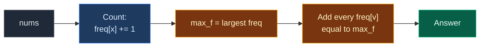

# 03. 3005. Count Elements With Maximum Frequency

| Difficulty | Pattern | Source | Time | Space |
|:---:|:---:|:---:|:---:|:---:|
| **Easy** | Frequency Array (Counting Buckets) | [3005. Count Elements With Maximum Frequency](https://leetcode.com/problems/count-elements-with-maximum-frequency/) | `O(n + R)` | `O(R)` |

`R` = size of the value range (here `101`, values `1..100`).

## 1. Problem Statement

You get an array `nums` of positive integers.

The **frequency** of a value is how many times it appears.

Find the highest frequency. Then return the **total number of elements** whose value has that highest frequency.

### Example

```text
nums = [1, 2, 2, 3, 1, 4]

Value 1 appears 2 times
Value 2 appears 2 times
Value 3 appears 1 time
Value 4 appears 1 time

Highest frequency = 2
Values with frequency 2: 1 and 2
Elements: 1, 1, 2, 2 -> 4 elements

Output: 4
```

We use this same example in every section below.

### Constraints

- `1 <= nums.length <= 100`
- `1 <= nums[i] <= 100`

## 2. Core Theory

This note uses the frequency array idea from [01. 1207. Unique Number of Occurrences](./01.%201207.%20Unique%20Number%20of%20Occurrences.md). Read that first if counting buckets are new to you.

Quick reminder: **index = value, cell = how many times it appeared.**

### What the problem really asks

The answer is **not** "how many values" have the top frequency. It is "how many **elements**" belong to those values.

```text
Top frequency = 2
Values with it: 1, 2          -> 2 values
Elements:       1,1, 2,2      -> 4 elements   <- this is the answer

answer = (number of top values) x (top frequency)
       = sum of freq[v] for every v with freq[v] == top
```

### Why a frequency array fits

Values are `1..100`, so `freq = [0] * 101` holds every counter. Three quick passes:

1. Count every value.
2. Find the top count `max_f`.
3. Add up every count that equals `max_f`.

```text
value:  1  2  3  4
freq:  [2][2][1][1]
        ^  ^
     equal to max 2  -> 2 + 2 = 4
```



## 3. Edge Cases

| Case | Input | Expected | Why it matters |
|:---|:---|:---:|:---|
| All different | `[1, 2, 3, 4, 5]` | `5` | Every value has frequency 1, so all elements count. LeetCode example 2 |
| All the same | `[7, 7, 7]` | `3` | One value holds every element |
| One element | `[9]` | `1` | Smallest input |
| One clear winner | `[1, 1, 1, 2, 2]` | `3` | Only value `1` has the top count |
| Value 100 | `[100, 100, 1]` | `2` | Index `100` must exist |

## 4. Brute Force: Count Every Element by Scanning

### Idea

1. For each element, find its frequency with `nums.count`.
2. Find the largest of those.
3. Count how many elements have that frequency.

### Code

```python
# Import List for type hints
from typing import List


# Brute force: scan the array to count each element
class SolutionBrute:

    # Main method
    def maxFrequencyElements(self, nums: List[int]) -> int:

        # Frequency of each element, found by a full scan each time
        counts = [nums.count(x) for x in nums]

        # The highest frequency
        max_f = max(counts)

        # Number of elements whose value has the highest frequency
        return sum(1 for c in counts if c == max_f)
```

### Complexity

| Measure | Complexity | Why |
|:---|:---:|:---|
| **Time** | `O(n²)` | `nums.count` is `O(n)` for each of `n` elements |
| **Space** | `O(n)` | The `counts` list |

## 5. Optimal Approach: Frequency Array, Max, Then Sum

### Idea

1. `freq = [0] * 101`. For each `x`, `freq[x] += 1`.
2. Walk `freq` to find `max_f`.
3. Walk `freq` again and add every `freq[v]` equal to `max_f`.

### Visual Walkthrough (Story Version)

**The story:** kids vote for their favourite fruit. Each fruit has a number. Every vote is a **block** stacked on that fruit's **tower**. After voting, the teacher finds the tallest tower height. Then every tower of that height is a winner, and **all the blocks** in the winning towers get a prize.

**How to read the pictures:** we draw towers for fruits 1, 2, 3, 4. `#` = one block. `^` = the vote just cast.

**Start: no blocks**

```text
votes: 1  2  2  3  1  4

tower 1:       0
tower 2:       0
tower 3:       0
tower 4:       0
```

**Vote 1** → tower 1.

```text
votes: 1  2  2  3  1  4
       ^
tower 1: #     1
tower 2:       0
tower 3:       0
tower 4:       0
```

**Vote 2** → tower 2.

```text
votes: 1  2  2  3  1  4
          ^
tower 1: #     1
tower 2: #     1
tower 3:       0
tower 4:       0
```

**Vote 2** → tower 2.

```text
votes: 1  2  2  3  1  4
             ^
tower 1: #     1
tower 2: ##    2
tower 3:       0
tower 4:       0
```

**Vote 3** → tower 3.

```text
votes: 1  2  2  3  1  4
                ^
tower 1: #     1
tower 2: ##    2
tower 3: #     1
tower 4:       0
```

**Vote 1** → tower 1.

```text
votes: 1  2  2  3  1  4
                   ^
tower 1: ##    2
tower 2: ##    2
tower 3: #     1
tower 4:       0
```

**Vote 4** → tower 4.

```text
votes: 1  2  2  3  1  4
                      ^
tower 1: ##    2
tower 2: ##    2
tower 3: #     1
tower 4: #     1
```

**Find the tallest tower.** Look at towers 1, 2, 3, 4: heights 2, 2, 1, 1. Tallest so far after each: 2, 2, 2, 2.

```text
tower 1: ##    2   <- tallest = 2
tower 2: ##    2   (same, tallest stays 2)
tower 3: #     1
tower 4: #     1
tallest = 2
```

**Hand out prizes, tower 1:** height 2 = tallest. Its 2 blocks get prizes. Prizes = 2.

```text
tower 1: ##  * 2   prize!   prizes = 2
tower 2: ##    2
tower 3: #     1
tower 4: #     1
```

**Tower 2:** height 2 = tallest. 2 more prizes. Prizes = 4.

```text
tower 1: ##  * 2
tower 2: ##  * 2   prize!   prizes = 4
tower 3: #     1
tower 4: #     1
```

**Tower 3:** height 1. Not tallest. Prizes stay 4.

```text
tower 3: #     1   no prize  prizes = 4
```

**Tower 4:** height 1. Not tallest. Prizes stay 4.

```text
tower 4: #     1   no prize  prizes = 4
```

Answer: **4**.

**All steps at a glance**

| Step | Action | t1 | t2 | t3 | t4 | Tallest | Prizes |
|:---:|:---|:---:|:---:|:---:|:---:|:---:|:---:|
| 1 | Vote 1 | 1 | 0 | 0 | 0 | – | – |
| 2 | Vote 2 | 1 | 1 | 0 | 0 | – | – |
| 3 | Vote 2 | 1 | 2 | 0 | 0 | – | – |
| 4 | Vote 3 | 1 | 2 | 1 | 0 | – | – |
| 5 | Vote 1 | 2 | 2 | 1 | 0 | – | – |
| 6 | Vote 4 | 2 | 2 | 1 | 1 | – | – |
| 7-10 | Find tallest | 2 | 2 | 1 | 1 | 2 | – |
| 11 | Tower 1 | 2 | 2 | 1 | 1 | 2 | 2 |
| 12 | Tower 2 | 2 | 2 | 1 | 1 | 2 | 4 |
| 13 | Tower 3 | 2 | 2 | 1 | 1 | 2 | 4 |
| 14 | Tower 4 | 2 | 2 | 1 | 1 | 2 | 4 |

**What the story teaches**

| In the story | In the code |
|:---|:---|
| Vote for fruit `x` | `x` in `nums` |
| Tower for fruit `x` | `freq[x]` |
| Tallest tower height | `max_f` |
| Winning tower | `freq[v] == max_f` |
| Every block in winning towers gets a prize | `total += freq[v]` |

Now the same steps again, this time with the exact indexes.

### Step-by-Step Example

```text
nums = [1, 2, 2, 3, 1, 4]
freq = [0] * 101         (we show only indexes 1..4)
```

**Part 1: count**

| Step | `x` | `freq[1]` | `freq[2]` | `freq[3]` | `freq[4]` |
|:---:|:---:|:---:|:---:|:---:|:---:|
| start | – | 0 | 0 | 0 | 0 |
| 1 | 1 | 1 | 0 | 0 | 0 |
| 2 | 2 | 1 | 1 | 0 | 0 |
| 3 | 2 | 1 | 2 | 0 | 0 |
| 4 | 3 | 1 | 2 | 1 | 0 |
| 5 | 1 | 2 | 2 | 1 | 0 |
| 6 | 4 | 2 | 2 | 1 | 1 |

**Part 2: find `max_f`** (start `max_f = 0`; index `0` and `5..100` are `0`, so they never change it)

| Step | `v` | `freq[v]` | `freq[v] > max_f`? | `max_f` |
|:---:|:---:|:---:|:---:|:---:|
| 7 | 1 | 2 | `2 > 0` yes | 2 |
| 8 | 2 | 2 | `2 > 2` no | 2 |
| 9 | 3 | 1 | `1 > 2` no | 2 |
| 10 | 4 | 1 | `1 > 2` no | 2 |

**Part 3: add counts equal to `max_f`** (start `total = 0`)

| Step | `v` | `freq[v]` | `== 2`? | `total` |
|:---:|:---:|:---:|:---:|:---:|
| 11 | 1 | 2 | Yes | `0 + 2 = 2` |
| 12 | 2 | 2 | Yes | `2 + 2 = 4` |
| 13 | 3 | 1 | No | 4 |
| 14 | 4 | 1 | No | 4 |

Return `4`.

### Code

```python
# Optimal: frequency array, find the max, add every count equal to it
class Solution:

    # Main method
    def maxFrequencyElements(self, nums: List[int]) -> int:

        # One counter for every value 0..100 (index 0 is unused)
        freq = [0] * 101

        # Count every value
        for x in nums:

            # One more of this value
            freq[x] += 1

        # Save the counts so the tests can look at them
        self.freq = freq

        # Highest frequency seen so far
        max_f = 0

        # Look at every counter
        for c in freq:

            # Found a taller tower
            if c > max_f:

                # Remember the new highest frequency
                max_f = c

        # Save the max so the tests can look at it
        self.max_f = max_f

        # Number of elements in the winning values
        total = 0

        # Look at every counter again
        for c in freq:

            # This value has the highest frequency
            if c == max_f:

                # All its elements count
                total += c

        # Return the total
        return total


# The example from this note
nums = [1, 2, 2, 3, 1, 4]

# Run the solution
sol = Solution()

# Get the answer
ans = sol.maxFrequencyElements(nums)

# Part 1, step 6: counts for values 1..4
assert sol.freq[1:5] == [2, 2, 1, 1]

# Part 2, step 10: highest frequency
assert sol.max_f == 2

# Part 3, step 14: final answer
assert ans == 4

# LeetCode example 2: all different
assert Solution().maxFrequencyElements([1, 2, 3, 4, 5]) == 5

# Edge case: all the same
assert Solution().maxFrequencyElements([7, 7, 7]) == 3

# Edge case: one element
assert Solution().maxFrequencyElements([9]) == 1

# Edge case: one clear winner
assert Solution().maxFrequencyElements([1, 1, 1, 2, 2]) == 3

# Edge case: value 100
assert Solution().maxFrequencyElements([100, 100, 1]) == 2

# Import random for comparison tests
import random

# Compare brute force and optimal on random arrays
for _ in range(500):

    # Random array with small values so ties are common
    a = [random.randint(1, 6) for _ in range(random.randint(1, 20))]

    # Both must agree
    assert SolutionBrute().maxFrequencyElements(a) == Solution().maxFrequencyElements(a)

# All checks passed
print("All tests passed")
```

### Complexity

| Measure | Complexity | Why |
|:---|:---:|:---|
| **Time** | `O(n + R)` | One pass over `nums`, two passes over `R = 101` counters |
| **Space** | `O(R)` | `101` counters, a fixed size |

## 6. Common Mistakes

| Mistake | What goes wrong | Fix |
|:---|:---|:---|
| Returning the number of top **values** | Gives `2` instead of `4` for the example | Add `freq[v]` for each top value, not `1` |
| One-pass version that resets `total = 1` on a new max | Forgets the earlier elements of the new top value | On a new max set `total = f`, not `1` |
| `freq = [0] * 100` | Value `100` goes out of range | Size `101` |
| Finding the max before counting is done | Max is too small | Finish counting first, or use the one-pass trick carefully |
| Looping over `nums` and adding `freq[x]` for each winning `x` | Each value is added once per element, so `2 + 2 + 2 + 2 = 8` | Loop over `freq` (each value once), or add `1` per element |

## 7. Interview Follow-ups

### Q1. Can it be done in one pass?

**Answer:**
- Yes. After `freq[x] += 1`, let `f = freq[x]`.
- If `f > max_f`: new record. Set `max_f = f` and `total = f`.
- If `f == max_f`: one more value reached the top. Do `total += f`.
- This works because a value only joins the top when its count reaches `max_f`, and at that moment all `f` of its elements are added.

### Q2. What if values were up to `10^9`?

**Answer:**
- Use `Counter(nums)` instead of an array.
- Then `max_f = max(c.values())` and `sum(v for v in c.values() if v == max_f)`.

### Q3. What if they asked for the values themselves?

**Answer:**
- Collect each `v` with `freq[v] == max_f`.
- Walking the array in index order gives them sorted.

### Q4. How is this related to "Top K Frequent Elements" (LeetCode 347)?

**Answer:**
- Both count first.
- 347 then puts values into buckets by count and reads from the highest bucket down. Here we only need the single highest bucket.

### Q5. Why is `O(n + 100)` called linear?

**Answer:**
- `100` is a fixed constant. It does not grow with input size.
- So the work grows only with `n`.

## 8. Interview Explanation

> Values are between 1 and 100, so I count them with a frequency array of size 101. Then I find the highest count max_f, and finally add up every count that equals max_f. That sum is the number of elements, not values, that have the top frequency, which is what the problem asks. It runs in O(n + 100) time and uses O(100) space. It can also be done in one pass by updating max_f and a running total each time a count grows.
