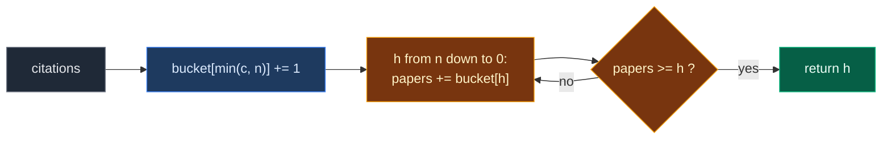

# 04. 274. H-Index

| Difficulty | Pattern | Source | Time | Space |
|:---:|:---:|:---:|:---:|:---:|
| **Medium** | Frequency Array (Counting Buckets) | [274. H-Index](https://leetcode.com/problems/h-index/) | `O(n)` | `O(n)` |

## 1. Problem Statement

You get an array `citations`. `citations[i]` is how many times the researcher's `i`-th paper was cited.

Return the researcher's **h-index**: the largest `h` such that the researcher has **at least `h` papers** with **at least `h` citations** each.

### Example

```text
citations = [3, 0, 6, 1, 5]

Try h = 3: papers with >= 3 citations: 3, 6, 5 -> 3 papers. 3 >= 3. OK
Try h = 4: papers with >= 4 citations: 6, 5    -> 2 papers. 2 <  4. Not OK

Output: 3
```

We use this same example in every section below.

### Constraints

- `n == citations.length`
- `1 <= n <= 5000`
- `0 <= citations[i] <= 1000`

## 2. Core Theory

This note uses the frequency array idea from [01. 1207. Unique Number of Occurrences](./01.%201207.%20Unique%20Number%20of%20Occurrences.md). Read that first if counting buckets are new to you.

### What the problem really asks

For each possible `h`, we need: "how many papers have **at least** `h` citations?" Call that `atLeast(h)`. The answer is the largest `h` with `atLeast(h) >= h`.

### Key fact 1: `h` can never be bigger than `n`

You cannot have more than `n` papers. So `h <= n`. A paper with `1000` citations helps exactly as much as a paper with `n` citations. We can **cap** every citation at `n`.

### Key fact 2: buckets by citation count

Make `n + 1` buckets, numbered `0..n`. Put each paper into bucket `min(c, n)`.

```text
citations = [3, 0, 6, 1, 5], n = 5

bucket:  0  1  2  3  4  5
count:  [1][1][0][1][0][2]
                        ^
            6 and 5 both land here (6 is capped to 5)
```

### Key fact 3: scan from the top, adding as you go

`atLeast(h)` = papers in buckets `h, h+1, ..., n`. If we walk `h` from `n` down to `0` and keep a running total, we get `atLeast(h)` for each `h` in `O(1)`. This is a **suffix sum** over the buckets.

The first `h` (from the top) where `atLeast(h) >= h` is the biggest such `h`, so we return it right away.

```text
h:         5  4  3
bucket:    2  0  1
atLeast:   2  2  3
>= h ?     no no yes  -> answer 3
```



## 3. Edge Cases

| Case | Input | Expected | Why it matters |
|:---|:---|:---:|:---|
| All zeros | `[0, 0, 0]` | `0` | The loop reaches `h = 0`, and `papers >= 0` is always true |
| One paper, cited | `[100]` | `1` | `100` is capped to `n = 1` |
| One paper, not cited | `[0]` | `0` | No paper has at least 1 citation |
| All very high | `[10, 10, 10]` | `3` | All capped to bucket `3`, `h` cannot pass `n` |
| Ties | `[1, 3, 1]` | `1` | LeetCode example 2. Only one paper has `>= 2` |
| Every citation equals `n` | `[4, 4, 4, 4]` | `4` | Answer hits the top bucket on the first check |

## 4. Brute Force: Try Every `h`

### Idea

Try `h` from `n` down to `0`. For each, count papers with at least `h` citations. Return the first `h` that works.

### Code

```python
# Import List for type hints
from typing import List


# Brute force: try every h and count papers each time
class SolutionBrute:

    # Main method
    def hIndex(self, citations: List[int]) -> int:

        # Number of papers
        n = len(citations)

        # Try the biggest h first
        for h in range(n, -1, -1):

            # Count papers with at least h citations
            papers = sum(1 for c in citations if c >= h)

            # Enough papers for this h
            if papers >= h:
                return h

        # Never reached, h = 0 always works
        return 0
```

### Complexity

| Measure | Complexity | Why |
|:---|:---:|:---|
| **Time** | `O(n²)` | Up to `n + 1` values of `h`, each scans `n` papers |
| **Space** | `O(1)` | Only counters |

## 5. Better Approach: Sort

### Idea

Sort citations from high to low. After sorting, paper `i` (0-based) is the `(i + 1)`-th best paper. If `sorted[i] >= i + 1`, then at least `i + 1` papers have at least `i + 1` citations. The answer is how many positions pass this check.

```text
sorted desc: [6, 5, 3, 1, 0]
i + 1:        1  2  3  4  5
pass?         y  y  y  n  n   -> 3
```

### Code

```python
# Better: sort descending and find the last position that still works
class SolutionBetter:

    # Main method
    def hIndex(self, citations: List[int]) -> int:

        # Best papers first
        c = sorted(citations, reverse=True)

        # Answer so far
        h = 0

        # Walk the sorted papers
        for i in range(len(c)):

            # The (i + 1)-th best paper has at least i + 1 citations
            if c[i] >= i + 1:

                # So h can be i + 1
                h = i + 1

            # Once it fails, it fails for all later papers too
            else:
                break

        # Return the h-index
        return h
```

### Complexity

| Measure | Complexity | Why |
|:---|:---:|:---|
| **Time** | `O(n log n)` | Sorting |
| **Space** | `O(n)` | The sorted copy |

## 6. Optimal Approach: Counting Buckets + Scan from the Top

### Idea

1. `bucket = [0] * (n + 1)`. For each `c`, do `bucket[min(c, n)] += 1`.
2. `papers = 0`. For `h` from `n` down to `0`:
   - `papers += bucket[h]` (now `papers` = papers with at least `h` citations).
   - If `papers >= h`, return `h`.

### Visual Walkthrough (Story Version)

**The story:** a scientist has 5 papers. Each paper has some **stars** (citations). There is a staircase with steps `0` to `5`. Each paper climbs to the step that matches its stars. A paper with more stars than steps just stands on the **top step**, because there is no higher step.

Then a judge walks **down** the stairs from the top. On each step she gathers every paper she has passed so far (they all have at least that many stars). The first step where her group of papers is **at least as big as the step number** is the h-index.

**How to read the pictures:** `P` = one paper on that step. `^` = the paper just placed. `>` = the judge.

**Start: stairs are empty**

```text
papers: 3  0  6  1  5

step 5: [   ]
step 4: [   ]
step 3: [   ]
step 2: [   ]
step 1: [   ]
step 0: [   ]
```

**Paper with 3 stars** → step `min(3, 5) = 3`.

```text
papers: 3  0  6  1  5
        ^
step 5: [   ]
step 4: [   ]
step 3: [P  ]
step 2: [   ]
step 1: [   ]
step 0: [   ]
```

**Paper with 0 stars** → step 0.

```text
papers: 3  0  6  1  5
           ^
step 5: [   ]
step 4: [   ]
step 3: [P  ]
step 2: [   ]
step 1: [   ]
step 0: [P  ]
```

**Paper with 6 stars** → no step 6, so step `min(6, 5) = 5`.

```text
papers: 3  0  6  1  5
              ^
step 5: [P  ]
step 4: [   ]
step 3: [P  ]
step 2: [   ]
step 1: [   ]
step 0: [P  ]
```

**Paper with 1 star** → step 1.

```text
papers: 3  0  6  1  5
                 ^
step 5: [P  ]
step 4: [   ]
step 3: [P  ]
step 2: [   ]
step 1: [P  ]
step 0: [P  ]
```

**Paper with 5 stars** → step 5.

```text
papers: 3  0  6  1  5
                    ^
step 5: [PP ]
step 4: [   ]
step 3: [P  ]
step 2: [   ]
step 1: [P  ]
step 0: [P  ]
```

**Judge on step 5:** picks up 2 papers. Group = 2. Is `2 >= 5`? No. Keep going down.

```text
step 5: [PP ] >   group = 2   2 >= 5? no
step 4: [   ]
step 3: [P  ]
```

**Judge on step 4:** picks up 0 papers. Group = 2. Is `2 >= 4`? No.

```text
step 5: [PP ]
step 4: [   ] >   group = 2   2 >= 4? no
step 3: [P  ]
```

**Judge on step 3:** picks up 1 paper. Group = 3. Is `3 >= 3`? **Yes!** Stop.

```text
step 5: [PP ]
step 4: [   ]
step 3: [P  ] >   group = 3   3 >= 3? YES -> h = 3
```

Answer: **3**.

**All steps at a glance**

| Step | Action | b0 | b1 | b2 | b3 | b4 | b5 | Group | Check |
|:---:|:---|:---:|:---:|:---:|:---:|:---:|:---:|:---:|:---|
| 1 | Place 3 → step 3 | 0 | 0 | 0 | 1 | 0 | 0 | – | – |
| 2 | Place 0 → step 0 | 1 | 0 | 0 | 1 | 0 | 0 | – | – |
| 3 | Place 6 → step 5 | 1 | 0 | 0 | 1 | 0 | 1 | – | – |
| 4 | Place 1 → step 1 | 1 | 1 | 0 | 1 | 0 | 1 | – | – |
| 5 | Place 5 → step 5 | 1 | 1 | 0 | 1 | 0 | 2 | – | – |
| 6 | Judge on step 5 | 1 | 1 | 0 | 1 | 0 | 2 | 2 | `2 >= 5` no |
| 7 | Judge on step 4 | 1 | 1 | 0 | 1 | 0 | 2 | 2 | `2 >= 4` no |
| 8 | Judge on step 3 | 1 | 1 | 0 | 1 | 0 | 2 | 3 | `3 >= 3` yes → 3 |

**What the story teaches**

| In the story | In the code |
|:---|:---|
| Paper's stars | `citations[i]` |
| Step on the staircase | Bucket index `0..n` |
| Standing on the top step if too many stars | `min(c, n)` |
| Papers on a step | `bucket[h]` |
| Judge walking down | `for h in range(n, -1, -1)` |
| Group the judge holds | `papers` (suffix sum) |
| Group at least as big as the step | `papers >= h` → return `h` |

Now the same steps again, this time with the exact indexes.

### Step-by-Step Example

```text
citations = [3, 0, 6, 1, 5], n = 5
bucket = [0, 0, 0, 0, 0, 0]
```

**Part 1: fill the buckets**

| Step | `c` | `min(c, 5)` | `bucket` after |
|:---:|:---:|:---:|:---|
| 1 | 3 | 3 | `[0, 0, 0, 1, 0, 0]` |
| 2 | 0 | 0 | `[1, 0, 0, 1, 0, 0]` |
| 3 | 6 | 5 | `[1, 0, 0, 1, 0, 1]` |
| 4 | 1 | 1 | `[1, 1, 0, 1, 0, 1]` |
| 5 | 5 | 5 | `[1, 1, 0, 1, 0, 2]` |

**Part 2: scan from the top** (`papers = 0`)

| Step | `h` | `bucket[h]` | `papers` after adding | `papers >= h`? |
|:---:|:---:|:---:|:---:|:---:|
| 6 | 5 | 2 | `0 + 2 = 2` | `2 >= 5` no |
| 7 | 4 | 0 | `2 + 0 = 2` | `2 >= 4` no |
| 8 | 3 | 1 | `2 + 1 = 3` | `3 >= 3` **yes** |

Return `3`. Steps for `h = 2, 1, 0` never run.

### Code

```python
# Optimal: counting buckets capped at n, then a suffix sum from the top
class Solution:

    # Main method
    def hIndex(self, citations: List[int]) -> int:

        # Number of papers
        n = len(citations)

        # bucket[k] = papers with exactly k citations (k = n means n or more)
        bucket = [0] * (n + 1)

        # Put every paper into its bucket
        for c in citations:

            # Papers above n citations all go into the top bucket
            bucket[min(c, n)] += 1

        # Save the buckets so the tests can look at them
        self.bucket = bucket

        # Papers with at least h citations, built from the top
        papers = 0

        # Record (h, papers) at each check, for the tests
        self.trace = []

        # Walk h from n down to 0
        for h in range(n, -1, -1):

            # Add the papers with exactly h (or n+) citations
            papers += bucket[h]

            # Save this check
            self.trace.append((h, papers))

            # At least h papers have at least h citations
            if papers >= h:
                return h

        # Never reached, h = 0 always works
        return 0


# The example from this note
citations = [3, 0, 6, 1, 5]

# Run the solution
sol = Solution()

# Get the answer
ans = sol.hIndex(citations)

# Part 1, step 5: buckets after placing every paper
assert sol.bucket == [1, 1, 0, 1, 0, 2]

# Part 2, steps 6-8: (h, papers) at each check, stops at h = 3
assert sol.trace == [(5, 2), (4, 2), (3, 3)]

# Final answer
assert ans == 3

# LeetCode example 2
assert Solution().hIndex([1, 3, 1]) == 1

# Edge case: all zeros
assert Solution().hIndex([0, 0, 0]) == 0

# Edge case: one paper, cited
assert Solution().hIndex([100]) == 1

# Edge case: one paper, not cited
assert Solution().hIndex([0]) == 0

# Edge case: all very high
assert Solution().hIndex([10, 10, 10]) == 3

# Edge case: every citation equals n
assert Solution().hIndex([4, 4, 4, 4]) == 4

# Brute and better agree on the example
assert SolutionBrute().hIndex(citations) == SolutionBetter().hIndex(citations) == 3

# Import random for comparison tests
import random

# Compare all three on random inputs
for _ in range(500):

    # Random citations
    a = [random.randint(0, 12) for _ in range(random.randint(1, 10))]

    # All three must agree
    assert SolutionBrute().hIndex(a) == SolutionBetter().hIndex(a) == Solution().hIndex(a)

# All checks passed
print("All tests passed")
```

### Complexity

| Measure | Complexity | Why |
|:---|:---:|:---|
| **Time** | `O(n)` | One pass to fill `n + 1` buckets, one pass down them |
| **Space** | `O(n)` | The bucket array. Capping at `n` keeps it small no matter how big citations get |

## 7. Common Mistakes

| Mistake | What goes wrong | Fix |
|:---|:---|:---|
| Bucket size = max citation + 1 | Works, but wastes space and does not use the `h <= n` fact | Cap at `n`, size `n + 1` |
| Forgetting to cap | `bucket[6]` is out of range when `n = 5` | `bucket[min(c, n)]` |
| Scanning from bottom to top | You find the smallest `h` that works, not the largest | Walk `h` from `n` down |
| Checking `papers > h` | Misses exact cases like `3 >= 3` | Use `>=` |
| Using `bucket[h] >= h` instead of the running total | Only counts papers with **exactly** `h` citations | Keep the running `papers` (at least `h`) |

## 8. Interview Follow-ups

### Q1. What if the citations are already sorted (LeetCode 275, H-Index II)?

**Answer:**
- Use binary search for `O(log n)`.
- In ascending order, at index `i` there are `n - i` papers with at least `citations[i]` citations.
- Find the first `i` with `citations[i] >= n - i`. The answer is `n - i`.

### Q2. Why is capping at `n` safe?

**Answer:**
- The h-index can never be more than the number of papers.
- A paper with `1000` citations and one with `n` citations both count for every `h <= n`. So they behave the same.

### Q3. Can the answer be 0?

**Answer:**
- Yes, when no paper has at least 1 citation.
- The loop reaches `h = 0`, and `papers >= 0` is always true, so it returns `0`.

### Q4. What if papers arrive one at a time and you must report the h-index after each?

**Answer:**
- Key fact: adding a paper never makes `h` go down.
- Keep `h`, a count `freq[c]` for each citation value, and `above` = papers with more than `h` citations.
- New paper with `c > h`: `above += 1`. Then while `above >= h + 1`: do `h += 1` and `above -= freq[h]` (those papers are no longer *above* the new `h`).
- `h` rises at most `n` times in total, so each new paper costs amortised `O(1)`.

### Q5. Why is this the "counting buckets" pattern?

**Answer:**
- We never sort. We place each paper in a bucket by its value, in `O(1)`.
- Then reading the buckets in order acts like reading a sorted list. That is how bucket sort beats `O(n log n)`.

## 9. Interview Explanation

> The h-index can never be bigger than n, so I make n + 1 buckets and put each paper into bucket min(citations, n). Then I walk h from n down to 0 and keep a running count of papers in buckets h and above, which is exactly the number of papers with at least h citations. The first h where that count is at least h is the largest valid h, so I return it. That avoids sorting and runs in O(n) time with O(n) space.
