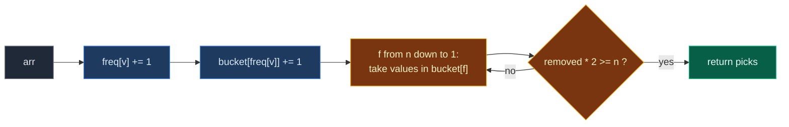

# 05. 1338. Reduce Array Size to The Half

| Difficulty | Pattern | Source | Time | Space |
|:---:|:---:|:---:|:---:|:---:|
| **Medium** | Frequency Array (Counting Buckets) | [1338. Reduce Array Size to The Half](https://leetcode.com/problems/reduce-array-size-to-the-half/) | `O(n + V)` | `O(n + V)` |

`V` = largest value in `arr` (at most `10^5`).

## 1. Problem Statement

You get an array `arr` of even length `n`.

You can pick a **set** of values. Picking a value removes **every copy** of it from the array.

Return the **smallest** set size that removes **at least half** of the array.

### Example

```text
arr = [3, 3, 3, 3, 5, 5, 5, 2, 2, 7]     n = 10, need to remove at least 5

Value 3 appears 4 times
Value 5 appears 3 times
Value 2 appears 2 times
Value 7 appears 1 time

Pick 3: removes 4. Total 4. Not enough.
Pick 5: removes 3. Total 7. 7 >= 5. Done.

Set {3, 5} has size 2.
Output: 2
```

We use this same example in every section below.

### Constraints

- `2 <= arr.length <= 10^5`
- `arr.length` is even
- `1 <= arr[i] <= 10^5`

## 2. Core Theory

This note uses the frequency array idea from [01. 1207. Unique Number of Occurrences](./01.%201207.%20Unique%20Number%20of%20Occurrences.md), and the "bucket by count, scan from the top" idea from [04. 274. H-Index](./04.%20274.%20H-Index.md).

### What the problem really asks

Each value we pick removes `count(value)` elements. We want to reach `n / 2` removed with as **few picks** as possible.

### Why greedy (biggest count first) is right

Every pick costs the same: `1`. So each pick should remove as much as possible. If some best answer used a smaller count while a bigger one was unused, swapping them removes at least as much with the same number of picks. So taking counts from biggest to smallest is always optimal.

### Two levels of counting

1. **Count the values:** `freq[v]` = how many times `v` appears.
2. **Count the counts:** `bucket[f]` = how many values appear exactly `f` times.

```text
arr = [3,3,3,3,5,5,5,2,2,7]

Level 1 (freq):     value 2 -> 2, value 3 -> 4, value 5 -> 3, value 7 -> 1

Level 2 (bucket):   f:       1  2  3  4  5 ... 10
                    bucket: [1][1][1][1][0]...[0]
```

A count can be at most `n`, so `bucket` has `n + 1` cells. Walking `bucket` from `f = n` down to `1` visits the counts in **biggest-first order**, without sorting.



## 3. Edge Cases

| Case | Input | Expected | Why it matters |
|:---|:---|:---:|:---|
| All the same | `[7, 7, 7, 7, 7, 7]` | `1` | One pick removes everything. LeetCode example 2 |
| All different | `[1, 2, 3, 4]` | `2` | Every pick removes 1. Need `n / 2` picks |
| Smallest input | `[1, 9]` | `1` | `n = 2`, remove 1 element |
| Exactly half with one pick | `[1, 1, 2, 3]` | `1` | `2 * 2 >= 4`. Uses `>=`, not `>` |
| Several values share the top count | `[1, 1, 2, 2, 3, 3]` | `2` | `bucket[2] = 3`; take values one at a time from the same bucket |

## 4. Brute Force: Pick the Biggest Remaining Count Each Time

### Idea

Count values with a dictionary. Then, again and again, scan all remaining counts to find the biggest, remove it, and add one pick, until half is gone.

### Code

```python
# Import List for type hints
from typing import List


# Brute force: find the biggest remaining count by scanning each time
class SolutionBrute:

    # Main method
    def minSetSize(self, arr: List[int]) -> int:

        # Count each value
        counts = {}

        # Go through the array
        for x in arr:

            # One more of x
            counts[x] = counts.get(x, 0) + 1

        # Elements removed so far
        removed = 0

        # Values picked so far
        picks = 0

        # Keep picking until half is gone
        while removed * 2 < len(arr):

            # Scan for the value with the biggest count
            best = max(counts, key=counts.get)

            # Remove all its copies
            removed += counts.pop(best)

            # One more pick
            picks += 1

        # Return the number of picks
        return picks
```

### Complexity

| Measure | Complexity | Why |
|:---|:---:|:---|
| **Time** | `O(n + d · k)` | `d` distinct values scanned on each of `k` picks. Worst case `O(n²)` when all values differ |
| **Space** | `O(d)` | The dictionary |

## 5. Better Approach: Sort the Counts

### Idea

Get all counts, sort them from big to small, and take them in that order.

### Code

```python
# Better: sort counts from biggest to smallest
class SolutionBetter:

    # Main method
    def minSetSize(self, arr: List[int]) -> int:

        # Count each value
        counts = {}

        # Go through the array
        for x in arr:

            # One more of x
            counts[x] = counts.get(x, 0) + 1

        # Elements removed so far
        removed = 0

        # Take counts from biggest to smallest
        for picks, c in enumerate(sorted(counts.values(), reverse=True), start=1):

            # Remove all copies of this value
            removed += c

            # Half is gone
            if removed * 2 >= len(arr):
                return picks

        # Never reached, all values together remove everything
        return len(counts)
```

### Complexity

| Measure | Complexity | Why |
|:---|:---:|:---|
| **Time** | `O(n + d log d)` | Sorting `d` distinct counts |
| **Space** | `O(d)` | The counts |

## 6. Optimal Approach: Bucket by Count, Scan from the Top

### Idea

1. `freq` of size `max(arr) + 1`. For each `x`, `freq[x] += 1`.
2. `bucket` of size `n + 1`. For each non-zero `freq[v]`, `bucket[freq[v]] += 1`.
3. For `f` from `n` down to `1`, while `bucket[f] > 0`: take one value (`removed += f`, `picks += 1`, `bucket[f] -= 1`). If `removed * 2 >= n`, return `picks`.

### Visual Walkthrough (Story Version)

**The story:** a kid has a toy box with 10 toys. Toys come in **kinds**: cars (`3`), balls (`5`), dolls (`2`), and one robot (`7`). Mom says: "Give away at least half of your toys. But you must give away a **whole kind** at a time." The kid wants to give away as **few kinds** as possible, so she gives the biggest kinds first.

To find the biggest kinds fast, she uses **shelves numbered by size**: shelf `4` holds kinds that have 4 toys, shelf `3` holds kinds with 3 toys, and so on. Then she starts at the top shelf and walks down.

**How to read the pictures:** first we count toys of each kind (`#` = one toy). Then we place kind names on shelves. `^` = the toy just counted.

**Start: count toys of each kind**

```text
toys: 3 3 3 3 5 5 5 2 2 7

kind 2: 0     kind 3: 0     kind 5: 0     kind 7: 0
```

**Toy 3** (1st)

```text
toys: 3 3 3 3 5 5 5 2 2 7
      ^
kind 2:        kind 3: #       kind 5:        kind 7:
```

**Toy 3** (2nd)

```text
toys: 3 3 3 3 5 5 5 2 2 7
        ^
kind 2:        kind 3: ##      kind 5:        kind 7:
```

**Toy 3** (3rd)

```text
toys: 3 3 3 3 5 5 5 2 2 7
          ^
kind 2:        kind 3: ###     kind 5:        kind 7:
```

**Toy 3** (4th)

```text
toys: 3 3 3 3 5 5 5 2 2 7
            ^
kind 2:        kind 3: ####    kind 5:        kind 7:
```

**Toy 5** (1st)

```text
toys: 3 3 3 3 5 5 5 2 2 7
              ^
kind 2:        kind 3: ####    kind 5: #      kind 7:
```

**Toy 5** (2nd)

```text
toys: 3 3 3 3 5 5 5 2 2 7
                ^
kind 2:        kind 3: ####    kind 5: ##     kind 7:
```

**Toy 5** (3rd)

```text
toys: 3 3 3 3 5 5 5 2 2 7
                  ^
kind 2:        kind 3: ####    kind 5: ###    kind 7:
```

**Toy 2** (1st)

```text
toys: 3 3 3 3 5 5 5 2 2 7
                    ^
kind 2: #      kind 3: ####    kind 5: ###    kind 7:
```

**Toy 2** (2nd)

```text
toys: 3 3 3 3 5 5 5 2 2 7
                      ^
kind 2: ##     kind 3: ####    kind 5: ###    kind 7:
```

**Toy 7** (1st)

```text
toys: 3 3 3 3 5 5 5 2 2 7
                        ^
kind 2: ##     kind 3: ####    kind 5: ###    kind 7: #
```

**Place kinds on shelves by size.** Kind 2 has 2 toys → shelf 2. Kind 3 has 4 → shelf 4. Kind 5 has 3 → shelf 3. Kind 7 has 1 → shelf 1.

```text
shelf 10..5: (empty)
shelf 4:  [kind 3]
shelf 3:  [kind 5]
shelf 2:  [kind 2]
shelf 1:  [kind 7]
```

**Walk down from shelf 10 to shelf 5:** all empty, nothing to take.

```text
shelf 10..5: (empty)   <- walked past
removed = 0 of 10, picks = 0
```

**Shelf 4:** give away kind 3 (4 toys). Removed `4`. Picks `1`. Is `4` at least half of `10`? No.

```text
shelf 4:  [      ]  <- gave away kind 3
shelf 3:  [kind 5]
toys left: 5 5 5 2 2 7
removed = 4 of 10, picks = 1
```

**Shelf 3:** give away kind 5 (3 toys). Removed `7`. Picks `2`. Is `7` at least half of `10`? **Yes.** Stop.

```text
shelf 4:  [      ]
shelf 3:  [      ]  <- gave away kind 5
toys left: 2 2 7
removed = 7 of 10, picks = 2   -> done
```

Answer: **2**.

**All steps at a glance**

| Step | Action | k2 | k3 | k5 | k7 | Removed | Picks |
|:---:|:---|:---:|:---:|:---:|:---:|:---:|:---:|
| 1-4 | Count four 3s | 0 | 4 | 0 | 0 | – | – |
| 5-7 | Count three 5s | 0 | 4 | 3 | 0 | – | – |
| 8-9 | Count two 2s | 2 | 4 | 3 | 0 | – | – |
| 10 | Count one 7 | 2 | 4 | 3 | 1 | – | – |
| 11 | Shelves: 4→k3, 3→k5, 2→k2, 1→k7 | 2 | 4 | 3 | 1 | – | – |
| 12 | Shelves 10..5 empty | | | | | 0 | 0 |
| 13 | Shelf 4: give kind 3 | | | | | 4 | 1 |
| 14 | Shelf 3: give kind 5 | | | | | 7 | 2 → done |

**What the story teaches**

| In the story | In the code |
|:---|:---|
| Kind of toy | Distinct value `v` |
| Toys of one kind | `freq[v]` |
| Shelf numbered by size | `bucket[f]` |
| Kinds on shelf `f` | `bucket[f]` = values with count `f` |
| Walking down from the top shelf | `for f in range(n, 0, -1)` |
| Give away a whole kind | `removed += f`, `picks += 1` |
| "At least half gone" | `removed * 2 >= n` |

Now the same steps again, this time with the exact indexes.

### Step-by-Step Example

```text
arr = [3, 3, 3, 3, 5, 5, 5, 2, 2, 7], n = 10
freq = [0] * 8         (max(arr) = 7, indexes 0..7)
bucket = [0] * 11      (indexes 0..10)
```

**Part 1: count values**

| Step | `x` | `freq[2]` | `freq[3]` | `freq[5]` | `freq[7]` |
|:---:|:---:|:---:|:---:|:---:|:---:|
| start | – | 0 | 0 | 0 | 0 |
| 1 | 3 | 0 | 1 | 0 | 0 |
| 2 | 3 | 0 | 2 | 0 | 0 |
| 3 | 3 | 0 | 3 | 0 | 0 |
| 4 | 3 | 0 | 4 | 0 | 0 |
| 5 | 5 | 0 | 4 | 1 | 0 |
| 6 | 5 | 0 | 4 | 2 | 0 |
| 7 | 5 | 0 | 4 | 3 | 0 |
| 8 | 2 | 1 | 4 | 3 | 0 |
| 9 | 2 | 2 | 4 | 3 | 0 |
| 10 | 7 | 2 | 4 | 3 | 1 |

`freq = [0, 0, 2, 4, 0, 3, 0, 1]`

**Part 2: count the counts** (walk `freq`, skip zeros)

| Step | `v` | `f = freq[v]` | `bucket` after (indexes 0..10) |
|:---:|:---:|:---:|:---|
| 11a | 2 | 2 | `[0, 0, 1, 0, 0, 0, 0, 0, 0, 0, 0]` |
| 11b | 3 | 4 | `[0, 0, 1, 0, 1, 0, 0, 0, 0, 0, 0]` |
| 11c | 5 | 3 | `[0, 0, 1, 1, 1, 0, 0, 0, 0, 0, 0]` |
| 11d | 7 | 1 | `[0, 1, 1, 1, 1, 0, 0, 0, 0, 0, 0]` |

**Part 3: scan from `f = 10` down** (`removed = 0`, `picks = 0`)

| Step | `f` | `bucket[f]` | Action | `removed` | `picks` | `removed * 2 >= 10`? |
|:---:|:---:|:---:|:---|:---:|:---:|:---:|
| 12 | 10, 9, 8, 7, 6, 5 | 0 each | Nothing to take | 0 | 0 | – |
| 13 | 4 | 1 | Take one: `bucket[4] = 0` | `0 + 4 = 4` | 1 | `8 >= 10` no |
| 14 | 3 | 1 | Take one: `bucket[3] = 0` | `4 + 3 = 7` | 2 | `14 >= 10` **yes** |

Return `2`.

### Code

```python
# Optimal: count values, bucket the counts, take biggest buckets first
class Solution:

    # Main method
    def minSetSize(self, arr: List[int]) -> int:

        # Length of the array
        n = len(arr)

        # One counter for every value 0..max(arr)
        freq = [0] * (max(arr) + 1)

        # Count every value
        for x in arr:

            # One more of x
            freq[x] += 1

        # Save the counts so the tests can look at them
        self.freq = freq

        # bucket[f] = how many values appear exactly f times
        bucket = [0] * (n + 1)

        # Look at every counter
        for f in freq:

            # Skip values that never appeared
            if f > 0:

                # One more value with count f
                bucket[f] += 1

        # Save a copy of the buckets for the tests
        self.bucket = bucket[:]

        # Elements removed so far
        removed = 0

        # Values picked so far
        picks = 0

        # Record (f, removed, picks) after each pick, for the tests
        self.trace = []

        # Walk counts from biggest to smallest
        for f in range(n, 0, -1):

            # Take every value that has count f, one by one
            while bucket[f] > 0:

                # Remove all copies of one such value
                removed += f

                # One more pick
                picks += 1

                # That value is used
                bucket[f] -= 1

                # Save this pick
                self.trace.append((f, removed, picks))

                # At least half is gone
                if removed * 2 >= n:
                    return picks

        # Never reached, all values together remove everything
        return picks


# The example from this note
arr = [3, 3, 3, 3, 5, 5, 5, 2, 2, 7]

# Run the solution
sol = Solution()

# Get the answer
ans = sol.minSetSize(arr)

# Part 1, step 10: final counts
assert sol.freq == [0, 0, 2, 4, 0, 3, 0, 1]

# Part 2, step 11d: buckets of counts
assert sol.bucket == [0, 1, 1, 1, 1, 0, 0, 0, 0, 0, 0]

# Part 3, steps 13-14: (f, removed, picks) after each pick
assert sol.trace == [(4, 4, 1), (3, 7, 2)]

# Final answer
assert ans == 2

# LeetCode example 2: all the same
assert Solution().minSetSize([7, 7, 7, 7, 7, 7]) == 1

# Edge case: all different
assert Solution().minSetSize([1, 2, 3, 4]) == 2

# Edge case: smallest input
assert Solution().minSetSize([1, 9]) == 1

# Edge case: exactly half with one pick
assert Solution().minSetSize([1, 1, 2, 3]) == 1

# Edge case: several values share the top count
assert Solution().minSetSize([1, 1, 2, 2, 3, 3]) == 2

# Brute and better agree on the example
assert SolutionBrute().minSetSize(arr) == SolutionBetter().minSetSize(arr) == 2

# Import random for comparison tests
import random

# Compare all three on random even-length arrays
for _ in range(500):

    # Random even length
    n = 2 * random.randint(1, 10)

    # Random values
    a = [random.randint(1, 6) for _ in range(n)]

    # All three must agree
    assert SolutionBrute().minSetSize(a) == SolutionBetter().minSetSize(a) == Solution().minSetSize(a)

# All checks passed
print("All tests passed")
```

### Complexity

| Measure | Complexity | Why |
|:---|:---:|:---|
| **Time** | `O(n + V)` | Count in `O(n)`, walk `freq` in `O(V)`, walk `bucket` in `O(n)`. Each value is taken at most once |
| **Space** | `O(n + V)` | `freq` has `V + 1` cells, `bucket` has `n + 1`. With a hash map for `freq`, this becomes `O(n)` |

## 7. Common Mistakes

| Mistake | What goes wrong | Fix |
|:---|:---|:---|
| Taking the whole `bucket[f]` at once | Overshoots: may count more picks than needed | Take values from a bucket one at a time and check after each |
| Using `removed > n / 2` | Misses the exactly-half case | Use `removed * 2 >= n` |
| Bucket size `max count` guessed too small | Index error when one value fills the array | Size `n + 1` |
| Scanning counts from small to big | Needs more picks than necessary | Biggest counts first |
| Counting picks per element instead of per value | Answer becomes the number of removed elements | `picks += 1` once per value taken |

## 8. Interview Follow-ups

### Q1. Why is greedy (biggest first) always optimal?

**Answer:**
- Every pick costs 1, so we want each pick to remove the most.
- If a best answer skipped a bigger count and used a smaller one, swap them. Same number of picks, at least as many removed.
- So some best answer always uses the biggest counts.

### Q2. Could a heap help?

**Answer:**
- Yes: push all counts into a max-heap and pop until half is gone.
- That is `O(n + d + k log d)`. Buckets are simpler and fully linear.

### Q3. What if picks had different costs?

**Answer:**
- Then greedy by count no longer works.
- It becomes a knapsack-like problem ("reach at least `n / 2` removed with the smallest total cost"), solved with dynamic programming.

### Q4. What if values were huge, like `10^9`?

**Answer:**
- Use a hash map (`Counter`) for level 1 instead of an array.
- Level 2 (`bucket`) still works, because counts are at most `n`.

### Q5. What if they asked for at least a fraction `p` of the array, not half?

**Answer:**
- Same algorithm. Change the stop check to `removed >= ceil(p · n)`.

## 9. Interview Explanation

> Each picked value removes all its copies and costs one pick, so greedily picking the values with the biggest counts is optimal. To avoid sorting, I count each value with a frequency array, then count the counts: bucket[f] is how many values appear exactly f times, and f is at most n. I walk f from n down to 1 and take values from each bucket one at a time, adding f to the removed total, until removed is at least half of n. That runs in O(n + max value) time and space, which is linear.
