# 01. Introduction to Trees

| Type | Topic | Key idea | Covers | Code | Next in this folder |
|:---:|:---:|:---|:---|:---:|:---:|
| **Theory** | Binary Tree Basics | A binary tree is a set of nodes where each node has at most two children, a left one and a right one | Root, parent, child, leaf, level, height, and the five types: full, complete, perfect, balanced, degenerate | Python checks for all five types | [02. Tree Representation](02.%20Tree%20Representation.md) |

## 1. What is a tree?

A **tree** stores things in a hierarchy, like a family tree or the folders on your computer:

- One thing sits at the top. It is called the **root**.
- Every other thing hangs below exactly one **parent**.
- Nothing loops back up. You can never walk down and end up where you started.

A **binary tree** is a tree where every node has **at most two children**: a **left child** and a **right child**. Left and right are different places: a node with only a left child is not the same tree as a node with only a right child.

Arrays and linked lists are straight lines. A tree **branches**, so one node can lead to two paths. That is why trees can find things fast: each step down can throw away half of what is left.

## 2. The parts of a tree

**The tree we take:** the 9-node tree below. It has the same shape as the tree in the lecture, with numbers added so we can talk about each node.

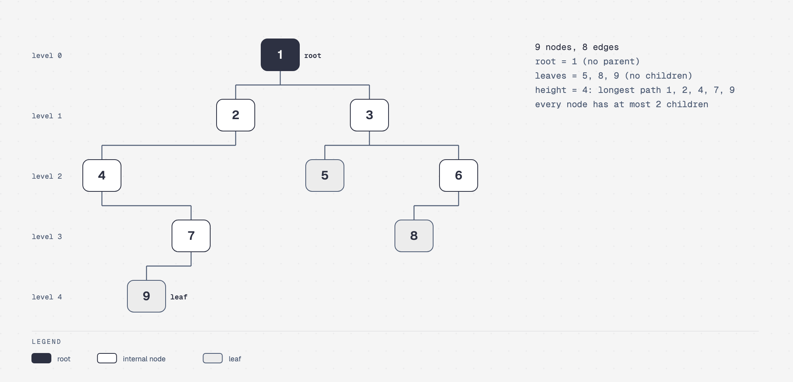

| Word | Plain meaning | In our tree | Why it matters |
|:---|:---|:---|:---|
| **Node** | One box that holds a value | 9 nodes: 1 to 9 | Every algorithm visits nodes |
| **Root** | The top node, the only one with no parent | 1 | Every tree problem starts from the root |
| **Parent / child** | A node directly above / directly below another | 3 is the parent of 5 and 6 | Recursion goes from a parent to its children |
| **Left / right child** | The child on the left side / right side | 4 is the left child of 2; 2 has no right child | Many problems treat the two sides differently |
| **Siblings** | Two children of the same parent | 5 and 6 | Level-by-level problems look at siblings together |
| **Leaf** | A node with no children | 5, 8, 9 | Recursion usually stops at leaves |
| **Internal node** | A node with at least one child | 1, 2, 3, 4, 6, 7 | These are the nodes that branch |
| **Edge** | The link between a parent and a child | 8 edges (always nodes minus 1) | Paths and distances count edges |
| **Subtree** | A node together with everything below it | The subtree of 2 is 2, 4, 7, 9 | Most tree code solves a problem for each subtree |
| **Ancestor / descendant** | Any node above on the path to the root / any node below | 1, 2, 4 are ancestors of 7 | Lowest common ancestor problems use this |
| **Level (depth)** | How many edges from the root down to the node | 9 is on level 4 | Level-order problems group nodes by level |
| **Height** | The number of edges on the longest path from the root down to a leaf | 4 (path 1, 2, 4, 7, 9) | Most tree operations take time proportional to the height |

**A note on counting height.** Some problems count **nodes** on the longest path instead of edges. LeetCode 104 "maximum depth" does that, and it would say 5 for our tree. Both are fine; just check which one a problem wants. Below, "levels deep" means counting nodes.

### Useful numbers

| Fact | Formula | Example | Why it is true |
|:---|:---|:---|:---|
| Most nodes on level `i` | `2^i` | Level 2 can hold at most 4 nodes | Each level can double the one above it |
| Nodes in a perfect tree of height `h` | `2^(h + 1) - 1` | Height 2 gives 7 nodes | `1 + 2 + 4 + ... + 2^h` |
| Smallest possible height for `n` nodes | `floor(log2(n))` | 8 nodes need height at least 3 | Packing every level full keeps the tree short |
| Biggest possible height for `n` nodes | `n - 1` | 4 nodes can be a chain of height 3 | One node per level |
| Edges in any tree with `n` nodes | `n - 1` | Our tree: 9 nodes, 8 edges | Every node except the root has one edge up to its parent |
| Missing child links (`None`) | `n + 1` | Our tree: 10 empty spots | `2n` child slots, `n - 1` of them used |

### Why height matters

Most tree operations walk from the root down one path, so they cost about **height** steps. The height depends on the shape:

- A balanced tree with 1,000,000 nodes is only about **19** levels tall.
- A degenerate tree (a chain) with 1,000,000 nodes is **999,999** levels tall.

In the chart, the grey bars are the height of a degenerate tree and the orange line is the height of a balanced tree. Both were worked out from the formulas above.

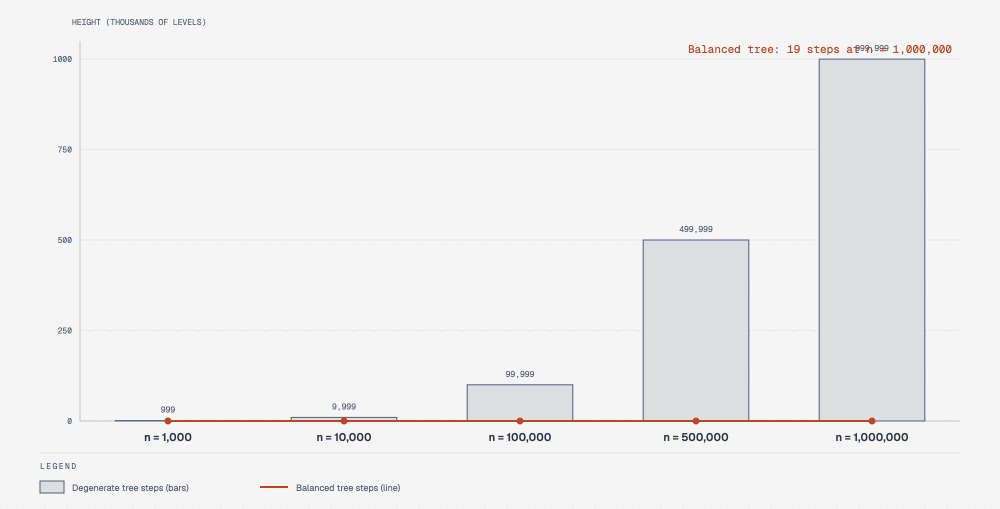

| Nodes `n` | Degenerate tree height `n - 1` | Balanced tree height `floor(log2(n))` | Steps to reach the deepest node (degenerate) | Steps (balanced) | Balanced is shorter by |
|:---:|:---:|:---:|:---:|:---:|:---:|
| 1,000 | 999 | 9 | 999 | 9 | about 111 times |
| 10,000 | 9,999 | 13 | 9,999 | 13 | about 769 times |
| 100,000 | 99,999 | 16 | 99,999 | 16 | about 6,250 times |
| 500,000 | 499,999 | 18 | 499,999 | 18 | about 27,778 times |
| 1,000,000 | 999,999 | 19 | 999,999 | 19 | about 52,632 times |

## 3. Five types of binary trees

The lecture lists five types. Each picture shows one tree that **is** that type on the left and one that **is not** on the right. The dark node is the one that breaks the rule.

### Full binary tree

**Rule:** every node has **0 or 2** children. Never exactly one.

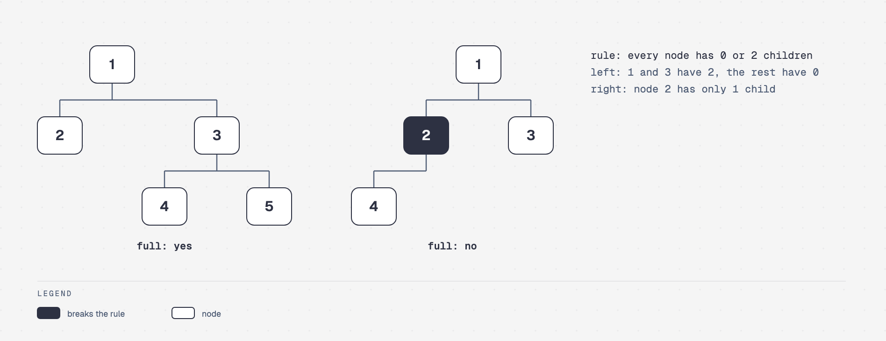

- In a full tree, the number of leaves is always the number of internal nodes plus 1.
- Where you meet it: expression trees (every operator has two operands), and Huffman coding trees.

### Complete binary tree

**Rule:**

1. Every level is completely filled, except maybe the last one.
2. The last level is filled **from the left**, with no gaps.

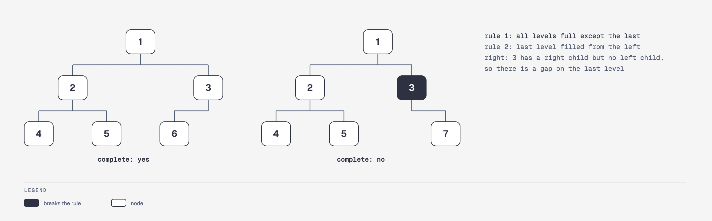

- Where you meet it: a **heap** is a complete tree. Because there are no gaps, it can be stored in a plain array (see the next note).

### Perfect binary tree

**Rule:** every internal node has 2 children **and** every leaf is on the **same level**.

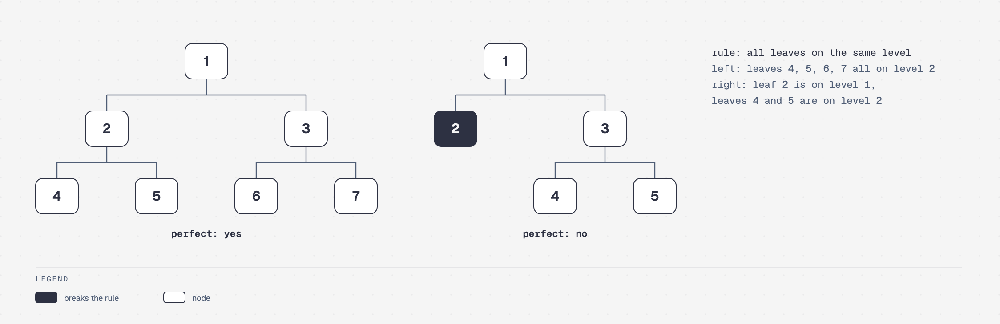

- A perfect tree of height `h` has exactly `2^(h + 1) - 1` nodes. The left tree has height 2 and 7 nodes.
- Every perfect tree is also full and complete.

### Balanced binary tree

**Rule (lecture):** the height is at most about `log2(n)`. For `n = 8` nodes, `log2(8) = 3`, so the height should be about 3, not 7.

**Rule (exact, used by LeetCode 110):** at **every** node, the left side and the right side are at most **1 level** apart in depth.

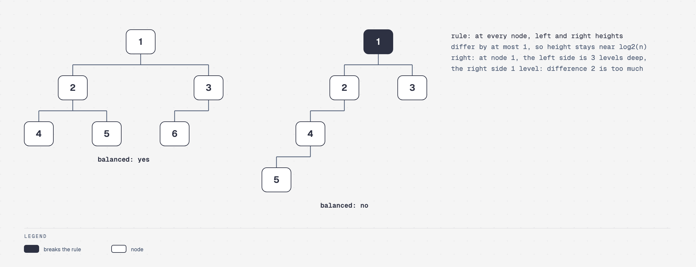

- Where you meet it: balanced search trees (AVL, red-black) keep search, insert and delete at `O(log n)`.

### Degenerate tree

**Rule:** every node has **at most one** child, so the tree is a single chain, just like a linked list.

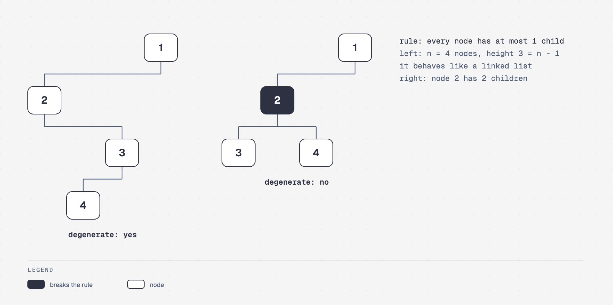

- With `n = 4` nodes (as in the lecture), the height is `3 = n - 1`, the worst possible.
- Where you meet it: inserting sorted numbers into a plain binary search tree builds a degenerate tree, and every operation slows down to `O(n)`.

### All five at a glance

| Type | Rule in plain words | Height | Also always | Where you meet it |
|:---|:---|:---:|:---|:---|
| Full | Every node has 0 or 2 children | anything | Leaves = internal nodes + 1 | Expression trees, Huffman trees |
| Complete | All levels full except the last; last level filled from the left | `floor(log2(n))` | Balanced | Heaps, priority queues |
| Perfect | Every inner node has 2 children and all leaves share one level | `log2(n + 1) - 1` | Full, complete, balanced | Teaching examples, segment trees on powers of two |
| Balanced | At every node, the two sides differ by at most 1 level | about `log2(n)` | Short, so operations are fast | AVL and red-black trees, LeetCode 110 |
| Degenerate | Every node has at most 1 child | `n - 1` | Behaves like a linked list | The worst case of a binary search tree |

## 4. Check our tree, step by step

**The tree we take:** the 9-node tree from section 2. We test it against the five rules, one at a time. In each picture the dark node breaks the rule.

**Step 1: is it full?**

- Every node needs 0 or 2 children.
- Node 2 has only one child (4). So do 4, 6 and 7.
- Answer: **not full**.

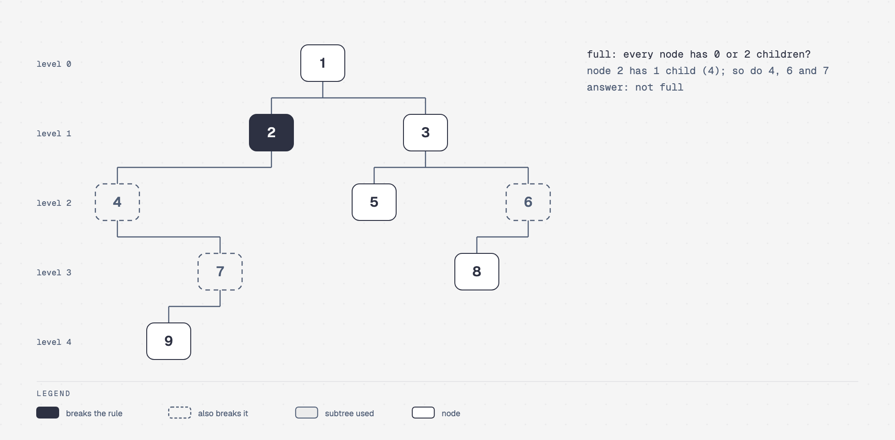

**Step 2: is it complete?**

- Read the tree level by level, left to right, and mark empty spots: `1, 2, 3, 4, (empty), 5, 6, ...`
- The empty spot is the missing right child of 2. Real nodes (5 and 6) come after it.
- A complete tree never has a real node after an empty spot. Answer: **not complete**.

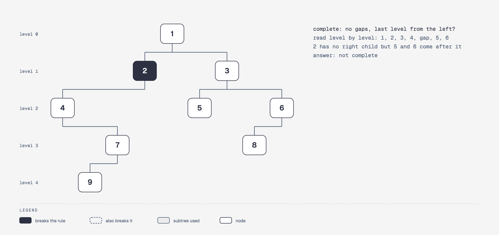

**Step 3: is it perfect?**

- All leaves must be on one level.
- Leaf 5 is on level 2, leaf 8 on level 3, leaf 9 on level 4.
- Answer: **not perfect**.

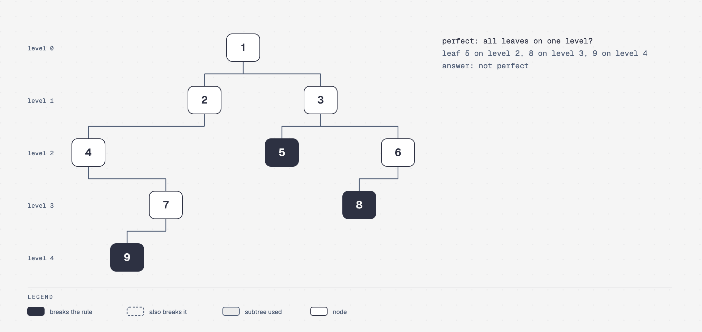

**Step 4: is it balanced?**

- At every node, the left side and the right side must be at most 1 level apart.
- At node 2, the left side (4, 7, 9) is 3 levels deep and the right side is empty (0 levels).
- The difference is 3, more than 1. Answer: **not balanced**.

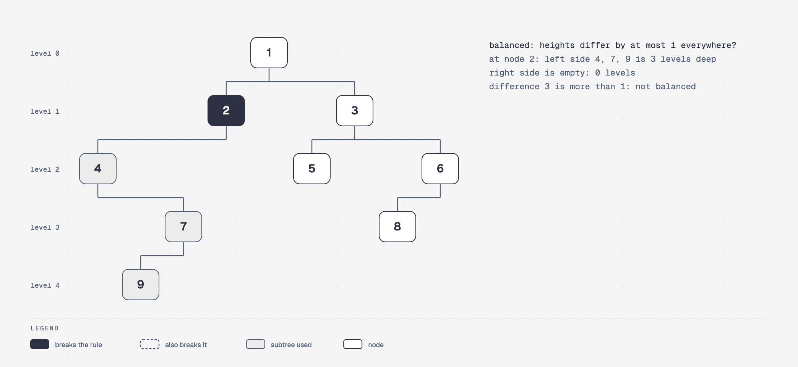

**Step 5: is it degenerate?**

- Every node must have at most one child.
- Node 1 has two children (2 and 3), and so does node 3.
- Answer: **not degenerate**.

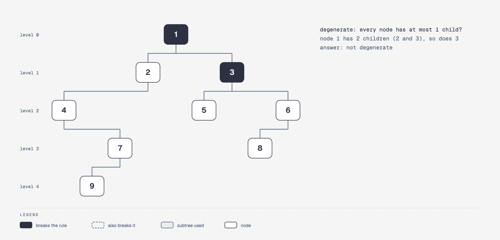

**All steps at a glance**

| Step | Question | Rule | Node that breaks it | What we see | Answer |
|:---:|:---|:---|:---:|:---|:---:|
| 1 | Full? | 0 or 2 children everywhere | 2 | 2, 4, 6, 7 each have one child | No |
| 2 | Complete? | No real node after an empty spot, level by level | 2 | 2 has no right child, but 5 and 6 come after | No |
| 3 | Perfect? | All leaves on one level | 5, 8, 9 | Leaves sit on levels 2, 3 and 4 | No |
| 4 | Balanced? | Sides differ by at most 1 level at every node | 2 | Left side 3 levels, right side 0 | No |
| 5 | Degenerate? | At most 1 child everywhere | 1 | 1 and 3 have two children | No |

Our tree is a plain binary tree: none of the five special types. That is normal; most trees in problems are like this.

## 5. Code: check the five types

The functions below follow the rules above one to one. `levels` counts nodes on the longest path (LeetCode style), so an empty tree has 0 levels.

```python
# Import deque for the level-by-level walk
from collections import deque

# Import Optional for type hints
from typing import Optional


# One node of a binary tree
class TreeNode:

    # Create a node with a value and optional children
    def __init__(self, val: int = 0, left: "Optional[TreeNode]" = None, right: "Optional[TreeNode]" = None):

        # The value stored in this node
        self.val = val

        # Link to the left child, or None
        self.left = left

        # Link to the right child, or None
        self.right = right


# Number of levels: empty tree is 0, a single node is 1
def levels(node: Optional[TreeNode]) -> int:

    # An empty tree has no levels
    if node is None:

        # Zero levels
        return 0

    # This node plus the deeper of its two sides
    return 1 + max(levels(node.left), levels(node.right))


# Number of nodes in the tree
def count(node: Optional[TreeNode]) -> int:

    # An empty tree has no nodes
    if node is None:

        # Zero nodes
        return 0

    # This node plus both sides
    return 1 + count(node.left) + count(node.right)


# Full: every node has 0 or 2 children
def is_full(node: Optional[TreeNode]) -> bool:

    # An empty tree breaks no rule
    if node is None:

        # Nothing to check
        return True

    # Exactly one child breaks the rule
    if (node.left is None) != (node.right is None):

        # Not full
        return False

    # Both sides must be full too
    return is_full(node.left) and is_full(node.right)


# Perfect: a tree with h levels must have exactly 2^h - 1 nodes
def is_perfect(root: Optional[TreeNode]) -> bool:

    # Compare the node count with the perfect count for this many levels
    return count(root) == 2 ** levels(root) - 1


# Complete: reading level by level, no real node comes after an empty spot
def is_complete(root: Optional[TreeNode]) -> bool:

    # Spots to visit, in level order (empty spots are None)
    queue = deque([root])

    # Becomes True once we meet an empty spot
    seen_gap = False

    # Visit every spot
    while queue:

        # Next spot in level order
        node = queue.popleft()

        # An empty spot
        if node is None:

            # Remember that a gap has appeared
            seen_gap = True

        # A real node after a gap
        elif seen_gap:

            # Not complete
            return False

        # A real node before any gap
        else:

            # Queue its left spot (may be empty)
            queue.append(node.left)

            # Queue its right spot (may be empty)
            queue.append(node.right)

    # No real node came after a gap
    return True


# Levels of the tree, or -1 as soon as some node is unbalanced
def balanced_levels(node: Optional[TreeNode]) -> int:

    # An empty tree is balanced with 0 levels
    if node is None:

        # Zero levels
        return 0

    # Levels of the left side
    left = balanced_levels(node.left)

    # The left side is already unbalanced
    if left == -1:

        # Pass the failure up
        return -1

    # Levels of the right side
    right = balanced_levels(node.right)

    # The right side is already unbalanced
    if right == -1:

        # Pass the failure up
        return -1

    # The two sides differ by more than one level here
    if abs(left - right) > 1:

        # Unbalanced at this node
        return -1

    # Balanced here: this node plus the deeper side
    return 1 + max(left, right)


# Balanced: no node has sides more than one level apart
def is_balanced(root: Optional[TreeNode]) -> bool:

    # -1 means some node failed
    return balanced_levels(root) != -1


# Degenerate: every node has at most one child
def is_degenerate(node: Optional[TreeNode]) -> bool:

    # Walk down the only path
    while node is not None:

        # Two children means it branches
        if node.left is not None and node.right is not None:

            # Not degenerate
            return False

        # Follow whichever child exists (or None at the end)
        node = node.left if node.left is not None else node.right

    # Never branched
    return True


# The tree we take: 1 with children 2 and 3, and so on
root = TreeNode(1, TreeNode(2, TreeNode(4, None, TreeNode(7, TreeNode(9)))), TreeNode(3, TreeNode(5), TreeNode(6, TreeNode(8))))

# Prints: False False False False False
print(is_full(root), is_complete(root), is_perfect(root), is_balanced(root), is_degenerate(root))
```

### Complexity

| Check | Time | Space | Why | Note |
|:---|:---:|:---:|:---|:---|
| `levels`, `count` | `O(n)` | `O(h)` | Visit every node once; the recursion goes as deep as the height `h` | `h` is `log n` when balanced and `n` for a chain |
| `is_full` | `O(n)` | `O(h)` | One visit per node | Stops early at the first node with one child |
| `is_perfect` | `O(n)` | `O(h)` | One `count` and one `levels` pass | Uses the formula `2^h - 1` instead of checking each leaf |
| `is_complete` | `O(n)` | `O(n)` | Each node enters the queue once | The queue can hold a whole level at once |
| `is_balanced` | `O(n)` | `O(h)` | Heights are computed bottom-up, once per node | Computing `levels` again at every node would be `O(n^2)` |
| `is_degenerate` | `O(h)` | `O(1)` | Walks one path only | Stops at the first node with two children |

## 6. Common Mistakes

| Mistake | What goes wrong | Fix |
|:---|:---|:---|
| Mixing up full and complete | A full tree can have gaps; a complete tree can have a node with one child | Full is about children counts; complete is about gaps, level by level |
| Thinking left and right do not matter | A node with only a left child and one with only a right child are different trees | Always keep `left` and `right` separate |
| Mixing up height in edges and in nodes | Answers are off by one | Check what the problem counts; LeetCode 104 counts nodes |
| Checking balance only at the root | A tree can look even at the root and still be unbalanced lower down | The rule must hold at **every** node |
| Recomputing heights for each node | The balance check becomes `O(n^2)` | Return heights bottom-up, as `balanced_levels` does |

## 7. Interview Follow-ups

### Q1. Is every complete tree also full?

**Answer:**
- No. The complete tree `1, 2, 3, 4, 5, 6` has node 3 with only one child, so it is not full.
- And a full tree can have gaps, so it is not always complete.
- Only a perfect tree is always both.

### Q2. How many nodes can a binary tree of height `h` have?

**Answer:**
- At least `h + 1` (a chain).
- At most `2^(h + 1) - 1` (a perfect tree).

### Q3. Why do we care whether a tree is balanced?

**Answer:**
- Most operations walk one path from the root, so they cost about the height.
- Balanced: height about `log2(n)`, so about 20 steps for a million nodes.
- Degenerate: height `n - 1`, so about a million steps.

### Q4. Why does a full binary tree with 7 internal nodes have exactly 8 leaves?

**Answer:**
- In a full tree, every internal node has exactly 2 children, so there are `2 * internal` edges.
- Edges are also `n - 1 = internal + leaves - 1`.
- So `2 * internal = internal + leaves - 1`, which gives `leaves = internal + 1 = 8`.

### Q5. Why is a heap stored as a complete tree?

**Answer:**
- A complete tree has no gaps, so its nodes fit in an array in level order.
- The children of index `i` are at `2i + 1` and `2i + 2`, so no links are needed.
- Its height is always about `log2(n)`, which keeps push and pop at `O(log n)`.

## 8. Interview Explanation

> A binary tree is a hierarchy of nodes where each node has at most two children, a left one and a right one. The top node is the root, nodes with no children are leaves, and the height is the longest path from the root to a leaf. There are five common shapes: full, where every node has zero or two children; complete, where every level is filled except the last and the last is filled from the left; perfect, where all leaves are on one level; balanced, where at every node the two sides differ by at most one level; and degenerate, where every node has one child so the tree is a chain. The shape matters because most operations cost about the height, which is about log n for a balanced tree but n for a chain.
