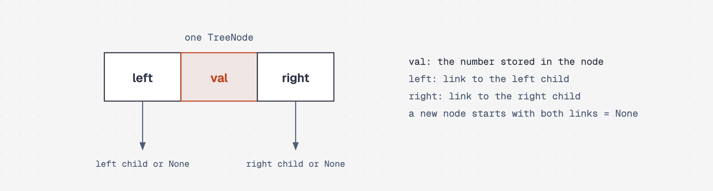
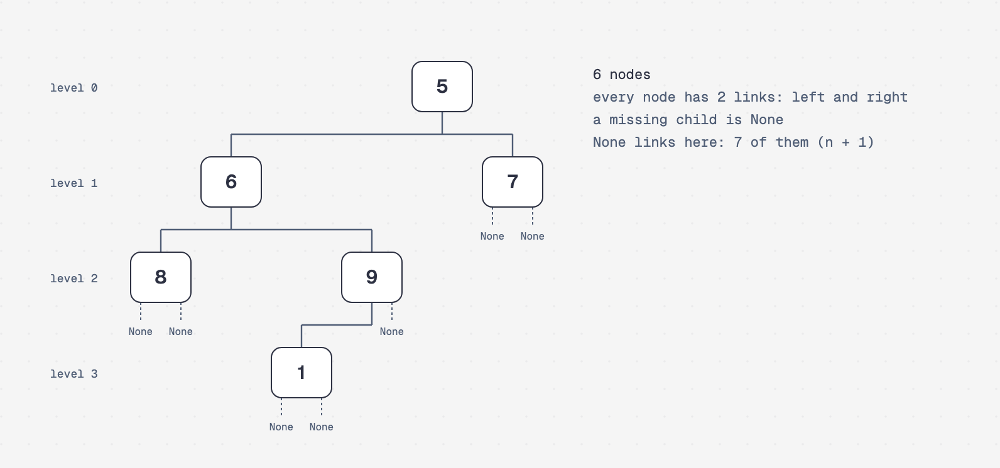
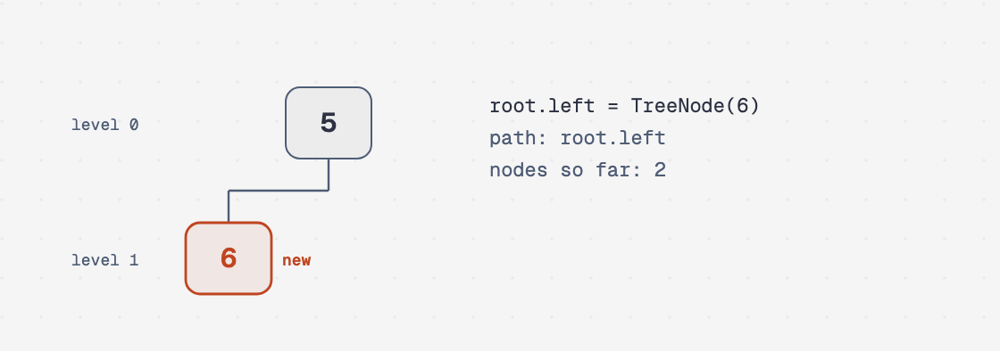
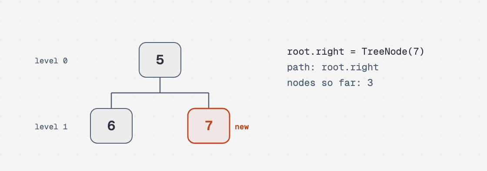
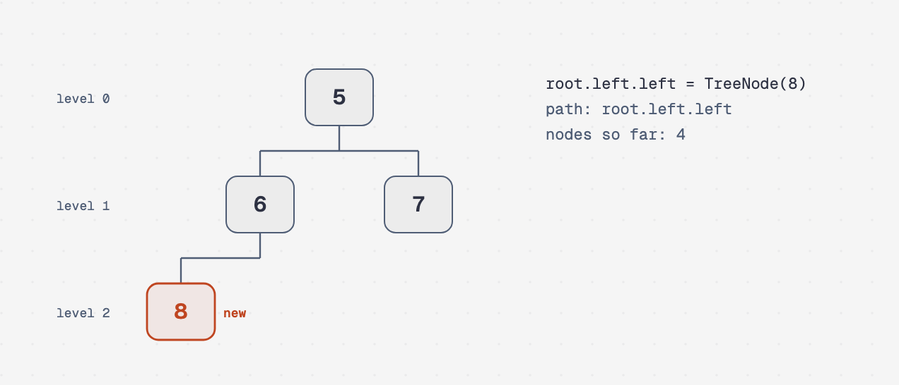
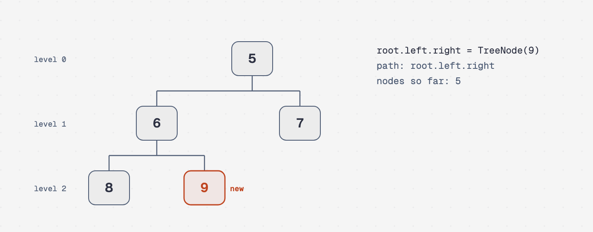
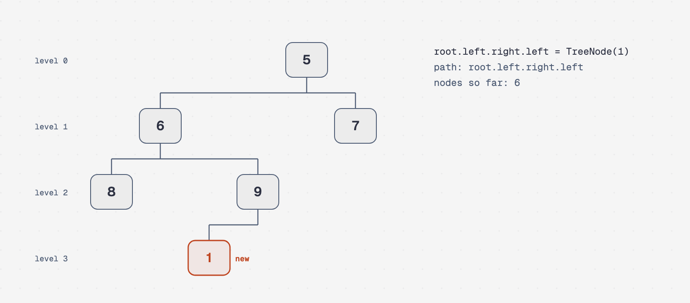
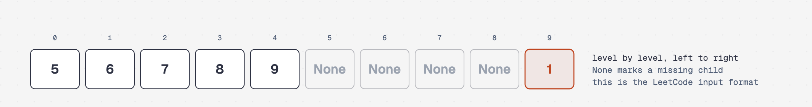
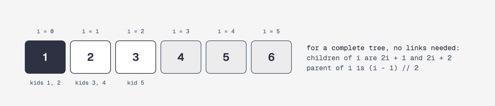

# 02. Tree Representation

| Type | Topic | Key idea | Covers | Code | Before in this folder |
|:---:|:---:|:---|:---|:---:|:---:|
| **Theory** | Storing a Binary Tree | Each node is a small box with a value and two links, `left` and `right`; a missing child is `None` | The node box, building a tree by hand, the LeetCode list format, and the array form of a complete tree | Python `TreeNode`, `build_tree`, `to_list` | [01. Introduction to Trees](01.%20Introduction%20to%20Trees.md) |

## 1. The problem: how do we store a tree?

An array stores numbers in a row. A tree branches, so each node must also remember **where its children are**. The lecture does this in C++ with a `struct Node` that holds a value and two pointers. We use the same idea in Python, with a class instead of a struct.

| Idea | C++ (lecture) | Python (these notes) | Plain meaning |
|:---|:---|:---|:---|
| The node type | `struct Node` | `class TreeNode` | A small box that holds one value |
| The value | `int data` | `self.val` (the LeetCode name) | The number stored in the box |
| Link to the left child | `Node* left` | `self.left` | Where the left child is |
| Link to the right child | `Node* right` | `self.right` | Where the right child is |
| "No child here" | `nullptr` / `NULL` | `None` | The link points nowhere |
| Make a new node | `new Node(1)` | `TreeNode(1)` | Create a box with value 1 and no children |
| Follow a link | `root->left` | `root.left` | Go from a node to its left child, one step down the tree |

## 2. One node

Each node is a box with three parts: a link to the left child, the value, and a link to the right child. A new node starts with **both links set to `None`**, exactly like the lecture's constructor (`left = right = null`).



## 3. The tree we take

**The tree we take:** the tree from the lecture board. `5` is the root; `6` and `7` are its children; `8` and `9` are the children of `6`; and `1` is the left child of `9`.

Every empty link is drawn as `None`. A tree with `n` nodes always has `n + 1` empty links: here 6 nodes and 7 `None`s.



## 4. Build it, step by step

We build the tree one line of code at a time. Each picture shows the tree after that line. The orange node is the one just added.

**Step 1: make the root**

- `root = TreeNode(5)`. The tree is one node; both of its links are `None`.


**Step 2: add the left child of the root**

- `root.left = TreeNode(6)`. Follow no links: we are at the root. Set its `left` link to a new node `6`.



**Step 3: add the right child of the root**

- `root.right = TreeNode(7)`. Set the root's `right` link to a new node `7`.



**Step 4: go left once, then add a left child**

- `root.left.left = TreeNode(8)`. First follow `root.left` to reach `6`, then set the `left` link of `6`.



**Step 5: go left once, then add a right child**

- `root.left.right = TreeNode(9)`. Follow `root.left` to `6`, then set its `right` link.



**Step 6: go left, then right, then add a left child**

- `root.left.right.left = TreeNode(1)`. Follow `left` to `6`, `right` to `9`, then set the `left` link of `9`.



**All steps at a glance**

| Step | Line of code | Links followed first | Link that is set | Nodes after the step | Read it as |
|:---:|:---|:---|:---|:---:|:---|
| 1 | `root = TreeNode(5)` | none | (new root) | 1 | "Make 5 the root" |
| 2 | `root.left = TreeNode(6)` | none | left of 5 | 2 | "Put 6 on the left of 5" |
| 3 | `root.right = TreeNode(7)` | none | right of 5 | 3 | "Put 7 on the right of 5" |
| 4 | `root.left.left = TreeNode(8)` | left (to 6) | left of 6 | 4 | "Go to 6, put 8 on its left" |
| 5 | `root.left.right = TreeNode(9)` | left (to 6) | right of 6 | 5 | "Go to 6, put 9 on its right" |
| 6 | `root.left.right.left = TreeNode(1)` | left, right (to 9) | left of 9 | 6 | "Go to 6, then 9, put 1 on its left" |

The lecture also builds a smaller tree the same way: `root = Node(1)`, `root.left = Node(2)`, `root.right = Node(3)`, `root.left.right = Node(5)`. The code section builds that one too.

## 5. Other ways to write a tree down

### The LeetCode list (level order)

LeetCode gives trees as a list read **level by level, left to right**, with `None` (written `null` on the website) for a missing child. Trailing `None`s at the end are dropped.



- Level 0: `5`. Level 1: `6, 7`.
- Level 2: children of 6 are `8, 9`; children of 7 are `None, None`.
- Level 3: children of 8 are `None, None`; children of 9 are `1` and a trailing `None` that is dropped.
- Result: `[5, 6, 7, 8, 9, None, None, None, None, 1]`.

### The array form of a complete tree

A **complete** tree has no gaps (see note 01), so it fits in a plain array with **no links at all**:

- The root is at index `0`.
- The children of index `i` are at `2i + 1` and `2i + 2`.
- The parent of index `i` is at `(i - 1) // 2`.



This is how a **heap** is stored. It does not work well for trees with gaps (like our tree), because every gap wastes array space.

### All the ways at a glance

| Way to store | What it looks like | Good for | Weak point | Where you meet it |
|:---|:---|:---|:---|:---|
| Linked nodes (`TreeNode`) | Each node has `val`, `left`, `right` | Any shape of tree; easy to change | Each node needs memory for two links | Almost every tree problem |
| Level-order list | `[5, 6, 7, 8, 9, None, None, None, None, 1]` | Writing a tree as text | You must rebuild the nodes to use it | LeetCode input and output |
| Array form (complete trees) | `[1, 2, 3, 4, 5, 6]`, children at `2i + 1`, `2i + 2` | Heaps; no links needed | Wastes space when the tree has gaps | Heaps and priority queues |
| Parent array or adjacency list | `parent[i]` or a list of neighbours per node | General trees with many children | Finding children takes extra work | Graph problems, union-find |

## 6. Code

The class matches LeetCode's `TreeNode`, so code written here can be pasted straight into LeetCode. `build_tree` and `to_list` turn the LeetCode list into nodes and back, which is handy for testing on your own machine.

```python
# Import deque for the level-by-level walk
from collections import deque

# Import List and Optional for type hints
from typing import List, Optional


# One node of a binary tree (same as LeetCode)
class TreeNode:

    # Create a node with a value and optional children
    def __init__(self, val: int = 0, left: "Optional[TreeNode]" = None, right: "Optional[TreeNode]" = None):

        # The value stored in this node
        self.val = val

        # Link to the left child, or None
        self.left = left

        # Link to the right child, or None
        self.right = right


# Build a tree from a LeetCode-style level-order list
def build_tree(values: List[Optional[int]]) -> Optional[TreeNode]:

    # Empty list or missing root means an empty tree
    if not values or values[0] is None:

        # No tree
        return None

    # The first value is the root
    root = TreeNode(values[0])

    # Nodes that still need their children, in level order
    queue = deque([root])

    # Index of the next value to read
    i = 1

    # Keep reading while values remain
    while i < len(values):

        # The next parent to fill
        node = queue.popleft()

        # There is a real left child
        if values[i] is not None:

            # Attach the left child
            node.left = TreeNode(values[i])

            # It will get its own children later
            queue.append(node.left)

        # Move to the right child's value
        i += 1

        # There is a real right child
        if i < len(values) and values[i] is not None:

            # Attach the right child
            node.right = TreeNode(values[i])

            # It will get its own children later
            queue.append(node.right)

        # Move to the next parent's first value
        i += 1

    # The finished tree
    return root


# Write a tree as a level-order list, dropping trailing Nones
def to_list(root: Optional[TreeNode]) -> List[Optional[int]]:

    # The answer list
    out = []

    # Spots to visit, in level order (empty spots are None)
    queue = deque([root])

    # Visit every spot
    while queue:

        # Next spot
        node = queue.popleft()

        # Empty spot
        if node is None:

            # Write None
            out.append(None)

        # Real node
        else:

            # Write its value
            out.append(node.val)

            # Queue its left spot
            queue.append(node.left)

            # Queue its right spot
            queue.append(node.right)

    # Drop the empty spots at the end
    while out and out[-1] is None:

        # Remove one trailing None
        out.pop()

    # The level-order list
    return out


# Step 1: make the root
root = TreeNode(5)

# Step 2: left child of the root
root.left = TreeNode(6)

# Step 3: right child of the root
root.right = TreeNode(7)

# Step 4: left child of 6
root.left.left = TreeNode(8)

# Step 5: right child of 6
root.left.right = TreeNode(9)

# Step 6: left child of 9
root.left.right.left = TreeNode(1)

# Prints: [5, 6, 7, 8, 9, None, None, None, None, 1]
print(to_list(root))

# The same tree, built from its LeetCode list
same = build_tree([5, 6, 7, 8, 9, None, None, None, None, 1])

# Prints the same list again
print(to_list(same))

# The smaller lecture example: 1 with children 2 and 3, and 5 on the right of 2
small = TreeNode(1, TreeNode(2, None, TreeNode(5)), TreeNode(3))

# Prints: [1, 2, 3, None, 5]
print(to_list(small))
```

### Complexity

| Operation | Time | Space | Why | Note |
|:---|:---:|:---:|:---|:---|
| Make one node | `O(1)` | `O(1)` | Set three fields | Both links start as `None` |
| Attach a child by hand | `O(d)` | `O(1)` | Follow `d` links from the root first | `root.left.right.left` follows 2 links |
| `build_tree` | `O(n)` | `O(n)` | Each value is read once; the queue holds one level | `n` is the length of the list |
| `to_list` | `O(n)` | `O(n)` | Each node and each empty spot is visited once | Trailing `None`s are removed at the end |
| Whole tree in memory | | `O(n)` | One box per node | Each box holds a value and two links |

## 7. Common Mistakes

| Mistake | What goes wrong | Fix |
|:---|:---|:---|
| Attaching to a child that does not exist yet | `root.left.left = TreeNode(8)` fails if `root.left` is still `None` | Build parents before children, top to bottom |
| Forgetting that a new node has no children | Code later reads `node.left.val` and crashes on `None` | Always check `if node.left is not None` first |
| Reading the LeetCode list as "index `i` has children `2i + 1`, `2i + 2`" | Wrong for trees with gaps, because LeetCode skips children of missing nodes | Use a queue, as `build_tree` does |
| Calling the value `data` in LeetCode code | LeetCode's class uses `val` | Use `node.val` |
| Using `root == None` | Works, but is not the Python style | Use `root is None` |

## 8. Interview Follow-ups

### Q1. Why does a tree with `n` nodes have `n + 1` empty links?

**Answer:**
- Each node has 2 links, so there are `2n` links in total.
- Every node except the root is pointed to by exactly one link, which uses `n - 1` links.
- That leaves `2n - (n - 1) = n + 1` empty links.

### Q2. When is the array form better than linked nodes?

**Answer:**
- When the tree is complete, like a heap: no gaps, so no wasted space and no links to store.
- Moving to a child or parent is simple arithmetic: `2i + 1`, `2i + 2`, `(i - 1) // 2`.

### Q3. How would you store a tree where a node can have many children?

**Answer:**
- Give each node a list of children: `self.children = []`.
- Or store it like a graph, with an adjacency list or a parent array.

### Q4. Can you rebuild a tree from just its values in level order without the `None`s?

**Answer:**
- Not in general. Without the `None`s you cannot tell which spots are empty.
- That is why LeetCode writes `null` for missing children.
- It does work for a complete tree, where there are no gaps (the array form).

### Q5. How much memory does a linked tree use compared with an array?

**Answer:**
- Linked: each node stores the value plus two links, so about three slots per node.
- Array form: one slot per node, but only for complete trees; gaps waste slots.
- Both are `O(n)`; the difference is the constant and how well gaps are handled.

## 9. Interview Explanation

> I store a binary tree as linked nodes. Each node is a small object with a value and two links, left and right, and a missing child is None. To build a tree I create the root and then attach children by following links from the root, so root.left.right means go left, then right. LeetCode writes trees as a level-order list with null for missing children, so I rebuild them with a queue: take the next parent, attach its left and right values, and push the new children. For complete trees like heaps there is an even simpler form: an array where the children of index i are at 2i + 1 and 2i + 2.
