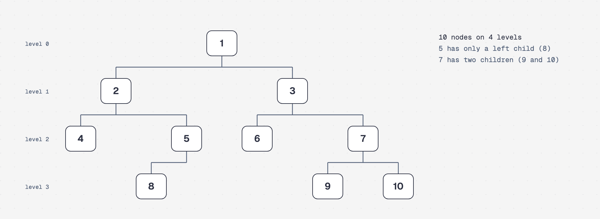
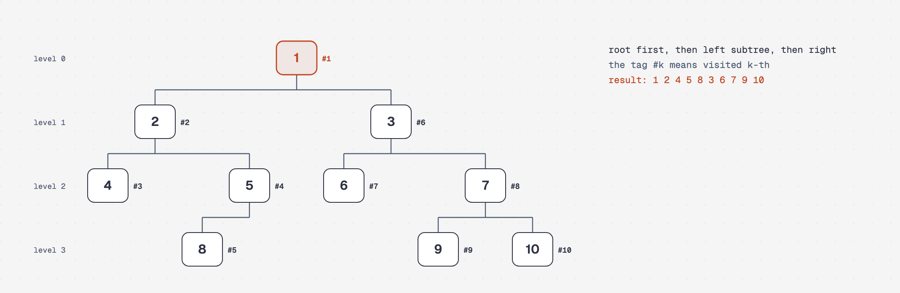
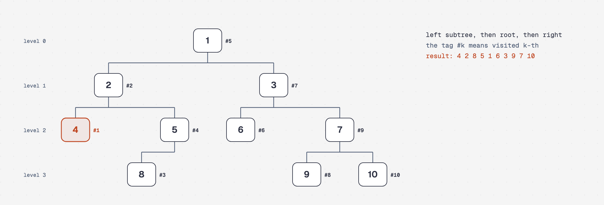
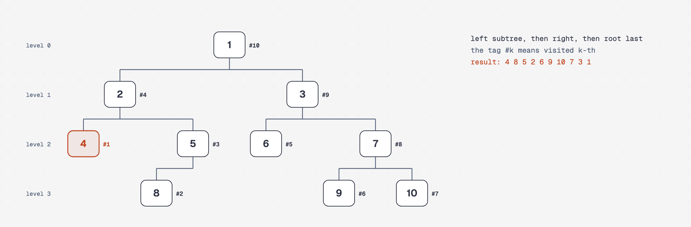
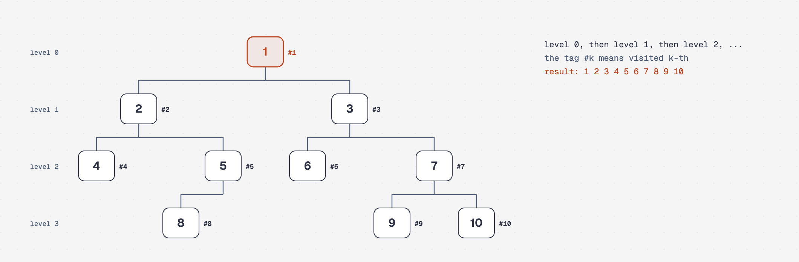
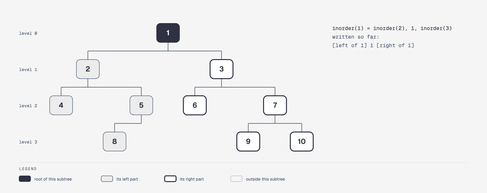
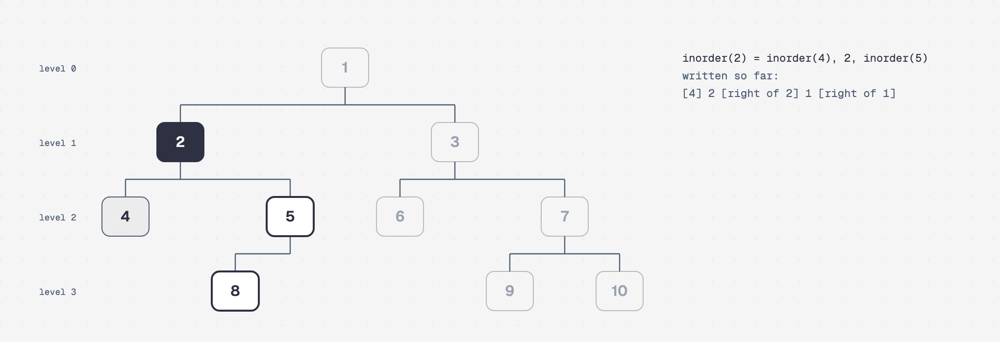
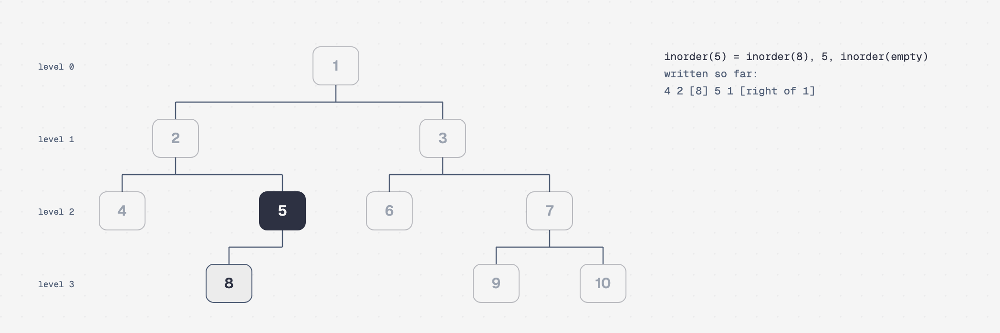
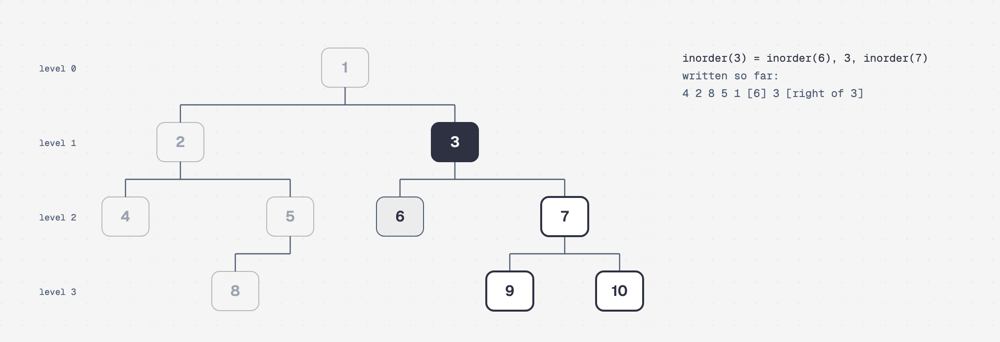
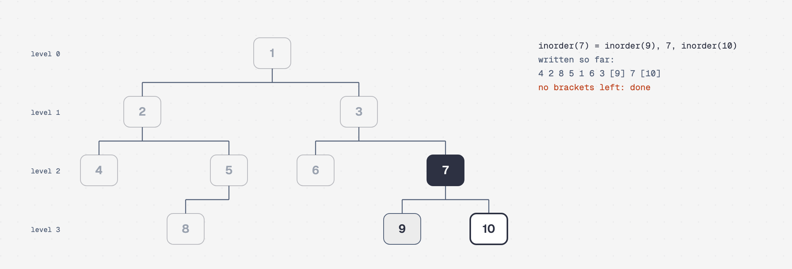

# 03. Binary Tree Traversals

| Type | Topic | Key idea | Covers | Code | Next in this folder |
|:---:|:---:|:---|:---|:---:|:---:|
| **Theory** | Tree Traversals | A traversal visits every node once; the order depends on when the root is visited compared with its two subtrees | BFS and DFS, preorder, inorder, postorder, level order, and how to write each order by hand | Short Python version of all four | [144. Preorder Traversal](04.%20144.%20Binary%20Tree%20Preorder%20Traversal.md) |

## 1. What is a traversal?

A **traversal** visits every node of a tree exactly once, in some fixed order. Arrays have one natural order (left to right). A tree branches, so there are several natural orders, and each one is useful for different problems.

There are two families:

| Family | How it moves | Orders in this family | Uses | Tool it needs |
|:---|:---|:---|:---|:---|
| **DFS** (depth-first search) | Go as deep as possible down one branch, then come back and try the next | Preorder, inorder, postorder | Most recursive tree problems | Recursion (or a stack) |
| **BFS** (breadth-first search) | Finish a whole level before going one level deeper | Level order | Anything "per level": widths, views, shortest depth | A queue |

### The three DFS orders

All three visit the left subtree before the right subtree. They differ only in **when the root is visited**. The name tells you:

- **Pre**order: root **before** both subtrees. Root, left, right.
- **In**order: root **in between** the subtrees. Left, root, right.
- **Post**order: root **after** both subtrees. Left, right, root.

The same rule is used again inside every subtree, all the way down.

## 2. The tree we take

**The tree we take:** the bigger tree from the lecture board, with 10 nodes.



The lecture first uses the smaller tree `1` with children `2, 3` and grandchildren `4, 5, 6, 7`. Its answers are in the table in section 4.

## 3. Each order on our tree

In each picture the tag `#k` next to a node means "this node is visited k-th". The orange node is visited first.

### Preorder: root, left, right



- Visit 1, then everything on its left (2, 4, 5, 8), then everything on its right (3, 6, 7, 9, 10).
- Inside the left part, the same rule: 2 first, then 4, then 5 and 8.
- **Result: `1 2 4 5 8 3 6 7 9 10`**

### Inorder: left, root, right



- Everything on the left of 1 comes first, then 1, then everything on the right.
- The root of the whole tree lands in the middle of the answer.
- **Result: `4 2 8 5 1 6 3 9 7 10`**

### Postorder: left, right, root



- Both subtrees are finished before their root, so the root of the whole tree comes **last**.
- **Result: `4 8 5 2 6 9 10 7 3 1`**

### Level order: level by level (BFS)



- Level 0, then level 1 from left to right, then level 2, then level 3.
- **Result: `1 2 3 4 5 6 7 8 9 10`**

## 4. Write an order by hand, step by step

The lecture's trick: draw a dashed circle around each subtree and treat it as one block. Write the order with the blocks still closed, then open one block at a time. Here is **inorder** on our tree.

**How to read the pictures:** the dark node is the root of the block being opened, grey is its left part, bold white is its right part, and faded nodes are outside this block.

**Step 1: open the whole tree (root 1)**

- Inorder of 1 = inorder of the left part, then 1, then inorder of the right part.
- Written so far: `[left of 1] 1 [right of 1]`.



**Step 2: open the left block (root 2)**

- Inorder of 2 = inorder of 4, then 2, then inorder of the subtree of 5.
- 4 is a leaf, so it is written as is.
- Written so far: `4 2 [right of 2] 1 [right of 1]`.



**Step 3: open the block of 5**

- Inorder of 5 = inorder of 8, then 5, then nothing (5 has no right child).
- Written so far: `4 2 8 5 1 [right of 1]`. The whole left side is done.



**Step 4: open the right block (root 3)**

- Inorder of 3 = inorder of 6, then 3, then inorder of the subtree of 7.
- Written so far: `4 2 8 5 1 6 3 [right of 3]`.



**Step 5: open the block of 7**

- Inorder of 7 = inorder of 9, then 7, then inorder of 10.
- Written so far: `4 2 8 5 1 6 3 9 7 10`. No closed blocks are left, so this is the answer.



**All steps at a glance**

| Step | Block opened | Left part | Root | Right part | Written so far | What we did |
|:---:|:---:|:---|:---:|:---|:---|:---|
| 1 | 1 | 2, 4, 5, 8 | 1 | 3, 6, 7, 9, 10 | `[left of 1] 1 [right of 1]` | Split the whole tree into left block, root, right block |
| 2 | 2 | 4 | 2 | 5, 8 | `4 2 [right of 2] 1 [right of 1]` | 4 is a leaf, so it is written as is; 5 stays closed |
| 3 | 5 | 8 | 5 | empty | `4 2 8 5 1 [right of 1]` | 8 is a leaf and 5 has no right child; the left side is done |
| 4 | 3 | 6 | 3 | 7, 9, 10 | `4 2 8 5 1 6 3 [right of 3]` | 6 is a leaf, so it is written as is; 7 stays closed |
| 5 | 7 | 9 | 7 | 10 | `4 2 8 5 1 6 3 9 7 10` | 9 and 10 are leaves; no closed blocks remain |

The same block trick works for preorder (write the root before its blocks) and postorder (write the root after its blocks).

**Both lecture trees at a glance**

| Order | Rule | Small tree (1 to 7) | Our tree (1 to 10) | Where you use it |
|:---|:---|:---|:---|:---|
| Preorder | Root, left, right | `1 2 4 5 3 6 7` | `1 2 4 5 8 3 6 7 9 10` | Copying a tree, saving it as text (serialize) |
| Inorder | Left, root, right | `4 2 5 1 6 3 7` | `4 2 8 5 1 6 3 9 7 10` | A binary search tree gives sorted order |
| Postorder | Left, right, root | `4 5 2 6 7 3 1` | `4 8 5 2 6 9 10 7 3 1` | Deleting a tree, computing heights and sizes bottom-up |
| Level order | Level by level | `1 2 3 4 5 6 7` | `1 2 3 4 5 6 7 8 9 10` | Per-level problems, shortest depth, views |

## 5. Code

Short versions of all four. Each one gets its own note with a full step-by-step walkthrough: [preorder](04.%20144.%20Binary%20Tree%20Preorder%20Traversal.md), [inorder](05.%2094.%20Binary%20Tree%20Inorder%20Traversal.md), [postorder](06.%20145.%20Binary%20Tree%20Postorder%20Traversal.md), [level order](07.%20102.%20Binary%20Tree%20Level%20Order%20Traversal.md).

```python
# Import deque for the level-order queue
from collections import deque

# Import List and Optional for type hints
from typing import List, Optional


# One node of a binary tree (same as LeetCode)
class TreeNode:

    # Create a node with a value and optional children
    def __init__(self, val: int = 0, left: "Optional[TreeNode]" = None, right: "Optional[TreeNode]" = None):

        # The value stored in this node
        self.val = val

        # Link to the left child, or None
        self.left = left

        # Link to the right child, or None
        self.right = right


# Preorder: root, left, right
def preorder(node: Optional[TreeNode], out: List[int]) -> None:

    # Nothing to visit in an empty tree
    if node is None:

        # Go back
        return

    # Visit the root first
    out.append(node.val)

    # Then the whole left subtree
    preorder(node.left, out)

    # Then the whole right subtree
    preorder(node.right, out)


# Inorder: left, root, right
def inorder(node: Optional[TreeNode], out: List[int]) -> None:

    # Nothing to visit in an empty tree
    if node is None:

        # Go back
        return

    # First the whole left subtree
    inorder(node.left, out)

    # Then the root
    out.append(node.val)

    # Then the whole right subtree
    inorder(node.right, out)


# Postorder: left, right, root
def postorder(node: Optional[TreeNode], out: List[int]) -> None:

    # Nothing to visit in an empty tree
    if node is None:

        # Go back
        return

    # First the whole left subtree
    postorder(node.left, out)

    # Then the whole right subtree
    postorder(node.right, out)

    # The root comes last
    out.append(node.val)


# Level order: one level at a time, left to right
def level_order(root: Optional[TreeNode]) -> List[int]:

    # The visit order
    out = []

    # Nodes waiting to be visited, oldest first
    queue = deque([root] if root else [])

    # Visit until no node is waiting
    while queue:

        # Take the oldest waiting node
        node = queue.popleft()

        # Visit it
        out.append(node.val)

        # Its left child waits at the back
        if node.left:

            # Queue the left child
            queue.append(node.left)

        # Its right child waits behind it
        if node.right:

            # Queue the right child
            queue.append(node.right)

    # The visit order
    return out


# The tree we take
root = TreeNode(1, TreeNode(2, TreeNode(4), TreeNode(5, TreeNode(8))), TreeNode(3, TreeNode(6), TreeNode(7, TreeNode(9), TreeNode(10))))

# Collect the three DFS orders
pre, ino, post = [], [], []

# Fill the preorder list
preorder(root, pre)

# Fill the inorder list
inorder(root, ino)

# Fill the postorder list
postorder(root, post)

# Prints: [1, 2, 4, 5, 8, 3, 6, 7, 9, 10]
print(pre)

# Prints: [4, 2, 8, 5, 1, 6, 3, 9, 7, 10]
print(ino)

# Prints: [4, 8, 5, 2, 6, 9, 10, 7, 3, 1]
print(post)

# Prints: [1, 2, 3, 4, 5, 6, 7, 8, 9, 10]
print(level_order(root))
```

### Complexity

| Traversal | Time | Extra space | Why | Space in the worst case |
|:---|:---:|:---:|:---|:---|
| Preorder, inorder, postorder | `O(n)` | `O(h)` | Each node is visited once; the recursion is as deep as the height `h` | A chain has `h = n - 1`, so `O(n)` |
| Level order | `O(n)` | `O(w)` | Each node enters the queue once; the queue holds about one level | The widest level `w` can hold about `n / 2` nodes, so `O(n)` |

## 6. Common Mistakes

| Mistake | What goes wrong | Fix |
|:---|:---|:---|
| Visiting right before left | Every order comes out mirrored | All four orders go left first, then right |
| Mixing up the names | Writing inorder when preorder was asked | The prefix says where the root goes: pre = before, in = middle, post = after |
| Forgetting the empty check | Code reads `None.left` and crashes | Return at once when `node is None` |
| Using a stack for level order | Nodes come out deepest-first, not level by level | Level order needs a queue: first in, first out |
| Applying the rule only at the root | The order inside the subtrees is wrong | The same rule repeats inside every subtree |

## 7. Interview Follow-ups

### Q1. Which traversal gives a sorted list for a binary search tree?

**Answer:**
- Inorder. In a BST, everything on the left is smaller and everything on the right is bigger.
- Left, root, right therefore comes out smallest to largest.

### Q2. Can you rebuild a tree from one traversal?

**Answer:**
- Not from one alone. Many trees share the same preorder, for example.
- Inorder plus preorder (or inorder plus postorder) is enough when the values are unique. That is LeetCode 105 and 106, later in this chapter.

### Q3. Why does postorder suit "bottom-up" problems?

**Answer:**
- A node is visited only after both of its children.
- So when you reach a node, the answers for its subtrees (height, size, sum) are already known.

### Q4. What is the difference between DFS and BFS memory use?

**Answer:**
- DFS keeps one path in memory: about the height `h`.
- BFS keeps one level in memory: about the width `w`.
- Tall thin trees favour BFS; short wide trees favour DFS.

### Q5. Can these traversals be done without recursion?

**Answer:**
- Yes. DFS can use an explicit stack, and level order already uses a queue.
- There is also Morris traversal, which uses no stack at all (`O(1)` space) by temporarily linking nodes.
- The next notes show the stack versions.

## 8. Interview Explanation

> A traversal visits every node exactly once. There are two families. Depth-first search goes deep down one branch before trying the next, and has three orders that differ only in when the root is visited: preorder is root, left, right; inorder is left, root, right; postorder is left, right, root. Breadth-first search, or level order, visits the tree level by level using a queue. All of them take O(n) time. The DFS orders use O(h) extra space for the recursion, and level order uses space for the widest level.
