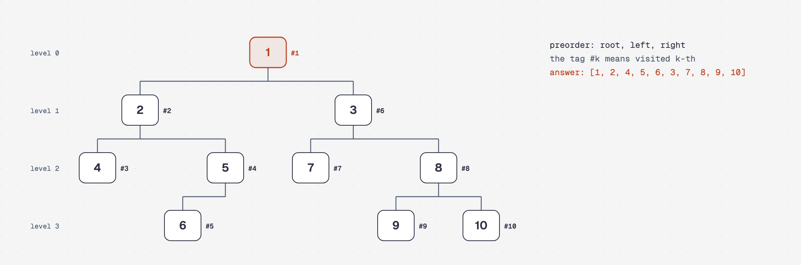
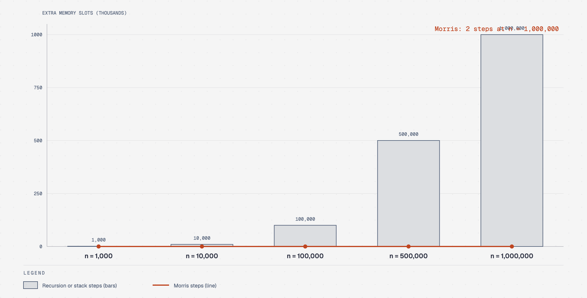
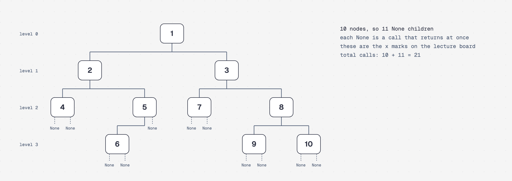
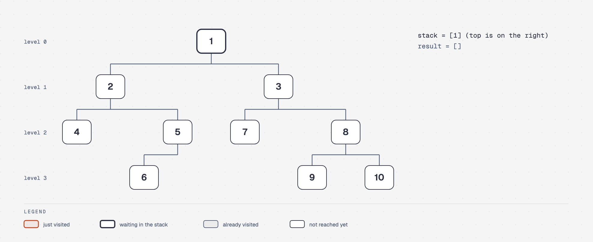
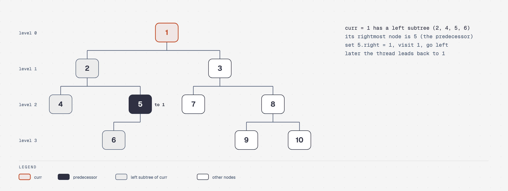
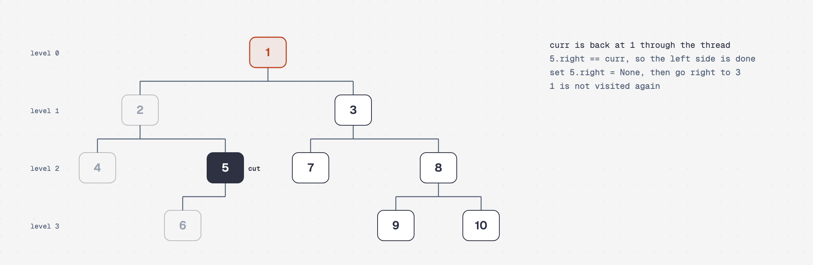

# 04. 144. Binary Tree Preorder Traversal

| Difficulty | Pattern | Key idea | Source | Time | Space | Before / after |
|:---:|:---:|:---|:---:|:---:|:---:|:---:|
| **Easy** | DFS Traversal (Root, Left, Right) | Visit the node, then its whole left subtree, then its whole right subtree; with a stack, push right before left | [144. Binary Tree Preorder Traversal](https://leetcode.com/problems/binary-tree-preorder-traversal/) | `O(n)` | `O(h)`, or `O(1)` with Morris | [03. Traversals](03.%20Binary%20Tree%20Traversals.md) / [94. Inorder](05.%2094.%20Binary%20Tree%20Inorder%20Traversal.md) |

## 1. Problem Statement

Given the `root` of a binary tree, return the **preorder traversal** of its values: root, then left subtree, then right subtree.

### Example

**The tree we take:** the 10-node tree from the lecture board, as a LeetCode list `[1, 2, 3, 4, 5, 7, 8, None, None, 6, None, None, None, 9, 10]`.

```text
Input:  root = [1, 2, 3, 4, 5, 7, 8, None, None, 6, None, None, None, 9, 10]
Output: [1, 2, 4, 5, 6, 3, 7, 8, 9, 10]
```



It has the tricky parts of the problem: a node with only a left child (5), and a deep right side (3, 8, 9, 10) that must wait until the whole left side is done. We use this tree in every section below.

LeetCode examples:

```text
root = [1, None, 2, 3]                                   gives [1, 2, 3]
root = [1, 2, 3, 4, 5, None, 8, None, None, 6, 7, 9]    gives [1, 2, 4, 5, 6, 7, 3, 8, 9]
root = []                                                gives []
root = [1]                                               gives [1]
```

### Constraints, in plain words

| Limit | What it means in plain words | What it tells us |
|:---|:---|:---|
| Number of nodes is `0` to `100` | The tree can be empty, and has at most 100 nodes | Any `O(n)` method is instant; handle the empty tree |
| `-100 <= Node.val <= 100` | Small whole numbers, maybe negative | Values do not matter; only the order does |
| Follow-up: iterative | Can you do it without recursion? | Use your own stack, or Morris for `O(1)` space |

**How fast is fast enough?**

- Every method visits each node once: `O(n)` time. With at most 100 nodes, all are instant.
- The real difference is **extra memory**. Recursion and the stack method keep one path in memory: up to `n` slots when the tree is a chain. Morris keeps only two pointers.

In the chart, the grey bars are the extra memory of recursion or a stack on a chain-shaped tree, and the orange line is Morris. Both were worked out from how deep each method goes.



| Nodes `n` (chain-shaped tree) | Recursion stack depth | Explicit stack size | Morris extra pointers | Morris uses less by | Note |
|:---:|:---:|:---:|:---:|:---:|:---|
| 100 | 100 | up to 100 | 2 | about 50 times | The LeetCode limit: all three are fine |
| 1,000 | 1,000 | up to 1,000 | 2 | about 500 times | Python's default recursion limit is 1,000 |
| 100,000 | 100,000 | up to 100,000 | 2 | about 50,000 times | Recursion would crash in Python here |
| 1,000,000 | 1,000,000 | up to 1,000,000 | 2 | about 500,000 times | Only the stack or Morris work |

## 2. Core Idea

Preorder is **root, left, right**, and the same rule repeats inside every subtree:

1. Visit the current node.
2. Do the whole preorder of its left subtree.
3. Do the whole preorder of its right subtree.

When a child is missing, that call returns at once. The lecture marks those with an `x`. A tree with `n` nodes has `n + 1` missing children, so there are `2n + 1` calls in total.



**Why the stack pushes right before left.** A stack gives back the **last** thing pushed first. We want the left child to come out first, so it must go in **last**: push right, then left.

## 3. Edge Cases

| Case | Input | Expected | Why it matters | Code that handles it |
|:---|:---|:---:|:---|:---|
| Empty tree | `[]` | `[]` | No root at all | `if root is None: return []` |
| One node | `[1]` | `[1]` | No children to visit | Both child calls return at once |
| Only right children | `[1, None, 2, 3]` | `[1, 2, 3]` | Left is missing at the root | The `None` left call returns, then the right side runs |
| Only left children (a chain) | `[1, 2, None, 3]` | `[1, 2, 3]` | The deepest case for recursion | Stack or Morris avoid deep recursion |
| Node with one child | 5 in our tree | `..., 5, 6, ...` | Its right side is empty | `if node.right:` guards the push |

## 4. Approach 1: Recursion

### Idea

Write the rule directly: visit the node, recurse left, recurse right. The call stack remembers where to come back to.

### Code

```python
# Import List and Optional for type hints
from typing import List, Optional


# Solution for 144, recursive
class Solution:

    # Main method
    def preorderTraversal(self, root: Optional[TreeNode]) -> List[int]:

        # The visit order
        result = []

        # Visit the node, then its left subtree, then its right subtree
        def dfs(node: Optional[TreeNode]) -> None:

            # A missing child: nothing to do
            if node is None:

                # Go back
                return

            # Visit the root first
            result.append(node.val)

            # Then the whole left subtree
            dfs(node.left)

            # Then the whole right subtree
            dfs(node.right)

        # Start at the root
        dfs(root)

        # The preorder list
        return result
```

### Complexity

| Measure | Complexity | Why | At the limit (`n = 100`) | Compared with the others |
|:---|:---:|:---|:---:|:---|
| **Time** | `O(n)` | Each node is visited once; each `None` call is `O(1)` | about 200 calls | Same as the other two |
| **Space** | `O(h)` | The call stack holds one path from the root | up to 100 frames for a chain | Same as the stack method; Morris uses `O(1)` |

## 5. Approach 2: Iterative With a Stack

### Idea

1. Put the root on a stack.
2. While the stack is not empty: pop the top node and visit it.
3. Push its **right** child, then its **left** child, so the left one is popped next.

### Run it on our example, step by step

**The tree we take:** the 10-node tree above.

**How to read the pictures:** orange is the node just popped and visited, bold boxes are waiting in the stack, grey boxes are already visited. In the notes, the **top** of the stack is on the right.

**Start:** the stack holds the root.



**Step 1: pop 1**

- Pop `1` from the top and visit it.
- Push the right child `3`, then the left child `2`, so `2` comes out next.
- Stack: `[3, 2]`. Result: `[1]`.

![Step 1: pop 1 and visit it; the stack is now [3, 2]](images/pre-stack-1.png)

**Step 2: pop 2**

- Pop `2` from the top and visit it.
- Push the right child `5`, then the left child `4`, so `4` comes out next.
- Stack: `[3, 5, 4]`. Result: `[1, 2]`.

![Step 2: pop 2 and visit it; the stack is now [3, 5, 4]](images/pre-stack-2.png)

**Step 3: pop 4**

- Pop `4` from the top and visit it.
- It is a leaf: nothing to push.
- Stack: `[3, 5]`. Result: `[1, 2, 4]`.

![Step 3: pop 4 and visit it; the stack is now [3, 5]](images/pre-stack-3.png)

**Step 4: pop 5**

- Pop `5` from the top and visit it.
- Push its only child `6`.
- Stack: `[3, 6]`. Result: `[1, 2, 4, 5]`.

![Step 4: pop 5 and visit it; the stack is now [3, 6]](images/pre-stack-4.png)

**Step 5: pop 6**

- Pop `6` from the top and visit it.
- It is a leaf: nothing to push.
- Stack: `[3]`. Result: `[1, 2, 4, 5, 6]`.

![Step 5: pop 6 and visit it; the stack is now [3]](images/pre-stack-5.png)

**Step 6: pop 3**

- Pop `3` from the top and visit it.
- Push the right child `8`, then the left child `7`, so `7` comes out next.
- Stack: `[8, 7]`. Result: `[1, 2, 4, 5, 6, 3]`.

![Step 6: pop 3 and visit it; the stack is now [8, 7]](images/pre-stack-6.png)

**Step 7: pop 7**

- Pop `7` from the top and visit it.
- It is a leaf: nothing to push.
- Stack: `[8]`. Result: `[1, 2, 4, 5, 6, 3, 7]`.

![Step 7: pop 7 and visit it; the stack is now [8]](images/pre-stack-7.png)

**Step 8: pop 8**

- Pop `8` from the top and visit it.
- Push the right child `10`, then the left child `9`, so `9` comes out next.
- Stack: `[10, 9]`. Result: `[1, 2, 4, 5, 6, 3, 7, 8]`.

![Step 8: pop 8 and visit it; the stack is now [10, 9]](images/pre-stack-8.png)

**Step 9: pop 9**

- Pop `9` from the top and visit it.
- It is a leaf: nothing to push.
- Stack: `[10]`. Result: `[1, 2, 4, 5, 6, 3, 7, 8, 9]`.

![Step 9: pop 9 and visit it; the stack is now [10]](images/pre-stack-9.png)

**Step 10: pop 10**

- Pop `10` from the top and visit it.
- It is a leaf: nothing to push.
- Stack: `[]`. Result: `[1, 2, 4, 5, 6, 3, 7, 8, 9, 10]`.
- The stack is empty. Done: the answer is `[1, 2, 4, 5, 6, 3, 7, 8, 9, 10]`.

![Step 10: pop 10 and visit it; the stack is now []](images/pre-stack-10.png)


**All steps at a glance**

| Step | Pop and visit | Pushed (right, then left) | Stack after (top on the right) | Result so far | Why |
|:---:|:---:|:---|:---|:---|:---|
| 1 | 1 | 3, 2 | `[3, 2]` | `[1]` | two children: left must come out first |
| 2 | 2 | 5, 4 | `[3, 5, 4]` | `[1, 2]` | two children: left must come out first |
| 3 | 4 | none | `[3, 5]` | `[1, 2, 4]` | leaf |
| 4 | 5 | 6 | `[3, 6]` | `[1, 2, 4, 5]` | one child |
| 5 | 6 | none | `[3]` | `[1, 2, 4, 5, 6]` | leaf |
| 6 | 3 | 8, 7 | `[8, 7]` | `[1, 2, 4, 5, 6, 3]` | two children: left must come out first |
| 7 | 7 | none | `[8]` | `[1, 2, 4, 5, 6, 3, 7]` | leaf |
| 8 | 8 | 10, 9 | `[10, 9]` | `[1, 2, 4, 5, 6, 3, 7, 8]` | two children: left must come out first |
| 9 | 9 | none | `[10]` | `[1, 2, 4, 5, 6, 3, 7, 8, 9]` | leaf |
| 10 | 10 | none | `[]` | `[1, 2, 4, 5, 6, 3, 7, 8, 9, 10]` | leaf, stack empty: done |

Ten pops, one per node, and the stack never held more than 3 nodes.

### Code

```python
# Import List and Optional for type hints
from typing import List, Optional


# Solution for 144, iterative with a stack
class Solution:

    # Main method
    def preorderTraversal(self, root: Optional[TreeNode]) -> List[int]:

        # An empty tree has an empty preorder
        if root is None:

            # Nothing to visit
            return []

        # The visit order
        result = []

        # Nodes waiting to be visited; the top is the end of the list
        stack = [root]

        # Keep going while some node is waiting
        while stack:

            # Take the top node
            node = stack.pop()

            # Visit it
            result.append(node.val)

            # Push the right child first, so it comes out later
            if node.right:

                # The right child waits underneath
                stack.append(node.right)

            # Push the left child last, so it comes out next
            if node.left:

                # The left child sits on top
                stack.append(node.left)

        # The preorder list
        return result
```

### Complexity

| Measure | Complexity | Why | At the limit (`n = 100`) | Compared with the others |
|:---|:---:|:---|:---:|:---|
| **Time** | `O(n)` | Each node is pushed and popped once | 100 pushes and 100 pops | Same as recursion |
| **Space** | `O(h)` | The stack holds at most one path plus the waiting right children | at most 100 nodes | No recursion limit to worry about |

## 6. Approach 3: Morris Traversal (`O(1)` Space)

### Idea

Morris uses the empty `right` links of the tree itself as temporary "threads" back up, so it needs no stack:

1. If `curr` has no left child: visit `curr`, go right.
2. Otherwise find the **predecessor**: the rightmost node of `curr`'s left subtree.
   - If its `right` is empty: make a thread `pred.right = curr`, **visit `curr`** (preorder visits before going left), and go left.
   - If its `right` already points to `curr`: the left side is finished. Remove the thread and go right.





### Every step of Morris on our tree

| Step | `curr` | Left child? | Predecessor | Thread found? | Action | Result so far |
|:---:|:---:|:---:|:---:|:---:|:---|:---|
| 1 | 1 | Yes | 5 | No | Make thread 5.right = 1, visit 1, go left to 2 | `[1]` |
| 2 | 2 | Yes | 4 | No | Make thread 4.right = 2, visit 2, go left to 4 | `[1, 2]` |
| 3 | 4 | No | - | - | Visit 4, go right to 2 | `[1, 2, 4]` |
| 4 | 2 | Yes | 4 | Yes | Remove thread 4.right, go right to 5 | `[1, 2, 4]` |
| 5 | 5 | Yes | 6 | No | Make thread 6.right = 5, visit 5, go left to 6 | `[1, 2, 4, 5]` |
| 6 | 6 | No | - | - | Visit 6, go right to 5 | `[1, 2, 4, 5, 6]` |
| 7 | 5 | Yes | 6 | Yes | Remove thread 6.right, go right to 1 | `[1, 2, 4, 5, 6]` |
| 8 | 1 | Yes | 5 | Yes | Remove thread 5.right, go right to 3 | `[1, 2, 4, 5, 6]` |
| 9 | 3 | Yes | 7 | No | Make thread 7.right = 3, visit 3, go left to 7 | `[1, 2, 4, 5, 6, 3]` |
| 10 | 7 | No | - | - | Visit 7, go right to 3 | `[1, 2, 4, 5, 6, 3, 7]` |
| 11 | 3 | Yes | 7 | Yes | Remove thread 7.right, go right to 8 | `[1, 2, 4, 5, 6, 3, 7]` |
| 12 | 8 | Yes | 9 | No | Make thread 9.right = 8, visit 8, go left to 9 | `[1, 2, 4, 5, 6, 3, 7, 8]` |
| 13 | 9 | No | - | - | Visit 9, go right to 8 | `[1, 2, 4, 5, 6, 3, 7, 8, 9]` |
| 14 | 8 | Yes | 9 | Yes | Remove thread 9.right, go right to 10 | `[1, 2, 4, 5, 6, 3, 7, 8, 9]` |
| 15 | 10 | No | - | - | Visit 10, go right to None (end) | `[1, 2, 4, 5, 6, 3, 7, 8, 9, 10]` |

Every thread is removed again, so the tree is unchanged at the end.

### Code

```python
# Import List and Optional for type hints
from typing import List, Optional


# Solution for 144, Morris traversal with O(1) extra space
class Solution:

    # Main method
    def preorderTraversal(self, root: Optional[TreeNode]) -> List[int]:

        # The visit order
        result = []

        # The node we are standing on
        curr = root

        # Walk until we fall off the tree
        while curr:

            # No left subtree: visit and go right
            if curr.left is None:

                # Visit the current node
                result.append(curr.val)

                # Move right (this may follow a thread back up)
                curr = curr.right

            # There is a left subtree
            else:

                # Start looking for the predecessor in the left subtree
                pred = curr.left

                # Go right as far as possible, stopping at an old thread
                while pred.right and pred.right is not curr:

                    # One step right
                    pred = pred.right

                # No thread yet: first time at curr
                if pred.right is None:

                    # Make a thread back to curr
                    pred.right = curr

                    # Preorder visits curr before its left subtree
                    result.append(curr.val)

                    # Go into the left subtree
                    curr = curr.left

                # The thread exists: the left subtree is done
                else:

                    # Remove the thread to restore the tree
                    pred.right = None

                    # Move on to the right subtree
                    curr = curr.right

        # The preorder list
        return result
```

### Complexity

| Measure | Complexity | Why | At the limit (`n = 100`) | Compared with the others |
|:---|:---:|:---|:---:|:---|
| **Time** | `O(n)` | Each edge is walked at most a few times while finding predecessors | a few hundred steps | Slower by a constant, same order |
| **Space** | `O(1)` | Only `curr` and `pred`; threads reuse empty links | 2 pointers | The only method with constant extra memory |

### All three at a glance

| Approach | Time | Space | Good for | Watch out for |
|:---|:---:|:---:|:---|:---|
| Recursion | `O(n)` | `O(h)` | Shortest and clearest; the default in interviews | Python's recursion limit on very deep trees |
| Stack | `O(n)` | `O(h)` | The follow-up "do it without recursion" | Push right before left |
| Morris | `O(n)` | `O(1)` | Showing you know the constant-space trick | It changes links while running; remove every thread |

## 7. Common Mistakes

| Mistake | What goes wrong | Fix |
|:---|:---|:---|
| Pushing left before right | The right subtree comes out first | Push right, then left |
| Visiting after the recursive calls | You get postorder instead | Visit first, then recurse |
| Forgetting the empty tree | `stack = [None]` and the code crashes on `None.val` | Return `[]` when `root is None` |
| In Morris, visiting when the thread is removed | Nodes with a left child are visited twice | Visit only when the thread is created |
| In Morris, not removing threads | The tree is left changed, and later code loops forever | Set `pred.right = None` on the way back |

## 8. Interview Follow-ups

### Q1. How do you change the stack code into postorder?

**Answer:**
- Push left before right, so you get root, right, left.
- Reverse the result at the end: left, right, root. That is postorder.

### Q2. Why not use a queue instead of a stack?

**Answer:**
- A queue gives back the oldest node first, so you get level order, not preorder.
- Preorder goes deep first, which is exactly what a stack does.

### Q3. When would you choose Morris in real code?

**Answer:**
- Only when memory is very tight and you are allowed to change the tree for a short time.
- In interviews it shows depth, but most people write the recursive or stack version first.

### Q4. How would you return the preorder of an n-ary tree (LeetCode 589)?

**Answer:**
- Same idea: visit the node, then each child from left to right.
- With a stack, push the children in reverse order so the first child is popped first.

### Q5. Preorder is used to copy or save a tree. Why?

**Answer:**
- It visits a parent before its children, so you can create the parent first and then attach the children.
- With `None` markers added, a preorder list fully describes the tree (LeetCode 297).

## 9. Interview Explanation

> Preorder visits the root, then the left subtree, then the right subtree, and the same rule repeats inside every subtree. Recursively that is three lines: visit the node, recurse left, recurse right, and return when the node is None. Iteratively I keep a stack: pop a node, visit it, then push its right child and then its left child, so the left child is popped first. Both are O(n) time and O(h) space for the height of the tree. If constant space is required, Morris traversal threads the rightmost node of each left subtree back to the current node, visits the node when the thread is created, and removes the thread on the way back.
