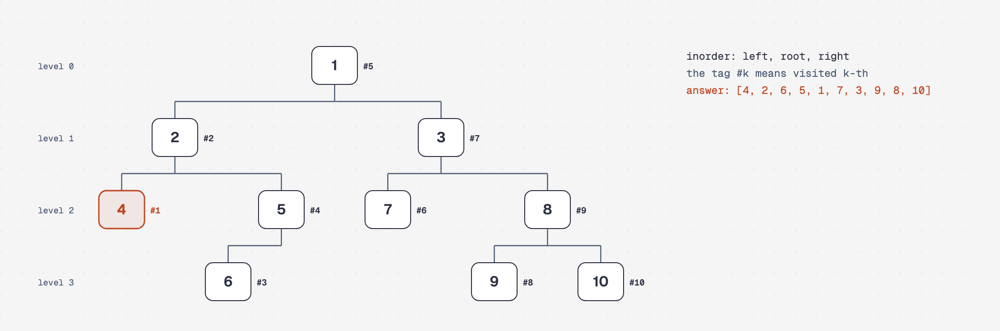
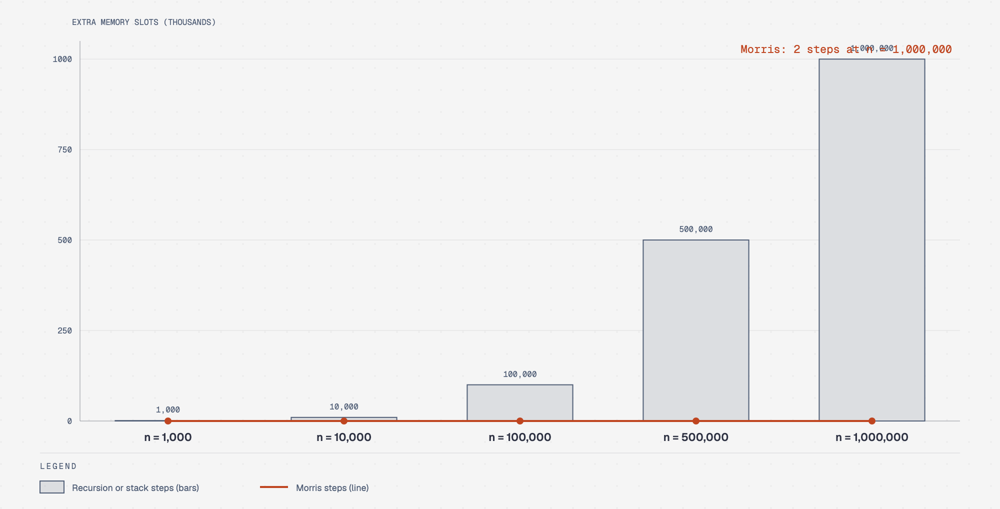
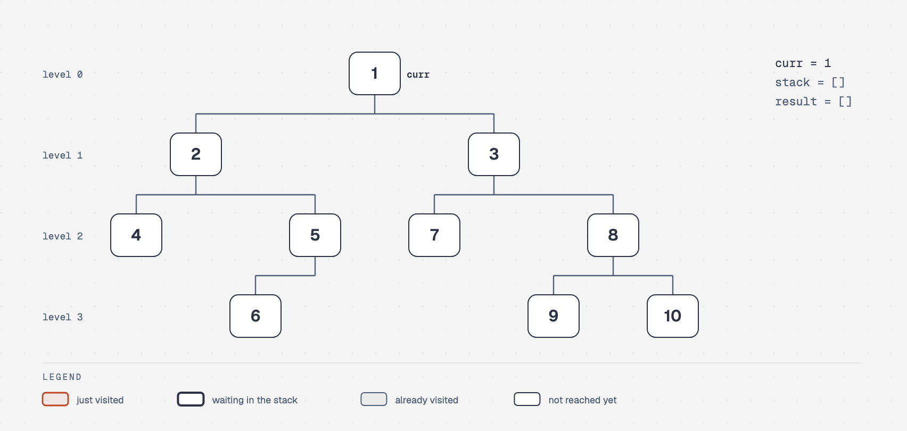
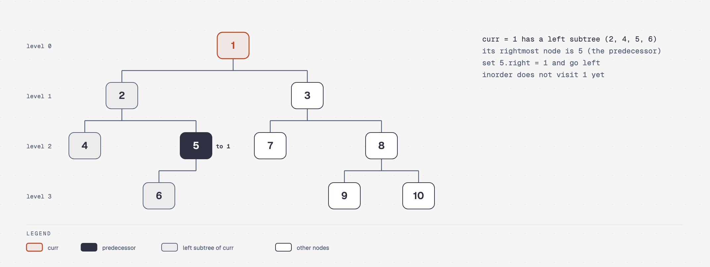
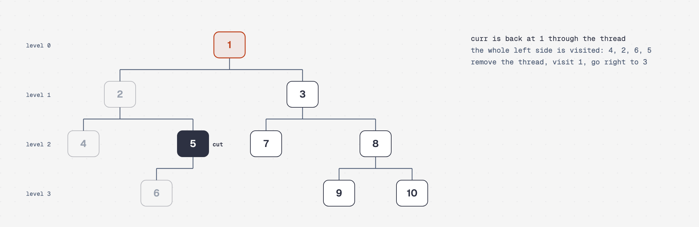

# 05. 94. Binary Tree Inorder Traversal

| Difficulty | Pattern | Key idea | Source | Time | Space | Before / after |
|:---:|:---:|:---|:---:|:---:|:---:|:---:|
| **Easy** | DFS Traversal (Left, Root, Right) | Go left as far as possible, visit the node on the way back, then turn right; a stack remembers the way back | [94. Binary Tree Inorder Traversal](https://leetcode.com/problems/binary-tree-inorder-traversal/) | `O(n)` | `O(h)`, or `O(1)` with Morris | [144. Preorder](04.%20144.%20Binary%20Tree%20Preorder%20Traversal.md) / [145. Postorder](06.%20145.%20Binary%20Tree%20Postorder%20Traversal.md) |

## 1. Problem Statement

Given the `root` of a binary tree, return the **inorder traversal** of its values: left subtree, then root, then right subtree.

### Example

**The tree we take:** the 10-node tree from the lecture board, as a LeetCode list `[1, 2, 3, 4, 5, 7, 8, None, None, 6, None, None, None, 9, 10]`.

```text
Input:  root = [1, 2, 3, 4, 5, 7, 8, None, None, 6, None, None, None, 9, 10]
Output: [4, 2, 6, 5, 1, 7, 3, 9, 8, 10]
```



It has the tricky parts of the problem: the first node visited (4) is deep on the left, not the root; node 5 has only a left child; and the root 1 lands in the middle of the answer. We use this tree in every section below.

LeetCode examples:

```text
root = [1, None, 2, 3]                                   gives [1, 3, 2]
root = [1, 2, 3, 4, 5, None, 8, None, None, 6, 7, 9]    gives [4, 2, 6, 5, 7, 1, 3, 9, 8]
root = []                                                gives []
root = [1]                                               gives [1]
```

### Constraints, in plain words

| Limit | What it means in plain words | What it tells us |
|:---|:---|:---|
| Number of nodes is `0` to `100` | The tree can be empty, and has at most 100 nodes | Any `O(n)` method is instant; handle the empty tree |
| `-100 <= Node.val <= 100` | Small whole numbers, maybe negative | Values do not matter; only the order does |
| Follow-up: "Recursive solution is trivial, could you do it iteratively?" | They want a version without recursion | Use your own stack, or Morris for `O(1)` space |

**How fast is fast enough?**

- Every method visits each node once: `O(n)` time. With at most 100 nodes, all are instant.
- The real difference is **extra memory**, exactly as in preorder: recursion and the stack keep up to `n` nodes on a chain-shaped tree, Morris keeps two pointers.

In the chart, the grey bars are the extra memory of recursion or a stack on a chain-shaped tree, and the orange line is Morris.



| Nodes `n` (chain-shaped tree) | Recursion stack depth | Explicit stack size | Morris extra pointers | Morris uses less by | Note |
|:---:|:---:|:---:|:---:|:---:|:---|
| 100 | 100 | up to 100 | 2 | about 50 times | The LeetCode limit: all three are fine |
| 1,000 | 1,000 | up to 1,000 | 2 | about 500 times | Python's default recursion limit is 1,000 |
| 100,000 | 100,000 | up to 100,000 | 2 | about 50,000 times | Recursion would crash in Python here |
| 1,000,000 | 1,000,000 | up to 1,000,000 | 2 | about 500,000 times | Only the stack or Morris work |

## 2. Core Idea

Inorder is **left, root, right**, and the rule repeats inside every subtree:

1. Do the whole inorder of the left subtree.
2. Visit the current node.
3. Do the whole inorder of the right subtree.

So the first node visited is the **leftmost** node, and every node is visited right after its whole left side.

**Without recursion:** keep walking left and push every node you pass onto a stack. When you cannot go left any more, pop a node, visit it, and then turn to its right child and do the same again. The stack holds exactly the nodes whose left side is still in progress.

**Where it matters:** in a binary search tree, inorder gives the values in **sorted order**. Many BST problems later in this chapter rely on that.

## 3. Edge Cases

| Case | Input | Expected | Why it matters | Code that handles it |
|:---|:---|:---:|:---|:---|
| Empty tree | `[]` | `[]` | No root at all | `while curr or stack` never runs |
| One node | `[1]` | `[1]` | Push it, pop it, done | The loops run once |
| Only right children | `[1, None, 2, 3]` | `[1, 3, 2]` | The root comes first because its left side is empty | Pop 1, then `curr = 1.right` |
| Only left children (a chain) | `[1, 2, None, 3]` | `[3, 2, 1]` | The deepest node comes first | The inner `while curr` pushes the whole chain |
| Node with one child | 5 in our tree | `..., 6, 5, ...` | Its right side is empty | `curr = node.right` becomes `None` |

## 4. Approach 1: Recursion

### Idea

Write the rule directly: recurse left, visit the node, recurse right.

### Code

```python
# Import List and Optional for type hints
from typing import List, Optional


# Solution for 94, recursive
class Solution:

    # Main method
    def inorderTraversal(self, root: Optional[TreeNode]) -> List[int]:

        # The visit order
        result = []

        # Left subtree, then the node, then the right subtree
        def dfs(node: Optional[TreeNode]) -> None:

            # A missing child: nothing to do
            if node is None:

                # Go back
                return

            # First the whole left subtree
            dfs(node.left)

            # Then visit the node
            result.append(node.val)

            # Then the whole right subtree
            dfs(node.right)

        # Start at the root
        dfs(root)

        # The inorder list
        return result
```

### Complexity

| Measure | Complexity | Why | At the limit (`n = 100`) | Compared with the others |
|:---|:---:|:---|:---:|:---|
| **Time** | `O(n)` | Each node is visited once; each `None` call is `O(1)` | about 200 calls | Same as the other two |
| **Space** | `O(h)` | The call stack holds one path from the root | up to 100 frames for a chain | Same as the stack method; Morris uses `O(1)` |

## 5. Approach 2: Iterative With a Stack

### Idea

1. `curr = root`, empty stack.
2. While `curr` exists or the stack is not empty:
   - Go left as far as possible, pushing every node you pass.
   - Pop the top node and visit it.
   - Set `curr` to its right child.

### Run it on our example, step by step

**The tree we take:** the 10-node tree above.

**How to read the pictures:** orange is the node just popped and visited, bold boxes are waiting in the stack, grey boxes are already visited, and the tag `next` marks where `curr` goes after the step. In the notes, the **top** of the stack is on the right.

**Start:** `curr = 1`, the stack is empty.



**Step 1: pop 4**

- Go left from `curr`, pushing `1`, `2`, `4`.
- Pop `4` and visit it. Its left side is already finished.
- `4` has no right child, so `curr` becomes `None`.
- Stack: `[1, 2]`. Result: `[4]`.

![Step 1: pop 4 and visit it; the stack is now [1, 2]](images/in-stack-1.png)

**Step 2: pop 2**

- `curr` is `None`, so there is nothing new to push.
- Pop `2` and visit it. Its left side is already finished.
- `curr` moves to the right child `5`.
- Stack: `[1]`. Result: `[4, 2]`.

![Step 2: pop 2 and visit it; the stack is now [1]](images/in-stack-2.png)

**Step 3: pop 6**

- Go left from `curr`, pushing `5`, `6`.
- Pop `6` and visit it. Its left side is already finished.
- `6` has no right child, so `curr` becomes `None`.
- Stack: `[1, 5]`. Result: `[4, 2, 6]`.

![Step 3: pop 6 and visit it; the stack is now [1, 5]](images/in-stack-3.png)

**Step 4: pop 5**

- `curr` is `None`, so there is nothing new to push.
- Pop `5` and visit it. Its left side is already finished.
- `5` has no right child, so `curr` becomes `None`.
- Stack: `[1]`. Result: `[4, 2, 6, 5]`.

![Step 4: pop 5 and visit it; the stack is now [1]](images/in-stack-4.png)

**Step 5: pop 1**

- `curr` is `None`, so there is nothing new to push.
- Pop `1` and visit it. Its left side is already finished.
- `curr` moves to the right child `3`.
- Stack: `[]`. Result: `[4, 2, 6, 5, 1]`.

![Step 5: pop 1 and visit it; the stack is now []](images/in-stack-5.png)

**Step 6: pop 7**

- Go left from `curr`, pushing `3`, `7`.
- Pop `7` and visit it. Its left side is already finished.
- `7` has no right child, so `curr` becomes `None`.
- Stack: `[3]`. Result: `[4, 2, 6, 5, 1, 7]`.

![Step 6: pop 7 and visit it; the stack is now [3]](images/in-stack-6.png)

**Step 7: pop 3**

- `curr` is `None`, so there is nothing new to push.
- Pop `3` and visit it. Its left side is already finished.
- `curr` moves to the right child `8`.
- Stack: `[]`. Result: `[4, 2, 6, 5, 1, 7, 3]`.

![Step 7: pop 3 and visit it; the stack is now []](images/in-stack-7.png)

**Step 8: pop 9**

- Go left from `curr`, pushing `8`, `9`.
- Pop `9` and visit it. Its left side is already finished.
- `9` has no right child, so `curr` becomes `None`.
- Stack: `[8]`. Result: `[4, 2, 6, 5, 1, 7, 3, 9]`.

![Step 8: pop 9 and visit it; the stack is now [8]](images/in-stack-8.png)

**Step 9: pop 8**

- `curr` is `None`, so there is nothing new to push.
- Pop `8` and visit it. Its left side is already finished.
- `curr` moves to the right child `10`.
- Stack: `[]`. Result: `[4, 2, 6, 5, 1, 7, 3, 9, 8]`.

![Step 9: pop 8 and visit it; the stack is now []](images/in-stack-9.png)

**Step 10: pop 10**

- Go left from `curr`, pushing `10`.
- Pop `10` and visit it. Its left side is already finished.
- `10` has no right child, so `curr` becomes `None`.
- Stack: `[]`. Result: `[4, 2, 6, 5, 1, 7, 3, 9, 8, 10]`.
- `curr` is `None` and the stack is empty. Done: the answer is `[4, 2, 6, 5, 1, 7, 3, 9, 8, 10]`.

![Step 10: pop 10 and visit it; the stack is now []](images/in-stack-10.png)


**All steps at a glance**

| Step | Pushed while going left | Pop and visit | `curr` after (its right child) | Stack after (top on the right) | Result so far |
|:---:|:---|:---:|:---:|:---|:---|
| 1 | 1, 2, 4 | 4 | None | `[1, 2]` | `[4]` |
| 2 | none | 2 | 5 | `[1]` | `[4, 2]` |
| 3 | 5, 6 | 6 | None | `[1, 5]` | `[4, 2, 6]` |
| 4 | none | 5 | None | `[1]` | `[4, 2, 6, 5]` |
| 5 | none | 1 | 3 | `[]` | `[4, 2, 6, 5, 1]` |
| 6 | 3, 7 | 7 | None | `[3]` | `[4, 2, 6, 5, 1, 7]` |
| 7 | none | 3 | 8 | `[]` | `[4, 2, 6, 5, 1, 7, 3]` |
| 8 | 8, 9 | 9 | None | `[8]` | `[4, 2, 6, 5, 1, 7, 3, 9]` |
| 9 | none | 8 | 10 | `[]` | `[4, 2, 6, 5, 1, 7, 3, 9, 8]` |
| 10 | 10 | 10 | None | `[]` | `[4, 2, 6, 5, 1, 7, 3, 9, 8, 10]` |

Ten pops, one per node. Each node was pushed once, on the way down its left side.

### Code

```python
# Import List and Optional for type hints
from typing import List, Optional


# Solution for 94, iterative with a stack
class Solution:

    # Main method
    def inorderTraversal(self, root: Optional[TreeNode]) -> List[int]:

        # The visit order
        result = []

        # Nodes whose left side is still in progress; the top is the end of the list
        stack = []

        # The node we are standing on
        curr = root

        # Keep going while there is a node to explore or one waiting
        while curr or stack:

            # Go left as far as possible
            while curr:

                # Remember this node for later
                stack.append(curr)

                # Step to the left child
                curr = curr.left

            # The left side of the top node is finished
            node = stack.pop()

            # Visit it
            result.append(node.val)

            # Now explore its right subtree
            curr = node.right

        # The inorder list
        return result
```

### Complexity

| Measure | Complexity | Why | At the limit (`n = 100`) | Compared with the others |
|:---|:---:|:---|:---:|:---|
| **Time** | `O(n)` | Each node is pushed once and popped once | 100 pushes and 100 pops | Same as recursion |
| **Space** | `O(h)` | The stack holds one path of "left side not finished" nodes | at most 100 nodes | No recursion limit to worry about |

## 6. Approach 3: Morris Traversal (`O(1)` Space)

### Idea

Same threads as Morris preorder; only the **moment of the visit** changes:

1. If `curr` has no left child: visit `curr`, go right.
2. Otherwise find the predecessor (rightmost node of the left subtree):
   - If its `right` is empty: make a thread `pred.right = curr` and go left. **Do not visit yet.**
   - If its `right` already points to `curr`: the left side is done. Remove the thread, **visit `curr`**, and go right.





### Every step of Morris on our tree

| Step | `curr` | Left child? | Predecessor | Thread found? | Action | Result so far |
|:---:|:---:|:---:|:---:|:---:|:---|:---|
| 1 | 1 | Yes | 5 | No | Make thread 5.right = 1, go left to 2 (no visit) | `[]` |
| 2 | 2 | Yes | 4 | No | Make thread 4.right = 2, go left to 4 (no visit) | `[]` |
| 3 | 4 | No | - | - | Visit 4, go right to 2 | `[4]` |
| 4 | 2 | Yes | 4 | Yes | Remove thread, visit 2, go right to 5 | `[4, 2]` |
| 5 | 5 | Yes | 6 | No | Make thread 6.right = 5, go left to 6 (no visit) | `[4, 2]` |
| 6 | 6 | No | - | - | Visit 6, go right to 5 | `[4, 2, 6]` |
| 7 | 5 | Yes | 6 | Yes | Remove thread, visit 5, go right to 1 | `[4, 2, 6, 5]` |
| 8 | 1 | Yes | 5 | Yes | Remove thread, visit 1, go right to 3 | `[4, 2, 6, 5, 1]` |
| 9 | 3 | Yes | 7 | No | Make thread 7.right = 3, go left to 7 (no visit) | `[4, 2, 6, 5, 1]` |
| 10 | 7 | No | - | - | Visit 7, go right to 3 | `[4, 2, 6, 5, 1, 7]` |
| 11 | 3 | Yes | 7 | Yes | Remove thread, visit 3, go right to 8 | `[4, 2, 6, 5, 1, 7, 3]` |
| 12 | 8 | Yes | 9 | No | Make thread 9.right = 8, go left to 9 (no visit) | `[4, 2, 6, 5, 1, 7, 3]` |
| 13 | 9 | No | - | - | Visit 9, go right to 8 | `[4, 2, 6, 5, 1, 7, 3, 9]` |
| 14 | 8 | Yes | 9 | Yes | Remove thread, visit 8, go right to 10 | `[4, 2, 6, 5, 1, 7, 3, 9, 8]` |
| 15 | 10 | No | - | - | Visit 10, go right to None (end) | `[4, 2, 6, 5, 1, 7, 3, 9, 8, 10]` |

Every thread is removed again, so the tree is unchanged at the end.

### Code

```python
# Import List and Optional for type hints
from typing import List, Optional


# Solution for 94, Morris traversal with O(1) extra space
class Solution:

    # Main method
    def inorderTraversal(self, root: Optional[TreeNode]) -> List[int]:

        # The visit order
        result = []

        # The node we are standing on
        curr = root

        # Walk until we fall off the tree
        while curr:

            # No left subtree: visit and go right
            if curr.left is None:

                # Visit the current node
                result.append(curr.val)

                # Move right (this may follow a thread back up)
                curr = curr.right

            # There is a left subtree
            else:

                # Start looking for the predecessor in the left subtree
                pred = curr.left

                # Go right as far as possible, stopping at an old thread
                while pred.right and pred.right is not curr:

                    # One step right
                    pred = pred.right

                # No thread yet: first time at curr
                if pred.right is None:

                    # Make a thread back to curr
                    pred.right = curr

                    # Go into the left subtree without visiting curr
                    curr = curr.left

                # The thread exists: the left subtree is done
                else:

                    # Remove the thread to restore the tree
                    pred.right = None

                    # Inorder visits curr after its left subtree
                    result.append(curr.val)

                    # Move on to the right subtree
                    curr = curr.right

        # The inorder list
        return result
```

### Complexity

| Measure | Complexity | Why | At the limit (`n = 100`) | Compared with the others |
|:---|:---:|:---|:---:|:---|
| **Time** | `O(n)` | Each edge is walked at most a few times while finding predecessors | a few hundred steps | Slower by a constant, same order |
| **Space** | `O(1)` | Only `curr` and `pred`; threads reuse empty links | 2 pointers | The only method with constant extra memory |

### All three at a glance

| Approach | Time | Space | Good for | Watch out for |
|:---|:---:|:---:|:---|:---|
| Recursion | `O(n)` | `O(h)` | Shortest and clearest; the default answer | Python's recursion limit on very deep trees |
| Stack | `O(n)` | `O(h)` | The follow-up "do it iteratively" | The loop condition is `curr or stack`, not just `stack` |
| Morris | `O(n)` | `O(1)` | Constant extra memory | Visit when the thread is **removed**, not when it is made |

## 7. Common Mistakes

| Mistake | What goes wrong | Fix |
|:---|:---|:---|
| Looping only `while stack` | The loop stops before the right subtree of the root is explored | Loop `while curr or stack` |
| Visiting before going left | You get preorder instead | Push while going left; visit only after a pop |
| Forgetting `curr = node.right` | The right subtrees are never visited | After visiting, always turn right |
| In Morris, visiting when the thread is made | You get preorder instead of inorder | Visit when there is no left child, or when the thread is removed |
| In Morris, not removing threads | The tree is left changed, and later code loops forever | Set `pred.right = None` on the way back |

## 8. Interview Follow-ups

### Q1. Why does inorder of a binary search tree come out sorted?

**Answer:**
- In a BST, everything in the left subtree is smaller than the node, and everything in the right subtree is bigger.
- Left, root, right therefore lists values from smallest to largest.

### Q2. How do you find the k-th smallest value in a BST (LeetCode 230)?

**Answer:**
- Run the iterative inorder and count the pops.
- The k-th pop is the answer, so you can stop early: `O(h + k)` time.

### Q3. How do you check that a tree is a valid BST (LeetCode 98)?

**Answer:**
- Do an inorder traversal and check that every value is bigger than the one before it.
- Keep only the previous value, so no list is needed.

### Q4. How can you get "reverse inorder" (right, root, left)?

**Answer:**
- Swap left and right everywhere in the code.
- In a BST it lists values from largest to smallest.

### Q5. What is the "predecessor" in Morris traversal, in plain words?

**Answer:**
- It is the node visited just before `curr` in inorder: the rightmost node of `curr`'s left subtree.
- Its right link is always empty, so it can safely hold a temporary thread back to `curr`.

## 9. Interview Explanation

> Inorder visits the left subtree, then the root, then the right subtree. Recursively that is: recurse left, visit, recurse right. Iteratively I keep a current pointer and a stack: I walk left as far as possible, pushing every node, then pop one, visit it, and move to its right child, and repeat while the pointer or the stack is non-empty. Both are O(n) time and O(h) space. For constant space, Morris traversal links the rightmost node of each left subtree back to the current node, goes left, and visits the current node when it comes back and removes the link. For a binary search tree, inorder gives the values in sorted order.
