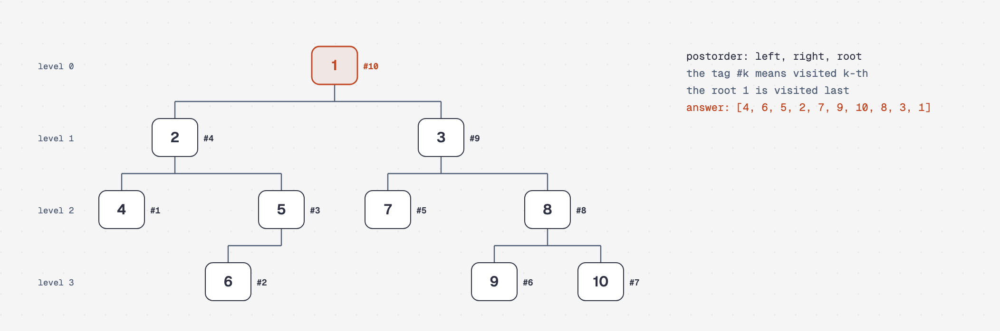
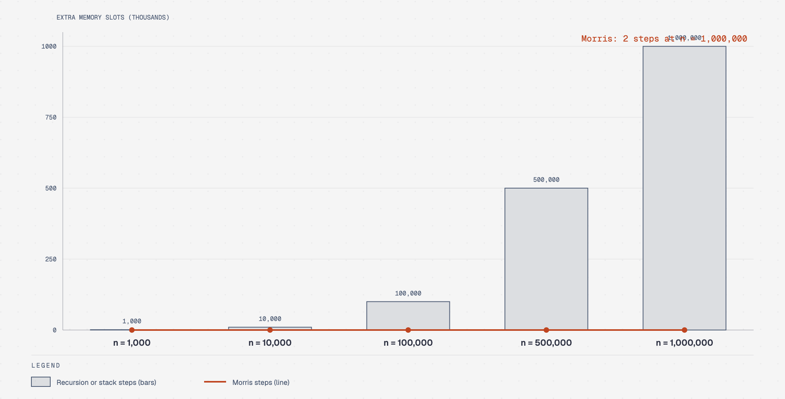
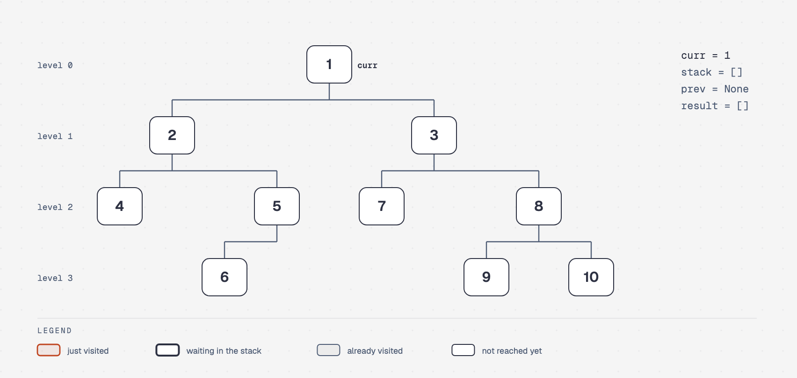

# 06. 145. Binary Tree Postorder Traversal

| Difficulty | Pattern | Key idea | Source | Time | Space | Before / after |
|:---:|:---:|:---|:---:|:---:|:---:|:---:|
| **Easy** | DFS Traversal (Left, Right, Root) | A node is visited only after both of its subtrees are finished; with one stack, a `prev` pointer tells us the right side is done | [145. Binary Tree Postorder Traversal](https://leetcode.com/problems/binary-tree-postorder-traversal/) | `O(n)` | `O(h)`, or `O(1)` with Morris | [94. Inorder](05.%2094.%20Binary%20Tree%20Inorder%20Traversal.md) / [102. Level Order](07.%20102.%20Binary%20Tree%20Level%20Order%20Traversal.md) |

## 1. Problem Statement

Given the `root` of a binary tree, return the **postorder traversal** of its values: left subtree, then right subtree, then root.

### Example

**The tree we take:** the 10-node tree from the lecture board, as a LeetCode list `[1, 2, 3, 4, 5, 7, 8, None, None, 6, None, None, None, 9, 10]`.

```text
Input:  root = [1, 2, 3, 4, 5, 7, 8, None, None, 6, None, None, None, 9, 10]
Output: [4, 6, 5, 2, 7, 9, 10, 8, 3, 1]
```



It has the tricky parts of the problem: a node has to be passed **twice** before it can be visited (once on the way down, once after its right side), and the root comes **last**. We use this tree in every section below.

LeetCode examples:

```text
root = [1, None, 2, 3]                                   gives [3, 2, 1]
root = [1, 2, 3, 4, 5, None, 8, None, None, 6, 7, 9]    gives [4, 6, 7, 5, 2, 9, 8, 3, 1]
root = []                                                gives []
root = [1]                                               gives [1]
```

### Constraints, in plain words

| Limit | What it means in plain words | What it tells us |
|:---|:---|:---|
| Number of nodes is `0` to `100` | The tree can be empty, and has at most 100 nodes | Any `O(n)` method is instant; handle the empty tree |
| `-100 <= Node.val <= 100` | Small whole numbers, maybe negative | Values do not matter; only the order does |
| Follow-up: iterative | Can you do it without recursion? | Two stacks (easy), one stack (harder), Morris (hardest) |

**How fast is fast enough?**

- Every method visits each node once: `O(n)` time. With at most 100 nodes, all are instant.
- They differ in **extra memory**: recursion and one stack keep one path (`O(h)`), two stacks keep every node (`O(n)`), Morris keeps a few pointers (`O(1)`).

In the chart, the grey bars are the extra memory of recursion or a stack on a chain-shaped tree, and the orange line is Morris.



| Nodes `n` (chain-shaped tree) | Recursion or one stack | Two stacks | Morris extra pointers | Morris uses less by | Note |
|:---:|:---:|:---:|:---:|:---:|:---|
| 100 | 100 | 100 in each stack | about 4 | about 25 times | The LeetCode limit: all four are fine |
| 1,000 | 1,000 | 1,000 in each stack | about 4 | about 250 times | Python's default recursion limit is 1,000 |
| 100,000 | 100,000 | 100,000 in each stack | about 4 | about 25,000 times | Recursion would crash in Python here |
| 1,000,000 | 1,000,000 | 1,000,000 in each stack | about 4 | about 250,000 times | Only the stacks or Morris work |

## 2. Core Idea

Postorder is **left, right, root**, and the rule repeats inside every subtree:

1. Do the whole postorder of the left subtree.
2. Do the whole postorder of the right subtree.
3. Visit the current node.

A node is visited only after **both** of its subtrees. That is why postorder fits "bottom-up" problems: when you reach a node, its children's answers (height, size, sum) are already known.

**Why one stack is tricky.** When we look at a node on top of the stack, we do not know whether we have come back from its left side or from its right side. The fix is a pointer `prev` = the last node we visited. If the top node's right child is `prev` (or there is no right child), its right side is finished and it can be visited. Otherwise we still have to go right.

## 3. Edge Cases

| Case | Input | Expected | Why it matters | Code that handles it |
|:---|:---|:---:|:---|:---|
| Empty tree | `[]` | `[]` | No root at all | `while curr or stack` never runs |
| One node | `[1]` | `[1]` | No children, visited at once | `node.right is None`, so visit |
| Only right children | `[1, None, 2, 3]` | `[3, 2, 1]` | The root must wait for its right side | `node.right is not prev`, so go right first |
| Only left children (a chain) | `[1, 2, None, 3]` | `[3, 2, 1]` | The deepest node comes first | The inner `while curr` pushes the whole chain |
| Node with only a left child | 5 in our tree | `..., 6, 5, ...` | It is visited right after its left side | `node.right is None` |

## 4. Approach 1: Recursion

### Idea

Write the rule directly: recurse left, recurse right, then visit the node.

### Code

```python
# Import List and Optional for type hints
from typing import List, Optional


# Solution for 145, recursive
class Solution:

    # Main method
    def postorderTraversal(self, root: Optional[TreeNode]) -> List[int]:

        # The visit order
        result = []

        # Left subtree, then right subtree, then the node
        def dfs(node: Optional[TreeNode]) -> None:

            # A missing child: nothing to do
            if node is None:

                # Go back
                return

            # First the whole left subtree
            dfs(node.left)

            # Then the whole right subtree
            dfs(node.right)

            # The node comes last
            result.append(node.val)

        # Start at the root
        dfs(root)

        # The postorder list
        return result
```

### Complexity

| Measure | Complexity | Why | At the limit (`n = 100`) | Compared with the others |
|:---|:---:|:---|:---:|:---|
| **Time** | `O(n)` | Each node is visited once; each `None` call is `O(1)` | about 200 calls | Same as the others |
| **Space** | `O(h)` | The call stack holds one path from the root | up to 100 frames for a chain | Same as one stack; Morris uses `O(1)` |

## 5. Approach 2: Two Stacks

### Idea

Postorder is **left, right, root**. Read backwards, that is **root, right, left**, which is a preorder with left and right swapped, easy to do with a stack. So:

1. Run a "root, right, left" traversal with `stack1`, pushing each popped node onto `stack2`.
2. Pop everything off `stack2`: it comes out reversed, which is postorder.

### Run it on our example

| Step | Pop from `stack1` | Push onto `stack2` | Push children onto `stack1` (left, then right) | `stack1` after | `stack2` after |
|:---:|:---:|:---:|:---|:---|:---|
| 1 | 1 | 1 | 2, 3 | `[2, 3]` | `[1]` |
| 2 | 3 | 3 | 7, 8 | `[2, 7, 8]` | `[1, 3]` |
| 3 | 8 | 8 | 9, 10 | `[2, 7, 9, 10]` | `[1, 3, 8]` |
| 4 | 10 | 10 | none (leaf) | `[2, 7, 9]` | `[1, 3, 8, 10]` |
| 5 | 9 | 9 | none (leaf) | `[2, 7]` | `[1, 3, 8, 10, 9]` |
| 6 | 7 | 7 | none (leaf) | `[2]` | `[1, 3, 8, 10, 9, 7]` |
| 7 | 2 | 2 | 4, 5 | `[4, 5]` | `[1, 3, 8, 10, 9, 7, 2]` |
| 8 | 5 | 5 | 6 | `[4, 6]` | `[1, 3, 8, 10, 9, 7, 2, 5]` |
| 9 | 6 | 6 | none (leaf) | `[4]` | `[1, 3, 8, 10, 9, 7, 2, 5, 6]` |
| 10 | 4 | 4 | none (leaf) | `[]` | `[1, 3, 8, 10, 9, 7, 2, 5, 6, 4]` |

Popping `stack2` from the top gives `[4, 6, 5, 2, 7, 9, 10, 8, 3, 1]`, the postorder.

### Code

```python
# Import List and Optional for type hints
from typing import List, Optional


# Solution for 145, two stacks
class Solution:

    # Main method
    def postorderTraversal(self, root: Optional[TreeNode]) -> List[int]:

        # An empty tree has an empty postorder
        if root is None:

            # Nothing to visit
            return []

        # Drives a root, right, left walk
        stack1 = [root]

        # Collects nodes in root, right, left order
        stack2 = []

        # Walk until stack1 is empty
        while stack1:

            # Take the top node
            node = stack1.pop()

            # Keep it for the reversed read-out
            stack2.append(node)

            # Push left first, so right is popped first
            if node.left:

                # The left child waits underneath
                stack1.append(node.left)

            # Push right last
            if node.right:

                # The right child sits on top
                stack1.append(node.right)

        # Reading stack2 backwards gives left, right, root
        return [node.val for node in reversed(stack2)]
```

### Complexity

| Measure | Complexity | Why | At the limit (`n = 100`) | Compared with the others |
|:---|:---:|:---|:---:|:---|
| **Time** | `O(n)` | Each node is pushed and popped twice, once per stack | about 400 stack operations | Same order as the others |
| **Space** | `O(n)` | `stack2` holds every node before the answer is read out | 100 nodes | More memory than one stack |

## 6. Approach 3: One Stack With `prev`

### Idea

1. Go left as far as possible, pushing every node.
2. Look at the top node (do not pop yet).
   - If it has a right child that is **not** `prev`, its right side is not done: move to that right child and repeat.
   - Otherwise its right side is done (or empty): pop it, visit it, set `prev` to it.

### Run it on our example, step by step

**The tree we take:** the 10-node tree above.

**How to read the pictures:** orange is the node just visited, bold boxes are waiting in the stack, grey boxes are already visited. Each step lists everything that happened since the last visit. In the notes, the **top** of the stack is on the right.

**Start:** `curr = 1`, the stack is empty, `prev = None`.



**Step 1: visit 4**

- Push 1, 2, 4.
- Top 4: no right child, visit 4.
- Set `prev = 4`. Stack: `[1, 2]`. Result: `[4]`.

![Step 1: visit 4; the stack is now [1, 2]](images/post-stack-1.png)

**Step 2: visit 6**

- Top 2: right child 5 not done, go right.
- Push 5, 6.
- Top 6: no right child, visit 6.
- Set `prev = 6`. Stack: `[1, 2, 5]`. Result: `[4, 6]`.

![Step 2: visit 6; the stack is now [1, 2, 5]](images/post-stack-2.png)

**Step 3: visit 5**

- Top 5: no right child, visit 5.
- Set `prev = 5`. Stack: `[1, 2]`. Result: `[4, 6, 5]`.

![Step 3: visit 5; the stack is now [1, 2]](images/post-stack-3.png)

**Step 4: visit 2**

- Top 2: right child 5 is done (prev), visit 2.
- Set `prev = 2`. Stack: `[1]`. Result: `[4, 6, 5, 2]`.

![Step 4: visit 2; the stack is now [1]](images/post-stack-4.png)

**Step 5: visit 7**

- Top 1: right child 3 not done, go right.
- Push 3, 7.
- Top 7: no right child, visit 7.
- Set `prev = 7`. Stack: `[1, 3]`. Result: `[4, 6, 5, 2, 7]`.

![Step 5: visit 7; the stack is now [1, 3]](images/post-stack-5.png)

**Step 6: visit 9**

- Top 3: right child 8 not done, go right.
- Push 8, 9.
- Top 9: no right child, visit 9.
- Set `prev = 9`. Stack: `[1, 3, 8]`. Result: `[4, 6, 5, 2, 7, 9]`.

![Step 6: visit 9; the stack is now [1, 3, 8]](images/post-stack-6.png)

**Step 7: visit 10**

- Top 8: right child 10 not done, go right.
- Push 10.
- Top 10: no right child, visit 10.
- Set `prev = 10`. Stack: `[1, 3, 8]`. Result: `[4, 6, 5, 2, 7, 9, 10]`.

![Step 7: visit 10; the stack is now [1, 3, 8]](images/post-stack-7.png)

**Step 8: visit 8**

- Top 8: right child 10 is done (prev), visit 8.
- Set `prev = 8`. Stack: `[1, 3]`. Result: `[4, 6, 5, 2, 7, 9, 10, 8]`.

![Step 8: visit 8; the stack is now [1, 3]](images/post-stack-8.png)

**Step 9: visit 3**

- Top 3: right child 8 is done (prev), visit 3.
- Set `prev = 3`. Stack: `[1]`. Result: `[4, 6, 5, 2, 7, 9, 10, 8, 3]`.

![Step 9: visit 3; the stack is now [1]](images/post-stack-9.png)

**Step 10: visit 1**

- Top 1: right child 3 is done (prev), visit 1.
- Set `prev = 1`. Stack: `[]`. Result: `[4, 6, 5, 2, 7, 9, 10, 8, 3, 1]`.
- The stack is empty and `curr` is `None`. Done: the answer is `[4, 6, 5, 2, 7, 9, 10, 8, 3, 1]`.

![Step 10: visit 1; the stack is now []](images/post-stack-10.png)


**All steps at a glance**

| Step | What happened since the last visit | Visited | Stack after (top on the right) | Result so far |
|:---:|:---|:---:|:---|:---|
| 1 | push 1, 2, 4; top 4: no right child, visit 4 | 4 | `[1, 2]` | `[4]` |
| 2 | top 2: right child 5 not done, go right; push 5, 6; top 6: no right child, visit 6 | 6 | `[1, 2, 5]` | `[4, 6]` |
| 3 | top 5: no right child, visit 5 | 5 | `[1, 2]` | `[4, 6, 5]` |
| 4 | top 2: right child 5 is done (prev), visit 2 | 2 | `[1]` | `[4, 6, 5, 2]` |
| 5 | top 1: right child 3 not done, go right; push 3, 7; top 7: no right child, visit 7 | 7 | `[1, 3]` | `[4, 6, 5, 2, 7]` |
| 6 | top 3: right child 8 not done, go right; push 8, 9; top 9: no right child, visit 9 | 9 | `[1, 3, 8]` | `[4, 6, 5, 2, 7, 9]` |
| 7 | top 8: right child 10 not done, go right; push 10; top 10: no right child, visit 10 | 10 | `[1, 3, 8]` | `[4, 6, 5, 2, 7, 9, 10]` |
| 8 | top 8: right child 10 is done (prev), visit 8 | 8 | `[1, 3]` | `[4, 6, 5, 2, 7, 9, 10, 8]` |
| 9 | top 3: right child 8 is done (prev), visit 3 | 3 | `[1]` | `[4, 6, 5, 2, 7, 9, 10, 8, 3]` |
| 10 | top 1: right child 3 is done (prev), visit 1 | 1 | `[]` | `[4, 6, 5, 2, 7, 9, 10, 8, 3, 1]` |

Every node is pushed once and visited once, and the stack never holds more than one path from the root.

### Code

```python
# Import List and Optional for type hints
from typing import List, Optional


# Solution for 145, one stack with a prev pointer
class Solution:

    # Main method
    def postorderTraversal(self, root: Optional[TreeNode]) -> List[int]:

        # The visit order
        result = []

        # Nodes waiting for their subtrees; the top is the end of the list
        stack = []

        # The node we are standing on
        curr = root

        # The node visited most recently
        prev = None

        # Keep going while there is a node to explore or one waiting
        while curr or stack:

            # Go left as far as possible
            while curr:

                # Remember this node for later
                stack.append(curr)

                # Step to the left child
                curr = curr.left

            # Look at the top node without removing it
            node = stack[-1]

            # Its right side exists and is not finished yet
            if node.right and node.right is not prev:

                # Go and explore the right side
                curr = node.right

            # Its right side is finished or empty
            else:

                # Remove it from the stack
                stack.pop()

                # Visit it
                result.append(node.val)

                # Remember it as the last visited node
                prev = node

        # The postorder list
        return result
```

### Complexity

| Measure | Complexity | Why | At the limit (`n = 100`) | Compared with the others |
|:---|:---:|:---|:---:|:---|
| **Time** | `O(n)` | Each node is pushed once, looked at a few times, and popped once | about 300 steps | Same order as the others |
| **Space** | `O(h)` | The stack holds one path from the root | at most 100 nodes for a chain | Less memory than two stacks |

## 7. Approach 4: Morris Traversal (`O(1)` Space)

### Idea

Morris postorder uses the same threads as Morris inorder, plus one more trick:

- Put a dummy node above the root (`dummy.left = root`), so the root also has a "parent" to come back to.
- When a thread is found the second time (the left side of `curr` is finished), visit the **right edge** of `curr`'s left subtree **from the bottom up**: from the predecessor back up to `curr.left`.
- To walk that edge upward without extra memory, reverse its `right` links, read it, and reverse them back.

### Every visit of Morris on our tree

| Event | `curr` | Its left subtree's right edge (top to bottom)&ensp;&#8203; | Visited (bottom to top) | Result so far |
|:---:|:---:|:---|:---|:---|
| 1 | 2 | 4 | 4 | `[4]` |
| 2 | 5 | 6 | 6 | `[4, 6]` |
| 3 | 1 | 2, 5 | 5, 2 | `[4, 6, 5, 2]` |
| 4 | 3 | 7 | 7 | `[4, 6, 5, 2, 7]` |
| 5 | 8 | 9 | 9 | `[4, 6, 5, 2, 7, 9]` |
| 6 | dummy | 1, 3, 8, 10 | 10, 8, 3, 1 | `[4, 6, 5, 2, 7, 9, 10, 8, 3, 1]` |

Joining the visited groups gives `[4, 6, 5, 2, 7, 9, 10, 8, 3, 1]`. All threads and reversed links are restored.

### Code

```python
# Import List and Optional for type hints
from typing import List, Optional


# Solution for 145, Morris traversal with O(1) extra space
class Solution:

    # Main method
    def postorderTraversal(self, root: Optional[TreeNode]) -> List[int]:

        # The visit order
        result = []

        # Reverse the right links on the path from start down to end
        def reverse(start: TreeNode, end: TreeNode) -> None:

            # The node that the current one will point back to
            prev = None

            # The node being re-linked
            node = start

            # Walk the path, flipping each right link
            while node is not end:

                # Remember the next node on the path
                nxt = node.right

                # Point back instead of forward
                node.right = prev

                # Move prev forward
                prev = node

                # Move to the next node
                node = nxt

            # Flip the last link too
            end.right = prev

        # A helper root so the real root is a left subtree too
        dummy = TreeNode(0)

        # Hang the real tree on the left of the dummy
        dummy.left = root

        # The node we are standing on
        curr = dummy

        # Walk until we fall off the dummy's right side
        while curr:

            # No left subtree: just go right
            if curr.left is None:

                # Move right (this may follow a thread back up)
                curr = curr.right

            # There is a left subtree
            else:

                # Start looking for the predecessor
                pred = curr.left

                # Go right as far as possible, stopping at an old thread
                while pred.right and pred.right is not curr:

                    # One step right
                    pred = pred.right

                # No thread yet: first time at curr
                if pred.right is None:

                    # Make a thread back to curr
                    pred.right = curr

                    # Go into the left subtree
                    curr = curr.left

                # The thread exists: the left subtree is finished
                else:

                    # Remove the thread
                    pred.right = None

                    # Turn the right edge from curr.left to pred upside down
                    reverse(curr.left, pred)

                    # Start reading at the bottom of that edge
                    node = pred

                    # Read the edge from bottom to top
                    while True:

                        # Visit this node
                        result.append(node.val)

                        # Stop at the top of the edge
                        if node is curr.left:

                            # The edge is fully read
                            break

                        # Move one node up the reversed edge
                        node = node.right

                    # Put the edge back the right way round
                    reverse(pred, curr.left)

                    # Move on to the right subtree
                    curr = curr.right

        # The postorder list
        return result
```

### Complexity

| Measure | Complexity | Why | At the limit (`n = 100`) | Compared with the others |
|:---|:---:|:---|:---:|:---|
| **Time** | `O(n)` | Each right edge is reversed, read and reversed back once | a few hundred steps | Slower by a constant |
| **Space** | `O(1)` | A few pointers; threads and reversals reuse links | about 4 pointers | The only constant-memory method |

### All four at a glance

| Approach | Time | Space | Difficulty | Good for | Watch out for |
|:---|:---:|:---:|:---:|:---|:---|
| Recursion | `O(n)` | `O(h)` | Easy | The default answer | Python's recursion limit on very deep trees |
| Two stacks | `O(n)` | `O(n)` | Medium | The easiest iterative version to remember | Push left before right into `stack1` |
| One stack with `prev` | `O(n)` | `O(h)` | Hard | Iterative with less memory | Peek first; pop only when the right side is done |
| Morris | `O(n)` | `O(1)` | Very hard | Constant extra memory | Reverse each right edge back after reading it |

## 8. Common Mistakes

| Mistake | What goes wrong | Fix |
|:---|:---|:---|
| Popping before checking the right side | A node is visited before its right subtree | Peek at `stack[-1]` first; pop only when the right side is done |
| Forgetting `prev` | The code goes right forever, back and forth | After visiting, set `prev = node` and `curr = None` |
| Two stacks: pushing right before left into `stack1` | The answer comes out as inorder-like nonsense | Push left, then right, so right is popped first |
| Comparing values instead of nodes for `prev` | Duplicate values break the check | Compare nodes: `node.right is prev` |
| Morris: not reversing the path back | The tree is left broken | Reverse the right edge again after reading it |

## 9. Interview Follow-ups

### Q1. Why is postorder good for deleting a tree?

**Answer:**
- Both children are freed before their parent.
- So no link is lost while it is still needed.

### Q2. How do you get the height of every node with postorder?

**Answer:**
- Height of a node = 1 + the bigger height of its two children.
- Postorder computes the children first, so each node's height is ready when it is visited.

### Q3. Is "reverse of root, right, left" really the same as postorder?

**Answer:**
- Yes. Reversing "root, right, left" gives "left, right, root" at every level, because the reversal also flips the order inside every subtree.

### Q4. What does `prev` mean in plain words?

**Answer:**
- It is the node we visited just before.
- If it is the right child of the top node, we have just come back up from the right side, so the top node is ready.

### Q5. Which approach would you write in an interview?

**Answer:**
- Recursion first. If asked for iterative, two stacks is the safest to write correctly.
- Mention the one-stack version for `O(h)` memory, and Morris only if constant space is asked.

## 10. Interview Explanation

> Postorder visits the left subtree, then the right subtree, then the root. Recursively that is recurse left, recurse right, visit. Iteratively, the simplest way is two stacks: a root-right-left traversal pushed onto a second stack comes out reversed as postorder. With one stack I go left as far as possible, then peek at the top: if it has a right child I have not finished, I go right; otherwise I pop it, visit it and remember it as prev, which is how I know later that a right subtree is done. All of these are O(n) time; recursion and one stack use O(h) space, two stacks use O(n), and Morris traversal can do it in O(1) by threading and reversing right edges.
