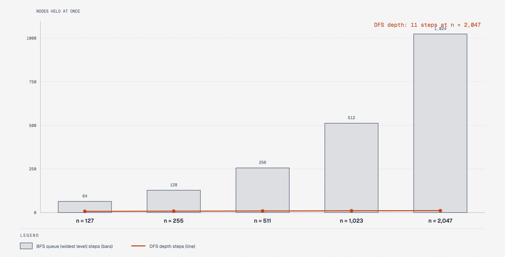
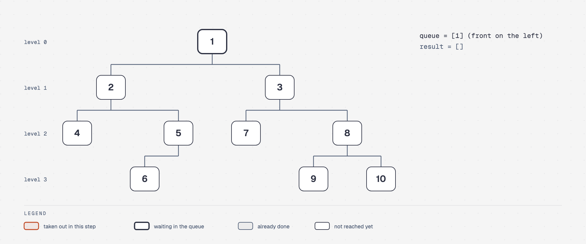

# 07. 102. Binary Tree Level Order Traversal

| Difficulty | Pattern | Key idea | Source | Time | Space | Before / after |
|:---:|:---:|:---|:---:|:---:|:---:|:---:|
| **Medium** | BFS With a Queue | Keep the nodes of one level in a queue; take exactly that many out, and their children form the next level | [102. Binary Tree Level Order Traversal](https://leetcode.com/problems/binary-tree-level-order-traversal/) | `O(n)` | `O(n)` | [145. Postorder](06.%20145.%20Binary%20Tree%20Postorder%20Traversal.md) / [103. Zigzag](08.%20103.%20Binary%20Tree%20Zigzag%20Level%20Order%20Traversal.md) |

## 1. Problem Statement

Given the `root` of a binary tree, return the **level order traversal** of its values: level by level, and from left to right inside each level. Each level is its own list.

### Example

**The tree we take:** the 10-node tree used in this whole section, as a LeetCode list `[1, 2, 3, 4, 5, 7, 8, None, None, 6, None, None, None, 9, 10]`.

```text
Input:  root = [1, 2, 3, 4, 5, 7, 8, None, None, 6, None, None, None, 9, 10]
Output: [[1], [2, 3], [4, 5, 7, 8], [6, 9, 10]]
```

![The tree we take, grouped by level: [1], [2, 3], [4, 5, 7, 8], [6, 9, 10]](images/lvl-example.png)

It has the tricky part of the problem: the last level, `[6, 9, 10]`, has nodes from **both** sides of the tree (6 is under 5 on the left, 9 and 10 are under 8 on the right), with gaps between them. We use this tree in every section below.

The lecture uses the perfect tree `1; 2, 3; 4, 5, 6, 7`, which gives `[[1], [2, 3], [4, 5, 6, 7]]`. LeetCode examples:

```text
root = [3, 9, 20, None, None, 15, 7]   gives [[3], [9, 20], [15, 7]]
root = [1]                              gives [[1]]
root = []                               gives []
```

### Constraints, in plain words

| Limit | What it means in plain words | What it tells us |
|:---|:---|:---|
| Number of nodes is `0` to `2000` | The tree can be empty, and has at most 2,000 nodes | `O(n)` is instant; return `[]` for an empty tree |
| `-1000 <= Node.val <= 1000` | Small whole numbers, maybe negative | Values do not matter; only positions do |
| Answer is a list of lists | One inner list per level | We must know **where each level ends** |

**How fast is fast enough?**

- Every method visits each node once: `O(n)` time, instant for 2,000 nodes.
- Memory is where BFS and DFS differ. BFS keeps one **level** in its queue, so its memory follows the **width** of the tree. DFS keeps one **path**, so its memory follows the **height**.

In the chart, on perfect trees of growing size, the grey bars are the most nodes the BFS queue holds at once (the whole last level), and the orange line is the deepest a DFS goes. Both were worked out from the shape of a perfect tree.



| Nodes `n` (perfect tree) | Levels | BFS queue at most (last level) | DFS depth at most | DFS holds fewer by | Note |
|:---:|:---:|:---:|:---:|:---:|:---|
| 127 | 7 | 64 | 7 | about 9 times | Wide trees make the queue big |
| 255 | 8 | 128 | 8 | about 16 times | |
| 511 | 9 | 256 | 9 | about 28 times | |
| 1,023 | 10 | 512 | 10 | about 51 times | |
| 2,047 | 11 | 1,024 | 11 | about 93 times | Just above the LeetCode limit of 2,000 |

Both are fine here. The answer itself holds all `n` values anyway, so the total space is `O(n)` either way.

## 2. Core Idea

Level order is **breadth-first search** (BFS): finish a whole level before going one level deeper. A **queue** (first in, first out) does exactly that, because children are added at the back and come out only after everything that was already waiting.

**How do we know where a level ends?** At the start of each round, the queue holds **exactly one whole level**. So:

1. Read `size = len(queue)`.
2. Take out exactly `size` nodes. That is one level.
3. While taking them out, add their children to the back. Those are the next level.

The lecture draws this as rows in a box: `[1]`, then `[2, 3]`, then `[4, 5, 6, 7]`, each row taken out before the next is read.

## 3. Edge Cases

| Case | Input | Expected | Why it matters | Code that handles it |
|:---|:---|:---:|:---|:---|
| Empty tree | `[]` | `[]` | No root to put in the queue | `if root is None: return []` |
| One node | `[1]` | `[[1]]` | One level with one node | The loop runs once |
| A chain | `[1, 2, None, 3]` | `[[1], [2], [3]]` | Every level has one node | `size` is 1 every round |
| Gaps in a level | our tree | `[6, 9, 10]` | Nodes of a level can be far apart | Children are queued left to right, so order is kept |
| Missing left child | `[1, None, 2]` | `[[1], [2]]` | Only a right child | `if node.left:` skips the missing one |

## 4. Approach 1: DFS With a Level Number

### Idea

Walk the tree with ordinary recursion (preorder), but pass the **level** down. When a level is reached for the first time, open a new list for it; then add the node to the list of its level. Because the left child is visited before the right child, each level fills from left to right.

### Run it on our example

| Call | Node | Level | New level opened? | Lists after the call | Why the order is right |
|:---:|:---:|:---:|:---:|:---|:---|
| 1 | 1 | 0 | Yes | `[[1]]` | first node on this level |
| 2 | 2 | 1 | Yes | `[[1], [2]]` | first node on this level |
| 3 | 4 | 2 | Yes | `[[1], [2], [4]]` | first node on this level |
| 4 | 5 | 2 | No | `[[1], [2], [4, 5]]` | left nodes of this level were added earlier |
| 5 | 6 | 3 | Yes | `[[1], [2], [4, 5], [6]]` | first node on this level |
| 6 | 3 | 1 | No | `[[1], [2, 3], [4, 5], [6]]` | left nodes of this level were added earlier |
| 7 | 7 | 2 | No | `[[1], [2, 3], [4, 5, 7], [6]]` | left nodes of this level were added earlier |
| 8 | 8 | 2 | No | `[[1], [2, 3], [4, 5, 7, 8], [6]]` | left nodes of this level were added earlier |
| 9 | 9 | 3 | No | `[[1], [2, 3], [4, 5, 7, 8], [6, 9]]` | left nodes of this level were added earlier |
| 10 | 10 | 3 | No | `[[1], [2, 3], [4, 5, 7, 8], [6, 9, 10]]` | left nodes of this level were added earlier |

### Code

```python
# Import deque for the queue
from collections import deque

# Import List and Optional for type hints
from typing import List, Optional


# Solution for 102, DFS with a level number
class Solution:

    # Main method
    def levelOrder(self, root: Optional[TreeNode]) -> List[List[int]]:

        # The answer: one list per level
        result = []

        # Visit a node knowing which level it is on
        def dfs(node: Optional[TreeNode], depth: int) -> None:

            # A missing child: nothing to do
            if node is None:

                # Go back
                return

            # First node seen on this level
            if depth == len(result):

                # Open a new list for this level
                result.append([])

            # Add the node to its level
            result[depth].append(node.val)

            # Left child first, so each level fills from the left
            dfs(node.left, depth + 1)

            # Then the right child
            dfs(node.right, depth + 1)

        # The root is on level 0
        dfs(root, 0)

        # All levels, top to bottom
        return result
```

### Complexity

| Measure | Complexity | Why | At the limit (`n = 2000`) | Compared with the others |
|:---|:---:|:---|:---:|:---|
| **Time** | `O(n)` | Each node is visited once | 2,000 visits | Same as BFS |
| **Space** | `O(h)` extra | The recursion keeps one path; the answer itself is `O(n)` | at most 2,000 frames for a chain | Uses less extra memory on wide trees |

## 5. Approach 2: Two Queues

### Idea

Keep two queues: `current` for this level and `next_level` for the one below. Empty `current` into one list, filling `next_level` with the children; then swap them. It is the same idea as BFS, written so that the levels are visibly separate.

### Code

```python
# Import deque for the queue
from collections import deque

# Import List and Optional for type hints
from typing import List, Optional


# Solution for 102, two queues
class Solution:

    # Main method
    def levelOrder(self, root: Optional[TreeNode]) -> List[List[int]]:

        # An empty tree has no levels
        if root is None:

            # Nothing to return
            return []

        # The answer: one list per level
        result = []

        # Nodes of the level being read
        current = deque([root])

        # Nodes of the level below
        next_level = deque()

        # Keep going while there is a level to read
        while current:

            # Values of this level
            level = []

            # Empty the current level
            while current:

                # Take the next node of this level
                node = current.popleft()

                # Record its value
                level.append(node.val)

                # Its left child goes to the next level
                if node.left:

                    # Queue it for the next level
                    next_level.append(node.left)

                # Its right child goes to the next level
                if node.right:

                    # Queue it for the next level
                    next_level.append(node.right)

            # This level is complete
            result.append(level)

            # The next level becomes the current one
            current, next_level = next_level, current

        # All levels, top to bottom
        return result
```

### Complexity

| Measure | Complexity | Why | At the limit (`n = 2000`) | Compared with the others |
|:---|:---:|:---|:---:|:---|
| **Time** | `O(n)` | Each node enters and leaves a queue once | 2,000 nodes | Same as BFS |
| **Space** | `O(w)` extra | The two queues together hold about two levels | about 2,000 nodes at most | Two queues instead of one |

## 6. Approach 3: BFS With One Queue (the Standard Answer)

### Idea

1. Put the root in a queue.
2. While the queue is not empty:
   - `size = len(queue)`: the number of nodes on this level.
   - Take out `size` nodes, add their values to `level`, and queue their children.
   - Add `level` to the answer.

### Run it on our example, step by step

**The tree we take:** the 10-node tree above.

**How to read the pictures:** orange nodes are taken out of the queue in this step (they form one level), bold boxes are waiting in the queue (the next level), grey boxes are already done. In the notes, the **front** of the queue is on the left.

**Start:** the queue holds the root.



**Step 1: level 0**

- The queue holds `[1]`, so `size = 1`.
- Take out exactly 1 node(s): `[1]`. That is level 0.
- Their children join the back of the queue, left to right: `2`, `3`.
- Queue: `[2, 3]`. Answer: `[[1]]`.

![Step 1: level 0 is [1]; the queue is now [2, 3]](images/lvl-step-1.png)

**Step 2: level 1**

- The queue holds `[2, 3]`, so `size = 2`.
- Take out exactly 2 node(s): `[2, 3]`. That is level 1.
- Their children join the back of the queue, left to right: `4`, `5`, `7`, `8`.
- Queue: `[4, 5, 7, 8]`. Answer: `[[1], [2, 3]]`.

![Step 2: level 1 is [2, 3]; the queue is now [4, 5, 7, 8]](images/lvl-step-2.png)

**Step 3: level 2**

- The queue holds `[4, 5, 7, 8]`, so `size = 4`.
- Take out exactly 4 node(s): `[4, 5, 7, 8]`. That is level 2.
- Their children join the back of the queue, left to right: `6`, `9`, `10`.
- Queue: `[6, 9, 10]`. Answer: `[[1], [2, 3], [4, 5, 7, 8]]`.

![Step 3: level 2 is [4, 5, 7, 8]; the queue is now [6, 9, 10]](images/lvl-step-3.png)

**Step 4: level 3**

- The queue holds `[6, 9, 10]`, so `size = 3`.
- Take out exactly 3 node(s): `[6, 9, 10]`. That is level 3.
- None of them has children, so nothing joins the queue.
- Queue: `[]`. Answer: `[[1], [2, 3], [4, 5, 7, 8], [6, 9, 10]]`.
- The queue is empty. Done: the answer is `[[1], [2, 3], [4, 5, 7, 8], [6, 9, 10]]`.

![Step 4: level 3 is [6, 9, 10]; the queue is now []](images/lvl-step-4.png)


**All steps at a glance**

| Step | Level | Queue at the start (front on the left) | Taken out (one level) | Children added to the back | Queue after | Answer so far |
|:---:|:---:|:---|:---|:---|:---|:---|
| 1 | 0 | `[1]` | `[1]` | `[2, 3]` | `[2, 3]` | `[[1]]` |
| 2 | 1 | `[2, 3]` | `[2, 3]` | `[4, 5, 7, 8]` | `[4, 5, 7, 8]` | `[[1], [2, 3]]` |
| 3 | 2 | `[4, 5, 7, 8]` | `[4, 5, 7, 8]` | `[6, 9, 10]` | `[6, 9, 10]` | `[[1], [2, 3], [4, 5, 7, 8]]` |
| 4 | 3 | `[6, 9, 10]` | `[6, 9, 10]` | `[]` | `[]` | `[[1], [2, 3], [4, 5, 7, 8], [6, 9, 10]]` |

Four rounds, one per level. Each round takes out exactly the nodes that were in the queue when it started.

### Code

```python
# Import deque for the queue
from collections import deque

# Import List and Optional for type hints
from typing import List, Optional


# Solution for 102, BFS with one queue
class Solution:

    # Main method
    def levelOrder(self, root: Optional[TreeNode]) -> List[List[int]]:

        # An empty tree has no levels
        if root is None:

            # Nothing to return
            return []

        # The answer: one list per level
        result = []

        # Nodes waiting to be visited; the front is the left end
        queue = deque([root])

        # One round of this loop handles one whole level
        while queue:

            # The queue holds exactly this level right now
            size = len(queue)

            # Values of this level
            level = []

            # Take out exactly the nodes of this level
            for _ in range(size):

                # The oldest waiting node
                node = queue.popleft()

                # Record its value
                level.append(node.val)

                # Its left child belongs to the next level
                if node.left:

                    # Queue the left child
                    queue.append(node.left)

                # Its right child belongs to the next level
                if node.right:

                    # Queue the right child
                    queue.append(node.right)

            # This level is complete
            result.append(level)

        # All levels, top to bottom
        return result
```

### Complexity

| Measure | Complexity | Why | At the limit (`n = 2000`) | Compared with the others |
|:---|:---:|:---|:---:|:---|
| **Time** | `O(n)` | Each node enters and leaves the queue once | 2,000 nodes | Same as the others |
| **Space** | `O(w)` extra | The queue holds about one level; the answer itself is `O(n)` | about 1,000 nodes on a perfect tree | The usual interview answer |

### All three at a glance

| Approach | Time | Extra space | How it knows a level | Good for |
|:---|:---:|:---:|:---|:---|
| BFS with one queue | `O(n)` | `O(w)` | Read `len(queue)` at the start of each round | The standard answer; easy to change for zigzag, right view, averages |
| DFS with a level number | `O(n)` | `O(h)` | The level is passed down as a number | Very wide trees, or when you already have a DFS |
| Two queues | `O(n)` | `O(w)` | One queue per level | Showing the levels clearly |

## 7. Common Mistakes

| Mistake | What goes wrong | Fix |
|:---|:---|:---|
| Using `while queue` inside the level loop | One "level" swallows all the following levels | Fix `size = len(queue)` first, then loop exactly `size` times |
| Using a list and `pop(0)` | Each `pop(0)` is `O(n)`, so the whole thing becomes `O(n^2)` | Use `collections.deque` and `popleft()` |
| Queuing `None` children | Later code reads `None.val` and crashes | Only queue a child `if node.left` / `if node.right` |
| DFS: visiting right before left | Each level comes out reversed | Recurse left first, then right |
| Returning `[[]]` for an empty tree | LeetCode expects `[]` | Return `[]` when `root is None` |

## 8. Interview Follow-ups

### Q1. How do you return the levels from the bottom up (LeetCode 107)?

**Answer:**
- Build the levels exactly the same way.
- Reverse the answer at the end.

### Q2. How do you print the zigzag order (LeetCode 103)?

**Answer:**
- Same BFS. Reverse every other level, or fill it from the back.
- That is the next note.

### Q3. How do you get the right side view (LeetCode 199)?

**Answer:**
- Same BFS; keep only the **last** node of each level.
- Or DFS right-first and keep the first node seen at each level.

### Q4. How do you find the minimum depth of a tree (LeetCode 111)?

**Answer:**
- BFS level by level and stop at the first leaf you meet.
- BFS finds it without exploring deeper levels, which DFS cannot promise.

### Q5. Why does BFS need a queue and not a stack?

**Answer:**
- A queue returns the oldest node first, so a whole level comes out before the next one.
- A stack returns the newest node first, which dives deep: that is DFS.

## 9. Interview Explanation

> Level order is breadth-first search. I put the root in a queue. At the start of each round the queue holds exactly one level, so I read its size, take out that many nodes, record their values as one level, and append their children to the back of the queue, which builds the next level. I repeat until the queue is empty. Each node enters and leaves the queue once, so it is O(n) time, and the queue holds about one level, which is O(n) in the worst case. A DFS that passes the level number down also works and uses O(h) extra space.
