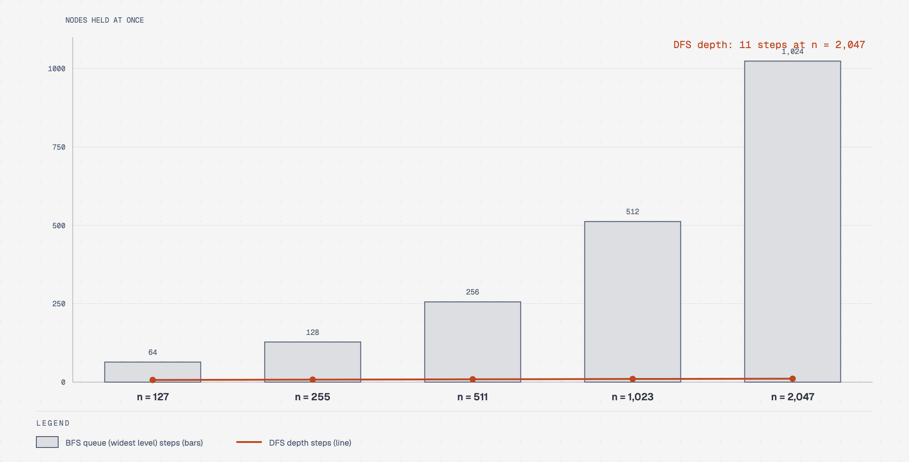
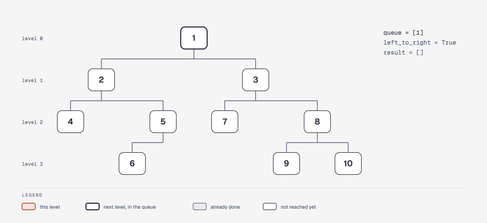

# 08. 103. Binary Tree Zigzag Level Order Traversal

| Difficulty | Pattern | Key idea | Source | Time | Space | Before / after |
|:---:|:---:|:---|:---:|:---:|:---:|:---:|
| **Medium** | BFS With a Direction Flag | Normal level order, but every other level is written right to left; a deque lets us add at the front or the back | [103. Binary Tree Zigzag Level Order Traversal](https://leetcode.com/problems/binary-tree-zigzag-level-order-traversal/) | `O(n)` | `O(n)` | [102. Level Order](07.%20102.%20Binary%20Tree%20Level%20Order%20Traversal.md) / [All in one](09.%20All%20in%20One%20Traversal.md) |

## 1. Problem Statement

Given the `root` of a binary tree, return the **zigzag level order traversal** of its values: the first level left to right, the next level right to left, then left to right again, and so on.

### Example

**The tree we take:** the 10-node tree used in this whole section, as a LeetCode list `[1, 2, 3, 4, 5, 7, 8, None, None, 6, None, None, None, 9, 10]`.

```text
Input:  root = [1, 2, 3, 4, 5, 7, 8, None, None, 6, None, None, None, 9, 10]
Output: [[1], [3, 2], [4, 5, 7, 8], [10, 9, 6]]
```

![Zigzag on the tree we take: level 0 [1], level 1 right to left [3, 2], level 2 [4, 5, 7, 8], level 3 right to left [10, 9, 6]; tags show each node's place in its level](images/zz-example.png)

It has the tricky part of the problem: on level 3 the nodes come from both sides of the tree, and reading them right to left puts `10` first and `6` last. We use this tree in every section below.

The lecture uses the tree `1; 2, 3; 4, 5, 6`, which gives `[[1], [3, 2], [4, 5, 6]]`. LeetCode examples:

```text
root = [3, 9, 20, None, None, 15, 7]   gives [[3], [20, 9], [15, 7]]
root = [1]                              gives [[1]]
root = []                               gives []
```

### Constraints, in plain words

| Limit | What it means in plain words | What it tells us |
|:---|:---|:---|
| Number of nodes is `0` to `2000` | The tree can be empty, and has at most 2,000 nodes | `O(n)` is instant; return `[]` for an empty tree |
| `-100 <= Node.val <= 100` | Small whole numbers, maybe negative | Values do not matter; only positions do |
| Direction alternates | Level 0 left to right, level 1 right to left, ... | Keep a flag and flip it after every level |

**How fast is fast enough?**

- Every method visits each node once: `O(n)` time, instant for 2,000 nodes.
- Memory follows the widest level, exactly as in level order (see the chart in [102](07.%20102.%20Binary%20Tree%20Level%20Order%20Traversal.md)).



| Nodes `n` (perfect tree) | Levels | Queue at most (last level) | Flips of the direction flag | Extra cost of zigzag over level order | Note |
|:---:|:---:|:---:|:---:|:---:|:---|
| 127 | 7 | 64 | 7 | none with a deque | Each value is placed once, front or back |
| 511 | 9 | 256 | 9 | none with a deque | |
| 2,047 | 11 | 1,024 | 11 | none with a deque | Just above the LeetCode limit |
| 2,047 | 11 | 1,024 | 11 | a reverse of every odd level with lists | Still `O(n)` overall |

## 2. Core Idea

Zigzag is **level order plus a direction flag**:

1. Walk the tree level by level with a queue, exactly as in 102. The queue order stays left to right every time.
2. Keep a flag `left_to_right`, starting at `True` (the lecture calls it flag 0 for left to right and flag 1 for right to left).
3. Put each value into the level list: at the **back** when the flag is `True`, at the **front** when it is `False`. A `deque` does both in `O(1)`.
4. After each level, flip the flag.

The important point: we never change the **queue** order. Children are always queued left then right. Only the way we **write** the level changes.

## 3. Edge Cases

| Case | Input | Expected | Why it matters | Code that handles it |
|:---|:---|:---:|:---|:---|
| Empty tree | `[]` | `[]` | No root to queue | `if root is None: return []` |
| One node | `[1]` | `[[1]]` | One level, direction does not matter | The loop runs once |
| Two levels | `[1, 2, 3]` | `[[1], [3, 2]]` | The very first reversed level | The flag is `False` on level 1 |
| A chain | `[1, 2, None, 3]` | `[[1], [2], [3]]` | Reversing a one-node level changes nothing | Front and back are the same spot |
| Gaps in a level | our tree | `[10, 9, 6]` | Nodes from both sides end up in one reversed list | `appendleft` reverses the queue order |

## 4. Approach 1: Level Order, Then Reverse Every Other Level

### Idea

Run the normal level order from 102, then reverse the lists at odd positions (level 1, 3, 5, ...). Simple, and correct, but it does the work twice.

### Code

```python
# Import deque for the queue
from collections import deque

# Import List and Optional for type hints
from typing import List, Optional


# Solution for 103, level order then reverse every other level
class Solution:

    # Main method
    def zigzagLevelOrder(self, root: Optional[TreeNode]) -> List[List[int]]:

        # An empty tree has no levels
        if root is None:

            # Nothing to return
            return []

        # The answer: one list per level
        result = []

        # Nodes waiting to be visited
        queue = deque([root])

        # One round per level
        while queue:

            # Values of this level, left to right
            level = []

            # Take out exactly the nodes of this level
            for _ in range(len(queue)):

                # The oldest waiting node
                node = queue.popleft()

                # Record its value
                level.append(node.val)

                # Queue the left child
                if node.left:

                    # It belongs to the next level
                    queue.append(node.left)

                # Queue the right child
                if node.right:

                    # It belongs to the next level
                    queue.append(node.right)

            # Odd levels must read right to left
            if len(result) % 2 == 1:

                # Flip this level
                level.reverse()

            # This level is complete
            result.append(level)

        # All levels, zigzag
        return result
```

### Complexity

| Measure | Complexity | Why | At the limit (`n = 2000`) | Compared with the others |
|:---|:---:|:---|:---:|:---|
| **Time** | `O(n)` | Each node is visited once, and each value is moved once more by a reverse | about 4,000 steps | A second pass over half of the values |
| **Space** | `O(n)` | The queue plus the answer | about 1,000 nodes in the queue | Same as the others |

## 5. Approach 2: Two Stacks

### Idea

Use two stacks, one for the levels read left to right and one for the levels read right to left.

- Popping from `stack1` (a left-to-right level), push the children **left, then right** onto `stack2`.
- Popping from `stack2` (a right-to-left level), push the children **right, then left** onto `stack1`.

Because a stack reverses the order it receives, each level comes out in the right direction.

### Run it on our example

| Round | Stack popped | Direction | Popped in order | Children pushed onto the other stack | Level list | Why it comes out this way |
|:---:|:---:|:---|:---|:---|:---|:---|
| 1 | `stack1` | left to right | `[1]` | `[2, 3]` (left child first) | `[1]` | The root alone; its children go to stack2 left first, so 3 is on top |
| 2 | `stack2` | right to left | `[3, 2]` | `[8, 7, 5, 4]` (right child first) | `[3, 2]` | 3 is on top, so this level reads 3, 2; children go right first, so 4 ends on top |
| 3 | `stack1` | left to right | `[4, 5, 7, 8]` | `[6, 9, 10]` (left child first) | `[4, 5, 7, 8]` | 4 is on top, so this level reads left to right; 10 ends on top of stack2 |
| 4 | `stack2` | right to left | `[10, 9, 6]` | `[]` (right child first) | `[10, 9, 6]` | 10 is on top, so this level reads 10, 9, 6; no children: done |

### Code

```python
# Import deque for the queue
from collections import deque

# Import List and Optional for type hints
from typing import List, Optional


# Solution for 103, two stacks
class Solution:

    # Main method
    def zigzagLevelOrder(self, root: Optional[TreeNode]) -> List[List[int]]:

        # An empty tree has no levels
        if root is None:

            # Nothing to return
            return []

        # The answer: one list per level
        result = []

        # Levels read left to right
        stack1 = [root]

        # Levels read right to left
        stack2 = []

        # Keep going while either stack has nodes
        while stack1 or stack2:

            # This level is read left to right
            if stack1:

                # Values of this level
                level = []

                # Empty stack1
                while stack1:

                    # Take the top node
                    node = stack1.pop()

                    # Record its value
                    level.append(node.val)

                    # Left child first onto stack2
                    if node.left:

                        # It will come out after the right child
                        stack2.append(node.left)

                    # Then the right child
                    if node.right:

                        # It will come out first
                        stack2.append(node.right)

                # This level is complete
                result.append(level)

            # This level is read right to left
            if stack2:

                # Values of this level
                level = []

                # Empty stack2
                while stack2:

                    # Take the top node
                    node = stack2.pop()

                    # Record its value
                    level.append(node.val)

                    # Right child first onto stack1
                    if node.right:

                        # It will come out after the left child
                        stack1.append(node.right)

                    # Then the left child
                    if node.left:

                        # It will come out first
                        stack1.append(node.left)

                # This level is complete
                result.append(level)

        # All levels, zigzag
        return result
```

### Complexity

| Measure | Complexity | Why | At the limit (`n = 2000`) | Compared with the others |
|:---|:---:|:---|:---:|:---|
| **Time** | `O(n)` | Each node is pushed and popped once | 2,000 nodes | Same as the others |
| **Space** | `O(n)` | The two stacks hold about two levels; plus the answer | about 1,000 nodes | No deque needed |

## 6. Approach 3: BFS With a Deque (the Standard Answer)

### Idea

1. Queue the root; `left_to_right = True`.
2. For each level: take out `size` nodes in queue order; put each value at the back (`append`) or the front (`appendleft`) of a deque, depending on the flag; queue the children left then right.
3. Add the level to the answer and flip the flag.

### Run it on our example, step by step

**The tree we take:** the 10-node tree above.

**How to read the pictures:** orange nodes are the level handled in this step, bold boxes are waiting in the queue, grey boxes are already done. The tag next to each orange node is its place in that level's list.

**Start:** the queue holds the root, and the direction is left to right.



**Step 1: level 0**

- Direction: left to right, so each value goes to the **back**.
- Take out `[1]` in queue order: `1` gives `[1]`.
- Children queued, left then right: `2`, `3`.
- Flip the direction for the next level. Answer: `[[1]]`.

![Step 1: level 0 becomes [1]](images/zz-step-1.png)

**Step 2: level 1**

- Direction: right to left, so each value goes to the **front**.
- Take out `[2, 3]` in queue order: `2` gives `[2]`; `3` gives `[3, 2]`.
- Children queued, left then right: `4`, `5`, `7`, `8`.
- Flip the direction for the next level. Answer: `[[1], [3, 2]]`.

![Step 2: level 1 becomes [3, 2]](images/zz-step-2.png)

**Step 3: level 2**

- Direction: left to right, so each value goes to the **back**.
- Take out `[4, 5, 7, 8]` in queue order: `4` gives `[4]`; `5` gives `[4, 5]`; `7` gives `[4, 5, 7]`; `8` gives `[4, 5, 7, 8]`.
- Children queued, left then right: `6`, `9`, `10`.
- Flip the direction for the next level. Answer: `[[1], [3, 2], [4, 5, 7, 8]]`.

![Step 3: level 2 becomes [4, 5, 7, 8]](images/zz-step-3.png)

**Step 4: level 3**

- Direction: right to left, so each value goes to the **front**.
- Take out `[6, 9, 10]` in queue order: `6` gives `[6]`; `9` gives `[9, 6]`; `10` gives `[10, 9, 6]`.
- No children to queue.
- Flip the direction for the next level. Answer: `[[1], [3, 2], [4, 5, 7, 8], [10, 9, 6]]`.
- The queue is empty. Done: the answer is `[[1], [3, 2], [4, 5, 7, 8], [10, 9, 6]]`.

![Step 4: level 3 becomes [10, 9, 6]](images/zz-step-4.png)


**All steps at a glance**

| Step | Level | Direction | Taken from the queue (left to right) | Level list | Children queued | Answer so far |
|:---:|:---:|:---|:---|:---|:---|:---|
| 1 | 0 | left to right | `[1]` | `[1]` | `[2, 3]` | `[[1]]` |
| 2 | 1 | right to left | `[2, 3]` | `[3, 2]` | `[4, 5, 7, 8]` | `[[1], [3, 2]]` |
| 3 | 2 | left to right | `[4, 5, 7, 8]` | `[4, 5, 7, 8]` | `[6, 9, 10]` | `[[1], [3, 2], [4, 5, 7, 8]]` |
| 4 | 3 | right to left | `[6, 9, 10]` | `[10, 9, 6]` | `[]` | `[[1], [3, 2], [4, 5, 7, 8], [10, 9, 6]]` |

The queue order was always left to right. Only the side we wrote on changed.

### Code

```python
# Import deque for the queue
from collections import deque

# Import List and Optional for type hints
from typing import List, Optional


# Solution for 103, BFS with a deque per level
class Solution:

    # Main method
    def zigzagLevelOrder(self, root: Optional[TreeNode]) -> List[List[int]]:

        # An empty tree has no levels
        if root is None:

            # Nothing to return
            return []

        # The answer: one list per level
        result = []

        # Nodes waiting to be visited, always left to right
        queue = deque([root])

        # Direction of the current level
        left_to_right = True

        # One round per level
        while queue:

            # The queue holds exactly this level
            size = len(queue)

            # Values of this level; we may add at either end
            level = deque()

            # Take out exactly the nodes of this level
            for _ in range(size):

                # The oldest waiting node
                node = queue.popleft()

                # Left to right: write at the back
                if left_to_right:

                    # Add at the back
                    level.append(node.val)

                # Right to left: write at the front
                else:

                    # Add at the front
                    level.appendleft(node.val)

                # Queue the left child
                if node.left:

                    # It belongs to the next level
                    queue.append(node.left)

                # Queue the right child
                if node.right:

                    # It belongs to the next level
                    queue.append(node.right)

            # This level is complete
            result.append(list(level))

            # The next level goes the other way
            left_to_right = not left_to_right

        # All levels, zigzag
        return result
```

### Complexity

| Measure | Complexity | Why | At the limit (`n = 2000`) | Compared with the others |
|:---|:---:|:---|:---:|:---|
| **Time** | `O(n)` | Each node enters and leaves the queue once; each value is placed once | 2,000 nodes | One pass, no reversing |
| **Space** | `O(n)` | The queue holds about one level; plus the answer | about 1,000 nodes on a perfect tree | The usual interview answer |

### All three at a glance

| Approach | Time | Space | How it reverses | Good for |
|:---|:---:|:---:|:---|:---|
| Level order, then reverse | `O(n)` | `O(n)` | `level.reverse()` on every odd level | Fastest to write if you already have 102 |
| Two stacks | `O(n)` | `O(n)` | A stack flips the order; the push order alternates | The classic textbook answer |
| BFS with a deque | `O(n)` | `O(n)` | `appendleft` on right-to-left levels | One clean pass; the usual interview answer |

## 7. Common Mistakes

| Mistake | What goes wrong | Fix |
|:---|:---|:---|
| Changing the order children are queued | Lower levels come out scrambled | Always queue left then right; only change how values are written |
| Forgetting to flip the flag | Every level is read the same way | `left_to_right = not left_to_right` after each level |
| Starting right to left | The first level is fine but every level after is mirrored | Start with `left_to_right = True` |
| Two stacks: same push order both ways | Directions stop alternating | Left-then-right from `stack1`, right-then-left from `stack2` |
| Returning a deque instead of a list | LeetCode expects lists | `result.append(list(level))` |

## 8. Interview Follow-ups

### Q1. Why not just reverse the queue on odd levels?

**Answer:**
- The queue order decides the order of the next level's children.
- Reversing it would scramble the levels below. Only the written list should be reversed.

### Q2. Can you do zigzag with DFS?

**Answer:**
- Yes. Pass the level down as in 102; on odd levels insert the value at the front of that level's list (a deque), on even levels at the back.

### Q3. What changes if each level must start right to left?

**Answer:**
- Start the flag at `False`. Everything else stays the same.

### Q4. How would you print the tree in a spiral, from the bottom up?

**Answer:**
- Build the zigzag levels, then reverse the outer list.

### Q5. What is the cost of `appendleft` on a Python list?

**Answer:**
- `list.insert(0, x)` moves every element, so it is `O(k)` for a list of `k` values.
- `deque.appendleft` is `O(1)`, which is why the deque is used.

## 9. Interview Explanation

> Zigzag is level order with a direction flag. I run a normal BFS with a queue, taking out one whole level per round and always queuing children left then right. For each level I build a deque: when the flag says left to right I append each value at the back, otherwise I append it at the front, which reverses that level. After each level I flip the flag. Each node is handled once, so it is O(n) time and O(n) space for the queue and the answer.
