# 09. All in One Traversal

| Difficulty | Pattern | Key idea | Source | Time | Space | Before in this folder |
|:---:|:---:|:---|:---:|:---:|:---:|:---:|
| **Medium** | Stack With a State Per Node | Push each node with a counter 1, 2 or 3; state 1 is its preorder moment, state 2 its inorder moment, state 3 its postorder moment | Lecture problem (also asked as "all three traversals in one pass") | `O(n)` | `O(n)` | [103. Zigzag](08.%20103.%20Binary%20Tree%20Zigzag%20Level%20Order%20Traversal.md) |

## 1. Problem Statement

Given the `root` of a binary tree, return its **preorder, inorder and postorder** traversals, all three, using **one** pass over the tree.

### Example

**The tree we take:** the 7-node tree from the lecture board: `1` with children `2` and `5`; `2` with children `3` and `4`; `5` with children `6` and `7`. As a LeetCode list: `[1, 2, 5, 3, 4, 6, 7]`.

```text
Input:  root = [1, 2, 5, 3, 4, 6, 7]
Output: preorder  = [1, 2, 3, 4, 5, 6, 7]
        inorder   = [3, 2, 4, 1, 6, 5, 7]
        postorder = [3, 4, 2, 6, 7, 5, 1]
```

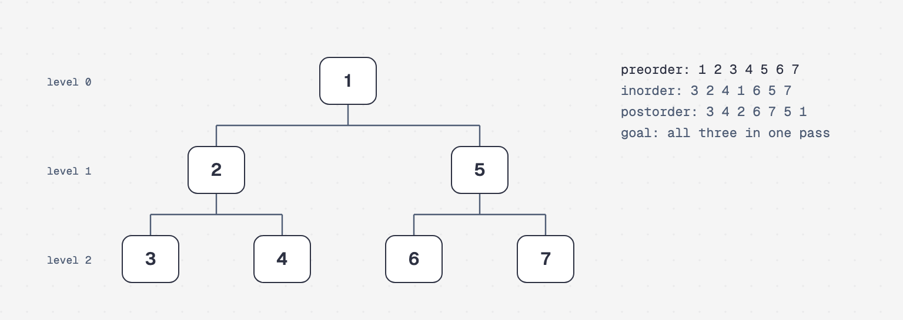

We use this tree in every section below.

### Constraints, in plain words

| Limit | What it means in plain words | What it tells us |
|:---|:---|:---|
| This is a lecture problem with no fixed limits | Assume a tree of up to about 100,000 nodes, like most tree problems | We need `O(n)` time and should avoid deep recursion |
| Three answers from one pass | Each node must be met three times during the same walk | Store a small counter with every node on the stack |
| The tree may be empty | No root at all | Return three empty lists |

**How fast is fast enough?**

- Three separate traversals visit every node three times in total: `3n` visits.
- The one-pass stack also pops every node three times (once per state): `3n` pops.
- So the work is the same, `O(n)`. The point of this problem is not speed; it is understanding that **all three orders come from the same walk**, and only the moment you write the value down differs. The lecture writes this as time `O(3n)` and space `O(3n)` for the three answer lists, which are both `O(n)`.

| Nodes `n` | Three separate traversals (visits) | One stack pass (pops) | Answer values stored | Stack size at most | Note |
|:---:|:---:|:---:|:---:|:---:|:---|
| 7 (our tree) | 21 | 21 | 21 | 4 | The lecture example |
| 1,000 | 3,000 | 3,000 | 3,000 | about the height + 1 | Same work either way |
| 100,000 | 300,000 | 300,000 | 300,000 | about the height + 1 | Well under a second |

## 2. Core Idea

Recursion meets every node **three times**:

1. On the way **down**, before going left. That is the **preorder** moment.
2. Back from the left subtree, before going right. That is the **inorder** moment.
3. Back from the right subtree, before leaving. That is the **postorder** moment.

The lecture copies this with a stack of pairs `(node, state)`:

| Popped state | It is the moment for | Write the value to | Then push back | Then push |
|:---:|:---|:---|:---|:---|
| 1 | Preorder | `preorder` | `(node, 2)` | the left child with state 1, if it exists |
| 2 | Inorder | `inorder` | `(node, 3)` | the right child with state 1, if it exists |
| 3 | Postorder | `postorder` | nothing | nothing: this node and its whole subtree are finished |

Because the node is pushed back **under** its child, the child's whole subtree is finished before the node is seen again. That is exactly what recursion does.

## 3. Edge Cases

| Case | Input | Expected | Why it matters | Code that handles it |
|:---|:---|:---:|:---|:---|
| Empty tree | `[]` | `[], [], []` | Nothing to push | `if root is None: return [], [], []` |
| One node | `[1]` | `[1], [1], [1]` | It is popped three times in a row | States 1, 2, 3 with no children pushed |
| Only left children | `[1, 2, None, 3]` | `[1, 2, 3], [3, 2, 1], [3, 2, 1]` | Inorder and postorder are the same here | State 2 pushes no right child |
| Only right children | `[1, None, 2, None, 3]` | `[1, 2, 3], [1, 2, 3], [3, 2, 1]` | Preorder and inorder are the same here | State 1 pushes no left child |
| Full tree | our tree | as above | Every node has 0 or 2 children | Both pushes happen |

## 4. Approach 1: Three Separate Traversals

### Idea

Run the preorder, inorder and postorder code from notes 04, 05 and 06, one after the other. Correct and simple, but it is three passes, which is exactly what this problem asks you to avoid.

### Code

```python
# Import List, Optional and Tuple for type hints
from typing import List, Optional, Tuple


# All three orders, one traversal each
class Solution:

    # Main method: returns (preorder, inorder, postorder)
    def allTraversals(self, root: Optional[TreeNode]) -> Tuple[List[int], List[int], List[int]]:

        # Root, left, right
        def pre(node: Optional[TreeNode], out: List[int]) -> None:

            # Stop at a missing child
            if node:

                # Visit first
                out.append(node.val)

                # Then the left subtree
                pre(node.left, out)

                # Then the right subtree
                pre(node.right, out)

        # Left, root, right
        def ino(node: Optional[TreeNode], out: List[int]) -> None:

            # Stop at a missing child
            if node:

                # First the left subtree
                ino(node.left, out)

                # Then visit
                out.append(node.val)

                # Then the right subtree
                ino(node.right, out)

        # Left, right, root
        def post(node: Optional[TreeNode], out: List[int]) -> None:

            # Stop at a missing child
            if node:

                # First the left subtree
                post(node.left, out)

                # Then the right subtree
                post(node.right, out)

                # Visit last
                out.append(node.val)

        # Three empty answer lists
        a, b, c = [], [], []

        # First pass: preorder
        pre(root, a)

        # Second pass: inorder
        ino(root, b)

        # Third pass: postorder
        post(root, c)

        # All three answers
        return a, b, c
```

### Complexity

| Measure | Complexity | Why | Our tree | Compared with the others |
|:---|:---:|:---|:---:|:---|
| **Time** | `O(n)` | Three passes of `n` visits each, one per order | 21 visits | Same total work, but three walks over the tree |
| **Space** | `O(n)` | Three answer lists plus `O(h)` recursion | 21 stored values | Same as the others |

## 5. Approach 2: One Recursive Walk

### Idea

One DFS can fill all three lists: write to `preorder` before the left call, to `inorder` between the two calls, and to `postorder` after the right call.

### Code

```python
# Import List, Optional and Tuple for type hints
from typing import List, Optional, Tuple


# All three orders from one recursive walk
class Solution:

    # Main method: returns (preorder, inorder, postorder)
    def allTraversals(self, root: Optional[TreeNode]) -> Tuple[List[int], List[int], List[int]]:

        # The three answer lists
        preorder, inorder, postorder = [], [], []

        # One walk that writes at all three moments
        def dfs(node: Optional[TreeNode]) -> None:

            # A missing child: nothing to do
            if node is None:

                # Go back
                return

            # Moment 1: on the way down
            preorder.append(node.val)

            # Walk the left subtree
            dfs(node.left)

            # Moment 2: back from the left side
            inorder.append(node.val)

            # Walk the right subtree
            dfs(node.right)

            # Moment 3: back from the right side
            postorder.append(node.val)

        # Start at the root
        dfs(root)

        # All three answers
        return preorder, inorder, postorder
```

### Complexity

| Measure | Complexity | Why | Our tree | Compared with the others |
|:---|:---:|:---|:---:|:---|
| **Time** | `O(n)` | One walk; each node is met three times | 7 calls with nodes | One pass |
| **Space** | `O(n)` | Three answer lists plus `O(h)` recursion | depth 3 | Can hit Python's recursion limit on deep trees |

## 6. Approach 3: One Stack With States (the Lecture Answer)

### Idea

1. Push `(root, 1)`.
2. Pop `(node, state)`:
   - State 1: add to preorder, push `(node, 2)`, then push `(left, 1)` if there is a left child.
   - State 2: add to inorder, push `(node, 3)`, then push `(right, 1)` if there is a right child.
   - State 3: add to postorder.
3. Repeat until the stack is empty.

### Run it on our example, step by step

**The tree we take:** the 7-node tree above.

**How to read the pictures:** orange is the pair just popped, bold boxes are in the stack, grey boxes are finished (state 3 done). The tag `s1`, `s2` or `s3` next to a node is its state: for the orange node, the state it was popped with; for the others, the state they wait with in the stack. In the notes, the **top** of the stack is on the right.

**Start:** the stack holds `(1, 1)`.

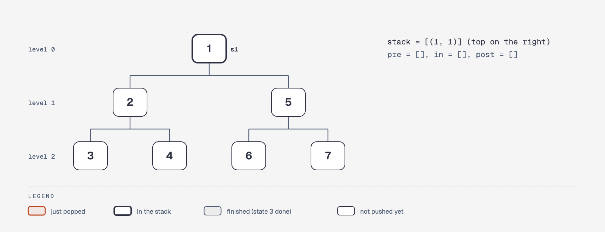

**Step 1: pop (1, 1)**

- State 1: add 1 to preorder, push (1, 2).
- Push left child (2, 1).
- Stack: `[[1, 2], [2, 1]]`.
- Lists: pre `[1]`, in `[]`, post `[]`.

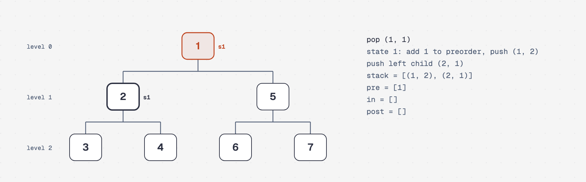

**Step 2: pop (2, 1)**

- State 1: add 2 to preorder, push (2, 2).
- Push left child (3, 1).
- Stack: `[[1, 2], [2, 2], [3, 1]]`.
- Lists: pre `[1, 2]`, in `[]`, post `[]`.

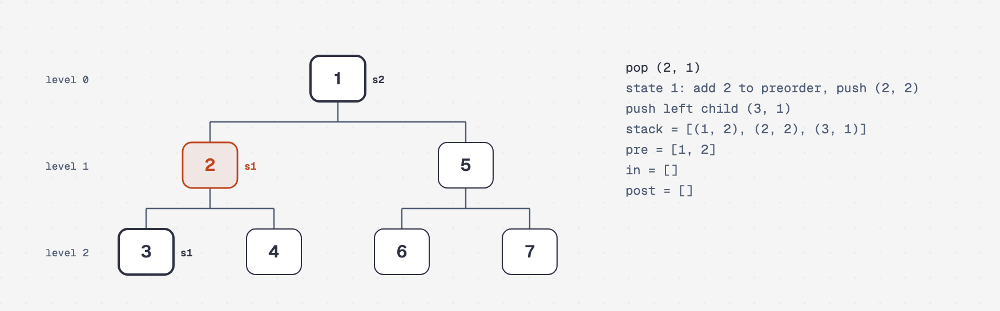

**Step 3: pop (3, 1)**

- State 1: add 3 to preorder, push (3, 2).
- No left child.
- Stack: `[[1, 2], [2, 2], [3, 2]]`.
- Lists: pre `[1, 2, 3]`, in `[]`, post `[]`.

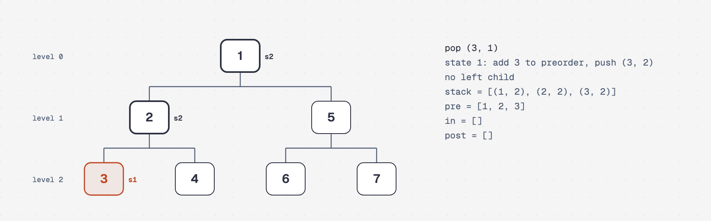

**Step 4: pop (3, 2)**

- State 2: add 3 to inorder, push (3, 3).
- No right child.
- Stack: `[[1, 2], [2, 2], [3, 3]]`.
- Lists: pre `[1, 2, 3]`, in `[3]`, post `[]`.

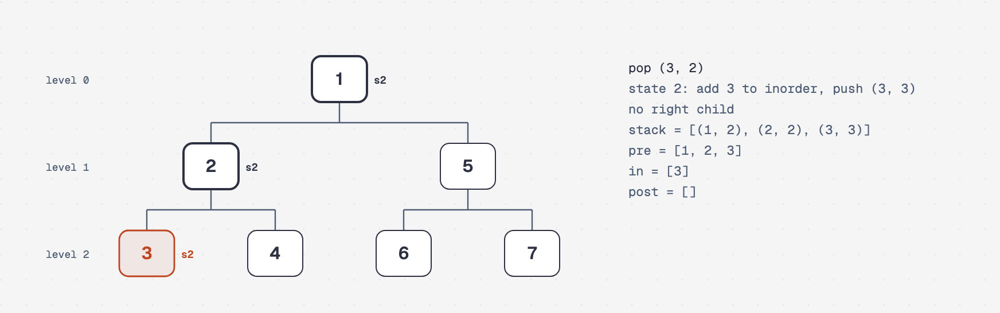

**Step 5: pop (3, 3)**

- State 3: add 3 to postorder.
- 3 is finished, nothing pushed.
- Stack: `[[1, 2], [2, 2]]`.
- Lists: pre `[1, 2, 3]`, in `[3]`, post `[3]`.

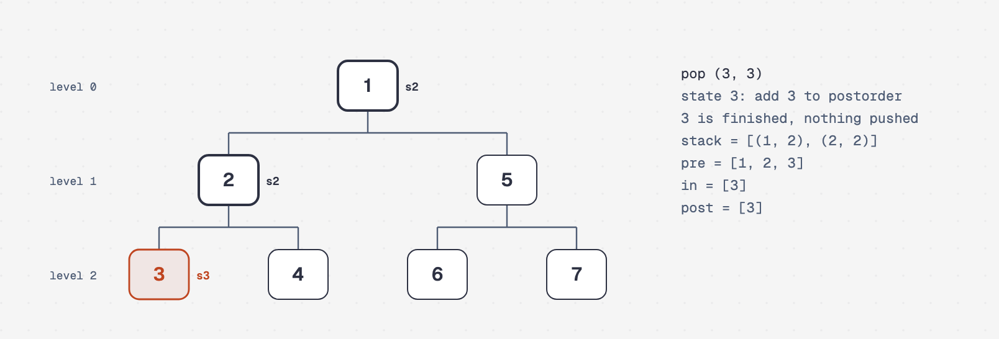

**Step 6: pop (2, 2)**

- State 2: add 2 to inorder, push (2, 3).
- Push right child (4, 1).
- Stack: `[[1, 2], [2, 3], [4, 1]]`.
- Lists: pre `[1, 2, 3]`, in `[3, 2]`, post `[3]`.

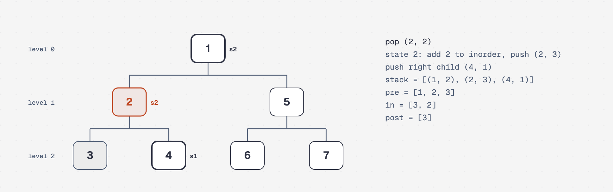

**Step 7: pop (4, 1)**

- State 1: add 4 to preorder, push (4, 2).
- No left child.
- Stack: `[[1, 2], [2, 3], [4, 2]]`.
- Lists: pre `[1, 2, 3, 4]`, in `[3, 2]`, post `[3]`.

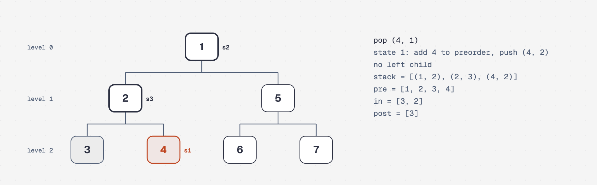

**Step 8: pop (4, 2)**

- State 2: add 4 to inorder, push (4, 3).
- No right child.
- Stack: `[[1, 2], [2, 3], [4, 3]]`.
- Lists: pre `[1, 2, 3, 4]`, in `[3, 2, 4]`, post `[3]`.

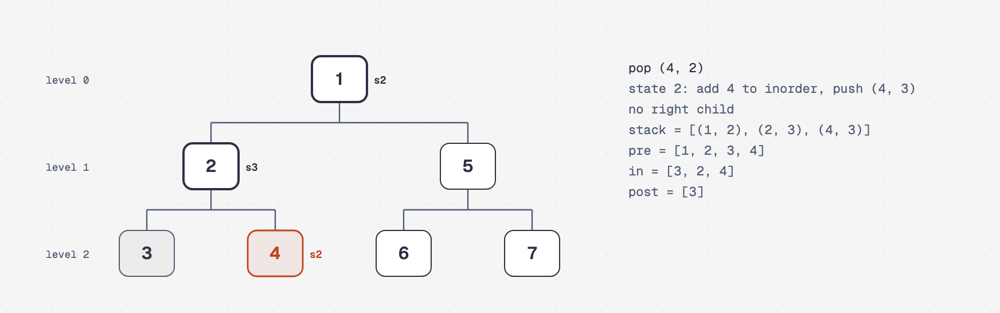

**Step 9: pop (4, 3)**

- State 3: add 4 to postorder.
- 4 is finished, nothing pushed.
- Stack: `[[1, 2], [2, 3]]`.
- Lists: pre `[1, 2, 3, 4]`, in `[3, 2, 4]`, post `[3, 4]`.

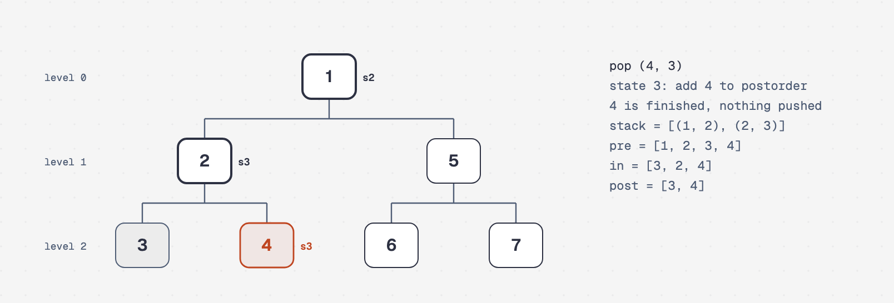

**Step 10: pop (2, 3)**

- State 3: add 2 to postorder.
- 2 is finished, nothing pushed.
- Stack: `[[1, 2]]`.
- Lists: pre `[1, 2, 3, 4]`, in `[3, 2, 4]`, post `[3, 4, 2]`.

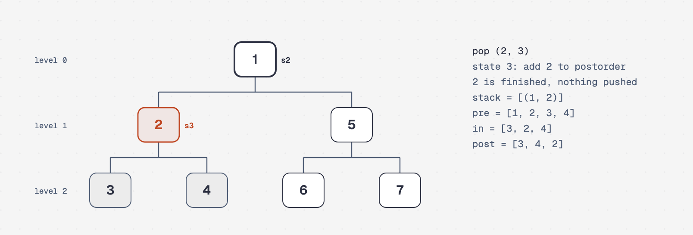

**Step 11: pop (1, 2)**

- State 2: add 1 to inorder, push (1, 3).
- Push right child (5, 1).
- Stack: `[[1, 3], [5, 1]]`.
- Lists: pre `[1, 2, 3, 4]`, in `[3, 2, 4, 1]`, post `[3, 4, 2]`.

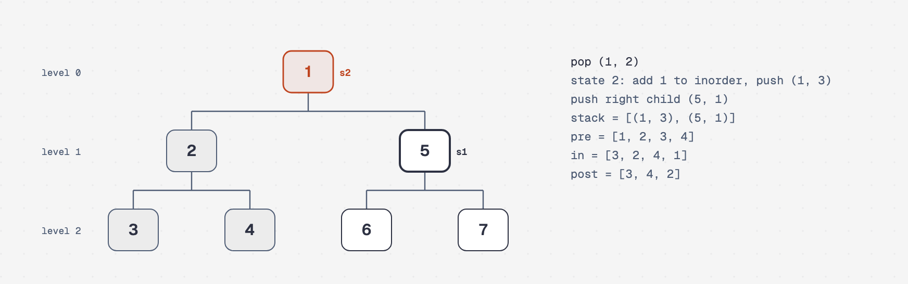

**Step 12: pop (5, 1)**

- State 1: add 5 to preorder, push (5, 2).
- Push left child (6, 1).
- Stack: `[[1, 3], [5, 2], [6, 1]]`.
- Lists: pre `[1, 2, 3, 4, 5]`, in `[3, 2, 4, 1]`, post `[3, 4, 2]`.

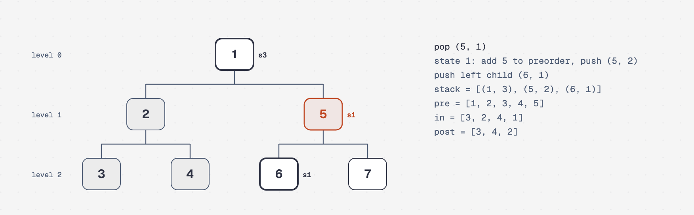

**Step 13: pop (6, 1)**

- State 1: add 6 to preorder, push (6, 2).
- No left child.
- Stack: `[[1, 3], [5, 2], [6, 2]]`.
- Lists: pre `[1, 2, 3, 4, 5, 6]`, in `[3, 2, 4, 1]`, post `[3, 4, 2]`.

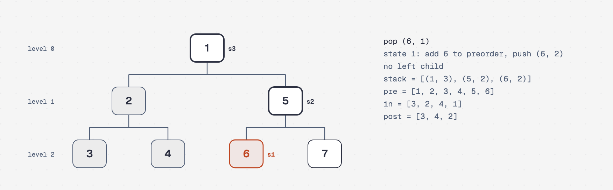

**Step 14: pop (6, 2)**

- State 2: add 6 to inorder, push (6, 3).
- No right child.
- Stack: `[[1, 3], [5, 2], [6, 3]]`.
- Lists: pre `[1, 2, 3, 4, 5, 6]`, in `[3, 2, 4, 1, 6]`, post `[3, 4, 2]`.

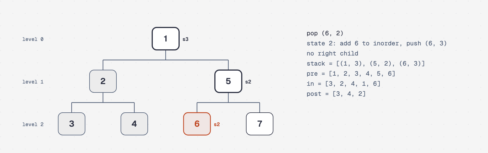

**Step 15: pop (6, 3)**

- State 3: add 6 to postorder.
- 6 is finished, nothing pushed.
- Stack: `[[1, 3], [5, 2]]`.
- Lists: pre `[1, 2, 3, 4, 5, 6]`, in `[3, 2, 4, 1, 6]`, post `[3, 4, 2, 6]`.

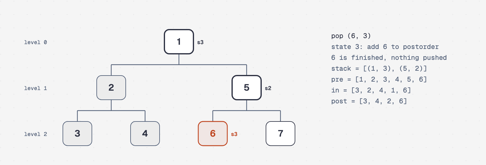

**Step 16: pop (5, 2)**

- State 2: add 5 to inorder, push (5, 3).
- Push right child (7, 1).
- Stack: `[[1, 3], [5, 3], [7, 1]]`.
- Lists: pre `[1, 2, 3, 4, 5, 6]`, in `[3, 2, 4, 1, 6, 5]`, post `[3, 4, 2, 6]`.

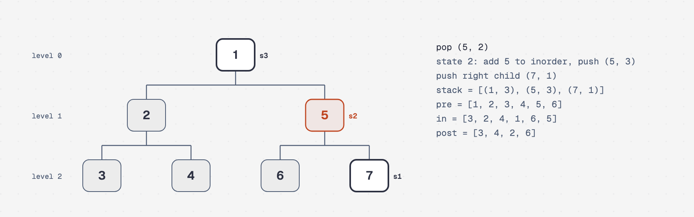

**Step 17: pop (7, 1)**

- State 1: add 7 to preorder, push (7, 2).
- No left child.
- Stack: `[[1, 3], [5, 3], [7, 2]]`.
- Lists: pre `[1, 2, 3, 4, 5, 6, 7]`, in `[3, 2, 4, 1, 6, 5]`, post `[3, 4, 2, 6]`.

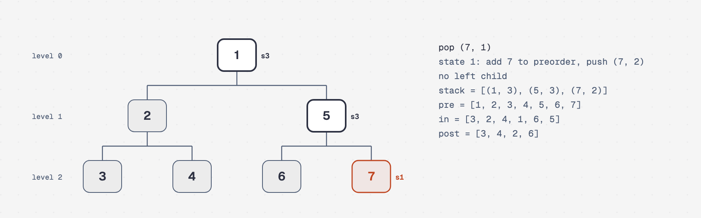

**Step 18: pop (7, 2)**

- State 2: add 7 to inorder, push (7, 3).
- No right child.
- Stack: `[[1, 3], [5, 3], [7, 3]]`.
- Lists: pre `[1, 2, 3, 4, 5, 6, 7]`, in `[3, 2, 4, 1, 6, 5, 7]`, post `[3, 4, 2, 6]`.


**Step 19: pop (7, 3)**

- State 3: add 7 to postorder.
- 7 is finished, nothing pushed.
- Stack: `[[1, 3], [5, 3]]`.
- Lists: pre `[1, 2, 3, 4, 5, 6, 7]`, in `[3, 2, 4, 1, 6, 5, 7]`, post `[3, 4, 2, 6, 7]`.

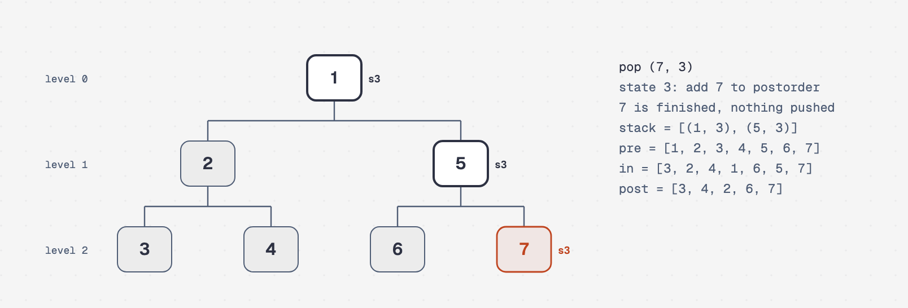

**Step 20: pop (5, 3)**

- State 3: add 5 to postorder.
- 5 is finished, nothing pushed.
- Stack: `[[1, 3]]`.
- Lists: pre `[1, 2, 3, 4, 5, 6, 7]`, in `[3, 2, 4, 1, 6, 5, 7]`, post `[3, 4, 2, 6, 7, 5]`.

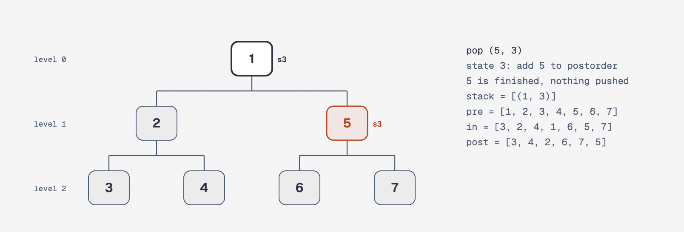

**Step 21: pop (1, 3)**

- State 3: add 1 to postorder.
- 1 is finished, nothing pushed.
- Stack: `[]`.
- Lists: pre `[1, 2, 3, 4, 5, 6, 7]`, in `[3, 2, 4, 1, 6, 5, 7]`, post `[3, 4, 2, 6, 7, 5, 1]`.
- The stack is empty. Done.

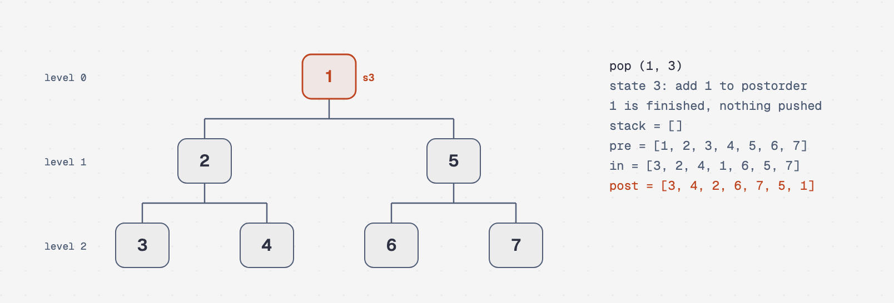


**All steps at a glance**

| Step | Popped | Written to | Pushed back | Child pushed | Stack after (top on the right) | Lists after |
|:---:|:---:|:---|:---|:---|:---|:---|
| 1 | `(1, 1)` | preorder | (1, 2) | left (2, 1) | `[[1, 2], [2, 1]]` | pre `[1]`, in `[]`, post `[]` |
| 2 | `(2, 1)` | preorder | (2, 2) | left (3, 1) | `[[1, 2], [2, 2], [3, 1]]` | pre `[1, 2]`, in `[]`, post `[]` |
| 3 | `(3, 1)` | preorder | (3, 2) | none | `[[1, 2], [2, 2], [3, 2]]` | pre `[1, 2, 3]`, in `[]`, post `[]` |
| 4 | `(3, 2)` | inorder | (3, 3) | none | `[[1, 2], [2, 2], [3, 3]]` | pre `[1, 2, 3]`, in `[3]`, post `[]` |
| 5 | `(3, 3)` | postorder | none | none | `[[1, 2], [2, 2]]` | pre `[1, 2, 3]`, in `[3]`, post `[3]` |
| 6 | `(2, 2)` | inorder | (2, 3) | right (4, 1) | `[[1, 2], [2, 3], [4, 1]]` | pre `[1, 2, 3]`, in `[3, 2]`, post `[3]` |
| 7 | `(4, 1)` | preorder | (4, 2) | none | `[[1, 2], [2, 3], [4, 2]]` | pre `[1, 2, 3, 4]`, in `[3, 2]`, post `[3]` |
| 8 | `(4, 2)` | inorder | (4, 3) | none | `[[1, 2], [2, 3], [4, 3]]` | pre `[1, 2, 3, 4]`, in `[3, 2, 4]`, post `[3]` |
| 9 | `(4, 3)` | postorder | none | none | `[[1, 2], [2, 3]]` | pre `[1, 2, 3, 4]`, in `[3, 2, 4]`, post `[3, 4]` |
| 10 | `(2, 3)` | postorder | none | none | `[[1, 2]]` | pre `[1, 2, 3, 4]`, in `[3, 2, 4]`, post `[3, 4, 2]` |
| 11 | `(1, 2)` | inorder | (1, 3) | right (5, 1) | `[[1, 3], [5, 1]]` | pre `[1, 2, 3, 4]`, in `[3, 2, 4, 1]`, post `[3, 4, 2]` |
| 12 | `(5, 1)` | preorder | (5, 2) | left (6, 1) | `[[1, 3], [5, 2], [6, 1]]` | pre `[1, 2, 3, 4, 5]`, in `[3, 2, 4, 1]`, post `[3, 4, 2]` |
| 13 | `(6, 1)` | preorder | (6, 2) | none | `[[1, 3], [5, 2], [6, 2]]` | pre `[1, 2, 3, 4, 5, 6]`, in `[3, 2, 4, 1]`, post `[3, 4, 2]` |
| 14 | `(6, 2)` | inorder | (6, 3) | none | `[[1, 3], [5, 2], [6, 3]]` | pre `[1, 2, 3, 4, 5, 6]`, in `[3, 2, 4, 1, 6]`, post `[3, 4, 2]` |
| 15 | `(6, 3)` | postorder | none | none | `[[1, 3], [5, 2]]` | pre `[1, 2, 3, 4, 5, 6]`, in `[3, 2, 4, 1, 6]`, post `[3, 4, 2, 6]` |
| 16 | `(5, 2)` | inorder | (5, 3) | right (7, 1) | `[[1, 3], [5, 3], [7, 1]]` | pre `[1, 2, 3, 4, 5, 6]`, in `[3, 2, 4, 1, 6, 5]`, post `[3, 4, 2, 6]` |
| 17 | `(7, 1)` | preorder | (7, 2) | none | `[[1, 3], [5, 3], [7, 2]]` | pre `[1, 2, 3, 4, 5, 6, 7]`, in `[3, 2, 4, 1, 6, 5]`, post `[3, 4, 2, 6]` |
| 18 | `(7, 2)` | inorder | (7, 3) | none | `[[1, 3], [5, 3], [7, 3]]` | pre `[1, 2, 3, 4, 5, 6, 7]`, in `[3, 2, 4, 1, 6, 5, 7]`, post `[3, 4, 2, 6]` |
| 19 | `(7, 3)` | postorder | none | none | `[[1, 3], [5, 3]]` | pre `[1, 2, 3, 4, 5, 6, 7]`, in `[3, 2, 4, 1, 6, 5, 7]`, post `[3, 4, 2, 6, 7]` |
| 20 | `(5, 3)` | postorder | none | none | `[[1, 3]]` | pre `[1, 2, 3, 4, 5, 6, 7]`, in `[3, 2, 4, 1, 6, 5, 7]`, post `[3, 4, 2, 6, 7, 5]` |
| 21 | `(1, 3)` | postorder | none | none | `[]` | pre `[1, 2, 3, 4, 5, 6, 7]`, in `[3, 2, 4, 1, 6, 5, 7]`, post `[3, 4, 2, 6, 7, 5, 1]` |

Twenty-one pops, three per node, and all three answers are ready at the end.

### Code

```python
# Import List, Optional and Tuple for type hints
from typing import List, Optional, Tuple


# All three orders from one stack with a state per node
class Solution:

    # Main method: returns (preorder, inorder, postorder)
    def allTraversals(self, root: Optional[TreeNode]) -> Tuple[List[int], List[int], List[int]]:

        # The three answer lists
        preorder, inorder, postorder = [], [], []

        # An empty tree gives three empty lists
        if root is None:

            # Nothing to walk
            return preorder, inorder, postorder

        # Pairs of (node, state); the top is the end of the list
        stack = [(root, 1)]

        # Keep going until every node has reached state 3
        while stack:

            # Take the top pair
            node, state = stack.pop()

            # State 1: the preorder moment
            if state == 1:

                # Record it in preorder
                preorder.append(node.val)

                # Come back to this node later with state 2
                stack.append((node, 2))

                # Explore the left child first
                if node.left:

                    # The left child starts at state 1
                    stack.append((node.left, 1))

            # State 2: the inorder moment
            elif state == 2:

                # Record it in inorder
                inorder.append(node.val)

                # Come back to this node later with state 3
                stack.append((node, 3))

                # Now explore the right child
                if node.right:

                    # The right child starts at state 1
                    stack.append((node.right, 1))

            # State 3: the postorder moment
            else:

                # Record it in postorder; this node is finished
                postorder.append(node.val)

        # All three answers
        return preorder, inorder, postorder
```

### Complexity

| Measure | Complexity | Why | Our tree | Compared with the others |
|:---|:---:|:---|:---:|:---|
| **Time** | `O(n)` | Each node is popped exactly three times | 21 pops | One pass, no recursion |
| **Space** | `O(n)` | Three answer lists; the stack holds at most one path plus one waiting child per level | stack never above 4 pairs | No recursion limit to worry about |

### All three at a glance

| Approach&ensp;&#8203;&ensp;&#8203;&ensp;&#8203;&ensp;&#8203;&ensp;&#8203;&ensp;&#8203;&ensp;&#8203;&ensp;&#8203;&ensp;&#8203;&ensp;&#8203;&ensp;&#8203;&ensp;&#8203;&ensp;&#8203;&ensp;&#8203;&ensp;&#8203;&ensp;&#8203; | Time | Space | Passes over the tree | Good for |
|:---|:---:|:---:|:---:|:---|
| Three separate traversals | `O(n)` | `O(n)` | 3 | Simplest to write: reuse the code from notes 04, 05 and 06 |
| One recursive walk | `O(n)` | `O(n)` | 1 | Shows clearly where each order writes its value |
| One stack with states | `O(n)` | `O(n)` | 1 | The interview answer: one pass, no recursion |

## 7. Common Mistakes

| Mistake | What goes wrong | Fix |
|:---|:---|:---|
| Pushing the child before pushing the node back | The node comes out before its child's subtree, and the orders break | Push `(node, state + 1)` first, then the child on top |
| Forgetting to push the node back at state 1 or 2 | The node never reaches inorder or postorder | Always push `(node, 2)` and `(node, 3)` |
| Pushing a `None` child | `None.val` crashes later | Push a child only if it exists |
| Pushing the right child at state 1 | Inorder and postorder come out wrong | Left child at state 1, right child at state 2 |

## 8. Interview Follow-ups

### Q1. Why does pushing `(node, 2)` before `(left, 1)` work?

**Answer:**
- The stack returns the last push first, so the left child comes out first.
- `(node, 2)` waits underneath until the left child's whole subtree is finished, exactly like returning from a recursive call.

### Q2. How many times is each node popped?

**Answer:**
- Exactly three times: once with each state.
- So `3n` pops in total, which is still `O(n)`.

### Q3. Can you get just one order from this code?

**Answer:**
- Yes. Keep only the list you need; the walk stays the same.
- For example, keep `inorder` only and you have an iterative inorder.

### Q4. How is this related to simulating any recursion with a stack?

**Answer:**
- The state number records "where we are inside the function": before the first call, between the calls, or after both.
- Any recursive function can be turned into a loop by storing its arguments plus such a position on a stack.

### Q5. What is the "interview gold line" from the lecture?

**Answer:**
- "By keeping a state for each node, we simulate recursion with a stack and get preorder, inorder and postorder in a single pass."

## 9. Interview Explanation

> Recursion meets every node three times: before going left, between the left and right subtrees, and after both. Those are the preorder, inorder and postorder moments. I simulate that with a stack of pairs: node and state. When I pop state 1, I add the node to preorder, push it back with state 2, and push its left child with state 1. When I pop state 2, I add it to inorder, push it back with state 3, and push its right child with state 1. When I pop state 3, I add it to postorder. Each node is popped three times, so the whole thing is O(n) time, and the three answer lists take O(n) space.
