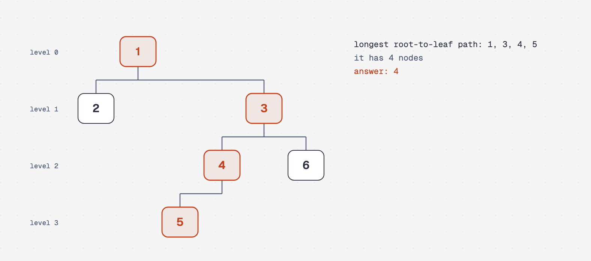
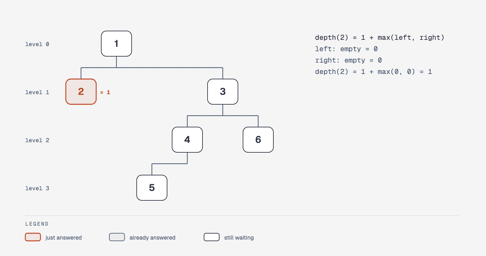
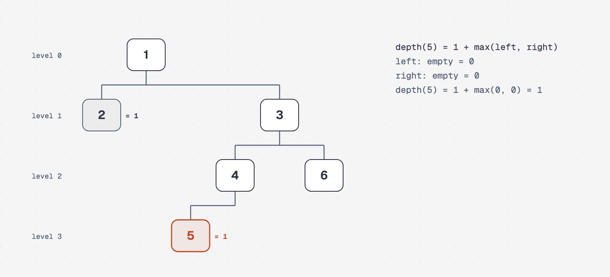
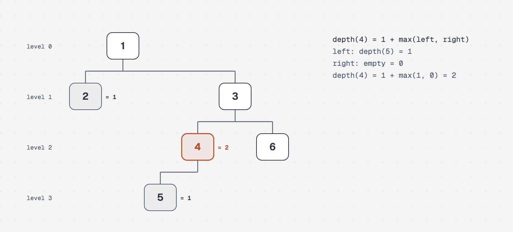
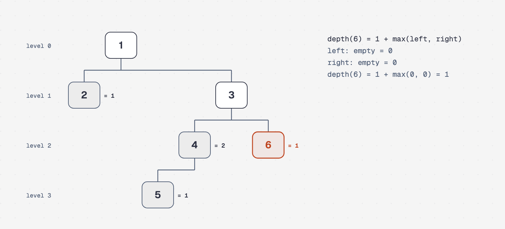
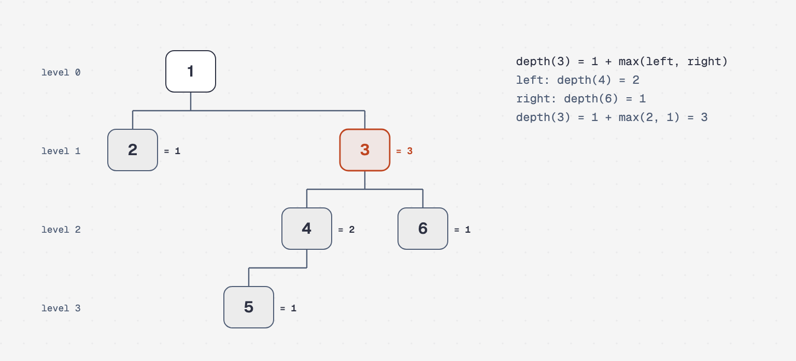
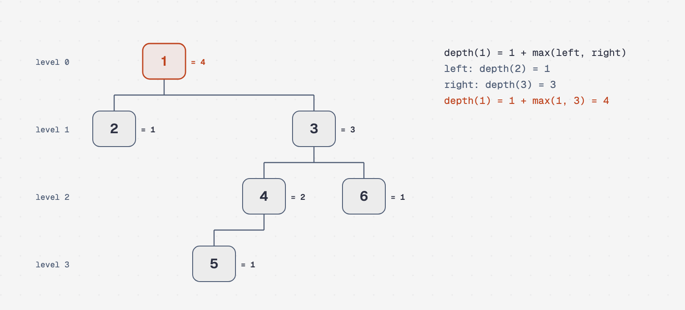

# 10. 104. Maximum Depth of Binary Tree

| Difficulty | Pattern | Key idea | Source | Time | Space | Next in this folder |
|:---:|:---:|:---|:---:|:---:|:---:|:---:|
| **Easy** | Bottom-Up Recursion (Postorder) | The depth of a node is 1 plus the deeper of its two children; an empty tree has depth 0 | [104. Maximum Depth of Binary Tree](https://leetcode.com/problems/maximum-depth-of-binary-tree/) | `O(n)` | `O(h)` | [110. Balanced Binary Tree](11.%20110.%20Balanced%20Binary%20Tree.md) |

## 1. Problem Statement

Given the `root` of a binary tree, return its **maximum depth**: the number of **nodes** on the longest path from the root down to the farthest leaf.

### Example

**The tree we take:** the 6-node tree from the lecture board: `1` with children `2` and `3`; `3` with children `4` and `6`; `4` with left child `5`. As a LeetCode list: `[1, 2, 3, None, None, 4, 6, 5]`.

```text
Input:  root = [1, 2, 3, None, None, 4, 6, 5]
Output: 4      (the path 1, 3, 4, 5 has 4 nodes)
```



It has the tricky part of the problem: the deepest leaf (5) hangs under a node with only one child, and the left side of the root is much shorter than the right side. We use this tree in every section below.

LeetCode examples:

```text
root = [3, 9, 20, None, None, 15, 7]   gives 3
root = [1, None, 2]                     gives 2
root = []                               gives 0
```

### Constraints, in plain words

| Limit | What it means in plain words | What it tells us |
|:---|:---|:---|
| Number of nodes is `0` to `10^4` | The tree can be empty, and has at most 10,000 nodes | Return 0 for an empty tree; `O(n)` is instant |
| `-100 <= Node.val <= 100` | Small whole numbers | Values do not matter at all here; only the shape does |
| Depth counts nodes, not edges | A single node has depth 1 | An empty tree has depth 0 |

**How fast is fast enough?**

- Every method visits each node once: `O(n)` time, about 10,000 steps at most.
- The difference is memory. Recursion and the stack method keep one path (the **height**), BFS keeps one level (the **width**). The lecture draws both: a tall chain makes recursion deep, a full bottom level makes the BFS queue wide.
- One warning: a chain of 10,000 nodes means 10,000 nested calls, which is over Python's default recursion limit of 1,000. The iterative versions avoid that.


| Tree shape (`n = 10,000`) | Height | Widest level | Recursion depth | BFS queue at most | Which uses less memory |
|:---|:---:|:---:|:---:|:---:|:---|
| Chain (every node has one child) | 10,000 | 1 | 10,000 (too deep for Python by default) | 1 | BFS |
| Complete (all levels full except the last) | 14 | about 4,000 | 14 | about 4,000 | DFS |
| Our example | 4 | 2 | 4 | 2 | About the same |

## 2. Core Idea

Ask every node one question: **"How deep is the tree below you, counting yourself?"**

- An empty spot answers **0**.
- A node answers **1 + the bigger answer of its two children**.

The answer must come from the children **before** the parent can answer. That is a **postorder** walk (left, right, then the node), so the answers travel from the leaves up to the root.

The lecture writes this as `1 + max(left, right)` at every node:

- `5`: `1 + max(0, 0) = 1`
- `4`: `1 + max(1, 0) = 2`
- `3`: `1 + max(2, 1) = 3`
- `1`: `1 + max(1, 3) = 4`

## 3. Edge Cases

| Case | Input | Expected | Why it matters | Code that handles it |
|:---|:---|:---:|:---|:---|
| Empty tree | `[]` | `0` | No nodes at all | `if root is None: return 0` |
| One node | `[1]` | `1` | Depth counts nodes | `1 + max(0, 0)` |
| Only right children | `[1, None, 2]` | `2` | The left side is empty | `max` picks the right side |
| A long chain | 10,000 nodes in a line | `10000` | Recursion goes 10,000 calls deep | Use BFS or the stack version in Python |
| Unbalanced sides | our tree | `4` | The short left side must not win | `max(left, right)` |

## 4. Approach 1: Level Order (BFS) and Count the Levels

### Idea

Walk the tree level by level with a queue (note 102). Every finished level adds 1 to the depth. The number of levels is the maximum depth.

### Run it on our example

| Round | Level | Nodes taken out | Children queued | Depth after | What happens |
|:---:|:---:|:---|:---|:---:|:---|
| 1 | 0 | `[1]` | `[2, 3]` | 1 | These children form the next level, so one more round follows |
| 2 | 1 | `[2, 3]` | `[4, 6]` | 2 | These children form the next level, so one more round follows |
| 3 | 2 | `[4, 6]` | `[5]` | 3 | These children form the next level, so one more round follows |
| 4 | 3 | `[5]` | `[]` | 4 | The queue is empty now, so this was the last level |

### Code

```python
# Import deque for the queue
from collections import deque

# Import Optional for type hints
from typing import Optional


# Solution for 104, BFS counting levels
class Solution:

    # Main method
    def maxDepth(self, root: Optional[TreeNode]) -> int:

        # An empty tree has depth 0
        if root is None:

            # Nothing to count
            return 0

        # Nodes of the current level
        queue = deque([root])

        # Levels finished so far
        depth = 0

        # One round per level
        while queue:

            # This level is real, so count it
            depth += 1

            # Take out exactly the nodes of this level
            for _ in range(len(queue)):

                # The oldest waiting node
                node = queue.popleft()

                # Queue the left child for the next level
                if node.left:

                    # It belongs to the next level
                    queue.append(node.left)

                # Queue the right child for the next level
                if node.right:

                    # It belongs to the next level
                    queue.append(node.right)

        # The number of levels is the maximum depth
        return depth
```

### Complexity

| Measure | Complexity | Why | At the limit (`n = 10^4`) | Compared with the others |
|:---|:---:|:---|:---:|:---|
| **Time** | `O(n)` | Each node enters and leaves the queue once | 10,000 nodes | Same as recursion |
| **Space** | `O(w)` | The queue holds about one level | up to about 4,000 nodes | Safe for chains; heavy for wide trees |

## 5. Approach 2: DFS With a Stack of (node, depth)

### Idea

Push `(root, 1)`. Each time you pop `(node, depth)`, update the best depth seen, then push the children with `depth + 1`. No recursion is needed.

### Run it on our example

| Pop | Node | Its depth | Best so far | Pushed (left, then right) | Stack after (top on the right) | What happens |
|:---:|:---:|:---:|:---:|:---|:---|:---|
| 1 | 1 | 1 | 1 | `[(2, 2), (3, 2)]` | `[(2, 2), (3, 2)]` | Children are one level deeper, so they carry depth 2 |
| 2 | 3 | 2 | 2 | `[(4, 3), (6, 3)]` | `[(2, 2), (4, 3), (6, 3)]` | Children are one level deeper, so they carry depth 3 |
| 3 | 6 | 3 | 3 | `[]` | `[(2, 2), (4, 3)]` | A leaf: nothing to push |
| 4 | 4 | 3 | 3 | `[(5, 4)]` | `[(2, 2), (5, 4)]` | Children are one level deeper, so they carry depth 4 |
| 5 | 5 | 4 | 4 | `[]` | `[(2, 2)]` | A leaf: nothing to push |
| 6 | 2 | 2 | 4 | `[]` | `[]` | A leaf: nothing to push |

### Code

```python
# Import deque for the queue
from collections import deque

# Import Optional for type hints
from typing import Optional


# Solution for 104, DFS with a stack of (node, depth)
class Solution:

    # Main method
    def maxDepth(self, root: Optional[TreeNode]) -> int:

        # An empty tree has depth 0
        if root is None:

            # Nothing to walk
            return 0

        # Pairs of (node, its depth); the root is at depth 1
        stack = [(root, 1)]

        # The deepest depth seen so far
        best = 0

        # Walk until no pair is waiting
        while stack:

            # Take the top pair
            node, depth = stack.pop()

            # Keep the deepest depth
            best = max(best, depth)

            # The left child is one level deeper
            if node.left:

                # Push it with depth + 1
                stack.append((node.left, depth + 1))

            # The right child is one level deeper
            if node.right:

                # Push it with depth + 1
                stack.append((node.right, depth + 1))

        # The maximum depth
        return best
```

### Complexity

| Measure | Complexity | Why | At the limit (`n = 10^4`) | Compared with the others |
|:---|:---:|:---|:---:|:---|
| **Time** | `O(n)` | Each node is pushed and popped once | 10,000 nodes | Same as the others |
| **Space** | `O(h)` | The stack holds about one path plus waiting siblings | up to 10,000 for a chain | No recursion limit |

## 6. Approach 3: Recursion, Bottom-Up (the Standard Answer)

### Idea

```text
depth(empty) = 0
depth(node)  = 1 + max(depth(node.left), depth(node.right))
```

### Run it on our example, step by step

**The tree we take:** the 6-node tree above.

**How to read the pictures:** orange is the node that has just computed its depth, grey nodes have already answered, white nodes are still waiting for their children. The tag `= k` is a node's answer.

**Step 1: depth of 2**

- Left: empty, so `0`. Right: empty, so `0`.
- `depth(2) = 1 + max(0, 0) = 1`.



**Step 2: depth of 5**

- Left: empty, so `0`. Right: empty, so `0`.
- `depth(5) = 1 + max(0, 0) = 1`.



**Step 3: depth of 4**

- Left: `depth(5) = 1`. Right: empty, so `0`.
- `depth(4) = 1 + max(1, 0) = 2`.



**Step 4: depth of 6**

- Left: empty, so `0`. Right: empty, so `0`.
- `depth(6) = 1 + max(0, 0) = 1`.



**Step 5: depth of 3**

- Left: `depth(4) = 2`. Right: `depth(6) = 1`.
- `depth(3) = 1 + max(2, 1) = 3`.



**Step 6: depth of 1**

- Left: `depth(2) = 1`. Right: `depth(3) = 3`.
- `depth(1) = 1 + max(1, 3) = 4`.
- This is the root, so the answer is **4**.




**All steps at a glance**

| Step | Node | Left child's answer | Right child's answer | `1 + max(left, right)` | Why it answers now |
|:---:|:---:|:---:|:---:|:---:|:---|
| 1 | 2 | 0 | 0 | 1 | It is a leaf: both children are empty, so both answers are 0 |
| 2 | 5 | 0 | 0 | 1 | It is a leaf: both children are empty, so both answers are 0 |
| 3 | 4 | 1 | 0 | 2 | Both of its children have already answered, so it can answer now |
| 4 | 6 | 0 | 0 | 1 | It is a leaf: both children are empty, so both answers are 0 |
| 5 | 3 | 2 | 1 | 3 | Both of its children have already answered, so it can answer now |
| 6 | 1 | 1 | 3 | 4 | Both of its children have already answered, so it can answer now |

The nodes answered in postorder: `2, 5, 4, 6, 3, 1`. Every child answered before its parent.

### Code

```python
# Import deque for the queue
from collections import deque

# Import Optional for type hints
from typing import Optional


# Solution for 104, recursion
class Solution:

    # Main method
    def maxDepth(self, root: Optional[TreeNode]) -> int:

        # An empty tree has depth 0
        if root is None:

            # Nothing below
            return 0

        # Depth of the left side
        left = self.maxDepth(root.left)

        # Depth of the right side
        right = self.maxDepth(root.right)

        # This node plus the deeper side
        return 1 + max(left, right)
```

### Complexity

| Measure | Complexity | Why | At the limit (`n = 10^4`) | Compared with the others |
|:---|:---:|:---|:---:|:---|
| **Time** | `O(n)` | Each node is visited once | 10,000 calls | Same as the others |
| **Space** | `O(h)` | The call stack holds one path | 14 for a full tree, 10,000 for a chain | Shortest code; watch Python's recursion limit |

### All three at a glance

| Approach | Time | Space | Good for | Watch out for |
|:---|:---:|:---:|:---|:---|
| Recursion | `O(n)` | `O(h)` | The standard three-line answer in interviews | Very deep chains hit Python's recursion limit |
| BFS, count levels | `O(n)` | `O(w)` | Tall thin trees; reuses level order | Very wide trees use a big queue |
| DFS with a stack | `O(n)` | `O(h)` | No recursion, still path-sized memory | Carry the depth with each node |

## 7. Common Mistakes

| Mistake | What goes wrong | Fix |
|:---|:---|:---|
| Returning 1 for an empty tree | Every answer is one too big | An empty tree has depth 0 |
| Counting edges instead of nodes | Every answer is one too small | LeetCode 104 counts nodes |
| Using `min` instead of `max` | You get the shortest path instead | Depth uses the **deeper** side |
| BFS: adding 1 per node instead of per level | The answer becomes the node count | Add 1 once per level, outside the inner loop |
| Recursion on a 10,000-node chain in Python | `RecursionError` | Use BFS or the stack version, or raise the recursion limit |

## 8. Interview Follow-ups

### Q1. How do you find the minimum depth (LeetCode 111)?

**Answer:**
- BFS level by level and stop at the first leaf: that level is the answer.
- With recursion, careful: a node with one child must use that child, not the empty side (which would wrongly give 1).

### Q2. Why is this a postorder problem?

**Answer:**
- A node can only answer after both children have answered.
- Left, right, then the node: postorder.

### Q3. How would you compute the depth of every node, not just the maximum?

**Answer:**
- Pass the depth down instead: `visit(node, depth)` and call the children with `depth + 1`.
- That is top-down, like the stack version.

### Q4. How does this help with "balanced binary tree" (LeetCode 110)?

**Answer:**
- A tree is balanced when, at every node, the two depths differ by at most 1.
- So you compute depths bottom-up exactly like here and check the difference at each node. That is the next note.

### Q5. What is the maximum depth of an n-ary tree (LeetCode 559)?

**Answer:**
- Same rule: `1 + max(depth of each child)`, with 0 for an empty tree.

## 9. Interview Explanation

> The depth of a node is one plus the larger depth of its two children, and an empty tree has depth zero. So I recurse: return 0 for None, otherwise return 1 + max(depth(left), depth(right)). The children answer before the parent, so it is a postorder walk. Each node is visited once, which is O(n) time, and the recursion uses O(h) space for the height. If the tree can be a very long chain, I use BFS and count levels, or a stack of node and depth pairs, to avoid deep recursion.
