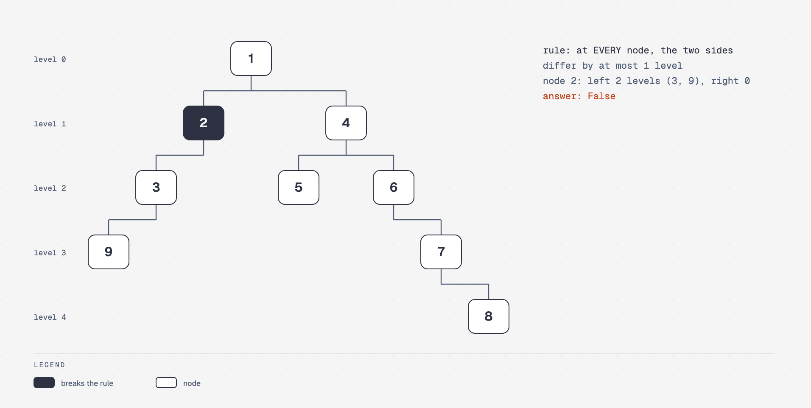
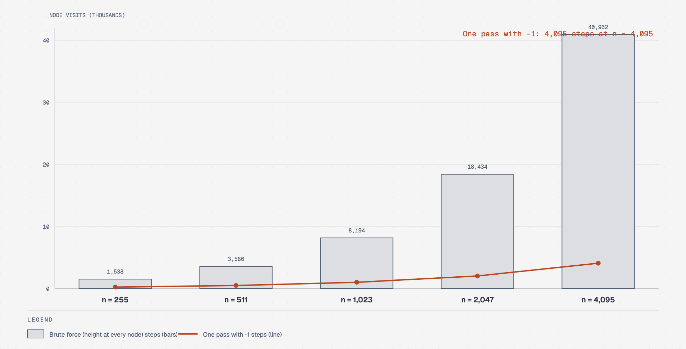
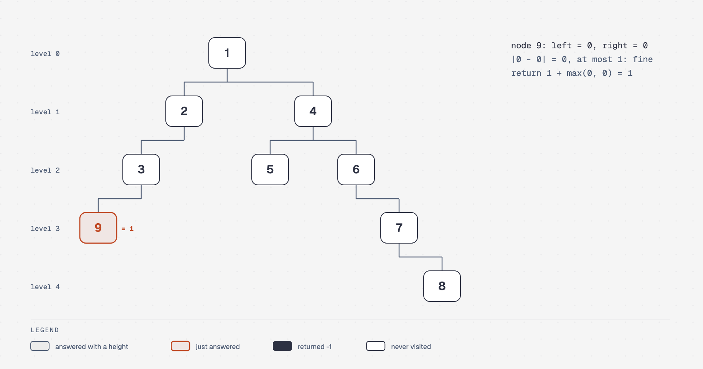
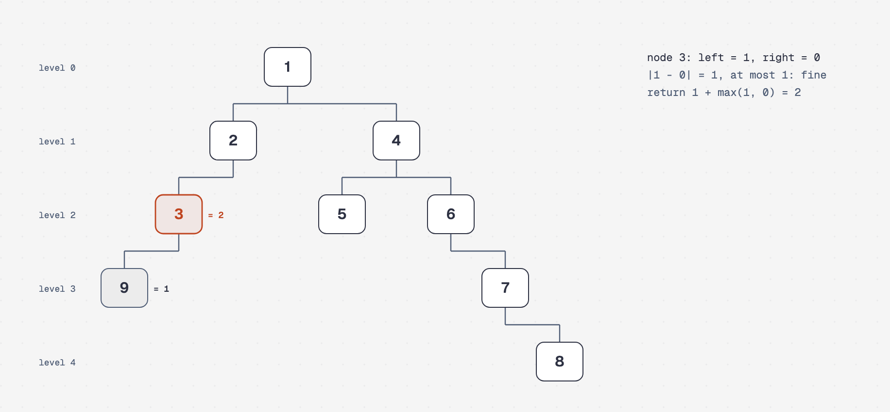
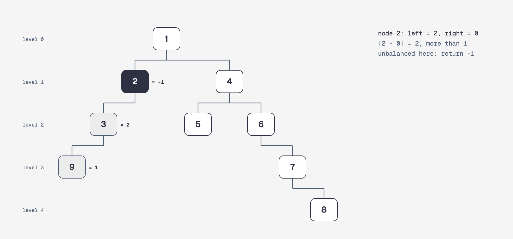
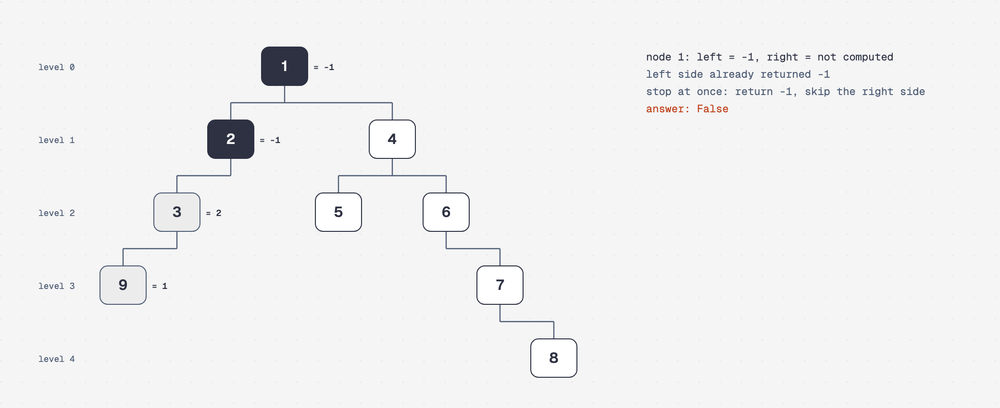

# 11. 110. Balanced Binary Tree

| Difficulty | Pattern | Key idea | Source | Time | Space | Before / after |
|:---:|:---:|:---|:---:|:---:|:---:|:---:|
| **Easy** | Bottom-Up Height With a Failure Signal | Compute heights bottom-up like 104; the moment a node's two sides differ by more than 1, return -1 and let it travel to the root | [110. Balanced Binary Tree](https://leetcode.com/problems/balanced-binary-tree/) | `O(n)` | `O(h)` | [104. Maximum Depth](10.%20104.%20Maximum%20Depth%20of%20Binary%20Tree.md) / [543. Diameter](12.%20543.%20Diameter%20of%20Binary%20Tree.md) |

## 1. Problem Statement

Given a binary tree, return `True` if it is **height-balanced**: for **every** node, the heights of its left and right subtrees differ by at most 1.

### Example

**The tree we take:** the 9-node tree from the lecture board: `1` with children `2` and `4`; `2` with left child `3`; `3` with left child `9`; `4` with children `5` and `6`; `6` with right child `7`; `7` with right child `8`. As a LeetCode list: `[1, 2, 4, 3, None, 5, 6, 9, None, None, None, None, 7, None, None, None, 8]`.

```text
Input:  root = [1, 2, 4, 3, None, 5, 6, 9, None, None, None, None, 7, None, None, None, 8]
Output: False   (at node 2 the left side is 2 levels deep and the right side is empty)
```



It has the tricky part of the problem: the **root** looks fine (its left side is 3 levels deep, its right side 4), but a node **lower down** breaks the rule. Checking only the root would give the wrong answer. We use this tree in every section below.

LeetCode examples:

```text
root = [3, 9, 20, None, None, 15, 7]          gives True
root = [1, 2, 2, 3, 3, None, None, 4, 4]      gives False
root = []                                      gives True
```

### Constraints, in plain words

| Limit | What it means in plain words | What it tells us |
|:---|:---|:---|
| Number of nodes is `0` to `5000` | The tree can be empty, and has at most 5,000 nodes | An empty tree is balanced; `O(n)` is instant |
| `-10^4 <= Node.val <= 10^4` | Whole numbers, maybe negative | Values do not matter; only the shape does |
| "For every node" | The rule must hold at the root **and** at every node below | A check at the root alone is not enough |

**How fast is fast enough?**

- **Brute force** computes the height of both sides at every node, again and again. The lecture bounds it by `O(n) x O(n) = O(n^2)`. On balanced trees it is about `n log n`, still clearly more than needed.
- **One bottom-up pass** computes each height once and also checks the rule on the way: `n` visits.

In the chart, the grey bars are the node visits of brute force and the orange line is the one-pass method, both counted by running the code on perfect trees.



| Nodes `n` (perfect tree) | Brute force visits | One-pass visits | Brute force time (at 100 million steps per second) | One-pass time | One pass is faster by |
|:---:|:---:|:---:|:---:|:---:|:---:|
| 255 | 1,538 | 255 | 0.015 milliseconds | 0.003 milliseconds | about 6 times |
| 511 | 3,586 | 511 | 0.036 milliseconds | 0.005 milliseconds | about 7 times |
| 1,023 | 8,194 | 1,023 | 0.082 milliseconds | 0.010 milliseconds | about 8 times |
| 2,047 | 18,434 | 2,047 | 0.184 milliseconds | 0.020 milliseconds | about 9 times |
| 4,095 | 40,962 | 4,095 | 0.410 milliseconds | 0.041 milliseconds | about 10 times |

## 2. Core Idea

**The rule (lecture):** a tree is balanced when, for every node, `|height(left) - height(right)| <= 1`.

**The slow way** asks each node "how tall is each side?" by walking down again. Lower nodes get measured over and over.

**The fast way** reuses note 104. Each node already computes `1 + max(left, right)`. Just add one check on the way: if `|left - right| > 1`, this node breaks the rule. Instead of a height, return a special signal **-1** that means "something below is not balanced". Then:

- If a child returns -1, return -1 at once. No need to look further (the lecture's early stop).
- At the end, the tree is balanced if the root did **not** return -1.

## 3. Edge Cases

| Case | Input | Expected | Why it matters | Code that handles it |
|:---|:---|:---:|:---|:---|
| Empty tree | `[]` | `True` | No node can break the rule | `return 0` for `None`, and `0 != -1` |
| One node | `[1]` | `True` | Both sides are empty: difference 0 | `abs(0 - 0) <= 1` |
| Root fine, lower node bad | our tree | `False` | The check must happen at every node | Every call checks its own difference |
| Two-node chain | `[1, 2]` | `True` | Difference 1 is still allowed | The test is `> 1`, not `>= 1` |
| Three-node chain | `[1, 2, None, 3]` | `False` | At node 1: left 2, right 0 | `abs(2 - 0) > 1` |

## 4. Brute Force: Measure Both Sides at Every Node

### Idea

For each node: compute the height of the left and right subtrees from scratch; if they differ by more than 1, return `False`; otherwise check the left and right children the same way.

### Run it on our example

| Check at node | Height of left side | Height of right side | Difference | Visits spent measuring | Result |
|:---:|:---:|:---:|:---:|:---:|:---|
| 1 | 3 | 4 | 1 | 8 | fine, check the children |
| 2 | 2 | 0 | 2 | 2 | more than 1: return False |

Brute force spent 10 node visits measuring heights before it found the failing node, and it measured nodes 3 and 9 twice. The one-pass method below needs only 4 visits.

### Code

```python
# Import Optional for type hints
from typing import Optional


# Solution for 110, brute force
class Solution:

    # Height of a subtree, counted in levels
    def height(self, node: Optional[TreeNode]) -> int:

        # An empty subtree has height 0
        if node is None:

            # No levels
            return 0

        # This node plus the taller side
        return 1 + max(self.height(node.left), self.height(node.right))

    # Main method
    def isBalanced(self, root: Optional[TreeNode]) -> bool:

        # An empty tree is balanced
        if root is None:

            # Nothing can break the rule
            return True

        # Measure both sides from scratch
        left = self.height(root.left)

        # Measure the right side from scratch
        right = self.height(root.right)

        # This node breaks the rule
        if abs(left - right) > 1:

            # Not balanced
            return False

        # Both sides must be balanced too
        return self.isBalanced(root.left) and self.isBalanced(root.right)
```

### Complexity

| Measure | Complexity | Why | At the limit (`n = 5000`) | Compared with brute force |
|:---|:---:|:---|:---:|:---|
| **Time** | `O(n^2)` worst case | Each check measures heights again from scratch | about 60,000 visits on a full tree | This is the baseline |
| **Space** | `O(h)` | Recursion depth | up to 5,000 for a chain | This is the baseline |

## 5. Optimal: One Bottom-Up Pass With -1

### Idea

```text
height(empty) = 0
height(node):
    left  = height(node.left);  if left  == -1: return -1
    right = height(node.right); if right == -1: return -1
    if |left - right| > 1: return -1
    return 1 + max(left, right)
balanced = height(root) != -1
```

### Run it on our example, step by step

**The tree we take:** the 9-node tree above.

**How to read the pictures:** grey nodes have answered with a height, orange is a node that just answered with a height, dark nodes returned -1, white nodes were never visited. The tag `= k` is a node's answer.

**Step 1: node 9**

- Left height `0`, right height `0`.
- `|0 - 0| = 0`, at most 1: fine here.
- Return the height `1 + max(0, 0) = 1`.



**Step 2: node 3**

- Left height `1`, right height `0`.
- `|1 - 0| = 1`, at most 1: fine here.
- Return the height `1 + max(1, 0) = 2`.



**Step 3: node 2**

- Left height `2`, right height `0`.
- `|2 - 0| = 2`, more than 1. **Node 2 breaks the rule.** Return `-1`.



**Step 4: node 1**

- The left child returned `-1`: something below already failed.
- Return `-1` at once. The right side (`4` and below) is **never visited**.
- This is the root, so the answer is `False`.




**All steps at a glance**

| Step | Node | `left` | `right` | Check | Returns | What happens next |
|:---:|:---:|:---:|:---:|:---|:---:|:---|
| 1 | 9 | 0 | 0 | |0 - 0| = 0 <= 1 | 1 | Its parent can use this height |
| 2 | 3 | 1 | 0 | |1 - 0| = 1 <= 1 | 2 | Its parent can use this height |
| 3 | 2 | 2 | 0 | |2 - 0| = 2 > 1 | -1 | Its parent will see -1 and stop |
| 4 | 1 | -1 | not computed | left side already failed, stop at once | -1 | The root returned -1: answer False |

Only 4 of the 9 nodes were visited. The whole right side (4, 5, 6, 7, 8) was skipped, because the answer was already known.

### Code

```python
# Import Optional for type hints
from typing import Optional


# Solution for 110, one bottom-up pass
class Solution:

    # Height of a subtree, or -1 if any node inside is unbalanced
    def check(self, node: Optional[TreeNode]) -> int:

        # An empty subtree is balanced with height 0
        if node is None:

            # No levels
            return 0

        # Height of the left side
        left = self.check(node.left)

        # Something on the left already failed
        if left == -1:

            # Pass the failure up at once
            return -1

        # Height of the right side
        right = self.check(node.right)

        # Something on the right already failed
        if right == -1:

            # Pass the failure up at once
            return -1

        # This node breaks the rule
        if abs(left - right) > 1:

            # Report the failure
            return -1

        # Balanced here: return the real height
        return 1 + max(left, right)

    # Main method
    def isBalanced(self, root: Optional[TreeNode]) -> bool:

        # -1 means some node failed
        return self.check(root) != -1
```

### Complexity

| Measure | Complexity | Why | At the limit (`n = 5000`) | Compared with brute force |
|:---|:---:|:---|:---:|:---|
| **Time** | `O(n)` | Each node is visited at most once, and the walk may stop early | at most 5,000 visits | About 10 times fewer visits on full trees |
| **Space** | `O(h)` | Recursion depth | up to 5,000 for a chain | Same as brute force |

## 6. Common Mistakes

| Mistake | What goes wrong | Fix |
|:---|:---|:---|
| Checking only the root | Our tree passes at the root but is not balanced | The rule must hold at every node |
| Testing `>= 1` instead of `> 1` | A difference of exactly 1 is wrongly rejected | Use `abs(left - right) > 1` |
| Forgetting to pass -1 up | A failure low in the tree is forgotten by its parents | Return -1 as soon as a child returns -1 |
| Using 0 as the failure signal | 0 is also the height of an empty tree | Use -1, which can never be a real height |
| Recomputing `maxDepth` inside the check | The answer is right but the time is `O(n^2)` | Get heights and the check from the same pass |

## 7. Interview Follow-ups

### Q1. Why is -1 a safe signal?

**Answer:**
- Real heights are 0 or more, so -1 can never be confused with a height.
- One number then carries two answers: the height, or "already failed".

### Q2. Can you return a pair instead of -1?

**Answer:**
- Yes: return `(height, is_balanced)` from each call, as the lecture's first Python version does.
- It is clearer to read, and the same `O(n)`.

### Q3. Is a balanced tree always complete?

**Answer:**
- No. Our LeetCode example `[3, 9, 20, None, None, 15, 7]` is balanced but has a gap under 9, so it is not complete.
- Every complete tree is balanced, though.

### Q4. Why do balanced trees matter in practice?

**Answer:**
- Their height stays near `log2(n)`, so search, insert and delete in a balanced search tree (AVL, red-black) stay `O(log n)`.

### Q5. How would you make an unbalanced binary search tree balanced (LeetCode 1382)?

**Answer:**
- Read its values in sorted order with an inorder traversal.
- Build a new tree by always picking the middle value as the root, recursively.

## 8. Interview Explanation

> A tree is balanced if, at every node, the left and right heights differ by at most one. The slow way measures both heights at every node, which repeats work and is O(n squared) in the worst case. Instead I compute heights bottom-up, like maximum depth, and check the difference at each node on the way. If a node breaks the rule I return -1, and any parent that sees -1 from a child returns -1 at once. The tree is balanced if the root did not return -1. That is one pass: O(n) time and O(h) space.
