# 12. 543. Diameter of Binary Tree

| Difficulty | Pattern | Key idea | Source | Time | Space | Before / after |
|:---:|:---:|:---|:---:|:---:|:---:|:---:|
| **Easy** | Bottom-Up Height, Track a Best Answer on the Side | Every longest path bends at some node; there it has `height(left) + height(right)` edges, so compute heights once and keep the best sum | [543. Diameter of Binary Tree](https://leetcode.com/problems/diameter-of-binary-tree/) | `O(n)` | `O(h)` | [110. Balanced](11.%20110.%20Balanced%20Binary%20Tree.md) / [124. Maximum Path Sum](13.%20124.%20Binary%20Tree%20Maximum%20Path%20Sum.md) |

## 1. Problem Statement

Given the `root` of a binary tree, return the **diameter**: the number of **edges** on the longest path between any two nodes. The path may or may not pass through the root.

### Example

**The tree we take:** the second tree from the lecture board: `1` with children `2` and `3`; `3` with children `4` and `7`; then the chains `4, 5, 6` (always left) and `7, 8, 9` (always right). As a LeetCode list: `[1, 2, 3, None, None, 4, 7, 5, None, None, 8, 6, None, None, 9]`.

```text
Input:  root = [1, 2, 3, None, None, 4, 7, 5, None, None, 8, 6, None, None, 9]
Output: 6      (the path 6, 5, 4, 3, 7, 8, 9)
```

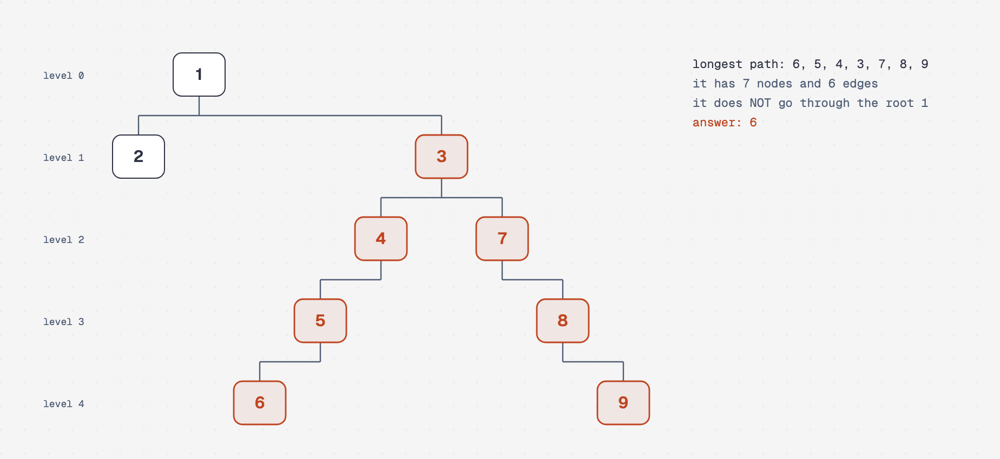

It has the tricky part of the problem, which the lecture points out: **the longest path does not pass through the root**. It bends at node 3. Any answer that only looks at the root gets 5, not 6. We use this tree in every section below.

LeetCode examples:

```text
root = [1, 2, 3, 4, 5]   gives 3   (the path 4, 2, 1, 3 or 5, 2, 1, 3)
root = [1, 2]            gives 1
```

### Constraints, in plain words

| Limit | What it means in plain words | What it tells us |
|:---|:---|:---|
| Number of nodes is `1` to `10^4` | At least one node, at most 10,000 | A single node has diameter 0 |
| `-100 <= Node.val <= 100` | Small whole numbers | Values do not matter; only the shape does |
| Length counts **edges** | A path of 7 nodes has length 6 | With heights counted in nodes, `left + right` already gives edges |

**How fast is fast enough?**

- **Brute force** stands at every node and measures both heights from scratch. On a chain of 10,000 nodes that is about **50 million** node visits: the lecture's `O(n) x O(n) = O(n^2)`.
- **One pass** computes each height once and checks the bend at the same time: **10,000** visits.

In the chart, the grey bars are brute force visits and the orange line is the one-pass method, on chain-shaped trees. The numbers were worked out from the loop counts.

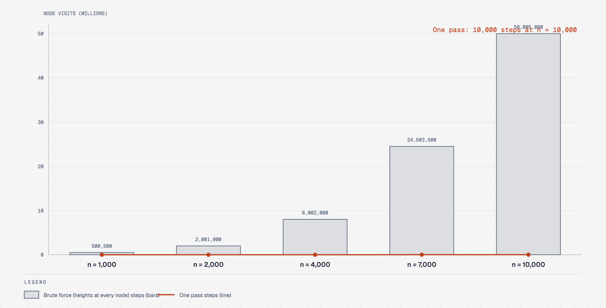

| Nodes `n` (chain) | Brute force visits | One-pass visits | Brute force time (at 100 million steps per second) | One-pass time | One pass is faster by |
|:---:|:---:|:---:|:---:|:---:|:---:|
| 1,000 | 500,500 | 1,000 | 5 milliseconds | 0.01 milliseconds | about 500 times |
| 2,000 | 2,001,000 | 2,000 | 20 milliseconds | 0.02 milliseconds | about 1,000 times |
| 4,000 | 8,002,000 | 4,000 | 80 milliseconds | 0.04 milliseconds | about 2,000 times |
| 7,000 | 24,503,500 | 7,000 | 245 milliseconds | 0.07 milliseconds | about 3,500 times |
| 10,000 | 50,005,000 | 10,000 | 500 milliseconds | 0.10 milliseconds | about 5,000 times |

## 2. Core Idea

Every path in a tree goes **up** to one highest node and then **down** again. Call that highest node the place where the path **bends**.

The longest path that bends at a node `N` goes as deep as possible on the left and as deep as possible on the right. Counting heights in nodes, it has exactly

```text
height(N.left) + height(N.right)   edges
```

So the diameter is the **largest** of these sums over all nodes (the lecture writes `maxi = max(maxi, lh + rh)`).

The heights are the same bottom-up heights as note 104. So one postorder walk can do both jobs:

- return the height `1 + max(lh, rh)` to the parent, and
- on the side, update `best = max(best, lh + rh)`.

## 3. Edge Cases

| Case | Input | Expected | Why it matters | Code that handles it |
|:---|:---|:---:|:---|:---|
| One node | `[1]` | `0` | No edges at all | `0 + 0 = 0` |
| Two nodes | `[1, 2]` | `1` | One edge | `1 + 0 = 1` at the root |
| Bend below the root | our tree | `6` | The root only gives 5 | `best` is updated at **every** node |
| A long chain | 10,000 nodes in a line | `9999` | Recursion depth 10,000 in Python | Raise the recursion limit or use an iterative postorder |
| Both sides equally deep | `[1, 2, 3, 4, 5]` | `3` | Several paths tie | `max` keeps any of them |

## 4. Brute Force: Measure Heights at Every Node

### Idea

Visit every node. At each one, compute the height of the left subtree and the right subtree **from scratch**, and update the best `lh + rh`. Then do the same for the children.

### Run it on our example

| Node visited | Height of left side | Height of right side | Path bending here (edges) | Visits spent measuring heights | Best so far |
|:---:|:---:|:---:|:---:|:---:|:---:|
| 1 | 1 | 4 | 5 | 8 | 5 |
| 2 | 0 | 0 | 0 | 0 | 5 |
| 3 | 3 | 3 | 6 | 6 | 6 |
| 4 | 2 | 0 | 2 | 2 | 6 |
| 5 | 1 | 0 | 1 | 1 | 6 |
| 6 | 0 | 0 | 0 | 0 | 6 |
| 7 | 0 | 2 | 2 | 2 | 6 |
| 8 | 0 | 1 | 1 | 1 | 6 |
| 9 | 0 | 0 | 0 | 0 | 6 |

Brute force spent 20 visits on measuring heights for a 9-node tree: the nodes deep in the chains were measured again and again. The one-pass method below needs 9 visits.

### Code

```python
# Import Optional for type hints
from typing import Optional


# Solution for 543, brute force
class Solution:

    # Height of a subtree, counted in nodes
    def height(self, node: Optional[TreeNode]) -> int:

        # An empty subtree has height 0
        if node is None:

            # No nodes
            return 0

        # This node plus the taller side
        return 1 + max(self.height(node.left), self.height(node.right))

    # Main method
    def diameterOfBinaryTree(self, root: Optional[TreeNode]) -> int:

        # An empty subtree has no path
        if root is None:

            # No edges
            return 0

        # The path that bends at this node, measured from scratch
        through = self.height(root.left) + self.height(root.right)

        # The best path that bends somewhere on the left
        left_best = self.diameterOfBinaryTree(root.left)

        # The best path that bends somewhere on the right
        right_best = self.diameterOfBinaryTree(root.right)

        # The longest of the three
        return max(through, left_best, right_best)
```

### Complexity

| Measure | Complexity | Why | At the limit (`n = 10^4`) | Compared with brute force |
|:---|:---:|:---|:---:|:---|
| **Time** | `O(n^2)` | At each node, measuring heights walks its whole subtree again from scratch | about 50,000,000 visits on a chain | This is the baseline |
| **Space** | `O(h)` | Recursion depth | up to 10,000 for a chain | This is the baseline |

## 5. Optimal: One Bottom-Up Pass

### Idea

```text
height(empty) = 0
height(node):
    lh = height(node.left)
    rh = height(node.right)
    best = max(best, lh + rh)      # the path that bends here
    return 1 + max(lh, rh)         # what the parent needs
answer = best
```

### Run it on our example, step by step

**The tree we take:** the 9-node tree above.

**How to read the pictures:** orange is the node that just answered, grey nodes have answered, white nodes are still waiting. The tag `h=k` is a node's height (counted in nodes).

**Step 1: node 2**

- Left height `0`, right height `0`.
- The longest path that bends at `2` has `0 + 0 = 0` edges. `best = max(0, 0) = 0`.
- Return the height `1 + max(0, 0) = 1` to the parent.

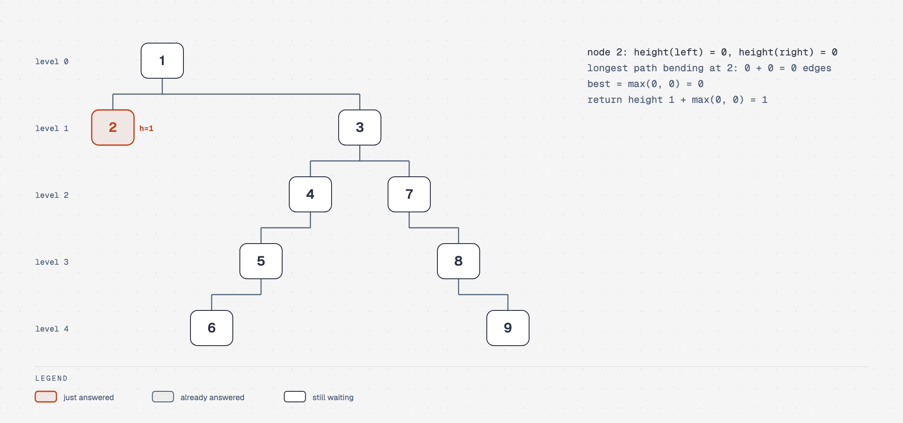

**Step 2: node 6**

- Left height `0`, right height `0`.
- The longest path that bends at `6` has `0 + 0 = 0` edges. `best = max(0, 0) = 0`.
- Return the height `1 + max(0, 0) = 1` to the parent.

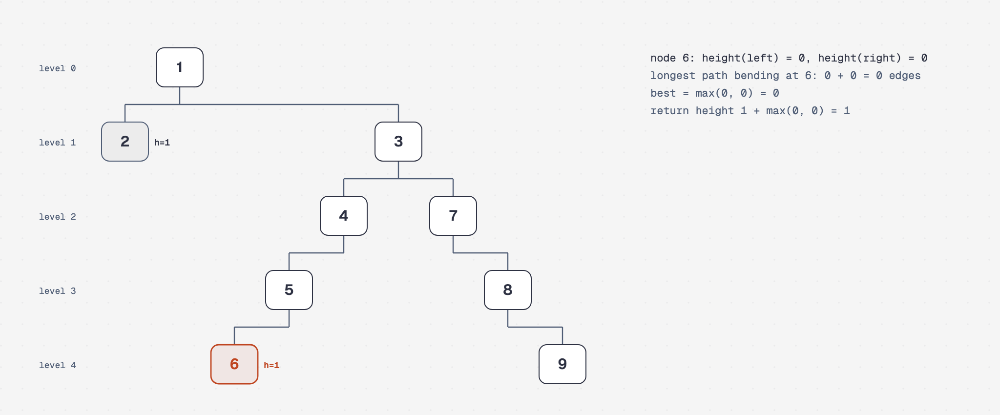

**Step 3: node 5**

- Left height `1`, right height `0`.
- The longest path that bends at `5` has `1 + 0 = 1` edges. `best = max(0, 1) = 1` (new best).
- Return the height `1 + max(1, 0) = 2` to the parent.

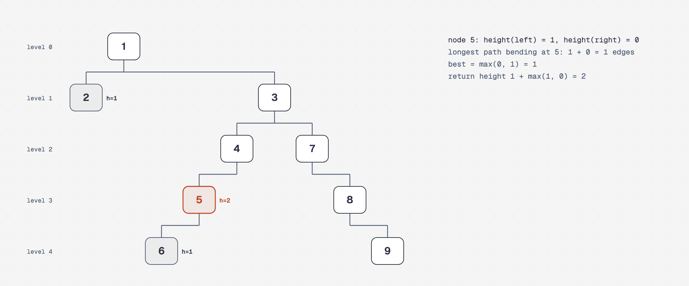

**Step 4: node 4**

- Left height `2`, right height `0`.
- The longest path that bends at `4` has `2 + 0 = 2` edges. `best = max(1, 2) = 2` (new best).
- Return the height `1 + max(2, 0) = 3` to the parent.

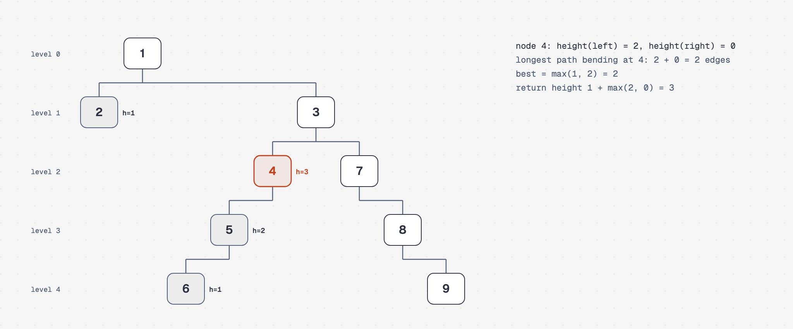

**Step 5: node 9**

- Left height `0`, right height `0`.
- The longest path that bends at `9` has `0 + 0 = 0` edges. `best = max(2, 0) = 2`.
- Return the height `1 + max(0, 0) = 1` to the parent.

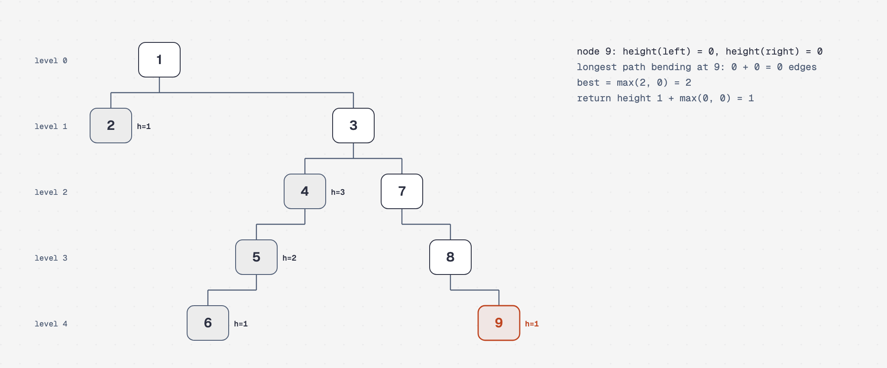

**Step 6: node 8**

- Left height `0`, right height `1`.
- The longest path that bends at `8` has `0 + 1 = 1` edges. `best = max(2, 1) = 2`.
- Return the height `1 + max(0, 1) = 2` to the parent.

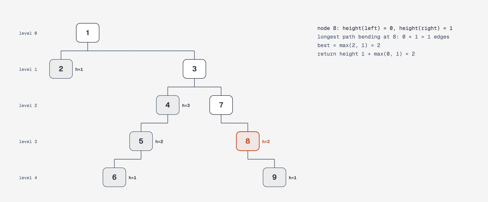

**Step 7: node 7**

- Left height `0`, right height `2`.
- The longest path that bends at `7` has `0 + 2 = 2` edges. `best = max(2, 2) = 2`.
- Return the height `1 + max(0, 2) = 3` to the parent.

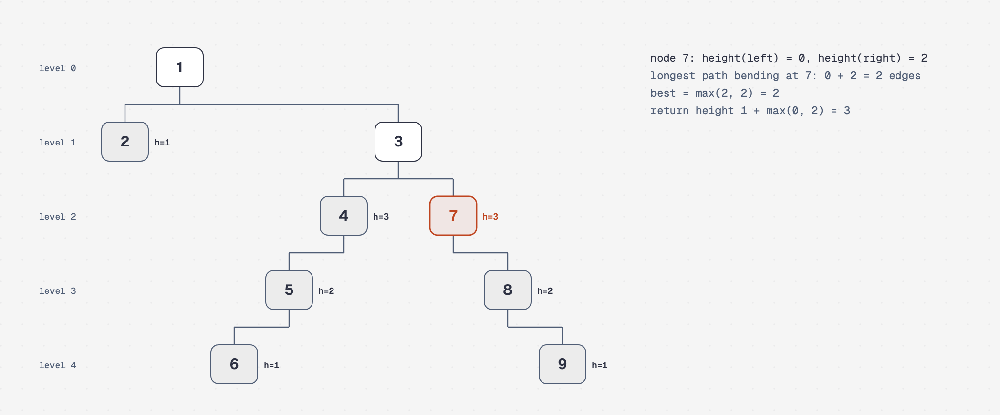

**Step 8: node 3**

- Left height `3`, right height `3`.
- The longest path that bends at `3` has `3 + 3 = 6` edges. `best = max(2, 6) = 6` (new best).
- Return the height `1 + max(3, 3) = 4` to the parent.

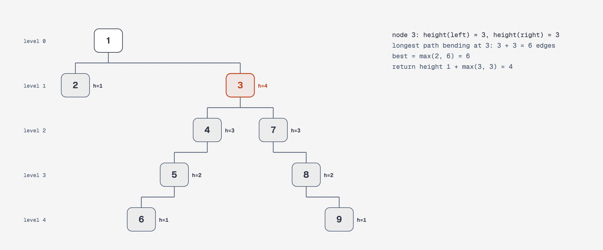

**Step 9: node 1**

- Left height `1`, right height `4`.
- The longest path that bends at `1` has `1 + 4 = 5` edges. `best = max(6, 5) = 6`.
- Return the height `1 + max(1, 4) = 5` to the parent.
- This is the root, so the answer is **6**.

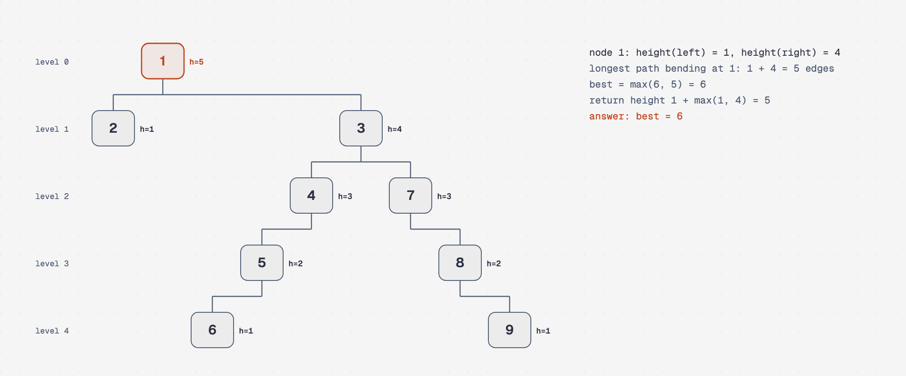


**All steps at a glance**

| Step | Node | `height(left)` | `height(right)` | Path bending here (edges) | `best` after | Height returned | What it means |
|:---:|:---:|:---:|:---:|:---:|:---:|:---:|:---|
| 1 | 2 | 0 | 0 | 0 | 0 | 1 | A leaf: no path bends here |
| 2 | 6 | 0 | 0 | 0 | 0 | 1 | A leaf: no path bends here |
| 3 | 5 | 1 | 0 | 1 | 1 | 2 | New longest path found here |
| 4 | 4 | 2 | 0 | 2 | 2 | 3 | New longest path found here |
| 5 | 9 | 0 | 0 | 0 | 2 | 1 | A leaf: no path bends here |
| 6 | 8 | 0 | 1 | 1 | 2 | 2 | Shorter than the best, best stays |
| 7 | 7 | 0 | 2 | 2 | 2 | 3 | Shorter than the best, best stays |
| 8 | 3 | 3 | 3 | 6 | 6 | 4 | New longest path found here |
| 9 | 1 | 1 | 4 | 5 | 6 | 5 | Shorter than the best, best stays |

The best path was found at node 3 (step 8), not at the root. The root's own bend only gave 5.

### Code

```python
# Import Optional for type hints
from typing import Optional


# Solution for 543, one bottom-up pass
class Solution:

    # Main method
    def diameterOfBinaryTree(self, root: Optional[TreeNode]) -> int:

        # The longest path found so far, in edges
        self.best = 0

        # Return the height of a subtree and record the path that bends at it
        def height(node: Optional[TreeNode]) -> int:

            # An empty subtree has height 0
            if node is None:

                # No nodes
                return 0

            # Height of the left side
            lh = height(node.left)

            # Height of the right side
            rh = height(node.right)

            # The longest path that bends at this node has lh + rh edges
            self.best = max(self.best, lh + rh)

            # The parent needs this node's height
            return 1 + max(lh, rh)

        # Walk the whole tree once
        height(root)

        # The longest path anywhere
        return self.best
```

### Complexity

| Measure | Complexity | Why | At the limit (`n = 10^4`) | Compared with brute force |
|:---|:---:|:---|:---:|:---|
| **Time** | `O(n)` | Each node is visited exactly once, in postorder | 10,000 visits | About 5,000 times fewer visits on a chain |
| **Space** | `O(h)` | Recursion depth | up to 10,000 for a chain | Same as brute force |

## 6. Common Mistakes

| Mistake | What goes wrong | Fix |
|:---|:---|:---|
| Only checking the path through the root | Our tree gives 5 instead of 6 | Update `best` at every node |
| Returning `lh + rh` to the parent | The parent gets a path that bends, which it cannot extend | Return the height `1 + max(lh, rh)`; keep `lh + rh` on the side |
| Counting nodes instead of edges | Every answer is one too big | With node-counted heights, `lh + rh` is already the number of edges |
| Using a local variable for `best` | Python cannot reassign it from the inner function | Use `self.best`, a list, or `nonlocal` |
| Computing `maxDepth` again at each node | Correct but `O(n^2)` | Get heights and the answer from one pass |

## 7. Interview Follow-ups

### Q1. Why can the parent not use `lh + rh`?

**Answer:**
- A path that bends at a node already uses both of its sides.
- To go further up, a path can only come from **one** side, so the parent needs the height `1 + max(lh, rh)`.

### Q2. How would you return the path itself, not just its length?

**Answer:**
- Return the deepest path (a list of nodes) from each call instead of just the height.
- At the best node, join the left path, the node and the reversed right path.

### Q3. What is the diameter of a general tree or a graph tree (LeetCode 1245)?

**Answer:**
- Run BFS from any node to find the farthest node `A`.
- Run BFS again from `A`; the farthest distance found is the diameter.

### Q4. How is this related to 124, Binary Tree Maximum Path Sum?

**Answer:**
- Same shape: compute something bottom-up, and at each node check the best path that bends there.
- In 124 we add values instead of counting edges, and we drop sides that would make the sum smaller. That is the next note.

### Q5. Can you do it without a global variable?

**Answer:**
- Yes: return a pair `(height, best inside this subtree)` from each call and combine the pairs at the parent.

## 8. Interview Explanation

> Every path in a tree bends at one highest node, and the longest path bending at a node uses its full left height plus its full right height. So the diameter is the largest left height plus right height over all nodes. I compute heights bottom-up like maximum depth: each call returns 1 plus the larger child height, and on the side I update best with left plus right. The answer may bend below the root, which is why I check every node. That is one pass: O(n) time and O(h) space.
