# 13. 124. Binary Tree Maximum Path Sum

| Difficulty | Pattern | Key idea | Source | Time | Space | Before / after |
|:---:|:---:|:---|:---:|:---:|:---:|:---:|
| **Hard** | Bottom-Up Gain, Track a Best Answer on the Side | Same shape as the diameter: each node returns the best downward sum (its "gain"), negative gains are dropped as 0, and the path that bends at the node is `val + left gain + right gain` | [124. Binary Tree Maximum Path Sum](https://leetcode.com/problems/binary-tree-maximum-path-sum/) | `O(n)` | `O(h)` | [543. Diameter](12.%20543.%20Diameter%20of%20Binary%20Tree.md) / [100. Same Tree](14.%20100.%20Same%20Tree.md) |

## 1. Problem Statement

A **path** is a sequence of nodes where each pair of neighbours is joined by an edge, and no node appears twice. The path does not have to pass through the root. The **path sum** is the sum of the values on the path.

Given the `root` of a binary tree, return the **maximum path sum** of any **non-empty** path.

### Example

**The tree we take:** a 9-node tree with negative values: `-10` with children `9` and `20`; `9` with left child `-4`; `20` with children `15` and `7`; `15` with right child `-2`; `7` with children `6` and `-8`. As a LeetCode list: `[-10, 9, 20, -4, None, 15, 7, None, None, None, -2, 6, -8]`.

```text
Input:  root = [-10, 9, 20, -4, None, 15, 7, None, None, None, -2, 6, -8]
Output: 48     (the path 15, 20, 7, 6)
```

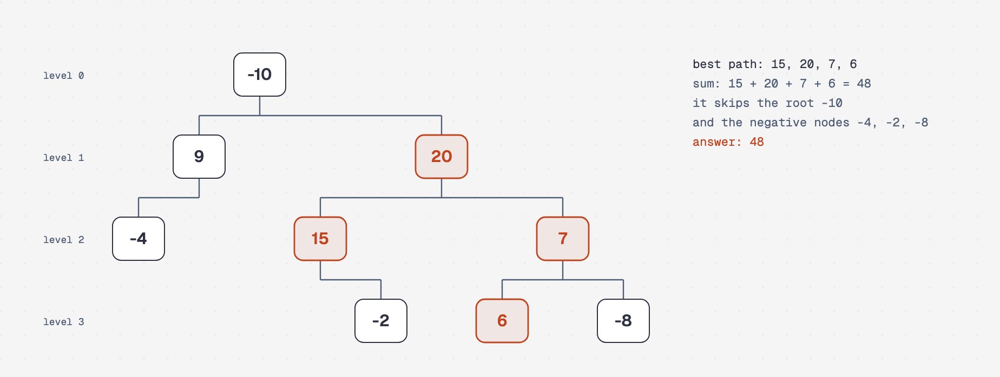

It has every tricky part of the problem:

- The best path **does not pass through the root** (`-10` would only lower the sum).
- Some branches are **negative** (`-4`, `-2`, `-8`) and must be left out.
- The path **bends** at `20` and goes down **both** sides.

It grows the lecture's example `[-10, 9, 20, None, None, 15, 7]` (answer 42) with negative leaves. We use it in every section below.

LeetCode examples:

```text
root = [1, 2, 3]                            gives 6    (2, 1, 3)
root = [-10, 9, 20, None, None, 15, 7]      gives 42   (15, 20, 7)
```

### Constraints, in plain words

| Limit | What it means in plain words | What it tells us |
|:---|:---|:---|
| Number of nodes is `1` to `3 * 10^4` | At least one node, at most 30,000 | `O(n^2)` would be about 450 million steps: too slow |
| `-1000 <= Node.val <= 1000` | Values can be **negative** | Some branches lower the sum and must be skipped |
| The path must be non-empty | At least one node is always in the path | If every value is negative, the answer is the largest single value, so start `best` at minus infinity, not 0 |

**How fast is fast enough?**

- The lecture first tries "every pair of nodes A and B": there are about `n^2` pairs, which it crosses out as too slow.
- A brute force that stands at every node and searches for the best downward paths again costs about **450 million** visits on a chain of 30,000 nodes.
- One bottom-up pass costs **30,000** visits.

In the chart, the grey bars are brute force visits and the orange line is the one-pass method, on chain-shaped trees. The numbers were worked out from the loop counts.

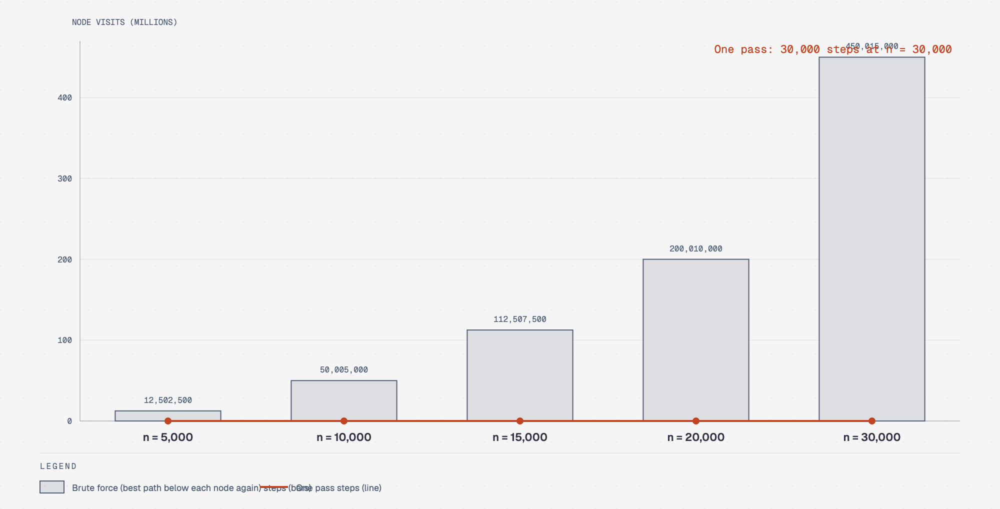

| Nodes `n` (chain) | Brute force visits | One-pass visits | Brute force time (at 100 million steps per second) | One-pass time | One pass is faster by |
|:---:|:---:|:---:|:---:|:---:|:---:|
| 5,000 | 12,502,500 | 5,000 | 0.13 seconds | 0.05 milliseconds | about 2,500 times |
| 10,000 | 50,005,000 | 10,000 | 0.5 seconds | 0.1 milliseconds | about 5,000 times |
| 15,000 | 112,507,500 | 15,000 | 1.1 seconds | 0.15 milliseconds | about 7,500 times |
| 20,000 | 200,010,000 | 20,000 | 2.0 seconds | 0.2 milliseconds | about 10,000 times |
| 30,000 | 450,015,000 | 30,000 | 4.5 seconds | 0.3 milliseconds | about 15,000 times |

## 2. Core Idea

This is the diameter problem (note 543) with **values** instead of edge counts.

Every path bends at one highest node. For a node `N`, the best path that bends at `N` is:

```text
N.val + (best downward sum on the left) + (best downward sum on the right)
```

The lecture calls those downward sums `maxL` and `maxR`. Two rules make them right:

1. **Drop negative sides.** If the best downward sum on a side is negative, it would only make the path worse, so treat it as 0 (just do not go that way): `left = max(0, gain(N.left))`.
2. **Return only one side to the parent.** A path going up through `N` can use at most one of `N`'s sides, so `N` returns its **gain** `N.val + max(left, right)`. The lecture's sticky note: "on every node, the longest one-sided path is what we return; the best two-sided path goes into `maxi`."

So one postorder walk returns gains upward and, on the side, keeps `best = max(best, N.val + left + right)`.

## 3. Edge Cases

| Case | Input | Expected | Why it matters | Code that handles it |
|:---|:---|:---:|:---|:---|
| One node | `[5]` | `5` | The path is just that node | `best` starts at minus infinity, then becomes 5 |
| All negative | `[-3, -1, -2]` | `-1` | The answer is a single node, not 0 | `best` starts at minus infinity, not 0 |
| Negative branches | our tree | `48` | `-4`, `-2`, `-8` must be skipped | `max(0, gain)` drops them |
| Best path away from the root | our tree | `48` | The root's own bend gives only 34 | `best` is updated at every node |
| Root needed | `[1, 2, 3]` | `6` | Here the bend at the root is the best | The root is checked like any other node |

## 4. Brute Force: Best Downward Paths Again at Every Node

### Idea

For every node, treat it as the bend: search its left subtree and its right subtree for the best downward path (from scratch), and compute `val + max(0, left) + max(0, right)`. Keep the largest. Every search walks the whole subtree again.

### Run it on our example

| Node tried as the bend | Best down-left (kept) | Best down-right (kept) | Path bending here | Visits spent searching | Best so far |
|:---:|:---:|:---:|:---:|:---:|:---:|
| -10 | 9 | 35 | 34 | 8 | 34 |
| 20 | 15 | 13 | 48 | 5 | 48 |
| 7 | 6 | 0 | 13 | 2 | 48 |
| -8 | 0 | 0 | -8 | 0 | 48 |
| 6 | 0 | 0 | 6 | 0 | 48 |
| 15 | 0 | 0 | 15 | 1 | 48 |
| -2 | 0 | 0 | -2 | 0 | 48 |
| 9 | 0 | 0 | 9 | 1 | 48 |
| -4 | 0 | 0 | -4 | 0 | 48 |

Brute force spent 17 visits searching downward paths for a 9-node tree, because every bend searched its subtree again. The one-pass method below needs 9 visits.

### Code

```python
# Import Optional for type hints
from typing import Optional


# Solution for 124, brute force
class Solution:

    # Best sum of a path that starts at node and only goes down
    def down(self, node: Optional[TreeNode]) -> int:

        # An empty side adds nothing
        if node is None:

            # Nothing to add
            return 0

        # Best downward sum on the left, dropped if negative
        left = max(0, self.down(node.left))

        # Best downward sum on the right, dropped if negative
        right = max(0, self.down(node.right))

        # This node plus the better side
        return node.val + max(left, right)

    # Main method
    def maxPathSum(self, root: Optional[TreeNode]) -> int:

        # The best path found so far
        best = float("-inf")

        # Every node will be tried as the bend
        stack = [root]

        # Try each node in turn
        while stack:

            # The next node to try as the bend
            node = stack.pop()

            # Best downward sum on the left, searched again from scratch
            left = max(0, self.down(node.left))

            # Best downward sum on the right, searched again from scratch
            right = max(0, self.down(node.right))

            # The best path that bends at this node
            best = max(best, node.val + left + right)

            # Try the left child later
            if node.left:

                # Queue it
                stack.append(node.left)

            # Try the right child later
            if node.right:

                # Queue it
                stack.append(node.right)

        # The best path anywhere
        return best
```

### Complexity

| Measure | Complexity | Why | At the limit (`n = 3 * 10^4`) | Compared with brute force |
|:---|:---:|:---|:---:|:---|
| **Time** | `O(n^2)` | At each node, the downward search walks its whole subtree again | about 450,000,000 visits on a chain | This is the baseline |
| **Space** | `O(h)` | Recursion depth | up to 30,000 for a chain | This is the baseline |

## 5. Optimal: One Bottom-Up Pass

### Idea

```text
gain(empty) = 0
gain(node):
    left  = max(0, gain(node.left))
    right = max(0, gain(node.right))
    best  = max(best, node.val + left + right)   # the path that bends here
    return node.val + max(left, right)            # what the parent may use
answer = best   (best starts at minus infinity)
```

### Run it on our example, step by step

**The tree we take:** the 9-node tree above.

**How to read the pictures:** orange is the node that just answered, grey nodes have answered, white nodes are still waiting. The tag `g=k` is the gain a node returns to its parent.

**Step 1: node -4**

- Left gain: empty, `0`. Right gain: empty, `0`.
- The best path bending at `-4` is `-4 + 0 + 0 = -4`. `best = -4` (new best).
- Return the gain `-4 + max(0, 0) = -4` to the parent.

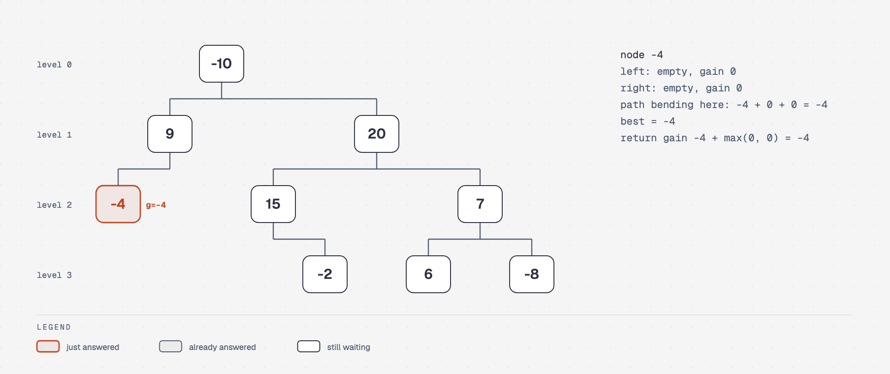

**Step 2: node 9**

- Left gain: `max(-4, 0) = 0` (negative, dropped). Right gain: empty, `0`.
- The best path bending at `9` is `9 + 0 + 0 = 9`. `best = 9` (new best).
- Return the gain `9 + max(0, 0) = 9` to the parent.

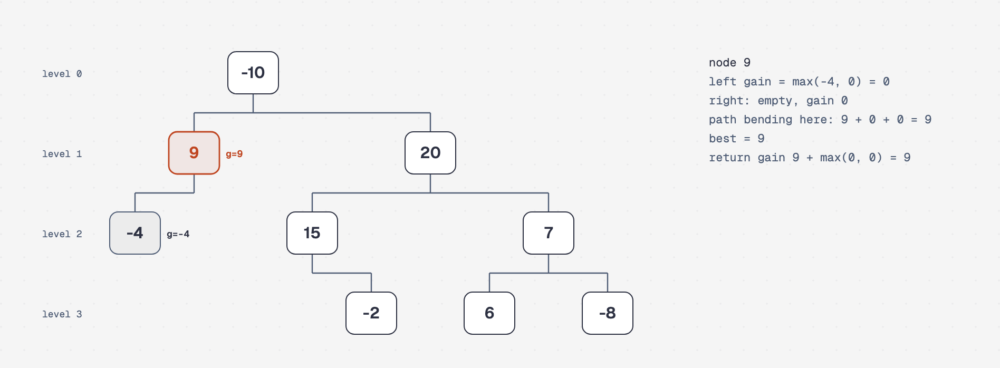

**Step 3: node -2**

- Left gain: empty, `0`. Right gain: empty, `0`.
- The best path bending at `-2` is `-2 + 0 + 0 = -2`. `best = 9` (stays, -2 is smaller).
- Return the gain `-2 + max(0, 0) = -2` to the parent.

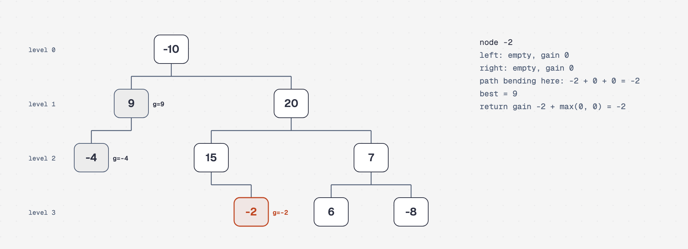

**Step 4: node 15**

- Left gain: empty, `0`. Right gain: `max(-2, 0) = 0` (negative, dropped).
- The best path bending at `15` is `15 + 0 + 0 = 15`. `best = 15` (new best).
- Return the gain `15 + max(0, 0) = 15` to the parent.

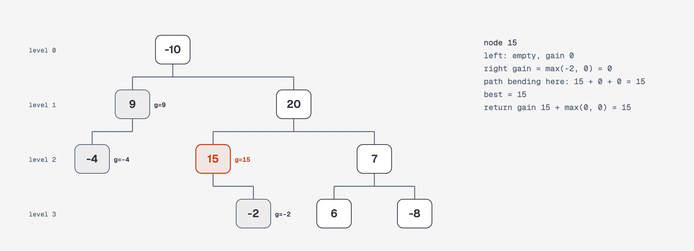

**Step 5: node 6**

- Left gain: empty, `0`. Right gain: empty, `0`.
- The best path bending at `6` is `6 + 0 + 0 = 6`. `best = 15` (stays, 6 is smaller).
- Return the gain `6 + max(0, 0) = 6` to the parent.

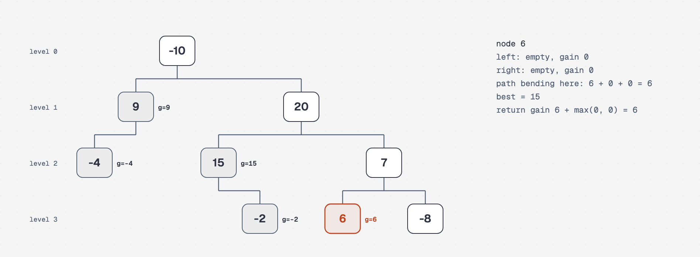

**Step 6: node -8**

- Left gain: empty, `0`. Right gain: empty, `0`.
- The best path bending at `-8` is `-8 + 0 + 0 = -8`. `best = 15` (stays, -8 is smaller).
- Return the gain `-8 + max(0, 0) = -8` to the parent.

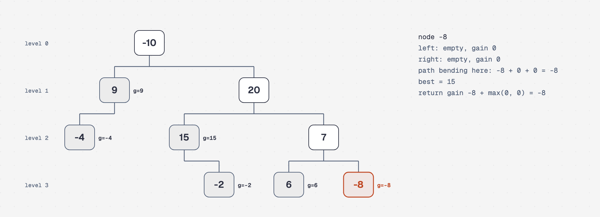

**Step 7: node 7**

- Left gain: `max(6, 0) = 6`. Right gain: `max(-8, 0) = 0` (negative, dropped).
- The best path bending at `7` is `7 + 6 + 0 = 13`. `best = 15` (stays, 13 is smaller).
- Return the gain `7 + max(6, 0) = 13` to the parent.

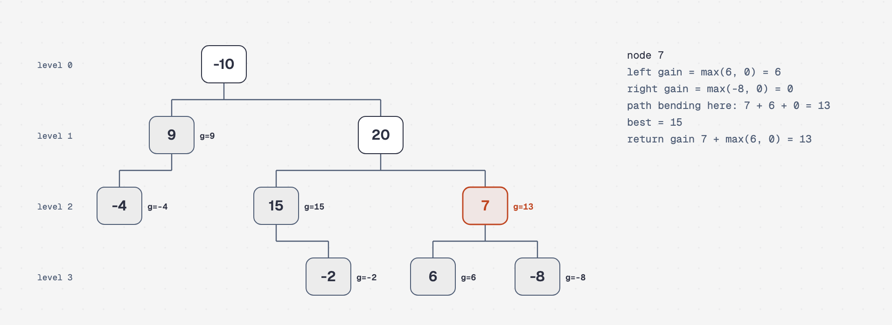

**Step 8: node 20**

- Left gain: `max(15, 0) = 15`. Right gain: `max(13, 0) = 13`.
- The best path bending at `20` is `20 + 15 + 13 = 48`. `best = 48` (new best).
- Return the gain `20 + max(15, 13) = 35` to the parent.

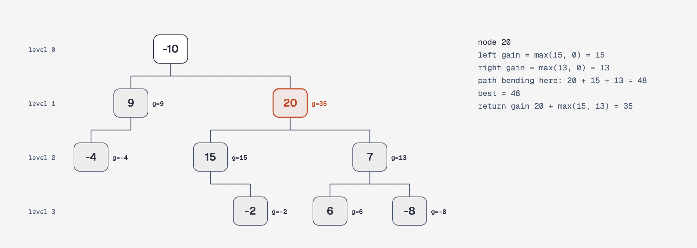

**Step 9: node -10**

- Left gain: `max(9, 0) = 9`. Right gain: `max(35, 0) = 35`.
- The best path bending at `-10` is `-10 + 9 + 35 = 34`. `best = 48` (stays, 34 is smaller).
- Return the gain `-10 + max(9, 35) = 25` to the parent.
- This is the root, so the answer is **48**.

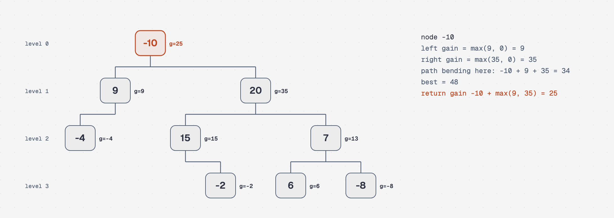


**All steps at a glance**

| Step | Node | Left gain (raw, then kept) | Right gain (raw, then kept) | Path bending here | `best` after | Gain returned | What it means |
|:---:|:---:|:---:|:---:|:---:|:---:|:---:|:---|
| 1 | -4 | - then 0 | - then 0 | -4 | -4 | -4 | New best path found here |
| 2 | 9 | -4 then 0 | - then 0 | 9 | 9 | 9 | New best path found here |
| 3 | -2 | - then 0 | - then 0 | -2 | 9 | -2 | Not better than the best |
| 4 | 15 | - then 0 | -2 then 0 | 15 | 15 | 15 | New best path found here |
| 5 | 6 | - then 0 | - then 0 | 6 | 15 | 6 | Not better than the best |
| 6 | -8 | - then 0 | - then 0 | -8 | 15 | -8 | Not better than the best |
| 7 | 7 | 6 then 6 | -8 then 0 | 13 | 15 | 13 | Not better than the best |
| 8 | 20 | 15 then 15 | 13 then 13 | 48 | 48 | 35 | New best path found here |
| 9 | -10 | 9 then 9 | 35 then 35 | 34 | 48 | 25 | Not better than the best |

The best path, 48, was found at node 20 (step 8). The root's bend only gave 34, and every negative branch was dropped by `max(0, ...)`.

### Code

```python
# Import Optional for type hints
from typing import Optional


# Solution for 124, one bottom-up pass
class Solution:

    # Main method
    def maxPathSum(self, root: Optional[TreeNode]) -> int:

        # The best path found so far; minus infinity handles all-negative trees
        self.best = float("-inf")

        # Return the best downward sum from node, and record the path bending at node
        def gain(node: Optional[TreeNode]) -> int:

            # An empty side adds nothing
            if node is None:

                # Nothing to add
                return 0

            # Best downward sum on the left, dropped if negative
            left = max(0, gain(node.left))

            # Best downward sum on the right, dropped if negative
            right = max(0, gain(node.right))

            # The best path that bends at this node uses both sides
            self.best = max(self.best, node.val + left + right)

            # The parent may extend only one side
            return node.val + max(left, right)

        # Walk the whole tree once
        gain(root)

        # The best path anywhere
        return self.best
```

### Complexity

| Measure | Complexity | Why | At the limit (`n = 3 * 10^4`) | Compared with brute force |
|:---|:---:|:---|:---:|:---|
| **Time** | `O(n)` | Each node is visited exactly once, in postorder | 30,000 visits | About 15,000 times fewer visits on a chain |
| **Space** | `O(h)` | Recursion depth | up to 30,000 for a chain | Same as brute force |

## 6. Common Mistakes

| Mistake | What goes wrong | Fix |
|:---|:---|:---|
| Starting `best` at 0 | An all-negative tree returns 0, but the path must have a node | Start at `float("-inf")` |
| Not dropping negative gains | `-2` and `-8` drag good paths down | `left = max(0, gain(left))` |
| Returning `val + left + right` to the parent | The parent builds a "path" that forks, which is not allowed | Return `val + max(left, right)` |
| Clamping the node's own value to 0 | A negative node could never be the whole answer | Clamp only the children's gains, never `node.val` |
| Checking only the root | Our tree gives 34 instead of 48 | Update `best` at every node |

## 7. Interview Follow-ups

### Q1. Why is it fine to drop a negative side?

**Answer:**
- A path does not have to go down a side at all.
- If the best you can get from a side is negative, not going there (adding 0) is always better.

### Q2. How is this the same as the diameter (543)?

**Answer:**
- Same walk: return a one-sided value upward, check the two-sided value at each node.
- Diameter adds 1 per edge; this adds node values and drops negative sides.

### Q3. How would you also return the path itself?

**Answer:**
- Return the best downward path (as a list of nodes) along with the gain.
- At the node where `best` improves, join the left path, the node, and the right path.

### Q4. What if the path must start at the root and go down (a "root-to-leaf" or "root-to-any" sum)?

**Answer:**
- Then there is no bend: the answer is just `gain(root)` with the one-sided rule.
- For root-to-leaf sums (LeetCode 112, 113), recurse with a running total instead.

### Q5. What if values are on edges instead of nodes?

**Answer:**
- Same idea: a side's gain is `edge weight + gain(child)`, clamped at 0 when negative.
- This becomes the "longest path in a weighted tree" problem.

## 8. Interview Explanation

> Every path bends at one highest node, and the best path bending at a node is its value plus the best downward sum on the left plus the best downward sum on the right, where a negative side is replaced by zero because we can simply not go there. A parent can only extend a path through one side of a child, so each call returns the child's value plus the larger of its two clamped sides. I do this in one postorder walk, returning these gains upward and updating a global best with value plus left plus right at every node. The best starts at minus infinity so an all-negative tree still returns its largest value. That is O(n) time and O(h) space.
