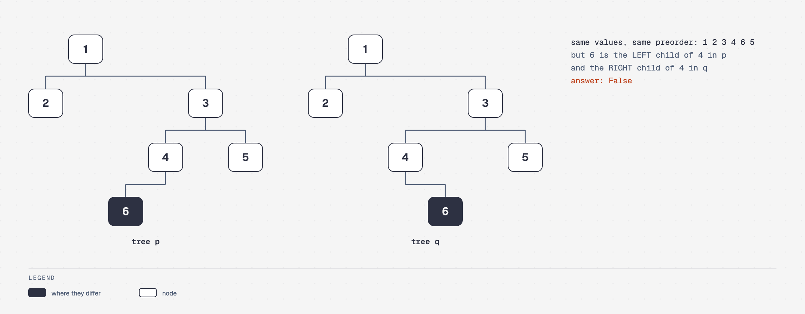
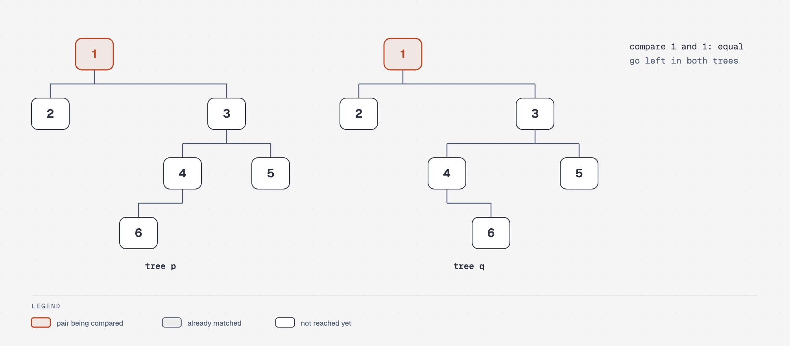
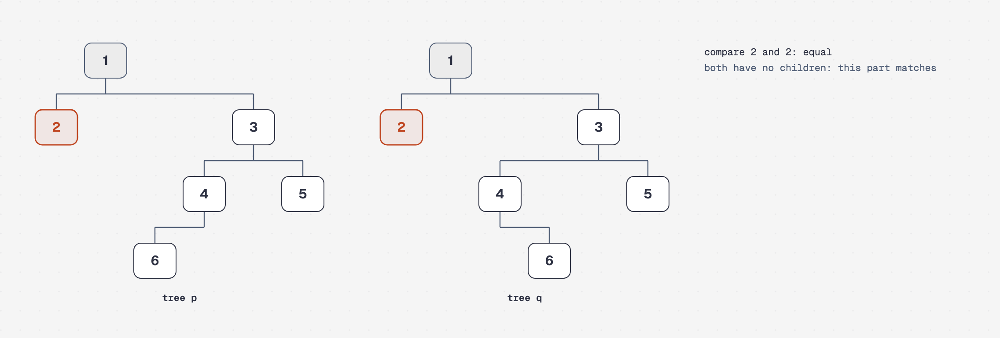
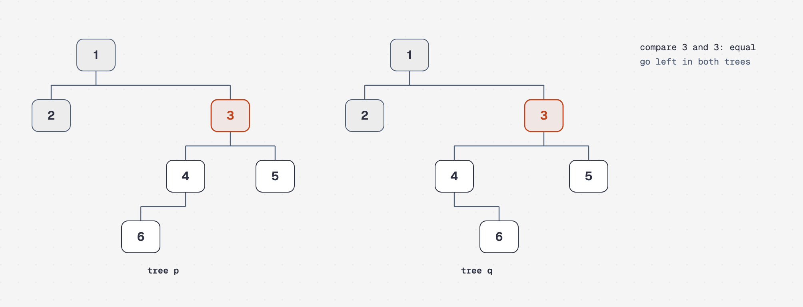
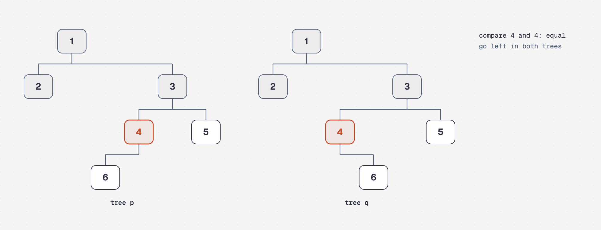
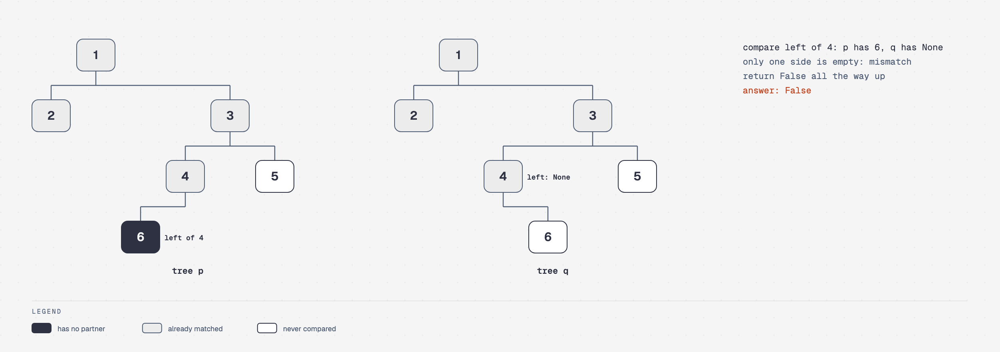

# 14. 100. Same Tree

| Difficulty | Pattern | Key idea | Source | Time | Space | Before in this folder |
|:---:|:---:|:---|:---:|:---:|:---:|:---:|
| **Easy** | Walk Two Trees Together (Preorder) | Compare the two roots, then the two left subtrees, then the two right subtrees; two empty spots match, one empty spot does not | [100. Same Tree](https://leetcode.com/problems/same-tree/) | `O(n)` | `O(h)` | [124. Maximum Path Sum](13.%20124.%20Binary%20Tree%20Maximum%20Path%20Sum.md) |

## 1. Problem Statement

Given the roots of two binary trees `p` and `q`, return `True` if they are the **same**: the same shape, and the same value in every matching node.

### Example

**The two trees we take:** both trees from the lecture board, with one more node `6` under `4`. In `p` it is the **left** child of `4`; in `q` it is the **right** child of `4`. As LeetCode lists: `p = [1, 2, 3, None, None, 4, 5, 6]` and `q = [1, 2, 3, None, None, 4, 5, None, 6]`.

```text
Input:  p = [1, 2, 3, None, None, 4, 5, 6]
        q = [1, 2, 3, None, None, 4, 5, None, 6]
Output: False
```



It has the trap of the problem: the two trees have **the same values** and even **the same preorder list** `1, 2, 3, 4, 6, 5`. Only the **shape** differs. A check that only compares values in order would wrongly say `True`. We use these two trees in every section below.

LeetCode examples:

```text
p = [1, 2, 3],  q = [1, 2, 3]      gives True
p = [1, 2],     q = [1, None, 2]   gives False
p = [1, 2, 1],  q = [1, 1, 2]      gives False
```

### Constraints, in plain words

| Limit | What it means in plain words | What it tells us |
|:---|:---|:---|
| Number of nodes in both trees is `0` to `100` | Either tree can be empty; each has at most 100 nodes | Two empty trees are the same; one empty and one not are different |
| `-10^4 <= Node.val <= 10^4` | Whole numbers, maybe negative | Compare values with `!=`; nothing special |
| "Same" means shape and values | Left and right positions must match too | Empty spots must be compared, not skipped |

**How fast is fast enough?**

- Every method looks at each pair of nodes at most once: `O(n)` time, at most 100 pairs here.
- The methods differ in memory: writing both trees out as lists uses `O(n)` extra; walking them together uses only the recursion depth `O(h)`, and can stop at the **first** difference.

| Method | Pairs or values looked at in our example | Extra memory | Can stop at the first difference? | Note |
|:---|:---:|:---:|:---:|:---|
| Compare full preorder lists with `None` markers | all 13 slots of each tree are written first | two lists of 13 | No: both lists are built first | Simple, but does the whole work every time |
| Walk both trees together (recursion) | 5 node pairs, then stop | recursion depth 4 | Yes | The standard answer |
| Walk both trees together (queue) | 5 node pairs, then stop | a queue of pairs | Yes | No recursion |

## 2. Core Idea

Two trees are the same when, at every position:

1. **Both spots are empty**: that position matches.
2. **Exactly one spot is empty**: the shapes differ. Answer `False`.
3. **Both have a node, but the values differ**: answer `False`.
4. **Both have a node with the same value**: check the two **left** subtrees and the two **right** subtrees the same way.

That is a **preorder** walk (root, left, right) done on both trees at the same time, as the lecture draws with arrows on both boards.

## 3. Edge Cases

| Case | Input | Expected | Why it matters | Code that handles it |
|:---|:---|:---:|:---|:---|
| Both empty | `[]`, `[]` | `True` | Nothing to compare | `if p is None and q is None: return True` |
| One empty | `[1]`, `[]` | `False` | Shapes differ at the root | `if p is None or q is None: return False` |
| Same values, mirrored | `[1, 2]`, `[1, None, 2]` | `False` | The child is on different sides | Empty spots are compared |
| Values differ | `[1, 2, 1]`, `[1, 1, 2]` | `False` | Same shape, different numbers | `if p.val != q.val: return False` |
| Same preorder, different shape | our trees | `False` | The values alone look identical | The walk checks positions, not just values |

## 4. Brute Force: Write Both Trees Out and Compare the Lists

### Idea

Write each tree as a preorder list, adding a marker `None` for every empty spot. Two trees are the same exactly when the two lists are equal. The markers are essential: without them our two trees give the same list.

### Run it on our example

| Slot | Spot in p | Tree p writes | Spot in q | Tree q writes | Same? | Meaning |
|:---:|:---|:---:|:---|:---:|:---:|:---|
| 0 | root | 1 | root | 1 | Yes | Both write the same thing |
| 1 | left of 1 | 2 | left of 1 | 2 | Yes | Both write the same thing |
| 2 | left of 2 | None | left of 2 | None | Yes | Both write the same thing |
| 3 | right of 2 | None | right of 2 | None | Yes | Both write the same thing |
| 4 | right of 1 | 3 | right of 1 | 3 | Yes | Both write the same thing |
| 5 | left of 3 | 4 | left of 3 | 4 | Yes | Both write the same thing |
| 6 | left of 4 | 6 | left of 4 | None | **No** | First difference: p has 6 on the left of 4, q has an empty spot |
| 7 | left of 6 | None | right of 4 | 6 | **No** | Different from here on |
| 8 | right of 6 | None | left of 6 | None | Yes | Both write the same thing |
| 9 | right of 4 | None | right of 6 | None | Yes | Both write the same thing |
| 10 | right of 3 | 5 | right of 3 | 5 | Yes | Both write the same thing |
| 11 | left of 5 | None | left of 5 | None | Yes | Both write the same thing |
| 12 | right of 5 | None | right of 5 | None | Yes | Both write the same thing |

The lists differ at slot 6. Without the `None` markers both lists would be `[1, 2, 3, 4, 6, 5]` and the answer would wrongly be `True`.

### Code

```python
# Import deque for the queue
from collections import deque

# Import List and Optional for type hints
from typing import List, Optional


# Solution for 100, compare full preorder lists with markers
class Solution:

    # Write a tree in preorder, with None for every empty spot
    def write(self, node: Optional[TreeNode], out: List[Optional[int]]) -> None:

        # An empty spot gets a marker
        if node is None:

            # Mark the empty spot
            out.append(None)

            # Nothing below it
            return

        # Root first
        out.append(node.val)

        # Then the left subtree
        self.write(node.left, out)

        # Then the right subtree
        self.write(node.right, out)

    # Main method
    def isSameTree(self, p: Optional[TreeNode], q: Optional[TreeNode]) -> bool:

        # The list for tree p
        a = []

        # The list for tree q
        b = []

        # Write tree p
        self.write(p, a)

        # Write tree q
        self.write(q, b)

        # Same lists, with markers, means same trees
        return a == b
```

### Complexity

| Measure | Complexity | Why | At the limit (100 nodes) | Compared with the others |
|:---|:---:|:---|:---:|:---|
| **Time** | `O(n + m)` | Both trees are written out in full before comparing | about 400 list slots | Never stops early |
| **Space** | `O(n + m)` | Two full lists | about 200 slots each | More memory than walking together |

## 5. Approach 2: Walk Both Trees Together With a Queue

### Idea

Keep a queue of **pairs** `(node from p, node from q)`. Take a pair: if both are empty, skip it; if one is empty or the values differ, return `False`; otherwise queue the two left children as a pair and the two right children as a pair.

### Code

```python
# Import deque for the queue
from collections import deque

# Import List and Optional for type hints
from typing import List, Optional


# Solution for 100, walk both trees together with a queue
class Solution:

    # Main method
    def isSameTree(self, p: Optional[TreeNode], q: Optional[TreeNode]) -> bool:

        # Pairs of matching spots still to compare
        queue = deque([(p, q)])

        # Compare until every pair is checked
        while queue:

            # The next pair of spots
            a, b = queue.popleft()

            # Both empty: this spot matches
            if a is None and b is None:

                # Move on to the next pair
                continue

            # Exactly one empty: the shapes differ
            if a is None or b is None:

                # Not the same
                return False

            # Different values
            if a.val != b.val:

                # Not the same
                return False

            # Compare the two left children later
            queue.append((a.left, b.left))

            # Compare the two right children later
            queue.append((a.right, b.right))

        # Every pair matched
        return True
```

### Complexity

| Measure | Complexity | Why | At the limit (100 nodes) | Compared with the others |
|:---|:---:|:---|:---:|:---|
| **Time** | `O(min(n, m))` | Stops at the first difference; at most every pair once | at most about 200 pairs | Same as recursion |
| **Space** | `O(w)` | The queue holds about one level of pairs | about 50 pairs | No recursion limit |

## 6. Optimal: Walk Both Trees Together With Recursion

### Idea

```text
same(p, q):
    both empty          -> True
    one empty           -> False
    values differ       -> False
    otherwise           -> same(p.left, q.left) and same(p.right, q.right)
```

### Run it on our example, step by step

**The two trees we take:** `p` and `q` above.

**How to read the pictures:** orange is the pair being compared, grey pairs have already matched, white nodes are not reached yet, and the dark node has no partner.

**Step 1: compare 1 with 1**

- Both are 1: equal.
- Go on to the left children.



**Step 2: compare 2 with 2**

- Both are 2: equal.
- Both of their children are empty spots, which match. Go back and compare the right children of 1.



**Step 3: compare 3 with 3**

- Both are 3: equal.
- Go on to the left children.



**Step 4: compare 4 with 4**

- Both are 4: equal.
- Go on to the left children of 4.



**Step 5: compare the left children of 4**

- In `p` the left child of 4 is `6`. In `q` the left child of 4 is **empty**.
- Exactly one spot is empty, so the shapes differ: return `False`.
- Every call above returns `False` too. The answer is **False**.




**All steps at a glance**

| Step | Spot | Node in p | Node in q | Result | What happens next |
|:---:|:---|:---:|:---:|:---|:---|
| 1 | root | 1 | 1 | match | Go on to the left children. |
| 2 | left of 1 | 2 | 2 | match | Both of their children are empty spots, which match. Go back and compare the right children of 1. |
| 3 | right of 1 | 3 | 3 | match | Go on to the left children. |
| 4 | left of 3 | 4 | 4 | match | Go on to the left children of 4. |
| 5 | left of 4 | 6 | None | **mismatch** | Return False all the way up; node 5 is never compared |

The walk stopped at the first difference. Node 5 in both trees was never compared, because the answer was already known.

### Code

```python
# Import deque for the queue
from collections import deque

# Import List and Optional for type hints
from typing import List, Optional


# Solution for 100, walk both trees together with recursion
class Solution:

    # Main method
    def isSameTree(self, p: Optional[TreeNode], q: Optional[TreeNode]) -> bool:

        # Both spots empty: they match
        if p is None and q is None:

            # This part is the same
            return True

        # Exactly one spot empty: the shapes differ
        if p is None or q is None:

            # Not the same
            return False

        # Both nodes exist but hold different values
        if p.val != q.val:

            # Not the same
            return False

        # Left with left, and right with right, must both match
        return self.isSameTree(p.left, q.left) and self.isSameTree(p.right, q.right)
```

### Complexity

| Measure | Complexity | Why | At the limit (100 nodes) | Compared with the others |
|:---|:---:|:---|:---:|:---|
| **Time** | `O(min(n, m))` | Each pair of nodes is compared at most once, and the walk stops early | at most 100 pairs | Stops at the first difference |
| **Space** | `O(h)` | Recursion depth | at most 100 for a chain | Less memory than writing lists |

## 7. Common Mistakes

| Mistake | What goes wrong | Fix |
|:---|:---|:---|
| Comparing traversal lists without `None` markers | Our two trees look the same | Add a marker for every empty spot, or walk the trees together |
| Checking `p.val` before checking for `None` | Crashes when one node is empty | Handle the empty cases first |
| Using `or` instead of `and` for the children | One matching side is enough to say `True` | Both sides must match: `and` |
| Comparing `p.left` with `q.right` | That checks for a mirror image, not the same tree | Left with left, right with right |
| Comparing node objects with `==` | Two different objects with the same value look different | Compare `p.val` with `q.val` |

## 8. Interview Follow-ups

### Q1. How do you check if a tree is symmetric (LeetCode 101)?

**Answer:**
- Compare the tree with its own mirror: `same(left, right)` where left is compared with right and right with left.
- That is note 21 later in this chapter.

### Q2. How do you check if one tree is a subtree of another (LeetCode 572)?

**Answer:**
- For every node of the big tree, check `same(node, small_root)`.
- `O(n x m)` in the worst case; with serialization plus string matching it can be `O(n + m)`.

### Q3. Why are the `None` markers needed when comparing lists?

**Answer:**
- A preorder list without markers loses the shape: our two trees both give `1, 2, 3, 4, 6, 5`.
- With markers, a preorder list describes the tree exactly, so equal lists mean equal trees.

### Q4. How would you check if two trees are the same after swapping children at some nodes (LeetCode 951)?

**Answer:**
- At each node, the children may match straight (`left-left`, `right-right`) or swapped (`left-right`, `right-left`).
- Try both: `(same(l1, l2) and same(r1, r2)) or (same(l1, r2) and same(r1, l2))`.

### Q5. What is the best-case time?

**Answer:**
- `O(1)`: if the roots already differ, the answer is known at once.
- The worst case is when the trees are the same: every pair must be checked.

## 9. Interview Explanation

> Two trees are the same if they have the same shape and the same values. I walk both trees together in preorder. If both nodes are empty, that spot matches. If only one is empty, or the values differ, I return False. Otherwise I check the two left subtrees and the two right subtrees, and both must match. The walk stops at the first difference. It is O(n) time in the worst case and O(h) space for the recursion. Comparing plain value lists would be wrong, because two different shapes can give the same order of values; that is why the empty spots must be compared too.
