# 15. 545. Boundary of Binary Tree

| Difficulty | Pattern | Key idea | Source | Time | Space | Next in this folder |
|:---:|:---:|:---|:---:|:---:|:---:|:---:|
| **Medium** | Three Walks Joined Together | The anticlockwise boundary is the root, then the left edge going down, then every leaf from left to right, then the right edge going up; leaves are added only once | [545. Boundary of Binary Tree](https://leetcode.com/problems/boundary-of-binary-tree/) (premium) | `O(n)` | `O(h)` | [987. Vertical Order](16.%20987.%20Vertical%20Order%20Traversal%20of%20a%20Binary%20Tree.md) |

## 1. Problem Statement

The **boundary** of a binary tree is, in this order:

1. the **root**,
2. the **left boundary** (going down), without the leaf at its end,
3. all **leaves** from left to right,
4. the **right boundary** in **reverse** (going up), without the leaf at its end.

**Left boundary:** start at the root's left child. Keep going left; if a node has no left child, go right instead. Stop before a leaf. If the root has no left child, the left boundary is empty. The right boundary is the mirror image on the root's right side.

Given the `root`, return the values on its boundary. The root itself is never counted as a leaf, unless it is the only node.

### Example

**The tree we take:** the 11-node tree from the lecture board: `1` with children `2` and `7`; `2` with left child `3`; `3` with right child `4`; `4` with children `5` and `6`; `7` with right child `8`; `8` with left child `9`; `9` with children `10` and `11`. As a LeetCode list: `[1, 2, 7, 3, None, None, 8, None, 4, 9, None, 5, 6, 10, 11]`.

```text
Input:  root = [1, 2, 7, 3, None, None, 8, None, 4, 9, None, 5, 6, 10, 11]
Output: [1, 2, 3, 4, 5, 6, 10, 11, 9, 8, 7]
```

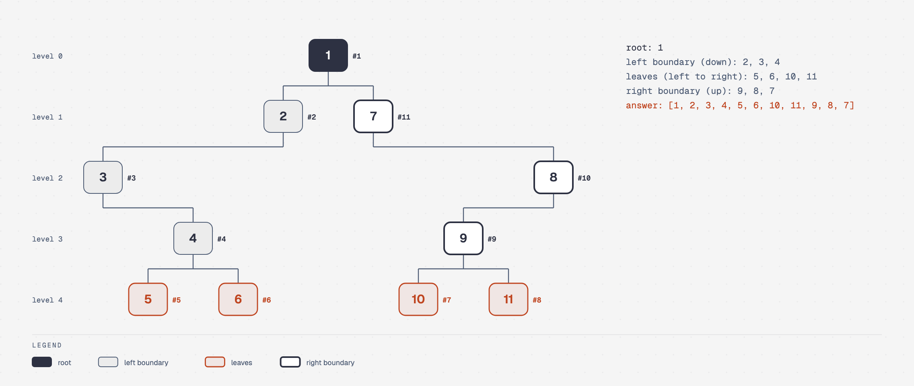

It has every tricky part of the problem: both edges **zigzag** (3 has no left child, so the left edge goes right; 8 has no right child, so the right edge goes left), and the leaves at the end of each edge must appear **once**, with the other leaves, not as part of an edge. We use this tree in every section below.

LeetCode examples:

```text
root = [1, None, 2, 3, 4]                                gives [1, 3, 4, 2]
root = [1, 2, 3, 4, 5, 6, None, None, None, 7, 8, 9, 10]  gives [1, 2, 4, 7, 8, 9, 10, 6, 3]
```

### Constraints, in plain words

| Limit | What it means in plain words | What it tells us |
|:---|:---|:---|
| Number of nodes is `1` to `10^4` | At least one node, at most 10,000 | `O(n)` is instant; a single node is its own boundary |
| `-1000 <= Node.val <= 1000` | Small whole numbers | Values do not matter; only positions do |
| No node may appear twice | A node on an edge that is also a leaf is a leaf only | Skip leaves while walking the two edges |

**How fast is fast enough?**

- The two edge walks touch only the nodes on the edges: at most the height each.
- The leaf walk visits every node once: `O(n)`.
- So the whole thing is `O(n)` time, about 10,000 steps at most. There is no slower "brute force" worth writing; the work is in getting the three parts and their order right.

| Part | Nodes visited in our tree | Nodes added to the answer | Extra memory | Order |
|:---|:---:|:---:|:---|:---|
| Root | 1 | 1 | none | first |
| Left boundary | 4 (2, 3, 4, then the leaf 5 stops it) | 3 | none | top to bottom |
| Leaves | 11 (the whole tree) | 4 | recursion depth, at most the height | left to right |
| Right boundary | 4 (7, 8, 9, then the leaf 11 stops it) | 3 | a small list, then reversed | bottom to top |

## 2. Core Idea

Walk around the outside of the tree **anticlockwise**, like tracing it with a finger (the lecture draws exactly this arrow):

- **Down the left edge.** Prefer left; if there is no left child, step right. Skip leaves.
- **Along the bottom.** A normal DFS (left before right) meets the leaves in left-to-right order.
- **Up the right edge.** Walk it **down** (prefer right, else left, skip leaves), keep the nodes in a list, then add the list **reversed**.

Leaves are only ever added in the middle part, so the leaf at the bottom of each edge is never added twice.

## 3. Edge Cases

| Case | Input | Expected | Why it matters | Code that handles it |
|:---|:---|:---:|:---|:---|
| Single node | `[1]` | `[1]` | The root is the whole boundary | `if self.is_leaf(root): return boundary` |
| No left child at the root | `[1, None, 2, 3, 4]` | `[1, 3, 4, 2]` | The left boundary is empty | `add_left(None, ...)` does nothing |
| Edges that zigzag | our tree | `..., 3, 4, ...` | 3 has no left child, so the edge steps right | `else: node = node.right` |
| Leaf at the end of an edge | 5 and 11 in our tree | each once | Edges stop before leaves | `if not self.is_leaf(node)` |
| Right edge order | our tree | `..., 9, 8, 7` | It must go upward | `out.extend(reversed(temp))` |

## 4. Approach: Root, Left Edge, Leaves, Right Edge

### Idea

1. Start the answer with the root.
2. Walk the left edge from `root.left`, adding non-leaf nodes.
3. DFS the whole tree, adding leaves from left to right.
4. Walk the right edge from `root.right`, collecting non-leaf nodes, and add them reversed.

### Run it on our example, step by step

**The tree we take:** the 11-node tree above.

**How to read the pictures:** grey nodes are already in the answer, orange nodes are added (or visited) in this step, bold boxes wait in the `temp` list of the right edge, and the dashed box is where an edge stops. The tag `#k` is a node's place in the answer.

**Step 1: the root**

- Add the root 1 (it is not a leaf).
- Answer so far: `[1]`.

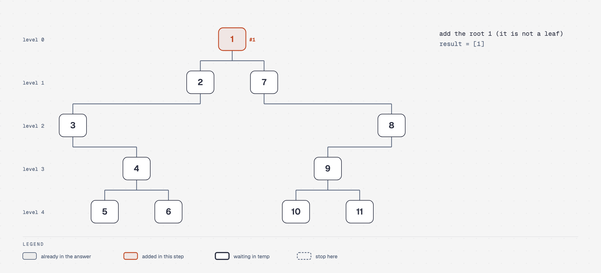

**Step 2: left boundary at 2**

- Left boundary starts at the root's left child 2.
- 2 is not a leaf: add it.
- 2 has a left child: go left to 3.
- Answer so far: `[1, 2]`.

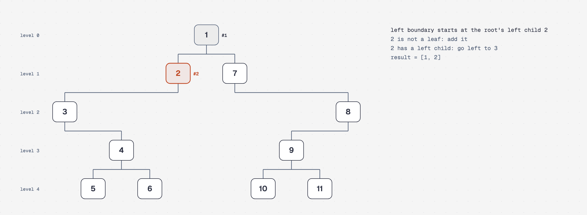

**Step 3: left boundary at 3**

- 3 is not a leaf: add it.
- 3 has no left child: go right to 4.
- Answer so far: `[1, 2, 3]`.

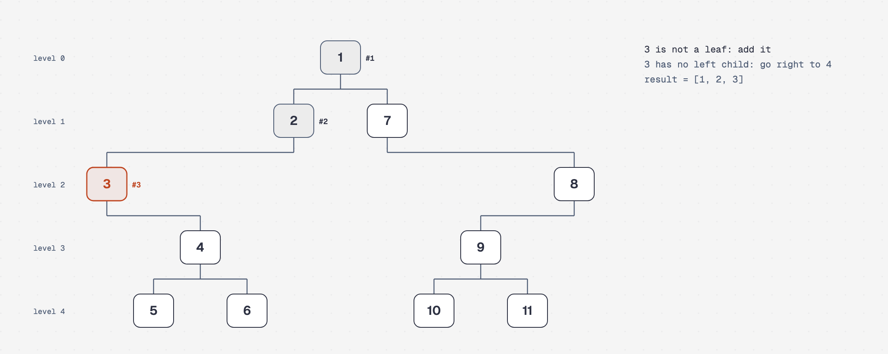

**Step 4: left boundary at 4**

- 4 is not a leaf: add it.
- 4 has a left child: go left to 5.
- Answer so far: `[1, 2, 3, 4]`.

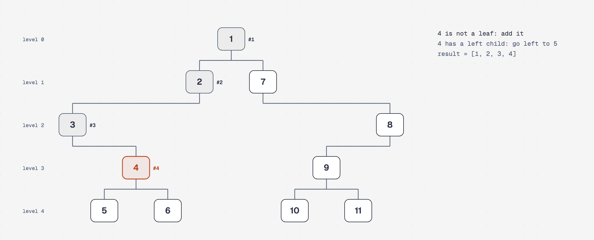

**Step 5: 5 is a leaf, stop**

- 5 is a leaf: the left boundary stops.
- 5 is NOT added here (leaves come next).
- Answer so far: `[1, 2, 3, 4]`.

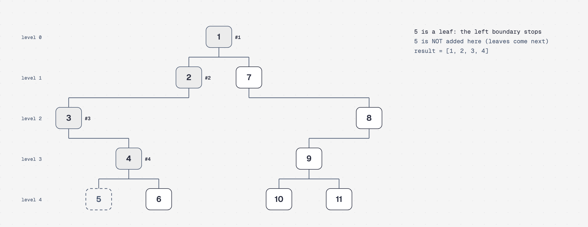

**Step 6: all leaves, left to right**

- Walk the whole tree, left before right.
- Every leaf in that order: 5, 6, 10, 11.
- Add them all.
- Answer so far: `[1, 2, 3, 4, 5, 6, 10, 11]`.

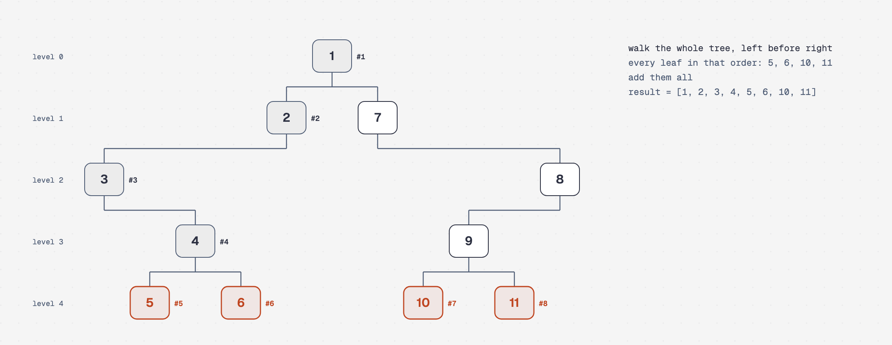

**Step 7: right boundary at 7**

- Right boundary starts at the root's right child 7.
- 7 is not a leaf: keep it in temp = [7].
- 7 has a right child: go right to 8.
- Answer so far: `[1, 2, 3, 4, 5, 6, 10, 11]`.

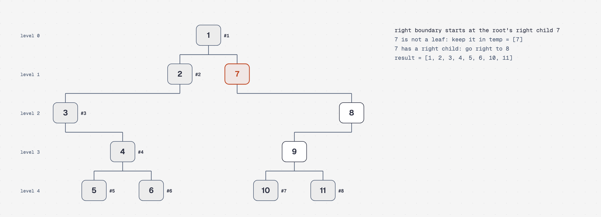

**Step 8: right boundary at 8**

- 8 is not a leaf: temp = [7, 8].
- 8 has no right child: go left to 9.
- Answer so far: `[1, 2, 3, 4, 5, 6, 10, 11]`.

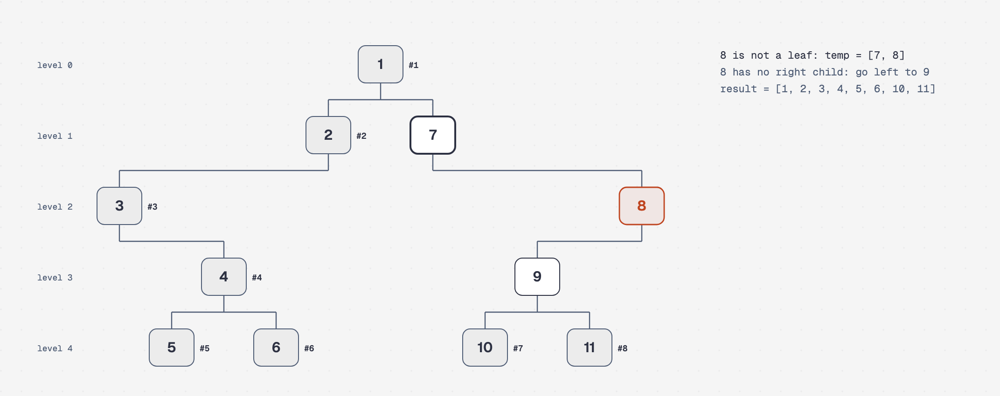

**Step 9: right boundary at 9**

- 9 is not a leaf: temp = [7, 8, 9].
- 9 has a right child: go right to 11.
- 11 is a leaf: the right boundary stops.
- Answer so far: `[1, 2, 3, 4, 5, 6, 10, 11]`.

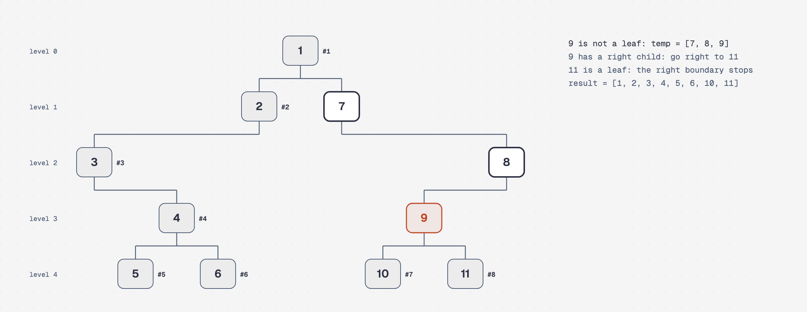

**Step 10: right boundary, bottom to top**

- Add temp in reverse: 9, 8, 7.
- The boundary goes UP the right side.
- Answer so far: `[1, 2, 3, 4, 5, 6, 10, 11, 9, 8, 7]`.
- Done. The answer is `[1, 2, 3, 4, 5, 6, 10, 11, 9, 8, 7]`.

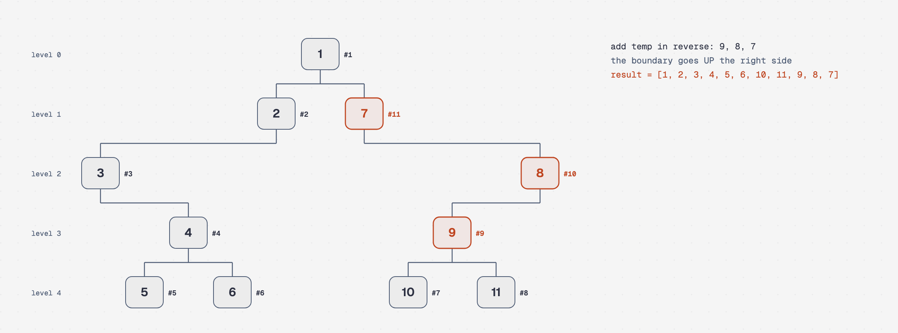


**All steps at a glance**

| Step | Part | What happens | Answer after the step |
|:---:|:---|:---|:---|
| 1 | Root | add the root 1 (it is not a leaf) | `[1]` |
| 2 | Left boundary | left boundary starts at the root's left child 2; 2 is not a leaf: add it; 2 has a left child: go left to 3 | `[1, 2]` |
| 3 | Left boundary | 3 is not a leaf: add it; 3 has no left child: go right to 4 | `[1, 2, 3]` |
| 4 | Left boundary | 4 is not a leaf: add it; 4 has a left child: go left to 5 | `[1, 2, 3, 4]` |
| 5 | Left boundary | 5 is a leaf: the left boundary stops; 5 is NOT added here (leaves come next) | `[1, 2, 3, 4]` |
| 6 | Leaves | walk the whole tree, left before right; every leaf in that order: 5, 6, 10, 11; add them all | `[1, 2, 3, 4, 5, 6, 10, 11]` |
| 7 | Right boundary | right boundary starts at the root's right child 7; 7 is not a leaf: keep it in temp = [7]; 7 has a right child: go right to 8 | `[1, 2, 3, 4, 5, 6, 10, 11]` |
| 8 | Right boundary | 8 is not a leaf: temp = [7, 8]; 8 has no right child: go left to 9 | `[1, 2, 3, 4, 5, 6, 10, 11]` |
| 9 | Right boundary | 9 is not a leaf: temp = [7, 8, 9]; 9 has a right child: go right to 11; 11 is a leaf: the right boundary stops | `[1, 2, 3, 4, 5, 6, 10, 11]` |
| 10 | Right boundary | add temp in reverse: 9, 8, 7; the boundary goes UP the right side | `[1, 2, 3, 4, 5, 6, 10, 11, 9, 8, 7]` |

### Code

```python
# Import List and Optional for type hints
from typing import List, Optional


# Solution for 545, boundary of a binary tree
class Solution:

    # A leaf has no children
    def is_leaf(self, node: TreeNode) -> bool:

        # No left child and no right child
        return node.left is None and node.right is None

    # Left boundary, top to bottom, without leaves
    def add_left(self, node: Optional[TreeNode], out: List[int]) -> None:

        # Walk down the left edge
        while node:

            # Leaves are added later, with the other leaves
            if not self.is_leaf(node):

                # Add this boundary node
                out.append(node.val)

            # Prefer going left
            if node.left:

                # Step left
                node = node.left

            # No left child: the edge continues on the right
            else:

                # Step right
                node = node.right

    # Every leaf, from left to right
    def add_leaves(self, node: Optional[TreeNode], out: List[int]) -> None:

        # An empty spot has no leaves
        if node is None:

            # Nothing to add
            return

        # A leaf is added as it is met
        if self.is_leaf(node):

            # Add the leaf
            out.append(node.val)

            # A leaf has nothing below it
            return

        # Leaves on the left come first
        self.add_leaves(node.left, out)

        # Then leaves on the right
        self.add_leaves(node.right, out)

    # Right boundary, bottom to top, without leaves
    def add_right(self, node: Optional[TreeNode], out: List[int]) -> None:

        # The right edge is collected top to bottom first
        temp = []

        # Walk down the right edge
        while node:

            # Leaves are already in the answer
            if not self.is_leaf(node):

                # Keep this boundary node for later
                temp.append(node.val)

            # Prefer going right
            if node.right:

                # Step right
                node = node.right

            # No right child: the edge continues on the left
            else:

                # Step left
                node = node.left

        # Add the right edge in reverse, so it goes upward
        out.extend(reversed(temp))

    # Main method
    def boundaryOfBinaryTree(self, root: Optional[TreeNode]) -> List[int]:

        # An empty tree has no boundary
        if root is None:

            # Nothing to return
            return []

        # The root is always first
        boundary = [root.val]

        # A single node is the whole boundary
        if self.is_leaf(root):

            # Done
            return boundary

        # Down the left side
        self.add_left(root.left, boundary)

        # Along the bottom
        self.add_leaves(root, boundary)

        # Up the right side
        self.add_right(root.right, boundary)

        # The full anticlockwise boundary
        return boundary
```

### Complexity

| Measure | Complexity | Why | At the limit (`n = 10^4`) | Note |
|:---|:---:|:---|:---:|:---|
| **Time** | `O(n)` | The leaf walk visits every node once; the edges add at most `2h` | about 10,000 steps | Each part is linear |
| **Space** | `O(h)` | The leaf recursion and the right-edge list are at most the height | up to 10,000 for a chain | The answer itself is extra |

## 5. Common Mistakes

| Mistake | What goes wrong | Fix |
|:---|:---|:---|
| Adding the edge leaves while walking the edges | 5 and 11 appear twice | Skip leaves on the edges; add them only in the leaf walk |
| Adding the right edge top to bottom | The boundary is not anticlockwise | Collect it, then add it reversed |
| Treating the root as a leaf in a bigger tree | The root is added twice | Add the root once at the start; the leaf walk starts below it only when the root has children |
| Stopping the left edge when there is no left child | 3, 4 are missed in our tree | Step right when there is no left child |
| Starting the left edge at the root itself | The root is added twice | Start at `root.left` |

## 6. Interview Follow-ups

### Q1. Why is the leaf walk a DFS and not a level order?

**Answer:**
- Level order lists shallow leaves before deep ones, so a deep leaf on the left would come after a shallow leaf on the right.
- DFS (left before right) lists leaves from left to right by position.

### Q2. Can you do it in one DFS?

**Answer:**
- Yes: pass two flags, "on the left edge" and "on the right edge", down the recursion.
- Add left-edge nodes before recursing, right-edge nodes after recursing, and leaves when met.

### Q3. How would you print the boundary clockwise?

**Answer:**
- Root, right edge going down, leaves from right to left, left edge going up.
- Mirror every step: swap left and right everywhere.

### Q4. What is the difference from the left view (note 20)?

**Answer:**
- The left view takes the first node of every level, which may be inside the tree.
- The left boundary follows the left edge: it can step right, and it skips the last leaf.

### Q5. Which nodes are visited more than once?

**Answer:**
- Edge nodes are visited by an edge walk and again by the leaf walk, but they are only added once.
- That is still `O(n)` in total.

## 7. Interview Explanation

> The boundary is the root, then the left edge going down without leaves, then all leaves from left to right, then the right edge going up without leaves. I walk the left edge from the root's left child, preferring left and stepping right when there is no left child, and add every non-leaf. Then a DFS, left before right, adds the leaves in order. Then I walk the right edge from the root's right child, preferring right, collect the non-leaves, and add them reversed so the boundary goes back up. Leaves are only added in the middle part, so nothing is added twice. It is O(n) time and O(h) extra space.
