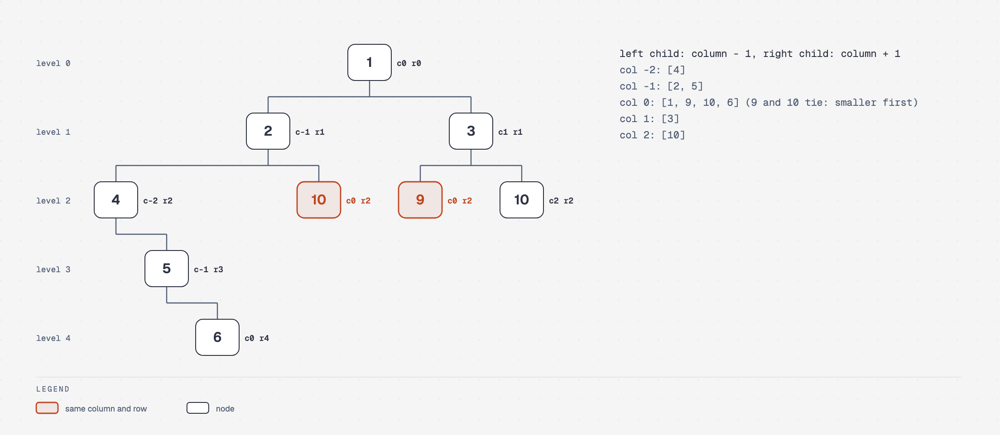
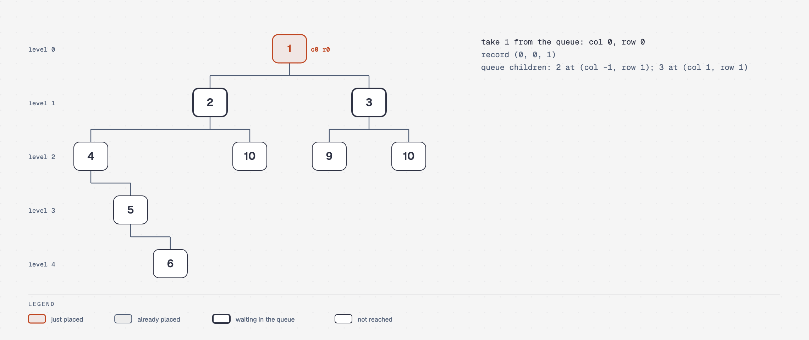
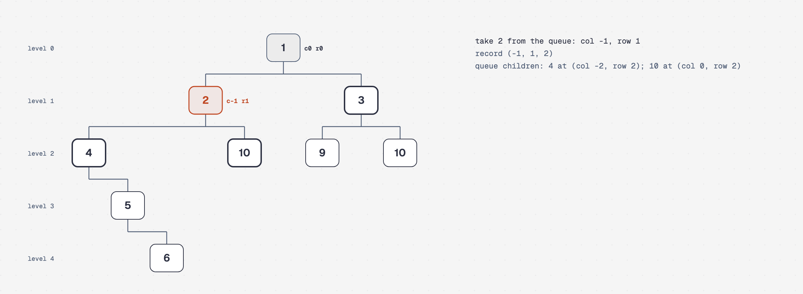
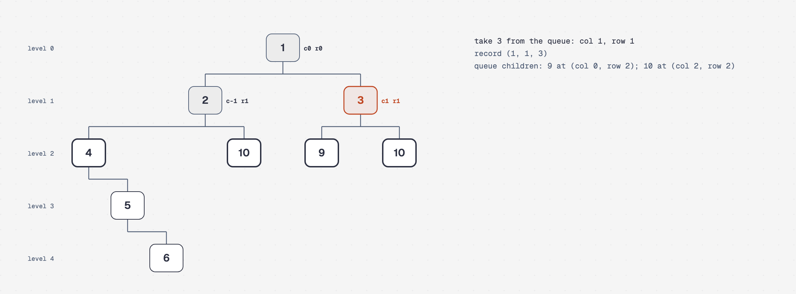
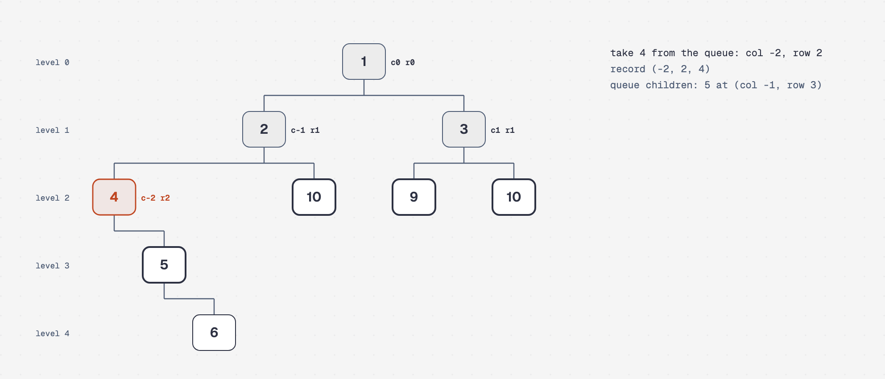
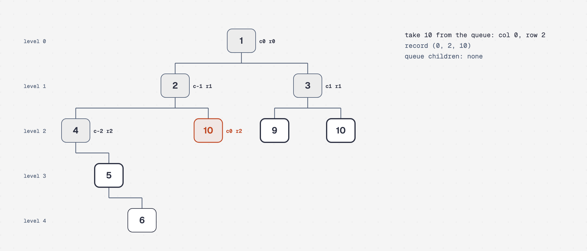
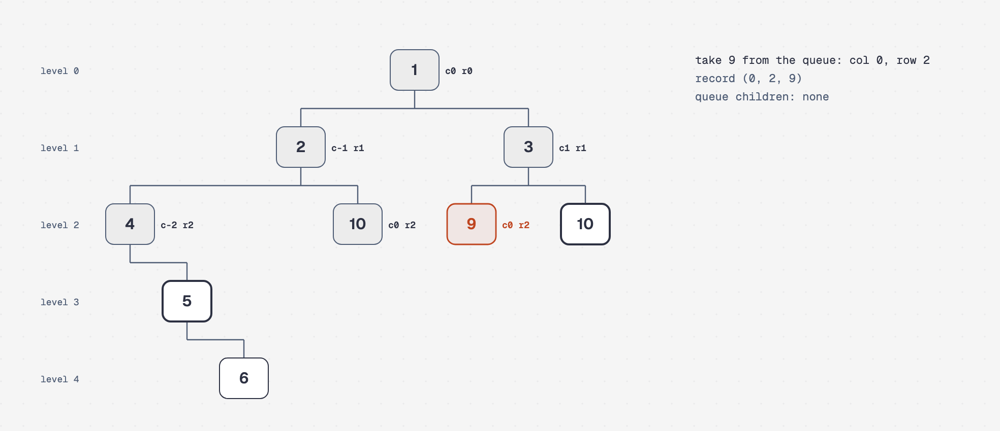
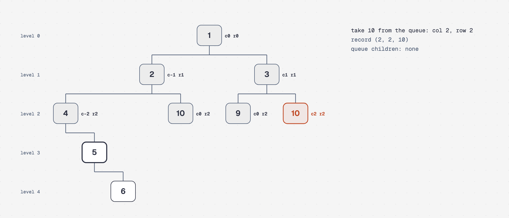
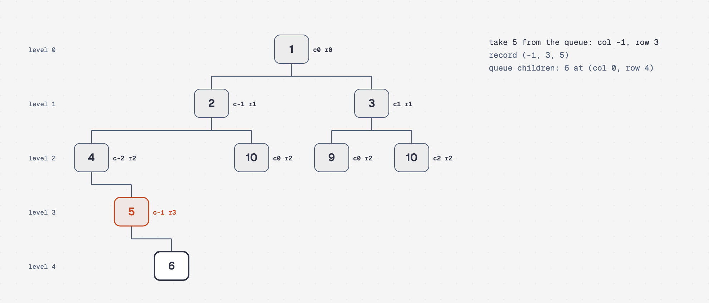
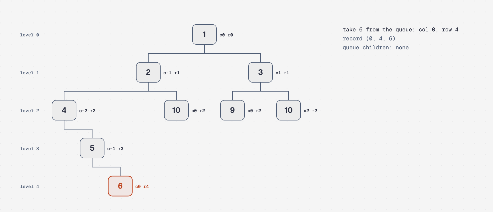

# 16. 987. Vertical Order Traversal of a Binary Tree

| Difficulty | Pattern | Key idea | Source | Time | Space | Before / after |
|:---:|:---:|:---|:---:|:---:|:---:|:---:|
| **Hard** | Coordinates Plus Sorting | Give every node a (column, row): left child is column - 1, right child is column + 1, both one row down; then list columns left to right, rows top to bottom, ties by value | [987. Vertical Order Traversal of a Binary Tree](https://leetcode.com/problems/vertical-order-traversal-of-a-binary-tree/) | `O(n log n)` | `O(n)` | [545. Boundary](15.%20545.%20Boundary%20of%20Binary%20Tree.md) / [Top View](17.%20Top%20View%20of%20Binary%20Tree.md) |

## 1. Problem Statement

Each node has a position (`row`, `col`). The root is at `(0, 0)`. A node's left child is at `(row + 1, col - 1)` and its right child at `(row + 1, col + 1)`.

The **vertical order traversal** lists the columns from the leftmost to the rightmost. Inside a column, nodes go from top to bottom. If two nodes have the **same row and column**, the smaller value comes first.

### Example

**The tree we take:** the tree from the lecture board: `1` with children `2` and `3`; `2` with children `4` and `10`; `3` with children `9` and `10`; `4` with right child `5`; `5` with right child `6`. As a LeetCode list: `[1, 2, 3, 4, 10, 9, 10, None, 5, None, None, None, None, None, None, None, 6]`.

```text
Input:  root = [1, 2, 3, 4, 10, 9, 10, None, 5, None, None, None, None, None, None, None, 6]
Output: [[4], [2, 5], [1, 9, 10, 6], [3], [10]]
```



It has the hardest part of the problem: the `10` under `2` and the `9` under `3` land on **the same spot** (column 0, row 2). They must be ordered by value, so `9` comes before `10`. It also has two nodes with the **same value** (10), which is why we track positions, not values. We use this tree in every section below.

LeetCode examples:

```text
root = [3, 9, 20, None, None, 15, 7]     gives [[9], [3, 15], [20], [7]]
root = [1, 2, 3, 4, 5, 6, 7]             gives [[4], [2], [1, 5, 6], [3], [7]]
root = [1, 2, 3, 4, 6, 5, 7]             gives [[4], [2], [1, 5, 6], [3], [7]]
```

### Constraints, in plain words

| Limit | What it means in plain words | What it tells us |
|:---|:---|:---|
| Number of nodes is `1` to `1000` | At least one node, at most 1,000 | Sorting all nodes (`n log n`, about 10,000 steps) is instant |
| `0 <= Node.val <= 1000` | Values can repeat | Track positions, and sort values only to break ties |
| Ties at the same spot | Two nodes can share a row and a column | Sort inside each spot by value |

**How fast is fast enough?**

- Placing every node takes one walk: `n` steps.
- Ordering them needs a sort by (column, row, value): about `n log n` steps, roughly 10,000 for 1,000 nodes.
- Both approaches below are `O(n log n)`; they differ only in where the sorting happens.

| Nodes `n` | Walk to place nodes | Sort comparisons (about `n log2 n`) | Total at 100 million steps per second | Extra memory | Note |
|:---:|:---:|:---:|:---:|:---|:---|
| 9 (our tree) | 9 | about 30 | instant | 9 triples | The lecture example |
| 1,000 | 1,000 | about 10,000 | about 0.1 milliseconds | 1,000 triples | The LeetCode limit |
| 100,000 | 100,000 | about 1,700,000 | about 17 milliseconds | 100,000 triples | Still fast |

## 2. Core Idea

Turn the tree into points on a grid, exactly as the lecture draws vertical lines through it:

1. **Place** every node: the root at column 0, row 0; going left subtracts 1 from the column, going right adds 1; every step down adds 1 to the row.
2. **Group** the nodes by column (the lecture uses a map: column to row to a sorted multiset of values).
3. **Read** the columns left to right; inside a column, rows top to bottom; inside a row, values smallest first.

## 3. Edge Cases

| Case | Input | Expected | Why it matters | Code that handles it |
|:---|:---|:---:|:---|:---|
| One node | `[1]` | `[[1]]` | One column, one row | The loops run once |
| Two nodes at the same spot | 9 and 10 in our tree | `9` before `10` | Ties are broken by value | `sorted(grid[col][row])` |
| Repeated values | the two 10s | in different columns | Values are not positions | Positions are carried with each node |
| A deep zigzag | 4, 5, 6 in our tree | 6 lands in column 0 | A node can come back under the root | Columns are computed, not guessed |
| Same column, different rows | 1 (row 0) and 6 (row 4) | `1` first | Rows go top to bottom | Rows are sorted before values |

## 4. Approach 1: DFS, Then One Sort

### Idea

Walk the tree once (any order), recording `(column, row, value)` for every node. Sort the triples: Python sorts by column, then row, then value, which is exactly the required order. Then group consecutive triples by column.

### Code

```python
# Import deque for the queue and defaultdict for the groups
from collections import deque, defaultdict

# Import List and Optional for type hints
from typing import List, Optional


# Solution for 987, DFS then one sort
class Solution:

    # Main method
    def verticalTraversal(self, root: Optional[TreeNode]) -> List[List[int]]:

        # Triples of (column, row, value) for every node
        nodes = []

        # Record a node and walk its children
        def dfs(node: Optional[TreeNode], row: int, col: int) -> None:

            # A missing child has no position
            if node is None:

                # Nothing to record
                return

            # Record column first, so sorting groups by column
            nodes.append((col, row, node.val))

            # The left child is one column left and one row down
            dfs(node.left, row + 1, col - 1)

            # The right child is one column right and one row down
            dfs(node.right, row + 1, col + 1)

        # The root is at row 0, column 0
        dfs(root, 0, 0)

        # Sort by column, then row, then value
        nodes.sort()

        # Values grouped by column, in sorted order
        groups = defaultdict(list)

        # Walk the sorted triples
        for col, row, val in nodes:

            # Add the value to its column
            groups[col].append(val)

        # Columns from left to right
        return [groups[col] for col in sorted(groups)]
```

### Complexity

| Measure | Complexity | Why | At the limit (`n = 1000`) | Compared with approach 2 |
|:---|:---:|:---|:---:|:---|
| **Time** | `O(n log n)` | One walk plus one sort of `n` triples | about 10,000 steps | Same order |
| **Space** | `O(n)` | The list of triples, plus `O(h)` recursion | 1,000 triples | Same order |

## 5. Approach 2: BFS With a Map of Columns (the Lecture's Method)

### Idea

Use a queue of `(node, column, row)` triples, as the lecture does. Each node taken from the queue is recorded in `grid[column][row]`, and its children are queued with their positions. At the end, read the columns, rows and values in sorted order.

### Run it on our example, step by step

**The tree we take:** the tree above.

**How to read the pictures:** orange is the node just placed, grey nodes are already placed, bold boxes wait in the queue, white nodes are not reached yet. The tag `c r` is a node's column and row.

**Step 1: node 1 at column 0, row 0**

- Take `1` from the front of the queue. Its spot is column `0`, row `0`.
- Record it: `grid[0][0]` gets `1`.
- Queue 2 at (col -1, row 1); 3 at (col 1, row 1).



**Step 2: node 2 at column -1, row 1**

- Take `2` from the front of the queue. Its spot is column `-1`, row `1`.
- Record it: `grid[-1][1]` gets `2`.
- Queue 4 at (col -2, row 2); 10 at (col 0, row 2).



**Step 3: node 3 at column 1, row 1**

- Take `3` from the front of the queue. Its spot is column `1`, row `1`.
- Record it: `grid[1][1]` gets `3`.
- Queue 9 at (col 0, row 2); 10 at (col 2, row 2).



**Step 4: node 4 at column -2, row 2**

- Take `4` from the front of the queue. Its spot is column `-2`, row `2`.
- Record it: `grid[-2][2]` gets `4`.
- Queue 5 at (col -1, row 3).



**Step 5: node 10 at column 0, row 2**

- Take `10` from the front of the queue. Its spot is column `0`, row `2`.
- Record it: `grid[0][2]` gets `10`.
- No children to queue.



**Step 6: node 9 at column 0, row 2**

- Take `9` from the front of the queue. Its spot is column `0`, row `2`.
- Record it: `grid[0][2]` gets `9`.
- No children to queue.



**Step 7: node 10 at column 2, row 2**

- Take `10` from the front of the queue. Its spot is column `2`, row `2`.
- Record it: `grid[2][2]` gets `10`.
- No children to queue.



**Step 8: node 5 at column -1, row 3**

- Take `5` from the front of the queue. Its spot is column `-1`, row `3`.
- Record it: `grid[-1][3]` gets `5`.
- Queue 6 at (col 0, row 4).



**Step 9: node 6 at column 0, row 4**

- Take `6` from the front of the queue. Its spot is column `0`, row `4`.
- Record it: `grid[0][4]` gets `6`.
- No children to queue.




**All steps at a glance**

| Step | Node taken | Column | Row | Children queued (with their spots) | Recorded so far in that column |
|:---:|:---:|:---:|:---:|:---|:---|
| 1 | 1 | 0 | 0 | 2 at (col -1, row 1); 3 at (col 1, row 1) | column 0: 1 (row 0) |
| 2 | 2 | -1 | 1 | 4 at (col -2, row 2); 10 at (col 0, row 2) | column -1: 2 (row 1) |
| 3 | 3 | 1 | 1 | 9 at (col 0, row 2); 10 at (col 2, row 2) | column 1: 3 (row 1) |
| 4 | 4 | -2 | 2 | 5 at (col -1, row 3) | column -2: 4 (row 2) |
| 5 | 10 | 0 | 2 | none | column 0: 1 (row 0), 10 (row 2) |
| 6 | 9 | 0 | 2 | none | column 0: 1 (row 0), 10 (row 2), 9 (row 2) |
| 7 | 10 | 2 | 2 | none | column 2: 10 (row 2) |
| 8 | 5 | -1 | 3 | 6 at (col 0, row 4) | column -1: 2 (row 1), 5 (row 3) |
| 9 | 6 | 0 | 4 | none | column 0: 1 (row 0), 10 (row 2), 9 (row 2), 6 (row 4) |

**Reading the grid, column by column**

| Column | Spots recorded (row: values) | After sorting rows, and values inside a row | Note |
|:---:|:---|:---|:---|
| -2 | row 2: [4] | `[4]` | One value per row, nothing to break |
| -1 | row 1: [2]; row 3: [5] | `[2, 5]` | One value per row, nothing to break |
| 0 | row 0: [1]; row 2: [10, 9]; row 4: [6] | `[1, 9, 10, 6]` | Row 2 holds two values (10 from the left side, 9 from the right side): sorted, 9 comes first |
| 1 | row 1: [3] | `[3]` | One value per row, nothing to break |
| 2 | row 2: [10] | `[10]` | One value per row, nothing to break |

Joining the columns gives `[[4], [2, 5], [1, 9, 10, 6], [3], [10]]`.

### Code

```python
# Import deque for the queue and defaultdict for the groups
from collections import deque, defaultdict

# Import List and Optional for type hints
from typing import List, Optional


# Solution for 987, BFS with a map of columns
class Solution:

    # Main method
    def verticalTraversal(self, root: Optional[TreeNode]) -> List[List[int]]:

        # column -> row -> values found at that spot
        grid = defaultdict(lambda: defaultdict(list))

        # Triples of (node, column, row), starting with the root at (0, 0)
        queue = deque([(root, 0, 0)])

        # Visit every node level by level
        while queue:

            # The next node and its position
            node, col, row = queue.popleft()

            # Record its value at its spot
            grid[col][row].append(node.val)

            # The left child is one column left and one row down
            if node.left:

                # Queue it with its position
                queue.append((node.left, col - 1, row + 1))

            # The right child is one column right and one row down
            if node.right:

                # Queue it with its position
                queue.append((node.right, col + 1, row + 1))

        # The answer: one list per column
        result = []

        # Columns from left to right
        for col in sorted(grid):

            # Values of this column
            column = []

            # Rows from top to bottom
            for row in sorted(grid[col]):

                # Ties at the same spot go smallest first
                column.extend(sorted(grid[col][row]))

            # This column is complete
            result.append(column)

        # All columns, left to right
        return result
```

### Complexity

| Measure | Complexity | Why | At the limit (`n = 1000`) | Compared with approach 1 |
|:---|:---:|:---|:---:|:---|
| **Time** | `O(n log n)` | Each node is queued once; sorting columns, rows and ties costs the log factor | about 10,000 steps | Same order |
| **Space** | `O(n)` | The grid holds every node; the queue holds about one level | 1,000 values | Same order |

## 6. Common Mistakes

| Mistake | What goes wrong | Fix |
|:---|:---|:---|
| Sorting a column only by value | 6 (row 4) would come before 9 (row 2) | Sort by row first, then by value |
| Not sorting ties at the same spot | 10 may come before 9 | Sort the values inside each `(column, row)` |
| Using values as keys | The two 10s get mixed up | Store positions with each node |
| Forgetting negative columns | Columns like -2 are skipped or misplaced | Use a dictionary and sort its keys |
| Confusing this with LeetCode 314 | 314 keeps BFS order for ties, not value order | Read the tie rule carefully: 987 sorts by value |

## 7. Interview Follow-ups

### Q1. How is LeetCode 314 (Binary Tree Vertical Order Traversal) different?

**Answer:**
- In 314, nodes at the same spot keep their BFS order (left to right), not sorted by value.
- So a plain BFS that appends to `columns[col]` is enough, with no sorting inside a column.

### Q2. How do you get the top view from this?

**Answer:**
- Keep only the **first** node of each column (the smallest row). That is the next note.

### Q3. How do you get the bottom view?

**Answer:**
- Keep only the **last** node of each column (the largest row). That is note 18.

### Q4. Can you avoid sorting the columns?

**Answer:**
- Track the smallest and largest column while walking; then read columns from min to max with a plain loop.
- Ties at the same spot still need sorting.

### Q5. Why do BFS and DFS both work here?

**Answer:**
- Every node carries its own position, and the final sort uses only positions and values.
- So the walk order does not matter, unlike in LeetCode 314.

## 8. Interview Explanation

> I give every node a coordinate: the root is column 0, row 0, a left child is one column to the left and one row down, a right child is one column to the right and one row down. I walk the tree once, recording column, row and value for every node. Then I sort those triples, which orders them by column, then row, then value, exactly as the problem requires, including the tie rule for nodes at the same spot. Finally I group the values by column from left to right. The walk is O(n) and the sort is O(n log n), with O(n) space.
