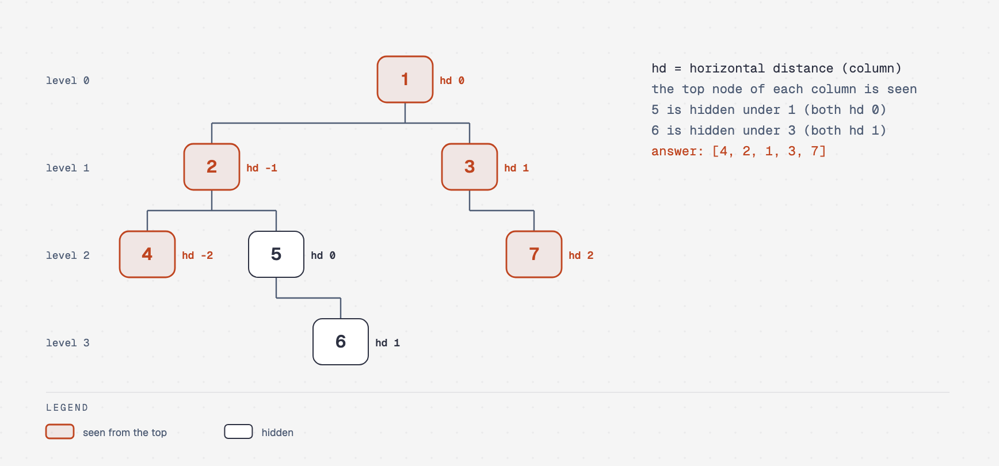
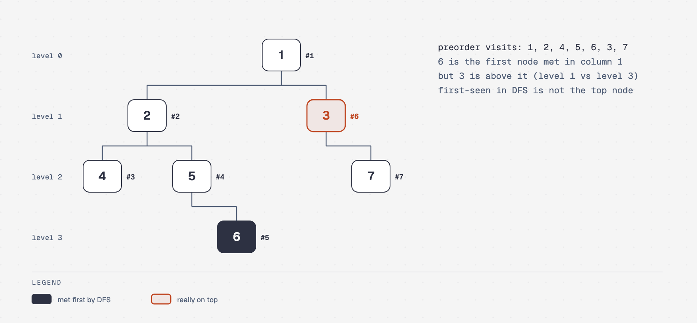
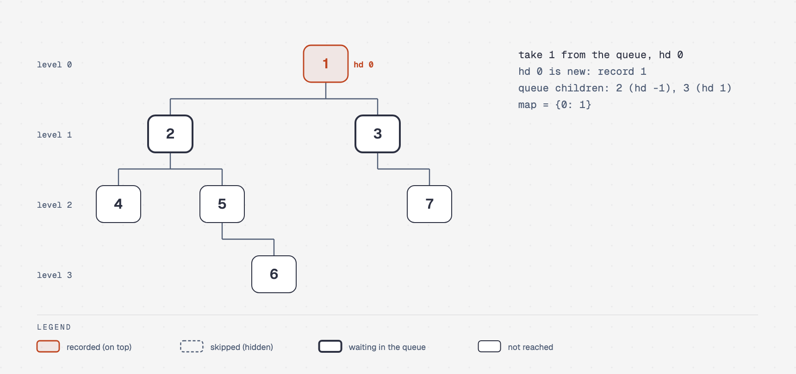
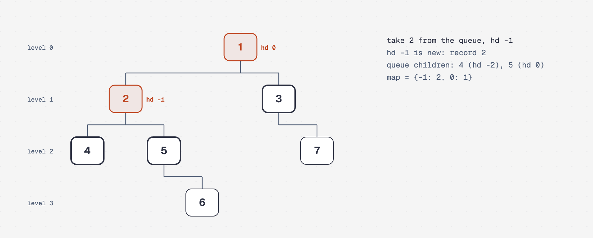
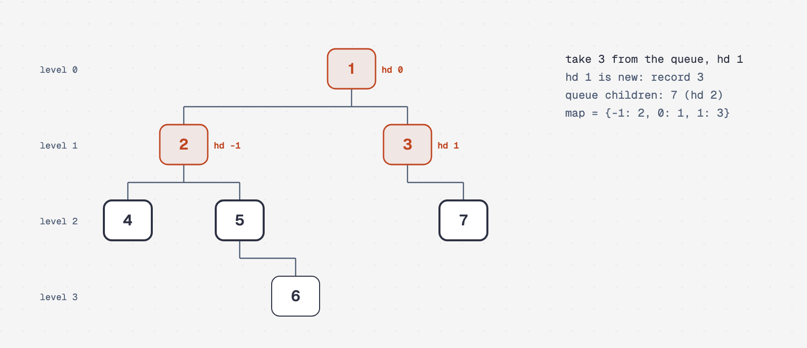
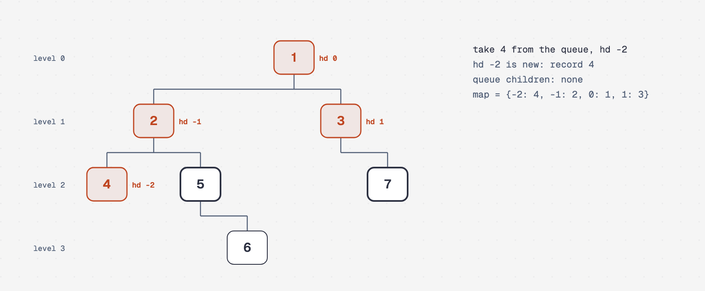
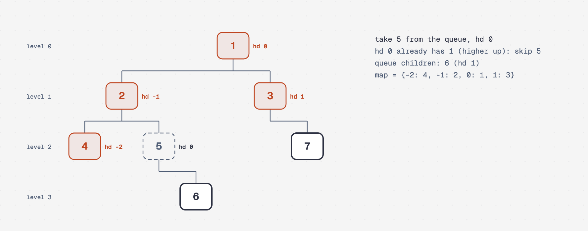
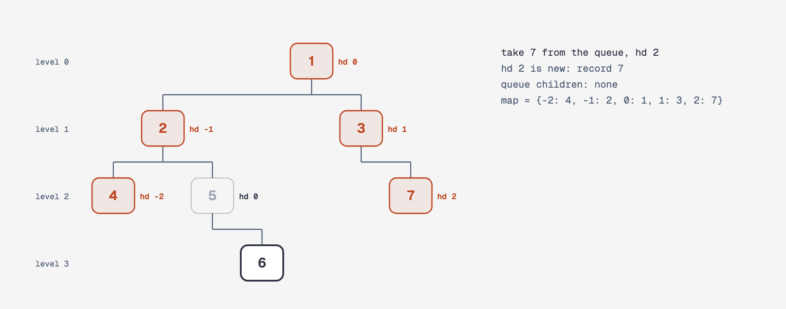
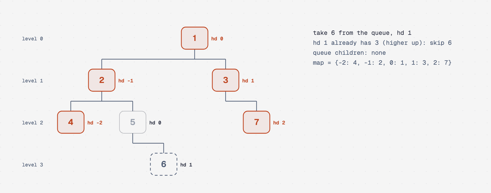

# 17. Top View of Binary Tree

| Difficulty | Pattern | Key idea | Source | Time | Space | Before / after |
|:---:|:---:|:---|:---:|:---:|:---:|:---:|
| **Medium** | BFS With a Column Number | Give each node a column (left - 1, right + 1); BFS meets the highest node of every column first, so keep the first value seen per column | [Top View of Binary Tree (GfG)](https://www.geeksforgeeks.org/problems/top-view-of-binary-tree/1) | `O(n)` | `O(n)` | [987. Vertical Order](16.%20987.%20Vertical%20Order%20Traversal%20of%20a%20Binary%20Tree.md) / [Bottom View](18.%20Bottom%20View%20of%20Binary%20Tree.md) |

## 1. Problem Statement

Given the `root` of a binary tree, return its **top view**: the nodes you see when you look at the tree from above, from the leftmost column to the rightmost.

- Each node has a **horizontal distance** (`hd`, its column): the root is 0, a left child is `hd - 1`, a right child is `hd + 1`.
- If several nodes share a column, only the **topmost** one (closest to the root) is seen.

### Example

**The tree we take:** the tree from the lecture board: `1` with children `2` and `3`; `2` with children `4` and `5`; `5` with right child `6`; `3` with right child `7`. As a level-order list: `[1, 2, 3, 4, 5, None, 7, None, None, None, 6]`.

```text
Input:  root = [1, 2, 3, 4, 5, None, 7, None, None, None, 6]
Output: [4, 2, 1, 3, 7]
```



It has the trap the lecture points out: node `6` is in column 1, the same column as `3`, but it is **deeper**. A walk that meets `6` before `3` (like a plain recursive DFS) would wrongly show `6`. We use this tree in every section below.

GfG examples:

```text
root = [1, 2, 3]                          gives [2, 1, 3]
root = [10, 20, 30, 40, 60, 90, 100]      gives [40, 20, 10, 30, 100]
```

### Constraints, in plain words

| Limit | What it means in plain words | What it tells us |
|:---|:---|:---|
| `1 <= number of nodes <= 10^5` | Up to 100,000 nodes | A chain this deep breaks Python recursion; BFS is safer |
| `1 <= node.data <= 10^5` | Positive whole numbers, which may repeat | Values do not matter; only positions (columns and levels) do |
| Topmost node per column | Higher nodes hide lower ones | Visit top levels first, or remember levels |

**How fast is fast enough?**

- BFS visits each node once: `O(n)`, about 100,000 steps at most.
- Columns range from `-(n - 1)` to `n - 1`, so tracking the smallest and largest column lets us read them in order without sorting.

| Nodes `n` | BFS visits | Columns at most | Sorting needed? | Recursion depth (DFS on a chain) | Note |
|:---:|:---:|:---:|:---|:---:|:---|
| 7 (our tree) | 7 | 5 | No, columns -2 to 2 | 3 | The lecture example |
| 1,000 | 1,000 | 1,999 | No | up to 1,000 | Already at Python's default recursion limit |
| 100,000 | 100,000 | 199,999 | No | up to 100,000 | DFS would crash in Python; BFS is fine |

## 2. Core Idea

Draw vertical lines through the tree, as the lecture does, and number them: the root's line is 0, lines to the left are -1, -2, and lines to the right are +1, +2. Looking from above, you see the **highest** node on each line.

- **BFS** visits the tree level by level, top first. So the **first** node it meets on each line is the highest one. Record it, and ignore every later node on the same line.
- A **plain DFS** does not go level by level, so its first node on a line may be deep. It only works if it also remembers each node's level and keeps the smallest.

## 3. Edge Cases

| Case | Input | Expected | Why it matters | Code that handles it |
|:---|:---|:---:|:---|:---|
| One node | `[1]` | `[1]` | One column | The loop runs once |
| Hidden directly below | 5 under 1 in our tree | `1` | Same column, lower level | `if col not in first` |
| Hidden after a zigzag | 6 under 3 in our tree | `3` | A deep node drifts back under a higher one | BFS reaches 3 first |
| Only left children | `[1, 2, None, 3]` | `[3, 2, 1]` | Every node is its own column | Columns -2, -1, 0 |
| Wide tree | `[10, 20, 30, 40, 60, 90, 100]` | `[40, 20, 10, 30, 100]` | 60 and 90 hide under 10 | Both are at column 0 |

## 4. Approach 1: DFS That Remembers Levels

### Idea

The lecture crosses out plain recursion, because a DFS can meet a deep node first.



The fix is to store `(level, value)` per column and replace it whenever a **higher** node (smaller level) shows up. Then any walk order works.

### Code

```python
# Import deque for the queue
from collections import deque

# Import List and Optional for type hints
from typing import List, Optional


# Top view, DFS that remembers the level of each column's node
class Solution:

    # Main method
    def topView(self, root: Optional[TreeNode]) -> List[int]:

        # column -> (level, value) of the highest node seen so far
        best = {}

        # Walk every node with its column and level
        def dfs(node: Optional[TreeNode], col: int, level: int) -> None:

            # A missing child has no position
            if node is None:

                # Nothing to record
                return

            # Keep this node if its column is new or it is higher up
            if col not in best or level < best[col][0]:

                # Remember the higher node
                best[col] = (level, node.val)

            # The left child is one column left, one level down
            dfs(node.left, col - 1, level + 1)

            # The right child is one column right, one level down
            dfs(node.right, col + 1, level + 1)

        # The root is column 0, level 0
        dfs(root, 0, 0)

        # Columns from left to right
        return [best[col][1] for col in sorted(best)]
```

### Complexity

| Measure | Complexity | Why | At the limit (`n = 10^5`) | Compared with BFS |
|:---|:---:|:---|:---:|:---|
| **Time** | `O(n log n)` | One walk, plus sorting the column keys | about 1,700,000 steps | Slower only because of the sort |
| **Space** | `O(n)` | The map plus `O(h)` recursion | up to 100,000 frames on a chain | Recursion depth is a risk in Python |

## 5. Approach 2: BFS, First Node per Column (the Lecture's Answer)

### Idea

1. Queue `(root, 0)`.
2. Take a pair; if its column is new, record the value.
3. Queue the children with `col - 1` and `col + 1`.
4. Read columns from the smallest to the largest.

### Run it on our example, step by step

**The tree we take:** the tree above.

**How to read the pictures:** orange nodes are recorded (seen from the top), dashed nodes were skipped as hidden, bold boxes wait in the queue, white nodes are not reached yet. The tag `hd` is a node's column.

**Step 1: node 1, column 0**

- Column `0` is new, so `1` is the top node there: record it.
- Queue `2 (hd -1)`, `3 (hd 1)`.
- Map: `{0: 1}`.



**Step 2: node 2, column -1**

- Column `-1` is new, so `2` is the top node there: record it.
- Queue `4 (hd -2)`, `5 (hd 0)`.
- Map: `{-1: 2, 0: 1}`.



**Step 3: node 3, column 1**

- Column `1` is new, so `3` is the top node there: record it.
- Queue `7 (hd 2)`.
- Map: `{-1: 2, 0: 1, 1: 3}`.



**Step 4: node 4, column -2**

- Column `-2` is new, so `4` is the top node there: record it.
- No children to queue.
- Map: `{-2: 4, -1: 2, 0: 1, 1: 3}`.



**Step 5: node 5, column 0**

- Column `0` already has `1`, which is higher up: `5` is hidden, skip it.
- Queue `6 (hd 1)`.
- Map: `{-2: 4, -1: 2, 0: 1, 1: 3}`.



**Step 6: node 7, column 2**

- Column `2` is new, so `7` is the top node there: record it.
- No children to queue.
- Map: `{-2: 4, -1: 2, 0: 1, 1: 3, 2: 7}`.



**Step 7: node 6, column 1**

- Column `1` already has `3`, which is higher up: `6` is hidden, skip it.
- No children to queue.
- Map: `{-2: 4, -1: 2, 0: 1, 1: 3, 2: 7}`.




**All steps at a glance**

| Step | Node taken | Column (hd) | New column? | Recorded | Children queued | Map after |
|:---:|:---:|:---:|:---:|:---|:---|:---|
| 1 | 1 | 0 | Yes | 1 | 2 (hd -1), 3 (hd 1) | `{0: 1}` |
| 2 | 2 | -1 | Yes | 2 | 4 (hd -2), 5 (hd 0) | `{-1: 2, 0: 1}` |
| 3 | 3 | 1 | Yes | 3 | 7 (hd 2) | `{-1: 2, 0: 1, 1: 3}` |
| 4 | 4 | -2 | Yes | 4 | none | `{-2: 4, -1: 2, 0: 1, 1: 3}` |
| 5 | 5 | 0 | No | nothing (hidden) | 6 (hd 1) | `{-2: 4, -1: 2, 0: 1, 1: 3}` |
| 6 | 7 | 2 | Yes | 7 | none | `{-2: 4, -1: 2, 0: 1, 1: 3, 2: 7}` |
| 7 | 6 | 1 | No | nothing (hidden) | none | `{-2: 4, -1: 2, 0: 1, 1: 3, 2: 7}` |

Reading the map from column -2 to column 2 gives `[4, 2, 1, 3, 7]`.

### Code

```python
# Import deque for the queue
from collections import deque

# Import List and Optional for type hints
from typing import List, Optional


# Top view, BFS keeps the first node met in each column
class Solution:

    # Main method
    def topView(self, root: Optional[TreeNode]) -> List[int]:

        # An empty tree has no view
        if root is None:

            # Nothing to see
            return []

        # column -> value of the first (highest) node in that column
        first = {}

        # Pairs of (node, column), level by level
        queue = deque([(root, 0)])

        # The leftmost and rightmost columns seen
        lo = hi = 0

        # Visit every node, top levels first
        while queue:

            # The next node and its column
            node, col = queue.popleft()

            # BFS meets the highest node of a column first
            if col not in first:

                # Record it
                first[col] = node.val

            # Stretch the column range to the left if needed
            lo = min(lo, col)

            # Stretch the column range to the right if needed
            hi = max(hi, col)

            # The left child is one column left
            if node.left:

                # Queue it
                queue.append((node.left, col - 1))

            # The right child is one column right
            if node.right:

                # Queue it
                queue.append((node.right, col + 1))

        # Columns from leftmost to rightmost
        return [first[col] for col in range(lo, hi + 1)]
```

### Complexity

| Measure | Complexity | Why | At the limit (`n = 10^5`) | Compared with DFS |
|:---|:---:|:---|:---:|:---|
| **Time** | `O(n)` | Each node is queued once; columns are read by range, no sort | 100,000 steps | No sorting needed |
| **Space** | `O(n)` | The map and the queue | up to 100,000 entries | No recursion |

## 6. Common Mistakes

| Mistake | What goes wrong | Fix |
|:---|:---|:---|
| Plain recursive DFS, first value wins | Our tree gives `[4, 2, 1, 6, 7]` | Use BFS, or store levels and keep the smallest |
| Overwriting the column every time | You get the bottom view instead | Record only if the column is new |
| Sorting values instead of columns | The answer comes out in the wrong order | Order by column, from the leftmost to the rightmost |
| Using a stack instead of a queue | It becomes a DFS again, and deep nodes can win | BFS needs a queue: first in, first out |

## 7. Interview Follow-ups

### Q1. How do you get the bottom view?

**Answer:**
- Same BFS, but **overwrite** the column every time. The last node met in a column is the lowest one. That is the next note.

### Q2. What if two nodes share the top spot of a column?

**Answer:**
- Two nodes on the same level and column can happen (like 9 and 10 in note 987).
- BFS keeps the one that is further left in level order; the problem usually accepts that.

### Q3. Why does BFS give the top node first?

**Answer:**
- BFS finishes level 0 before level 1, level 1 before level 2, and so on.
- So in every column the highest node is met before any lower one.

### Q4. How is this related to vertical order traversal?

**Answer:**
- Vertical order lists every node of every column. The top view keeps only the first node of each column.

### Q5. How would you print the tree's left and right views?

**Answer:**
- Those look from the side, so they pick one node per **level**, not per column. They are notes 19 and 20.

## 8. Interview Explanation

> I give every node a horizontal distance: the root is 0, a left child is one less, a right child is one more. Looking from the top, each distance shows only its highest node. A breadth-first search visits the tree level by level, so the first node it meets at each distance is the highest one. I keep a map from distance to value and only record a distance the first time I see it. At the end I read the distances from the smallest to the largest. A plain recursive DFS can meet a deeper node first, so it is wrong unless it also stores levels. BFS is O(n) time and O(n) space.
