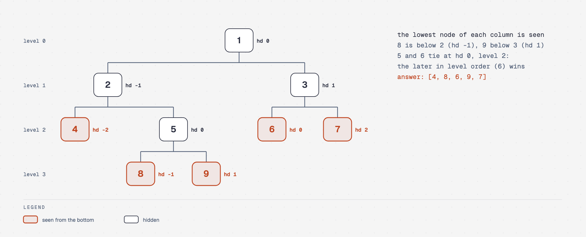
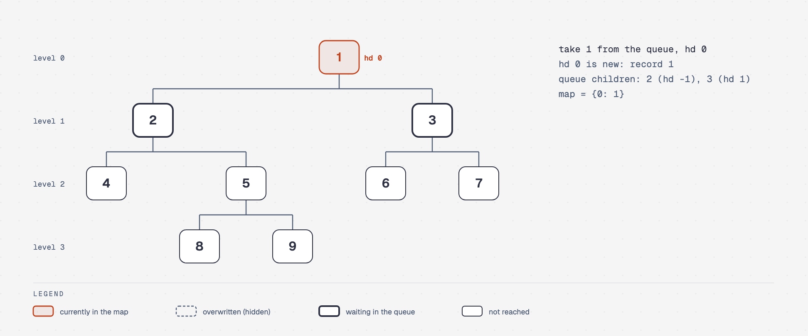
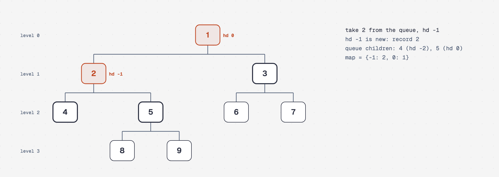
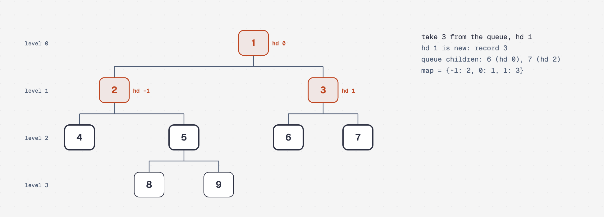
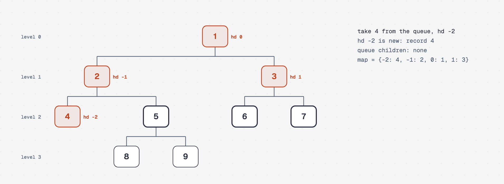
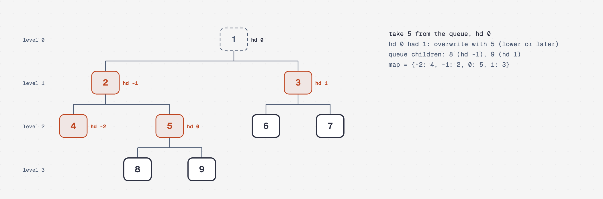
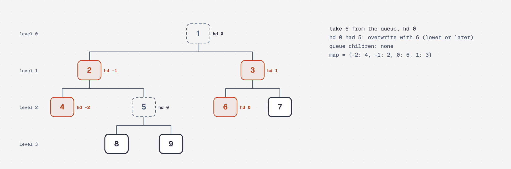
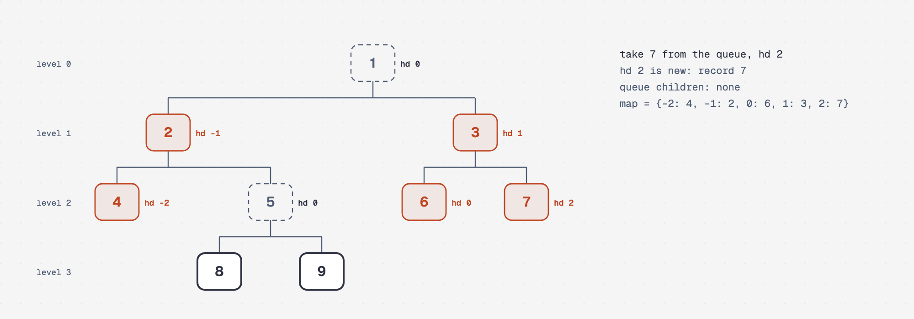
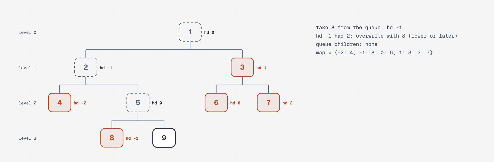
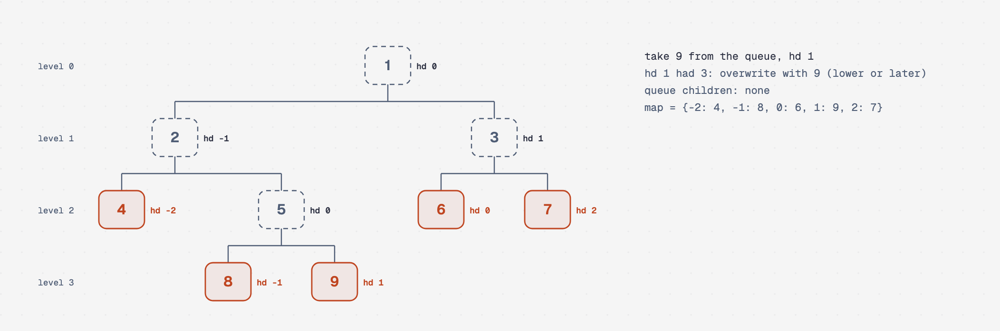

# 18. Bottom View of Binary Tree

| Difficulty | Pattern | Key idea | Source | Time | Space | Before / after |
|:---:|:---:|:---|:---:|:---:|:---:|:---:|
| **Medium** | BFS With a Column Number, Overwrite | Same as the top view, but overwrite the column every time; the last node BFS meets in a column is the lowest one (or the later one on a tie) | [Bottom View of Binary Tree (GfG)](https://www.geeksforgeeks.org/problems/bottom-view-of-binary-tree/1) | `O(n)` | `O(n)` | [Top View](17.%20Top%20View%20of%20Binary%20Tree.md) / [Right Side View](19.%20199.%20Binary%20Tree%20Right%20Side%20View.md) |

## 1. Problem Statement

Given the `root` of a binary tree, return its **bottom view**: the nodes you see when you look at the tree from below, from the leftmost column to the rightmost.

- Columns work as in the top view: the root is 0, a left child is `hd - 1`, a right child is `hd + 1`.
- In each column the **lowest** node is seen. If several nodes are equally low in a column, the **later one in level order** is the one seen.

### Example

**The tree we take:** the tree from the lecture board: `1` with children `2` and `3`; `2` with children `4` and `5`; `3` with children `6` and `7`; `5` with children `8` and `9`. As a level-order list: `[1, 2, 3, 4, 5, 6, 7, None, None, 8, 9]`.

```text
Input:  root = [1, 2, 3, 4, 5, 6, 7, None, None, 8, 9]
Output: [4, 8, 6, 9, 7]
```



It has both tricky parts of the problem:

- `8` and `9` sit **below** `2` and `3` in their columns, so the deeper nodes win.
- `5` and `6` are in the **same column on the same level** (the lecture circles them). The rule picks the later one in level order: `6`.

We use this tree in every section below.

GfG examples:

```text
root = [1, 2, 3, 4, 5, None, 6]                                  gives [4, 2, 5, 3, 6]
root = [20, 8, 22, 5, 3, 4, 25, None, None, 10, 14, None, None, 28]  gives [5, 10, 4, 28, 25]
```

### Constraints, in plain words

| Limit | What it means in plain words | What it tells us |
|:---|:---|:---|
| `1 <= number of nodes <= 10^5` | Up to 100,000 nodes | A chain this deep breaks Python recursion; BFS is safer |
| `1 <= node.data <= 10^5` | Positive whole numbers, which may repeat | Values do not matter; only columns and levels do |
| Ties go to the later node in level order | Same column and same level: the right-hand one wins | BFS order handles this for free when we overwrite |

**How fast is fast enough?**

- BFS visits each node once: `O(n)`, about 100,000 steps at most.
- Tracking the smallest and largest column lets us read the columns in order without sorting.

| Nodes `n` | BFS visits | Overwrites in the map | Sorting needed? | Recursion depth (DFS on a chain) | Note |
|:---:|:---:|:---:|:---|:---:|:---|
| 9 (our tree) | 9 | 4 (columns 0, -1, 0, 1) | No, columns -2 to 2 | 3 | The lecture example |
| 1,000 | 1,000 | at most 1,000 | No | up to 1,000 | Already at Python's default recursion limit |
| 100,000 | 100,000 | at most 100,000 | No | up to 100,000 | DFS would crash in Python; BFS is fine |

## 2. Core Idea

The top view keeps the **first** node BFS meets in each column. The bottom view keeps the **last** one:

- BFS goes level by level, top first. So within a column, every later node is **lower or equal**.
- If we simply **overwrite** `map[column] = value` every time, the value left at the end is the lowest node, and on a tie it is the later one in level order, exactly as the problem asks.

The four "view" problems in this section follow one table (from the lecture's pattern comparison):

| View | Group nodes by | Keep | With BFS | Note |
|:---|:---|:---|:---|:---|
| Top view | Column | The first node per column | Record only if the column is new | Note 17: the highest node of each column |
| Bottom view | Column | The last node per column | Overwrite every time | This note: the lowest node of each column |
| Left view | Level | The first node per level | The first node of each BFS level | Note 20: the leftmost node of each level |
| Right view | Level | The last node per level | The last node of each BFS level | Note 19: the rightmost node of each level |

## 3. Edge Cases

| Case | Input | Expected | Why it matters | Code that handles it |
|:---|:---|:---:|:---|:---|
| One node | `[1]` | `[1]` | One column | The loop runs once |
| Deeper node in a column | 8 under 2 in our tree | `8` | Lower wins | Overwrite every time |
| Tie on the same level | 5 and 6 in our tree | `6` | The later one in level order wins | BFS meets 6 after 5, so 6 overwrites it |
| Only left children | `[1, 2, None, 3]` | `[3, 2, 1]` | Every node is its own column | Columns -2, -1, 0 |
| Root hidden | our tree, column 0 | `6`, not `1` | The root can be hidden from below | Overwrites replace the root |

## 4. Approach 1: DFS That Remembers Levels

### Idea

Store `(level, value)` per column and replace it whenever a node is at the **same or a deeper** level. Preorder meets equal-level nodes from left to right, so "same or deeper" also gives the later one on a tie.

### Code

```python
# Import deque for the queue
from collections import deque

# Import List and Optional for type hints
from typing import List, Optional


# Bottom view, DFS that remembers the level of each column's node
class Solution:

    # Main method
    def bottomView(self, root: Optional[TreeNode]) -> List[int]:

        # column -> (level, value) of the lowest node seen so far
        best = {}

        # Walk every node with its column and level
        def dfs(node: Optional[TreeNode], col: int, level: int) -> None:

            # A missing child has no position
            if node is None:

                # Nothing to record
                return

            # Same level or deeper replaces the old node (ties go to the later one)
            if col not in best or level >= best[col][0]:

                # Remember the lower node
                best[col] = (level, node.val)

            # The left child is one column left, one level down
            dfs(node.left, col - 1, level + 1)

            # The right child is one column right, one level down
            dfs(node.right, col + 1, level + 1)

        # The root is column 0, level 0
        dfs(root, 0, 0)

        # Columns from left to right
        return [best[col][1] for col in sorted(best)]
```

### Complexity

| Measure | Complexity | Why | At the limit (`n = 10^5`) | Compared with BFS |
|:---|:---:|:---|:---:|:---|
| **Time** | `O(n log n)` | One walk, plus sorting the column keys | about 1,700,000 steps | Slower only because of the sort |
| **Space** | `O(n)` | The map plus `O(h)` recursion | up to 100,000 frames on a chain | Recursion depth is a risk in Python |

## 5. Approach 2: BFS, Overwrite per Column (the Lecture's Answer)

### Idea

1. Queue `(root, 0)`.
2. Take a pair and **overwrite** `map[column]` with its value.
3. Queue the children with `col - 1` and `col + 1`.
4. Read columns from the smallest to the largest.

### Run it on our example, step by step

**The tree we take:** the tree above.

**How to read the pictures:** orange nodes are the values currently in the map, dashed nodes were overwritten (hidden from below), bold boxes wait in the queue, white nodes are not reached yet. The tag `hd` is a node's column.

**Step 1: node 1, column 0**

- Column `0` is new: record `1`.
- Queue `2 (hd -1)`, `3 (hd 1)`.
- Map: `{0: 1}`.



**Step 2: node 2, column -1**

- Column `-1` is new: record `2`.
- Queue `4 (hd -2)`, `5 (hd 0)`.
- Map: `{-1: 2, 0: 1}`.



**Step 3: node 3, column 1**

- Column `1` is new: record `3`.
- Queue `6 (hd 0)`, `7 (hd 2)`.
- Map: `{-1: 2, 0: 1, 1: 3}`.



**Step 4: node 4, column -2**

- Column `-2` is new: record `4`.
- No children to queue.
- Map: `{-2: 4, -1: 2, 0: 1, 1: 3}`.



**Step 5: node 5, column 0**

- Column `0` had `1`. `5` is lower (or later on the same level), so overwrite: `1` is now hidden.
- Queue `8 (hd -1)`, `9 (hd 1)`.
- Map: `{-2: 4, -1: 2, 0: 5, 1: 3}`.



**Step 6: node 6, column 0**

- Column `0` had `5`. `6` is lower (or later on the same level), so overwrite: `5` is now hidden.
- No children to queue.
- Map: `{-2: 4, -1: 2, 0: 6, 1: 3}`.



**Step 7: node 7, column 2**

- Column `2` is new: record `7`.
- No children to queue.
- Map: `{-2: 4, -1: 2, 0: 6, 1: 3, 2: 7}`.



**Step 8: node 8, column -1**

- Column `-1` had `2`. `8` is lower (or later on the same level), so overwrite: `2` is now hidden.
- No children to queue.
- Map: `{-2: 4, -1: 8, 0: 6, 1: 3, 2: 7}`.



**Step 9: node 9, column 1**

- Column `1` had `3`. `9` is lower (or later on the same level), so overwrite: `3` is now hidden.
- No children to queue.
- Map: `{-2: 4, -1: 8, 0: 6, 1: 9, 2: 7}`.




**All steps at a glance**

| Step | Node taken | Column (hd) | Column had | Map now holds | Children queued | Map after |
|:---:|:---:|:---:|:---:|:---|:---|:---|
| 1 | 1 | 0 | nothing | 1 | 2 (hd -1), 3 (hd 1) | `{0: 1}` |
| 2 | 2 | -1 | nothing | 2 | 4 (hd -2), 5 (hd 0) | `{-1: 2, 0: 1}` |
| 3 | 3 | 1 | nothing | 3 | 6 (hd 0), 7 (hd 2) | `{-1: 2, 0: 1, 1: 3}` |
| 4 | 4 | -2 | nothing | 4 | none | `{-2: 4, -1: 2, 0: 1, 1: 3}` |
| 5 | 5 | 0 | 1 | 5 | 8 (hd -1), 9 (hd 1) | `{-2: 4, -1: 2, 0: 5, 1: 3}` |
| 6 | 6 | 0 | 5 | 6 | none | `{-2: 4, -1: 2, 0: 6, 1: 3}` |
| 7 | 7 | 2 | nothing | 7 | none | `{-2: 4, -1: 2, 0: 6, 1: 3, 2: 7}` |
| 8 | 8 | -1 | 2 | 8 | none | `{-2: 4, -1: 8, 0: 6, 1: 3, 2: 7}` |
| 9 | 9 | 1 | 3 | 9 | none | `{-2: 4, -1: 8, 0: 6, 1: 9, 2: 7}` |

Reading the map from column -2 to column 2 gives `[4, 8, 6, 9, 7]`.

### Code

```python
# Import deque for the queue
from collections import deque

# Import List and Optional for type hints
from typing import List, Optional


# Bottom view, BFS overwrites each column
class Solution:

    # Main method
    def bottomView(self, root: Optional[TreeNode]) -> List[int]:

        # An empty tree has no view
        if root is None:

            # Nothing to see
            return []

        # column -> value of the latest node met in that column
        last = {}

        # Pairs of (node, column), level by level
        queue = deque([(root, 0)])

        # The leftmost and rightmost columns seen
        lo = hi = 0

        # Visit every node, top levels first
        while queue:

            # The next node and its column
            node, col = queue.popleft()

            # A later node is lower or later on its level: overwrite
            last[col] = node.val

            # Stretch the column range to the left if needed
            lo = min(lo, col)

            # Stretch the column range to the right if needed
            hi = max(hi, col)

            # The left child is one column left
            if node.left:

                # Queue it
                queue.append((node.left, col - 1))

            # The right child is one column right
            if node.right:

                # Queue it
                queue.append((node.right, col + 1))

        # Columns from leftmost to rightmost
        return [last[col] for col in range(lo, hi + 1)]
```

### Complexity

| Measure | Complexity | Why | At the limit (`n = 10^5`) | Compared with DFS |
|:---|:---:|:---|:---:|:---|
| **Time** | `O(n)` | Each node is queued once; columns are read by range, no sort | 100,000 steps | No sorting needed |
| **Space** | `O(n)` | The map and the queue | up to 100,000 entries | No recursion |

## 6. Common Mistakes

| Mistake | What goes wrong | Fix |
|:---|:---|:---|
| Recording only the first node per column | You get the top view instead | Overwrite every time |
| DFS keeping the deeper node with `>` only | On a tie, the earlier node stays (5 instead of 6) | Use `>=` so the later node on the same level wins |
| Using a stack instead of a queue | Overwrites happen in the wrong order | BFS needs a queue: first in, first out |
| Sorting values instead of columns | The answer comes out in the wrong order | Order by column, from the leftmost to the rightmost |

## 7. Interview Follow-ups

### Q1. Why does overwriting give the lowest node?

**Answer:**
- BFS visits levels from top to bottom, so in each column the nodes come in order of depth.
- The last one written is the deepest one.

### Q2. What if the tie rule said "the earlier one in level order"?

**Answer:**
- Overwrite only when the new node is **strictly** deeper: store `(level, value)` and compare levels.

### Q3. How do top and bottom view differ in code?

**Answer:**
- One line: top view writes only `if col not in first`, bottom view writes every time.

### Q4. Can a node be in both the top and the bottom view?

**Answer:**
- Yes, when it is the only node in its column, like `4` and `7` in our tree.

### Q5. How would you print the boundary instead?

**Answer:**
- The boundary goes around the tree (root, left edge, leaves, right edge). It is note 15.

## 8. Interview Explanation

> I give every node a horizontal distance: the root is 0, a left child is one less, a right child is one more. Looking from below, each distance shows its lowest node. A breadth-first search visits the tree level by level, so in each column the nodes arrive from top to bottom. I keep a map from distance to value and simply overwrite it for every node; the value left at the end is the lowest node, and on a tie it is the later one in level order, which is the rule. Then I read the distances from the smallest to the largest. It is O(n) time and O(n) space.
