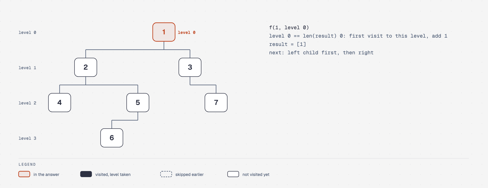
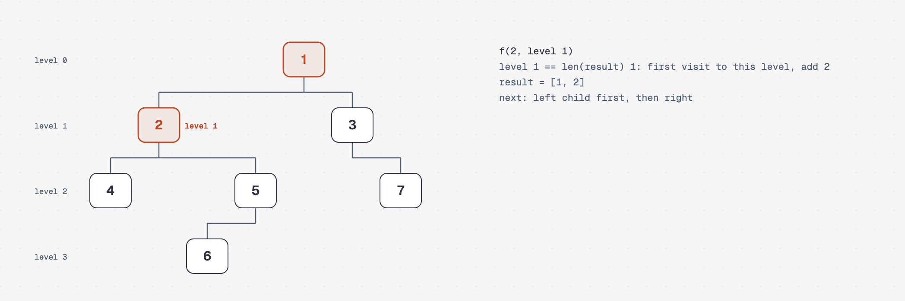
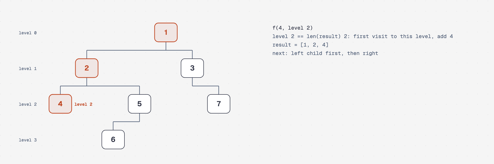
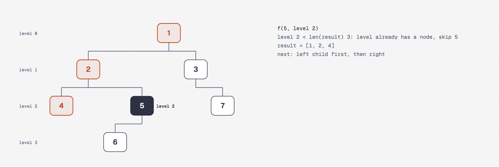
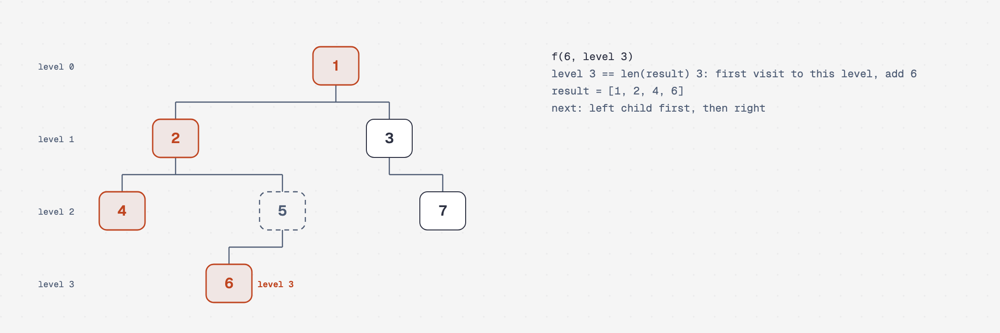
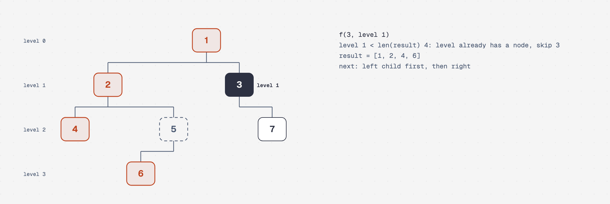
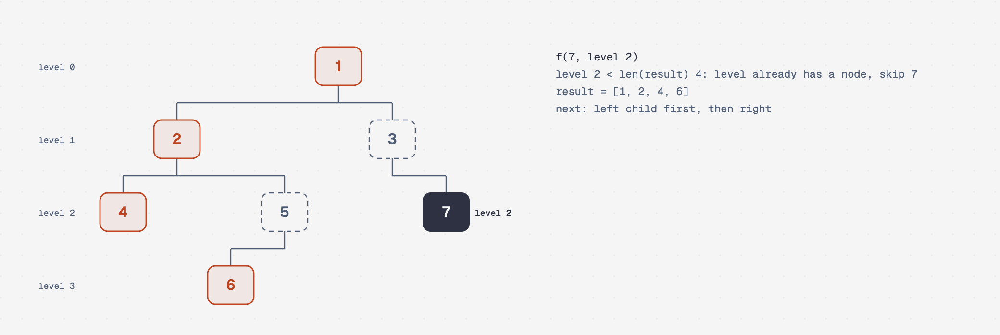

# 20. Left View of Binary Tree

| Difficulty | Pattern | Key idea | Source | Time | Space | Around this note |
|:---:|:---:|:---|:---:|:---:|:---:|:---:|
| **Easy** | One Node per Level | From the left side you see exactly one node per level: the leftmost one. A DFS that goes left first meets it first on every level | [Left View of Binary Tree (GfG)](https://www.geeksforgeeks.org/problems/left-view-of-binary-tree/1) | `O(n)` | `O(h)` | [Right Side View](19.%20199.%20Binary%20Tree%20Right%20Side%20View.md) |

## 1. Problem Statement

Given the `root` of a binary tree, imagine standing on its **left side**. Return the values of the nodes you can see, ordered from top to bottom.

### Example

**The tree we take:** the tree from the lecture board: `1` with children `2` and `3`; `2` with children `4` and `5`; `5` with left child `6`; `3` with right child `7`. As a level-order list: `[1, 2, 3, 4, 5, None, 7, 6]`.

```text
Input:  root = [1, 2, 3, 4, 5, None, 7, 6]
Output: [1, 2, 4, 6]
```

![The tree we take: seen from the left, one node per level: [1, 2, 4, 6]](images/lsv-example.png)

It has the tricky part of the problem: node `6` hangs deep under the **left** side of the tree, but it is the **only** node on level 3, so it is seen from **both** sides. A view is about levels, not about which side of the tree a node is on. We use this tree in every section below.

Examples:

```text
root = [1, 2, 3, 4, 5, 6, 7, None, 8]        gives [1, 2, 4, 8]
root = [1, 3, None, None, 4]                 gives [1, 3, 4]
root = [10, 20, 30, 40, 60]                  gives [10, 20, 40]
```

### Constraints, in plain words

| Limit | What it means in plain words | What it tells us |
|:---|:---|:---|
| `1 <= number of nodes <= 10^5` | Up to 100,000 nodes | A chain this deep breaks Python recursion; BFS is safer there |
| `0 <= node.data <= 10^5` | Whole numbers, which may repeat | Values do not matter; only positions do |
| One node per level | The answer has exactly as many values as the tree has levels | Track which levels already have a node |

**How fast is fast enough?**

- Both methods visit each node once: `O(n)`.
- They differ in memory, as the lecture shows with two drawings: a recursive DFS keeps one path (`O(h)`, bad only for a long chain), while BFS keeps one level (`O(n)` for a wide bottom level).

| Tree shape (`n` nodes) | Height | Widest level | Recursion depth (DFS) | BFS queue at most | Lecture's choice |
|:---|:---:|:---:|:---:|:---:|:---|
| Our example | 4 | 3 | 4 | 3 | Either |
| Full tree, `n = 1,023` | 10 | 512 | 10 | 512 | Recursion: much less memory |
| Chain, `n = 1,000` | 1,000 | 1 | 1,000 | 1 | BFS: avoids deep recursion |

## 2. Core Idea

Looking from the left, each level hides all its nodes behind its **leftmost** node. So the answer is "the leftmost node of every level".

Two ways to find it:

- **BFS (level order):** go level by level; the first node of each level is the leftmost.
- **DFS, left child first (the lecture's recursive answer):** pass the level down. Because the left side is explored first, the **first** node reached on each level is the leftmost one. Record a node when `level == len(result)`, which means "this level has no node yet".

The left view is the same code with the two recursive calls swapped (the lecture marks this on the board).

## 3. Edge Cases

| Case | Input | Expected | Why it matters | Code that handles it |
|:---|:---|:---:|:---|:---|
| Empty tree | `[]` | `[]` | No levels | The base case returns at once |
| One node | `[1]` | `[1]` | One level | `0 == len([])` adds it |
| Deep node on the right side | 6 in our tree | included | It is alone on its level | `level == len(result)` is true for it |
| A chain | `[1, 2, None, 3]` | `[1, 2, 3]` | Every node is alone on its level | Every node is added |
| Hidden node | the right nodes on levels 1 and 2 | not included | Their levels are already taken | `level < len(result)` skips them |

## 4. Approach 1: BFS, the Leftmost Node of Each Level

### Idea

Run level order (note 102). On each level, keep the first node.

### Run it on our example

| Level | Nodes on the level, left to right | Seen from the left | Hidden behind it | Why |
|:---:|:---|:---:|:---|:---|
| 0 | `[1]` | 1 | nothing | It is the only node on this level, so nothing hides it |
| 1 | `[2, 3]` | 2 | 3 | It is the first of 2 nodes, so it hides the rest of the level |
| 2 | `[4, 5, 7]` | 4 | 5, 7 | It is the first of 3 nodes, so it hides the rest of the level |
| 3 | `[6]` | 6 | nothing | It is the only node on this level, so nothing hides it |

### Code

```python
# Import deque for the queue
from collections import deque

# Import List and Optional for type hints
from typing import List, Optional


# Left view, BFS keeps the first node of every level
class Solution:

    # Main method
    def leftView(self, root: Optional[TreeNode]) -> List[int]:

        # An empty tree has no view
        if root is None:

            # Nothing to see
            return []

        # One value per level
        result = []

        # Nodes of the current level, left to right
        queue = deque([root])

        # One round per level
        while queue:

            # The number of nodes on this level
            size = len(queue)

            # Take out exactly this level
            for i in range(size):

                # The next node on this level, from the left
                node = queue.popleft()

                # The first node of the level is the one seen from the left
                if i == 0:

                    # Record it
                    result.append(node.val)

                # Queue the left child for the next level
                if node.left:

                    # It belongs to the next level
                    queue.append(node.left)

                # Queue the right child for the next level
                if node.right:

                    # It belongs to the next level
                    queue.append(node.right)

        # One value per level, top to bottom
        return result
```

### Complexity

| Measure&ensp;&#8203;&ensp;&#8203;&ensp;&#8203;&ensp;&#8203;&ensp;&#8203;&ensp;&#8203; | Complexity | Why | At the limit | Compared with DFS |
|:---|:---:|:---|:---:|:---|
| **Time** | `O(n)` | Each node is queued once | one step per node | Same |
| **Space** | `O(w)` | The queue holds about one level | up to about `n / 2` on a full tree | More memory on wide trees |

## 5. Approach 2: DFS, Left Child First (the Lecture's Answer)

### Idea

```text
f(node, level):
    if node is None: return
    if level == len(result): result.append(node.val)
    f(node.left, level + 1)
    f(node.right, level + 1)
```

### Run it on our example, step by step

**The tree we take:** the tree above.

**How to read the pictures:** orange nodes are in the answer, the dark node was just visited but its level was already taken, dashed nodes were skipped earlier, white nodes are not visited yet. The tag shows the level of the current call.

**Step 1: f(1, level 0)**

- `level 0 == len(result) 0`: this is the first node reached on level 0, so add `1`.
- Result: `[1]`.



**Step 2: f(2, level 1)**

- `level 1 == len(result) 1`: this is the first node reached on level 1, so add `2`.
- Result: `[1, 2]`.



**Step 3: f(4, level 2)**

- `level 2 == len(result) 2`: this is the first node reached on level 2, so add `4`.
- Result: `[1, 2, 4]`.



**Step 4: f(5, level 2)**

- `level 2 < len(result) 3`: level 2 already has a node, so `5` is hidden. Skip it.
- Result: `[1, 2, 4]`.



**Step 5: f(6, level 3)**

- `level 3 == len(result) 3`: this is the first node reached on level 3, so add `6`.
- Result: `[1, 2, 4, 6]`.



**Step 6: f(3, level 1)**

- `level 1 < len(result) 4`: level 1 already has a node, so `3` is hidden. Skip it.
- Result: `[1, 2, 4, 6]`.



**Step 7: f(7, level 2)**

- `level 2 < len(result) 4`: level 2 already has a node, so `7` is hidden. Skip it.
- Result: `[1, 2, 4, 6]`.




**All steps at a glance**

| Step | Call | `len(result)` before | First on this level? | Result after | Why |
|:---:|:---|:---:|:---:|:---|:---|
| 1 | `f(1, 0)` | 0 | Yes | `[1]` | The left side reached level 0 for the first time here |
| 2 | `f(2, 1)` | 1 | Yes | `[1, 2]` | The left side reached level 1 for the first time here |
| 3 | `f(4, 2)` | 2 | Yes | `[1, 2, 4]` | The left side reached level 2 for the first time here |
| 4 | `f(5, 2)` | 3 | No | `[1, 2, 4]` | Level 2 already has a node closer to the left, so this one is hidden |
| 5 | `f(6, 3)` | 3 | Yes | `[1, 2, 4, 6]` | The left side reached level 3 for the first time here |
| 6 | `f(3, 1)` | 4 | No | `[1, 2, 4, 6]` | Level 1 already has a node closer to the left, so this one is hidden |
| 7 | `f(7, 2)` | 4 | No | `[1, 2, 4, 6]` | Level 2 already has a node closer to the left, so this one is hidden |

### Code

```python
# Import deque for the queue
from collections import deque

# Import List and Optional for type hints
from typing import List, Optional


# Left view, DFS that goes left first
class Solution:

    # Main method
    def leftView(self, root: Optional[TreeNode]) -> List[int]:

        # One value per level
        result = []

        # Visit a node knowing its level
        def f(node: Optional[TreeNode], level: int) -> None:

            # A missing child: nothing to do
            if node is None:

                # Go back
                return

            # The first node reached on a new level is the leftmost one
            if level == len(result):

                # Record it
                result.append(node.val)

            # Go left first, so the left side reaches each level first
            f(node.left, level + 1)

            # Then the right side
            f(node.right, level + 1)

        # The root is on level 0
        f(root, 0)

        # One value per level, top to bottom
        return result
```

### Complexity

| Measure&ensp;&#8203;&ensp;&#8203;&ensp;&#8203;&ensp;&#8203;&ensp;&#8203;&ensp;&#8203;&ensp;&#8203; | Complexity | Why | At the limit | Compared with BFS |
|:---|:---:|:---|:---:|:---|
| **Time** | `O(n)` | Each node is visited once | one step per node | Same |
| **Space** | `O(h)` | The call stack holds one path | `log n` on a full tree, `n` on a chain | Less memory on wide trees |

## 6. Common Mistakes

| Mistake | What goes wrong | Fix |
|:---|:---|:---|
| Following only the left edge of the tree | 6 is missed, because it hangs under the right side | One node per **level**, wherever it is |
| Recursing right child first | You get the right view | Recurse left first |
| Checking `level > len(result)` | Levels are skipped or the code crashes | Add exactly when `level == len(result)` |
| BFS picking the wrong end of the level | You get the right view | Right view: last node of the level; left view: first node |

## 7. Interview Follow-ups

### Q1. How do you get the right view?

**Answer:**
- DFS: swap the two recursive calls. BFS: take the other end of each level.

### Q2. Why does `level == len(result)` mean "first time on this level"?

**Answer:**
- `result` has one value for each level already seen: levels `0` to `len(result) - 1`.
- So the next new level is exactly `len(result)`.

### Q3. How is this different from the top view?

**Answer:**
- Side views pick one node per **level**; top and bottom views pick one node per **column**.

### Q4. Which method would you use for a very deep tree in Python?

**Answer:**
- BFS, because deep recursion hits Python's recursion limit.

### Q5. How would you return both side views at once?

**Answer:**
- BFS once: on every level, take the first node for the left view and the last node for the right view.

## 8. Interview Explanation

> From the left side, every level shows only its leftmost node, so the answer is one node per level. I do a DFS that visits the left child before the right child and passes the level down. The first node I reach on each level is the leftmost one, so I add a node exactly when its level equals the size of the result so far. That is O(n) time and O(h) space. A level-order BFS that keeps the first node of every level also works, with space for the widest level instead.
