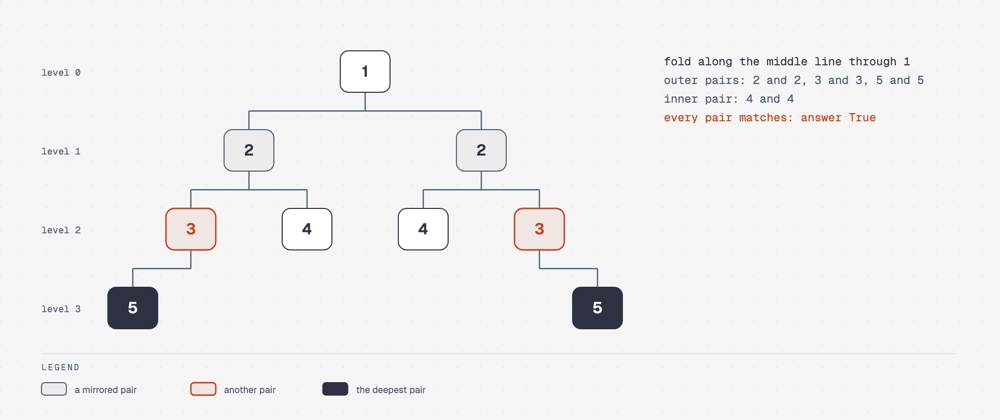
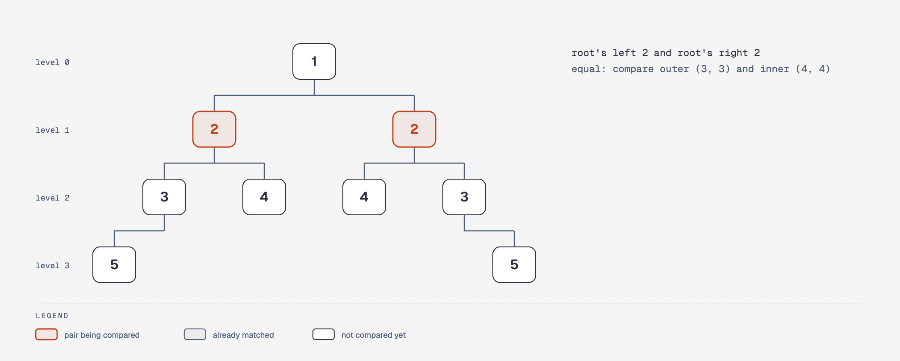
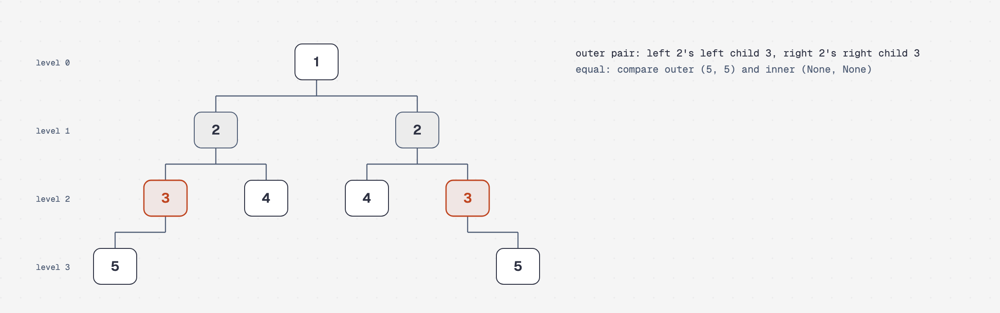
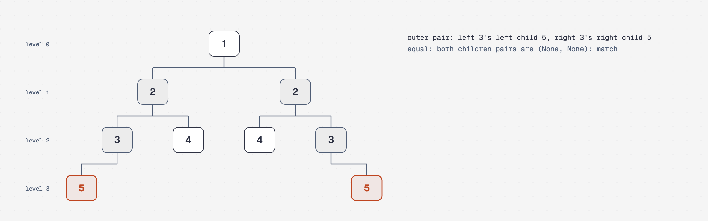
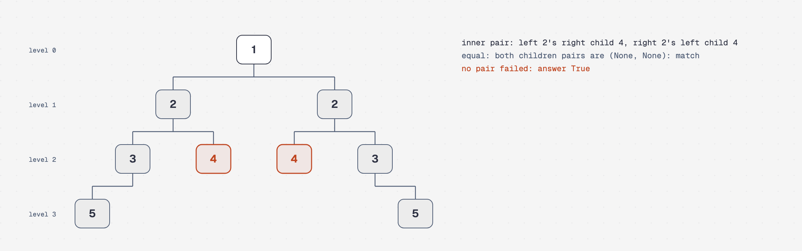

# 21. 101. Symmetric Tree

| Difficulty | Pattern | Key idea | Source | Time | Space | Next in this folder |
|:---:|:---:|:---|:---:|:---:|:---:|:---:|
| **Easy** | Compare Two Subtrees as Mirrors | A tree is symmetric when its left half is a mirror of its right half: compare outer with outer and inner with inner, all the way down | [101. Symmetric Tree](https://leetcode.com/problems/symmetric-tree/) | `O(n)` | `O(h)` | [257. Binary Tree Paths](22.%20257.%20Binary%20Tree%20Paths.md) |

## 1. Problem Statement

Given the `root` of a binary tree, return `True` if it is a **mirror of itself**: symmetric around a vertical line through the root.

### Example

**The tree we take:** a 9-node tree: `1`; then `2, 2`; then `3, 4, 4, 3`; then a `5` under the far-left `3` (as its left child) and a `5` under the far-right `3` (as its right child). As a LeetCode list: `[1, 2, 2, 3, 4, 4, 3, 5, None, None, None, None, None, None, 5]`.

```text
Input:  root = [1, 2, 2, 3, 4, 4, 3, 5, None, None, None, None, None, None, 5]
Output: True
```



It shows the key idea from the lecture board: the two halves must match **as a mirror**, not as copies. The far-left `3` pairs with the far-right `3`, and its **left** child `5` pairs with the other `3`'s **right** child `5`. It extends LeetCode's example 1 by one level, so the walk has to go deep. We use it in every section below.

LeetCode examples:

```text
root = [1, 2, 2, 3, 4, 4, 3]              gives True
root = [1, 2, 2, None, 3, None, 3]        gives False   (both 3s are right children)
```

### Constraints, in plain words

| Limit | What it means in plain words | What it tells us |
|:---|:---|:---|
| Number of nodes is `1` to `1000` | At least one node, at most 1,000 | A single node is symmetric; `O(n)` is instant |
| `-100 <= Node.val <= 100` | Small whole numbers, which repeat a lot here | Compare values at mirrored spots, not just values |
| Follow-up: "recursively and iteratively" | Show both versions | Recursion on pairs, and a queue of pairs |

**How fast is fast enough?**

- Every method compares each mirrored pair once: about `n / 2` pairs, so `O(n)`.
- The difference is memory: recursion keeps one path (`O(h)`), the queue keeps about one level of pairs, the mirror copy builds a second tree (`O(n)`).

| Method | Pairs compared in our tree | Extra memory | Stops at the first mismatch? | Note |
|:---|:---:|:---|:---:|:---|
| Mirror copy, then compare | 4 node pairs | a full copy of the right half | Yes, during the compare | Reuses note 14, but builds a new tree |
| Queue of pairs | 4 node pairs | about one level of pairs | Yes | The iterative answer |
| Recursion on pairs | 4 node pairs | one path of calls | Yes | The lecture's answer |

## 2. Core Idea

Fold the tree along the vertical line through the root (the lecture draws this line). Symmetric means every node lands on a node with the same value. Two subtrees `A` and `B` mirror each other when:

1. both are empty, or
2. both exist, `A.val == B.val`, **and**
   - `A.left` mirrors `B.right` (the **outer** pair), **and**
   - `A.right` mirrors `B.left` (the **inner** pair).

The whole tree is symmetric when `root.left` mirrors `root.right`. This is the same tree check as note 14, except that left is compared with right.

## 3. Edge Cases

| Case | Input | Expected | Why it matters | Code that handles it |
|:---|:---|:---:|:---|:---|
| One node | `[1]` | `True` | Both halves are empty | `is_mirror(None, None)` |
| Same values, same sides | `[1, 2, 2, None, 3, None, 3]` | `False` | Both 3s are right children, so not a mirror | Outer pair `(None, 3)` fails |
| One half missing | `[1, 2]` | `False` | Only the left half exists | `(2, None)` fails |
| Values differ | `[1, 2, 3]` | `False` | Shapes mirror but values do not | `a.val != b.val` |
| Deep mirror | our tree | `True` | The check must go all the way down | The recursion continues to the leaves |

## 4. Approach 1: Mirror the Right Half, Then Compare

### Idea

Build a mirrored copy of the right half (swap every left and right), then check that it is the same tree as the left half, with the code from note 14. Correct, but it builds a whole new tree first.

### Code

```python
# Import deque for the queue
from collections import deque

# Import Optional for type hints
from typing import Optional


# Solution for 101, mirror copy then compare
class Solution:

    # Build a mirrored copy of a tree
    def mirror(self, node: Optional[TreeNode]) -> Optional[TreeNode]:

        # An empty tree mirrors to an empty tree
        if node is None:

            # Nothing to copy
            return None

        # New node: same value, children swapped and mirrored
        return TreeNode(node.val, self.mirror(node.right), self.mirror(node.left))

    # Two trees are the same (note 14)
    def same(self, a: Optional[TreeNode], b: Optional[TreeNode]) -> bool:

        # Both empty: they match
        if a is None and b is None:

            # Same here
            return True

        # One empty, or values differ
        if a is None or b is None or a.val != b.val:

            # Not the same
            return False

        # Left with left, right with right
        return self.same(a.left, b.left) and self.same(a.right, b.right)

    # Main method
    def isSymmetric(self, root: Optional[TreeNode]) -> bool:

        # The left side must equal the mirror of the right side
        return self.same(root.left, self.mirror(root.right))
```

### Complexity

| Measure | Complexity | Why | At the limit (`n = 1000`) | Compared with the others |
|:---|:---:|:---|:---:|:---|
| **Time** | `O(n)` | Copy the right half, then compare | about 1,000 steps | Same order as the others, but more work: a whole copy is built first |
| **Space** | `O(n)` | The mirrored copy | about 500 new nodes | The most memory of the three methods |

## 5. Approach 2: A Queue of Mirrored Pairs (Iterative)

### Idea

Start with the pair `(root.left, root.right)`. Take a pair: if both are empty, skip it; if one is empty or the values differ, return `False`; otherwise queue the outer pair `(a.left, b.right)` and the inner pair `(a.right, b.left)`.

### Code

```python
# Import deque for the queue
from collections import deque

# Import Optional for type hints
from typing import Optional


# Solution for 101, queue of mirrored pairs
class Solution:

    # Main method
    def isSymmetric(self, root: Optional[TreeNode]) -> bool:

        # Pairs that must mirror each other
        queue = deque([(root.left, root.right)])

        # Check every pair
        while queue:

            # The next pair
            a, b = queue.popleft()

            # Both empty: this pair matches
            if a is None and b is None:

                # Move on
                continue

            # One empty, or different values
            if a is None or b is None or a.val != b.val:

                # Not a mirror
                return False

            # Outer children must mirror each other
            queue.append((a.left, b.right))

            # Inner children must mirror each other
            queue.append((a.right, b.left))

        # Every pair matched
        return True
```

### Complexity

| Measure | Complexity | Why | At the limit (`n = 1000`) | Compared with the others |
|:---|:---:|:---|:---:|:---|
| **Time** | `O(n)` | Each mirrored pair is checked once | about 500 pairs | Same as recursion: every pair checked once |
| **Space** | `O(w)` | The queue holds about one level of pairs | about 250 pairs on a full tree | No recursion, so no Python recursion limit |

## 6. Approach 3: Recursion on Mirrored Pairs (the Lecture's Answer)

### Idea

```text
is_mirror(a, b):
    both empty    -> True
    one empty     -> False
    values differ -> False
    otherwise     -> is_mirror(a.left, b.right) and is_mirror(a.right, b.left)
answer = is_mirror(root.left, root.right)
```

### Run it on our example, step by step

**The tree we take:** the 9-node tree above.

**How to read the pictures:** orange is the mirrored pair being compared, grey pairs have already matched, white nodes are not compared yet.

**Step 1: compare 2 with 2**

- Root's left 2 and root's right 2.
- Both are `2`: equal: compare outer (3, 3) and inner (4, 4).



**Step 2: compare 3 with 3**

- Outer pair: left 2's left child 3, right 2's right child 3.
- Both are `3`: equal: compare outer (5, 5) and inner (None, None).



**Step 3: compare 5 with 5**

- Outer pair: left 3's left child 5, right 3's right child 5.
- Both are `5`: equal: both children pairs are (None, None): match.



**Step 4: compare 4 with 4**

- Inner pair: left 2's right child 4, right 2's left child 4.
- Both are `4`: equal: both children pairs are (None, None): match.
- No pair failed. The answer is **True**.




**All steps at a glance**

| Step | Pair compared | Equal? | Next pairs to check | Why these pairs |
|:---:|:---|:---:|:---|:---|
| 1 | root's left 2 and root's right 2 | Yes | outer (3, 3) and inner (4, 4) | A mirror swaps sides: outer goes with outer, inner with inner |
| 2 | outer pair: left 2's left child 3, right 2's right child 3 | Yes | outer (5, 5) and inner (None, None) | A mirror swaps sides: outer goes with outer, inner with inner |
| 3 | outer pair: left 3's left child 5, right 3's right child 5 | Yes | (None, None) twice | A mirror swaps sides: outer goes with outer, inner with inner |
| 4 | inner pair: left 2's right child 4, right 2's left child 4 | Yes | (None, None) twice | A mirror swaps sides: outer goes with outer, inner with inner |

### Code

```python
# Import deque for the queue
from collections import deque

# Import Optional for type hints
from typing import Optional


# Solution for 101, recursion on mirrored pairs
class Solution:

    # Do these two subtrees mirror each other?
    def is_mirror(self, a: Optional[TreeNode], b: Optional[TreeNode]) -> bool:

        # Both empty: they match
        if a is None and b is None:

            # Mirror here
            return True

        # Exactly one empty: shapes differ
        if a is None or b is None:

            # Not a mirror
            return False

        # Values differ
        if a.val != b.val:

            # Not a mirror
            return False

        # Outer with outer, and inner with inner
        return self.is_mirror(a.left, b.right) and self.is_mirror(a.right, b.left)

    # Main method
    def isSymmetric(self, root: Optional[TreeNode]) -> bool:

        # The two halves must mirror each other
        return self.is_mirror(root.left, root.right)
```

### Complexity

| Measure | Complexity | Why | At the limit (`n = 1000`) | Compared with the others |
|:---|:---:|:---|:---:|:---|
| **Time** | `O(n)` | Each mirrored pair is compared once | about 500 pairs | Same as the queue: every pair checked once |
| **Space** | `O(h)` | The call stack holds one path | about 10 on a full tree, up to 500 on a long chain | Least memory on full trees; deep chains hit the recursion limit |

## 7. Common Mistakes

| Mistake | What goes wrong | Fix |
|:---|:---|:---|
| Comparing left with left | That checks if the two halves are copies, not mirrors | Outer with outer: `a.left` with `b.right` |
| Checking that the inorder list is a palindrome | Different shapes can give a palindrome too | Compare mirrored pairs |
| Comparing `root.left` with `root.left` | Always `True` | Start with `(root.left, root.right)` |
| Forgetting the `None` cases | Crashes on `None.val` | Handle empty spots first |

## 8. Interview Follow-ups

### Q1. How is this related to Same Tree (100)?

**Answer:**
- Same pairwise walk, but here left is compared with right.
- In fact, `is_mirror(root.left, root.right)` is "same tree" with one side swapped.

### Q2. How do you invert a tree (LeetCode 226)?

**Answer:**
- Swap `left` and `right` at every node, for example in postorder.
- A tree is symmetric exactly when it is the same as its inverted copy.

### Q3. Can you check symmetry level by level?

**Answer:**
- Yes: in each BFS level, including `None` spots, the list of values must read the same forwards and backwards.
- The `None` spots are needed, otherwise shapes are lost.

### Q4. What is the best-case time?

**Answer:**
- `O(1)`: if the root's two children already differ, the answer is known at once.

### Q5. What if the tree had n-ary children?

**Answer:**
- Compare the children lists as mirrors: child `i` of `A` with child `k - 1 - i` of `B`, for `k` children.

## 9. Interview Explanation

> A tree is symmetric when its left half is the mirror image of its right half. Two subtrees mirror each other if both are empty, or both have the same value and the left child of one mirrors the right child of the other, and the right child of one mirrors the left child of the other. So I call is_mirror on the root's two children and recurse on outer pairs and inner pairs, returning False at the first mismatch. Each pair is compared once, so it is O(n) time and O(h) space. The same check works iteratively with a queue of pairs.
