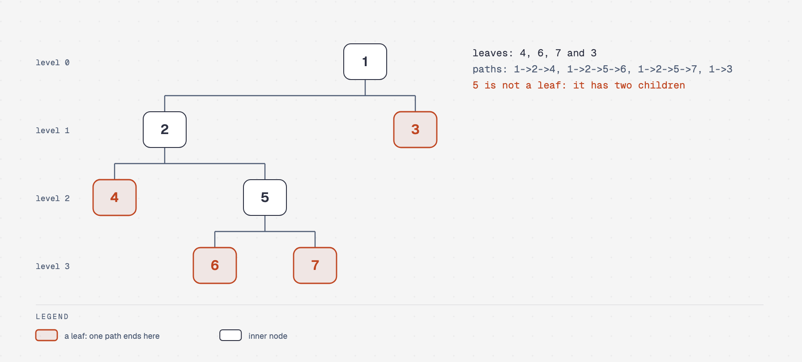

# 22. 257. Binary Tree Paths

| Difficulty | Pattern | Key idea | Source | Time | Space | Before / after |
|:---:|:---:|:---|:---:|:---:|:---:|:---:|
| **Easy** | DFS With a Path (Backtracking) | Walk down from the root keeping the path so far; at a leaf, save the path; when going back up, remove the last node | [257. Binary Tree Paths](https://leetcode.com/problems/binary-tree-paths/) | `O(n x h)` | `O(h)` | [101. Symmetric Tree](21.%20101.%20Symmetric%20Tree.md) / [236. LCA](23.%20236.%20Lowest%20Common%20Ancestor%20of%20a%20Binary%20Tree.md) |

## 1. Problem Statement

Given the `root` of a binary tree, return **all root-to-leaf paths**, in any order. Each path is a string like `"1->2->5"`. A **leaf** is a node with no children.

### Example

**The tree we take:** the 7-node tree from the lecture board: `1` with children `2` and `3`; `2` with children `4` and `5`; `5` with children `6` and `7`. As a LeetCode list: `[1, 2, 3, 4, 5, None, None, None, None, 6, 7]`.

```text
Input:  root = [1, 2, 3, 4, 5, None, None, None, None, 6, 7]
Output: ["1->2->4", "1->2->5->6", "1->2->5->7", "1->3"]
```



It has the tricky parts of the problem:

- The leaves sit at **three different depths** (3 at level 1, 4 at level 2, 6 and 7 at level 3), so paths have different lengths.
- Node `5` has two children, so the path `1, 2, 5` is **shared** by two answers. After saving `1->2->5->6`, the walk must remove `6` before adding `7`.
- Node `5` itself is **not** a leaf, so no path may end there.

We use this tree in every section below.

LeetCode examples:

```text
root = [1, 2, 3, None, 5]   gives ["1->2->5", "1->3"]
root = [1]                  gives ["1"]
```

### Constraints, in plain words

| Limit | What it means in plain words | What it tells us |
|:---|:---|:---|
| Number of nodes is `1` to `100` | At least one node, at most 100 | A single node gives one path `"1"`; any method is instant |
| `-100 <= Node.val <= 100` | Values can be negative | Use `str(val)`, so `-5` prints as `"-5"`; the `"->"` stays between values |
| "Root-to-leaf", "any order" | Every path starts at the root and ends at a leaf | Save a path only at a node with **no** children; the order of the list does not matter |

**How fast is fast enough?**

- Every method visits each node once.
- The real cost is writing the answer: each of the `L` leaves gets a path of up to `h` values. So the time is `O(n x h)` in the worst case, at most about 100 x 100 = 10,000 small steps here.
- The difference between methods is memory and how often strings are copied.

| Method | How the path is kept | Extra memory (besides the answer) | Strings built in our tree | Note |
|:---|:---|:---|:---:|:---|
| BFS with a queue of (node, path string) | Each queue item carries its own string | about one level of strings | 7, one per node | The lecture's first code |
| DFS passing a string down | Each call gets a new, longer string | one path of calls and strings | 7, one per node | The lecture's second code |
| DFS with one shared list (backtracking) | One list: push on the way down, pop on the way up | one list of at most `h` values | 4, one per leaf | Builds strings only at leaves |

## 2. Core Idea

Think of walking down the tree with a notebook in which you write the nodes you pass:

1. Arriving at a node, **write it down** (add it to the path).
2. If the node is a **leaf**, the notebook now holds one full answer: **save** a copy as `"1->2->..."`.
3. Otherwise, go to the left child, then to the right child.
4. Before going back up, **erase** the node (remove the last value). This is **backtracking**: the notebook is ready for the next branch.

The lecture shows the same walk as "root to node path": the path list grows `[1]`, `[1, 2]`, `[1, 2, 4]`, and shrinks again when a branch is done.

## 3. Edge Cases

| Case | Input | Expected | Why it matters | Code that handles it |
|:---|:---|:---|:---|:---|
| One node | `[1]` | `["1"]` | The root is also a leaf | The leaf check runs at the root too |
| Node with one child | `[1, 2, 3, None, 5]` | `["1->2->5", "1->3"]` | `2` is not a leaf, its missing left child adds no path | Save only when **both** children are `None` |
| Negative values | `[-1, 2]` | `["-1->2"]` | The minus sign must stay | `str(node.val)` |
| Shared prefix | our tree | 4 paths | `1, 2, 5` is used twice | Pop after each branch |
| A long chain | 100 nodes in a line | 1 path of 100 values | The deepest recursion here | 100 calls is fine in Python |

## 4. Approach 1: BFS With a Queue of (node, path string)

### Idea

Put `(root, "")` in a queue. Take an item `(node, path)`: if the node is a leaf, save `path + str(node.val)`; otherwise queue each child with `path + str(node.val) + "->"`. Every queue item carries its own copy of the path.

### Code

```python
# Import deque for the queue
from collections import deque

# Import types for hints
from typing import List, Optional


# Solution for 257, BFS with a queue of (node, path string)
class Solution:

    # Main method
    def binaryTreePaths(self, root: Optional[TreeNode]) -> List[str]:

        # The finished paths
        res = []

        # Each item: a node and the path written before it
        queue = deque([(root, "")])

        # Take items until the queue is empty
        while queue:

            # The next node and its path so far
            node, path = queue.popleft()

            # A leaf ends one full path
            if node.left is None and node.right is None:

                # Save the path with this leaf
                res.append(path + str(node.val))

            # The left child continues the path
            if node.left:

                # Queue it with this node added
                queue.append((node.left, path + str(node.val) + "->"))

            # The right child continues the path
            if node.right:

                # Queue it with this node added
                queue.append((node.right, path + str(node.val) + "->"))

        # Every root-to-leaf path
        return res
```

### Complexity

| Measure | Complexity | Why | At the limit (100 nodes) | Compared with the others |
|:---|:---:|:---|:---:|:---|
| **Time** | `O(n x h)` | Each node is visited once, but each string copy costs up to `h` | at most about 10,000 small steps | Same order as the others |
| **Space** | `O(w x h)` | The queue holds about one level of strings | about 50 strings of up to 7 values on a full tree | The most memory of the three methods |

## 5. Approach 2: DFS Passing a String Down

### Idea

Call `dfs(node, path)` where `path` already ends with `node`. At a leaf, save `path`. Otherwise call each child with `path + "->" + str(child.val)`. Each call gets its own new string, so nothing has to be undone.

### Code

```python
# Import types for hints
from typing import List, Optional


# Solution for 257, DFS passing a string down
class Solution:

    # Visit a node whose path (ending with it) is already written
    def dfs(self, node: TreeNode, path: str, res: List[str]) -> None:

        # A leaf ends one full path
        if node.left is None and node.right is None:

            # Save it
            res.append(path)

            # Nothing below a leaf
            return

        # Go left with a longer path
        if node.left:

            # The child gets its own new string
            self.dfs(node.left, path + "->" + str(node.left.val), res)

        # Go right with a longer path
        if node.right:

            # The child gets its own new string
            self.dfs(node.right, path + "->" + str(node.right.val), res)

    # Main method
    def binaryTreePaths(self, root: Optional[TreeNode]) -> List[str]:

        # The finished paths
        res = []

        # The root's path is just its value
        self.dfs(root, str(root.val), res)

        # Every root-to-leaf path
        return res
```

### Complexity

| Measure | Complexity | Why | At the limit (100 nodes) | Compared with the others |
|:---|:---:|:---|:---:|:---|
| **Time** | `O(n x h)` | One new string per node, each up to `h` values | at most about 10,000 small steps | Same order as the others |
| **Space** | `O(h x h)` | `h` calls deep, each holding its own string | small here, about 100 x 100 characters on a chain | Simple, nothing to undo |

## 6. Optimal: DFS With One Shared List (Backtracking)

### Idea

```text
walk(node):
    path.append(node.val)                     # write it down
    if node is a leaf: save "->".join(path)   # one full answer
    else: walk(node.left); walk(node.right)   # only the children that exist
    path.pop()                                # erase it before going back up
```

### Run it on our example, step by step

**The tree we take:** the 7-node tree above.

**How to read the pictures:** orange is the node being visited, dark nodes are on the current path (in the shared list), grey nodes were visited and popped off, white nodes are not visited yet.

**Step 1: visit 1**

- Append `1`: the path list is `[1]`.
- `1` has children, so nothing is saved.
- Next: go down to the left child 2.

![Step 1: visit 1, path [1]](images/paths-step-1.png)

**Step 2: visit 2**

- Append `2`: the path list is `[1, 2]`.
- `2` has children, so nothing is saved.
- Next: go down to the left child 4.

![Step 2: visit 2, path [1, 2]](images/paths-step-2.png)

**Step 3: visit 4**

- Append `4`: the path list is `[1, 2, 4]`.
- `4` has no children, so it is a leaf. Save `"1->2->4"`. Paths so far: 1.
- Next: pop 4, go back to 2, then right to 5.

![Step 3: visit 4, path [1, 2, 4]](images/paths-step-3.png)

**Step 4: visit 5**

- Append `5`: the path list is `[1, 2, 5]`.
- `5` has children, so nothing is saved.
- Next: go down to the left child 6.

![Step 4: visit 5, path [1, 2, 5]](images/paths-step-4.png)

**Step 5: visit 6**

- Append `6`: the path list is `[1, 2, 5, 6]`.
- `6` has no children, so it is a leaf. Save `"1->2->5->6"`. Paths so far: 2.
- Next: pop 6, go back to 5, then right to 7.

![Step 5: visit 6, path [1, 2, 5, 6]](images/paths-step-5.png)

**Step 6: visit 7**

- Append `7`: the path list is `[1, 2, 5, 7]`.
- `7` has no children, so it is a leaf. Save `"1->2->5->7"`. Paths so far: 3.
- Next: pop 7, pop 5, pop 2, then go right to 3.

![Step 6: visit 7, path [1, 2, 5, 7]](images/paths-step-6.png)

**Step 7: visit 3**

- Append `3`: the path list is `[1, 3]`.
- `3` has no children, so it is a leaf. Save `"1->3"`. Paths so far: 4.
- Next: pop 3, pop 1: the walk is done.

![Step 7: visit 3, path [1, 3]](images/paths-step-7.png)


**All steps at a glance**

| Step | Visit | Path list after adding it&ensp;&#8203; | Leaf? | Saved | Paths saved so far | What the walk does next |
|:---:|:---:|:---|:---:|:---|:---:|:---|
| 1 | 1 | `[1]` | No | nothing | 0 | go down to the left child 2 |
| 2 | 2 | `[1, 2]` | No | nothing | 0 | go down to the left child 4 |
| 3 | 4 | `[1, 2, 4]` | Yes | `"1->2->4"` | 1 | pop 4, go back to 2, then right to 5 |
| 4 | 5 | `[1, 2, 5]` | No | nothing | 1 | go down to the left child 6 |
| 5 | 6 | `[1, 2, 5, 6]` | Yes | `"1->2->5->6"` | 2 | pop 6, go back to 5, then right to 7 |
| 6 | 7 | `[1, 2, 5, 7]` | Yes | `"1->2->5->7"` | 3 | pop 7, pop 5, pop 2, then go right to 3 |
| 7 | 3 | `[1, 3]` | Yes | `"1->3"` | 4 | pop 3, pop 1: the walk is done |

The list never held more than 4 values (the height), and strings were built only 4 times, once per leaf.

### Code

```python
# Import types for hints
from typing import List, Optional


# Solution for 257, DFS with one shared list
class Solution:

    # Main method
    def binaryTreePaths(self, root: Optional[TreeNode]) -> List[str]:

        # The finished paths
        res = []

        # The values from the root to the current node
        path = []

        # Visit one node
        def walk(node: TreeNode) -> None:

            # Write this node down
            path.append(str(node.val))

            # A leaf ends one full path
            if node.left is None and node.right is None:

                # Save a new string built from the list
                res.append("->".join(path))

            # Otherwise go down
            else:

                # Left child first, if it exists
                if node.left:

                    # Walk the left subtree
                    walk(node.left)

                # Then the right child, if it exists
                if node.right:

                    # Walk the right subtree
                    walk(node.right)

            # Erase this node before going back up
            path.pop()

        # Start at the root
        walk(root)

        # Every root-to-leaf path
        return res
```

### Complexity

| Measure | Complexity | Why | At the limit (100 nodes) | Compared with the others |
|:---|:---:|:---|:---:|:---|
| **Time** | `O(n x h)` | Each node is pushed and popped once; each leaf joins a path of up to `h` values | at most about 10,000 small steps | Fewest string copies: only at leaves |
| **Space** | `O(h)` | One shared list and one path of calls, besides the answer | at most 100 values on a chain | Least memory of the three methods |

## 7. Related: Root to Node Path (the Lecture Board)

The lecture first solves a close cousin: **return the path from the root to one given node**, for example node `7` in our tree. The same backtracking walk works, with one change: each call returns `True` when it has found the node, so the walk stops early and the path is **not** popped on the way back.

```text
find(node):
    if node is empty: return False
    path.append(node.val)
    if node.val == target: return True
    if find(node.left) or find(node.right): return True
    path.pop()                  # the target is not below this node
    return False
```

Run on our tree with target `7` (node `3` is never visited):

| Step | Visit | Path list | Is it 7? | What happens | Why |
|:---:|:---:|:---|:---:|:---|:---|
| 1 | 1 | `[1]` | No | Search left in 2 | 7 may be anywhere below 1 |
| 2 | 2 | `[1, 2]` | No | Search left in 4 | Left side first, like preorder |
| 3 | 4 | `[1, 2, 4]` | No | Both children empty: return False, pop 4 | 7 is not below 4, so 4 is not on the path |
| 4 | 5 | `[1, 2, 5]` | No | Search left in 6 | Left side of 5 first |
| 5 | 6 | `[1, 2, 5, 6]` | No | Both children empty: return False, pop 6 | 7 is not below 6, so 6 is not on the path |
| 6 | 7 | `[1, 2, 5, 7]` | Yes | Return True; 5, 2 and 1 also return True and keep their values | Found: nothing is popped on the way back |

Answer: `[1, 2, 5, 7]`.

```python
# Import Optional for type hints
from typing import List, Optional


# Path from the root to one target value
class RootToNode:

    # Main method
    def path(self, root: Optional[TreeNode], target: int) -> List[int]:

        # The path so far
        path = []

        # Is the target in this subtree? Keeps the path if yes
        def find(node: Optional[TreeNode]) -> bool:

            # Empty spot: the target is not here
            if node is None:

                # Not found
                return False

            # Write this node down
            path.append(node.val)

            # This is the target
            if node.val == target:

                # Found: keep the path
                return True

            # Found in the left or the right subtree
            if find(node.left) or find(node.right):

                # Found below: keep the path
                return True

            # Not below this node: erase it
            path.pop()

            # Not found here
            return False

        # Start the search at the root
        find(root)

        # The path, or an empty list if the target is missing
        return path
```

## 8. Common Mistakes

| Mistake | What goes wrong | Fix |
|:---|:---|:---|
| Saving the path at `None` instead of at a leaf | A node with one child saves a path that ends early, and leaves save it twice | Save only when both children are `None` |
| Forgetting `path.pop()` | Values of finished branches stay in the list: `1->2->4->5->6` | Pop once, after both children are done |
| Saving `path` itself instead of a copy | Every saved answer is the same list, which ends empty | Save `"->".join(...)`, a new string |
| Adding `"->"` after the last value | Paths end with an arrow: `"1->3->"` | Join with `"->"`, or add the arrow only before a child |
| Writing `node.val` without `str` | `TypeError` when joining numbers | Convert with `str(node.val)` |

## 9. Interview Follow-ups

### Q1. How do you check if a root-to-leaf path adds up to a target (LeetCode 112)?

**Answer:**
- Pass the remaining sum down: `target - node.val`.
- At a leaf, check that the remaining sum is 0. LeetCode 113 asks for all such paths: use the same shared list and pop.

### Q2. How do you sum all root-to-leaf numbers (LeetCode 129)?

**Answer:**
- Pass the number so far down: `num * 10 + node.val`.
- At a leaf, add `num` to the total.

### Q3. Why is the time `O(n x h)` and not `O(n)`?

**Answer:**
- Visiting nodes is `O(n)`, but the answer itself has up to `L` paths of up to `h` values.
- Writing them out costs `O(L x h)`, which can be `O(n x log n)` on a full tree.

### Q4. How would you return the path from the root to a node (the lecture's board)?

**Answer:**
- Same walk, but return `True` when the target is found and skip the pop on the way back.
- That path is the base of the next note, the lowest common ancestor.

### Q5. Can you do it without recursion?

**Answer:**
- Yes: use a stack of `(node, path string)` pairs, or the BFS queue from Approach 1.

## 10. Interview Explanation

> I walk the tree depth first and keep the path from the root to the current node in one list. When I arrive at a node I append its value. If the node has no children, the list is one full root-to-leaf path, so I join it with arrows and save it. Otherwise I go to the left child and then the right child. Before going back up I pop the node, so the list is ready for the next branch. Each node is pushed and popped once, and the strings are built only at the leaves, so the time is O(n times h) for the output and the extra space is O(h). The same walk, returning True when a target is found, gives the path from the root to any node.
