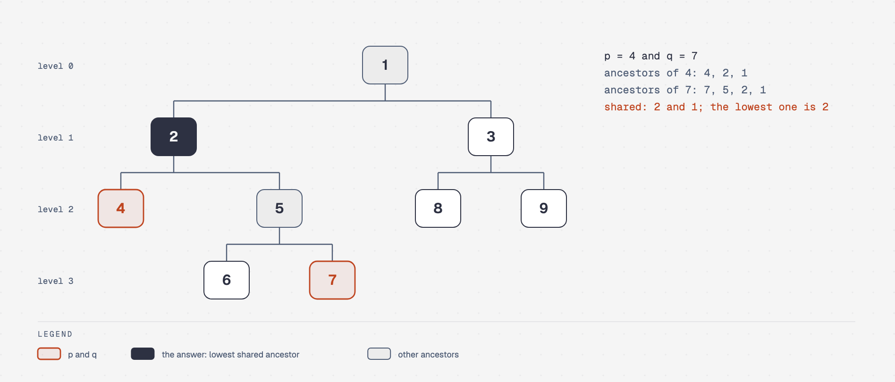
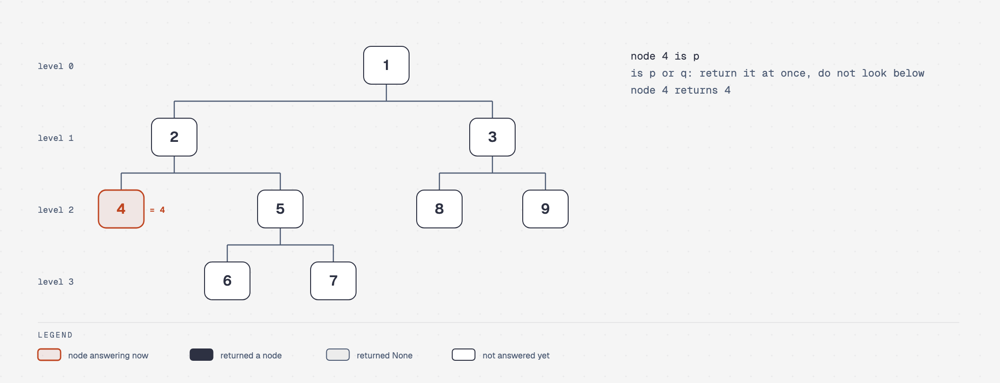
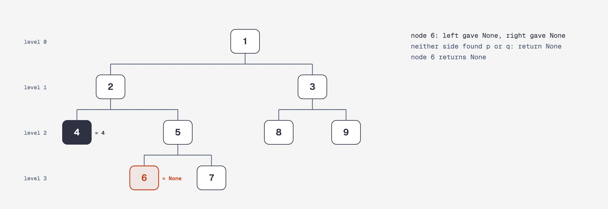
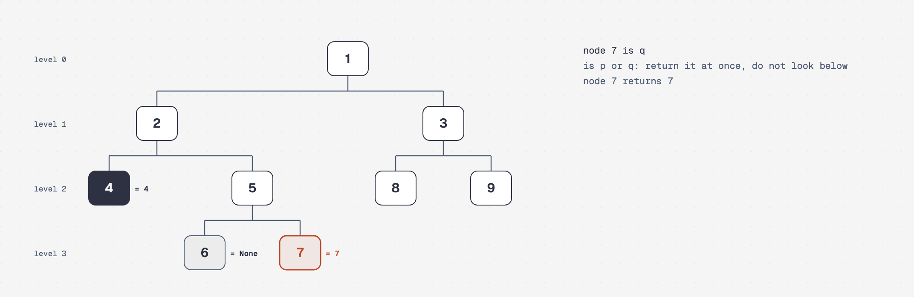
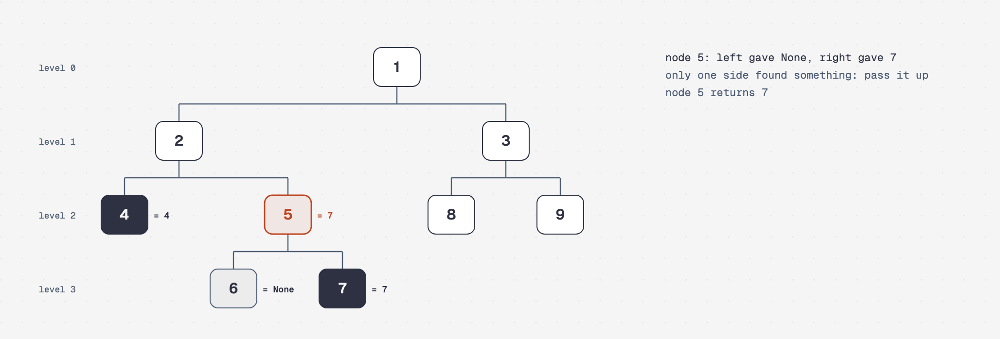
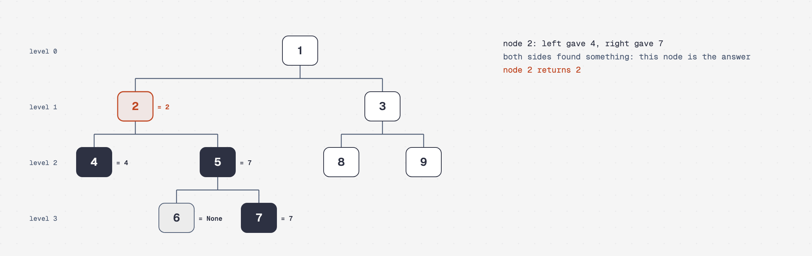
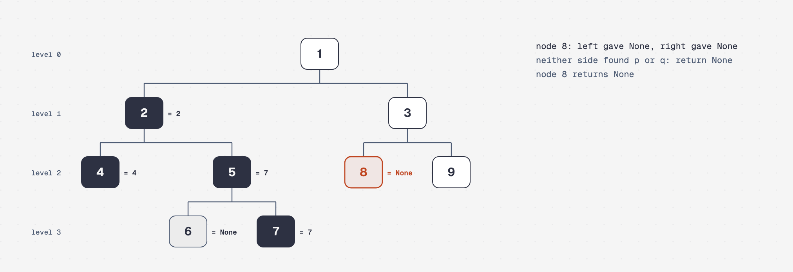
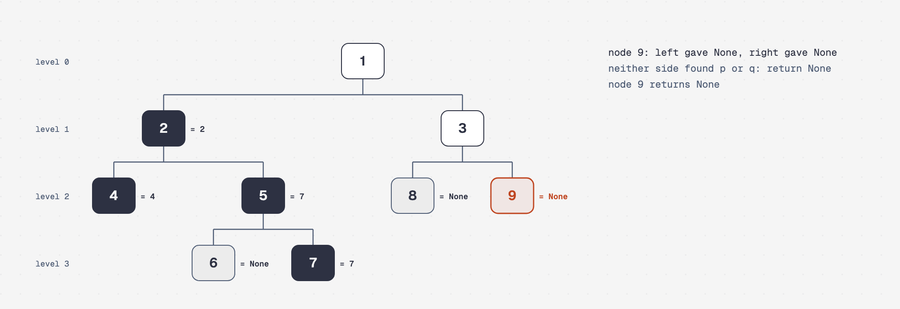
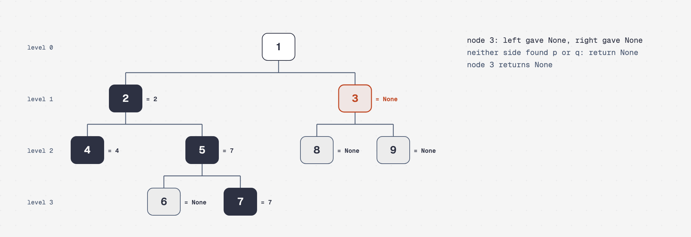
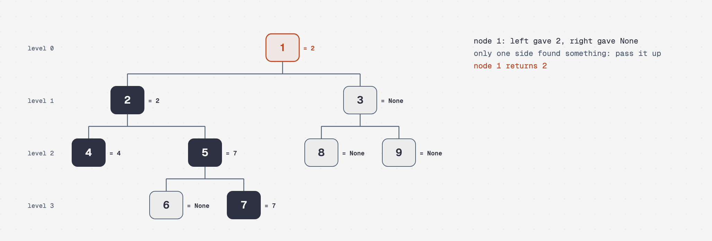

# 23. 236. Lowest Common Ancestor of a Binary Tree

| Difficulty | Pattern | Key idea | Source | Time | Space | Before / after |
|:---:|:---:|:---|:---:|:---:|:---:|:---:|
| **Medium** | Bottom-Up Search, Return What You Found | Each call returns `p`, `q`, the answer, or `None`; the first node where **both** sides return something is the lowest common ancestor | [236. Lowest Common Ancestor of a Binary Tree](https://leetcode.com/problems/lowest-common-ancestor-of-a-binary-tree/) | `O(n)` | `O(h)` | [257. Binary Tree Paths](22.%20257.%20Binary%20Tree%20Paths.md) / [662. Maximum Width](24.%20662.%20Maximum%20Width%20of%20Binary%20Tree.md) |

## 1. Problem Statement

Given a binary tree and two of its nodes `p` and `q`, return their **lowest common ancestor (LCA)**: the lowest (deepest) node that has both `p` and `q` below it. A node counts as being below **itself**, so if `p` is above `q`, the answer is `p`.

### Example

**The tree we take:** the 9-node tree from the lecture board: `1` with children `2` and `3`; `2` with children `4` and `5`; `5` with children `6` and `7`; `3` with children `8` and `9`. As a LeetCode list: `[1, 2, 3, 4, 5, 8, 9, None, None, 6, 7]`, with `p = 4` and `q = 7`.

```text
Input:  root = [1, 2, 3, 4, 5, 8, 9, None, None, 6, 7], p = 4, q = 7
Output: 2
```



It has the tricky parts of the problem:

- `p` and `q` are at **different depths** (level 2 and level 3), so you cannot just walk both up one step at a time.
- Nodes `2` and `1` are **both** common ancestors. The answer is the **lowest** one, `2`.
- A whole subtree (`3, 8, 9`) has neither node, and must give "nothing found".

The lecture also asks, on the same tree: `lca(5, 9) = 1` (one on each side of the root) and `lca(2, 6) = 2` (one node is above the other). We use this tree in every section below.

LeetCode examples:

```text
root = [3, 5, 1, 6, 2, 0, 8, None, None, 7, 4], p = 5, q = 1   gives 3
root = [3, 5, 1, 6, 2, 0, 8, None, None, 7, 4], p = 5, q = 4   gives 5   (5 is above 4)
root = [1, 2], p = 1, q = 2                                     gives 1
```

### Constraints, in plain words

| Limit | What it means in plain words | What it tells us |
|:---|:---|:---|
| Number of nodes is `2` to `10^5` | Up to 100,000 nodes | `O(n)` is fine; `O(n^2)` (about 10 billion steps) is not |
| `-10^9 <= Node.val <= 10^9`, all values unique | Values never repeat | A node can be named by its value; compare nodes with `is` or `==` |
| `p != q`, both exist in the tree | Two different nodes, always found | No need to handle "not found"; the first node equal to `p` or `q` can be returned at once |

**How fast is fast enough?**

- Every method here looks at each node at most a few times: `O(n)`, about 100,000 steps.
- The difference is memory and passes. Storing two paths or a parent map costs extra lists; the bottom-up search needs only the recursion.
- One warning: on a chain of 100,000 nodes, recursion goes 100,000 calls deep, over Python's default limit of 1,000. The parent-map method avoids recursion.

| Method | Passes over the tree | Extra memory | Our example: nodes visited | Note |
|:---|:---:|:---|:---:|:---|
| Two root-to-node paths | 2 searches, then compare | two path lists, up to `h` each | 3 to find 4, then 6 to find 7 | The lecture's first idea |
| Parent map, then climb | 1 BFS, then 2 climbs | a dict of all `n` parents, and a set | 9 in the BFS, then 3 + 3 climb steps | No recursion |
| Bottom-up search | 1 | only the recursion, `O(h)` | 9 | The lecture's answer |

## 2. Core Idea

**The lecture's picture:** draw the path from the root to `p` and the path from the root to `q`. They start together and split at some node. That split point is the LCA.

**The fast way** finds the split point in one bottom-up walk. Ask each node: "what did you find below you?"

1. An empty spot found nothing: return `None`.
2. If the node **is** `p` or `q`, return it at once. Anything below it does not matter: if the other node is below, this node is still the answer.
3. Otherwise ask the left and right children:
   - **Both** found something: `p` is on one side and `q` on the other, so **this node** is the split point. Return it.
   - **Only one** found something: pass that up unchanged (it is either `p`, `q`, or the answer already found lower down).
   - **Neither** found anything: return `None`.

The answer is whatever the root returns.

## 3. Edge Cases

| Case | Input | Expected | Why it matters | Code that handles it |
|:---|:---|:---:|:---|:---|
| One node above the other | our tree, `p = 2`, `q = 6` | `2` | A node counts as its own ancestor | Return at once when the node is `p` or `q` |
| On both sides of the root | our tree, `p = 5`, `q = 9` | `1` | The split is at the very top | Both sides return something at `1` |
| Root is one of them | `[1, 2]`, `p = 1`, `q = 2` | `1` | The root itself is the answer | The first check returns the root |
| Different depths | our tree, `p = 4`, `q = 7` | `2` | Paths have different lengths | No step-by-step climbing needed |
| A long chain | 100,000 nodes in a line | the higher of the two | Recursion 100,000 deep | Use the parent map, or raise the recursion limit |

## 4. Brute Force: Two Root-to-Node Paths

### Idea

Find the path from the root to `p` and the path from the root to `q` with the backtracking walk from note 22. Walk both lists from the start while they agree. The last equal node is the LCA.

### Run it on our example

**The tree we take:** the 9-node tree above, `p = 4`, `q = 7`. The two paths are `[1, 2, 4]` and `[1, 2, 5, 7]`.

| Index | Path to `p = 4` | Path to `q = 7` | Same node? | Last shared node so far | What it means |
|:---:|:---:|:---:|:---:|:---:|:---|
| 0 | 1 | 1 | Yes | 1 | Both paths start at the root, so the root is always shared |
| 1 | 2 | 2 | Yes | 2 | Both p and q are below 2 |
| 2 | 4 | 5 | No: the paths split | stop, answer 2 | p goes left of 2 and q goes right of 2 |
| 3 | (path ended) | 7 | not compared | (already stopped) | Nothing after the split can be shared |

The lists agree on `1` and `2` and then split, so the answer is `2`. The lecture notes the cost: `O(N)` time for the searches and `O(N)` space for the two lists.

### Code

```python
# Import types for hints
from typing import List, Optional


# Solution for 236, two root-to-node paths
class Solution:

    # Path of nodes from the root to target, or an empty list
    def path_to(self, root: TreeNode, target: TreeNode) -> List[TreeNode]:

        # The nodes from the root to the current node
        path = []

        # Is target in this subtree? Keeps the path if yes
        def find(node: Optional[TreeNode]) -> bool:

            # Empty spot: not here
            if node is None:

                # Not found
                return False

            # Write this node down
            path.append(node)

            # Found the target, or found it below
            if node is target or find(node.left) or find(node.right):

                # Keep the path
                return True

            # Not below this node: erase it
            path.pop()

            # Not found here
            return False

        # Search from the root
        find(root)

        # The finished path
        return path

    # Main method
    def lowestCommonAncestor(self, root: TreeNode, p: TreeNode, q: TreeNode) -> TreeNode:

        # Path from the root to p
        a = self.path_to(root, p)

        # Path from the root to q
        b = self.path_to(root, q)

        # The root is always shared
        ans = root

        # Walk both paths while they agree
        for x, y in zip(a, b):

            # The paths split here
            if x is not y:

                # Stop: ans is the last shared node
                break

            # Still shared: remember it
            ans = x

        # The last shared node
        return ans
```

### Complexity

| Measure | Complexity | Why | At the limit (`n = 10^5`) | Compared with the others |
|:---|:---:|:---|:---:|:---|
| **Time** | `O(n)` | Two full searches, then one compare | about 200,000 visits | Two passes instead of one |
| **Space** | `O(h)` | Two path lists and the recursion | up to 100,000 each on a chain | Extra lists the optimal method does not need |

## 5. Approach 2: Parent Map, Then Climb

### Idea

Walk the tree once with BFS and store each node's parent in a dict. Then climb from `p` to the root and put every node in a set. Finally climb from `q`: the first node that is already in the set is the LCA. No recursion, so a long chain is safe.

### Code

```python
# Import deque for the BFS queue
from collections import deque

# Import types for hints
from typing import List, Optional


# Solution for 236, parent map then climb
class Solution:

    # Main method
    def lowestCommonAncestor(self, root: TreeNode, p: TreeNode, q: TreeNode) -> TreeNode:

        # Each node's parent; the root has none
        parent = {root: None}

        # BFS queue
        queue = deque([root])

        # Fill the parent map until both p and q are in it
        while p not in parent or q not in parent:

            # Next node
            node = queue.popleft()

            # Record the left child's parent
            if node.left:

                # Its parent is this node
                parent[node.left] = node

                # Visit it later
                queue.append(node.left)

            # Record the right child's parent
            if node.right:

                # Its parent is this node
                parent[node.right] = node

                # Visit it later
                queue.append(node.right)

        # All ancestors of p, including p itself
        ancestors = set()

        # Climb from p to the root
        while p:

            # Mark this ancestor
            ancestors.add(p)

            # One step up
            p = parent[p]

        # Climb from q until we meet a marked node
        while q not in ancestors:

            # One step up
            q = parent[q]

        # The first shared ancestor
        return q
```

### Complexity

| Measure | Complexity | Why | At the limit (`n = 10^5`) | Compared with the others |
|:---|:---:|:---|:---:|:---|
| **Time** | `O(n)` | One BFS, then two climbs of at most `h` steps | about 100,000 visits plus the climbs | Same order |
| **Space** | `O(n)` | The parent dict holds every node | about 100,000 entries | The most memory, but no recursion limit |

## 6. Optimal: One Bottom-Up Search

### Idea

```text
lca(node):
    if node is empty:          return None
    if node is p or node is q: return node
    left  = lca(node.left)
    right = lca(node.right)
    if left and right: return node      # p and q split here
    return left or right                # pass up what was found, or None
```

### Run it on our example, step by step

**The tree we take:** the 9-node tree above, `p = 4`, `q = 7`.

**How to read the pictures:** orange is the node answering now, dark nodes returned a node, grey nodes returned `None`, white nodes have not answered yet. The tag `= k` is what a node returned.

**Step 1: node 4 returns 4**

- Node `4` is `p`. Return `4` at once; its children are never asked.
- Anything below it does not matter.
- Node `4` returns `4`.



**Step 2: node 6 returns None**

- Node `6`: the left side returned `None`, the right side returned `None`.
- Neither side found p or q: return None.
- Node `6` returns `None`.



**Step 3: node 7 returns 7**

- Node `7` is `q`. Return `7` at once; its children are never asked.
- Anything below it does not matter.
- Node `7` returns `7`.



**Step 4: node 5 returns 7**

- Node `5`: the left side returned `None`, the right side returned `7`.
- Only one side found something: pass it up.
- Node `5` returns `7`.



**Step 5: node 2 returns 2**

- Node `2`: the left side returned `4`, the right side returned `7`.
- Both sides found something: this node is the answer.
- Node `2` returns `2`.



**Step 6: node 8 returns None**

- Node `8`: the left side returned `None`, the right side returned `None`.
- Neither side found p or q: return None.
- Node `8` returns `None`.



**Step 7: node 9 returns None**

- Node `9`: the left side returned `None`, the right side returned `None`.
- Neither side found p or q: return None.
- Node `9` returns `None`.



**Step 8: node 3 returns None**

- Node `3`: the left side returned `None`, the right side returned `None`.
- Neither side found p or q: return None.
- Node `3` returns `None`.



**Step 9: node 1 returns 2**

- Node `1`: the left side returned `2`, the right side returned `None`.
- Only one side found something: pass it up.
- Node `1` returns `2`. This is the answer.




**All steps at a glance**

| Step | Node | Left side returned | Right side returned | Node returns | Why |
|:---:|:---:|:---:|:---:|:---:|:---|
| 1 | 4 | not asked | not asked | `4` | Is p or q: return it at once, do not look below |
| 2 | 6 | `None` | `None` | `None` | Neither side found p or q: return None |
| 3 | 7 | not asked | not asked | `7` | Is p or q: return it at once, do not look below |
| 4 | 5 | `None` | `7` | `7` | Only one side found something: pass it up |
| 5 | 2 | `4` | `7` | `2` | Both sides found something: this node is the answer |
| 6 | 8 | `None` | `None` | `None` | Neither side found p or q: return None |
| 7 | 9 | `None` | `None` | `None` | Neither side found p or q: return None |
| 8 | 3 | `None` | `None` | `None` | Neither side found p or q: return None |
| 9 | 1 | `2` | `None` | `2` | Only one side found something: pass it up |

The split was found at node `2` (step 5). The root only passed it up, because its right side found nothing.

### Code

```python
# Solution for 236, one bottom-up search
class Solution:

    # Main method
    def lowestCommonAncestor(self, root: 'TreeNode', p: 'TreeNode', q: 'TreeNode') -> 'TreeNode':

        # Empty spot: nothing found here
        if root is None:

            # Nothing
            return None

        # This node is p or q: return it at once
        if root is p or root is q:

            # Found one of them
            return root

        # What the left side found
        left = self.lowestCommonAncestor(root.left, p, q)

        # What the right side found
        right = self.lowestCommonAncestor(root.right, p, q)

        # One on each side: p and q split here
        if left and right:

            # This node is the answer
            return root

        # Pass up whatever was found, or None
        return left if left else right
```

### Complexity

| Measure | Complexity | Why | At the limit (`n = 10^5`) | Compared with the others |
|:---|:---:|:---|:---:|:---|
| **Time** | `O(n)` | Each node is visited at most once | at most 100,000 visits | One pass, the fewest visits |
| **Space** | `O(h)` | Recursion depth | about 17 on a balanced tree, up to 100,000 on a chain | Least memory; watch Python's recursion limit on chains |

## 7. Common Mistakes

| Mistake | What goes wrong | Fix |
|:---|:---|:---|
| Searching below `p` after finding it | Extra work, and harder logic for "one above the other" | Return as soon as the node is `p` or `q` |
| Returning the highest common ancestor | `1` instead of `2`: every common ancestor contains both | The **first** node where both sides answer, from the bottom |
| Comparing values with a different tree's nodes | Fails if values repeat in other problems | Here values are unique; compare nodes with `is` to be safe |
| Brute force: stopping at the first difference but returning the wrong index | Off by one: returns the node after the split | Return the **last equal** node |
| Using this code on a BST | Correct, but slower than needed | In a BST use the values: go left if both are smaller, right if both are bigger (LeetCode 235, later in this chapter) |

## 8. Interview Follow-ups

### Q1. Why is it safe to stop at `p` without searching below it?

**Answer:**
- If `q` is below `p`, then `p` is the answer, and returning `p` already gives it.
- If `q` is elsewhere, some higher node will see `p` on one side and `q` on the other.

### Q2. What if `p` or `q` might not be in the tree (LeetCode 1644)?

**Answer:**
- The early return can then give a wrong answer.
- Search the whole tree, count how many of `p` and `q` were really seen, and return the answer only if the count is 2.

### Q3. What if nodes have parent pointers (LeetCode 1650)?

**Answer:**
- It becomes "where do two linked lists meet?".
- Climb from `p` and `q` together; when one reaches the top, restart it at the other's start. They meet at the LCA.

### Q4. How is the BST version different (LeetCode 235)?

**Answer:**
- The values tell you where to go: if both are smaller than the node, go left; both bigger, go right; otherwise this node is the split.
- That is `O(h)` time with no full search.

### Q5. How would you answer many LCA queries on the same tree?

**Answer:**
- Precompute each node's depth and its ancestors at jumps of 1, 2, 4, 8, ... (binary lifting).
- Each query then takes `O(log n)`.

## 9. Interview Explanation

> I do one bottom-up search. Each call returns what it found below: None if nothing, the node itself if it is p or q, or the answer if it was already found. At a node, I ask both children. If both return something, p is on one side and q on the other, so this node is the lowest common ancestor. If only one returns something, I pass it up unchanged. If the node itself is p or q, I return it at once, which also covers the case where one node is above the other. Each node is visited once, so it is O(n) time and O(h) space. If the tree can be a very long chain, I would instead build a parent map with BFS and climb from both nodes.
