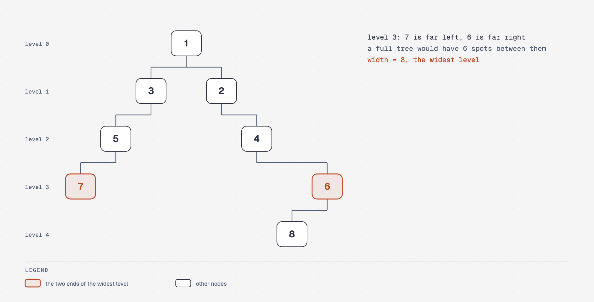
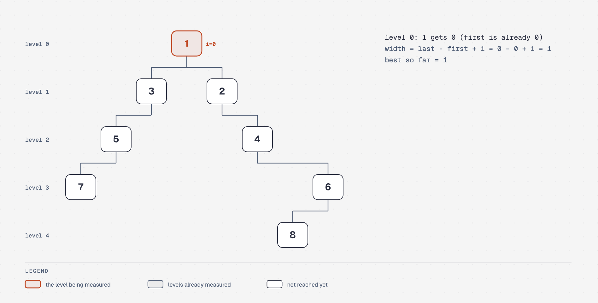
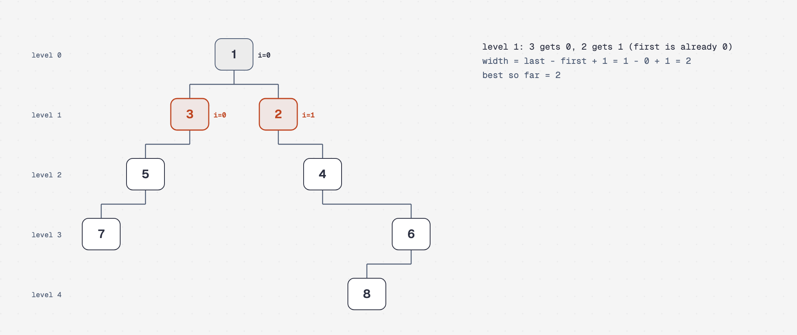
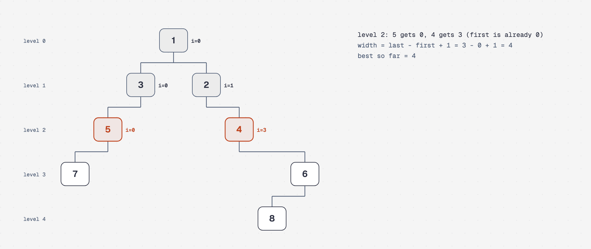
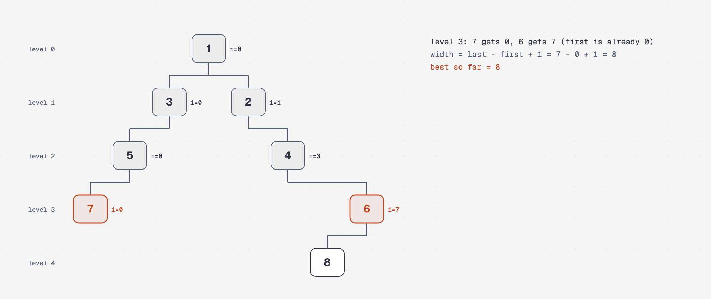
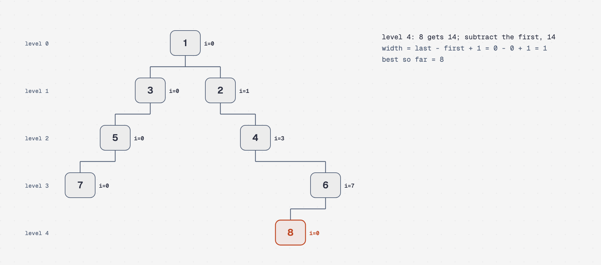

# 24. 662. Maximum Width of Binary Tree

| Difficulty | Pattern | Key idea | Source | Time | Space | Before / after |
|:---:|:---:|:---|:---:|:---:|:---:|:---:|
| **Medium** | Level Order With Position Numbers | Number every spot as in a complete tree (children of `i` are `2i` and `2i + 1`); a level's width is `last - first + 1`; subtract the level's first number so the numbers stay small | [662. Maximum Width of Binary Tree](https://leetcode.com/problems/maximum-width-of-binary-tree/) | `O(n)` | `O(w)` | [236. LCA](23.%20236.%20Lowest%20Common%20Ancestor%20of%20a%20Binary%20Tree.md) / [Children Sum Property](25.%20Children%20Sum%20Property.md) |

## 1. Problem Statement

Given the `root` of a binary tree, return its **maximum width**: the largest width of any level.

The **width** of a level is the number of spots between its leftmost and rightmost nodes, **counting the empty spots in between** as if the tree were complete down to that level. Empty spots outside the two end nodes do not count. The answer fits in a 32-bit integer.

### Example

**The tree we take:** the third tree from the lecture board, with one more node: `1` with children `3` and `2`; `3` has only a left child `5`; `5` has only a left child `7`; `2` has only a right child `4`; `4` has only a right child `6`; and `6` has a left child `8`. As a LeetCode list: `[1, 3, 2, 5, None, None, 4, 7, None, None, 6, None, None, 8]`.

```text
Input:  root = [1, 3, 2, 5, None, None, 4, 7, None, None, 6, None, None, 8]
Output: 8      (level 3: 7, then 6 empty spots, then 6)
```



It has the tricky parts of the problem:

- Level 3 has only **2 nodes**, but its width is **8**: the empty spots between the ends count.
- Level 4 has one node, `8`, at position 14 of a complete tree. Its width is 1: spots **outside** the ends do not count.
- Every level goes one step further out, so the position numbers **double** each level. On deep trees they become huge, which is why the lecture subtracts the first number of each level.

We use this tree in every section below.

LeetCode examples:

```text
root = [1, 3, 2, 5, 3, None, 9]                     gives 4   (level 2: 5, 3, empty, 9)
root = [1, 3, 2, 5, None, None, 9, 6, None, 7]      gives 7   (level 3: 6, five empty spots, 7)
root = [1, 3, 2, 5]                                 gives 2   (level 1: 3, 2)
```

### Constraints, in plain words

| Limit | What it means in plain words | What it tells us |
|:---|:---|:---|
| Number of nodes is `1` to `3000` | At most 3,000 nodes | `O(n)` is instant; but the tree can be up to 3,000 levels deep |
| `-100 <= Node.val <= 100` | Values do not matter | Only the shape and the positions matter |
| The answer fits in 32 bits | The **width** is small, but position numbers can still be huge | Positions double each level: on a deep zig-zag tree they reach about `2^3000`. Subtract each level's first number to keep them small |

**How fast is fast enough?**

- **Brute force** fills in the empty spots as real `None` items. A tree with `h` levels then stores about `2^(h+1)` spots (one extra all-empty level shows where it ends), even if it has only a few nodes.
- **Position numbers** never store empty spots: each real node carries its number, so the work is just `n` nodes.

| Levels `h` (a zig-zag tree with about `h` nodes) | Spots the brute force stores | Nodes the position method stores | Brute force time (at 100 million steps per second) | Position method time | Verdict |
|:---:|:---:|:---:|:---:|:---:|:---|
| 5 (our tree) | 63 | 8 | instant | instant | Both fine on tiny trees |
| 20 | about 2 million | 20 | 0.02 seconds | instant | Brute force is already wasteful |
| 30 | about 2 billion | 30 | about 20 seconds | instant | Brute force is too slow |
| 40 | about 2 trillion | 40 | hours | instant | Brute force cannot finish |
| 3,000 (the limit) | about `2^3000` | 3,000 | never | instant | Only the position method works |

## 2. Core Idea

**Number the spots like a complete tree.** The lecture uses the heap numbering:

- 0-based: the root is `0`, the children of `i` are `2i + 1` and `2i + 2`.
- 1-based: the root is `1`, the children of `i` are `2i` and `2i + 1`.

Either works. Then the width of a level is simply:

```text
width = (number of the last node) - (number of the first node) + 1
```

The empty spots are counted **without storing them**, because the numbers already skip over them.

**Keep the numbers small.** Every level doubles the numbers. The lecture's fix: at the start of each level, subtract the first node's number from every node on that level, so the first node becomes `0`. The differences inside the level stay the same, so the width does not change, and the numbers stay at most about `2 x width`.

With the subtracted number `i` starting at 0, the children are `2i` and `2i + 1` (the lecture's code uses this form).

## 3. Edge Cases

| Case | Input | Expected | Why it matters | Code that handles it |
|:---|:---|:---:|:---|:---|
| One node | `[1]` | `1` | A single level with one node | `0 - 0 + 1 = 1` |
| Empty spots between the ends | our tree | `8` | Only 2 nodes on level 3, width 8 | `last - first + 1` |
| Empty spots outside the ends | our tree, level 4 | width `1` | Node 8 is at position 14, but alone | Subtract the first number |
| A deep zig-zag | 3,000 levels | small | Raw positions reach about `2^3000` | Subtract the first number each level |
| A straight chain | `[1, 2, None, 3]` | `1` | One node per level | Every level has width 1 |

## 4. Brute Force: Level Order With Real Empty Spots

### Idea

Do level order (note 102), but put a `None` in the queue for every missing child, and for every child of a `None`. Each level then has all its spots. Trim the `None` items at both ends and count what is left. Stop when a level has only `None`.

### Run it on our example

**The tree we take:** the 8-node tree above.

| Level | Spots stored (with `None`) | Real nodes | Leftmost real spot | Rightmost real spot | Width | What the empty spots cost |
|:---:|:---:|:---:|:---:|:---:|:---:|:---|
| 0 | 1 | 1 (`1`) | 0 | 0 | 1 | Nothing yet |
| 1 | 2 | 2 (`3`, `2`) | 0 | 1 | 2 | Nothing yet |
| 2 | 4 | 2 (`5`, `4`) | 0 | 3 | 4 | 2 empty spots stored in the middle |
| 3 | 8 | 2 (`7`, `6`) | 0 | 7 | **8** | 6 empty spots stored |
| 4 | 16 | 1 (`8`) | 14 | 14 | 1 | 15 empty spots stored for one node |
| 5 | 32 | 0 | none | none | stop | 32 empty spots just to learn that the tree ended |

The tree has 8 nodes, but the queue had to hold 63 spots. On deep trees that number doubles every level.

### Code

```python
# Import deque for the queue
from collections import deque

# Import Optional for type hints
from typing import Optional


# Solution for 662, level order with real empty spots
class Solution:

    # Main method
    def widthOfBinaryTree(self, root: Optional[TreeNode]) -> int:

        # The widest level so far
        best = 0

        # One level of spots, empty spots as None
        level = [root]

        # Go down while the level has at least one node
        while any(level):

            # Index of the leftmost real node
            lo = 0

            # Skip empty spots on the left
            while level[lo] is None:

                # Move right
                lo += 1

            # Index of the rightmost real node
            hi = len(level) - 1

            # Skip empty spots on the right
            while level[hi] is None:

                # Move left
                hi -= 1

            # Spots between the two ends, both included
            best = max(best, hi - lo + 1)

            # The next level, with two spots under every spot
            nxt = []

            # Visit every spot, empty or not
            for node in level:

                # Children of an empty spot are empty too
                nxt.append(node.left if node else None)

                # Same for the right child
                nxt.append(node.right if node else None)

            # Move down one level
            level = nxt

        # The widest level
        return best
```

### Complexity

| Measure | Complexity | Why | At the limit (3,000 levels) | Compared with the optimal |
|:---|:---:|:---|:---:|:---|
| **Time** | `O(2^h)` | Every spot of a complete tree down to the last level is stored | about `2^3000` spots: impossible | This is the baseline |
| **Space** | `O(2^h)` | The last level alone has `2^(h-1)` spots | impossible | This is the baseline |

## 5. Approach 2: DFS That Remembers the First Number of Each Level

### Idea

Walk the tree with DFS, carrying each node's number and level. The **first** node DFS meets on a level is its leftmost node (DFS goes left first), so store its number. At every node, the width up to that node is `number - first[level] + 1`. Python's whole numbers never overflow, so this works without subtracting, but the numbers can grow to thousands of digits on a deep tree.

### Code

```python
# Import Optional for type hints
from typing import Optional


# Solution for 662, DFS with the first number of each level
class Solution:

    # Main method
    def widthOfBinaryTree(self, root: Optional[TreeNode]) -> int:

        # first[d] is the number of the leftmost node on level d
        first = []

        # The widest level so far
        self.best = 0

        # Visit a node with its number i on level d
        def dfs(node: Optional[TreeNode], d: int, i: int) -> None:

            # Empty spot: nothing to do
            if node is None:

                # Stop here
                return

            # First visit to this level: this node is its leftmost
            if d == len(first):

                # Remember its number
                first.append(i)

            # Width from the leftmost node to this node
            self.best = max(self.best, i - first[d] + 1)

            # Left child gets 2i
            dfs(node.left, d + 1, 2 * i)

            # Right child gets 2i + 1
            dfs(node.right, d + 1, 2 * i + 1)

        # Start at the root, level 0, number 0
        dfs(root, 0, 0)

        # The widest level
        return self.best
```

### Complexity

| Measure | Complexity | Why | At the limit (3,000 nodes) | Compared with the optimal |
|:---|:---:|:---|:---:|:---|
| **Time** | `O(n)` node visits | Each node is visited once, but each number can have up to `h` bits | 3,000 visits on numbers up to 3,000 bits | Slower arithmetic on deep trees |
| **Space** | `O(h)` | Recursion plus one number per level | up to 3,000 levels | Watch Python's recursion limit |

## 6. Optimal: Level Order With Numbers Reset Each Level

### Idea

```text
queue = [(root, 0)]
while queue:
    first = number of the first item in the queue
    for each (node, i) on this level:
        i = i - first                      # the level now starts at 0
        queue left child  with 2i
        queue right child with 2i + 1
        if it is the last node: best = max(best, i + 1)
```

### Run it on our example, step by step

**The tree we take:** the 8-node tree above.

**How to read the pictures:** orange is the level being measured, grey levels are done, white levels are not reached yet. The tag `i=k` is a node's number after subtracting its level's first number.

**Step 1: level 0, width 1**

- The root starts with number 0.
- The first number is already 0, so nothing changes.
- Width = last - first + 1 = `0 - 0 + 1 = 1`. Best so far: `1`.



**Step 2: level 1, width 2**

- The level holds node 3 gets 0, node 2 gets 1.
- The first number is already 0, so nothing changes.
- Width = last - first + 1 = `1 - 0 + 1 = 2`. Best so far: `2`.



**Step 3: level 2, width 4**

- The level holds node 5 gets 0, node 4 gets 3.
- The first number is already 0, so nothing changes.
- Width = last - first + 1 = `3 - 0 + 1 = 4`. Best so far: `4`.



**Step 4: level 3, width 8**

- The level holds node 7 gets 0, node 6 gets 7.
- The first number is already 0, so nothing changes.
- Width = last - first + 1 = `7 - 0 + 1 = 8`. Best so far: `8`.



**Step 5: level 4, width 1**

- The level holds node 8 gets 14.
- Subtract the first number, `14`: 8 is 0.
- Width = last - first + 1 = `0 - 0 + 1 = 1`. Best so far: `8`.




**All steps at a glance**

| Step | Level | Numbers from the parents | Subtract | Numbers after reset | Width | Best so far | What this level shows |
|:---:|:---:|:---|:---:|:---|:---:|:---:|:---|
| 1 | 0 | 1: 0 | 0 | 1: 0 | 1 | 1 | The root alone |
| 2 | 1 | 3: 0, 2: 1 | 0 | 3: 0, 2: 1 | 2 | 2 | Two full spots |
| 3 | 2 | 5: 0, 4: 3 | 0 | 5: 0, 4: 3 | 4 | 4 | Two empty spots between 5 and 4 count |
| 4 | 3 | 7: 0, 6: 7 | 0 | 7: 0, 6: 7 | 8 | 8 | Six empty spots between 7 and 6 count |
| 5 | 4 | 8: 14 | 14 | 8: 0 | 1 | 8 | Spots left of 8 do not count |

The widest level is level 3, with width 8. Thanks to the reset, every level starts again at 0. Without it, the numbers would double on every level, and on a 3,000-level tree they would have about 900 digits.

### Code

```python
# Import deque for the queue
from collections import deque

# Import Optional for type hints
from typing import Optional


# Solution for 662, level order with numbers reset each level
class Solution:

    # Main method
    def widthOfBinaryTree(self, root: Optional[TreeNode]) -> int:

        # Each item: a node and its number on its level
        queue = deque([(root, 0)])

        # The widest level so far
        best = 0

        # One loop per level
        while queue:

            # Number of nodes on this level
            size = len(queue)

            # The first number on this level
            first = queue[0][1]

            # Visit every node on this level
            for k in range(size):

                # Next node and its number
                node, i = queue.popleft()

                # Reset so the level starts at 0
                i -= first

                # Left child gets 2i
                if node.left:

                    # Queue it for the next level
                    queue.append((node.left, 2 * i))

                # Right child gets 2i + 1
                if node.right:

                    # Queue it for the next level
                    queue.append((node.right, 2 * i + 1))

                # The last node of the level gives the width
                if k == size - 1:

                    # Width is last - first + 1, and first is now 0
                    best = max(best, i + 1)

        # The widest level
        return best
```

### Complexity

| Measure | Complexity | Why | At the limit (3,000 nodes) | Compared with brute force |
|:---|:---:|:---|:---:|:---|
| **Time** | `O(n)` | Each node enters and leaves the queue once | 3,000 visits | Only real nodes, never empty spots |
| **Space** | `O(w)` | The queue holds about one level of real nodes | at most about 1,500 nodes | Numbers stay small after each reset |

## 7. Common Mistakes

| Mistake | What goes wrong | Fix |
|:---|:---|:---|
| Counting only the real nodes of a level | Our level 3 gives 2 instead of 8 | Use `last - first + 1` with position numbers |
| Not subtracting the first number | Numbers double each level; in other languages they overflow, in Python they get slow | Subtract the level's first number at the start of each level |
| Mixing 0-based and 1-based child rules | Children land on wrong numbers and widths are off | Pick one rule and use it everywhere |
| Measuring the width with the level's smallest and largest value | Values have nothing to do with positions | Use the numbers, not `node.val` |
| Brute force with real `None` spots | Memory explodes on deep trees | Store numbers, not empty spots |

## 8. Interview Follow-ups

### Q1. Why does subtracting the first number not change the width?

**Answer:**
- The width is a difference: `last - first + 1`.
- Subtracting the same amount from every number on a level keeps every difference the same.

### Q2. Why do children of a reset number `i` get `2i` and `2i + 1`?

**Answer:**
- After the reset, the level's first node is `0`, and its children `0` and `1` are the first two spots of the next level.
- Any rule that doubles and keeps the left child before the right child works; the next level is reset again anyway.

### Q3. What does a level's width look like in a complete tree?

**Answer:**
- Level `d` of a perfect tree has `2^d` spots, all full, so its width is `2^d`.
- The deepest level of a perfect tree is the widest.

### Q4. How would you return the widest level's number, not its width?

**Answer:**
- Keep the level number next to `best`, and update both when a wider level is found.

### Q5. How is this related to vertical order (987)?

**Answer:**
- Both give each node a position.
- Vertical order uses columns `col - 1` and `col + 1`, where nodes can share a column; here every spot gets its own number `2i` and `2i + 1`.

## 9. Interview Explanation

> I number every spot as in a complete binary tree, so the children of number i are 2i and 2i plus 1. Then the width of a level is the last node's number minus the first node's number plus one, which counts the empty spots in between without storing them. I do a level order traversal with a queue of node and number pairs. At the start of each level I subtract the first number from every number on that level, so the numbers stay small instead of doubling every level. Each node is visited once, so it is O(n) time and O(w) space for the queue.
