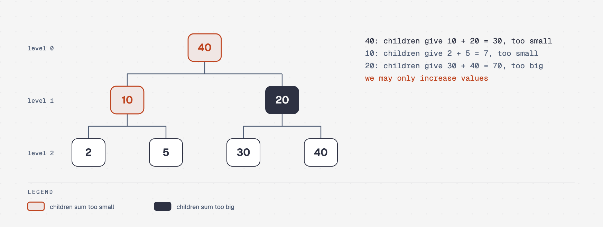
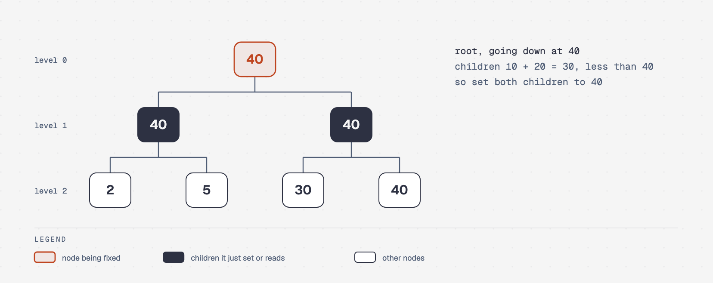
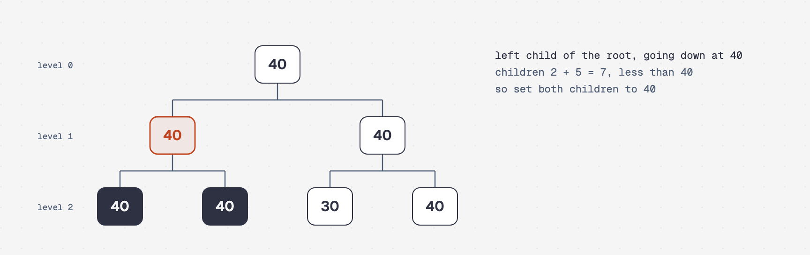
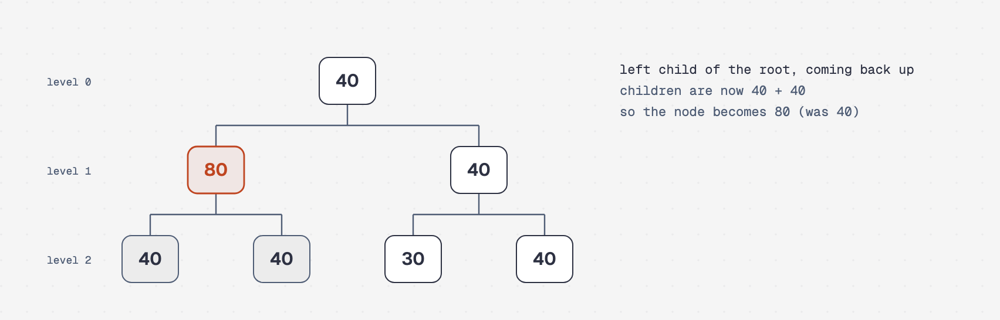
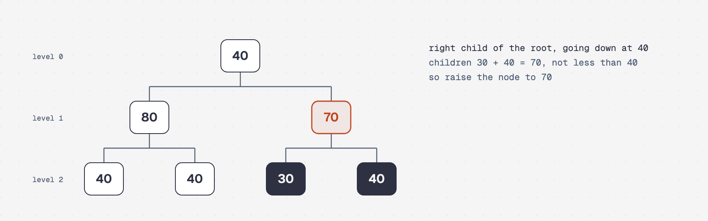
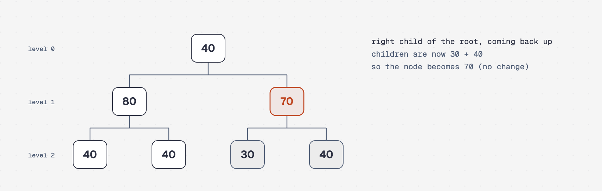
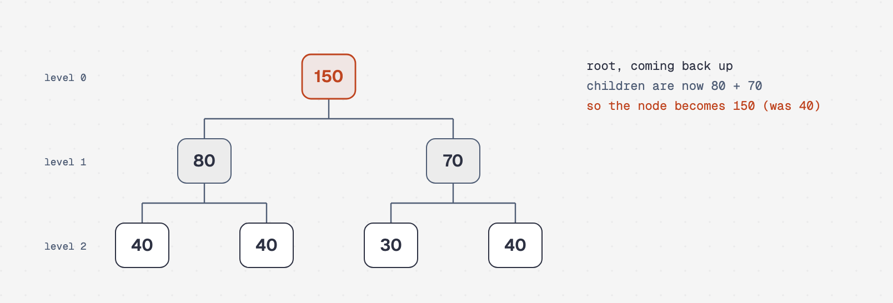

# 25. Children Sum Property

| Difficulty | Pattern | Key idea | Source | Time | Space | Before / after |
|:---:|:---:|:---|:---:|:---:|:---:|:---:|
| **Medium** | Fix Going Down, Then Fix Coming Back Up | Going down, lift the children up to the parent when they are too small (so nothing ever has to shrink); coming back up, set each node to the sum of its children | Coding Ninjas / GeeksforGeeks "Children Sum Property" | `O(n)` | `O(h)` | [662. Maximum Width](24.%20662.%20Maximum%20Width%20of%20Binary%20Tree.md) / [863. All Nodes Distance K](26.%20863.%20All%20Nodes%20Distance%20K%20in%20Binary%20Tree.md) |

## 1. Problem Statement

A binary tree has the **children sum property** when, for every node that has children, the node's value equals the sum of its children's values (a missing child counts as 0).

Change the values of the given tree so that it has this property. The rules:

1. You may only **increase** a value, by any amount, any number of times. You may never decrease one.
2. You may not change the shape of the tree.
3. Any valid answer is accepted.

### Example

**The tree we take:** the tree from the lecture board: `40` with children `10` and `20`; `10` with children `2` and `5`; `20` with children `30` and `40`. In level order: `[40, 10, 20, 2, 5, 30, 40]`.

```text
Input:  root = [40, 10, 20, 2, 5, 30, 40]
Output: one valid answer is [150, 80, 70, 40, 40, 30, 40]
```



It has both hard cases of the problem:

- At `40` and at `10` the children add up to **too little** (30 and 7). We cannot lower the parent, so the children must grow.
- At `20` the children add up to **too much** (70). Here the parent can simply grow to 70.
- When a child grows, its own parent may then be too small, so the fix has to travel up as well as down.

The lecture's other board, `[50, 7, 2, 3, 5, 1, 30]`, becomes `[200, 100, 100, 50, 50, 50, 50]` with the same method. We use the first tree in every section below.

Platform examples:

```text
root = [2, 35, 10, 2, 3, 5, 2]   one valid answer: [45, 35, 10, 30, 5, 8, 2]
root = [10, 5, 5]                already valid, nothing to change
```

### Constraints, in plain words

| Limit | What it means in plain words | What it tells us |
|:---|:---|:---|
| `0 <= N <= 10^2` nodes | The tree can be empty; at most 100 nodes | Return at once for an empty tree; any `O(n)` or `O(n x h)` method is fine |
| `1 <= value <= 10^6` | Positive values | Sums grow as they go up; Python numbers never overflow |
| Values may only increase | Never lower a node | When the children are too small, lift the children, not the parent down |

**How fast is fast enough?**

- The lecture first imagines adding `+1` again and again wherever the rule fails. It notes this is about `O(n^2)`: a fix at one node can break its child, then its grandchild, and so on.
- The two-way walk fixes every node once on the way down and once on the way back up: `O(n)`.

| Method | Fixes in our tree | Passes over the tree | Worst case | Note |
|:---|:---:|:---:|:---:|:---|
| Repeat passes until nothing changes | 3 fixes, then a pass to confirm | 2 here, up to `h + 1` | `O(n x h)` | Each pass pushes a missing amount one level further down |
| Fix going down, then coming back up | 6 node updates | 1 | `O(n)` | The lecture's answer |

## 2. Core Idea

The hard part is that values may only go **up**. So, on the way **down**, make sure no child will ever have to shrink:

1. **Going down, at a node:** add up its children.
   - If the children's sum is **less** than the node, set **both** children to the node's value. Now the children are big enough; anything they need later can only make them bigger.
   - Otherwise, raise the node to the children's sum.
2. Fix the left subtree and the right subtree the same way.
3. **Coming back up:** the children may have grown below, so set the node to `left + right`.

Why no value ever drops:

- Going down, a child is lifted only when the children's sum is smaller than the parent, so each child was smaller than the parent too.
- Coming back up, each child is at least what it was set to going down, so `left + right` is at least the node's value from going down.
- Leaves never change their value after going down.

## 3. Edge Cases

| Case | Input | Expected | Why it matters | Code that handles it |
|:---|:---|:---|:---|:---|
| Empty tree | `[]` | nothing to do | No nodes | `if root is None: return` |
| One node | `[5]` | `[5]` | A leaf has no children to match | Leaves are never changed coming back up |
| Already valid | `[10, 5, 5]` | `[10, 5, 5]` | Nothing should break | Sums already match; every update writes the same value |
| Children too small | our tree at 40 and 10 | children lifted | The parent cannot shrink | Set both children to the parent's value |
| One child missing | `[10, 3]` | `[10, 10]` | The missing child counts as 0 | Only existing children are lifted and added |

## 4. Brute Force: Repeat Passes Until Nothing Changes

### Idea

Walk the tree in postorder. At each node with children:

- If the children add up to **more**, raise the node to their sum.
- If they add up to **less**, add the missing amount to one child (the left one if it exists).

Lifting a child can break that child's own rule, which the next pass fixes one level lower. Repeat until a full pass changes nothing.

### Run it on our example

**The tree we take:** the 7-node tree above.

| Pass | Node (postorder) | Children sum | Node value | Fix | Tree after the pass |
|:---:|:---|:---:|:---:|:---|:---|
| 1 | 10 | 2 + 5 = 7 | 10 | Too small: left child 2 grows by 3 to 5 | |
| 1 | 20 | 30 + 40 = 70 | 20 | Too big: 20 grows to 70 | |
| 1 | 40 (root) | 10 + 70 = 80 | 40 | Too big: the root grows to 80 | `[80, 10, 70, 5, 5, 30, 40]` |
| 2 | every node | all match | all match | Nothing changes, so stop | `[80, 10, 70, 5, 5, 30, 40]` |

The brute force found a different valid answer, `[80, 10, 70, 5, 5, 30, 40]`. That is fine: any valid tree is accepted.

Here two passes were enough. On a long chain, a missing amount at the top moves down one level per pass, so it can take `h` passes of `n` nodes each.

### Code

```python
# Import Optional for type hints
from typing import Optional


# Solution for Children Sum Property, repeat passes until nothing changes
class Solution:

    # One postorder pass; returns True if anything changed
    def one_pass(self, node: Optional[TreeNode]) -> bool:

        # Empty spot: nothing to fix
        if node is None:

            # No change
            return False

        # Fix the left subtree first
        changed = self.one_pass(node.left)

        # Then the right subtree
        changed = self.one_pass(node.right) or changed

        # A leaf has no rule to keep
        if node.left is None and node.right is None:

            # Report what the children did
            return changed

        # Sum of the children, a missing child counts as 0
        s = (node.left.val if node.left else 0) + (node.right.val if node.right else 0)

        # Children too big: raise the node
        if s > node.val:

            # The node grows to the children's sum
            node.val = s

            # Something changed
            changed = True

        # Children too small: lift one child by the missing amount
        elif s < node.val:

            # Prefer the left child if it exists
            child = node.left if node.left else node.right

            # Add exactly what is missing
            child.val += node.val - s

            # Something changed
            changed = True

        # Tell the caller
        return changed

    # Main method
    def changeTree(self, root: Optional[TreeNode]) -> None:

        # Repeat until a full pass changes nothing
        while self.one_pass(root):

            # Keep going
            pass
```

### Complexity

| Measure&ensp;&#8203;&ensp;&#8203; | Complexity | Why | At the limit (`n = 100`) | Compared with the optimal |
|:---|:---:|:---|:---:|:---|
| **Time** | `O(n x h)` | Up to `h + 1` passes of `n` nodes | about 10,000 node visits on a chain | This is the baseline |
| **Space** | `O(h)` | Recursion depth | up to 100 | This is the baseline |

## 5. Optimal: Fix Going Down, Then Fix Coming Back Up

### Idea

```text
change(node):
    if node is empty or a leaf: return
    s = left.val + right.val           (missing child counts as 0)
    if s < node.val: set both children to node.val
    else:            node.val = s
    change(node.left)
    change(node.right)
    node.val = left.val + right.val     (missing child counts as 0)
```

### Run it on our example, step by step

**The tree we take:** the 7-node tree above.

**How to read the pictures:** orange is the node being fixed, dark nodes are its children that it just set or reads, white nodes are the rest. Every picture shows the values at that moment.

**Step 1: the root, going down at 40**

- Children 10 + 20 = 30, less than 40.
- So set both children to 40.
- The tree is now `[40, 40, 40, 2, 5, 30, 40]`.



**Step 2: the root's left child, going down at 40**

- Children 2 + 5 = 7, less than 40.
- So set both children to 40.
- The tree is now `[40, 40, 40, 40, 40, 30, 40]`.



**Step 3: the root's left child, coming back up**

- Children are now 40 + 40.
- So the node becomes 80 (was 40).
- The tree is now `[40, 80, 40, 40, 40, 30, 40]`.



**Step 4: the root's right child, going down at 40**

- Children 30 + 40 = 70, not less than 40.
- So raise the node to 70.
- The tree is now `[40, 80, 70, 40, 40, 30, 40]`.



**Step 5: the root's right child, coming back up**

- Children are now 30 + 40.
- So the node becomes 70 (no change).
- The tree is now `[40, 80, 70, 40, 40, 30, 40]`.



**Step 6: the root, coming back up**

- Children are now 80 + 70.
- So the node becomes 150 (was 40).
- The tree is now `[150, 80, 70, 40, 40, 30, 40]`.




**All steps at a glance**

| Step | Node | Direction | What it saw | What it did | Tree after (level order) |
|:---:|:---|:---:|:---|:---|:---|
| 1 | The root | down | children 10 + 20 = 30, less than 40 | set both children to 40 | `[40, 40, 40, 2, 5, 30, 40]` |
| 2 | The root's left child | down | children 2 + 5 = 7, less than 40 | set both children to 40 | `[40, 40, 40, 40, 40, 30, 40]` |
| 3 | The root's left child | up | children are now 40 + 40 | the node becomes 80 (was 40) | `[40, 80, 40, 40, 40, 30, 40]` |
| 4 | The root's right child | down | children 30 + 40 = 70, not less than 40 | raise the node to 70 | `[40, 80, 70, 40, 40, 30, 40]` |
| 5 | The root's right child | up | children are now 30 + 40 | the node becomes 70 (no change) | `[40, 80, 70, 40, 40, 30, 40]` |
| 6 | The root | up | children are now 80 + 70 | the node becomes 150 (was 40) | `[150, 80, 70, 40, 40, 30, 40]` |

The final tree is `[150, 80, 70, 40, 40, 30, 40]`. Check: `40 + 40 = 80`, `30 + 40 = 70`, `80 + 70 = 150`. No value went down.

### Code

```python
# Import Optional for type hints
from typing import Optional


# Solution for Children Sum Property, fix going down then coming back up
class Solution:

    # Main method
    def changeTree(self, root: Optional[TreeNode]) -> None:

        # Empty spot: nothing to do
        if root is None:

            # Stop
            return

        # A leaf keeps its value
        if root.left is None and root.right is None:

            # Stop
            return

        # Sum of the children, a missing child counts as 0
        s = (root.left.val if root.left else 0) + (root.right.val if root.right else 0)

        # Children too small: lift them up to the parent
        if s < root.val:

            # Lift the left child
            if root.left:

                # It becomes the parent's value
                root.left.val = root.val

            # Lift the right child
            if root.right:

                # It becomes the parent's value
                root.right.val = root.val

        # Children big enough: raise the parent instead
        else:

            # The parent grows to the children's sum
            root.val = s

        # Fix the left subtree
        self.changeTree(root.left)

        # Fix the right subtree
        self.changeTree(root.right)

        # Coming back up: the children may have grown
        root.val = (root.left.val if root.left else 0) + (root.right.val if root.right else 0)
```

### Complexity

| Measure | Complexity | Why | At the limit (`n = 100`) | Compared with brute force |
|:---|:---:|:---|:---:|:---|
| **Time** | `O(n)` | Each node is fixed once going down and once coming back up | about 200 updates | One pass instead of up to `h + 1` |
| **Space** | `O(h)` | Recursion depth | up to 100 on a chain | Same as brute force |

## 6. Common Mistakes

| Mistake | What goes wrong | Fix |
|:---|:---|:---|
| Lowering the parent to the children's sum | Breaks the "only increase" rule at 40 and at 10 | Lift the children instead when their sum is too small |
| Only fixing on the way up | At 40 the children sum to 30; the parent would have to shrink | First lift the children going down |
| Only fixing on the way down | Children grow below, and the parent no longer matches | Set `node = left + right` coming back up |
| Changing a leaf coming back up | A leaf has no children; it would become 0 | Update only nodes that have at least one child |
| Lifting just one child to the full parent value | Correct, but then the other child is not covered for later | Lift both: it is simpler and always safe |

## 7. Interview Follow-ups

### Q1. How do you only check whether a tree already has the property (GeeksforGeeks "Children Sum in a Binary Tree")?

**Answer:**
- Walk every node; if a node has children and `node.val != left + right`, return `False`.
- `O(n)` time, `O(h)` space.

### Q2. Why is it safe to set both children to the parent's value?

**Answer:**
- They were smaller than that anyway (their sum was smaller), so this only increases them.
- After that, anything the subtrees do only makes the children bigger, so the parent never has to shrink.

### Q3. Is the answer unique?

**Answer:**
- No. Any tree where every value grew or stayed and every parent equals its children's sum is accepted.
- The platform example accepts `[45, 35, 10, 30, 5, 8, 2]` among others.

### Q4. What if values could also decrease?

**Answer:**
- Then a single bottom-up pass is enough: set every non-leaf node to `left + right` in postorder.

### Q5. Can you do it without recursion?

**Answer:**
- Yes: do the "going down" fixes in a BFS order, store the nodes in a list, then walk the list backwards to do the "coming back up" sums.

## 8. Interview Explanation

> The problem is that values may only go up. So I walk the tree and, going down at each node, I look at the children's sum. If it is smaller than the node, I set both children to the node's value, which only raises them and makes sure they are never too small later. Otherwise I raise the node to the children's sum. Then I fix both subtrees, and on the way back up I set the node to the sum of its children, which may have grown. Each node is touched twice, so it is O(n) time and O(h) space for the recursion.
