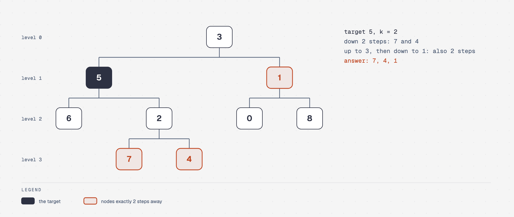
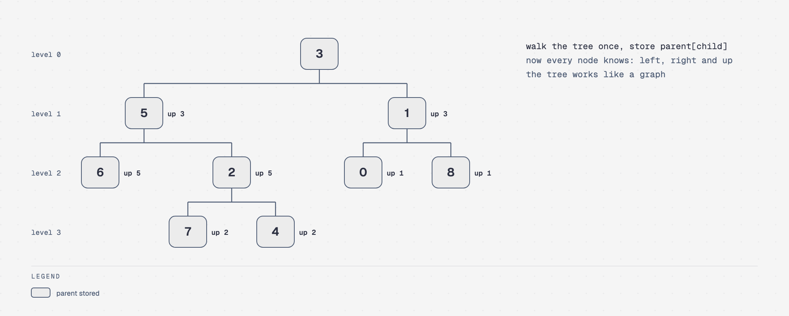
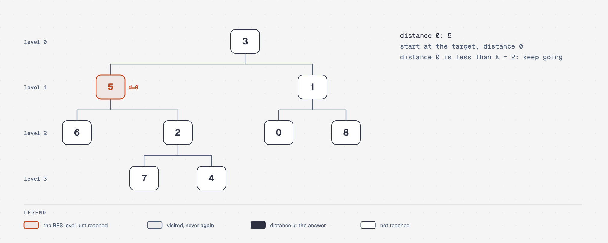
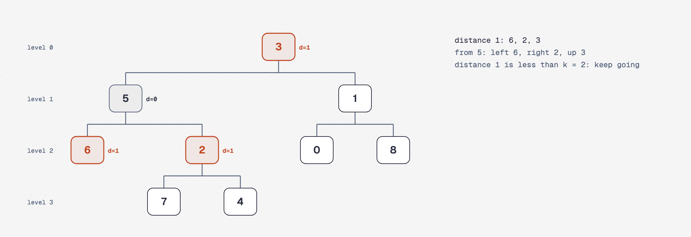
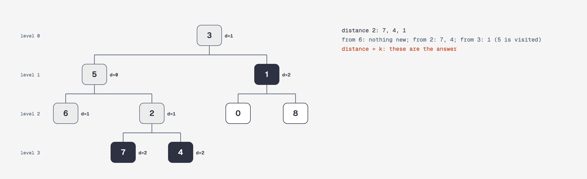

# 26. 863. All Nodes Distance K in Binary Tree

| Difficulty | Pattern | Key idea | Source | Time | Space | Before / after |
|:---:|:---:|:---|:---:|:---:|:---:|:---:|
| **Medium** | Parent Map, Then BFS Like a Graph | A tree only points down; store each node's parent so you can also move up, then spread out from the target one step at a time with BFS and a visited set | [863. All Nodes Distance K in Binary Tree](https://leetcode.com/problems/all-nodes-distance-k-in-binary-tree/) | `O(n)` | `O(n)` | [Children Sum Property](25.%20Children%20Sum%20Property.md) / [Time To Burn Tree](27.%20Time%20To%20Burn%20Tree.md) |

## 1. Problem Statement

Given the `root` of a binary tree, a `target` node in it, and a whole number `k`, return the values of **all nodes that are exactly `k` edges away from the target**, in any order. The path may go **up** through parents as well as down.

### Example

**The tree we take:** LeetCode's example, which is also the lecture board: `3` with children `5` and `1`; `5` with children `6` and `2`; `2` with children `7` and `4`; `1` with children `0` and `8`. As a LeetCode list: `[3, 5, 1, 6, 2, 0, 8, None, None, 7, 4]`, with `target = 5` and `k = 2`.

```text
Input:  root = [3, 5, 1, 6, 2, 0, 8, None, None, 7, 4], target = 5, k = 2
Output: [7, 4, 1]      (any order)
```



It has the tricky parts of the problem:

- Two answers, `7` and `4`, are **below** the target. A normal walk down finds them.
- One answer, `1`, needs a step **up** to `3` and then a step down. A tree node does not know its parent, so a plain walk down can never find it.
- When moving around freely, it is easy to step back to a node you just left (from `3` back to `5`), so visited nodes must be remembered.

We use this tree in every section below.

LeetCode examples:

```text
root = [3, 5, 1, 6, 2, 0, 8, None, None, 7, 4], target = 5, k = 2   gives [7, 4, 1]
root = [1], target = 1, k = 3                                         gives []
```

### Constraints, in plain words

| Limit | What it means in plain words | What it tells us |
|:---|:---|:---|
| Number of nodes is `1` to `500` | At most 500 nodes | Any `O(n)` method is instant; even `O(n^2)` is only 250,000 steps |
| `0 <= Node.val <= 500`, all values unique | Values never repeat | A value names exactly one node |
| `target` is a node in the tree | The start always exists | No "not found" case |
| `0 <= k <= 1000` | `k` can be 0, or bigger than the tree | `k = 0` gives `[target]`; a too-big `k` gives `[]` |

**How fast is fast enough?**

- **Brute force** measures the distance from the target to every node separately, using two root paths each time. That is `n` searches of `O(n)`: about 250,000 steps at the limit.
- **Parent map plus BFS** touches each node a few times in total: about 1,500 steps at the limit.
- Both finish instantly for 500 nodes; the BFS is the one that scales and the one interviewers expect.

| Method | Work per node | Total at `n = 500` | Extra memory | Note |
|:---|:---|:---:|:---|:---|
| Distance to every node via root paths | two path searches, `O(n)` | about 250,000 steps | two path lists | Simple, repeats a lot of work |
| Parent map, then BFS from the target | a constant number of moves | about 1,500 steps | parent map, visited set, queue | The lecture's answer |

## 2. Core Idea

A tree is a graph whose edges only point down. From the target we need to move in **three** directions: left child, right child, and **parent**.

1. **Give every node an "up" link.** Walk the tree once and store `parent[child] = node` in a dict. Now every node knows all its neighbours, like in a graph.
2. **Spread out from the target, one step at a time.** Do BFS starting at the target with distance 0. Each round, move every node in the queue to its left child, right child and parent. All nodes reached in round `d` are exactly `d` steps away.
3. **Never go back.** Keep a visited set, so `5 -> 3 -> 5` does not happen.
4. **Stop at round `k`.** Everything in the queue at distance `k` is the answer.

## 3. Edge Cases

| Case | Input | Expected | Why it matters | Code that handles it |
|:---|:---|:---|:---|:---|
| `k = 0` | our tree, target 5, `k = 0` | `[5]` | The target itself is 0 steps away | The BFS starts with the target at distance 0 |
| `k` too big | `[1]`, target 1, `k = 3` | `[]` | No node is that far | The queue empties before round `k` |
| Answer only above | our tree, target 7, `k = 3` | `[6, 3]` | The walks are 7, 2, 5, 6 and 7, 2, 5, 3: both go up first | The parent link allows moving up |
| Target is the root | our tree, target 3, `k = 2` | `[6, 2, 0, 8]` | Only downward moves | The root's parent is `None`, skipped |
| Going back | any tree | no repeats | `5 -> 3 -> 5` would count 5 again | The visited set |

## 4. Brute Force: Measure the Distance to Every Node

### Idea

For every node `x`, find the path from the root to `x` and the path from the root to the target (note 22). The two paths share a beginning up to their lowest common ancestor (note 23). The distance is:

```text
distance = len(path to x) + len(path to target) - 2 x (shared part)
```

Keep the nodes whose distance is `k`.

### Run it on our example

**The tree we take:** the 9-node tree above, `target = 5`, `k = 2`. The path to the target is `[3, 5]`, length 2.

| Node `x` | Path from the root to `x` | Shared with the path to 5 (`[3, 5]`) | Distance | Distance = 2? | The walk from `x` to 5 |
|:---:|:---|:---:|:---:|:---:|:---|
| 3 | `[3]` | 1 | 1 + 2 - 2 = 1 | No | down from 3 to 5 |
| 5 | `[3, 5]` | 2 | 2 + 2 - 4 = 0 | No | it is the target |
| 6 | `[3, 5, 6]` | 2 | 3 + 2 - 4 = 1 | No | up from 6 to 5 |
| 2 | `[3, 5, 2]` | 2 | 3 + 2 - 4 = 1 | No | up from 2 to 5 |
| 7 | `[3, 5, 2, 7]` | 2 | 4 + 2 - 4 = 2 | **Yes** | up 7, 2, then 5 |
| 4 | `[3, 5, 2, 4]` | 2 | 4 + 2 - 4 = 2 | **Yes** | up 4, 2, then 5 |
| 1 | `[3, 1]` | 1 | 2 + 2 - 2 = 2 | **Yes** | up 1, 3, then down to 5 |
| 0 | `[3, 1, 0]` | 1 | 3 + 2 - 2 = 3 | No | up 0, 1, 3, then down to 5 |
| 8 | `[3, 1, 8]` | 1 | 3 + 2 - 2 = 3 | No | up 8, 1, 3, then down to 5 |

Nine path searches for nine nodes, to find `7, 4, 1`. Each search walks the tree again.

### Code

```python
# Import types for hints
from typing import List, Optional


# Solution for 863, distance to every node via root paths
class Solution:

    # Path of nodes from the root to target
    def path_to(self, root: TreeNode, target: TreeNode) -> List[TreeNode]:

        # The nodes from the root to the current node
        path = []

        # Is target in this subtree? Keeps the path if yes
        def find(node: Optional[TreeNode]) -> bool:

            # Empty spot: not here
            if node is None:

                # Not found
                return False

            # Write this node down
            path.append(node)

            # Found the target, or found it below
            if node is target or find(node.left) or find(node.right):

                # Keep the path
                return True

            # Not below this node: erase it
            path.pop()

            # Not found here
            return False

        # Search from the root
        find(root)

        # The finished path
        return path

    # Main method
    def distanceK(self, root: TreeNode, target: TreeNode, k: int) -> List[int]:

        # Path from the root to the target, found once
        pt = self.path_to(root, target)

        # The answer values
        res = []

        # Every node of the tree, collected with a simple stack
        stack = [root]

        # Visit every node
        while stack:

            # Next node
            x = stack.pop()

            # Path from the root to this node
            px = self.path_to(root, x)

            # Length of the shared beginning
            shared = 0

            # Count how many nodes the two paths share
            while shared < min(len(px), len(pt)) and px[shared] is pt[shared]:

                # One more shared node
                shared += 1

            # Edges from x up to the split, then down to the target
            if len(px) + len(pt) - 2 * shared == k:

                # Exactly k steps away
                res.append(x.val)

            # Visit the left child later
            if x.left:

                # Push it
                stack.append(x.left)

            # Visit the right child later
            if x.right:

                # Push it
                stack.append(x.right)

        # All nodes at distance k
        return res
```

### Complexity

| Measure | Complexity | Why | At the limit (`n = 500`) | Compared with the optimal |
|:---|:---:|:---|:---:|:---|
| **Time** | `O(n^2)` | For each of `n` nodes, a path search of `O(n)` | about 250,000 steps | This is the baseline |
| **Space** | `O(n)` | Two path lists and the recursion | up to 500 each on a chain | This is the baseline |

## 5. Optimal: Parent Map, Then BFS From the Target

### Idea

```text
parent = {}                       # walk once: parent[child] = node
queue = [(target, 0)]; visited = {target}
while queue:
    node, d = take from queue
    if d == k: collect node; continue
    for nb in (node.left, node.right, parent[node]):
        if nb and nb not visited: mark it, queue (nb, d + 1)
```

### Run it on our example, step by step

**The tree we take:** the 9-node tree above, `target = 5`, `k = 2`.

**How to read the pictures:** orange is the BFS round just reached, grey nodes were visited before, dark nodes are at distance `k` (the answer), white nodes are never reached. The tag `d=k` is a node's distance from the target.

**Step 1: write down every node's parent**

- Walk the tree once and store `parent[child] = node`: 5 and 1 go up to 3, 6 and 2 go up to 5, 0 and 8 go up to 1, 7 and 4 go up to 2.
- The root 3 has no parent.
- Now every node has up to three neighbours: left, right and up.



**Step 2: distance 0**

- Nodes reached: `5`.
- Start at the target, distance 0.
- Distance 0 is less than k = 2: queue their neighbours.



**Step 3: distance 1**

- Nodes reached: `6, 2, 3`.
- From 5: left 6, right 2, up 3.
- Distance 1 is less than k = 2: queue their neighbours.



**Step 4: distance 2**

- Nodes reached: `7, 4, 1`.
- From 6: nothing new; from 2: 7, 4; from 3: 1 (5 is visited).
- Distance equals k: collect them, the answer is `[7, 4, 1]`.




**All steps at a glance**

| Step | BFS round (distance) | Nodes reached | How they were reached | Visited after this step | Action |
|:---:|:---:|:---|:---|:---|:---|
| 1 | - | - | One walk stores every parent | none yet | Build the parent map |
| 2 | 0 | 5 | Start at the target, distance 0 | 5 | Distance 0 is less than k = 2: queue their neighbours |
| 3 | 1 | 6, 2, 3 | From 5: left 6, right 2, up 3 | 5, 6, 2, 3 | Distance 1 is less than k = 2: queue their neighbours |
| 4 | 2 | 7, 4, 1 | From 6: nothing new; from 2: 7, 4; from 3: 1 (5 is visited) | 5, 6, 2, 3, 7, 4, 1 | Distance equals k: collect them, the answer is `[7, 4, 1]` |

The nodes `0` and `8` were never reached: they are 3 steps away, and the BFS stopped at round 2.

### Code

```python
# Import deque for the BFS queue
from collections import deque

# Import types for hints
from typing import List, Optional


# Solution for 863, parent map then BFS from the target
class Solution:

    # Main method
    def distanceK(self, root: TreeNode, target: TreeNode, k: int) -> List[int]:

        # parent[node] is the node above it; the root has None
        parent = {root: None}

        # Walk the tree once to fill the parent map
        stack = [root]

        # Visit every node
        while stack:

            # Next node
            node = stack.pop()

            # Look at both children
            for child in (node.left, node.right):

                # Only real children
                if child:

                    # Store the up link
                    parent[child] = node

                    # Visit the child later
                    stack.append(child)

        # BFS from the target, starting at distance 0
        queue = deque([(target, 0)])

        # Nodes already reached
        visited = {target}

        # The answer values
        res = []

        # Spread out one step at a time
        while queue:

            # Next node and its distance
            node, d = queue.popleft()

            # Exactly k steps away
            if d == k:

                # Part of the answer
                res.append(node.val)

                # Do not go further from here
                continue

            # The three neighbours: left, right and up
            for nb in (node.left, node.right, parent[node]):

                # A real node we have not reached yet
                if nb and nb not in visited:

                    # Mark it now, so it is queued only once
                    visited.add(nb)

                    # One step further away
                    queue.append((nb, d + 1))

        # All nodes at distance k
        return res
```

### Complexity

| Measure | Complexity | Why | At the limit (`n = 500`) | Compared with brute force |
|:---|:---:|:---|:---:|:---|
| **Time** | `O(n)` | One walk for the parent map, then each node enters the queue at most once | about 1,500 steps | About 170 times fewer steps at the limit |
| **Space** | `O(n)` | The parent map, the visited set and the queue | about 500 entries each | More memory, much less time |

## 6. Common Mistakes

| Mistake | What goes wrong | Fix |
|:---|:---|:---|
| Only searching below the target | Our tree gives `[7, 4]` and misses `1` | Store parents, so BFS can move up |
| No visited set | `5 -> 3 -> 5` counts 5 again; answers repeat | Mark nodes when they are queued |
| Marking nodes visited when taken out, not when queued | The same node can be queued twice from two neighbours | Mark at the moment of queuing |
| Searching for the target by value in a copied tree | The target is a node object; values work too because they are unique | Use the given `target` node directly |
| Forgetting `k = 0` | Returns nothing or the neighbours | The target itself is the answer |

## 7. Interview Follow-ups

### Q1. Can you do it without a parent map?

**Answer:**
- Yes, with one DFS that returns each node's distance to the target (or -1 if the target is not below).
- At an ancestor at distance `d`, collect the nodes at depth `k - d - 1` in its **other** subtree. Same `O(n)` time, `O(h)` extra space.

### Q2. How is this related to "time to burn a tree" (next note)?

**Answer:**
- Same parent map and BFS from a start node.
- Instead of stopping at round `k`, count how many rounds it takes until every node is reached.

### Q3. What if you needed the distance between two given nodes?

**Answer:**
- Find their LCA (note 23); the distance is `depth(a) + depth(b) - 2 x depth(LCA)`.
- Or BFS from one until the other is reached.

### Q4. Why BFS and not DFS from the target?

**Answer:**
- BFS reaches nodes in order of distance, so round `k` is exactly the answer, and it can stop there.
- DFS with a visited set also works if it carries the distance, but it cannot stop early as cleanly.

### Q5. What if the tree is very large but `k` is small?

**Answer:**
- The BFS only touches nodes within `k` steps of the target.
- The parent map still costs `O(n)`; building it only along the root-to-target path plus the needed subtrees saves work.

## 8. Interview Explanation

> A tree node only knows its children, but the answer can be above the target. So first I walk the tree once and store every node's parent in a dict; now each node has three neighbours: left, right and parent, like in a graph. Then I do BFS from the target with a visited set. Each round moves one step in every direction, so the nodes in round k are exactly k steps away, and I return them. The visited set stops me from walking back to a node I came from. Each node is handled a constant number of times, so it is O(n) time and O(n) space.
