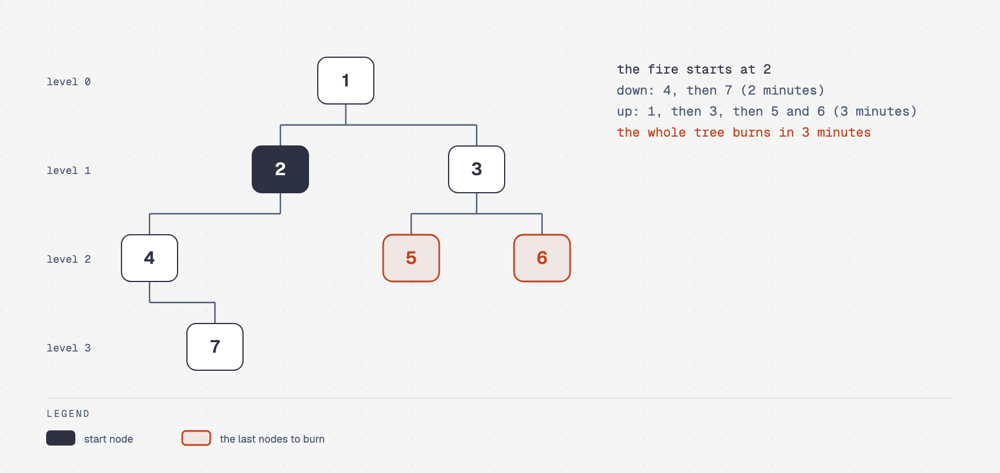
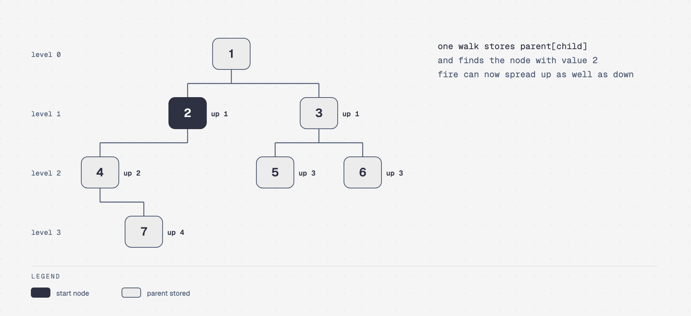
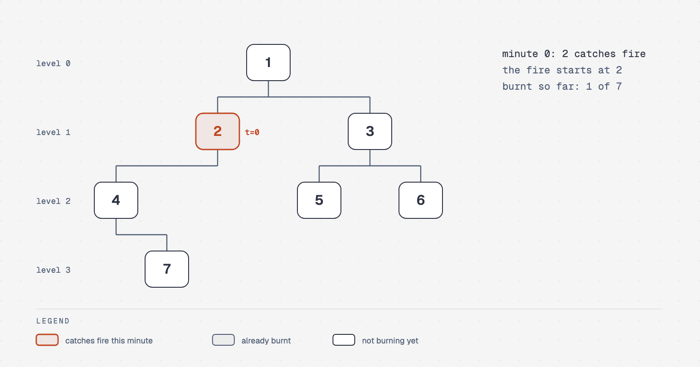
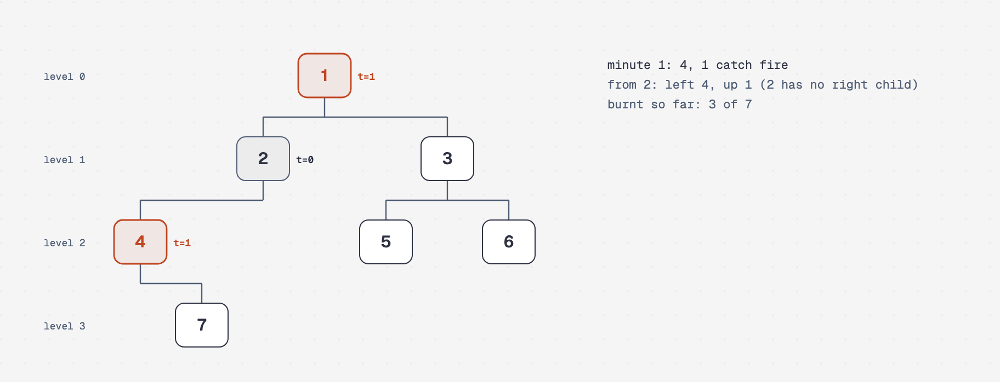
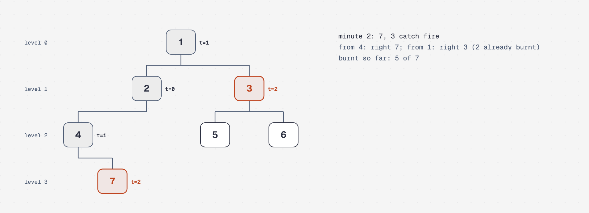
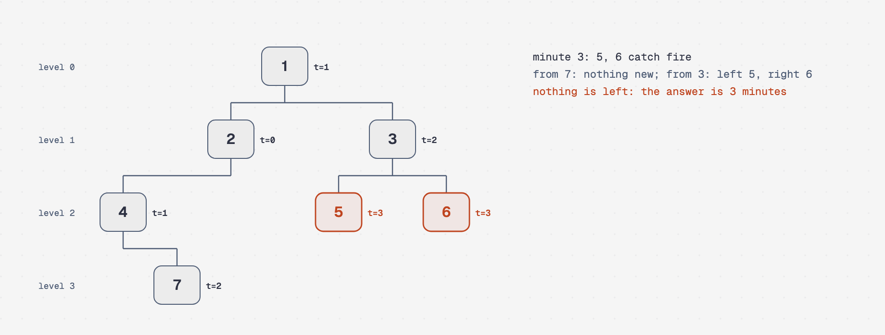

# 27. Time To Burn Tree

| Difficulty | Pattern | Key idea | Source | Time | Space | Before / after |
|:---:|:---:|:---|:---:|:---:|:---:|:---:|
| **Hard** | Parent Map, Then BFS Rounds | Fire spreads one step per minute to the left child, right child and parent; store parents, BFS from the start node, and count the rounds until nothing new burns | Coding Ninjas "Time To Burn Tree" (LeetCode 2385 is the same idea) | `O(n)` | `O(n)` | [863. All Nodes Distance K](26.%20863.%20All%20Nodes%20Distance%20K%20in%20Binary%20Tree.md) / [222. Count Complete Tree Nodes](28.%20222.%20Count%20Complete%20Tree%20Nodes.md) |

## 1. Problem Statement

A binary tree of unique values catches fire at a **start** node. Every minute, the fire moves from each burning node to all its neighbours: its left child, its right child and its **parent**. Return the number of minutes until the **whole tree** has burnt.

### Example

**The tree we take:** the tree from the lecture board: `1` with children `2` and `3`; `2` with left child `4`; `4` with right child `7`; `3` with children `5` and `6`. As a level-order list: `[1, 2, 3, 4, None, 5, 6, None, 7]`, with `start = 2`.

```text
Input:  root = [1, 2, 3, 4, None, 5, 6, None, 7], start = 2
Output: 3
```



It has the tricky parts of the problem:

- The fire goes **up** as well as down. From `2` it reaches `1` after one minute, which a walk down from `2` would never see.
- The deepest node below the start (`7`, 2 minutes away) is **not** the last to burn. The last ones are `5` and `6`, on the other side of the root, 3 minutes away.
- The answer is the **largest** distance from the start to any node.

We use this tree in every section below.

Platform examples:

```text
root = [1, 2, 3, None, None, 4, 5], start = 3         gives 2   (minute 1: 1, 4, 5; minute 2: 2)
root = [1, 2, 3, 4, None, None, 5], start = 2         gives 3   (minute 1: 1, 4; minute 2: 3; minute 3: 5)
```

### Constraints, in plain words

| Limit | What it means in plain words | What it tells us |
|:---|:---|:---|
| `1 <= N <= 10^5` | Up to 100,000 nodes | `O(n)` is fine; `O(n^2)` would be 10 billion steps, about 100 seconds |
| `1 <= value <= 10^9`, values unique | The start value names exactly one node | Find the start node by its value during the first walk |
| The start node always exists | No "not found" case | The BFS always has a place to begin |
| Time limit 1 second | About 100 million simple steps | Only a linear method fits |

**How fast is fast enough?**

- **Brute force** measures the distance from the start to every node separately, with root paths. That is `n` searches of up to `n` steps: about `n^2`.
- **Parent map plus BFS** builds the map in one walk and burns every node once: about `n`.

In the chart, the grey bars are the brute force's node visits and the orange line is the parent map plus BFS. The numbers were worked out from the loop counts.


| Nodes `n` | Brute force visits (about `n^2`) | Parent map + BFS visits (about `n`) | Brute force time (at 100 million steps per second) | Parent map + BFS time | Fits in 1 second? |
|:---:|:---:|:---:|:---:|:---:|:---|
| 20,000 | 400,000,000 | 20,000 | 4 seconds | 0.2 milliseconds | Only the BFS |
| 40,000 | 1,600,000,000 | 40,000 | 16 seconds | 0.4 milliseconds | Only the BFS |
| 60,000 | 3,600,000,000 | 60,000 | 36 seconds | 0.6 milliseconds | Only the BFS |
| 80,000 | 6,400,000,000 | 80,000 | 64 seconds | 0.8 milliseconds | Only the BFS |
| 100,000 | 10,000,000,000 | 100,000 | 100 seconds | 1 millisecond | Only the BFS |

## 2. Core Idea

This is note 26 (all nodes at distance `k`) without a fixed `k`:

1. **Give every node an "up" link.** One walk stores `parent[child] = node`, and also finds the node whose value is `start`.
2. **Burn one ring per minute.** BFS from the start node. Each BFS round takes every burning node to its left child, right child and parent that have not burnt yet. One round is one minute.
3. **Count the rounds.** When a round adds nothing new, the tree is fully burnt. The number of rounds that **did** add nodes is the answer.

The lecture's sticky note: start `time` at `-1` and add 1 for every BFS level, including the start's own level. Then `time` ends as the number of minutes.

## 3. Edge Cases

| Case | Input | Expected | Why it matters | Code that handles it |
|:---|:---|:---:|:---|:---|
| One node | `[1]`, start 1 | `0` | Nothing else to burn | One BFS level, `-1 + 1 = 0` |
| Start is the root | our tree, start 1 | `3` | Only downward spread: 1, then 2 and 3, then 4, 5, 6, then 7 | The root's parent is `None`, skipped |
| Start is a leaf | our tree, start 7 | `5` | Must go all the way up and down: 7, 4, 2, 1, 3, then 5 and 6 | The parent links |
| Last node is on the other side | our tree, start 2 | `3` | The deepest node below 2 is only 2 away | BFS counts every direction |
| A long chain | 100,000 nodes, start at one end | `99999` | Deep recursion in Python | Build the parent map with a stack or queue, not recursion |

## 4. Brute Force: Distance From the Start to Every Node

### Idea

For every node `x`, find the root path to `x` and the root path to the start (note 22). The distance is `len(path to x) + len(path to start) - 2 x (shared part)`. The answer is the largest distance.

### Run it on our example

**The tree we take:** the 7-node tree above, `start = 2`. The path to the start is `[1, 2]`. The nodes are listed in the order the stack visits them.

| Node `x` | Path from the root to `x` | Shared with the path to 2 (`[1, 2]`) | Distance from 2 | Largest so far | The fire's route from 2 |
|:---:|:---|:---:|:---:|:---:|:---|
| 1 | `[1]` | 1 | 1 + 2 - 2 = 1 | 1 | up to 1 |
| 3 | `[1, 3]` | 1 | 2 + 2 - 2 = 2 | 2 | up to 1, down to 3 |
| 6 | `[1, 3, 6]` | 1 | 3 + 2 - 2 = 3 | 3 | up to 1, down to 3, down to 6 |
| 5 | `[1, 3, 5]` | 1 | 3 + 2 - 2 = 3 | 3 | up to 1, down to 3, down to 5 |
| 2 | `[1, 2]` | 2 | 2 + 2 - 4 = 0 | 3 | it is the start |
| 4 | `[1, 2, 4]` | 2 | 3 + 2 - 4 = 1 | 3 | down to 4 |
| 7 | `[1, 2, 4, 7]` | 2 | 4 + 2 - 4 = 2 | 3 | down to 4, down to 7 |

The answer is the largest distance, `3`. Seven path searches were needed for seven nodes.

### Code

```python
# Import types for hints
from typing import List, Optional


# Solution for Time To Burn Tree, distance to every node via root paths
class Solution:

    # Path of nodes from the root to the node with value v
    def path_to(self, root: TreeNode, v: int) -> List[TreeNode]:

        # Stack of (node, path to it) pairs
        stack = [(root, [root])]

        # Search the whole tree
        while stack:

            # Next node and its path
            node, path = stack.pop()

            # Found it
            if node.val == v:

                # Return its path
                return path

            # Look at both children
            for child in (node.left, node.right):

                # Only real children
                if child:

                    # Extend the path by the child
                    stack.append((child, path + [child]))

        # Not found (does not happen here)
        return []

    # Main method
    def timeToBurnTree(self, root: TreeNode, start: int) -> int:

        # Path from the root to the start node
        ps = self.path_to(root, start)

        # Largest distance seen so far
        best = 0

        # Every node of the tree
        stack = [root]

        # Visit every node
        while stack:

            # Next node
            x = stack.pop()

            # Path from the root to this node
            px = self.path_to(root, x.val)

            # Length of the shared beginning
            shared = 0

            # Count how many nodes the two paths share
            while shared < min(len(px), len(ps)) and px[shared] is ps[shared]:

                # One more shared node
                shared += 1

            # Distance from the start to x
            best = max(best, len(px) + len(ps) - 2 * shared)

            # Look at both children
            for child in (x.left, x.right):

                # Only real children
                if child:

                    # Visit it later
                    stack.append(child)

        # The farthest node burns last
        return best
```

### Complexity

| Measure | Complexity | Why | At the limit (`n = 10^5`) | Compared with the optimal |
|:---|:---:|:---|:---:|:---|
| **Time** | `O(n^2)` | A path search of `O(n)` for each of `n` nodes | about 10,000,000,000 visits | This is the baseline |
| **Space** | `O(n)` | Two path lists and the stack | up to 100,000 | This is the baseline |

## 5. Optimal: Parent Map, Then BFS Rounds

### Idea

```text
walk once: parent[child] = node, and find the start node
queue = [start]; burnt = {start}; time = -1
while queue:
    time += 1                                    # one more minute
    for each node in this round:
        for nb in (left, right, parent[node]):
            if nb exists and is not burnt: burn it, queue it for the next round
return time
```

### Run it on our example, step by step

**The tree we take:** the 7-node tree above, `start = 2`.

**How to read the pictures:** orange nodes catch fire in this minute, grey nodes have already burnt, white nodes are not burning yet. The tag `t=k` is the minute a node caught fire.

**Step 1: write down every node's parent**

- One walk stores `parent[child] = node`: 2 and 3 go up to 1, 4 goes up to 2, 7 goes up to 4, 5 and 6 go up to 3.
- The same walk finds the node with value `2`, the start.
- Now the fire can spread up as well as down.



**Step 2: minute 0**

- `2` catches fire.
- The fire starts at 2.
- Burnt so far: 1 of 7 nodes.



**Step 3: minute 1**

- `4, 1` catch fire.
- From 2: left 4, up 1 (2 has no right child).
- Burnt so far: 3 of 7 nodes.



**Step 4: minute 2**

- `7, 3` catch fire.
- From 4: right 7; from 1: right 3 (2 already burnt).
- Burnt so far: 5 of 7 nodes.



**Step 5: minute 3**

- `5, 6` catch fire.
- From 7: nothing new; from 3: left 5, right 6.
- Nothing is left, so the queue empties: the answer is `3`.




**All steps at a glance**

| Step | Minute | Catch fire | How the fire got there | Burnt so far | `time` after this round |
|:---:|:---:|:---|:---|:---|:---:|
| 1 | - | - | One walk stores every parent and finds the start | none | -1 |
| 2 | 0 | 2 | The fire starts at 2 | 2 | 0 |
| 3 | 1 | 4, 1 | From 2: left 4, up 1 (2 has no right child) | 2, 4, 1 | 1 |
| 4 | 2 | 7, 3 | From 4: right 7; from 1: right 3 (2 already burnt) | 2, 4, 1, 7, 3 | 2 |
| 5 | 3 | 5, 6 | From 7: nothing new; from 3: left 5, right 6 | 2, 4, 1, 7, 3, 5, 6 | 3 |

The fire needed 3 minutes. The nodes `5` and `6` burnt last, even though `7` is deeper in the tree.

### Code

```python
# Import deque for the BFS queue
from collections import deque

# Import types for hints
from typing import List, Optional


# Solution for Time To Burn Tree, parent map then BFS rounds
class Solution:

    # Main method
    def timeToBurnTree(self, root: TreeNode, start: int) -> int:

        # parent[node] is the node above it; the root has None
        parent = {root: None}

        # The node with value start
        src = None

        # Walk the tree once with a stack
        stack = [root]

        # Visit every node
        while stack:

            # Next node
            node = stack.pop()

            # Is this the start?
            if node.val == start:

                # Remember it
                src = node

            # Look at both children
            for child in (node.left, node.right):

                # Only real children
                if child:

                    # Store the up link
                    parent[child] = node

                    # Visit it later
                    stack.append(child)

        # Nodes burning in the current minute
        queue = deque([src])

        # Nodes that have caught fire
        burnt = {src}

        # The start's own round will make this 0
        time = -1

        # One loop per minute
        while queue:

            # One more minute
            time += 1

            # Burn every node of this round
            for _ in range(len(queue)):

                # Next burning node
                node = queue.popleft()

                # Its three neighbours: left, right and up
                for nb in (node.left, node.right, parent[node]):

                    # A real node that is not burnt yet
                    if nb and nb not in burnt:

                        # It catches fire
                        burnt.add(nb)

                        # It burns in the next minute
                        queue.append(nb)

        # Minutes until the whole tree burnt
        return time
```

### Complexity

| Measure | Complexity | Why | At the limit (`n = 10^5`) | Compared with brute force |
|:---|:---:|:---|:---:|:---|
| **Time** | `O(n)` | One walk for the parent map, then each node burns once | about 100,000 visits, plus 3 neighbour checks each | About 100,000 times fewer visits at the limit |
| **Space** | `O(n)` | The parent map, the burnt set and the queue | about 100,000 entries each | More memory, far less time |

## 6. Common Mistakes

| Mistake | What goes wrong | Fix |
|:---|:---|:---|
| Only measuring the height below the start | Our tree gives 2 instead of 3 | Store parents, so the fire can go up |
| Adding a minute per node instead of per round | The answer becomes the node count | Count once per BFS level |
| Starting the counter at 0 and adding for the start's round | Every answer is one too big | Start at `-1`, or count only rounds that add new nodes |
| No burnt set | The fire walks back and forth: `2 -> 1 -> 2` | Mark nodes when they catch fire |
| Building the parent map with recursion on a 100,000 chain | `RecursionError` in Python | Use a stack or a queue |

## 7. Interview Follow-ups

### Q1. How is LeetCode 2385 (Amount of Time for Binary Tree to Be Infected) different?

**Answer:**
- It is the same problem: `start` is a value, the answer is the number of minutes.
- The same code works with the method renamed to `amountOfTime(root, start)`.

### Q2. Can you do it without a parent map?

**Answer:**
- Yes, with one DFS. Each call returns the distance from that node down to the start (or the node's height if the start is not below).
- At an ancestor of the start, the fire time through it is `distance to start + height of the other side`. Keep the maximum. `O(n)` time, `O(h)` space.

### Q3. What if several nodes start burning at the same time?

**Answer:**
- Put all of them in the first BFS round. This is "multi-source BFS", like the "rotting oranges" problem (LeetCode 994).

### Q4. What is the answer in terms of tree measures?

**Answer:**
- It is the largest distance from the start to any node, also called the start's **eccentricity**.
- The diameter (note 12) is the largest eccentricity over all start nodes.

### Q5. How does this connect to graphs?

**Answer:**
- With the parent links, the tree is just an undirected graph with `n - 1` edges.
- BFS from one node gives the shortest distance to every other node; the answer is the largest one.

## 8. Interview Explanation

> Fire moves one step per minute in three directions: left, right and up to the parent. A tree node does not know its parent, so I first walk the tree once and store every node's parent in a dict, finding the start node on the way. Then I run BFS from the start with a burnt set. Each BFS round is one minute: every burning node lights its unburnt left child, right child and parent. I count the rounds, starting from minus one so the start's own round counts as minute zero. When the queue is empty, the counter is the answer. Each node is handled a constant number of times, so it is O(n) time and O(n) space.
