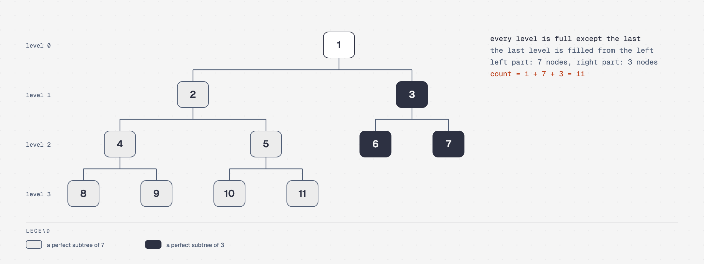
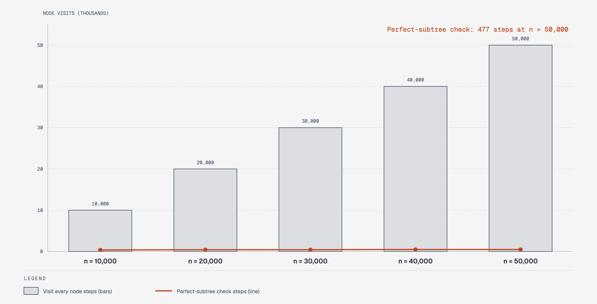
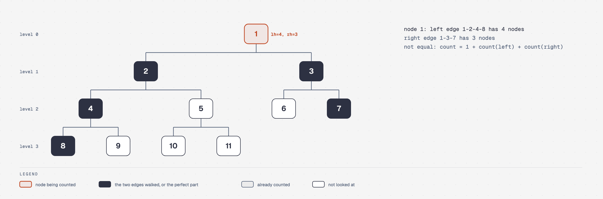
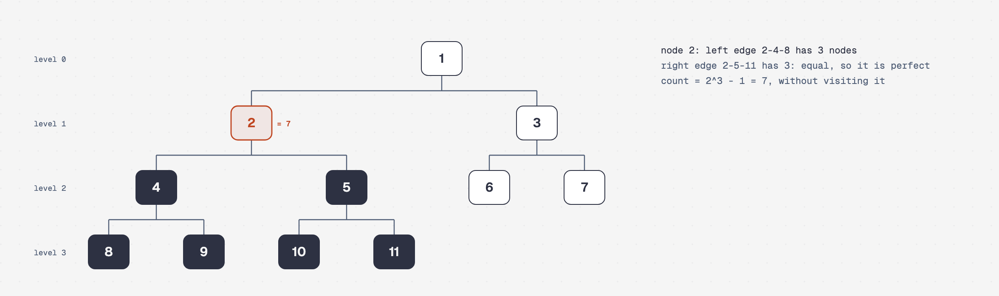
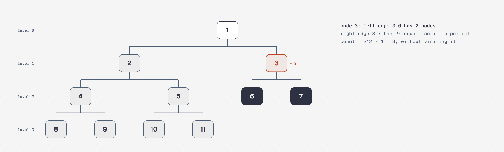
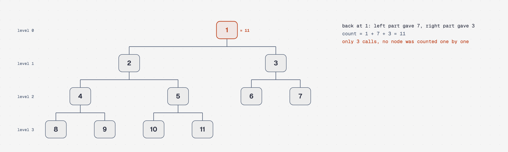

# 28. 222. Count Complete Tree Nodes

| Difficulty | Pattern | Key idea | Source | Time | Space | Before / after |
|:---:|:---:|:---|:---:|:---:|:---:|:---:|
| **Easy** | Skip Perfect Subtrees With a Formula | If a subtree's leftmost edge and rightmost edge are equally long, it is perfect and has `2^h - 1` nodes; otherwise count `1 + left + right`, and only one side is ever not perfect | [222. Count Complete Tree Nodes](https://leetcode.com/problems/count-complete-tree-nodes/) | `O((log n)^2)` | `O(log n)` | [Time To Burn Tree](27.%20Time%20To%20Burn%20Tree.md) / [Unique Binary Tree](29.%20Requirements%20needed%20to%20construct%20a%20Unique%20Binary%20Tree.md) |

## 1. Problem Statement

Given the `root` of a **complete** binary tree, return the number of nodes. Do it in **less than** `O(n)` time.

A **complete** tree has every level full except possibly the last, and the last level is filled from the **left** with no gaps (note 01). A **perfect** tree has every level full, including the last; with `h` levels it has exactly `2^h - 1` nodes.

### Example

**The tree we take:** the complete tree from the lecture board with 11 nodes: values `1` to `11` in level order. As a LeetCode list: `[1, 2, 3, 4, 5, 6, 7, 8, 9, 10, 11]`.

```text
Input:  root = [1, 2, 3, 4, 5, 6, 7, 8, 9, 10, 11]
Output: 11
```



It has the tricky part of the problem:

- The **whole** tree is not perfect: the last level has only 4 of its 8 spots.
- But the root's **left** subtree (`2, 4, 5, 8, 9, 10, 11`) is perfect: 7 nodes.
- And the root's **right** subtree (`3, 6, 7`) is perfect too: 3 nodes.
- So the count is `1 + 7 + 3 = 11`, found without visiting most of the nodes.

We use this tree in every section below.

LeetCode examples:

```text
root = [1, 2, 3, 4, 5, 6]   gives 6
root = []                   gives 0
root = [1]                  gives 1
```

### Constraints, in plain words

| Limit | What it means in plain words | What it tells us |
|:---|:---|:---|
| Number of nodes is `0` to `5 * 10^4` | Up to 50,000 nodes; can be empty | An empty tree has 0 nodes |
| `0 <= Node.val <= 5 * 10^4` | Values do not matter | Only the shape is counted |
| The tree is complete | All levels full but the last, which fills from the left | The height is at most about 16, and at every node at least one side is perfect |
| "Less than `O(n)`" | Visiting every node is not allowed | Use the shape: count perfect parts with a formula |

**How fast is fast enough?**

- **Visiting every node** costs `n`: 50,000 at the limit. Correct, but the problem asks for less.
- **Checking edge heights** walks only down the leftmost and rightmost edges (`log n` steps each), and recurses into at most one non-perfect side per level: about `(log n)^2` steps.

In the chart, the grey bars are "visit every node" and the orange line is the perfect-subtree check, both counted by running the code on complete trees.



| Nodes `n` (complete tree) | Visit every node | Perfect-subtree check (counted) | Visit-every-node time (at 100 million steps per second) | Perfect-subtree check time | Fewer visits by |
|:---:|:---:|:---:|:---:|:---:|:---:|
| 10,000 | 10,000 | 361 | 0.1 milliseconds | 0.0036 milliseconds | about 28 times |
| 20,000 | 20,000 | 416 | 0.2 milliseconds | 0.0042 milliseconds | about 48 times |
| 30,000 | 30,000 | 420 | 0.3 milliseconds | 0.0042 milliseconds | about 71 times |
| 40,000 | 40,000 | 475 | 0.4 milliseconds | 0.0047 milliseconds | about 84 times |
| 50,000 | 50,000 | 477 | 0.5 milliseconds | 0.0048 milliseconds | about 105 times |

## 2. Core Idea

**Perfect trees have a formula.** A perfect tree with `h` levels has `1 + 2 + 4 + ... + 2^(h-1) = 2^h - 1` nodes. The lecture: a perfect tree of 3 levels has `2^3 - 1 = 7` nodes.

**Spotting a perfect subtree is cheap.** In a complete tree, a subtree is perfect exactly when its **leftmost** edge (keep going left) and its **rightmost** edge (keep going right) have the same number of nodes. Each edge takes only `h` steps to walk.

**So at each node:**

1. Walk the leftmost edge: `lh` nodes. Walk the rightmost edge: `rh` nodes.
2. If `lh == rh`, the subtree is perfect: return `2^lh - 1` at once.
3. Otherwise return `1 + count(left) + count(right)`.

**Why it is fast:** in a complete tree, at every node at least one of the two children is perfect, so it answers after one height check. Only one path goes down level by level, and each level costs `O(log n)` for the height walks: `O(log n) x O(log n)`.

## 3. Edge Cases

| Case | Input | Expected | Why it matters | Code that handles it |
|:---|:---|:---:|:---|:---|
| Empty tree | `[]` | `0` | No nodes | `if root is None: return 0` |
| One node | `[1]` | `1` | Both edges have 1 node: `2^1 - 1 = 1` | The formula |
| Perfect tree | `[1, 2, 3, 4, 5, 6, 7]` | `7` | Answered at the root, no recursion | `lh == rh` at the root |
| Last level has one node | `[1, 2, 3, 4]` | `4` | The left side is not perfect, the right side is | Recurse only where needed |
| Our tree | 11 nodes | `11` | Root is not perfect, both children are | `1 + 7 + 3` |

## 4. Brute Force: Visit Every Node

### Idea

Any traversal counts the nodes: add 1 for the node, then count the left and right subtrees. The lecture writes it as an inorder walk with a counter. It works for any tree, but it ignores that the tree is complete.

### Run it on our example

**The tree we take:** the 11-node tree above.

| Order (inorder) | Node | Level | Leaf? | Counter after it | What the walk does |
|:---:|:---:|:---:|:---:|:---:|:---|
| 1 | 8 | 3 | Yes | 1 | A leaf: add 1 to the counter, then go back up to its parent |
| 2 | 4 | 2 | No | 2 | Add 1 after its whole left side is counted, then go down to the right |
| 3 | 9 | 3 | Yes | 3 | A leaf: add 1 to the counter, then go back up to its parent |
| 4 | 2 | 1 | No | 4 | Add 1 after its whole left side is counted, then go down to the right |
| 5 | 10 | 3 | Yes | 5 | A leaf: add 1 to the counter, then go back up to its parent |
| 6 | 5 | 2 | No | 6 | Add 1 after its whole left side is counted, then go down to the right |
| 7 | 11 | 3 | Yes | 7 | A leaf: add 1 to the counter, then go back up to its parent |
| 8 | 1 | 0 | No | 8 | Add 1 after its whole left side is counted, then go down to the right |
| 9 | 6 | 2 | Yes | 9 | A leaf: add 1 to the counter, then go back up to its parent |
| 10 | 3 | 1 | No | 10 | Add 1 after its whole left side is counted, then go down to the right |
| 11 | 7 | 2 | Yes | 11 | A leaf: add 1 to the counter, then go back up to its parent |

All 11 nodes were visited to get `11`. The walk never used the fact that the tree is complete.

### Code

```python
# Import Optional for type hints
from typing import Optional


# Solution for 222, visit every node
class Solution:

    # Main method
    def countNodes(self, root: Optional[TreeNode]) -> int:

        # An empty spot has no nodes
        if root is None:

            # Nothing to count
            return 0

        # This node, plus everything on the left and on the right
        return 1 + self.countNodes(root.left) + self.countNodes(root.right)
```

### Complexity

| Measure | Complexity | Why | At the limit (`n = 5 * 10^4`) | Compared with the optimal |
|:---|:---:|:---|:---:|:---|
| **Time** | `O(n)` | Every node is visited once | 50,000 visits | This is the baseline |
| **Space** | `O(log n)` | Recursion depth; a complete tree has height about `log2(n)` | about 16 | This is the baseline |

## 5. Optimal: Skip Perfect Subtrees With `2^h - 1`

### Idea

```text
count(node):
    if node is empty: return 0
    lh = nodes on the leftmost edge, rh = nodes on the rightmost edge
    if lh == rh: return 2^lh - 1          # perfect: use the formula
    return 1 + count(node.left) + count(node.right)
```

### Run it on our example, step by step

**The tree we take:** the 11-node tree above.

**How to read the pictures:** orange is the node being counted, dark nodes are the two edges just walked (or the perfect part just counted by the formula), grey nodes are already counted, white nodes were not looked at.

**Step 1: node 1**

- Leftmost edge `1, 2, 4, 8`: 4 nodes. Rightmost edge `1, 3, 7`: 3 nodes.
- They differ, so the subtree of `1` is not perfect.
- Count it as `1 + count(2) + count(3)`.



**Step 2: node 2**

- Leftmost edge `2, 4, 8`: 3 nodes. Rightmost edge `2, 5, 11`: 3 nodes.
- They are equal, so the subtree of `2` is perfect.
- It has `2^3 - 1 = 7` nodes, counted without visiting them.



**Step 3: node 3**

- Leftmost edge `3, 6`: 2 nodes. Rightmost edge `3, 7`: 2 nodes.
- They are equal, so the subtree of `3` is perfect.
- It has `2^2 - 1 = 3` nodes, counted without visiting them.



**Step 4: back at node 1**

- The left child answered 7 and the right child answered 3.
- Node 1 returns `1 + 7 + 3 = 11`.
- That is the answer.




**All steps at a glance**

| Step | Node | Leftmost edge | Rightmost edge | Perfect? | Result | Why |
|:---:|:---:|:---|:---|:---:|:---:|:---|
| 1 | 1 | `1, 2, 4, 8` (4) | `1, 3, 7` (3) | No | wait for both children | The last level is only partly filled |
| 2 | 2 | `2, 4, 8` (3) | `2, 5, 11` (3) | Yes | `2^3 - 1 = 7` | Equal edges mean every level is full |
| 3 | 3 | `3, 6` (2) | `3, 7` (2) | Yes | `2^2 - 1 = 3` | Equal edges mean every level is full |
| 4 | 1 | (already walked) | (already walked) | No | `1 + 7 + 3 = 11` | Add this node to the two answers |

Only 3 calls were made, and only the edge nodes were walked. The nodes `9` and `10` were never visited at all.

### Code

```python
# Import Optional for type hints
from typing import Optional


# Solution for 222, skip perfect subtrees with the formula
class Solution:

    # Main method
    def countNodes(self, root: Optional[TreeNode]) -> int:

        # An empty spot has no nodes
        if root is None:

            # Nothing to count
            return 0

        # Nodes on the leftmost edge
        lh = 0

        # Start the walk at this node
        node = root

        # Keep going left
        while node:

            # One more node on the edge
            lh += 1

            # Step to the left child
            node = node.left

        # Nodes on the rightmost edge
        rh = 0

        # Start the walk at this node again
        node = root

        # Keep going right
        while node:

            # One more node on the edge
            rh += 1

            # Step to the right child
            node = node.right

        # Equal edges: the subtree is perfect
        if lh == rh:

            # A perfect tree with lh levels has 2^lh - 1 nodes
            return (1 << lh) - 1

        # Not perfect: this node plus both sides
        return 1 + self.countNodes(root.left) + self.countNodes(root.right)
```

### Complexity

| Measure | Complexity | Why | At the limit (`n = 5 * 10^4`) | Compared with brute force |
|:---|:---:|:---|:---:|:---|
| **Time** | `O((log n)^2)` | At most `log n` calls go down, each walks two edges of `log n` nodes | 477 visits (counted) | About 100 times fewer visits at the limit |
| **Space** | `O(log n)` | Recursion depth | about 16 | Same as brute force |

## 6. Common Mistakes

| Mistake | What goes wrong | Fix |
|:---|:---|:---|
| Using the formula without checking both edges | The tree might not be perfect: our tree would give 15 | Compare the leftmost and rightmost edge lengths first |
| Measuring the height with `maxDepth` | That visits every node: `O(n)` per call | Walk only the leftmost and only the rightmost edge |
| Computing `2^h` with `2 ** h - 1` or `(1 << h) - 1` mixed up as `1 << h - 1` | Operator order: `1 << h - 1` is `1 << (h - 1)` | Write `(1 << h) - 1` |
| Counting edges instead of nodes for `h` | Off by one: `2^(h+1) - 1` vs `2^h - 1` | Count nodes on the edge, starting at the node itself |
| Using this on a tree that is not complete | The fast count is wrong | Only complete trees have "one side is always perfect" |

## 7. Interview Follow-ups

### Q1. Why is at least one child always perfect in a complete tree?

**Answer:**
- The last level fills from the left. If it reaches into the right subtree, the left subtree's last level is full, so the left child is perfect.
- If it does not, the right subtree has no last-level nodes, so the right child is perfect, one level shorter.

### Q2. Can you count it with binary search instead?

**Answer:**
- Yes. The last level has spots `0` to `2^(h-1) - 1`. Binary search for the last filled spot; checking a spot walks one path of `h` steps using its bits.
- Also `O((log n)^2)`.

### Q3. How do you check that a tree is complete (LeetCode 958)?

**Answer:**
- BFS, and remember when the first empty spot is seen.
- If any real node comes after that empty spot, the tree is not complete.

### Q4. What is the height of a complete tree with `n` nodes?

**Answer:**
- `floor(log2(n)) + 1` levels: about 16 for 50,000 nodes. That is why every edge walk is short.

### Q5. Why is "less than `O(n)`" even possible?

**Answer:**
- Because the shape is almost fixed: once you know the height and how far the last level goes, the count is known.
- The formula counts whole perfect parts without visiting them.

## 8. Interview Explanation

> A complete tree is almost perfect, and a perfect tree with h levels has 2 to the h minus 1 nodes. At a node I walk only the leftmost edge and only the rightmost edge. If they have the same number of nodes, the subtree is perfect and I return 2 to the h minus 1 directly. Otherwise I return 1 plus the counts of the two children. In a complete tree at least one child is always perfect, so only one path goes deeper, about log n calls, each doing two edge walks of log n steps. That is O(log n squared) time and O(log n) space, instead of visiting all n nodes.
