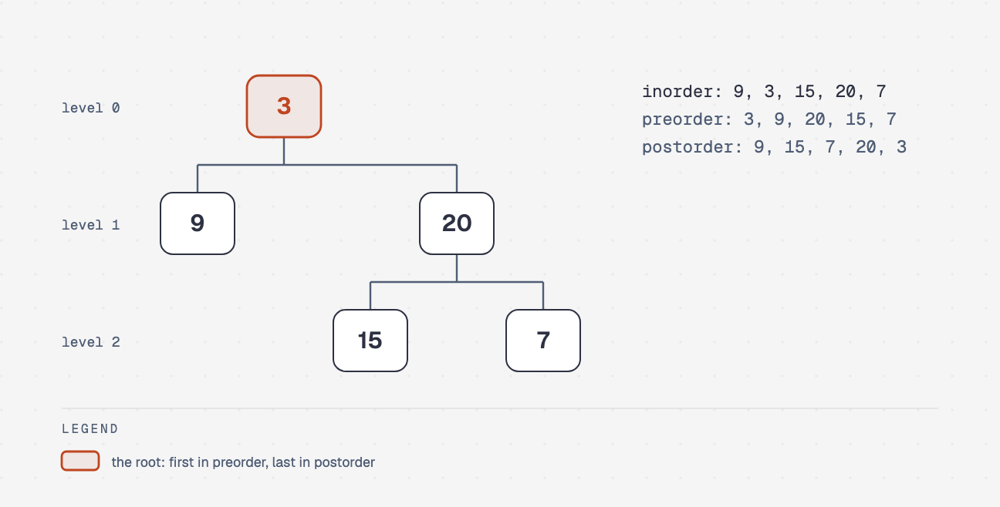
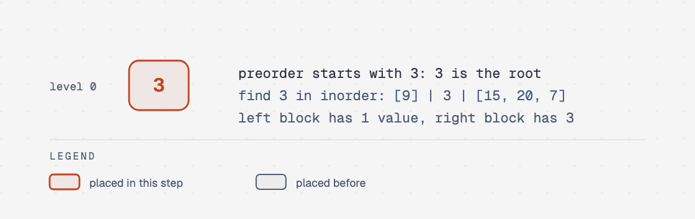
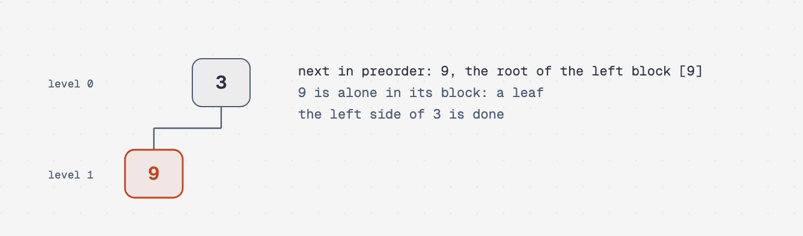
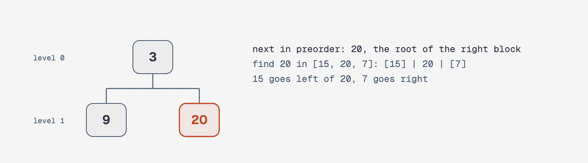
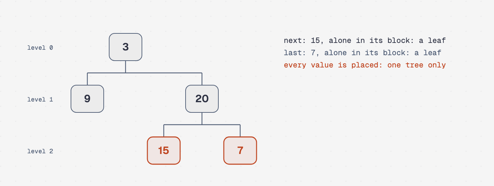
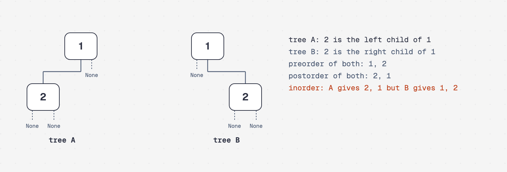
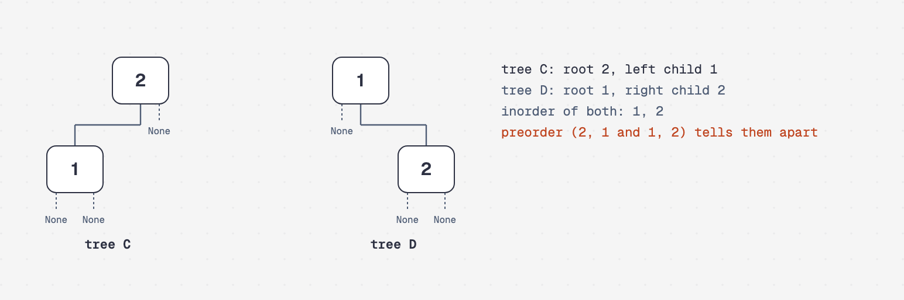

# 29. Requirements needed to construct a Unique Binary Tree

| Type | Topic | Key idea | Covers | Code | Before / after |
|:---:|:---:|:---|:---|:---:|:---:|
| **Theory** | Which Traversals Fix One Tree | Inorder tells **left from right** around a root; preorder or postorder tells **which node is the root**. You need both kinds, so inorder plus preorder, or inorder plus postorder | Why each pair works or fails, small trees that prove it, how the two lists build the tree step by step | A short checker that tries every tree with 4 values | [222. Count Complete Tree Nodes](28.%20222.%20Count%20Complete%20Tree%20Nodes.md) / [105. Build From Preorder and Inorder](30.%20105.%20Construct%20Binary%20Tree%20from%20Preorder%20and%20Inorder%20Traversal.md) |

## 1. The question

The lecture asks: **"Can you construct a unique binary tree with the following?"** You are given one or two traversal lists of a tree with **distinct** values (note 03). Is there exactly one tree that gives those lists, or could several trees give them?

| Given | Unique tree? | Why, in one line | Smallest proof |
|:---|:---:|:---|:---|
| Inorder **and** preorder | **Yes** | Preorder names the root, inorder splits the rest into left and right | Section 4 builds it with no choice |
| Inorder **and** postorder | **Yes** | Postorder names the root (last), inorder splits the rest | Same build, reading postorder from the end |
| Preorder **and** postorder | No | Both name the root, but neither says which side a lone child is on | Trees A and B in section 5 |
| Only one list | No | Either no root is known (inorder), or no split is known (preorder, postorder) | Trees C and D in section 6 |

**The rule to remember:** you always need **inorder**, plus one list that tells you the root (preorder or postorder).

## 2. What each list tells you

| List | Order | What it tells you | What it cannot tell you |
|:---|:---|:---|:---|
| Preorder | Root, left, right | The **first** value is the root | Where the left part ends and the right part begins |
| Postorder | Left, right, root | The **last** value is the root | Where the left part ends and the right part begins |
| Inorder | Left, root, right | Once you know the root, everything **before** it is on the left and everything **after** it is on the right | Which value is the root |

So preorder and postorder carry the **same kind** of information (where the root is), and inorder carries the **other** kind (how to split). A pair works only when it has both kinds.

## 3. The tree we take

**The two lists:** the lecture's board.

```text
Inorder  = [9, 3, 15, 20, 7]
Preorder = [3, 9, 20, 15, 7]
```



This is LeetCode's example for note 30. It has a root with a one-node left side and a three-node right side, so the split point is not in the middle. Its postorder is `[9, 15, 7, 20, 3]`.

## 4. Build it from inorder and preorder, step by step

The lecture builds the tree by hand. Take the next value from preorder: it is the root of the current block. Find it in inorder: the values to its left form its left subtree, the values to its right form its right subtree.

**How to read the pictures:** orange is the node placed in this step, grey nodes were placed before.

**Step 1: the root**

- Preorder starts with `3`, so `3` is the root.
- In inorder, `3` splits the list into `[9]` on the left and `[15, 20, 7]` on the right.
- So the left subtree has 1 node and the right subtree has 3 nodes.



**Step 2: the left block `[9]`**

- The next value in preorder is `9`. It is the root of the left block.
- The block has only `9`, so it is a leaf.
- The left side of `3` is done.



**Step 3: the right block `[15, 20, 7]`**

- The next value in preorder is `20`. It is the root of the right block.
- In inorder, `20` splits `[15, 20, 7]` into `[15]` and `[7]`.
- So `15` goes to the left of `20` and `7` to the right.



**Step 4: the last two leaves**

- The next value in preorder is `15`: alone in its block, a leaf under `20` on the left.
- The last value is `7`: alone in its block, a leaf under `20` on the right.
- Every value was placed, and there was never a choice. So the tree is unique.



**All steps at a glance**

| Step | Next in preorder | Its inorder block | Left part | Right part | Where it goes | Any choice left? |
|:---:|:---:|:---|:---|:---|:---|:---:|
| 1 | 3 | `[9, 3, 15, 20, 7]` | `[9]` | `[15, 20, 7]` | The root of the whole tree | None |
| 2 | 9 | `[9]` | empty | empty | Left child of 3 | None |
| 3 | 20 | `[15, 20, 7]` | `[15]` | `[7]` | Right child of 3 | None |
| 4 | 15, then 7 | `[15]`, then `[7]` | empty | empty | Left and right child of 20 | None: every value is placed |

The lecture notes that the same works with **postorder** in place of preorder: read postorder from the **end**, because there the root comes last (note 31).

## 5. Why preorder and postorder are not enough

Look at two tiny trees: in tree A, `2` is the **left** child of `1`; in tree B, `2` is the **right** child of `1`.



| Tree | Preorder | Postorder | Inorder | What the lists say |
|:---|:---:|:---:|:---:|:---|
| A (2 on the left) | `1, 2` | `2, 1` | `2, 1` | Preorder and postorder are the same as tree B's; only inorder is different |
| B (2 on the right) | `1, 2` | `2, 1` | `1, 2` | Preorder and postorder are the same as tree A's; only inorder is different |

Preorder and postorder are the same for both, so they cannot tell A from B. Inorder can: it puts `2` before `1` only when `2` is on the left.

**When does preorder plus postorder work?** Only when every node has 0 or 2 children (a **full** tree). Then a lone child never happens, and the split is known. That is LeetCode 889.

## 6. Why one list is never enough

With inorder alone, the root is unknown. Tree C (root `2`, left child `1`) and tree D (root `1`, right child `2`) both give inorder `1, 2`.



With preorder alone (or postorder alone), the root is known but the split is not: `1, 2, 3` can be a chain going left, a chain going right, a root with two children, and more.

## 7. Check it on every small tree

The code below builds **every** binary tree with the values `1, 2, 3, 4` (14 shapes, each with 24 ways to place the values) and counts the most trees that share the same lists.

| Lists given | Most trees with the same lists | Unique? | What it shows |
|:---|:---:|:---:|:---|
| Inorder + preorder | 1 | **Yes** | Every tree has its own pair of lists |
| Inorder + postorder | 1 | **Yes** | Every tree has its own pair of lists |
| Preorder + postorder | 8 | No | A chain of 4 nodes: each lone child can be left or right, so 2 x 2 x 2 = 8 trees look the same |
| Inorder only | 14 | No | All 14 shapes can give the same inorder |
| Preorder only | 14 | No | All 14 shapes can give the same preorder |
| Postorder only | 14 | No | All 14 shapes can give the same postorder |

### Code

```python
# Import permutations to try every order of the values
from itertools import permutations

# Import Counter to count how many trees share the same lists
from collections import Counter


# One node of a binary tree
class TreeNode:

    # Store the value and the two children
    def __init__(self, val, left=None, right=None):

        # The value of this node
        self.val = val

        # The left child, or None
        self.left = left

        # The right child, or None
        self.right = right


# Every tree shape with n nodes, values left empty
def shapes(n):

    # Zero nodes: only the empty tree
    if n == 0:

        # One shape: nothing
        return [None]

    # All shapes found
    out = []

    # Put k nodes on the left, the rest on the right
    for k in range(n):

        # Every left shape with k nodes
        for left in shapes(k):

            # Every right shape with the remaining nodes
            for right in shapes(n - 1 - k):

                # A root with these two subtrees
                out.append(("node", left, right))

    # Every shape with n nodes
    return out


# Fill a shape with values in preorder, giving a real tree
def fill(shape, vals):

    # An empty shape stays empty
    if shape is None:

        # No node here
        return None

    # The root takes the next value
    root = TreeNode(vals.pop(0))

    # Fill the left side next
    root.left = fill(shape[1], vals)

    # Then fill the right side
    root.right = fill(shape[2], vals)

    # The finished tree
    return root


# Preorder: root, left, right
def pre(node):

    # Empty: nothing to write
    return [] if node is None else [node.val] + pre(node.left) + pre(node.right)


# Inorder: left, root, right
def ino(node):

    # Empty: nothing to write
    return [] if node is None else ino(node.left) + [node.val] + ino(node.right)


# Postorder: left, right, root
def post(node):

    # Empty: nothing to write
    return [] if node is None else post(node.left) + post(node.right) + [node.val]


# Most trees that share the same lists, for one pair of orders
def worst_share(n, orders):

    # How many trees give each combination of lists
    seen = Counter()

    # Try every shape
    for shape in shapes(n):

        # Try every way to place the values
        for perm in permutations(range(1, n + 1)):

            # Build this tree
            root = fill(shape, list(perm))

            # The lists we are allowed to look at
            key = tuple(tuple(f(root)) for f in orders)

            # One more tree with exactly these lists
            seen[key] += 1

    # 1 means every tree is unique
    return max(seen.values())


# The lists we try, with a name for each choice
choices = [("inorder + preorder", (ino, pre)), ("inorder + postorder", (ino, post)), ("preorder + postorder", (pre, post)), ("inorder only", (ino,)), ("preorder only", (pre,)), ("postorder only", (post,))]

# Check every choice on all trees with 4 distinct values
for name, orders in choices:

    # Print the most trees that look the same
    print(f"{name:22} at most {worst_share(4, orders)} tree(s) share the same lists")
```

## 8. Common Mistakes

| Mistake | What goes wrong | Fix |
|:---|:---|:---|
| Thinking preorder plus postorder is enough | Trees A and B above look the same | Always include inorder, unless the tree is full |
| Forgetting that values must be distinct | With repeats, finding the root in inorder is ambiguous: `[1, 1]` | The uniqueness rule assumes distinct values |
| Reading postorder from the front | The front of postorder is a leaf, not the root | The root is the **last** value in postorder |
| Splitting by position instead of by the root's place in inorder | The blocks get the wrong sizes | Find the root's index in inorder; that gives the left size |

## 9. Interview Follow-ups

### Q1. Does inorder plus level order give a unique tree?

**Answer:**
- Yes. Level order names the root (its first value), and inorder splits the rest.
- For each block, the root is the block's value that appears first in level order.

### Q2. When does preorder plus postorder work (LeetCode 889)?

**Answer:**
- When the tree is full (every node has 0 or 2 children).
- Then the value right after the root in preorder is the left child, and its place in postorder gives the size of the left subtree.

### Q3. How many binary tree shapes have `n` nodes?

**Answer:**
- The Catalan number: 1, 1, 2, 5, 14, 42, ... for `n = 0, 1, 2, 3, 4, 5`.
- That is why one list is so far from enough: 14 shapes for only 4 nodes.

### Q4. What does a preorder list with `None` markers give?

**Answer:**
- A unique tree, on its own: the markers show exactly where each subtree ends.
- That is how a tree is saved as text (note 32, serialize and deserialize).

### Q5. How is the build done fast in code?

**Answer:**
- Store each value's index in inorder in a dict, so each split is found in `O(1)`.
- Then the whole build is `O(n)`. Notes 30 and 31 do exactly this.

## 10. Interview Explanation

> Preorder and postorder each tell me which value is the root, but not where the left subtree ends and the right one begins. Inorder is the opposite: once I know the root, everything before it is on the left and everything after it is on the right, but it does not tell me the root. So to rebuild a unique tree I need inorder plus one of preorder or postorder. Preorder plus postorder is not enough, because a single child could be on either side: the trees 1 with left child 2 and 1 with right child 2 have the same preorder and postorder. This assumes the values are distinct.
