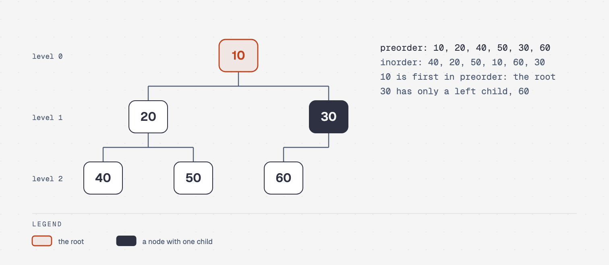
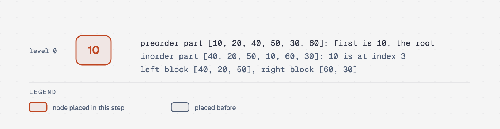
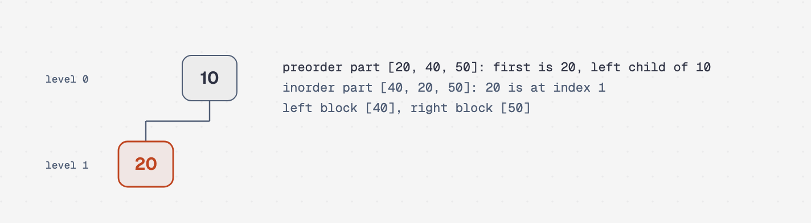
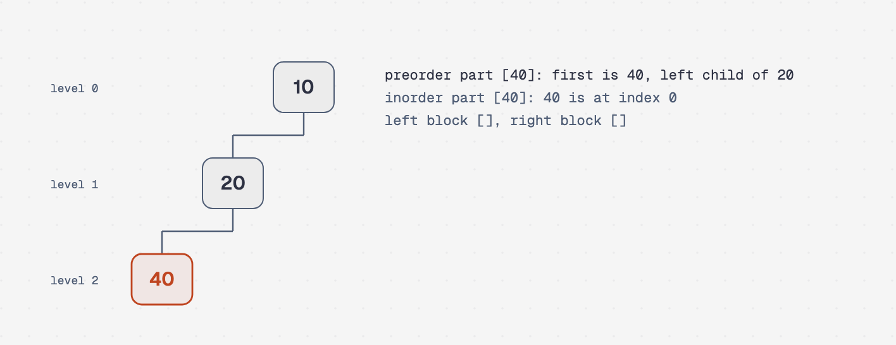
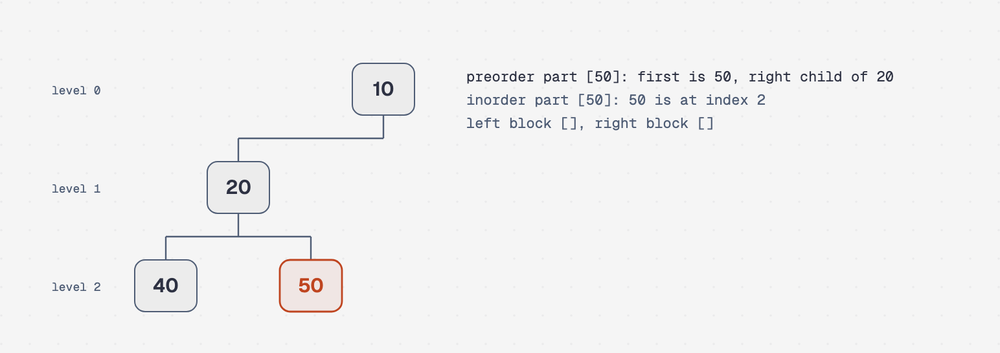
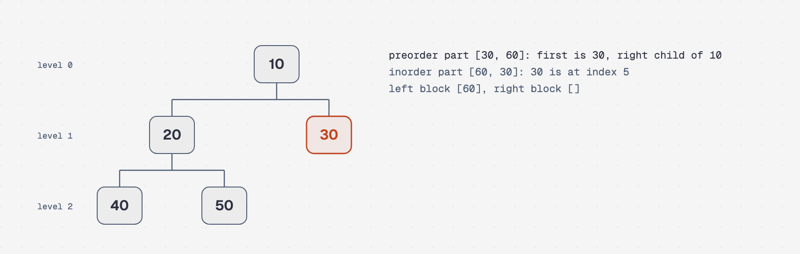
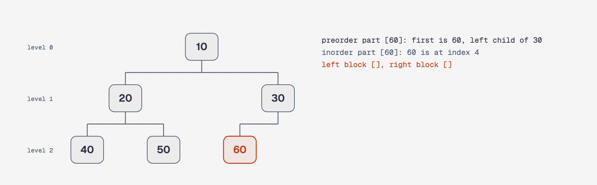

# 30. 105. Construct Binary Tree from Preorder and Inorder Traversal

| Difficulty | Pattern | Key idea | Source | Time | Space | Before / after |
|:---:|:---:|:---|:---:|:---:|:---:|:---:|
| **Medium** | Divide by the Root's Place in Inorder | The first preorder value is the root; its index in inorder splits the rest into the left block and the right block, whose sizes tell where each block sits in preorder. A dict gives that index in `O(1)` | [105. Construct Binary Tree from Preorder and Inorder Traversal](https://leetcode.com/problems/construct-binary-tree-from-preorder-and-inorder-traversal/) | `O(n)` | `O(n)` | [Unique Binary Tree](29.%20Requirements%20needed%20to%20construct%20a%20Unique%20Binary%20Tree.md) / [106. Build From Inorder and Postorder](31.%20106.%20Construct%20Binary%20Tree%20from%20Inorder%20and%20Postorder%20Traversal.md) |

## 1. Problem Statement

Given two lists `preorder` and `inorder` of the same binary tree (all values distinct), build the tree and return its root.

### Example

**The tree we take:** the lecture board's lists.

```text
Input:  preorder = [10, 20, 40, 50, 30, 60]
        inorder  = [40, 20, 50, 10, 60, 30]
Output: [10, 20, 30, 40, 50, 60]      (level order of the tree below)
```



It has the tricky parts of the problem:

- The root `10` sits at index 3 of inorder, so the **left block** has 3 values and the **right block** has 2: the split is not in the middle.
- Node `30` has only a **left** child. Its right block is empty, and the code must return `None` for it.
- The left block's values in preorder (`20, 40, 50`) come right after the root, and the right block's (`30, 60`) come after those. Their **sizes** from inorder tell where each block starts in preorder.

We use these lists in every section below.

LeetCode examples:

```text
preorder = [3, 9, 20, 15, 7], inorder = [9, 3, 15, 20, 7]   gives [3, 9, 20, None, None, 15, 7]
preorder = [-1], inorder = [-1]                               gives [-1]
```

### Constraints, in plain words

| Limit | What it means in plain words | What it tells us |
|:---|:---|:---|
| `1 <= preorder.length <= 3000` | 1 to 3,000 nodes | `O(n^2)` is about 9 million steps: still fast, but `O(n)` is the clean answer |
| `inorder.length == preorder.length` | Both lists describe the same nodes | Both lists can be cut into blocks of equal size |
| `-3000 <= value <= 3000`, all unique | Values never repeat | Each value has exactly one index in inorder, so a dict works |
| Both lists are real traversals of one tree | No broken input | No need to check for impossible lists |

**How fast is fast enough?**

- **Brute force** searches inorder for the root with `.index()` and copies the blocks with slicing, at every node: up to `n` steps per node, about `n^2 / 2` in total on a chain.
- **Index ranges plus a dict** finds each root in `O(1)` and never copies: `n` steps.

| Nodes `n` (chain) | Brute force steps (about `n^2 / 2`) | Ranges + dict steps | Brute force time (at 100 million steps per second) | Ranges + dict time | Faster by |
|:---:|:---:|:---:|:---:|:---:|:---:|
| 500 | 125,000 | 500 | 1.25 milliseconds | 0.005 milliseconds | about 250 times |
| 1,000 | 500,000 | 1,000 | 5 milliseconds | 0.01 milliseconds | about 500 times |
| 2,000 | 2,000,000 | 2,000 | 20 milliseconds | 0.02 milliseconds | about 1,000 times |
| 3,000 | 4,500,000 | 3,000 | 45 milliseconds | 0.03 milliseconds | about 1,500 times |

## 2. Core Idea

The rule from note 29, used again and again:

1. The **first** value of the preorder block is the **root** of this block.
2. Find the root in the inorder block. Everything **before** it is the left subtree; everything **after** it is the right subtree. Call the number before it `left_size`.
3. In preorder, the left subtree is the next `left_size` values after the root, and the right subtree is the rest.
4. Build the left subtree from those two blocks, then the right subtree, the same way. An empty block gives `None`.

Instead of copying blocks, keep **index ranges**: `[pl, pr]` in preorder and `[il, ir]` in inorder. A dict `value -> index in inorder` finds the root's place in `O(1)` (the lecture's "hash").

## 3. Edge Cases

| Case | Input | Expected | Why it matters | Code that handles it |
|:---|:---|:---|:---|:---|
| One node | `[-1]`, `[-1]` | `[-1]` | Both blocks are empty | `pl > pr` returns `None` for both children |
| Only a left child | `30` in our tree | `30` with left child `60` | The right block is empty | The right range is empty: `None` |
| Left chain | `[1, 2, 3]`, `[3, 2, 1]` | `1 -> 2 -> 3` going left | The root is always last in its inorder block | `left_size` is the whole rest |
| Right chain | `[1, 2, 3]`, `[1, 2, 3]` | `1 -> 2 -> 3` going right | The root is always first in its inorder block | `left_size = 0` |
| Negative values | `[-1]`, `[-1]` | `[-1]` | Values are dict keys, sign does not matter | The dict |

## 4. Brute Force: Slice the Lists and Search With `.index()`

### Idea

Take `preorder[0]` as the root, find it with `inorder.index(root)`, slice both lists into left and right parts, and recurse on the slices. Easy to write, but every call searches and copies.

### Code

```python
# Import types for hints
from typing import List, Optional


# Solution for 105, slice the lists and search with index()
class Solution:

    # Main method
    def buildTree(self, preorder: List[int], inorder: List[int]) -> Optional[TreeNode]:

        # No values: no tree
        if not preorder:

            # Empty subtree
            return None

        # The first preorder value is the root
        root = TreeNode(preorder[0])

        # Where the root sits in inorder
        m = inorder.index(preorder[0])

        # Left subtree: next m values of preorder, first m of inorder
        root.left = self.buildTree(preorder[1:m + 1], inorder[:m])

        # Right subtree: the rest of both lists
        root.right = self.buildTree(preorder[m + 1:], inorder[m + 1:])

        # The finished subtree
        return root
```

### Complexity

| Measure | Complexity | Why | At the limit (`n = 3000`) | Compared with the optimal |
|:---|:---:|:---|:---:|:---|
| **Time** | `O(n^2)` | Each call searches and slices up to `n` values | about 4,500,000 steps on a chain | This is the baseline |
| **Space** | `O(n^2)` | The slices at every level are new lists | up to about 4,500,000 copied values on a chain | This is the baseline |

## 5. Optimal: Index Ranges and a Dict

### Idea

```text
pos = {value: index in inorder}
build(pl, pr, il, ir):                       # preorder[pl..pr], inorder[il..ir]
    if pl > pr: return None
    root = preorder[pl];  m = pos[root];  left_size = m - il
    root.left  = build(pl + 1, pl + left_size, il, m - 1)
    root.right = build(pl + left_size + 1, pr, m + 1, ir)
```

### Run it on our example, step by step

**The lists we take:** `preorder = [10, 20, 40, 50, 30, 60]`, `inorder = [40, 20, 50, 10, 60, 30]`.

**How to read the pictures:** orange is the node placed in this step, grey nodes were placed before. The tree grows in preorder: root first, then the whole left side, then the right side.

**Step 1: place 10**

- The preorder part is `[10, 20, 40, 50, 30, 60]`. Its first value, `10`, is the root.
- In the inorder part `[40, 20, 50, 10, 60, 30]`, `10` is at index 3.
- So the left block is `[40, 20, 50]` and the right block is `[60, 30]`.



**Step 2: place 20**

- The preorder part is `[20, 40, 50]`. Its first value, `20`, is the left child of 10.
- In the inorder part `[40, 20, 50]`, `20` is at index 1.
- So the left block is `[40]` and the right block is `[50]`.



**Step 3: place 40**

- The preorder part is `[40]`. Its first value, `40`, is the left child of 20.
- In the inorder part `[40]`, `40` is at index 0.
- So the left block is empty and the right block is empty. Both are empty: a leaf.



**Step 4: place 50**

- The preorder part is `[50]`. Its first value, `50`, is the right child of 20.
- In the inorder part `[50]`, `50` is at index 2.
- So the left block is empty and the right block is empty. Both are empty: a leaf.



**Step 5: place 30**

- The preorder part is `[30, 60]`. Its first value, `30`, is the right child of 10.
- In the inorder part `[60, 30]`, `30` is at index 5.
- So the left block is `[60]` and the right block is empty.



**Step 6: place 60**

- The preorder part is `[60]`. Its first value, `60`, is the left child of 30.
- In the inorder part `[60]`, `60` is at index 4.
- So the left block is empty and the right block is empty. Both are empty: a leaf.




**All steps at a glance**

| Step | Node | Preorder range | Inorder range | Index in inorder | Left block | Right block | Placed as |
|:---:|:---:|:---|:---|:---:|:---|:---|:---|
| 1 | 10 | `[10, 20, 40, 50, 30, 60]` (`0..5`) | `[40, 20, 50, 10, 60, 30]` (`0..5`) | 3 | `[40, 20, 50]` | `[60, 30]` | The root |
| 2 | 20 | `[20, 40, 50]` (`1..3`) | `[40, 20, 50]` (`0..2`) | 1 | `[40]` | `[50]` | The left child of 10 |
| 3 | 40 | `[40]` (`2..2`) | `[40]` (`0..0`) | 0 | empty | empty | The left child of 20 |
| 4 | 50 | `[50]` (`3..3`) | `[50]` (`2..2`) | 2 | empty | empty | The right child of 20 |
| 5 | 30 | `[30, 60]` (`4..5`) | `[60, 30]` (`4..5`) | 5 | `[60]` | empty | The right child of 10 |
| 6 | 60 | `[60]` (`5..5`) | `[60]` (`4..4`) | 4 | empty | empty | The left child of 30 |

### Code

```python
# Import types for hints
from typing import List, Optional


# Solution for 105, index ranges and a dict
class Solution:

    # Main method
    def buildTree(self, preorder: List[int], inorder: List[int]) -> Optional[TreeNode]:

        # Index of every value in inorder
        pos = {v: i for i, v in enumerate(inorder)}

        # Build from preorder[pl..pr] and inorder[il..ir]
        def build(pl: int, pr: int, il: int, ir: int) -> Optional[TreeNode]:

            # Empty range: no node here
            if pl > pr:

                # Empty subtree
                return None

            # The first value of the range is the root
            root = TreeNode(preorder[pl])

            # Where the root sits in inorder
            m = pos[preorder[pl]]

            # How many values are on its left
            left_size = m - il

            # Left: the next left_size preorder values, inorder before m
            root.left = build(pl + 1, pl + left_size, il, m - 1)

            # Right: the remaining preorder values, inorder after m
            root.right = build(pl + left_size + 1, pr, m + 1, ir)

            # The finished subtree
            return root

        # Build the whole tree
        return build(0, len(preorder) - 1, 0, len(inorder) - 1)
```

### Complexity

| Measure | Complexity | Why | At the limit (`n = 3000`) | Compared with brute force |
|:---|:---:|:---|:---:|:---|
| **Time** | `O(n)` | Each node is created once, and its root index comes from the dict | 3,000 steps | About 1,500 times fewer steps on a chain |
| **Space** | `O(n)` | The dict, plus recursion depth up to `n` on a chain | 3,000 dict entries | No copies of the lists |

## 6. Approach 3: One Stack, No Recursion (From the Lecture)

### Idea

Walk preorder from left to right and keep a stack of nodes whose right child is not known yet. Keep a pointer `j` into inorder.

- If the stack's top is **not** `inorder[j]`, the new node is the top's **left** child (we are still going left).
- Otherwise, pop while the top equals `inorder[j]` (moving `j` forward each time). Those nodes' left sides are finished. The new node is the **right** child of the last popped node.

### Code

```python
# Import types for hints
from typing import List, Optional


# Solution for 105, one stack and no recursion
class Solution:

    # Main method
    def buildTree(self, preorder: List[int], inorder: List[int]) -> Optional[TreeNode]:

        # The first preorder value is the root
        root = TreeNode(preorder[0])

        # Nodes whose right child is still unknown
        stack = [root]

        # Next value to match in inorder
        j = 0

        # Place every other preorder value
        for v in preorder[1:]:

            # The new node
            node = TreeNode(v)

            # Top of the stack is not finished on its left yet
            if stack[-1].val != inorder[j]:

                # So the new node is its left child
                stack[-1].left = node

            # Top's left side is finished
            else:

                # The parent of a right child, found below
                parent = None

                # Pop every node whose left side is finished
                while stack and stack[-1].val == inorder[j]:

                    # This node may get the right child
                    parent = stack.pop()

                    # Move on in inorder
                    j += 1

                # The new node is the right child of the last popped node
                parent.right = node

            # The new node may get children later
            stack.append(node)

        # The finished tree
        return root
```

### Complexity

| Measure | Complexity | Why | At the limit (`n = 3000`) | Compared with the recursive version |
|:---|:---:|:---|:---:|:---|
| **Time** | `O(n)` | Each node is pushed and popped once | 3,000 pushes and pops | Same |
| **Space** | `O(h)` | The stack holds one path | up to 3,000 on a chain | No dict, no recursion limit |

## 7. Common Mistakes

| Mistake | What goes wrong | Fix |
|:---|:---|:---|
| Using `m` (the inorder index) to cut preorder | Inorder and preorder ranges do not start at the same index | Cut preorder with `left_size = m - il` |
| Off by one in the right preorder range | The right subtree gets a left value | Right starts at `pl + left_size + 1` |
| Calling `.index()` at every node | `O(n^2)` on chains | Build the dict once |
| Building right before left with a moving preorder pointer | Values are taken in the wrong order | With a single pointer, always build left first |
| Forgetting the empty range | Infinite recursion or index errors | Return `None` when `pl > pr` |

## 8. Interview Follow-ups

### Q1. How does this change for inorder plus postorder (LeetCode 106)?

**Answer:**
- The root is the **last** value of the postorder block.
- The left block in postorder is the first `left_size` values, and the right block is the rest before the root. That is the next note.

### Q2. Why do the values have to be distinct?

**Answer:**
- With repeats, the root could be at several places in inorder, so the split is not known.
- Different splits can give different trees.

### Q3. Can you avoid the dict and keep `O(n)`?

**Answer:**
- Yes: the stack version in Approach 3 uses no dict.
- Another way: pass a "stop" value down; build until inorder reaches the stop value, moving one pointer through each list.

### Q4. How would you build a tree from preorder alone if it is a BST (LeetCode 1008)?

**Answer:**
- In a BST, inorder is just the sorted list, so preorder is enough.
- Or build directly: each value goes left while it is below an upper bound. That is `O(n)`.

### Q5. What is the recursion depth, and when does it matter?

**Answer:**
- It equals the tree height: up to 3,000 for a chain.
- Python's default limit is 1,000, so raise it with `sys.setrecursionlimit` or use the stack version.

## 9. Interview Explanation

> The first value of preorder is the root. I look up its index in inorder with a dict built once. Everything before that index in inorder is the left subtree, so left_size is that index minus the start of the inorder range. In preorder, the next left_size values are the left subtree and the rest are the right subtree. I recurse with index ranges instead of slicing, and return None when a range is empty. Each node is created once with an O(1) lookup, so it is O(n) time and O(n) space for the dict and the recursion.
