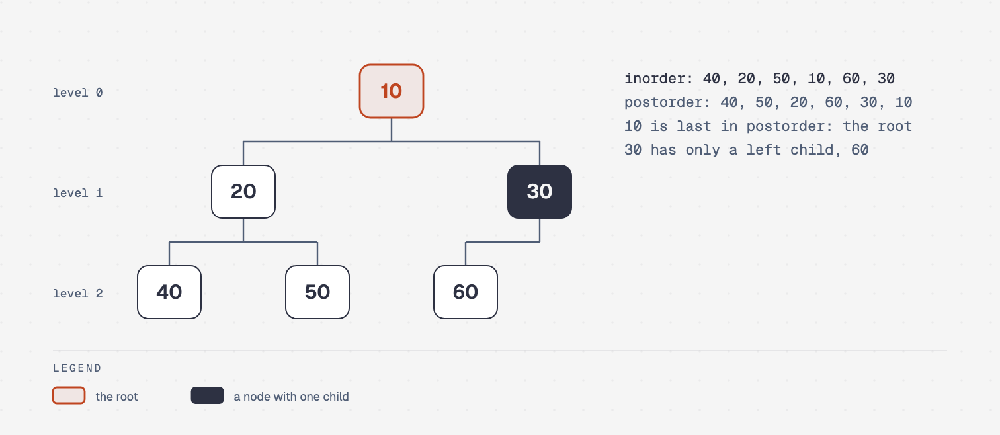
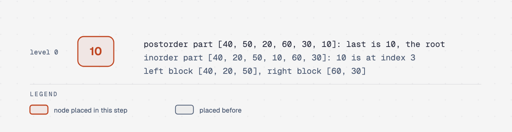
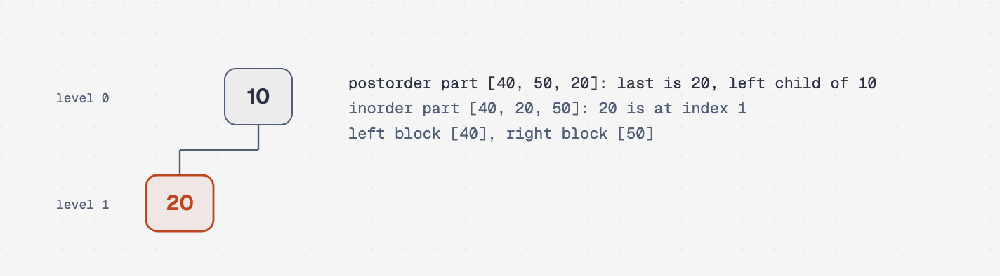
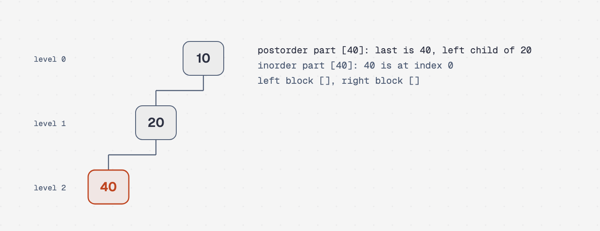
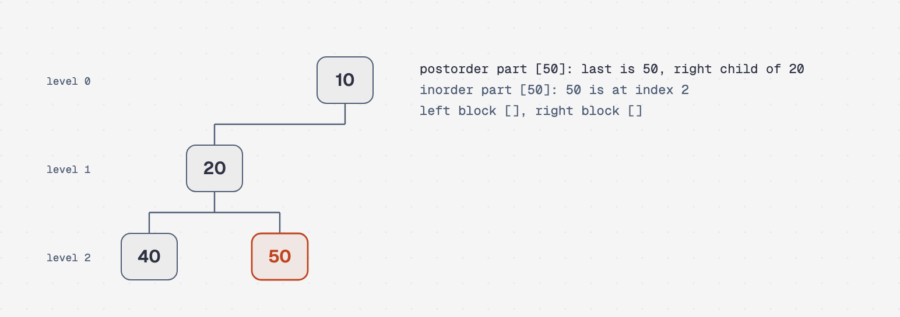
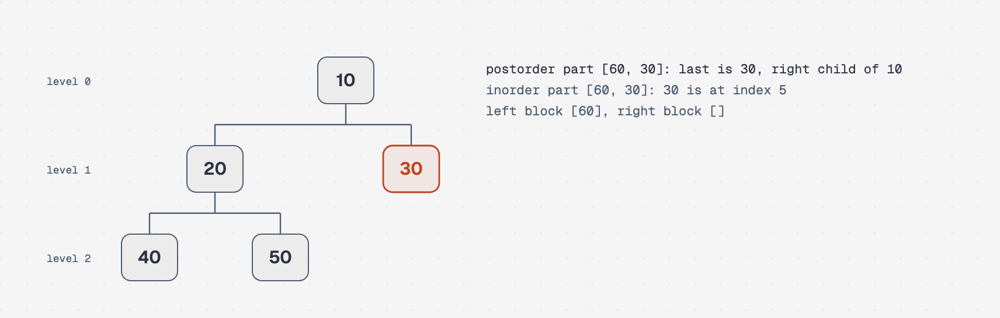
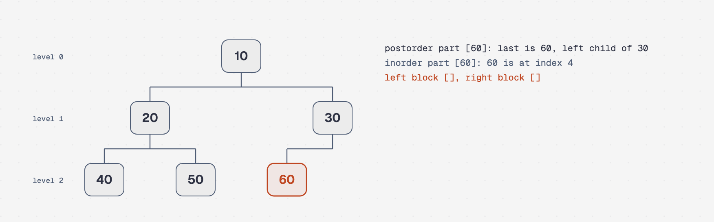

# 31. 106. Construct Binary Tree from Inorder and Postorder Traversal

| Difficulty | Pattern | Key idea | Source | Time | Space | Before / after |
|:---:|:---:|:---|:---:|:---:|:---:|:---:|
| **Medium** | Divide by the Root's Place in Inorder | Same as 105, but the root is the **last** value of the postorder block; its index in inorder gives `left_size`, so postorder splits into the first `left_size` values (left) and the rest before the root (right) | [106. Construct Binary Tree from Inorder and Postorder Traversal](https://leetcode.com/problems/construct-binary-tree-from-inorder-and-postorder-traversal/) | `O(n)` | `O(n)` | [105. Build From Preorder and Inorder](30.%20105.%20Construct%20Binary%20Tree%20from%20Preorder%20and%20Inorder%20Traversal.md) / [297. Serialize and Deserialize](32.%20297.%20Serialize%20and%20Deserialize%20Binary%20Tree.md) |

## 1. Problem Statement

Given two lists `inorder` and `postorder` of the same binary tree (all values distinct), build the tree and return its root.

### Example

**The tree we take:** the lecture board's lists (the same tree as note 30, now with postorder).

```text
Input:  inorder   = [40, 20, 50, 10, 60, 30]
        postorder = [40, 50, 20, 60, 30, 10]
Output: [10, 20, 30, 40, 50, 60]      (level order of the tree below)
```



It has the tricky parts of the problem:

- The root is at the **end** of postorder (`10`), not at the start.
- In postorder, the left block (`40, 50, 20`) comes **first**, then the right block (`60, 30`), then the root. The left block's size comes from inorder: `10` is at index 3, so 3 values.
- Node `30` has only a **left** child, so its right block is empty.

We use these lists in every section below.

LeetCode examples:

```text
inorder = [9, 3, 15, 20, 7], postorder = [9, 15, 7, 20, 3]   gives [3, 9, 20, None, None, 15, 7]
inorder = [-1], postorder = [-1]                               gives [-1]
```

### Constraints, in plain words

| Limit | What it means in plain words | What it tells us |
|:---|:---|:---|
| `1 <= inorder.length <= 3000` | 1 to 3,000 nodes | `O(n^2)` is about 9 million steps; `O(n)` is the clean answer |
| `postorder.length == inorder.length` | Both lists describe the same nodes | Both can be cut into blocks of equal size |
| `-3000 <= value <= 3000`, all unique | Values never repeat | A dict `value -> index in inorder` works |
| Both lists are real traversals of one tree | No broken input | No need to check for impossible lists |

**How fast is fast enough?**

| Nodes `n` (chain) | Brute force steps (about `n^2 / 2`) | Ranges + dict steps | Brute force time (at 100 million steps per second) | Ranges + dict time | Faster by |
|:---:|:---:|:---:|:---:|:---:|:---:|
| 500 | 125,000 | 500 | 1.25 milliseconds | 0.005 milliseconds | about 250 times |
| 1,000 | 500,000 | 1,000 | 5 milliseconds | 0.01 milliseconds | about 500 times |
| 2,000 | 2,000,000 | 2,000 | 20 milliseconds | 0.02 milliseconds | about 1,000 times |
| 3,000 | 4,500,000 | 3,000 | 45 milliseconds | 0.03 milliseconds | about 1,500 times |

The brute force searches with `.index()` and copies slices at every node; the optimal method uses a dict and index ranges.

## 2. Core Idea

Postorder is left, right, **root**. So:

1. The **last** value of the postorder block is the root.
2. Find it in inorder: the values before it are the left subtree (`left_size` of them), the values after it are the right subtree.
3. In postorder, the **first** `left_size` values are the left subtree, and the values after them, up to (not including) the root, are the right subtree.
4. Build both sides the same way. An empty block gives `None`.

| | 105 (preorder + inorder) | 106 (inorder + postorder) |
|:---|:---|:---|
| Where the root is | First value of the preorder block | Last value of the postorder block |
| Left block in the root's list | Right after the root: `pl + 1 .. pl + left_size` | At the start: `pl .. pl + left_size - 1` |
| Right block in the root's list | After the left block: `pl + left_size + 1 .. pr` | After the left block, before the root: `pl + left_size .. pr - 1` |
| Stack version walks the list | Forwards, attaching **left** children first | Backwards, attaching **right** children first |

## 3. Edge Cases

| Case | Input | Expected | Why it matters | Code that handles it |
|:---|:---|:---|:---|:---|
| One node | `[-1]`, `[-1]` | `[-1]` | Both blocks are empty | `pl > pr` returns `None` |
| Only a left child | `30` in our tree | `30` with left child `60` | The right block is empty | Empty range: `None` |
| Left chain | inorder `[3, 2, 1]`, postorder `[3, 2, 1]` | `1 -> 2 -> 3` going left | The root is last in its inorder block | `left_size` is the whole rest |
| Right chain | inorder `[1, 2, 3]`, postorder `[3, 2, 1]` | `1 -> 2 -> 3` going right | The root is first in its inorder block | `left_size = 0` |
| Reading postorder from the front | any | wrong tree | The front of postorder is a leaf | Take the root from the end |

## 4. Brute Force: Slice the Lists and Search With `.index()`

### Idea

Take `postorder[-1]` as the root, find it with `inorder.index(root)` at position `m`, and recurse on slices: left gets `inorder[:m]` and `postorder[:m]`; right gets `inorder[m + 1:]` and `postorder[m:-1]`.

### Code

```python
# Import types for hints
from typing import List, Optional


# Solution for 106, slice the lists and search with index()
class Solution:

    # Main method
    def buildTree(self, inorder: List[int], postorder: List[int]) -> Optional[TreeNode]:

        # No values: no tree
        if not postorder:

            # Empty subtree
            return None

        # The last postorder value is the root
        root = TreeNode(postorder[-1])

        # Where the root sits in inorder
        m = inorder.index(postorder[-1])

        # Left subtree: first m values of both lists
        root.left = self.buildTree(inorder[:m], postorder[:m])

        # Right subtree: the rest, without the root at the end of postorder
        root.right = self.buildTree(inorder[m + 1:], postorder[m:-1])

        # The finished subtree
        return root
```

### Complexity

| Measure | Complexity | Why | At the limit (`n = 3000`) | Compared with the optimal |
|:---|:---:|:---|:---:|:---|
| **Time** | `O(n^2)` | Each call searches and slices up to `n` values | about 4,500,000 steps on a chain | This is the baseline |
| **Space** | `O(n^2)` | Slices at every level are new lists | up to about 4,500,000 copied values on a chain | This is the baseline |

## 5. Optimal: Index Ranges and a Dict

### Idea

```text
pos = {value: index in inorder}
build(pl, pr, il, ir):                       # postorder[pl..pr], inorder[il..ir]
    if pl > pr: return None
    root = postorder[pr];  m = pos[root];  left_size = m - il
    root.left  = build(pl, pl + left_size - 1, il, m - 1)
    root.right = build(pl + left_size, pr - 1, m + 1, ir)
```

### Run it on our example, step by step

**The lists we take:** `inorder = [40, 20, 50, 10, 60, 30]`, `postorder = [40, 50, 20, 60, 30, 10]`.

**How to read the pictures:** orange is the node placed in this step, grey nodes were placed before. The code builds the left side first, so the tree grows root, left side, right side.

**Step 1: place 10**

- The postorder part is `[40, 50, 20, 60, 30, 10]`. Its last value, `10`, is the root.
- In the inorder part `[40, 20, 50, 10, 60, 30]`, `10` is at index 3.
- So the left block is `[40, 20, 50]` and the right block is `[60, 30]`.



**Step 2: place 20**

- The postorder part is `[40, 50, 20]`. Its last value, `20`, is the left child of 10.
- In the inorder part `[40, 20, 50]`, `20` is at index 1.
- So the left block is `[40]` and the right block is `[50]`.



**Step 3: place 40**

- The postorder part is `[40]`. Its last value, `40`, is the left child of 20.
- In the inorder part `[40]`, `40` is at index 0.
- So the left block is empty and the right block is empty. Both are empty: a leaf.



**Step 4: place 50**

- The postorder part is `[50]`. Its last value, `50`, is the right child of 20.
- In the inorder part `[50]`, `50` is at index 2.
- So the left block is empty and the right block is empty. Both are empty: a leaf.



**Step 5: place 30**

- The postorder part is `[60, 30]`. Its last value, `30`, is the right child of 10.
- In the inorder part `[60, 30]`, `30` is at index 5.
- So the left block is `[60]` and the right block is empty.



**Step 6: place 60**

- The postorder part is `[60]`. Its last value, `60`, is the left child of 30.
- In the inorder part `[60]`, `60` is at index 4.
- So the left block is empty and the right block is empty. Both are empty: a leaf.




**All steps at a glance**

| Step | Node | Postorder range | Inorder range | Index in inorder | Left block | Right block | Placed as |
|:---:|:---:|:---|:---|:---:|:---|:---|:---|
| 1 | 10 | `[40, 50, 20, 60, 30, 10]` (`0..5`) | `[40, 20, 50, 10, 60, 30]` (`0..5`) | 3 | `[40, 20, 50]` | `[60, 30]` | The root |
| 2 | 20 | `[40, 50, 20]` (`0..2`) | `[40, 20, 50]` (`0..2`) | 1 | `[40]` | `[50]` | The left child of 10 |
| 3 | 40 | `[40]` (`0..0`) | `[40]` (`0..0`) | 0 | empty | empty | The left child of 20 |
| 4 | 50 | `[50]` (`1..1`) | `[50]` (`2..2`) | 2 | empty | empty | The right child of 20 |
| 5 | 30 | `[60, 30]` (`3..4`) | `[60, 30]` (`4..5`) | 5 | `[60]` | empty | The right child of 10 |
| 6 | 60 | `[60]` (`3..3`) | `[60]` (`4..4`) | 4 | empty | empty | The left child of 30 |

### Code

```python
# Import types for hints
from typing import List, Optional


# Solution for 106, index ranges and a dict
class Solution:

    # Main method
    def buildTree(self, inorder: List[int], postorder: List[int]) -> Optional[TreeNode]:

        # Index of every value in inorder
        pos = {v: i for i, v in enumerate(inorder)}

        # Build from postorder[pl..pr] and inorder[il..ir]
        def build(pl: int, pr: int, il: int, ir: int) -> Optional[TreeNode]:

            # Empty range: no node here
            if pl > pr:

                # Empty subtree
                return None

            # The last value of the range is the root
            root = TreeNode(postorder[pr])

            # Where the root sits in inorder
            m = pos[postorder[pr]]

            # How many values are on its left
            left_size = m - il

            # Left: the first left_size postorder values, inorder before m
            root.left = build(pl, pl + left_size - 1, il, m - 1)

            # Right: the next values up to just before the root, inorder after m
            root.right = build(pl + left_size, pr - 1, m + 1, ir)

            # The finished subtree
            return root

        # Build the whole tree
        return build(0, len(postorder) - 1, 0, len(inorder) - 1)
```

### Complexity

| Measure | Complexity | Why | At the limit (`n = 3000`) | Compared with brute force |
|:---|:---:|:---|:---:|:---|
| **Time** | `O(n)` | Each node is created once with an `O(1)` lookup | 3,000 steps | About 1,500 times fewer steps on a chain |
| **Space** | `O(n)` | The dict, plus recursion depth up to `n` on a chain | 3,000 dict entries | No copies of the lists |

## 6. Approach 3: One Stack, No Recursion (From the Lecture)

### Idea

Read postorder **backwards**: that gives root, right, left (a mirrored preorder). Read inorder backwards too, with a pointer `j` from the end.

- If the stack's top is **not** `inorder[j]`, the new node is the top's **right** child.
- Otherwise, pop while the top equals `inorder[j]` (moving `j` back each time). The new node is the **left** child of the last popped node.

### Code

```python
# Import types for hints
from typing import List, Optional


# Solution for 106, one stack and no recursion
class Solution:

    # Main method
    def buildTree(self, inorder: List[int], postorder: List[int]) -> Optional[TreeNode]:

        # The last postorder value is the root
        root = TreeNode(postorder[-1])

        # Nodes whose left child is still unknown
        stack = [root]

        # Next value to match in inorder, from the end
        j = len(inorder) - 1

        # Place the other values, reading postorder backwards
        for v in reversed(postorder[:-1]):

            # The new node
            node = TreeNode(v)

            # Top of the stack is not finished on its right yet
            if stack[-1].val != inorder[j]:

                # So the new node is its right child
                stack[-1].right = node

            # Top's right side is finished
            else:

                # The parent of a left child, found below
                parent = None

                # Pop every node whose right side is finished
                while stack and stack[-1].val == inorder[j]:

                    # This node may get the left child
                    parent = stack.pop()

                    # Move back in inorder
                    j -= 1

                # The new node is the left child of the last popped node
                parent.left = node

            # The new node may get children later
            stack.append(node)

        # The finished tree
        return root
```

### Complexity

| Measure | Complexity | Why | At the limit (`n = 3000`) | Compared with the recursive version |
|:---|:---:|:---|:---:|:---|
| **Time** | `O(n)` | Each node is pushed and popped once | 3,000 pushes and pops | Same |
| **Space** | `O(h)` | The stack holds one path | up to 3,000 on a chain | No dict, no recursion limit |

## 7. Common Mistakes

| Mistake | What goes wrong | Fix |
|:---|:---|:---|
| Taking the root from the front of postorder | The front is a leaf (`40`), not the root | Take `postorder[pr]` |
| Right block ending at `pr` | The root is counted again inside its own right subtree | The right block ends at `pr - 1` |
| Left block starting at `pl + 1` (copied from 105) | Every left subtree loses its first value | In postorder the left block starts at `pl` |
| With one moving postorder pointer, building left first | Values are taken in the wrong order | With a pointer from the end, build **right** first |
| Calling `.index()` at every node | `O(n^2)` on chains | Build the dict once |

## 8. Interview Follow-ups

### Q1. Why must a single backward pointer build the right subtree first?

**Answer:**
- Read backwards, postorder is root, right, left.
- So after a root, the next values belong to the right subtree; building left first would take them in the wrong order.

### Q2. Can you build from preorder and postorder (LeetCode 889)?

**Answer:**
- Only if the tree is full (every node has 0 or 2 children); otherwise the answer is not unique (note 29).
- The value after the root in preorder is the left child; its index in postorder gives the left block's size.

### Q3. How do you check your answer quickly?

**Answer:**
- Write the built tree in inorder and postorder again and compare with the input.
- Both must match exactly, because the pair fixes one tree.

### Q4. What is the recursion depth here?

**Answer:**
- The tree height: up to 3,000 for a chain, over Python's default limit of 1,000.
- Raise the limit or use the stack version.

### Q5. What changes if values can repeat?

**Answer:**
- The root may appear several times in inorder, so the split is not known and the tree is not unique.
- The problem guarantees distinct values to avoid this.

## 9. Interview Explanation

> The last value of postorder is the root. I find its index in inorder with a dict built once; the number of values before it is left_size. In postorder, the first left_size values are the left subtree and the values after them, up to just before the root, are the right subtree. I recurse with index ranges and return None for an empty range. Each node is created once with an O(1) lookup, so it is O(n) time and O(n) space. The only differences from 105 are where the root is and where the left block starts.
