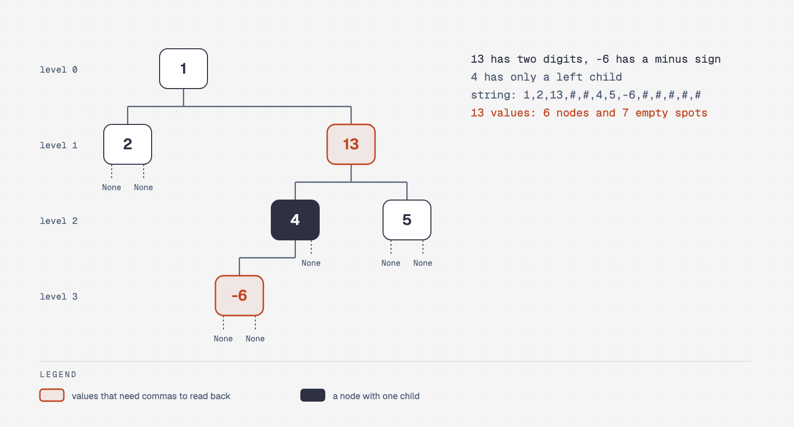
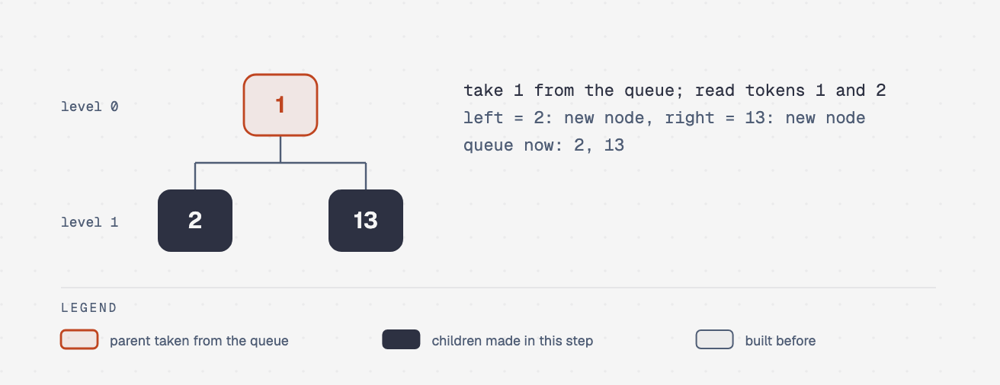
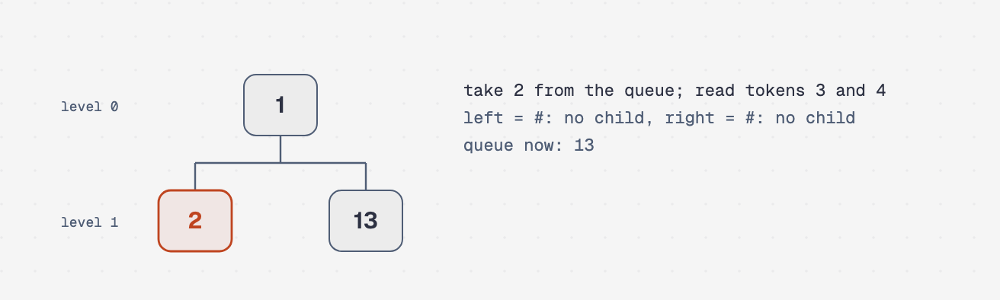
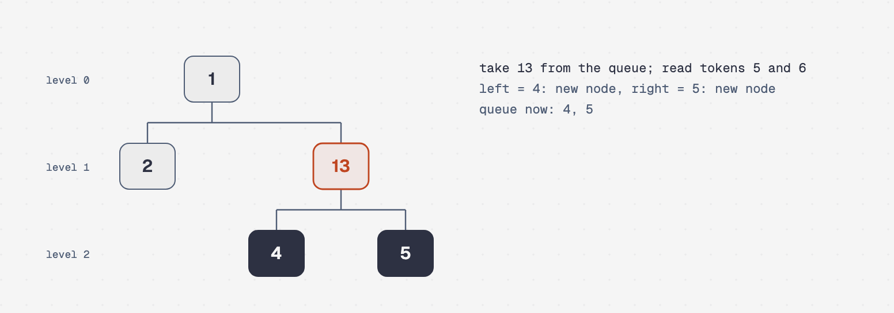
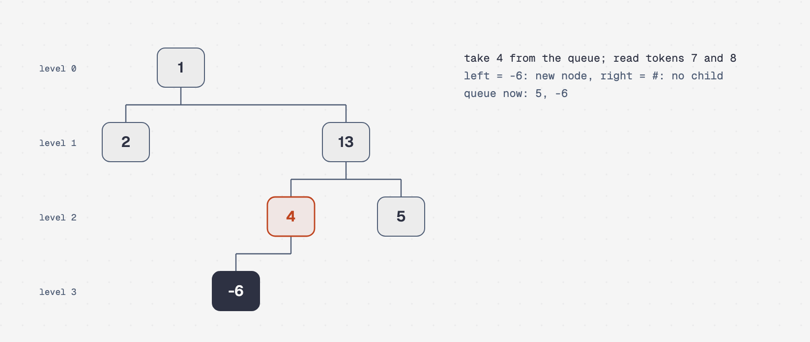
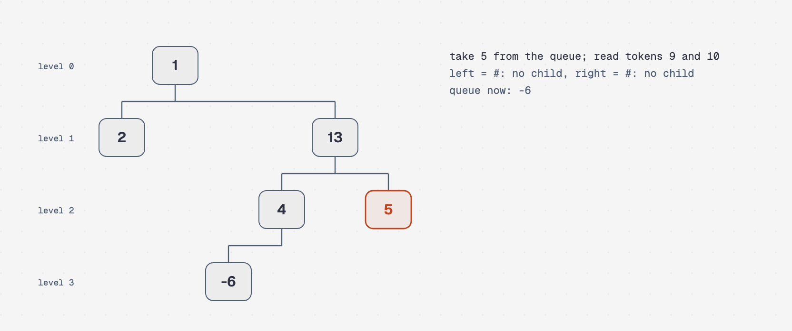
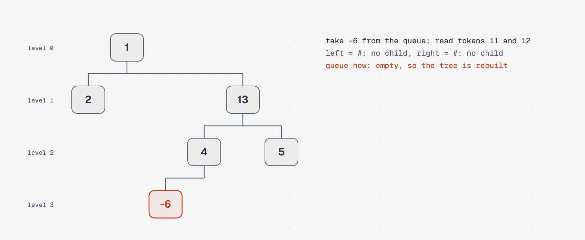

# 32. 297. Serialize and Deserialize Binary Tree

| Difficulty | Pattern | Key idea | Source | Time | Space | Before / after |
|:---:|:---:|:---|:---:|:---:|:---:|:---:|
| **Hard** | Traversal With Empty-Spot Markers | Write the tree in level order (or preorder) and put a marker `#` for every empty spot; with the markers, one list fixes the shape, so reading it back in the same order rebuilds the same tree | [297. Serialize and Deserialize Binary Tree](https://leetcode.com/problems/serialize-and-deserialize-binary-tree/) | `O(n)` | `O(n)` | [106. Build From Inorder and Postorder](31.%20106.%20Construct%20Binary%20Tree%20from%20Inorder%20and%20Postorder%20Traversal.md) / [114. Flatten Binary Tree](33.%20114.%20Flatten%20Binary%20Tree%20to%20Linked%20List.md) |

## 1. Problem Statement

Design two functions:

- `serialize(root)`: turn a binary tree into a **string**,
- `deserialize(data)`: turn that string back into the **same tree**.

Any format is allowed, as long as `deserialize(serialize(root))` gives back the same shape and values. The lecture's picture: tree to `serialize` to string, then string to `deserialize` (the reverse logic) to tree.

### Example

**The tree we take:** the lecture's tree `1` with children `2` and `13`, and `13` with children `4` and `5`, plus one more node `-6` as the left child of `4`. As a LeetCode list: `[1, 2, 13, None, None, 4, 5, -6]`.

```text
Input:  root = [1, 2, 13, None, None, 4, 5, -6]
serialize(root)   gives "1,2,13,#,#,4,5,-6,#,#,#,#,#"
deserialize(that) gives the same tree back
```



It has the tricky parts of the problem:

- `13` has **two digits** and `-6` has a **minus sign**, so values must be separated (with commas), not just glued together.
- `4` has only a **left** child. Without a marker for its empty right spot, the reader cannot know which side `-6` is on.
- Values may **repeat** in this problem, so tricks that need unique values (like notes 30 and 31) do not work.

We use this tree in every section below.

LeetCode examples:

```text
root = [1, 2, 3, None, None, 4, 5]   round trip gives [1, 2, 3, None, None, 4, 5]
root = []                            round trip gives []
```

### Constraints, in plain words

| Limit | What it means in plain words | What it tells us |
|:---|:---|:---|
| Number of nodes is `0` to `10^4` | Up to 10,000 nodes; can be empty | The empty tree needs its own string, for example `""` |
| `-1000 <= Node.val <= 1000` | Up to 4 digits, maybe a minus sign | Separate values with commas so they can be read back |
| Values may repeat | Two nodes can have the same value | One list with empty-spot markers works; inorder plus preorder does not |
| "Any format" | You choose the string | Level order with `#` and preorder with `#` are the two standard choices |

**How fast is fast enough?**

- Both directions visit each node and each empty spot once. A tree with `n` nodes has `n + 1` empty spots, so the string has `2n + 1` values: about 20,000 for 10,000 nodes.
- Both methods below are `O(n)`. The level-order one is the lecture's main answer; the preorder one is shorter to write.

| Method | Values in the string for our tree | Works with repeated values? | Recursion? | Note |
|:---|:---:|:---:|:---:|:---|
| Two lists: inorder and preorder (note 30) | 12 (6 + 6) | No | Yes | Needs unique values to find the root in inorder |
| Level order with `#` markers | 13 (6 nodes + 7 empty spots) | Yes | No | The lecture's main answer |
| Preorder with `#` markers | 13 | Yes | Yes | Shorter code, same size |

## 2. Core Idea

A traversal list loses the shape (note 29). An **empty-spot marker** puts it back: if every missing child is written as `#`, the reader always knows when a subtree ends.

**Serialize (level order):** BFS from the root. For each item taken from the queue, write its value and queue both children (even empty ones); for an empty item, write `#`.

**Deserialize (level order):** split the string at commas. Make the root from the first value and put it in a queue. Then repeat: take a parent from the queue and read the **next two** values; they are its left and right child (`#` means none). Every real child goes into the queue. Parents and values come in the same order as they were written, so each value lands on the right spot.

## 3. Edge Cases

| Case | Input | String | Why it matters | Code that handles it |
|:---|:---|:---|:---|:---|
| Empty tree | `[]` | `""` | No root to write | `if not root: return ""` and `if not data: return None` |
| One node | `[5]` | `"5,#,#"` | Two empty spots after it | Both children are queued and written as `#` |
| Two-digit and negative values | our tree | `...,13,...,-6,...` | Glued digits would be ambiguous | Commas between values, `int()` to read back |
| One child only | `4` in our tree | `-6,#` for its children | The side of the lone child must be kept | The `#` marker |
| Repeated values | `[1, 1, 1]` | `"1,1,1,#,#,#,#"` | Inorder plus preorder cannot tell the 1s apart | Markers do not care about values |

## 4. Why Not Just Two Lists?

Note 30 rebuilds a tree from inorder plus preorder. That needs **unique** values, because the root is found by its value in inorder. Here values may repeat. Take `[1, 1]` (a `1` with a left child `1`) and `[1, None, 1]` (a `1` with a right child `1`). Both give inorder `1, 1` and preorder `1, 1`, so the two lists cannot tell the shapes apart. One list with markers has no such problem.

## 5. Approach 1: Level Order With `#` Markers (the Lecture's Answer)

### Idea

```text
serialize:   BFS; write node.val, or # for an empty spot; queue both children of every real node
deserialize: root = first value; queue = [root]; i = 1
             repeat: take a parent; values[i] and values[i + 1] are its left and right child
```

### Run it on our example, step by step

**The string we read:** `"1,2,13,#,#,4,5,-6,#,#,#,#,#"`. Its values are numbered from 0: value 0 is `1`, value 1 is `2`, value 2 is `13`, and so on.

**How to read the pictures:** orange is the parent taken from the queue, dark nodes are the children made in this step, grey nodes were built before.

**Step 1: children of 1**

- Take `1` from the queue and read values 1 and 2: `2` and `13`.
- Left child: `2`. Right child: `13`.
- Queue now: 2, 13.



**Step 2: children of 2**

- Take `2` from the queue and read values 3 and 4: `#` and `#`.
- Left child: none (`#`). Right child: none (`#`).
- Queue now: 13.



**Step 3: children of 13**

- Take `13` from the queue and read values 5 and 6: `4` and `5`.
- Left child: `4`. Right child: `5`.
- Queue now: 4, 5.



**Step 4: children of 4**

- Take `4` from the queue and read values 7 and 8: `-6` and `#`.
- Left child: `-6`. Right child: none (`#`).
- Queue now: 5, -6.



**Step 5: children of 5**

- Take `5` from the queue and read values 9 and 10: `#` and `#`.
- Left child: none (`#`). Right child: none (`#`).
- Queue now: -6.



**Step 6: children of -6**

- Take `-6` from the queue and read values 11 and 12: `#` and `#`.
- Left child: none (`#`). Right child: none (`#`).
- Queue now: empty. The tree is rebuilt.




**All steps at a glance**

| Step | Parent taken | Values read (numbers) | Left child | Right child | Queue after this step | What it means for this parent |
|:---:|:---:|:---|:---:|:---:|:---|:---|
| 1 | 1 | `2`, `13` (1, 2) | `2` | `13` | 2, 13 | Two children |
| 2 | 2 | `#`, `#` (3, 4) | none (`#`) | none (`#`) | 13 | A leaf: both spots are empty |
| 3 | 13 | `4`, `5` (5, 6) | `4` | `5` | 4, 5 | Two children |
| 4 | 4 | `-6`, `#` (7, 8) | `-6` | none (`#`) | 5, -6 | Only a left child |
| 5 | 5 | `#`, `#` (9, 10) | none (`#`) | none (`#`) | -6 | A leaf: both spots are empty |
| 6 | -6 | `#`, `#` (11, 12) | none (`#`) | none (`#`) | empty | A leaf: both spots are empty |

### Code

```python
# Import deque for the queue
from collections import deque

# Import Optional for type hints
from typing import Optional


# Codec for 297, level order with # markers
class Codec:

    # Tree to string
    def serialize(self, root: Optional[TreeNode]) -> str:

        # An empty tree is an empty string
        if root is None:

            # Nothing to write
            return ""

        # The values written so far
        out = []

        # BFS queue, empty spots included
        queue = deque([root])

        # Visit every node and every empty spot
        while queue:

            # Next item
            node = queue.popleft()

            # A real node
            if node:

                # Write its value
                out.append(str(node.val))

                # Queue its left spot, even if empty
                queue.append(node.left)

                # Queue its right spot, even if empty
                queue.append(node.right)

            # An empty spot
            else:

                # Write the marker
                out.append("#")

        # Values separated by commas
        return ",".join(out)

    # String to tree
    def deserialize(self, data: str) -> Optional[TreeNode]:

        # An empty string is an empty tree
        if not data:

            # No root
            return None

        # The values in the order they were written
        vals = data.split(",")

        # The first value is the root
        root = TreeNode(int(vals[0]))

        # Parents waiting for their two children
        queue = deque([root])

        # Next value to read
        i = 1

        # Give every parent its two children
        while queue:

            # Next parent
            node = queue.popleft()

            # Its left child
            if vals[i] != "#":

                # Make the node
                node.left = TreeNode(int(vals[i]))

                # It will get children later
                queue.append(node.left)

            # Move to the next value
            i += 1

            # Its right child
            if vals[i] != "#":

                # Make the node
                node.right = TreeNode(int(vals[i]))

                # It will get children later
                queue.append(node.right)

            # Move to the next value
            i += 1

        # The rebuilt tree
        return root
```

### Complexity

| Measure | Complexity | Why | At the limit (`n = 10^4`) | Compared with preorder |
|:---|:---:|:---|:---:|:---|
| **Time** | `O(n)` | Each node and each empty spot is written once and read once | about 20,000 values each way | Same |
| **Space** | `O(n)` | The string, the list of values, and the queue | about 20,000 values | No recursion, so no depth limit |

## 6. Approach 2: Preorder With `#` Markers

### Idea

Write the tree in preorder, with `#` for every empty spot: `1,2,#,#,13,4,-6,#,#,#,5,#,#`. To read it back, take the next value: `#` means an empty spot; otherwise make a node, then build its left subtree from the following values, then its right subtree. The markers tell each call exactly when to stop.

### Code

```python
# Import Optional for type hints
from typing import Optional


# Codec for 297, preorder with # markers
class Codec:

    # Tree to string
    def serialize(self, root: Optional[TreeNode]) -> str:

        # The values written so far
        out = []

        # Write one subtree in preorder
        def write(node: Optional[TreeNode]) -> None:

            # An empty spot
            if node is None:

                # Write the marker
                out.append("#")

                # Nothing below it
                return

            # Write the root first
            out.append(str(node.val))

            # Then the left subtree
            write(node.left)

            # Then the right subtree
            write(node.right)

        # Write the whole tree
        write(root)

        # Values separated by commas
        return ",".join(out)

    # String to tree
    def deserialize(self, data: str) -> Optional[TreeNode]:

        # Read the values one by one
        vals = iter(data.split(","))

        # Build one subtree from the next values
        def read() -> Optional[TreeNode]:

            # The next value
            v = next(vals)

            # A marker: empty spot
            if v == "#":

                # No node here
                return None

            # Make the node
            node = TreeNode(int(v))

            # Its left subtree comes next
            node.left = read()

            # Then its right subtree
            node.right = read()

            # The finished subtree
            return node

        # Build the whole tree
        return read()
```

### Complexity

| Measure | Complexity | Why | At the limit (`n = 10^4`) | Compared with level order |
|:---|:---:|:---|:---:|:---|
| **Time** | `O(n)` | Each value is written once and read once | about 20,000 values each way | Same |
| **Space** | `O(n)` | The string, plus recursion depth `O(h)` | up to 10,000 calls deep on a chain | Over Python's default limit of 1,000 on chains |

## 7. Common Mistakes

| Mistake | What goes wrong | Fix |
|:---|:---|:---|
| Writing values without markers | The shape is lost: `4` with only a left child looks like `4` with only a right child | Write `#` for every empty spot |
| Gluing values without a separator | `1,13` and `11,3` both become `113` | Separate with commas |
| Reading `-6` as a character | Two characters, `-` and `6` | Split at commas and use `int()` |
| Deserializing with a different order than serializing | Values land on the wrong spots | Read in exactly the order you wrote |
| Forgetting the empty tree | `"".split(",")` gives `[""]` and `int("")` fails | Return `None` for an empty string |

## 8. Interview Follow-ups

### Q1. Can you remove the trailing `#` markers?

**Answer:**
- Yes. In level order, the markers after the last real node never change the shape: `1,2,13,#,#,4,5,-6` is enough.
- While reading, stop when the values run out. LeetCode's own format does this.

### Q2. Can you make the string smaller?

**Answer:**
- Use a one-character marker (`#` instead of `null`), drop trailing markers, or store numbers as bytes instead of text.
- Long runs of markers can also be compressed, like `#x4`.

### Q3. Why is preorder alone (without markers) not enough?

**Answer:**
- `1` with left child `2` and `1` with right child `2` both give preorder `1, 2`.
- With markers they differ: `1,2,#,#,#` and `1,#,2,#,#`.

### Q4. How would you serialize a BST more compactly (LeetCode 449)?

**Answer:**
- A BST's preorder alone is enough, because the values decide left or right.
- No markers are needed; rebuild with value bounds.

### Q5. How would you serialize an n-ary tree (LeetCode 428)?

**Answer:**
- Write each node's value followed by its number of children, in preorder.
- Reading back, each node knows how many children to build.

## 9. Interview Explanation

> I write the tree in level order and put a marker for every empty spot, separating values with commas. To read it back, I split the string, make the root from the first value and put it in a queue. Then I repeatedly take a parent from the queue and read the next two values as its left and right child, where the marker means no child; every real child goes into the queue. Because I read in exactly the order I wrote, every value lands in its original spot. Each node and empty spot is handled once, so both directions are O(n) time and O(n) space. A preorder version with markers works too and is shorter, but it uses recursion.
