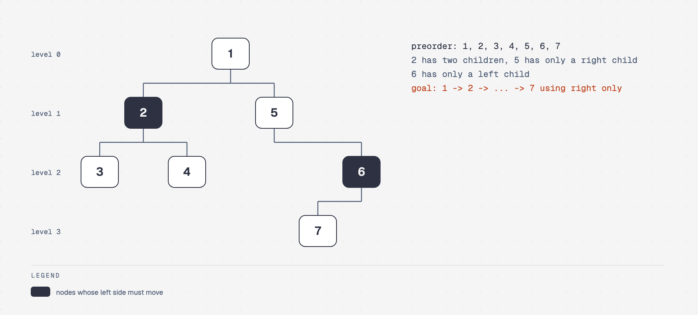
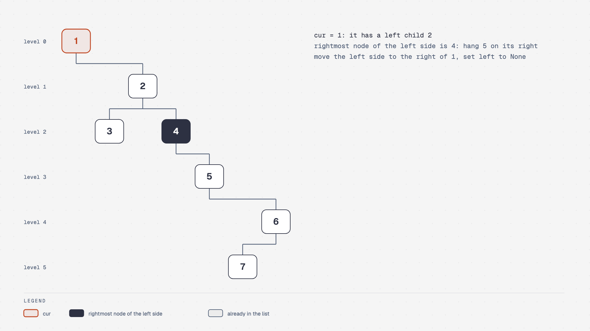
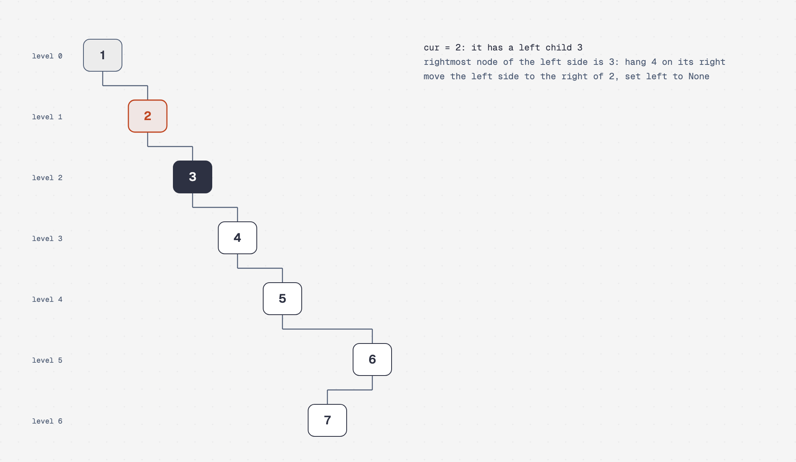
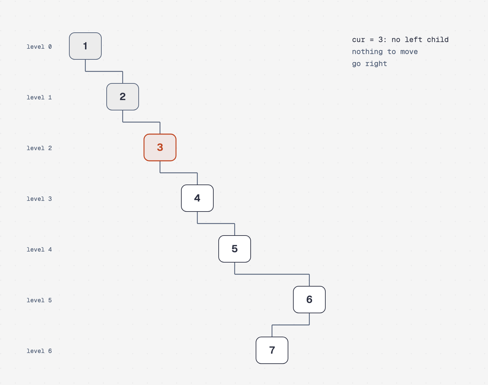
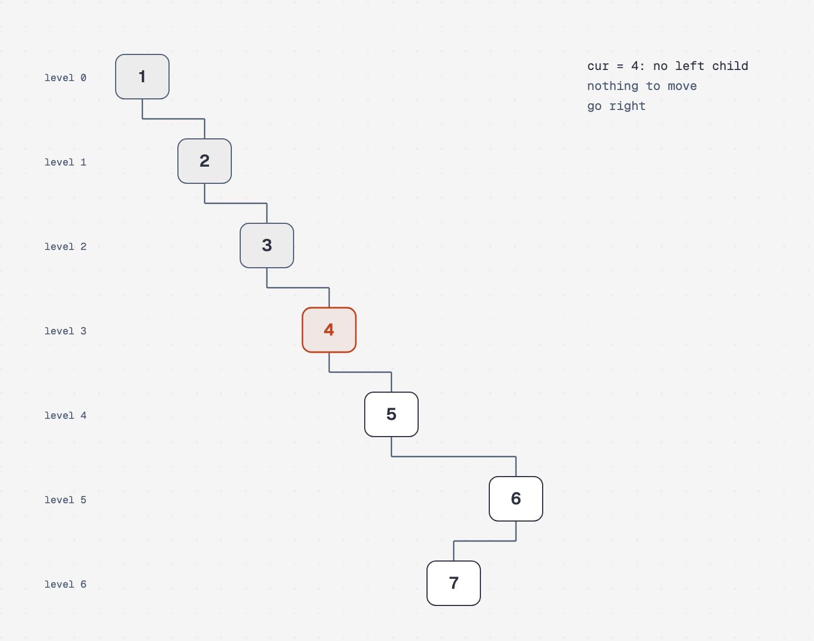
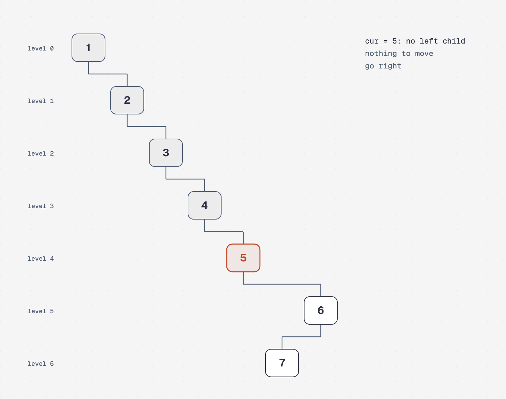
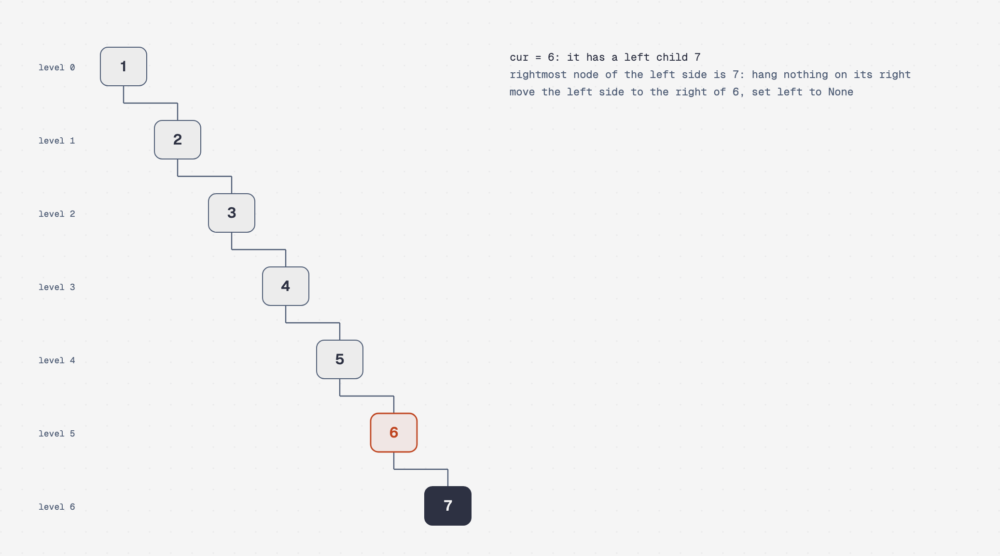
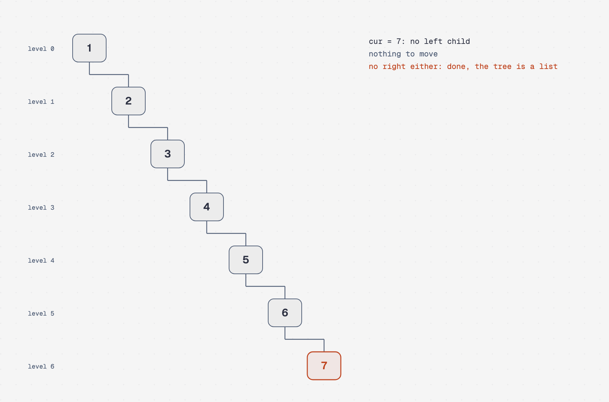

# 33. 114. Flatten Binary Tree to Linked List

| Difficulty | Pattern | Key idea | Source | Time | Space | Before in this folder |
|:---:|:---:|:---|:---:|:---:|:---:|:---:|
| **Medium** | Rewire In Place (Morris Style) | At each node with a left side, hang the old right side on the rightmost node of the left side, then move the left side to the right; walk right and repeat | [114. Flatten Binary Tree to Linked List](https://leetcode.com/problems/flatten-binary-tree-to-linked-list/) | `O(n)` | `O(1)` | [297. Serialize and Deserialize](32.%20297.%20Serialize%20and%20Deserialize%20Binary%20Tree.md) |

## 1. Problem Statement

Given the `root` of a binary tree, flatten it **in place** into a "linked list":

- Use the same `TreeNode` objects. The `right` pointer points to the next node; every `left` pointer is `None`.
- The order of the list is the **preorder** of the tree.

Return nothing; change the tree itself. Follow-up: can you do it with `O(1)` extra space?

### Example

**The tree we take:** the lecture board's tree: `1` with children `2` and `5`; `2` with children `3` and `4`; `5` with only a right child `6`; `6` with only a left child `7`. As a LeetCode list: `[1, 2, 5, 3, 4, None, 6, None, None, None, None, 7]`.

```text
Input:  root = [1, 2, 5, 3, 4, None, 6, None, None, None, None, 7]
Output: [1, None, 2, None, 3, None, 4, None, 5, None, 6, None, 7]
```



It has the tricky parts of the problem:

- `2` has **both** children: after flattening, `3` and `4` must come before `5`, so the old right side of `1` must wait at the end of the left side.
- `5` has **no** left child: nothing to move there.
- `6` has **only a left** child: `7` must be moved from left to right.
- Everything must happen in place, without making new nodes.

We use this tree in every section below.

LeetCode examples:

```text
root = [1, 2, 5, 3, 4, None, 6]   gives [1, None, 2, None, 3, None, 4, None, 5, None, 6]
root = []                          gives []
root = [0]                         gives [0]
```

### Constraints, in plain words

| Limit | What it means in plain words | What it tells us |
|:---|:---|:---|
| Number of nodes is `0` to `2000` | Up to 2,000 nodes; can be empty | Any `O(n)` method is instant; handle the empty tree |
| `-100 <= Node.val <= 100` | Values do not matter | Only the links change |
| In place, preorder order | Rewire `left` and `right`; do not create nodes | The list must be root, left side, right side |
| Follow-up: `O(1)` extra space | No stack, no recursion | Rewire while walking, Morris style |

**How fast is fast enough?**

- Every method below is `O(n)` time. The difference is memory: recursion keeps one path (`O(h)`, up to 2,000 on a chain), a stack keeps up to `O(n)` nodes, and the in-place walk keeps two pointers.

| Method | Time | Extra memory | Our tree: most extra items held | Note&ensp;&#8203;&ensp;&#8203;&ensp;&#8203;&ensp;&#8203;&ensp;&#8203;&ensp;&#8203;&ensp;&#8203;&ensp;&#8203;&ensp;&#8203;&ensp;&#8203;&ensp;&#8203;&ensp;&#8203;&ensp;&#8203;&ensp;&#8203;&ensp;&#8203;&ensp;&#8203;&ensp;&#8203;&ensp;&#8203;&ensp;&#8203;&ensp;&#8203;&ensp;&#8203;&ensp;&#8203;&ensp;&#8203;&ensp;&#8203; |
|:---|:---:|:---:|:---:|:---|
| Recursion: right, left, root with `prev` | `O(n)` | `O(h)` | 4 calls deep | The lecture's first answer |
| Stack in preorder | `O(n)` | `O(n)` | 3 nodes on the stack | The lecture's second answer |
| Rewire in place while walking right | `O(n)` | `O(1)` | 2 pointers | The follow-up answer |

## 2. Core Idea

The list must read `1, 2, 3, 4, 5, 6, 7`: the root, then its whole left side, then its whole right side.

**Look at one node `cur` that has a left side.** In the list, the last node of the left side (its rightmost node, call it `pred`) must be followed by `cur`'s old right side. So:

1. Find `pred`: start at `cur.left` and keep going right.
2. Hang `cur`'s old right side on `pred.right`.
3. Move the left side to the right: `cur.right = cur.left`, `cur.left = None`.
4. Go to `cur.right` and repeat. When `cur` has no left side, just go right.

The lecture shows two other ways that build the same list: recursion in the order **right, left, root** with a `prev` pointer (each node points to the node built just before it), and a stack that pops nodes in preorder.

## 3. Edge Cases

| Case | Input | Expected | Why it matters | Code that handles it |
|:---|:---|:---|:---|:---|
| Empty tree | `[]` | `[]` | Nothing to do | `while cur` does not run |
| One node | `[0]` | `[0]` | Already a list | No left side, the loop ends |
| Only right children | `[1, None, 2, None, 3]` | unchanged | Already a list | Nothing is ever moved |
| Only left children | `[1, 2, None, 3]` | `1 -> 2 -> 3` on the right | Every node moves its left side | One move per node |
| Left side with a right tail | `2` in our tree | `3, 4` before `5` | The old right side must wait at `pred` | `pred.right = cur.right` |

## 4. Approach 1: Recursion in the Order Right, Left, Root

### Idea

The list is built **from the end**: first `7`, then `6` pointing to `7`, then `5` pointing to `6`, and so on. Visiting nodes in the order right, left, root gives exactly `7, 6, 5, 4, 3, 2, 1`. Keep `prev`, the node built last; at each node set `node.right = prev`, `node.left = None`, then `prev = node`.

### Code

```python
# Import Optional for type hints
from typing import Optional


# Solution for 114, recursion right, left, root with prev
class Solution:

    # Main method
    def flatten(self, root: Optional[TreeNode]) -> None:

        # The node built just before, the next one in the list
        self.prev = None

        # Visit right, then left, then the node
        def build(node: Optional[TreeNode]) -> None:

            # Empty spot: nothing to do
            if node is None:

                # Stop
                return

            # The right side comes last in the list, so build it first
            build(node.right)

            # Then the left side
            build(node.left)

            # This node points to the node built just before
            node.right = self.prev

            # A list has no left links
            node.left = None

            # This node is now the head of the built part
            self.prev = node

        # Flatten the whole tree
        build(root)
```

### Complexity

| Measure | Complexity | Why | At the limit (`n = 2000`) | Compared with the optimal |
|:---|:---:|:---|:---:|:---|
| **Time** | `O(n)` | Each node is visited once | 2,000 calls | Same |
| **Space** | `O(h)` | Recursion depth | up to 2,000 on a chain, over Python's default limit of 1,000 | More memory |

## 5. Approach 2: A Stack in Preorder

### Idea

Pop a node; push its right child, then its left child (so the left comes out first). The stack's top is now the next node in preorder, so set `node.right` to it and `node.left = None`.

### Code

```python
# Import Optional for type hints
from typing import Optional


# Solution for 114, a stack in preorder
class Solution:

    # Main method
    def flatten(self, root: Optional[TreeNode]) -> None:

        # Empty tree: nothing to do
        if root is None:

            # Stop
            return

        # Nodes waiting, next in preorder on top
        stack = [root]

        # Take nodes in preorder
        while stack:

            # Next node in preorder
            node = stack.pop()

            # Right child waits longer
            if node.right:

                # Push it first
                stack.append(node.right)

            # Left child comes out next
            if node.left:

                # Push it last
                stack.append(node.left)

            # The next node in the list is on top of the stack
            if stack:

                # Link to it
                node.right = stack[-1]

            # A list has no left links
            node.left = None
```

### Complexity

| Measure | Complexity | Why | At the limit (`n = 2000`) | Compared with the optimal&ensp;&#8203; |
|:---|:---:|:---|:---:|:---|
| **Time** | `O(n)` | Each node is pushed and popped once | 2,000 pushes | Same |
| **Space** | `O(n)` | Waiting right children pile up | up to about 1,000 on a full tree | More memory |

## 6. Optimal: Rewire In Place While Walking Right

### Idea

```text
cur = root
while cur:
    if cur.left:
        pred = rightmost node of cur.left
        pred.right = cur.right        # old right side waits at the end of the left side
        cur.right = cur.left          # left side moves to the right
        cur.left = None
    cur = cur.right
```

### Run it on our example, step by step

**The tree we take:** the 7-node tree above.

**How to read the pictures:** orange is `cur`, the dark node is `pred` (the rightmost node of the left side), grey nodes are already in their final place in the list. Each picture shows the tree **after** the step's rewiring.

**Step 1: cur = 1**

- `1` has a left child, `2`.
- The rightmost node of the left side is `4`. Hang `5` on its right.
- Move the left side to the right of `1` and set `1.left = None`. Next: `2`.



**Step 2: cur = 2**

- `2` has a left child, `3`.
- The rightmost node of the left side is `3`. Hang `4` on its right.
- Move the left side to the right of `2` and set `2.left = None`. Next: `3`.



**Step 3: cur = 3**

- `3` has no left child.
- Nothing to move.
- Next: `4`.



**Step 4: cur = 4**

- `4` has no left child.
- Nothing to move.
- Next: `5`.



**Step 5: cur = 5**

- `5` has no left child.
- Nothing to move.
- Next: `6`.



**Step 6: cur = 6**

- `6` has a left child, `7`.
- The rightmost node of the left side is `7`. Hang nothing (`None`) on its right.
- Move the left side to the right of `6` and set `6.left = None`. Next: `7`.



**Step 7: cur = 7**

- `7` has no left child.
- Nothing to move.
- No right child either: the tree is now a list.




**All steps at a glance**

| Step | `cur` | Left side? | `pred` (rightmost of the left side) | Old right side hung on `pred` | What changed | Next `cur` |
|:---:|:---:|:---:|:---:|:---:|:---|:---:|
| 1 | 1 | Yes | 4 | 5 | `1.right = 2`, `1.left = None`, `4.right = 5` | 2 |
| 2 | 2 | Yes | 3 | 4 | `2.right = 3`, `2.left = None`, `3.right = 4` | 3 |
| 3 | 3 | No | - | - | Nothing | 4 |
| 4 | 4 | No | - | - | Nothing | 5 |
| 5 | 5 | No | - | - | Nothing | 6 |
| 6 | 6 | Yes | 7 | None | `6.right = 7`, `6.left = None`, `7.right = None` | 7 |
| 7 | 7 | No | - | - | Nothing | None (done) |

Only three nodes (`1`, `2`, `6`) had a left side to move. No new nodes and no stack were used.

### Code

```python
# Import Optional for type hints
from typing import Optional


# Solution for 114, rewire in place while walking right
class Solution:

    # Main method
    def flatten(self, root: Optional[TreeNode]) -> None:

        # Start at the root
        cur = root

        # Walk down the right pointers
        while cur:

            # Only a node with a left side needs work
            if cur.left:

                # Start at the left child
                pred = cur.left

                # Find the rightmost node of the left side
                while pred.right:

                    # Keep going right
                    pred = pred.right

                # The old right side waits after the left side
                pred.right = cur.right

                # Move the left side to the right
                cur.right = cur.left

                # A list has no left links
                cur.left = None

            # Next node in the list
            cur = cur.right
```

### Complexity

| Measure | Complexity | Why | At the limit (`n = 2000`) | Compared with the other methods |
|:---|:---:|:---|:---:|:---|
| **Time** | `O(n)` | Each `pred` walk goes down a right edge that is then moved; every edge is walked at most twice | at most about 4,000 steps | Same order |
| **Space** | `O(1)` | Only `cur` and `pred` | 2 pointers | The follow-up answer |

## 7. Common Mistakes

| Mistake | What goes wrong | Fix |
|:---|:---|:---|
| Forgetting `cur.left = None` | The result still has left links: not a list | Clear the left pointer after moving it |
| Moving the left side without saving the old right side | `5, 6, 7` are lost | Hang the old right side on `pred` first |
| Recursion in the order left, right, root with `prev` | The list comes out in the wrong order | Use right, left, root so the list is built from the end |
| Stack: pushing left before right | The right side comes out first | Push right first, then left |
| Making new nodes | Not in place | Only change `left` and `right` |

## 8. Interview Follow-ups

### Q1. Why does the recursive version go right, left, root?

**Answer:**
- That is preorder backwards: `7, 6, 5, 4, 3, 2, 1`.
- Each node can then point to the node just built, so the list grows from its end.

### Q2. Why is the in-place walk still `O(n)` with the inner `pred` loop?

**Answer:**
- Each `pred` walk follows right edges inside a left side; after the move, those nodes are on the main path and are walked once more by `cur`.
- So every edge is walked a constant number of times.

### Q3. How would you flatten into inorder order instead?

**Answer:**
- Same idea with a different tail: hang `cur` on the rightmost node of its left side, then continue from the left child.
- That is the Morris inorder walk.

### Q4. How would you make a doubly linked list (left = previous)?

**Answer:**
- Walk in the required order and keep `prev`; set `prev.right = node` and `node.left = prev`.
- For a BST in sorted order, use an inorder walk (a classic follow-up).

### Q5. What does the result look like as a LeetCode list?

**Answer:**
- Every node has `None` on the left: `[1, None, 2, None, 3, ...]`.

## 9. Interview Explanation

> The list must follow preorder: the root, its left side, then its right side. I walk with cur from the root. If cur has a left side, I find its rightmost node, which is the last node of the left side in preorder, and hang cur's old right side there. Then I move the left side to the right and set left to None. Then I step right and repeat. Every edge is walked a constant number of times, so it is O(n) time, and only two pointers are used, so it is O(1) extra space. A simpler version uses recursion in the order right, left, root with a prev pointer, at O(h) space.
