# 01. 167. Two Sum II - Input Array Is Sorted

| Difficulty | Pattern | Source | Time | Space |
|:---:|:---:|:---:|:---:|:---:|
| **Medium** | Two Pointers: Opposite-End Pairs on Sorted | [167. Two Sum II - Input Array Is Sorted](https://leetcode.com/problems/two-sum-ii-input-array-is-sorted/) | `O(n)` | `O(1)` |

## 1. Problem Statement

You get a **1-indexed** array of integers `numbers`. It is already **sorted in non-decreasing order** (small values on the left, big values on the right, equal values allowed).

You also get an integer `target`.

Find two numbers that add up to `target`. Call them `numbers[index1]` and `numbers[index2]`, where `1 <= index1 < index2 <= numbers.length`.

Return `[index1, index2]`: the two indexes, **each incremented by one**, as an array of length 2.

Rules:

- The tests are made so that there is **exactly one solution**.
- You **may not** use the same element twice.
- Your solution must use only **constant extra space**.

Important points, in plain words:

- The array is sorted in non-decreasing order.
- Indexes are **1-based**, not 0-based. Python counts from `0`, so we add `1` at the end.
- Exactly one solution exists, so we can stop at the first pair we find.
- You cannot use the same element twice (`index1 < index2`, never equal).

### Example

```text
Input:  numbers = [1, 3, 4, 6, 8, 11], target = 10
Output: [3, 4]

Why: numbers[2] + numbers[3] = 4 + 6 = 10   (0-based indexes 2 and 3)
     The answer must be 1-based, so we return [2 + 1, 3 + 1] = [3, 4].
```

We use this same example in every section below. It is a little longer than the LeetCode ones so that both pointers get to move.

The top row is the Python index. The bottom row is the 1-based position the problem wants back. The answer pair is green.

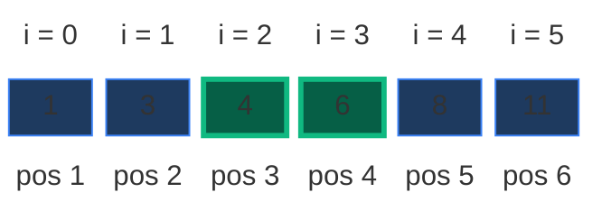

LeetCode examples (also checked in the tests):

| Input | Output | Why |
|:---|:---:|:---|
| `numbers = [2, 7, 11, 15], target = 9` | `[1, 2]` | `2 + 7 = 9`, so `index1 = 1`, `index2 = 2` |
| `numbers = [2, 3, 4], target = 6` | `[1, 3]` | `2 + 4 = 6`, so `index1 = 1`, `index2 = 3` |
| `numbers = [-1, 0], target = -1` | `[1, 2]` | `-1 + 0 = -1`, so `index1 = 1`, `index2 = 2` |

For the first one: `numbers[0] + numbers[1] = 2 + 7 = 9`, but the answer is 1-indexed, so we return `[1, 2]`, not `[0, 1]`.

### Constraints

- `2 <= numbers.length <= 3 * 10^4`
- `-1000 <= numbers[i] <= 1000`
- `numbers` is sorted in **non-decreasing order**.
- `-1000 <= target <= 1000`
- The tests are generated such that there is **exactly one solution**.

### What the constraints tell us (simple theory)

A **constraint** is the biggest input the judge will ever give you. It quietly tells you how fast your code must be.

**Rule of thumb:** a computer does about **100 million (10^8) simple steps per second**. Count how many steps your idea needs for the biggest input, and compare.

| Biggest input `n` | Steps you can afford | Ideas that fit |
|:---:|:---:|:---|
| up to ~20 | about `2^n` | Try every subset |
| up to ~500 | about `n^3` | Three nested loops |
| up to ~5,000 | about `n^2` | Two nested loops |
| up to ~1,000,000 | about `n` or `n log n` | One loop, two pointers, sorting |

**For this problem:** `n` is at most `30,000`.

- Brute force checks every pair. In the worst case that is `n * (n - 1) / 2` pairs: about **450 million checks** for `n = 30,000`. That is several seconds even in a fast language, and far too slow in Python. It is a "Time Limit Exceeded".
- Two pointers check at most `n - 1` pairs: **29,999 checks**. That is instant.
- Values are small (`-1000 .. 1000`), so any sum is between `-2000` and `2000`. No overflow worry, even with 32-bit integers.
- "Constant extra space" rules out a hash map. That is a strong hint: the sorted order must do the work.

**How the work grows as `n` grows**

Red bars = pair checks made by brute force. Green line = checks made by two pointers (it stays flat near zero). Worst case input: `[0, 0, ..., 0, 500, 500]` with `target = 1000`, where the only pair is the last two. Numbers come from running both loops with a counter.

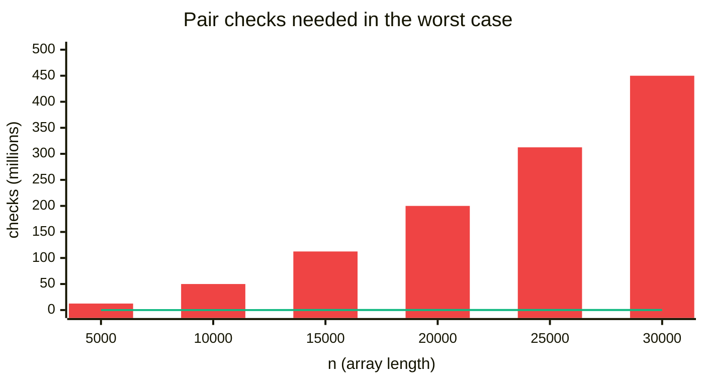

| `n` | Brute force pair checks | Two-pointer checks |
|:---:|:---:|:---:|
| 5,000 | 12,497,500 | 4,999 |
| 10,000 | 49,995,000 | 9,999 |
| 15,000 | 112,492,500 | 14,999 |
| 20,000 | 199,990,000 | 19,999 |
| 25,000 | 312,487,500 | 24,999 |
| 30,000 | 449,985,000 | 29,999 |

Grow `n` 6 times (5,000 to 30,000), and brute force grows **36 times**. Two pointers grow only 6 times.

## 2. Core Theory

This is the first note of the **Opposite-End Pairs** pattern, so we start from zero.

### What the problem really asks

"Find two different spots whose values add up to `target`."

There are `n * (n - 1) / 2` possible pairs. For our example (`n = 6`) that is 15 pairs. The question is: **can we find the right pair without looking at all of them?**

This problem is different from normal Two Sum (LeetCode 1) for one reason: the array is already **sorted**.

- Small values are on the left.
- Large values are on the right.

That one fact lets us throw away a whole bunch of pairs with every single check.

### What is a pointer here?

A **pointer** is just an index (a whole number) that "points at" one spot in the array. We use two of them:

- `left` (we write `L`) starts at the **start** of the array: the smallest value.
- `right` (we write `R`) starts at the **end** of the array: the biggest value.

The spots from `L` to `R` (both included) are the **window**: the values that are still "alive". Everything outside the window is already ruled out.

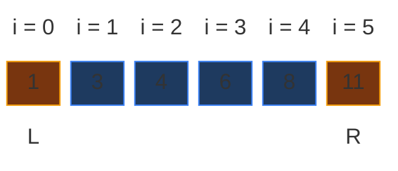

Every round we look at one pair: `numbers[L] + numbers[R]`. Then we move **one** pointer one step **inward**. The window gets one smaller each round, and the two pointers walk toward each other until they meet. That is why the pattern is called **converging** (coming together) or **opposite-end** pointers.

### The pointer-move rule

Compute `current_sum = numbers[L] + numbers[R]`. There are only three cases:

| Case | Meaning | Move |
|:---|:---|:---|
| `current_sum == target` | Found it | Return `[L + 1, R + 1]` |
| `current_sum < target` | Sum is too small, we need a **bigger** number | `L += 1` (left moves forward) |
| `current_sum > target` | Sum is too big, we need a **smaller** number | `R -= 1` (right moves backward) |

Why those directions? Moving `L` to the right can only give an equal or **bigger** value (sorted). Moving `R` to the left can only give an equal or **smaller** value. So:

- If the sum is too small, moving `R` backward would make it even smaller. Useless. Only `L += 1` can help.
- If the sum is too big, moving `L` forward would make it even bigger. Useless. Only `R -= 1` can help.

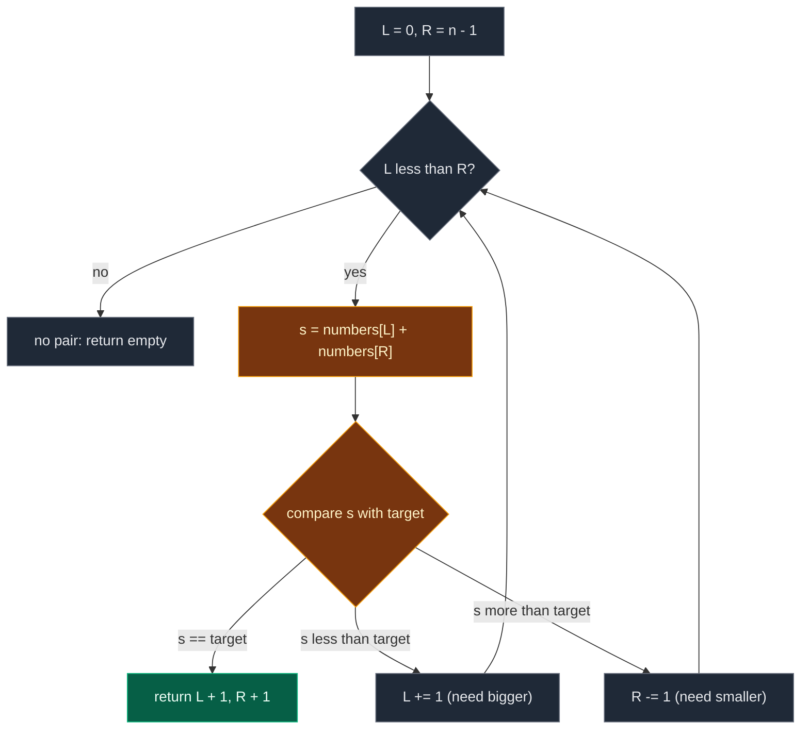

This works **only because the array is sorted**.

### Why is it safe to drop an end? (the key proof)

Moving a pointer means we **never look at that value again**. That sounds risky. What if the dropped value was part of the answer? Here is why it never is.

**Case 1: the sum is too big, so we drop `R`.**

`numbers[L]` is the **smallest** value in the window. `numbers[R]` paired with its smallest possible partner is already too big. Any other partner is equal or bigger, so the sum only gets bigger. So `numbers[R]` cannot reach `target` with **anyone** left in the window. Drop it.

In our example, the first check is `1 + 11 = 12`, which is more than `10`. Look at `11` with every partner:

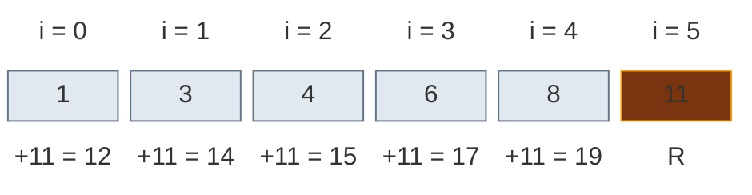

All of `12, 14, 15, 17, 19` are more than `10`. The value `11` is hopeless. Throwing it away loses nothing.

**Case 2: the sum is too small, so we drop `L`.**

`numbers[R]` is the **biggest** value in the window. `numbers[L]` paired with its biggest possible partner is still too small. Any other partner is equal or smaller, so the sum only gets smaller. So `numbers[L]` cannot reach `target` with **anyone** left in the window. Drop it.

In our example, after dropping `11`, the window is `i = 0 .. 4` and the check is `1 + 8 = 9`, which is less than `10`. Look at `1` with every partner still in the window:

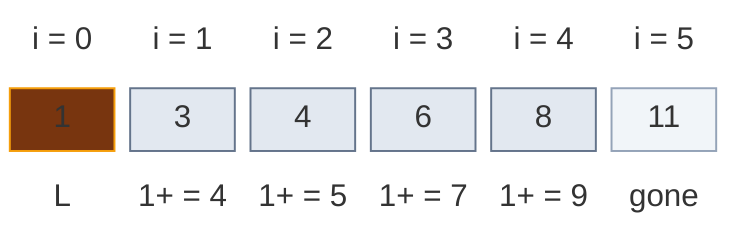

All of `4, 5, 7, 9` are less than `10`. The value `1` is hopeless. Throwing it away loses nothing.

**Short version to say in an interview:**

- Too small: `L` already had its **best** partner (the biggest) and still fell short. `L` is useless. Move it.
- Too big: `R` already had its **best** partner (the smallest) and still went over. `R` is useless. Move it.

### The promise that never breaks (the invariant)

> **If a valid pair exists, both of its spots are inside the window `[L, R]`.**

- At the start, the window is the whole array, so the promise is true.
- Every move drops only a value that is proven hopeless (the proof above), so the promise stays true.
- When `current_sum == target`, we have found the pair.
- If `L` and `R` meet (`L == R`), the window has only one spot. One spot cannot make a pair (no reusing an element), so no pair exists.

Each round removes exactly one spot, so there are at most `n - 1` rounds. That is `O(n)` time, with only two index variables: `O(1)` space.

### The same idea as a picture: the pair-sum grid

Write every pair sum in a grid: row `i`, column `j`, cell = `numbers[i] + numbers[j]` (only `i < j`, because a pair needs two different spots). Because the array is sorted, the sums **grow to the right** and **grow downward**. The green cell is the answer `4 + 6 = 10`.

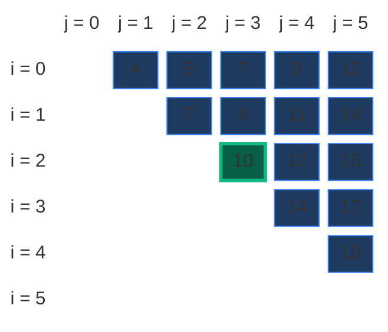

- Dropping `R` = crossing out a **whole column** (every pair that uses that `R`).
- Dropping `L` = crossing out a **whole row** (every pair that uses that `L`).

Two pointers start at the top-right corner (`i = 0, j = 5`) and walk down or left like a staircase. After our 5 checks (orange = the 4 checked misses, green = the answer, grey = crossed out without ever being checked):

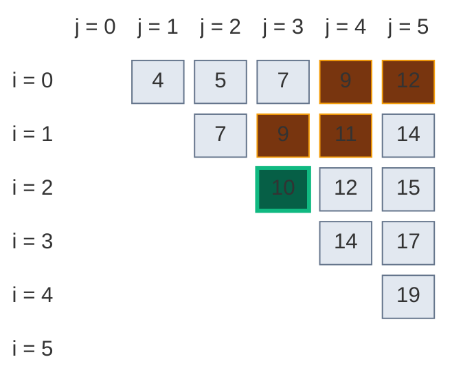

We checked only 5 of the 15 cells, and the proof says none of the grey cells could have been the answer.

### Why sortedness is the whole trick

Both proofs use only two facts: "`numbers[L]` is the smallest in the window" and "`numbers[R]` is the biggest in the window". If the array is not sorted, both facts are false, the proof breaks, and the scan can walk past the answer. That is why the unsorted problem (LeetCode 1) uses a hash map instead.

### How to recognise the pattern

| Signal | What it tells you |
|:---|:---|
| Input is said to be sorted | The sorted order is the intended tool |
| "Constant extra space" is required | Rules out a hash map, points at two pointers |
| You look for a **pair** `(i, j)` and moving one end changes the result in a known direction | Converging pointers fit |
| Exactly one solution is guaranteed | Return at the first hit |
| 1-indexed output is asked for | Add 1 to both indexes, an easy point to lose |

## 3. Edge Cases

| Case | Input | Expected | Why it matters |
|:---|:---|:---:|:---|
| Minimum length | `[1, 2], target = 3` | `[1, 2]` | `n == 2` is the smallest input. The loop runs exactly once |
| Negative numbers | `[-1, 0], target = -1` | `[1, 2]` | Negatives are allowed. The logic must not assume positive values |
| Both values negative | `[-3, -1, 0, 2], target = -4` | `[1, 2]` | "Too small" and "too big" still work below zero |
| All values equal | `[3, 3], target = 6` | `[1, 2]` | Two different spots with the same value are fine. Only the same **spot** is forbidden |
| Duplicates, one copy in the answer | `[1, 2, 2, 3], target = 5` | `[2, 4]` | Several index pairs could sum to `5`. Two pointers return one valid pair |
| Duplicates not in the answer | `[0, 0, 3, 4], target = 7` | `[3, 4]` | The pointer must walk past the duplicate block, not get stuck |
| Answer at both ends | `[1, 2, 3, 4], target = 5` | `[1, 4]` | Found on the very first check, before any move |
| Answer in the middle | `[1, 3, 4, 6, 8, 11], target = 10` | `[3, 4]` | Needs moves from both sides (our main example) |
| Zero target | `[-5, 0, 5], target = 0` | `[1, 3]` | `target = 0` needs no special case |
| Same element reused | `[1, 5], target = 2` | no pair | `1 + 1 = 2` must **not** be reported. `while L < R` (not `<=`) blocks this |
| Value range limits | `[-1000, 1000], target = 0` | `[1, 2]` | The extreme values from the constraints |

LeetCode promises exactly one answer, so "no pair" never happens there. Our code returns `[]` in that case, which keeps the tests honest.

## 4. Brute Force: Try Every Pair

### Idea

Try every pair of numbers and check if their sum equals the target. Pick the first number with index `i`, the second with index `j` after `i`.

On our example, the pairs are checked in this order until the answer shows up:

| Check | `i` | `j` | Sum | Equal to 10? |
|:---:|:---:|:---:|:---:|:---:|
| 1 | 0 | 1 | `1 + 3 = 4` | no |
| 2 | 0 | 2 | `1 + 4 = 5` | no |
| 3 | 0 | 3 | `1 + 6 = 7` | no |
| 4 | 0 | 4 | `1 + 8 = 9` | no |
| 5 | 0 | 5 | `1 + 11 = 12` | no |
| 6 | 1 | 2 | `3 + 4 = 7` | no |
| 7 | 1 | 3 | `3 + 6 = 9` | no |
| 8 | 1 | 4 | `3 + 8 = 11` | no |
| 9 | 1 | 5 | `3 + 11 = 14` | no |
| 10 | 2 | 3 | `4 + 6 = 10` | **yes**, return `[3, 4]` |

10 checks. Two pointers will need only 5. On the LeetCode example `[2, 7, 11, 15], target = 9`, the very first pair `2 + 7 = 9` is already the answer, so brute force returns `[1, 2]` right away. Brute force does not use the sorted order at all.

### Code

```python
# Import List for type hints
from typing import List


# Brute force: check every pair (i, j) with i < j
class SolutionBrute:

    # Main method
    def twoSum(self, numbers: List[int], target: int) -> List[int]:

        # Store the length of the array
        n = len(numbers)

        # Pick the first number using index i
        for i in range(n):

            # Pick the second number using index j after i
            for j in range(i + 1, n):

                # Check whether the selected pair forms the target sum
                if numbers[i] + numbers[j] == target:

                    # Return 1-based indexes as required by the problem
                    return [i + 1, j + 1]

        # Never reached on LeetCode, because exactly one solution exists
        return []
```

### Complexity

| Measure | Complexity | Why |
|:---|:---:|:---|
| **Time** | `O(n^2)` | For every element, we check all elements after it |
| **Space** | `O(1)` | We do not use any extra data structure |

## 5. Better Approach: Hash Map

### Idea

This is the same as normal Two Sum. For every number, compute the partner it needs:

```text
needed = target - current_number
```

Then check if this `needed` value was seen before. Keep a dictionary `value -> index` of everything seen so far.

On our example (`target = 10`):

| Index | Current | Needed | Seen before? | Dictionary after |
|:---:|:---:|:---:|:---:|:---|
| 0 | 1 | 9 | no | `{1: 0}` |
| 1 | 3 | 7 | no | `{1: 0, 3: 1}` |
| 2 | 4 | 6 | no | `{1: 0, 3: 1, 4: 2}` |
| 3 | 6 | 4 | **yes**, at index 2 | return `[2 + 1, 3 + 1] = [3, 4]` |

On the LeetCode example `[2, 7, 11, 15], target = 9`: at index 0, current `2` needs `7`, not seen yet, so store `2 -> 0`. At index 1, current `7` needs `2`, which is already in the map, so return `[1, 2]`.

### Code

```python
# Better: one pass with a hash map (works even if the array is not sorted)
class SolutionHash:

    # Main method
    def twoSum(self, numbers: List[int], target: int) -> List[int]:

        # Create a dictionary to store number and its index
        seen = {}

        # Traverse every number with its index
        for index, num in enumerate(numbers):

            # Calculate the number needed to complete the target
            needed = target - num

            # Check if the needed number already exists in the dictionary
            if needed in seen:

                # Return the previous index and current index in 1-based format
                return [seen[needed] + 1, index + 1]

            # Store the current number with its index
            seen[num] = index

        # Never reached on LeetCode, because exactly one solution exists
        return []
```

### Complexity

| Measure | Complexity | Why |
|:---|:---:|:---|
| **Time** | `O(n)` | We traverse the array once |
| **Space** | `O(n)` | We store numbers in a hash map |

### Why the hash map is not the best here

- The hash map gives good time: `O(n)`.
- But it ignores the most important information: **the array is sorted**.
- It also breaks the rule "use only constant extra space".
- Because the array is sorted, we can solve it in `O(n)` time **and** `O(1)` space. That is better than the hash map.

## 6. Optimal Approach: Two Pointers

### Idea

Place one pointer at the smallest number and one pointer at the largest number:

```text
left  = 0
right = len(numbers) - 1
```

Then, while `left < right`, compute:

```text
current_sum = numbers[left] + numbers[right]
```

Because the array is sorted:

- **Case 1: sum is too small** (`current_sum < target`). We need a bigger sum. The only useful move is `left += 1`. Moving `right` backward would make the sum even smaller.
- **Case 2: sum is too large** (`current_sum > target`). We need a smaller sum. The only useful move is `right -= 1`. Moving `left` forward would make the sum even bigger.
- **Case 3: sum is equal to target** (`current_sum == target`). We found the answer. Return `[left + 1, right + 1]`, because the problem wants 1-based indexes.

### Visual Walkthrough (Story Version)

**The story:** a toy shop has six toys on one long shelf, sorted by price, cheapest on the left. The prices are `1, 3, 4, 6, 8, 11` coins. You have a gift card worth **exactly 10 coins**, and the rule is: buy **exactly two different toys** and spend the card to the last coin.

Two friends help you:

- **Lily** stands at the **cheap end** (the left). She can only step **right**, to pricier toys.
- **Max** stands at the **expensive end** (the right). He can only step **left**, to cheaper toys.

Every turn, they each pick up the toy in front of them and add the two prices.

- Too expensive? Max puts his toy **back for good** and steps left. (Even with the cheapest toy in the game, his toy was too much.)
- Too cheap? Lily puts her toy **back for good** and steps right. (Even with the priciest toy in the game, her toy was not enough.)
- Exactly 10? Buy them!

**How to read the pictures:** orange = the two toys being held, blue = still in the game, grey = put back for good, green = bought.

**Start**

Lily holds toy 0 (1 coin). Max holds toy 5 (11 coins).

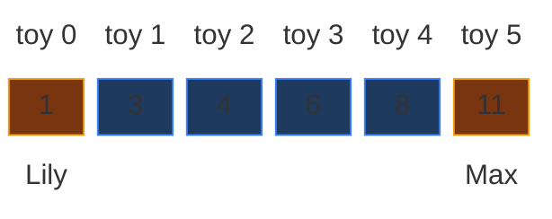

**Turn 1: 1 + 11 = 12 coins**

- 12 is more than 10. Too expensive.
- Max's toy costs 11. Even with the cheapest toy (1 coin), it is too much. So toy 5 can never be part of the answer.
- Max puts toy 5 back and steps left to toy 4.

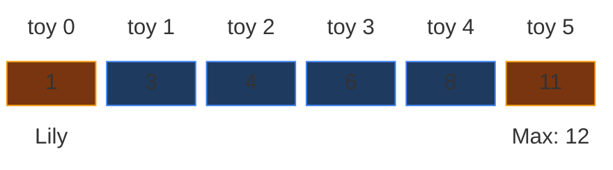

**Turn 2: 1 + 8 = 9 coins**

- 9 is less than 10. Too cheap.
- Lily's toy costs 1. Even with the priciest toy still in the game (8 coins), it is not enough. So toy 0 can never be part of the answer.
- Lily puts toy 0 back and steps right to toy 1.

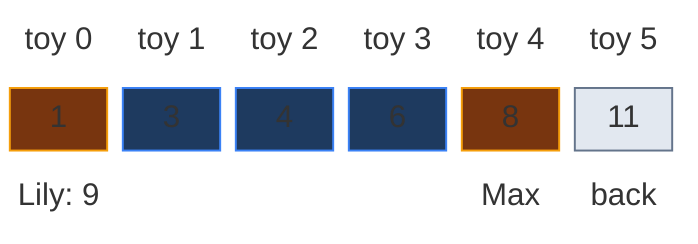

**Turn 3: 3 + 8 = 11 coins**

- 11 is more than 10. Too expensive.
- Max's toy (8) is too much even with the cheapest toy left (3). Max puts toy 4 back and steps left to toy 3.

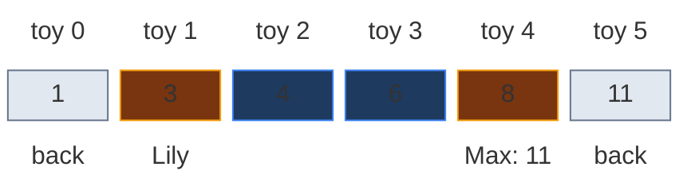

**Turn 4: 3 + 6 = 9 coins**

- 9 is less than 10. Too cheap.
- Lily's toy (3) is not enough even with the priciest toy left (6). Lily puts toy 1 back and steps right to toy 2.

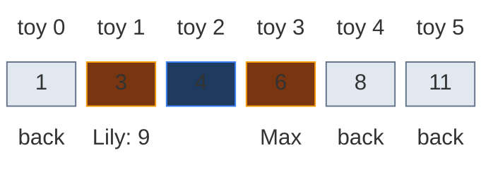

**Turn 5: 4 + 6 = 10 coins**

- Exactly 10! Buy toy 2 and toy 3.
- The shop counts shelf spots from 1, not 0. So the receipt says spots **3 and 4**.

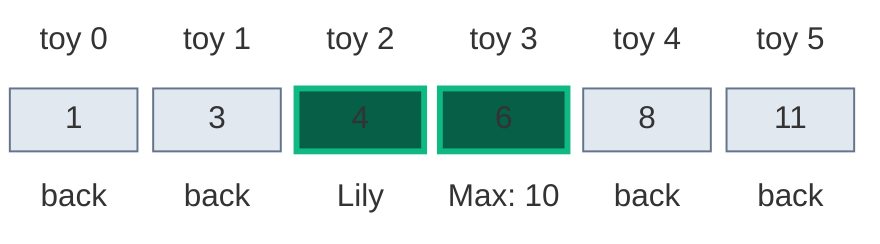

**All steps at a glance**

| Turn | Lily (toy, price) | Max (toy, price) | Total | Verdict | Who moves |
|:---:|:---:|:---:|:---:|:---|:---|
| 1 | 0, 1 | 5, 11 | 12 | too expensive | Max puts back toy 5 |
| 2 | 0, 1 | 4, 8 | 9 | too cheap | Lily puts back toy 0 |
| 3 | 1, 3 | 4, 8 | 11 | too expensive | Max puts back toy 4 |
| 4 | 1, 3 | 3, 6 | 9 | too cheap | Lily puts back toy 1 |
| 5 | 2, 4 | 3, 6 | 10 | exact | buy, receipt `[3, 4]` |

**What the story teaches**

| In the story | In the code |
|:---|:---|
| The shelf sorted by price | `numbers` (sorted) |
| Gift card of 10 coins | `target` |
| Lily at the cheap end | `left`, starts at `0` |
| Max at the expensive end | `right`, starts at `len(numbers) - 1` |
| Adding the two prices | `current_sum = numbers[left] + numbers[right]` |
| Too expensive, Max steps left | `current_sum > target` → `right -= 1` |
| Too cheap, Lily steps right | `current_sum < target` → `left += 1` |
| Put back **for good** | That index is outside the window and never checked again |
| Two different toys | `while left < right` |
| Receipt counts from 1 | `return [left + 1, right + 1]` |

Now the same steps again, with exact values.

### Step-by-Step Example

```text
numbers = [1, 3, 4, 6, 8, 11]
target  = 10
left = 0, right = 5
```

**How to read the pictures:** orange = `L` and `R` at the moment of the check (the label under `R` shows the sum), blue = still in the window, grey (`out`) = ruled out, green = the answer.

**Check 1:** `left = 0`, `right = 5`. `left < right`, so the loop runs.

- `current_sum = numbers[0] + numbers[5] = 1 + 11 = 12`.
- `12 == 10`? No. `12 < 10`? No. So `12 > 10`: too big.
- `right -= 1` → `right = 4`.

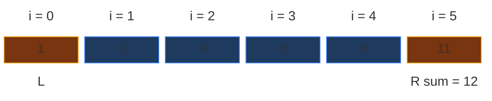

**Check 2:** `left = 0`, `right = 4`. `0 < 4`, the loop runs.

- `current_sum = numbers[0] + numbers[4] = 1 + 8 = 9`.
- `9 == 10`? No. `9 < 10`? Yes: too small.
- `left += 1` → `left = 1`.

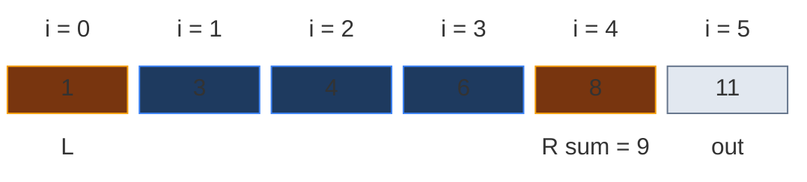

**Check 3:** `left = 1`, `right = 4`. `1 < 4`, the loop runs.

- `current_sum = numbers[1] + numbers[4] = 3 + 8 = 11`.
- `11 == 10`? No. `11 < 10`? No. So `11 > 10`: too big.
- `right -= 1` → `right = 3`.

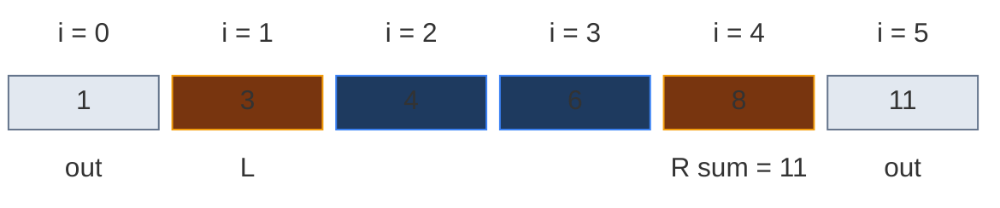

**Check 4:** `left = 1`, `right = 3`. `1 < 3`, the loop runs.

- `current_sum = numbers[1] + numbers[3] = 3 + 6 = 9`.
- `9 == 10`? No. `9 < 10`? Yes: too small.
- `left += 1` → `left = 2`.

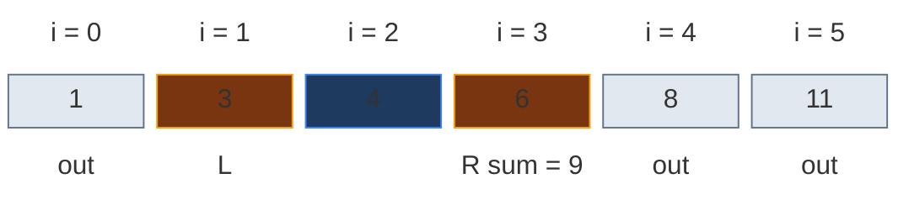

**Check 5:** `left = 2`, `right = 3`. `2 < 3`, the loop runs.

- `current_sum = numbers[2] + numbers[3] = 4 + 6 = 10`.
- `10 == 10`? Yes: found.

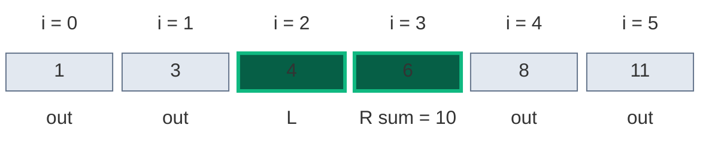

**Return:** `[left + 1, right + 1] = [2 + 1, 3 + 1] = [3, 4]`.

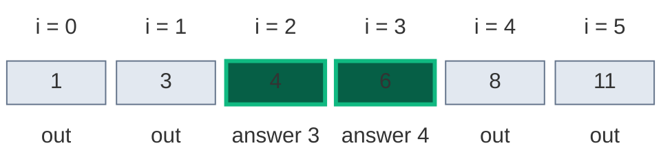

| Check | `left` | `right` | `numbers[left]` | `numbers[right]` | `current_sum` | Compare | Action |
|:---:|:---:|:---:|:---:|:---:|:---:|:---:|:---|
| 1 | 0 | 5 | 1 | 11 | 12 | `> 10` | `right = 4` |
| 2 | 0 | 4 | 1 | 8 | 9 | `< 10` | `left = 1` |
| 3 | 1 | 4 | 3 | 8 | 11 | `> 10` | `right = 3` |
| 4 | 1 | 3 | 3 | 6 | 9 | `< 10` | `left = 2` |
| 5 | 2 | 3 | 4 | 6 | 10 | `== 10` | return `[3, 4]` |

**Answer:** `[3, 4]` after 5 checks (brute force needed 10).

**Quick checks with the LeetCode examples** (same rule, shorter runs):

| Input | Checks | Output |
|:---|:---|:---:|
| `[2, 7, 11, 15]`, `target = 9` | `left = 0 (2)`, `right = 3 (15)`: `2 + 15 = 17 > 9`, so `right = 2`. Then `2 + 11 = 13 > 9`, so `right = 1`. Then `2 + 7 = 9`, found | `[1, 2]` |
| `[2, 3, 4]`, `target = 6` | `left = 0 (2)`, `right = 2 (4)`: `2 + 4 = 6`, found at once | `[1, 3]` |
| `[-1, 0]`, `target = -1` | `left = 0 (-1)`, `right = 1 (0)`: `-1 + 0 = -1`, equals target | `[1, 2]` |

### Code

```python
# Optimal: two pointers that walk toward each other
class Solution:

    # Main method (trace is only for tests)
    def twoSum(self, numbers: List[int], target: int, trace: list = None) -> List[int]:

        # Initialize the left pointer at the start of the sorted array
        left = 0

        # Initialize the right pointer at the end of the sorted array
        right = len(numbers) - 1

        # Continue until the two pointers meet (left < right means two different spots)
        while left < right:

            # Calculate the sum of the numbers at both pointers
            current_sum = numbers[left] + numbers[right]

            # Save the pointers and the sum (only for tests)
            if trace is not None:

                # Record left, right and the sum we just checked
                trace.append((left, right, current_sum))

            # If the current sum is equal to target, we found the answer
            if current_sum == target:

                # Return 1-based indexes as required by the problem
                return [left + 1, right + 1]

            # If current sum is smaller than target, we need a bigger number
            elif current_sum < target:

                # Move left pointer forward to increase the sum
                left += 1

            # If current sum is greater than target, we need a smaller number
            else:

                # Move right pointer backward to decrease the sum
                right -= 1

        # Never reached on LeetCode, because exactly one valid answer exists
        return []


# The example from this note
steps = []

# Run with tracing
answer = Solution().twoSum([1, 3, 4, 6, 8, 11], 10, steps)

# Check 1: left = 0, right = 5, 1 + 11 = 12 (too big, right moves)
assert steps[0] == (0, 5, 12)

# Check 2: left = 0, right = 4, 1 + 8 = 9 (too small, left moves)
assert steps[1] == (0, 4, 9)

# Check 3: left = 1, right = 4, 3 + 8 = 11 (too big, right moves)
assert steps[2] == (1, 4, 11)

# Check 4: left = 1, right = 3, 3 + 6 = 9 (too small, left moves)
assert steps[3] == (1, 3, 9)

# Check 5: left = 2, right = 3, 4 + 6 = 10 (found)
assert steps[4] == (2, 3, 10)

# Exactly 5 checks were made
assert len(steps) == 5

# Final answer, 1-based
assert answer == [3, 4]

# LeetCode examples
assert Solution().twoSum([2, 7, 11, 15], 9) == [1, 2]

# LeetCode example 2
assert Solution().twoSum([2, 3, 4], 6) == [1, 3]

# LeetCode example 3
assert Solution().twoSum([-1, 0], -1) == [1, 2]

# The LeetCode example 1 trace: 17, then 13, then 9
steps = []

# Run with tracing
Solution().twoSum([2, 7, 11, 15], 9, steps)

# Only the right pointer moves here
assert steps == [(0, 3, 17), (0, 2, 13), (0, 1, 9)]

# Edge cases from the table
cases = [
    ([1, 2], 3, [1, 2]),
    ([-1, 0], -1, [1, 2]),
    ([-3, -1, 0, 2], -4, [1, 2]),
    ([3, 3], 6, [1, 2]),
    ([1, 2, 2, 3], 5, [2, 4]),
    ([0, 0, 3, 4], 7, [3, 4]),
    ([1, 2, 3, 4], 5, [1, 4]),
    ([1, 3, 4, 6, 8, 11], 10, [3, 4]),
    ([-5, 0, 5], 0, [1, 3]),
    ([-1000, 1000], 0, [1, 2]),
]

# Check each case with the optimal and the brute force
for given, goal, expected in cases:

    # Optimal
    assert Solution().twoSum(given, goal) == expected

    # Brute force
    assert SolutionBrute().twoSum(given, goal) == expected

    # Hash map may pick another valid pair when values repeat, so check it is valid
    i, j = SolutionHash().twoSum(given, goal)

    # Two different spots, in order, with the right sum
    assert 1 <= i < j <= len(given) and given[i - 1] + given[j - 1] == goal

# The same element must NOT be reused: 1 + 1 = 2 is not a valid answer
assert Solution().twoSum([1, 5], 2) == []

# No pair exists at all
assert Solution().twoSum([1, 2, 3], 100) == []

# Worst case from the chart: only the last two values work, n - 1 checks
steps = []

# Ten values: eight zeros, then 500 and 500
Solution().twoSum([0] * 8 + [500, 500], 1000, steps)

# Left walks all the way: 9 checks for n = 10
assert len(steps) == 9

# Random tests: brute force == optimal on arrays with exactly one answer
import random

# Try many random sorted arrays
for _ in range(500):

    # Random sorted array with duplicates and negatives
    data = sorted(random.randint(-20, 20) for _ in range(random.randint(2, 12)))

    # Random target in a small range
    goal = random.randint(-40, 40)

    # Count pairs of spots that hit the target
    pairs = [(i, j) for i in range(len(data)) for j in range(i + 1, len(data)) if data[i] + data[j] == goal]

    # Keep only inputs with exactly one answer, like LeetCode
    if len(pairs) == 1:

        # The one true answer, 1-based
        truth = [pairs[0][0] + 1, pairs[0][1] + 1]

        # Optimal finds it
        assert Solution().twoSum(data, goal) == truth

        # Brute force finds it
        assert SolutionBrute().twoSum(data, goal) == truth

        # Hash map finds it
        assert SolutionHash().twoSum(data, goal) == truth

    # Any input: if a pair exists, two pointers find a valid one
    elif pairs:

        # Run the optimal
        i, j = Solution().twoSum(data, goal)

        # It must be a real pair
        assert (i - 1, j - 1) in pairs

    # No pair at all
    else:

        # Two pointers report nothing
        assert Solution().twoSum(data, goal) == []

# All checks passed
print("All tests passed")
```

The `trace` argument is only for the step checks. LeetCode calls `twoSum(numbers, target)` and it works the same.

### Complexity

| Measure | Complexity | Why |
|:---|:---:|:---|
| **Time** | `O(n)` | Each check moves one pointer one step inward, so there are at most `n - 1` checks. Together the pointers move at most `n` times |
| **Space** | `O(1)` | Only two variables, `left` and `right` (plus `current_sum`) |

## 7. Common Mistakes

| Mistake | What goes wrong | Fix |
|:---|:---|:---|
| Returning `[left, right]` | The problem is **1-indexed**. Every answer is off by one | Return `[left + 1, right + 1]`. This is the most common wrong answer here |
| Writing `while left <= right` | Allows `left == right`, which uses one element twice: `[1, 5], target = 2` wrongly returns `[1, 1]` | Use `while left < right`, which forces `index1 < index2` |
| Moving the wrong pointer | Moving `right` down when the sum is already too small makes it smaller still. The scan drifts away and misses the answer | Too small → `left += 1`. Too big → `right -= 1` |
| Sorting the input first "to be safe" | The array is already sorted. Sorting wastes `O(n log n)`, and on an unsorted input it would break the index mapping the answer needs | Trust the given order and read indexes directly |
| Using a hash map by habit | Correct, but `O(n)` space, and the problem asks for constant space. It misses the point of the question | Use two pointers. Mention the hash map only for unsorted input |
| Moving both pointers on a match | Harmless here because we return at once. If you change the code to **count** pairs, it skips answers | Return on a match. If counting, handle runs of equal values on purpose |
| Overflow on `numbers[left] + numbers[right]` | Not an issue in Python or with these small values. In C++ or Java with values near the 32-bit limit, the sum wraps around and comparisons flip | Use a 64-bit sum, or compare `numbers[left] > target - numbers[right]` |

## 8. Interview Follow-ups

### Q1. Why is it safe to throw away an end? Won't we miss the answer?

**Answer:**
- If the sum is too small, `numbers[left]` was paired with the **biggest** value in the window and still fell short. Every other partner is smaller, so `left` can never reach `target`. Drop it.
- If the sum is too big, `numbers[right]` was paired with the **smallest** value in the window and still went over. Every other partner is bigger, so `right` can never reach `target`. Drop it.
- So the promise "the answer is inside `[left, right]`" stays true after every move.

### Q2. What if the array were NOT sorted?

**Answer:**
- The proof breaks, because `numbers[right]` is no longer the biggest value in the window.
- Option 1: a hash map in one pass. `O(n)` time, `O(n)` space. Store `value -> index` and look up `target - num`. This is LeetCode 1.
- Option 2: sort first, then two pointers. `O(n log n)` time. You must keep the original indexes next to the values, for example `sorted(enumerate(nums), key=lambda p: p[1])`, because the answer is about positions.
- If indexes are needed, the hash map wins on time. If only the values are needed and memory is tight, sorting in place plus two pointers wins on space.

### Q3. Can you beat `O(n)` on a sorted array?

**Answer:**
- Not in the worst case. Any correct method may have to look at a linear number of spots.
- Binary search per element is another `O(1)`-space method: for each `left`, binary search `target - numbers[left]` in the part after it. That is `O(n log n)`, worse in the worst case, but fast when the answer is near the front.
- A useful speed-up is **galloping**: instead of `right -= 1`, binary search for the last index whose value is `<= target - numbers[left]`. This skips long runs of too-big values in `O(log n)` and helps on skewed data.

### Q4. What if there could be zero answers, or many, and you must return all unique pairs?

**Answer:**
- Do not return on the first match.
- On a match, record the pair, then move `left` past all values equal to `numbers[left]`, and move `right` past all values equal to `numbers[right]`. This is the same trick 3Sum uses.
- That gives every unique **value** pair in `O(n)`.
- For every unique **index** pair, count the run lengths `a` and `b` and emit `a * b` pairs (or `a * (a - 1) / 2` when both ends are inside the same run of equal values). The output itself can then be quadratic.

### Q5. How does this grow into 3Sum and kSum?

**Answer:**
- This problem is the base case of the whole family.
- 3Sum: sort, fix one index with an outer loop, and run this exact scan on the rest. `O(n^2)`.
- 4Sum: fix two indexes, then run the scan. `O(n^3)`.
- kSum on a sorted array: `O(n^(k-1))`. Peel indexes with loops until two remain, then converge.
- At every level, skip values equal to the previous one at that level, so the output has no duplicates.

### Q6. Same setup, but find the pair whose sum is closest to the target.

**Answer:**
- The scan is the same, but never return early (except on an exact hit, where the distance is zero).
- Keep `best` by `abs(current_sum - target)` and update it every check.
- Move `left` when the sum is too small and `right` when it is too big.
- One `O(n)` pass is enough: the proof still holds, and the running best catches the near misses.

### Q7. What if the array were sorted in non-increasing order (big to small)?

**Answer:**
- Flip the moves: when the sum is too small, move the pointer that is on the **smallest** value toward bigger values. Now that is the **right** pointer, so `right -= 1`.
- Or start `left` at the end and `right` at the start.
- The safest way to say it: "move the pointer standing on the smallest live value when the sum is too small, and the pointer on the largest live value when it is too big". Then the direction of the sort does not matter.

### Q8. Why `while left < right` and not `while left <= right`?

**Answer:**
- When `left == right`, both pointers are on the **same** element.
- Using it twice is forbidden, so that is not a valid pair.
- `left < right` stops exactly when only one spot is left.

## 9. Interview Explanation

> Since the array is already sorted, I use two pointers: one at the start and one at the end. I compute the sum of both. If the sum equals the target, I return the two indexes incremented by one, because the problem is 1-indexed. If the sum is smaller than the target, I move the left pointer forward to increase the sum. If the sum is larger, I move the right pointer backward to decrease the sum. Each move is safe: when the sum is too small, the left value already had its biggest possible partner and still fell short, so it can never be in the answer, and the same holds for the right value when the sum is too big. Every step removes one index, so this runs in O(n) time with O(1) space, which beats the hash map approach on space.
