# 02. 15. 3Sum

| Difficulty | Pattern | Source | Time | Space |
|:---:|:---:|:---:|:---:|:---:|
| **Medium** | Two Pointers + Sorting (fix one, pair the rest) | [15. 3Sum](https://leetcode.com/problems/3sum/) | `O(n^2)` | `O(1)` extra |

## 1. Problem Statement

You get an integer array `nums`.

Return **all** triplets `[nums[i], nums[j], nums[k]]` where:

- `i`, `j` and `k` are three **different** positions (`i != j`, `i != k`, `j != k`).
- `nums[i] + nums[j] + nums[k] == 0`.

The answer must **not** contain duplicate triplets. The order of the triplets, and the order inside one triplet, does not matter.

### Example

```text
Input:  nums = [-1, 0, 1, 2, -1, -4]
Output: [[-1, -1, 2], [-1, 0, 1]]

nums[0] + nums[1] + nums[2] = (-1) + 0 + 1    = 0
nums[1] + nums[2] + nums[4] = 0 + 1 + (-1)    = 0
nums[0] + nums[3] + nums[4] = (-1) + 2 + (-1) = 0

The first two are the same values {-1, 0, 1}, so they count once.
The distinct triplets are [-1, 0, 1] and [-1, -1, 2].
```

We use this same example in every section below.

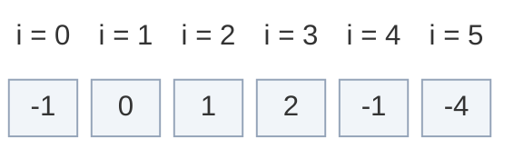

Other LeetCode examples:

```text
[0, 1, 1] -> []          (the only triplet sums to 2)
[0, 0, 0] -> [[0, 0, 0]] (the only triplet sums to 0)
```

### Constraints

- `3 <= nums.length <= 3000`
- `-10^5 <= nums[i] <= 10^5`
- The sum of three values is at most `3 * 10^5` in size. It fits easily in a 32-bit `int`. Python has no overflow anyway.

### What the constraints tell us (simple theory)

A **constraint** is the biggest input the judge will ever give you. It quietly tells you how fast your code must be.

**Rule of thumb:** a computer does about **100 million (10^8) simple steps per second**. Count how many steps your idea needs for the biggest input, and compare.

| Biggest input `n` | Steps you can afford | Ideas that fit |
|:---:|:---:|:---|
| up to ~20 | about `2^n` | Try every subset |
| up to ~500 | about `n^3` | Three nested loops |
| up to ~5,000 | about `n^2` | Two nested loops, or one loop with a two-pointer scan inside |
| up to ~1,000,000 | about `n` or `n log n` | One loop, sorting |

**For this problem:** `n` is at most `3000`.

- Brute force checks every group of three positions. For `n = 3000` that is **4,495,501,000 checks** (about 4.5 billion). At 10^8 steps per second that is around **45 seconds**. Too slow.
- Sort once, fix one number, and run two pointers on the rest. On an array of 3000 different numbers (half negative, half not) the inner loop runs only **2,250,748 times** (about 2.3 million). That is a few hundredths of a second.

So `n <= 3000` is the judge telling you: `O(n^3)` fails, `O(n^2)` passes.

**How the work grows as `n` grows**

Red bars = checks made by brute force (three loops). Green line = inner-loop steps made by sort + two pointers (it stays flat near zero).

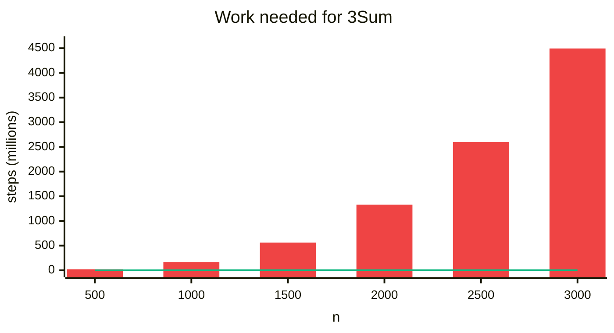

| `n` | Brute force checks | Two-pointer steps |
|:---:|:---:|:---:|
| 500 | 20,708,500 | 62,623 |
| 1000 | 166,167,000 | 250,248 |
| 1500 | 561,375,500 | 562,873 |
| 2000 | 1,331,334,000 | 1,000,498 |
| 2500 | 2,601,042,500 | 1,563,123 |
| 3000 | 4,495,501,000 | 2,250,748 |

How these were counted: brute force = number of times the innermost loop body runs (this equals `n * (n - 1) * (n - 2) / 6`). Two pointers = number of `while left < right` iterations, on the input `[-n/2, ..., n/2 - 1]`.

## 2. Core Theory

### What the problem really asks

Pick three different positions. Their values must add up to `0`. Report each **set of values** only once.

Two things make it hard:

1. There are many groups of three (about `n^3 / 6`).
2. Equal values can build the **same** triplet from different positions. In the example, positions `(0, 1, 2)` and `(1, 2, 4)` both give `{-1, 0, 1}`.

### Key observation: it is Two Sum in disguise

This problem is an extension of **Two Sum**. Fix one number `nums[i]`. Then we need two other numbers with:

```text
nums[i] + nums[left] + nums[right] = 0
```

Rearrange:

```text
nums[left] + nums[right] = -nums[i]
```

So after fixing one number, the problem becomes: **find two numbers whose sum is `-nums[i]`**. On a sorted array that is exactly [167. Two Sum II - Input Array Is Sorted](01.%20167.%20Two%20Sum%20II%20-%20Input%20Array%20Is%20Sorted.md), solved with two pointers in `O(n)`.

3Sum = one outer loop (fix `i`) + one Two Sum II scan inside it.

How to read the array pictures in this note:

| Colour | Meaning |
|:---|:---|
| Blue | the fixed number `nums[i]` |
| Orange | the two pointers `L` (left) and `R` (right) |
| Green | a triplet that sums to `0` |
| Grey | ruled out, never looked at again |
| Dashed yellow | skipped because it is a duplicate |
| Light | still in play |

Here we fix `nums[1] = -1`. We need a pair that sums to `1`, using only the cells to the right of `i`:

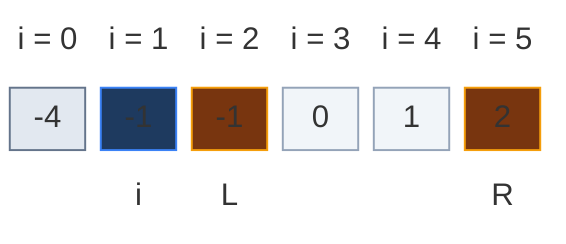

### Why sorting helps (two ways)

Sorted example:

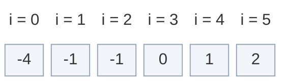

**1. Two-pointer moves become possible.**

- Sum too small: move `left` to the right. Values get bigger, so the sum goes up.
- Sum too large: move `right` to the left. Values get smaller, so the sum goes down.

**2. Duplicate skipping becomes easy.** Equal values sit next to each other. To avoid repeats, just compare a value with its neighbour.

### Why it is safe to throw a pointer away

Fix `nums[i]`. Let `need = -nums[i]`. Look at `pair = nums[left] + nums[right]`.

- **`pair < need`:** `nums[right]` is the biggest value still in the window. Even the biggest partner is not enough for `nums[left]`. Every other partner is smaller. So `nums[left]` can never be part of an answer here. Throw it away: `left += 1`.
- **`pair > need`:** `nums[left]` is the smallest value still in the window. Even the smallest partner is too much for `nums[right]`. So `nums[right]` is useless. Throw it away: `right -= 1`.
- **`pair == need`:** record the triplet. Both values are now "used up" for this `i`, so move both inward.

Every move throws away one value, and only after proving it cannot help. So we never miss an answer, and each scan takes at most `n` steps.

The pointer-move rule:

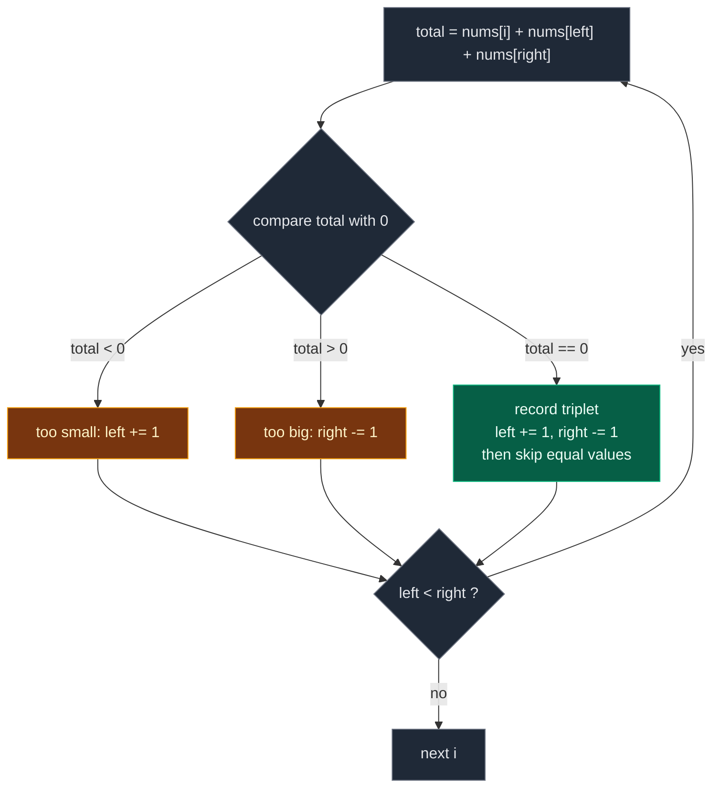

### The important duplicate problem

After sorting, `-1` appears twice: at `i = 1` and at `i = 2`. Both would fix `-1` and then find the same pair `0 + 1`. The triplet `[-1, 0, 1]` would be found twice. The output must contain it once.

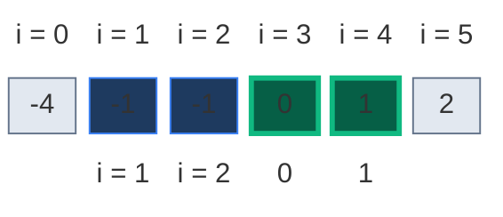

So we must skip duplicates carefully. There are **three** places where a repeat can sneak in: the fixed number `i`, the `left` value and the `right` value.

### Duplicate skipping, drawn step by step

**Rule 1: skip a fixed number equal to the previous fixed number.** In code: `if i > 0 and nums[i] == nums[i - 1]: continue`.

In the example, `i = 2` holds `-1`, the same as `i = 1`. Every triplet that starts with this `-1` was already found by `i = 1`. So `i = 2` is skipped.

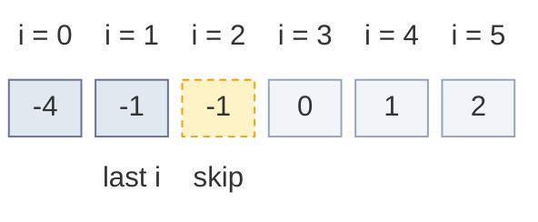

We compare with `nums[i - 1]` (the one **before**), not `nums[i + 1]`. The first `-1` must still get its turn, because it is the one that can use the second `-1` as a partner (that is how `[-1, -1, 2]` is found).

**Rule 2 and 3: after a hit, move both pointers, then skip equal `left` and `right` values.**

Our main example never needs rules 2 and 3, so here is a tiny array that does: `nums = [-2, 0, 0, 2, 2]`.

*Step A.* `i = 0` (`-2`), `L = 1`, `R = 4`. `-2 + 0 + 2 = 0`. Record `[-2, 0, 2]`.

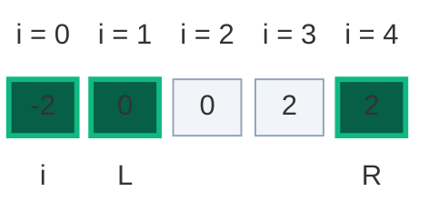

*Step B.* Move both first: `L = 2`, `R = 3`. Cells `1` and `4` are used up.

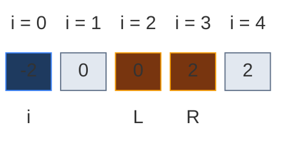

*Step C.* Skip on the left: `nums[2] = 0` equals `nums[1] = 0` (the value we just used). So `L = 3`. Now `L = R`, so the skip loops stop and the `while` loop ends. The right skip never needs to run.

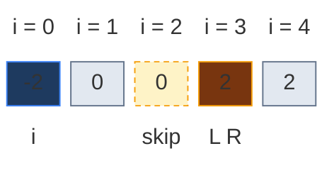

*What happens without the skip.* At step B we would check `L = 2`, `R = 3`: `-2 + 0 + 2 = 0` again, and record `[-2, 0, 2]` a **second** time.

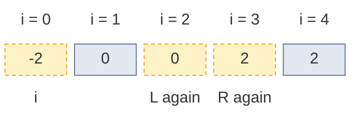

The skip code:

- Left side: `while left < right and nums[left] == nums[left - 1]: left += 1`
- Right side: `while left < right and nums[right] == nums[right + 1]: right -= 1`

Order matters: **1. add the triplet, 2. move `left` and `right`, 3. skip duplicates.** The skip compares the new cell with the cell we just used (`left - 1` and `right + 1`). The `left < right` guard stops the pointers from crossing or running off the array (for example on `[0, 0, 0, 0]`).

### Early break

After sorting, if `nums[i] > 0`, every number after it is also positive. Three positives can never sum to `0`. So we stop the outer loop with `if nums[i] > 0: break`.

Example: `[1, 2, 3, 4]`. At `i = 0` the fixed number is `1 > 0`, so we stop at once.

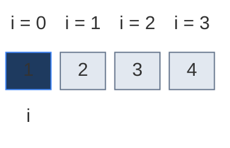

Use `>`, not `>=`. With `[0, 0, 0]` the fixed number is `0` and the answer `[0, 0, 0]` still exists.

### Recognising the pattern

| Signal | Response |
|:---|:---|
| "find all pairs or triplets summing to a target" | Sort, fix `k - 2` numbers, then two pointers |
| "the solution set must not contain duplicates" | Sort and skip equal neighbours instead of a set |
| Order of the output does not matter | You may sort the input |
| You need **indices**, not values | Sorting loses indices. Use a hash map, or sort `(value, index)` pairs |

## 3. Edge Cases

| Case | Input | Expected | Why it matters |
|:---|:---|:---:|:---|
| Fewer than three values | `[]`, `[0]`, `[0, 0]` | `[]` | `range(n - 2)` is empty. Not allowed by LeetCode, but the code should not crash |
| Exactly three zeros | `[0, 0, 0]` | `[[0, 0, 0]]` | The early break must be `> 0`, not `>= 0` |
| Many zeros | `[0, 0, 0, 0]` | `[[0, 0, 0]]` | Must appear **once**. Tests all three skip rules and the `left < right` guard |
| No triplet | `[0, 1, 1]` | `[]` | Return an empty list, not `None` |
| All positive | `[1, 2, 3, 4]` | `[]` | Early break fires at `i = 0` |
| All negative | `[-1, -2, -3]` | `[]` | Sum can never reach `0` |
| Duplicates on `left` and `right` | `[-2, 0, 0, 2, 2]` | `[[-2, 0, 2]]` | Skipping only `i` would record it twice |
| Duplicates in the fixed slot | `[-1, 0, 1, 2, -1, -4]` | `[[-1, -1, 2], [-1, 0, 1]]` | The `i` skip stops a second `[-1, 0, 1]` |
| A value used twice inside one triplet | `[-1, -1, 2]` | `[[-1, -1, 2]]` | Equal values at different positions are allowed. Do not over-skip |
| Many equal non-zero values | `[1, 1, 1, 1]` | `[]` | Skip loops must not run past each other |
| Large values | `[-100000, 50000, 50000]` | `[[-100000, 50000, 50000]]` | No overflow in Python. In C++ or Java the sum still fits in `int` |

## 4. Brute Force: Try Every Triplet

### Idea

1. Use three loops to pick positions `i < j < k`.
2. If `nums[i] + nums[j] + nums[k] == 0`, sort the three values.
3. Put the sorted triplet in a set. The set removes repeats, because the same values in a different order now look the same.
4. Turn the set back into a list.

On the example there are `6 * 5 * 4 / 6 = 20` groups of three. Exactly three of them sum to `0`:

`(i, j, k) = (0, 1, 2)`: `-1 + 0 + 1 = 0`, sorted `(-1, 0, 1)`.

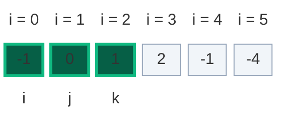

`(i, j, k) = (0, 3, 4)`: `-1 + 2 + (-1) = 0`, sorted `(-1, -1, 2)`.

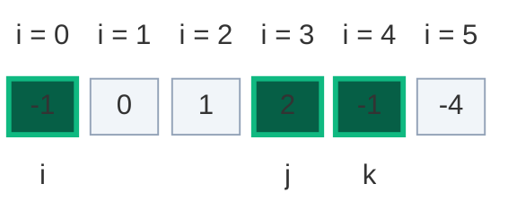

`(i, j, k) = (1, 2, 4)`: `0 + 1 + (-1) = 0`, sorted `(-1, 0, 1)`. Already in the set, so nothing new.

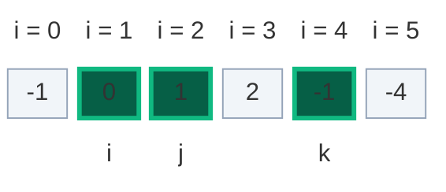

Set = `{(-1, 0, 1), (-1, -1, 2)}`. Answer: `[[-1, -1, 2], [-1, 0, 1]]` (in any order).

### Code

```python
# Import List for type hints
from typing import List


# Brute force: try every group of three positions
class SolutionBrute:

    # Main method
    def threeSum(self, nums: List[int]) -> List[List[int]]:

        # Number of elements
        n = len(nums)

        # A set removes repeated triplets
        unique_triplets = set()

        # Pick the first position
        for i in range(n):

            # Pick the second position after i
            for j in range(i + 1, n):

                # Pick the third position after j
                for k in range(j + 1, n):

                    # Check if the three values sum to zero
                    if nums[i] + nums[j] + nums[k] == 0:

                        # Sort the values so the same triplet always looks the same
                        triplet = tuple(sorted([nums[i], nums[j], nums[k]]))

                        # Add it to the set
                        unique_triplets.add(triplet)

        # Turn each tuple back into a list
        result = [list(triplet) for triplet in unique_triplets]

        # Return all unique triplets
        return result
```

### Complexity

| Measure | Complexity | Why |
|:---|:---:|:---|
| **Time** | `O(n^3)` | Three nested loops. About 4.5 billion checks for `n = 3000` |
| **Space** | `O(number of unique triplets)` | The set of triplets |

## 5. Better Approach: Hash Set for the Two Sum Part

### Idea

Fix one number `nums[i]`. Then find two numbers after `i` whose sum is `-nums[i]`. That inner part is the classic **hash set Two Sum**:

1. For every index `i`, fix `nums[i]`.
2. Make an empty set called `seen`.
3. For every index `j > i`, the third number we need is:

```text
third = -(nums[i] + nums[j])
```

4. If `third` is in `seen`, we found a triplet (`third` sits somewhere between `i` and `j`).
5. Sort the triplet and add it to a result set to avoid duplicates.
6. Add `nums[j]` to `seen`, so later `j` values can pair with it.

No sorting of the array is needed. But we still need the result set, because nothing stops the same values from being found again.

### Hash set walkthrough, step by step

Original order: `nums = [-1, 0, 1, 2, -1, -4]`.

**Fix `i = 0`, `nums[i] = -1`.** We need pairs that sum to `1`.

*`j = 1`*, `nums[j] = 0`. `third = -(-1 + 0) = 1`. `seen = {}`. `1` not found. Add `0`, so `seen = {0}`.

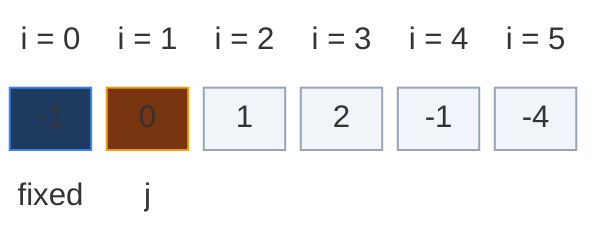

*`j = 2`*, `nums[j] = 1`. `third = -(-1 + 1) = 0`. `seen = {0}`. `0` **found**. Triplet `[-1, 1, 0]`, sorted `(-1, 0, 1)`. Add `1`, so `seen = {0, 1}`.

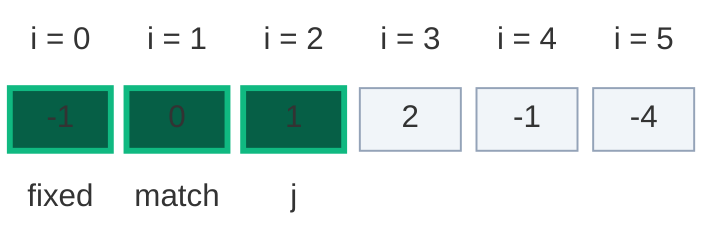

*`j = 3`*, `nums[j] = 2`. `third = -(-1 + 2) = -1`. `seen = {0, 1}`. `-1` not found. Add `2`, so `seen = {0, 1, 2}`.

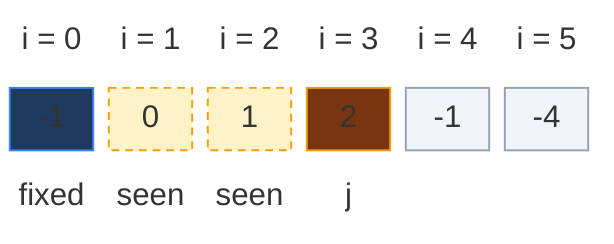

*`j = 4`*, `nums[j] = -1`. `third = -(-1 + -1) = 2`. `seen = {0, 1, 2}`. `2` **found**. Triplet `(-1, -1, 2)`. Add `-1`, so `seen = {-1, 0, 1, 2}`.

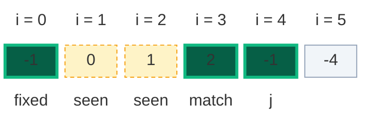

*`j = 5`*, `nums[j] = -4`. `third = -(-1 + -4) = 5`. Not found. Add `-4`.

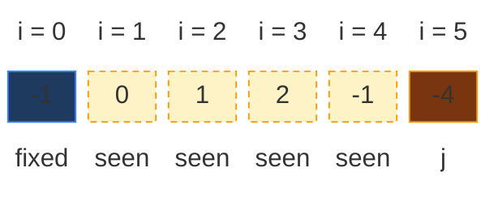

Result set after `i = 0`: `{(-1, 0, 1), (-1, -1, 2)}`. That is already the full answer.

**The other `i` values.** They find nothing new. One of them finds a **repeat**, which shows why the result set is needed:

| `i` | `nums[i]` | `j` | `nums[j]` | `third` | `seen` before | Found? |
|:---:|:---:|:---:|:---:|:---:|:---|:---|
| 1 | 0 | 2 | 1 | -1 | `{}` | no |
| 1 | 0 | 3 | 2 | -2 | `{1}` | no |
| 1 | 0 | 4 | -1 | 1 | `{1, 2}` | **yes, `(-1, 0, 1)` again** (the set ignores it) |
| 1 | 0 | 5 | -4 | 4 | `{-1, 1, 2}` | no |
| 2 | 1 | 3 | 2 | -3 | `{}` | no |
| 2 | 1 | 4 | -1 | 0 | `{2}` | no |
| 2 | 1 | 5 | -4 | 3 | `{-1, 2}` | no |
| 3 | 2 | 4 | -1 | -1 | `{}` | no |
| 3 | 2 | 5 | -4 | 2 | `{-1}` | no |
| 4 | -1 | 5 | -4 | 5 | `{}` | no |

The repeat at `i = 1`, `j = 4` (`0 + (-1) + 1`):

```mermaid
block-beta
  columns 6
  h0["i = 0"] h1["i = 1"] h2["i = 2"] h3["i = 3"] h4["i = 4"] h5["i = 5"]
  c0["-1"] c1["0"] c2["1"] c3["2"] c4["-1"] c5["-4"]
  space m1["fixed"] m2["match"] m3["seen"] m4["j"] space
  classDef head fill:none,stroke:none,color:#64748b
  class h0,h1,h2,h3,h4,h5 head
  classDef old fill:#e2e8f0,stroke:#64748b,color:#0f172a
  class c0 old
  classDef new fill:#065f46,stroke:#10b981,color:#ecfdf5,stroke-width:3px
  class c1,c2,c4 new
  classDef wait fill:#fef3c7,stroke:#f59e0b,color:#78350f,stroke-dasharray:4 3
  class c3 wait
  classDef empty fill:#f1f5f9,stroke:#94a3b8,color:#64748b
  class c5 empty
  classDef note fill:none,stroke:none,color:#b45309
  class m1,m2,m3,m4 note
```

In total the inner loop ran `15` times (`5 + 4 + 3 + 2 + 1`). Final answer: `[[-1, -1, 2], [-1, 0, 1]]`.

### Code

```python
# Better: fix one number, then hash set Two Sum on the rest
class SolutionBetter:

    # Main method
    def threeSum(self, nums: List[int]) -> List[List[int]]:

        # Number of elements
        n = len(nums)

        # Set of unique sorted triplets
        unique_triplets = set()

        # Fix one element at a time
        for i in range(n):

            # Values seen after the fixed index i
            seen = set()

            # Go through the elements after i
            for j in range(i + 1, n):

                # The third value that makes the sum zero
                third = -(nums[i] + nums[j])

                # Was that value seen earlier (between i and j)?
                if third in seen:

                    # Sort the triplet so its order does not matter
                    triplet = tuple(sorted([nums[i], nums[j], third]))

                    # Add it to the set (repeats are ignored)
                    unique_triplets.add(triplet)

                # Remember the current value for later pairs
                seen.add(nums[j])

        # Turn each tuple back into a list
        result = [list(triplet) for triplet in unique_triplets]

        # Return unique triplets
        return result
```

### Complexity

| Measure | Complexity | Why |
|:---|:---:|:---|
| **Time** | `O(n^2)` | Fix one element, then scan the rest once |
| **Space** | `O(n)` + output | `seen` can hold up to `n` values, and the result set stores triplets |

This is already `O(n^2)`, but it still needs extra sets: one for `seen` and one to remove repeats. Sorting + two pointers removes both.

## 6. Optimal Approach: Two Pointers

### Idea

1. Sort the array.
2. Fix one number `nums[i]`, from left to right.
3. If `nums[i] > 0`, stop. Nothing after it can help.
4. If `nums[i]` equals `nums[i - 1]`, skip it. Its triplets were already found.
5. Put `left = i + 1` and `right = n - 1`. Compute `total = nums[i] + nums[left] + nums[right]`.
   - `total < 0`: too small, `left += 1`.
   - `total > 0`: too big, `right -= 1`.
   - `total == 0`: record it, move both pointers, then skip equal values on both sides.
6. Repeat while `left < right`.

The inner loop is exactly [Two Sum II](01.%20167.%20Two%20Sum%20II%20-%20Input%20Array%20Is%20Sorted.md) with target `-nums[i]`, plus the duplicate skips.

### Visual Walkthrough (Story Version)

**The story:** six kids want to build **floating rafts**. Each kid holds a number card. A positive card is a balloon that pulls up. A negative card is a stone that pulls down. A raft holds exactly **three** kids, and it is perfect when it floats level: the cards add up to `0`.

The rules of the game:

- Kids line up from the heaviest stone to the biggest balloon (sorting).
- One kid at a time becomes the **captain** (the fixed number `i`).
- Two helpers stand behind the captain: **Lefty** at the near end, **Righty** at the far end.
- Raft sinks (sum below `0`)? Lefty steps aside, and the next kid (a lighter stone or a bigger balloon) takes his place.
- Raft flies up (sum above `0`)? Righty steps aside, and the kid before him (a smaller balloon) takes his place.
- Raft floats level? Take a photo! Then both helpers step aside. If the next helper holds the same card as the one who just left, he steps aside too (same photo again).
- If a new captain holds the same card as the last captain, he **sits out**. He would only take the same photos.
- If the captain is a balloon (card above `0`), everyone after him is a balloon too. Game over.

**Step 1: the kids arrive in any order.**

```mermaid
block-beta
  columns 6
  h0["kid 0"] h1["kid 1"] h2["kid 2"] h3["kid 3"] h4["kid 4"] h5["kid 5"]
  c0["-1"] c1["0"] c2["1"] c3["2"] c4["-1"] c5["-4"]
  classDef head fill:none,stroke:none,color:#64748b
  class h0,h1,h2,h3,h4,h5 head
  classDef empty fill:#f1f5f9,stroke:#94a3b8,color:#64748b
  class c0,c1,c2,c3,c4,c5 empty
```

**Step 2: they line up, heaviest stone first.**

```mermaid
block-beta
  columns 6
  h0["kid 0"] h1["kid 1"] h2["kid 2"] h3["kid 3"] h4["kid 4"] h5["kid 5"]
  c0["-4"] c1["-1"] c2["-1"] c3["0"] c4["1"] c5["2"]
  classDef head fill:none,stroke:none,color:#64748b
  class h0,h1,h2,h3,h4,h5 head
  classDef empty fill:#f1f5f9,stroke:#94a3b8,color:#64748b
  class c0,c1,c2,c3,c4,c5 empty
```

**Step 3: kid 0 (`-4`) is captain.** Lefty starts at kid 1, Righty at kid 5 (`2`). Every raft sinks: `-3`, `-3`, `-2`, `-1`. Lefty keeps stepping aside until he meets Righty. No photo. The picture shows the last try: `-4 + 1 + 2 = -1`.

```mermaid
block-beta
  columns 6
  h0["kid 0"] h1["kid 1"] h2["kid 2"] h3["kid 3"] h4["kid 4"] h5["kid 5"]
  c0["-4"] c1["-1"] c2["-1"] c3["0"] c4["1"] c5["2"]
  m0["captain"] space space space m4["Lefty"] m5["Righty"]
  classDef head fill:none,stroke:none,color:#64748b
  class h0,h1,h2,h3,h4,h5 head
  classDef done fill:#1e3a5f,stroke:#3b82f6,color:#dbeafe
  class c0 done
  classDef old fill:#e2e8f0,stroke:#64748b,color:#0f172a
  class c1,c2,c3 old
  classDef read fill:#78350f,stroke:#f59e0b,color:#fef3c7
  class c4,c5 read
  classDef note fill:none,stroke:none,color:#b45309
  class m0,m4,m5 note
```

**Step 4: kid 1 (`-1`) is captain.** Lefty is kid 2 (`-1`), Righty is kid 5 (`2`). `-1 + -1 + 2 = 0`. The raft floats! Photo 1: `[-1, -1, 2]`.

```mermaid
block-beta
  columns 6
  h0["kid 0"] h1["kid 1"] h2["kid 2"] h3["kid 3"] h4["kid 4"] h5["kid 5"]
  c0["-4"] c1["-1"] c2["-1"] c3["0"] c4["1"] c5["2"]
  space m1["captain"] m2["Lefty"] space space m5["Righty"]
  classDef head fill:none,stroke:none,color:#64748b
  class h0,h1,h2,h3,h4,h5 head
  classDef old fill:#e2e8f0,stroke:#64748b,color:#0f172a
  class c0 old
  classDef new fill:#065f46,stroke:#10b981,color:#ecfdf5,stroke-width:3px
  class c1,c2,c5 new
  classDef empty fill:#f1f5f9,stroke:#94a3b8,color:#64748b
  class c3,c4 empty
  classDef note fill:none,stroke:none,color:#b45309
  class m1,m2,m5 note
```

**Step 5: both helpers step aside.** Lefty is now kid 3 (`0`), Righty kid 4 (`1`). Their cards differ from the helpers who left, so nobody else steps aside. `-1 + 0 + 1 = 0`. Photo 2: `[-1, 0, 1]`. Both step aside again, they cross, and this captain is done.

```mermaid
block-beta
  columns 6
  h0["kid 0"] h1["kid 1"] h2["kid 2"] h3["kid 3"] h4["kid 4"] h5["kid 5"]
  c0["-4"] c1["-1"] c2["-1"] c3["0"] c4["1"] c5["2"]
  space m1["captain"] space m3["Lefty"] m4["Righty"] space
  classDef head fill:none,stroke:none,color:#64748b
  class h0,h1,h2,h3,h4,h5 head
  classDef old fill:#e2e8f0,stroke:#64748b,color:#0f172a
  class c0,c2,c5 old
  classDef new fill:#065f46,stroke:#10b981,color:#ecfdf5,stroke-width:3px
  class c1,c3,c4 new
  classDef note fill:none,stroke:none,color:#b45309
  class m1,m3,m4 note
```

**Step 6: kid 2 (`-1`) holds the same card as the last captain.** He sits out. Without this rule we would get photo 2 a second time.

```mermaid
block-beta
  columns 6
  h0["kid 0"] h1["kid 1"] h2["kid 2"] h3["kid 3"] h4["kid 4"] h5["kid 5"]
  c0["-4"] c1["-1"] c2["-1"] c3["0"] c4["1"] c5["2"]
  space space m2["sits out"] space space space
  classDef head fill:none,stroke:none,color:#64748b
  class h0,h1,h2,h3,h4,h5 head
  classDef old fill:#e2e8f0,stroke:#64748b,color:#0f172a
  class c0,c1 old
  classDef wait fill:#fef3c7,stroke:#f59e0b,color:#78350f,stroke-dasharray:4 3
  class c2 wait
  classDef empty fill:#f1f5f9,stroke:#94a3b8,color:#64748b
  class c3,c4,c5 empty
  classDef note fill:none,stroke:none,color:#b45309
  class m2 note
```

**Step 7: kid 3 (`0`) is captain.** Lefty is kid 4 (`1`), Righty kid 5 (`2`). `0 + 1 + 2 = 3`, the raft flies up. Righty steps aside and meets Lefty. No photo. There are no kids left for a new captain with two helpers, so the game ends.

```mermaid
block-beta
  columns 6
  h0["kid 0"] h1["kid 1"] h2["kid 2"] h3["kid 3"] h4["kid 4"] h5["kid 5"]
  c0["-4"] c1["-1"] c2["-1"] c3["0"] c4["1"] c5["2"]
  space space space m3["captain"] m4["Lefty Righty"] space
  classDef head fill:none,stroke:none,color:#64748b
  class h0,h1,h2,h3,h4,h5 head
  classDef old fill:#e2e8f0,stroke:#64748b,color:#0f172a
  class c0,c1,c2,c5 old
  classDef done fill:#1e3a5f,stroke:#3b82f6,color:#dbeafe
  class c3 done
  classDef read fill:#78350f,stroke:#f59e0b,color:#fef3c7
  class c4 read
  classDef note fill:none,stroke:none,color:#b45309
  class m3,m4 note
```

**All steps at a glance**

| Step | Captain | Lefty, Righty | Raft sum | What happens |
|:---:|:---:|:---|:---:|:---|
| 1 | - | - | - | Kids arrive: `[-1, 0, 1, 2, -1, -4]` |
| 2 | - | - | - | Line up: `[-4, -1, -1, 0, 1, 2]` |
| 3 | kid 0 (`-4`) | kid 1..4 with kid 5 | `-3, -3, -2, -1` | Always sinks, Lefty walks to Righty |
| 4 | kid 1 (`-1`) | kid 2, kid 5 | `0` | Photo `[-1, -1, 2]` |
| 5 | kid 1 (`-1`) | kid 3, kid 4 | `0` | Photo `[-1, 0, 1]` |
| 6 | kid 2 (`-1`) | - | - | Same card as last captain, sits out |
| 7 | kid 3 (`0`) | kid 4, kid 5 | `3` | Flies up, Righty steps aside, game ends |

Photos: `[[-1, -1, 2], [-1, 0, 1]]`.

**What the story teaches**

| In the story | In the code |
|:---|:---|
| Kids line up by card | `nums.sort()` |
| Captain | the fixed number `nums[i]` |
| Lefty and Righty | `left` and `right` |
| Raft sinks, Lefty steps aside | `total < 0`: `left += 1` |
| Raft flies up, Righty steps aside | `total > 0`: `right -= 1` |
| Photo | `result.append([nums[i], nums[left], nums[right]])` |
| Next helper with the same card also steps aside | the two skip `while` loops |
| Captain with the same card sits out | `if i > 0 and nums[i] == nums[i - 1]: continue` |
| Balloon captain ends the game | `if nums[i] > 0: break` |
| Helpers meet | `while left < right` ends |

Now the same steps again, with every pointer move.

### Step-by-Step Example

```text
nums = [-1, 0, 1, 2, -1, -4]
```

**Sort.** `nums = [-4, -1, -1, 0, 1, 2]`, `n = 6`, `result = []`. The outer loop runs `i = 0, 1, 2, 3` (`range(n - 2)`).

```mermaid
block-beta
  columns 6
  h0["i = 0"] h1["i = 1"] h2["i = 2"] h3["i = 3"] h4["i = 4"] h5["i = 5"]
  c0["-4"] c1["-1"] c2["-1"] c3["0"] c4["1"] c5["2"]
  classDef head fill:none,stroke:none,color:#64748b
  class h0,h1,h2,h3,h4,h5 head
  classDef empty fill:#f1f5f9,stroke:#94a3b8,color:#64748b
  class c0,c1,c2,c3,c4,c5 empty
```

#### Fixed number `i = 0` (`nums[0] = -4`)

`-4 > 0`? No. `i = 0`, so no duplicate check. `left = 1`, `right = 5`.

**Step 1.** `total = -4 + (-1) + 2 = -3`. `-3 < 0`, too small. `left = 2`.

```mermaid
block-beta
  columns 6
  h0["i = 0"] h1["i = 1"] h2["i = 2"] h3["i = 3"] h4["i = 4"] h5["i = 5"]
  c0["-4"] c1["-1"] c2["-1"] c3["0"] c4["1"] c5["2"]
  m0["i"] m1["L"] space space space m5["R"]
  classDef head fill:none,stroke:none,color:#64748b
  class h0,h1,h2,h3,h4,h5 head
  classDef done fill:#1e3a5f,stroke:#3b82f6,color:#dbeafe
  class c0 done
  classDef read fill:#78350f,stroke:#f59e0b,color:#fef3c7
  class c1,c5 read
  classDef empty fill:#f1f5f9,stroke:#94a3b8,color:#64748b
  class c2,c3,c4 empty
  classDef note fill:none,stroke:none,color:#b45309
  class m0,m1,m5 note
```

**Step 2.** `total = -4 + (-1) + 2 = -3`. Still too small. `left = 3`.

```mermaid
block-beta
  columns 6
  h0["i = 0"] h1["i = 1"] h2["i = 2"] h3["i = 3"] h4["i = 4"] h5["i = 5"]
  c0["-4"] c1["-1"] c2["-1"] c3["0"] c4["1"] c5["2"]
  m0["i"] space m2["L"] space space m5["R"]
  classDef head fill:none,stroke:none,color:#64748b
  class h0,h1,h2,h3,h4,h5 head
  classDef done fill:#1e3a5f,stroke:#3b82f6,color:#dbeafe
  class c0 done
  classDef old fill:#e2e8f0,stroke:#64748b,color:#0f172a
  class c1 old
  classDef read fill:#78350f,stroke:#f59e0b,color:#fef3c7
  class c2,c5 read
  classDef empty fill:#f1f5f9,stroke:#94a3b8,color:#64748b
  class c3,c4 empty
  classDef note fill:none,stroke:none,color:#b45309
  class m0,m2,m5 note
```

**Step 3.** `total = -4 + 0 + 2 = -2`. Too small. `left = 4`.

```mermaid
block-beta
  columns 6
  h0["i = 0"] h1["i = 1"] h2["i = 2"] h3["i = 3"] h4["i = 4"] h5["i = 5"]
  c0["-4"] c1["-1"] c2["-1"] c3["0"] c4["1"] c5["2"]
  m0["i"] space space m3["L"] space m5["R"]
  classDef head fill:none,stroke:none,color:#64748b
  class h0,h1,h2,h3,h4,h5 head
  classDef done fill:#1e3a5f,stroke:#3b82f6,color:#dbeafe
  class c0 done
  classDef old fill:#e2e8f0,stroke:#64748b,color:#0f172a
  class c1,c2 old
  classDef read fill:#78350f,stroke:#f59e0b,color:#fef3c7
  class c3,c5 read
  classDef empty fill:#f1f5f9,stroke:#94a3b8,color:#64748b
  class c4 empty
  classDef note fill:none,stroke:none,color:#b45309
  class m0,m3,m5 note
```

**Step 4.** `total = -4 + 1 + 2 = -1`. Too small. `left = 5`.

```mermaid
block-beta
  columns 6
  h0["i = 0"] h1["i = 1"] h2["i = 2"] h3["i = 3"] h4["i = 4"] h5["i = 5"]
  c0["-4"] c1["-1"] c2["-1"] c3["0"] c4["1"] c5["2"]
  m0["i"] space space space m4["L"] m5["R"]
  classDef head fill:none,stroke:none,color:#64748b
  class h0,h1,h2,h3,h4,h5 head
  classDef done fill:#1e3a5f,stroke:#3b82f6,color:#dbeafe
  class c0 done
  classDef old fill:#e2e8f0,stroke:#64748b,color:#0f172a
  class c1,c2,c3 old
  classDef read fill:#78350f,stroke:#f59e0b,color:#fef3c7
  class c4,c5 read
  classDef note fill:none,stroke:none,color:#b45309
  class m0,m4,m5 note
```

**Step 5.** `left = 5`, `right = 5`. `left < right` is false, so the scan stops. No triplet starts with `-4`. This makes sense: the two biggest values give `1 + 2 = 3`, but we need `4`.

```mermaid
block-beta
  columns 6
  h0["i = 0"] h1["i = 1"] h2["i = 2"] h3["i = 3"] h4["i = 4"] h5["i = 5"]
  c0["-4"] c1["-1"] c2["-1"] c3["0"] c4["1"] c5["2"]
  m0["i"] space space space space m5["L R"]
  classDef head fill:none,stroke:none,color:#64748b
  class h0,h1,h2,h3,h4,h5 head
  classDef done fill:#1e3a5f,stroke:#3b82f6,color:#dbeafe
  class c0 done
  classDef old fill:#e2e8f0,stroke:#64748b,color:#0f172a
  class c1,c2,c3,c4 old
  classDef read fill:#78350f,stroke:#f59e0b,color:#fef3c7
  class c5 read
  classDef note fill:none,stroke:none,color:#b45309
  class m0,m5 note
```

#### Fixed number `i = 1` (`nums[1] = -1`)

`-1 > 0`? No. `nums[1] = -1` vs `nums[0] = -4`: different, so no skip. `left = 2`, `right = 5`. We need a pair summing to `1`.

**Step 6.** `total = -1 + (-1) + 2 = 0`. **Found.** `result = [[-1, -1, 2]]`.

```mermaid
block-beta
  columns 6
  h0["i = 0"] h1["i = 1"] h2["i = 2"] h3["i = 3"] h4["i = 4"] h5["i = 5"]
  c0["-4"] c1["-1"] c2["-1"] c3["0"] c4["1"] c5["2"]
  space m1["i"] m2["L"] space space m5["R"]
  classDef head fill:none,stroke:none,color:#64748b
  class h0,h1,h2,h3,h4,h5 head
  classDef old fill:#e2e8f0,stroke:#64748b,color:#0f172a
  class c0 old
  classDef new fill:#065f46,stroke:#10b981,color:#ecfdf5,stroke-width:3px
  class c1,c2,c5 new
  classDef empty fill:#f1f5f9,stroke:#94a3b8,color:#64748b
  class c3,c4 empty
  classDef note fill:none,stroke:none,color:#b45309
  class m1,m2,m5 note
```

**Step 7.** Move both: `left = 3`, `right = 4`. Left skip: `nums[3] = 0` vs `nums[2] = -1`, different, stay. Right skip: `nums[4] = 1` vs `nums[5] = 2`, different, stay.

```mermaid
block-beta
  columns 6
  h0["i = 0"] h1["i = 1"] h2["i = 2"] h3["i = 3"] h4["i = 4"] h5["i = 5"]
  c0["-4"] c1["-1"] c2["-1"] c3["0"] c4["1"] c5["2"]
  space m1["i"] space m3["L"] m4["R"] space
  classDef head fill:none,stroke:none,color:#64748b
  class h0,h1,h2,h3,h4,h5 head
  classDef old fill:#e2e8f0,stroke:#64748b,color:#0f172a
  class c0,c2,c5 old
  classDef done fill:#1e3a5f,stroke:#3b82f6,color:#dbeafe
  class c1 done
  classDef read fill:#78350f,stroke:#f59e0b,color:#fef3c7
  class c3,c4 read
  classDef note fill:none,stroke:none,color:#b45309
  class m1,m3,m4 note
```

**Step 8.** `total = -1 + 0 + 1 = 0`. **Found.** `result = [[-1, -1, 2], [-1, 0, 1]]`.

```mermaid
block-beta
  columns 6
  h0["i = 0"] h1["i = 1"] h2["i = 2"] h3["i = 3"] h4["i = 4"] h5["i = 5"]
  c0["-4"] c1["-1"] c2["-1"] c3["0"] c4["1"] c5["2"]
  space m1["i"] space m3["L"] m4["R"] space
  classDef head fill:none,stroke:none,color:#64748b
  class h0,h1,h2,h3,h4,h5 head
  classDef old fill:#e2e8f0,stroke:#64748b,color:#0f172a
  class c0,c2,c5 old
  classDef new fill:#065f46,stroke:#10b981,color:#ecfdf5,stroke-width:3px
  class c1,c3,c4 new
  classDef note fill:none,stroke:none,color:#b45309
  class m1,m3,m4 note
```

**Step 9.** Move both: `left = 4`, `right = 3`. The skip loops do not run because `left < right` is false. The scan stops.

```mermaid
block-beta
  columns 6
  h0["i = 0"] h1["i = 1"] h2["i = 2"] h3["i = 3"] h4["i = 4"] h5["i = 5"]
  c0["-4"] c1["-1"] c2["-1"] c3["0"] c4["1"] c5["2"]
  space m1["i"] space m3["R"] m4["L"] space
  classDef head fill:none,stroke:none,color:#64748b
  class h0,h1,h2,h3,h4,h5 head
  classDef old fill:#e2e8f0,stroke:#64748b,color:#0f172a
  class c0,c2,c3,c4,c5 old
  classDef done fill:#1e3a5f,stroke:#3b82f6,color:#dbeafe
  class c1 done
  classDef note fill:none,stroke:none,color:#b45309
  class m1,m3,m4 note
```

#### Fixed number `i = 2` (`nums[2] = -1`)

**Step 10.** `nums[2] = -1` equals `nums[1] = -1`. **Skip** (`continue`). Every triplet starting with `-1` was already found at `i = 1`. Without this skip, the scan would find `[-1, 0, 1]` again.

```mermaid
block-beta
  columns 6
  h0["i = 0"] h1["i = 1"] h2["i = 2"] h3["i = 3"] h4["i = 4"] h5["i = 5"]
  c0["-4"] c1["-1"] c2["-1"] c3["0"] c4["1"] c5["2"]
  space m1["last i"] m2["skip"] space space space
  classDef head fill:none,stroke:none,color:#64748b
  class h0,h1,h2,h3,h4,h5 head
  classDef old fill:#e2e8f0,stroke:#64748b,color:#0f172a
  class c0,c1 old
  classDef wait fill:#fef3c7,stroke:#f59e0b,color:#78350f,stroke-dasharray:4 3
  class c2 wait
  classDef empty fill:#f1f5f9,stroke:#94a3b8,color:#64748b
  class c3,c4,c5 empty
  classDef note fill:none,stroke:none,color:#b45309
  class m1,m2 note
```

#### Fixed number `i = 3` (`nums[3] = 0`)

`0 > 0`? No (this is why the check is `>` and not `>=`). `nums[3] = 0` vs `nums[2] = -1`: different. `left = 4`, `right = 5`.

**Step 11.** `total = 0 + 1 + 2 = 3`. `3 > 0`, too big. `right = 4`.

```mermaid
block-beta
  columns 6
  h0["i = 0"] h1["i = 1"] h2["i = 2"] h3["i = 3"] h4["i = 4"] h5["i = 5"]
  c0["-4"] c1["-1"] c2["-1"] c3["0"] c4["1"] c5["2"]
  space space space m3["i"] m4["L"] m5["R"]
  classDef head fill:none,stroke:none,color:#64748b
  class h0,h1,h2,h3,h4,h5 head
  classDef old fill:#e2e8f0,stroke:#64748b,color:#0f172a
  class c0,c1,c2 old
  classDef done fill:#1e3a5f,stroke:#3b82f6,color:#dbeafe
  class c3 done
  classDef read fill:#78350f,stroke:#f59e0b,color:#fef3c7
  class c4,c5 read
  classDef note fill:none,stroke:none,color:#b45309
  class m3,m4,m5 note
```

**Step 12.** `left = 4`, `right = 4`. The scan stops. `range(4)` is finished, so the outer loop ends too.

```mermaid
block-beta
  columns 6
  h0["i = 0"] h1["i = 1"] h2["i = 2"] h3["i = 3"] h4["i = 4"] h5["i = 5"]
  c0["-4"] c1["-1"] c2["-1"] c3["0"] c4["1"] c5["2"]
  space space space m3["i"] m4["L R"] space
  classDef head fill:none,stroke:none,color:#64748b
  class h0,h1,h2,h3,h4,h5 head
  classDef old fill:#e2e8f0,stroke:#64748b,color:#0f172a
  class c0,c1,c2,c5 old
  classDef done fill:#1e3a5f,stroke:#3b82f6,color:#dbeafe
  class c3 done
  classDef read fill:#78350f,stroke:#f59e0b,color:#fef3c7
  class c4 read
  classDef note fill:none,stroke:none,color:#b45309
  class m3,m4 note
```

**All scan steps**

| Step | `i` | `nums[i]` | `left` | `right` | `total` | Action |
|:---:|:---:|:---:|:---:|:---:|:---:|:---|
| 1 | 0 | -4 | 1 | 5 | -3 | `left += 1` |
| 2 | 0 | -4 | 2 | 5 | -3 | `left += 1` |
| 3 | 0 | -4 | 3 | 5 | -2 | `left += 1` |
| 4 | 0 | -4 | 4 | 5 | -1 | `left += 1` |
| 5 | 0 | -4 | 5 | 5 | - | stop |
| 6 | 1 | -1 | 2 | 5 | 0 | record `[-1, -1, 2]` |
| 7 | 1 | -1 | 3 | 4 | - | moved both, no skips |
| 8 | 1 | -1 | 3 | 4 | 0 | record `[-1, 0, 1]` |
| 9 | 1 | -1 | 4 | 3 | - | stop |
| 10 | 2 | -1 | - | - | - | skip duplicate `i` |
| 11 | 3 | 0 | 4 | 5 | 3 | `right -= 1` |
| 12 | 3 | 0 | 4 | 4 | - | stop, loop ends |

The `while` body ran **7** times (steps 1, 2, 3, 4, 6, 8, 11). Brute force checked **20** groups of three.

**Answer:** `[[-1, -1, 2], [-1, 0, 1]]`

### Code

```python
# Solution for 15. 3Sum: sort, fix one number, two pointers on the rest
class Solution:

    # Main method (trace is optional and only used by the tests)
    def threeSum(self, nums: List[int], trace: list = None) -> List[List[int]]:

        # Sort so two pointers work and equal values sit side by side
        nums.sort()

        # All unique triplets
        result = []

        # Number of elements
        n = len(nums)

        # Fix one number at a time (we need two more after it)
        for i in range(n - 2):

            # A positive fixed number means everything after it is positive too
            if nums[i] > 0:

                # No triplet can sum to zero any more
                break

            # Same fixed number as the last one gives the same triplets again
            if i > 0 and nums[i] == nums[i - 1]:

                # Remember the skip for the tests
                if trace is not None:

                    # Save the skipped index
                    trace.append(("skip", i))

                # Move on to the next fixed number
                continue

            # Left pointer starts just after the fixed number
            left = i + 1

            # Right pointer starts at the last index
            right = n - 1

            # Scan while the pointers have not met
            while left < right:

                # Sum of the fixed number and both pointers
                total = nums[i] + nums[left] + nums[right]

                # Remember this step for the tests
                if trace is not None:

                    # Save (i, left, right, total)
                    trace.append((i, left, right, total))

                # Too small: the left value must grow
                if total < 0:

                    # Move left one step to the right
                    left += 1

                # Too big: the right value must shrink
                elif total > 0:

                    # Move right one step to the left
                    right -= 1

                # Exactly zero: we found a triplet
                else:

                    # Save the values (not the indexes)
                    result.append([nums[i], nums[left], nums[right]])

                    # Move both pointers inward first
                    left += 1

                    # Right pointer also moves inward
                    right -= 1

                    # Skip left values equal to the one just used
                    while left < right and nums[left] == nums[left - 1]:

                        # Step past the duplicate
                        left += 1

                    # Skip right values equal to the one just used
                    while left < right and nums[right] == nums[right + 1]:

                        # Step past the duplicate
                        right -= 1

        # Every unique triplet, in sorted order
        return result


# Import random for the agreement tests
import random

# Our example, traced step by step
trace = []

# Run the optimal solution with the trace switched on
ans = Solution().threeSum([-1, 0, 1, 2, -1, -4], trace)

# The answer from the walkthrough
assert ans == [[-1, -1, 2], [-1, 0, 1]]

# Every scan step: (i, left, right, total)
assert [s for s in trace if s[0] != "skip"] == [(0, 1, 5, -3), (0, 2, 5, -3), (0, 3, 5, -2), (0, 4, 5, -1), (1, 2, 5, 0), (1, 3, 4, 0), (3, 4, 5, 3)]

# The duplicate fixed number at i = 2 was skipped
assert [s[1] for s in trace if s[0] == "skip"] == [2]

# The while body ran 7 times
assert len([s for s in trace if s[0] != "skip"]) == 7

# LeetCode example 2: no triplet
assert Solution().threeSum([0, 1, 1]) == []

# LeetCode example 3: all zeros
assert Solution().threeSum([0, 0, 0]) == [[0, 0, 0]]

# Many zeros still give one triplet (needs the > 0 break, not >= 0)
assert Solution().threeSum([0, 0, 0, 0]) == [[0, 0, 0]]

# Left and right duplicates are skipped after a match
assert Solution().threeSum([-2, 0, 0, 2, 2]) == [[-2, 0, 2]]

# All positive: early break, nothing found
assert Solution().threeSum([1, 2, 3, 4]) == []

# All negative: nothing found
assert Solution().threeSum([-3, -2, -1]) == []

# Smallest allowed input
assert Solution().threeSum([1, -1, 0]) == [[-1, 0, 1]]

# A case with several answers
assert Solution().threeSum([-4, -2, -2, -2, 0, 1, 2, 2, 2, 3, 3, 4, 4, 6, 6]) == [[-4, -2, 6], [-4, 0, 4], [-4, 1, 3], [-4, 2, 2], [-2, -2, 4], [-2, 0, 2]]

# Turn a list of triplets into a sorted, comparable form
def norm(triplets):

    # Sort inside each triplet, then sort the list
    return sorted(sorted(t) for t in triplets)

# Brute force, better and optimal must agree on random arrays
for _ in range(500):

    # Random length between 3 and 12
    size = random.randint(3, 12)

    # Small values so zero sums happen often
    arr = [random.randint(-5, 5) for _ in range(size)]

    # Optimal answer (on a copy, because it sorts in place)
    expected = norm(Solution().threeSum(arr[:]))

    # Brute force must match
    assert norm(SolutionBrute().threeSum(arr[:])) == expected

    # Better (hash set) must match
    assert norm(SolutionBetter().threeSum(arr[:])) == expected

# A big input runs fast enough
big = [random.randint(-10 ** 5, 10 ** 5) for _ in range(3000)]

# Every triplet in the big answer really sums to zero
assert all(sum(t) == 0 for t in Solution().threeSum(big))

# All checks passed
print("All tests passed")
```

**About `trace`:** the extra `trace` argument is only for the tests above. LeetCode calls `threeSum(nums)` without it, and the code behaves exactly the same.

### Complexity

| Part | Time | Why |
|:---|:---:|:---|
| Sorting | `O(n log n)` | Python's sort |
| Outer loop | `O(n)` | One fixed number at a time |
| Two-pointer scan per fixed number | `O(n)` | `left` and `right` together move at most `n` steps |
| **Total** | **`O(n^2)`** | `n` fixed numbers × `O(n)` scan; the sort is smaller |

| Space | Size | Why |
|:---|:---:|:---|
| Extra (not counting the output) | `O(1)` | Only `i`, `left`, `right`, `total` |
| Sorting | `O(n)` in Python | Python's sort uses a helper buffer; this depends on the language |
| Output | `O(k)` | `k` triplets found |

| Approach | Time | Extra space |
|:---|:---:|:---:|
| Brute force | `O(n^3)` | `O(k)` for the set of triplets |
| Better (hash set) | `O(n^2)` | `O(n)` for the set, plus the dedup set |
| **Optimal (sort + two pointers)** | **`O(n^2)`** | **`O(1)`** |

## 7. Common Mistakes

| Mistake | What goes wrong | Fix |
|:---|:---|:---|
| Forgetting to sort | Two pointers cannot decide which side to move, so answers are missed | Call `nums.sort()` before the outer loop. It also puts duplicates next to each other |
| Skipping duplicate fixed numbers with `nums[i] == nums[i + 1]` | Skips the first copy instead of the repeats, so `[-1, -1, 2]` is never found | Compare backwards: `if i > 0 and nums[i] == nums[i - 1]: continue` |
| Not skipping duplicate fixed numbers at all | The same triplets are added again | Use the `i > 0 and nums[i] == nums[i - 1]` check |
| Skipping duplicates for `i` but not for `left` / `right` | `[-2, 0, 0, 2, 2]` records `[-2, 0, 2]` twice | After a match, skip equal values on both sides |
| Skipping duplicates before moving the pointers | Compares the wrong neighbours and can skip a valid pair | Order after a match: 1) add the triplet, 2) move `left` and `right`, 3) skip duplicates |
| `if nums[i] >= 0: break` | `[0, 0, 0]` breaks at `i = 0` and returns `[]` | The early break must be `nums[i] > 0` |
| No `left < right` in the skip loops | On `[0, 0, 0, 0]` the skip walks off the array | Guard both skip loops with `left < right` |
| Returning indexes | LeetCode 15 wants values, and sorting has already moved the indexes | Append `[nums[i], nums[left], nums[right]]` |
| Adding a `set` of triplets on top | Not wrong, but it hides a broken skip and costs extra space | Trust the skip rules; sorting makes them enough |

## 8. Interview Follow-ups

### Q1. How do you extend this to 4Sum, or any kSum?

**Answer:**
- For 4Sum, fix two numbers with two loops, then run the same two-pointer scan inside. That is `O(n^3)`.
- In general, kSum on a sorted array is `O(n^(k-1))`: peel off one number per loop until two are left, then use two pointers.
- The duplicate skip works the same at every level.
- See [18. 4Sum](../../01.%20Array/06.%20Sorting%20+%20Two%20Pointers/03.%2018.%204Sum.md).

### Q2. Can you beat `O(n^2)`?

**Answer:**
- Not with any practical method. 3Sum is the classic "3SUM-hard" problem.
- Researchers believe no general `O(n^(2 - ε))` solution exists.
- If the values are in a small range, an FFT trick can do better, but interviews do not expect it.

### Q3. What if you must return indexes instead of values?

**Answer:**
- Sorting moves the elements, so store `(value, index)` pairs before sorting.
- Equal values at different indexes now count as different answers, so remove the value-based duplicate skips.
- Warn the interviewer: `[0] * n` then has `C(n, 3)` answers, which is a huge output.

### Q4. What if you only need to know whether any triplet exists, or how many there are?

**Answer:**
- **Exists:** the same scan, but return `True` at the first match.
- **Count:** at a match, count how many equal values sit at `left` (`a`) and at `right` (`b`), and add `a * b`.
- If `nums[left] == nums[right]`, the whole block is one value, so add `C(block length, 2)`. Then jump both pointers past the block.

### Q5. The array is too big for memory (a billion numbers on disk). What changes?

**Answer:**
- Sort it on disk with an external merge sort.
- Stream the fixed number `i` forward.
- The scan needs both ends at once, so keep two buffered readers: one moving forward and one moving backward.
- Memory stays at the size of the buffers.

### Q6. How is 3Sum Closest (LeetCode 16) different?

**Answer:**
- Same sort plus two-pointer scan.
- Keep the best sum by `abs(total - target)`, and move by the sign of `total - target`.
- No duplicate skips are needed, because duplicates cannot change the closest sum.
- Still `O(n^2)`.

## 9. Interview Explanation

> I sort the array first. Then I fix one number at a time and use two pointers on the part to its right, to find two numbers that add up to minus the fixed number. If the sum is too small I move the left pointer right; if it is too big I move the right pointer left. Sorting makes each move safe, because it rules out a whole row or column of pairs at once. To keep the triplets unique, I skip a fixed number equal to the previous one, and after a match I skip equal values on both sides. I also stop early once the fixed number is positive. That gives `O(n^2)` time and `O(1)` extra space, which beats the `O(n^3)` brute force and the `O(n)`-space hash set approach.
