# 01. 125. Valid Palindrome

| Difficulty | Pattern | Source | Time | Space |
|:---:|:---:|:---:|:---:|:---:|
| **Easy** | Two Pointers: Converging (Palindrome Check) | [125. Valid Palindrome](https://leetcode.com/problems/valid-palindrome/) | `O(n)` | `O(1)` |

## 1. Problem Statement

A phrase is a **palindrome** if, after converting all uppercase letters into lowercase letters and removing all non-alphanumeric characters, it reads the same forward and backward. Alphanumeric characters include letters and numbers.

Given a string `s`, return `true` if it is a **palindrome**, or `false` otherwise.

In simple words, you must check whether `s` is a palindrome after you:

1. Remove every character that is not a letter or a digit (spaces, commas, colons, `!`, `_`, ...).
2. Ignore the difference between uppercase and lowercase.

LeetCode examples:

```text
Input:  s = "A man, a plan, a canal: Panama"
Output: true
Explanation: "amanaplanacanalpanama" is a palindrome.
```

```text
Input:  s = "race a car"
Output: false
Explanation: "raceacar" is not a palindrome.
             Its reverse is "racaecar".
```

```text
Input:  s = " "
Output: true
Explanation: s is an empty string "" after removing non-alphanumeric characters.
             Since an empty string reads the same forward and backward, it is a palindrome.
```

### Example

The LeetCode strings are long (the first one has 30 characters). So we use one short string that still has everything: a capital letter, a comma, a space, a `!` at the end, and a middle letter.

```text
Input:  s = "Top, spot!"
Output: true

After cleaning: "topspot"
Reverse:        "topspot"
Same, so the answer is true.
```

We use this same example (`"Top, spot!"`, 10 characters, index `0` to `9`) in every section below.

### Constraints

- `1 <= s.length <= 2 * 10^5`
- `s` consists only of printable ASCII characters.
- So `s` can hold letters, digits, spaces and symbols. A string of only symbols (like `" "` or `",.:"`) is allowed, and it cleans to an empty string.

### What the constraints tell us (simple theory)

A **constraint** is the biggest input the judge will ever give you. It quietly tells you how fast your code must be.

**Rule of thumb:** a computer does about **100 million (10^8) simple steps per second**. Count how many steps your idea needs for the biggest input, and compare.

| Biggest input `n` | Steps you can afford | Ideas that fit |
|:---:|:---:|:---|
| up to ~20 | about `2^n` | Plain recursion, try everything |
| up to ~500 | about `n^3` | Three nested loops |
| up to ~5,000 | about `n^2` | Two nested loops |
| up to ~1,000,000 | about `n` or `n log n` | One loop, two pointers |

**For this problem:** `n` is at most `200,000`.

- Any idea with two nested loops (`n^2`) would need about **40 billion steps**. That is far too slow.
- So we need one pass over the string, `O(n)`.
- The brute force (clean, reverse, compare) is already `O(n)`, but it touches the string about **2.4 times** and builds **two new strings**. For `n = 200,000` that is **480,000 steps** and **280,000 extra characters** in memory.
- Two pointers touch each character at most once and build nothing. For `n = 200,000` that is about **130,000 steps** and **0 extra characters**.

Both pass easily. The real win of two pointers is the memory: `O(1)` instead of `O(n)`. Interviewers ask for exactly that.

**How the work grows as `n` grows**

We measured both codes on `"Top, spot!"` repeated until the length is `n` (it stays a palindrome, so no early stop). Brute steps = characters scanned + characters reversed + characters compared. Two-pointer steps = skip moves + pair compares.

Red bars = brute force steps. Green line = two-pointer steps.

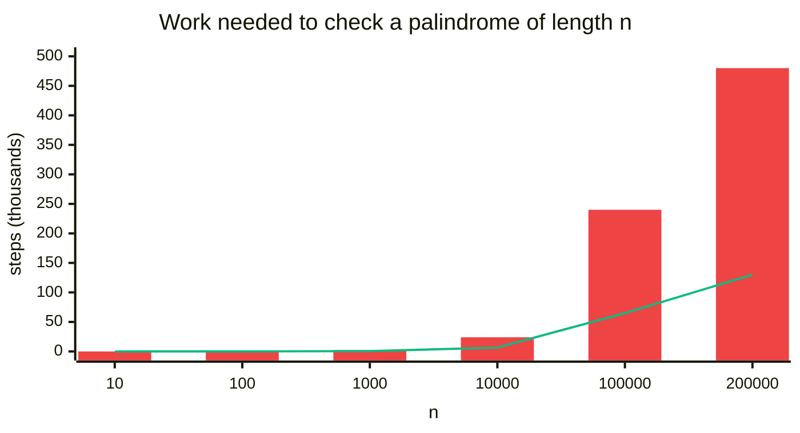

| `n` | Brute force steps | Brute force extra characters | Two-pointer steps | Two-pointer extra characters |
|:---:|:---:|:---:|:---:|:---:|
| 10 | 24 | 14 | 7 | 0 |
| 100 | 240 | 140 | 64 | 0 |
| 1,000 | 2,400 | 1,400 | 649 | 0 |
| 10,000 | 24,000 | 14,000 | 6,499 | 0 |
| 100,000 | 240,000 | 140,000 | 64,999 | 0 |
| 200,000 | 480,000 | 280,000 | 129,999 | 0 |

Both lines grow in a straight line (linear). Neither one ever blows up. The difference is the extra memory column.

## 2. Core Theory

This is the first note of the Palindrome pattern, so we start from zero.

### What is a palindrome?

A **palindrome** reads the same from left to right and from right to left. `mom`, `level`, `racecar` and `12321` are palindromes. `cat` is not (its reverse is `tac`).

Reading the same both ways means: the first character equals the last, the second equals the second last, and so on. We call each of these a **mirrored pair**.

Odd length (`level`): the middle character has no partner. It pairs with itself, so it can never break the palindrome.

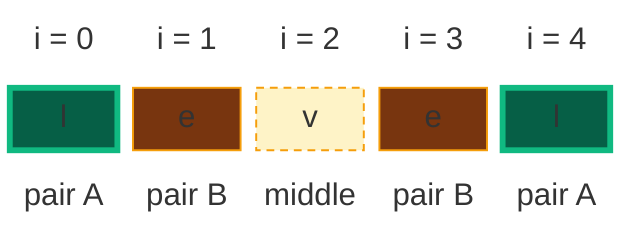

Even length (`abba`): every character has a partner. There is no middle.

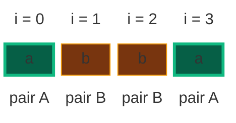

So a normal palindrome check compares:

| Compare | with |
|:---|:---|
| first character | last character |
| second character | second last character |
| third character | third last character |
| ... | ... |

### What the problem really asks

Same check, with two extra rules:

- Ignore spaces, commas, colons and any other symbol. Only letters and digits count.
- Ignore uppercase and lowercase: `T` and `t` are the same.

For our example, only 7 of the 10 characters count:

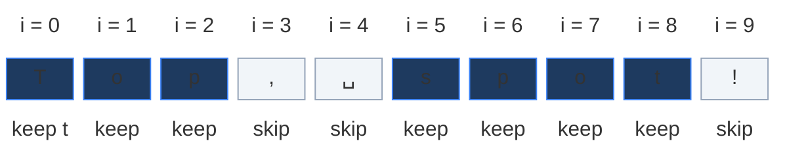

The kept characters are `t o p s p o t`. That is a palindrome, so the answer is `true`.

### Why two pointers work here

The easy way is to build the cleaned string and compare it with its reverse. That costs extra memory. Two pointers do the same check with no copy:

- Put `left` at the first index and `right` at the last index.
- If `s[left]` is a symbol, move `left` one step right. It is not part of the cleaned string, so it can never be in a pair.
- If `s[right]` is a symbol, move `right` one step left. Same reason.
- When both stand on letters or digits, compare them in lowercase.
- Match: move both inward. Mismatch: answer `false` right away.
- Stop when the pointers meet or cross. Then the answer is `true`.

**Why it is safe to throw a character away (the "safe to discard" proof, in simple words):**

1. A **symbol** is never part of the cleaned string. Skipping it changes nothing.
2. After `s[left]` and `s[right]` **match**, both are done. Each character has exactly one partner, and these two were each other's partner. Every other pair sits strictly between them. So we never need them again.
3. If they **do not match**, that one broken pair already breaks the palindrome. No later pair can fix it, so returning `false` early loses nothing.

**Why the pairs are the right ones.** The `k`-th letter from the left and the `k`-th letter from the right are exactly the `k`-th mirrored pair of the cleaned string. Skipping finds them, comparing checks them. It is the same comparison as cleaning and reversing, just done on the fly, so both methods always give the same answer.

### What a mismatch looks like

`s = "race a car"` cleans to `raceacar`. The pairs `r = r`, `a = a`, `c = c` match. Then `left` stands on `e` (index 3). `right` is at index 6, a space, so it skips to index 5, `a`. Now `e` is not `a`, so the answer is `false`.

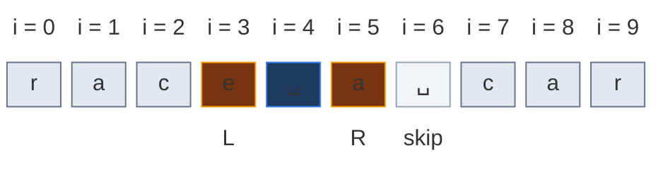

(Grey = pairs already matched. Orange = where `L` and `R` stand now. White = skipped. Blue = not looked at yet.)

### The pointer-move rule

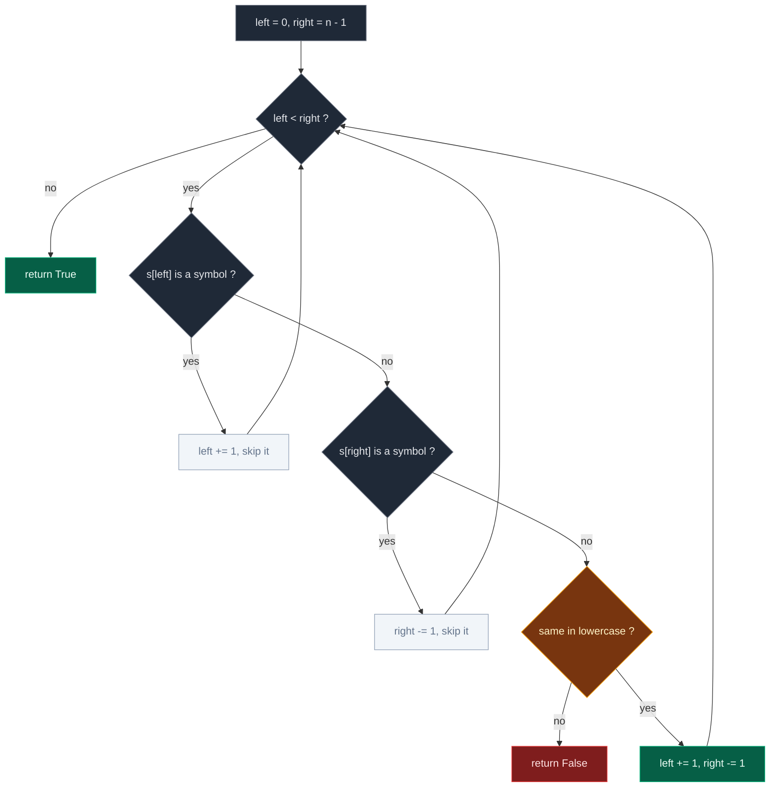

The code does the same thing with two small `while` loops for the skips. Each skip loop also checks `left < right`, so a string of only symbols can never push a pointer off the end.

### How to spot this pattern

| Signal in the problem | What it suggests |
|:---|:---|
| "reads the same forwards and backwards" | Mirrored-pair comparison from both ends |
| "ignore characters of type X" | Skip loops inside the pointer walk, not a pre-pass |
| Input is sorted and you need a pair or a sum | Opposite ends, move by comparison to a target |
| "maximise or minimise something over a pair `(i, j)`" | Start widest, shrink while dropping the side that cannot win |

## 3. Edge Cases

| Case | Input | Expected | Why it matters |
|:---|:---|:---:|:---|
| Empty after cleaning | `" "` | `True` | An empty string is a palindrome. The loop must never compare anything. |
| Only punctuation | `",.:"` | `True` | Both skip loops run to the end. Without the `left < right` guard inside them you go out of range. |
| Single character | `"a"` | `True` | `left == right` at once, so the `while left < right` loop never runs. |
| Digits present | `"0P"` | `False` | `0` is not `p`. Using `isalpha()` instead of `isalnum()` would drop `0` and wrongly return `True`. |
| All the same character | `"aaaa"` | `True` | Every pair matches. Checks that the loop ends and does not spin. |
| Digits-only palindrome | `"1221"` | `True` | Digits are compared, not filtered out. |
| Mixed case | `"Aa"` | `True` | Lowercase both sides, not just one. |
| Odd valid length | `"aba"` | `True` | The middle character pairs with itself and never breaks the answer. |
| Underscore | `"a_a"` | `True` | `_` is skipped. Python's `isalnum()` says `_` is not alphanumeric (unlike `\w` in regex). |
| Symbols around a digit | `"-1-"` | `True` | `-` is skipped, leaving `"1"`. There are no negative numbers here, only symbols. |
| Many symbols in a row | `"a,,,a"` | `True` | The skip must be a `while`, not an `if`. |
| Mismatch in the middle | `"race a car"` | `False` | Early pairs match, then `e` vs `a` fails. |

## 4. Brute Force: Clean, Reverse, Compare

### Idea

First build a new cleaned string that holds only the lowercase letters and digits. Then check whether this cleaned string is equal to its reverse.

For `"Top, spot!"`: the cleaned string is `"topspot"`, the reverse is `"topspot"`. Every position is the same, so the answer is `true`.

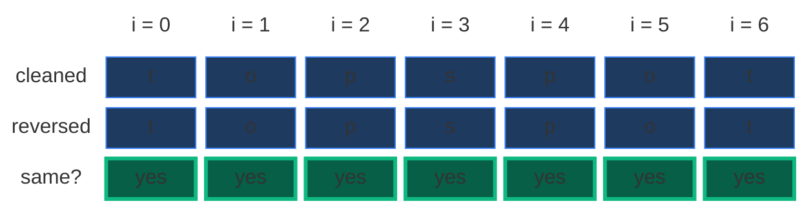

### Code

```python
# Import List for type hints
from typing import List


# Brute force: clean the string, then compare it with its reverse
class SolutionBrute:

    # Same method name as LeetCode
    def isPalindrome(self, s: str) -> bool:

        # Empty list to hold only valid lowercase characters
        cleaned_chars = []

        # Go through every character in the input string
        for ch in s:

            # Keep it only if it is a letter or a digit
            if ch.isalnum():

                # Store its lowercase form
                cleaned_chars.append(ch.lower())

        # Turn the list of characters into one string
        cleaned_string = "".join(cleaned_chars)

        # Palindrome if it equals its reversed copy
        return cleaned_string == cleaned_string[::-1]
```

### Complexity

| Measure | Complexity | Why |
|:---|:---:|:---|
| **Time** | `O(n)` | One pass to clean, one to reverse, one to compare |
| **Space** | `O(n)` | The cleaned string and its reversed copy |

## 5. Better Approach: Clean Once, Then Two Pointers

### Idea

The reversed copy is wasted memory. We do not need it. We can compare the cleaned string with itself from both ends:

- `left` starts at index `0`, `right` at the last index.
- Compare `cleaned[left]` and `cleaned[right]`. If they differ, return `false`.
- Move both inward. Stop when they meet.

This is the plain palindrome check from Core Theory. There are no symbols left, so there is nothing to skip yet.

For `"topspot"` (green = pair compared this round, grey = done, blue = not checked yet):

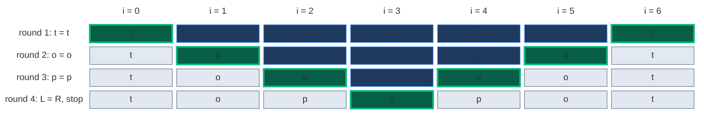

The middle `s` (index 3) is never compared, because the loop stops when `left == right`. A middle character pairs with itself.

### Code

```python
# Better: build the cleaned string once, then walk it with two pointers
class SolutionBetter:

    # Same method name as LeetCode
    def isPalindrome(self, s: str) -> bool:

        # Keep only letters and digits, all in lowercase
        cleaned = [ch.lower() for ch in s if ch.isalnum()]

        # Left pointer at the first cleaned character
        left = 0

        # Right pointer at the last cleaned character
        right = len(cleaned) - 1

        # Compare pairs until the pointers meet
        while left < right:

            # A broken pair means it is not a palindrome
            if cleaned[left] != cleaned[right]:

                # Stop right away
                return False

            # Move left one step to the right
            left += 1

            # Move right one step to the left
            right -= 1

        # Every pair matched
        return True
```

### Complexity

| Measure | Complexity | Why |
|:---|:---:|:---|
| **Time** | `O(n)` | One pass to clean, then at most half of it to compare |
| **Space** | `O(n)` | Still one cleaned copy (but no reversed copy) |

One copy is left. The optimal approach removes it by skipping symbols on the fly.

## 6. Optimal Approach: Two Pointers With Skipping

### Idea

We only care about letters and digits. So instead of cleaning the string first, we walk the **original** string from both ends:

```text
left  = 0
right = len(s) - 1
```

Then, while `left < right`:

- If `s[left]` is not alphanumeric, skip it: `left += 1`.
- If `s[right]` is not alphanumeric, skip it: `right -= 1`.
- Otherwise compare `s[left].lower()` and `s[right].lower()`.
  - Different: return `False`.
  - Same: `left += 1` and `right -= 1`.

If the loop ends, every pair matched, so return `True`.

**Why this is better than the brute force.** The brute force needs a cleaned string, which is `O(n)` extra space. Two pointers only need two numbers, `left` and `right`, so the space is `O(1)`.

### Visual Walkthrough (Story Version)

**The story:** a sign hangs on the wall. It is made of 10 tiles: `T o p , ␣ s p o t !`. Two kids, **Lefty** and **Righty**, want to know if it is a *magic word*: one that reads the same from both ends.

The rules of the game:

- Lefty starts on the first tile. Righty starts on the last tile. They walk toward each other.
- Some tiles are **puddles** (a comma, a space, a `!`). Puddles are not letters, so the kids just jump over them.
- Big and small letters are **twins**: `T` and `t` count as the same letter.
- When both kids stand on letters, they shout their letters. Twins: both step inward. Not twins: the word is not magic, game over.
- When the kids meet or pass each other, the word is magic.

Colours: orange = where a kid stands now, green = twins just found, grey = tiles already checked, white = puddle, blue = not looked at yet.

**Start: Lefty on tile 0, Righty on tile 9**

Lefty stands on `T`, a letter. Righty stands on `!`.

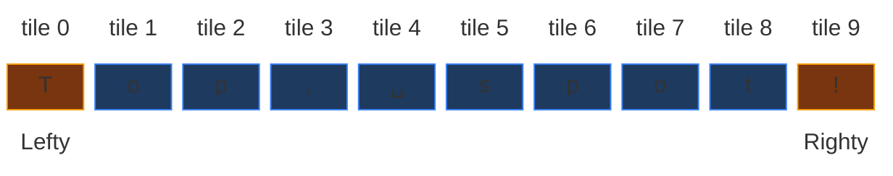

**Step 1: Righty jumps over a puddle**

`!` is a puddle. Righty jumps one tile to the left, onto tile 8 (`t`).

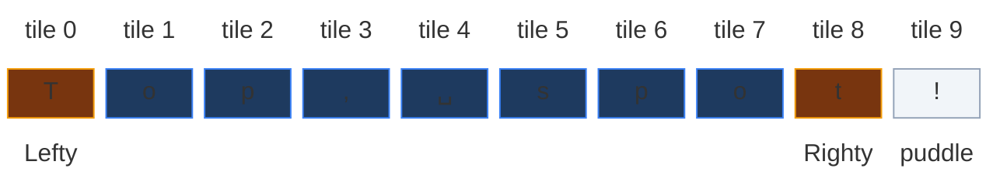

**Step 2: `T` and `t` are twins**

Lefty shouts `T`, Righty shouts `t`. Big `T` and small `t` are twins. Both step inward: Lefty to tile 1, Righty to tile 7.

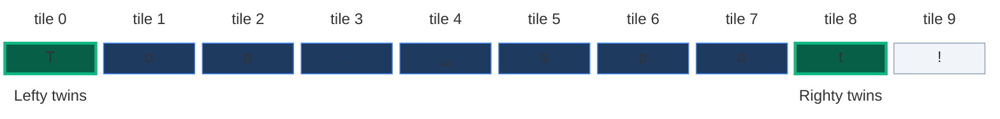

**Step 3: `o` and `o` are twins**

Lefty shouts `o`, Righty shouts `o`. Twins. Lefty goes to tile 2, Righty to tile 6.

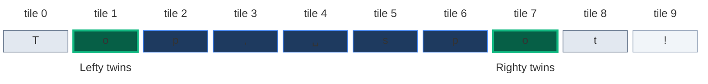

**Step 4: `p` and `p` are twins**

Lefty shouts `p`, Righty shouts `p`. Twins. Lefty goes to tile 3, Righty to tile 5.

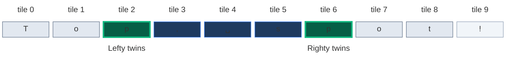

**Step 5: Lefty jumps over a puddle**

Tile 3 is a `,`, a puddle. Lefty jumps to tile 4. Righty waits on tile 5 (`s`).

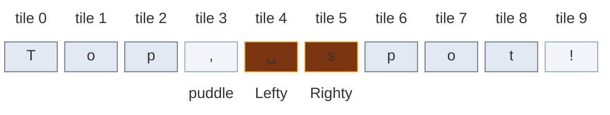

**Step 6: Lefty jumps over another puddle**

Tile 4 is a space, another puddle. Lefty jumps to tile 5. Now both kids stand on the same tile.

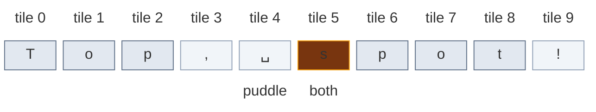

**Step 7: the middle tile**

Both kids look at the same `s`. A letter is always its own twin. They step past each other: Lefty to tile 6, Righty to tile 4.

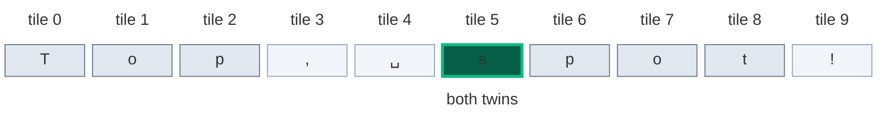

**End: the kids have passed each other**

Lefty is now right of Righty. Every pair of letters was twins, so the sign is a magic word.

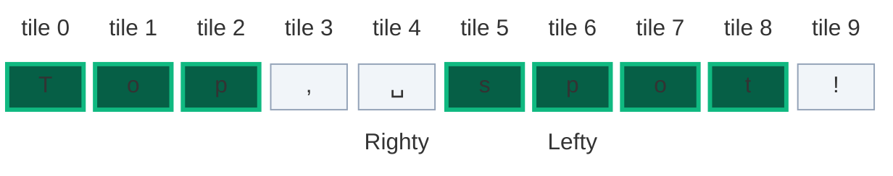

**All steps at a glance**

| Step | Lefty on | Righty on | What happens | Lefty after | Righty after |
|:---:|:---:|:---:|:---|:---:|:---:|
| 1 | 0 `T` | 9 `!` | Righty jumps a puddle | 0 | 8 |
| 2 | 0 `T` | 8 `t` | Twins | 1 | 7 |
| 3 | 1 `o` | 7 `o` | Twins | 2 | 6 |
| 4 | 2 `p` | 6 `p` | Twins | 3 | 5 |
| 5 | 3 `,` | 5 `s` | Lefty jumps a puddle | 4 | 5 |
| 6 | 4 `␣` | 5 `s` | Lefty jumps a puddle | 5 | 5 |
| 7 | 5 `s` | 5 `s` | Same tile, its own twin | 6 | 4 |
| End | 6 | 4 | Kids passed each other: magic word | | |

**What the story teaches**

| In the story | In the code |
|:---|:---|
| Tiles on the sign | characters of `s` |
| Lefty | `left` |
| Righty | `right` |
| Puddle | a character where `isalnum()` is `False` |
| Jumping a puddle | the skip loops `left += 1` / `right -= 1` |
| Twins (`T` and `t`) | `s[left].lower() == s[right].lower()` |
| Not twins, game over | `return False` |
| Both step inward | `left += 1` and `right -= 1` after a match |
| Kids meet or pass | `while left < right` ends, `return True` |
| Kids only remember where they stand | `O(1)` space, no cleaned copy |

Now the same steps again, with exact indexes and values.

### Step-by-Step Example

```text
Input:  s = "Top, spot!"      (n = 10)
Output: true
```

In the pictures, `␣` is the space at index 4. White cells are skipped symbols.

**Start:** `left = 0`, `right = 9`. Outer check `0 < 9` is true.

- Left skip loop: `s[0] = 'T'` is alphanumeric, so `left` stays `0`.

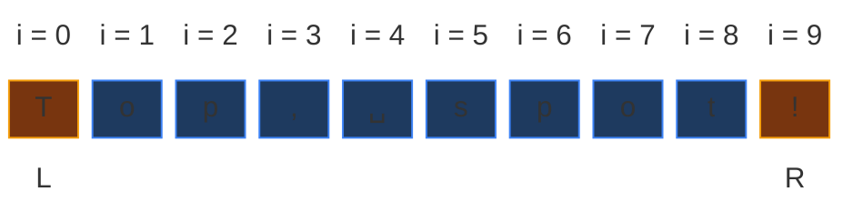

**Move 1 (right skip):** `s[9] = '!'` is not alphanumeric. `right = 9 - 1 = 8`. Check again: `s[8] = 't'` is alphanumeric, so the right skip loop stops.

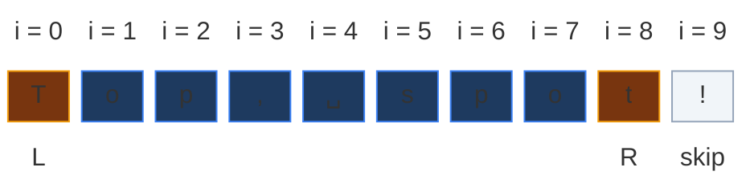

**Move 2 (compare):** `s[0].lower() = 't'`, `s[8].lower() = 't'`. `'t' == 't'`, match. `left = 1`, `right = 7`. Outer check `1 < 7` is true. No skips (`o` and `o` are letters).

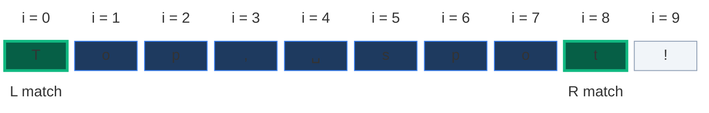

**Move 3 (compare):** `s[1] = 'o'`, `s[7] = 'o'`. `'o' == 'o'`, match. `left = 2`, `right = 6`. Outer check `2 < 6` is true. No skips.

```mermaid
block-beta
  columns 10
  h0["i = 0"] h1["i = 1"] h2["i = 2"] h3["i = 3"] h4["i = 4"] h5["i = 5"] h6["i = 6"] h7["i = 7"] h8["i = 8"] h9["i = 9"]
  c0["T"] c1["o"] c2["p"] c3[","] c4["␣"] c5["s"] c6["p"] c7["o"] c8["t"] c9["!"]
  space m1["L match"] space space space space space m7["R match"] space space
  classDef head fill:none,stroke:none,color:#64748b
  class h0,h1,h2,h3,h4,h5,h6,h7,h8,h9 head
  classDef old fill:#e2e8f0,stroke:#64748b,color:#0f172a
  class c0,c8 old
  classDef new fill:#065f46,stroke:#10b981,color:#ecfdf5,stroke-width:3px
  class c1,c7 new
  classDef done fill:#1e3a5f,stroke:#3b82f6,color:#dbeafe
  class c2,c3,c4,c5,c6 done
  classDef empty fill:#f1f5f9,stroke:#94a3b8,color:#64748b
  class c9 empty
  classDef note fill:none,stroke:none,color:#b45309
  class m1,m7 note
```

**Move 4 (compare):** `s[2] = 'p'`, `s[6] = 'p'`. `'p' == 'p'`, match. `left = 3`, `right = 5`. Outer check `3 < 5` is true.

```mermaid
block-beta
  columns 10
  h0["i = 0"] h1["i = 1"] h2["i = 2"] h3["i = 3"] h4["i = 4"] h5["i = 5"] h6["i = 6"] h7["i = 7"] h8["i = 8"] h9["i = 9"]
  c0["T"] c1["o"] c2["p"] c3[","] c4["␣"] c5["s"] c6["p"] c7["o"] c8["t"] c9["!"]
  space space m2["L match"] space space space m6["R match"] space space space
  classDef head fill:none,stroke:none,color:#64748b
  class h0,h1,h2,h3,h4,h5,h6,h7,h8,h9 head
  classDef old fill:#e2e8f0,stroke:#64748b,color:#0f172a
  class c0,c1,c7,c8 old
  classDef new fill:#065f46,stroke:#10b981,color:#ecfdf5,stroke-width:3px
  class c2,c6 new
  classDef done fill:#1e3a5f,stroke:#3b82f6,color:#dbeafe
  class c3,c4,c5 done
  classDef empty fill:#f1f5f9,stroke:#94a3b8,color:#64748b
  class c9 empty
  classDef note fill:none,stroke:none,color:#b45309
  class m2,m6 note
```

**Move 5 (left skip):** `s[3] = ','` is not alphanumeric. `left = 3 + 1 = 4`. Check `4 < 5` is true, keep skipping.

```mermaid
block-beta
  columns 10
  h0["i = 0"] h1["i = 1"] h2["i = 2"] h3["i = 3"] h4["i = 4"] h5["i = 5"] h6["i = 6"] h7["i = 7"] h8["i = 8"] h9["i = 9"]
  c0["T"] c1["o"] c2["p"] c3[","] c4["␣"] c5["s"] c6["p"] c7["o"] c8["t"] c9["!"]
  space space space m3["skip"] m4["L"] m5["R"] space space space space
  classDef head fill:none,stroke:none,color:#64748b
  class h0,h1,h2,h3,h4,h5,h6,h7,h8,h9 head
  classDef old fill:#e2e8f0,stroke:#64748b,color:#0f172a
  class c0,c1,c2,c6,c7,c8 old
  classDef empty fill:#f1f5f9,stroke:#94a3b8,color:#64748b
  class c3,c9 empty
  classDef read fill:#78350f,stroke:#f59e0b,color:#fef3c7
  class c4,c5 read
  classDef note fill:none,stroke:none,color:#b45309
  class m3,m4,m5 note
```

**Move 6 (left skip):** `s[4] = ' '` is not alphanumeric. `left = 4 + 1 = 5`. Now `5 < 5` is false, so the left skip loop stops. The right skip loop also stops at once (`5 < 5` is false).

```mermaid
block-beta
  columns 10
  h0["i = 0"] h1["i = 1"] h2["i = 2"] h3["i = 3"] h4["i = 4"] h5["i = 5"] h6["i = 6"] h7["i = 7"] h8["i = 8"] h9["i = 9"]
  c0["T"] c1["o"] c2["p"] c3[","] c4["␣"] c5["s"] c6["p"] c7["o"] c8["t"] c9["!"]
  space space space space m4["skip"] m5["L R"] space space space space
  classDef head fill:none,stroke:none,color:#64748b
  class h0,h1,h2,h3,h4,h5,h6,h7,h8,h9 head
  classDef old fill:#e2e8f0,stroke:#64748b,color:#0f172a
  class c0,c1,c2,c6,c7,c8 old
  classDef empty fill:#f1f5f9,stroke:#94a3b8,color:#64748b
  class c3,c4,c9 empty
  classDef read fill:#78350f,stroke:#f59e0b,color:#fef3c7
  class c5 read
  classDef note fill:none,stroke:none,color:#b45309
  class m4,m5 note
```

**Move 7 (compare):** `s[5] = 's'` with `s[5] = 's'`. Same character, match. `left = 6`, `right = 4`.

```mermaid
block-beta
  columns 10
  h0["i = 0"] h1["i = 1"] h2["i = 2"] h3["i = 3"] h4["i = 4"] h5["i = 5"] h6["i = 6"] h7["i = 7"] h8["i = 8"] h9["i = 9"]
  c0["T"] c1["o"] c2["p"] c3[","] c4["␣"] c5["s"] c6["p"] c7["o"] c8["t"] c9["!"]
  space space space space space m5["L R match"] space space space space
  classDef head fill:none,stroke:none,color:#64748b
  class h0,h1,h2,h3,h4,h5,h6,h7,h8,h9 head
  classDef old fill:#e2e8f0,stroke:#64748b,color:#0f172a
  class c0,c1,c2,c6,c7,c8 old
  classDef empty fill:#f1f5f9,stroke:#94a3b8,color:#64748b
  class c3,c4,c9 empty
  classDef new fill:#065f46,stroke:#10b981,color:#ecfdf5,stroke-width:3px
  class c5 new
  classDef note fill:none,stroke:none,color:#b45309
  class m5 note
```

**End:** outer check `6 < 4` is false. The loop ends with no mismatch. Return `True`.

```mermaid
block-beta
  columns 10
  h0["i = 0"] h1["i = 1"] h2["i = 2"] h3["i = 3"] h4["i = 4"] h5["i = 5"] h6["i = 6"] h7["i = 7"] h8["i = 8"] h9["i = 9"]
  c0["T"] c1["o"] c2["p"] c3[","] c4["␣"] c5["s"] c6["p"] c7["o"] c8["t"] c9["!"]
  space space space space m4["R"] space m6["L"] space space space
  classDef head fill:none,stroke:none,color:#64748b
  class h0,h1,h2,h3,h4,h5,h6,h7,h8,h9 head
  classDef new fill:#065f46,stroke:#10b981,color:#ecfdf5,stroke-width:3px
  class c0,c1,c2,c5,c6,c7,c8 new
  classDef empty fill:#f1f5f9,stroke:#94a3b8,color:#64748b
  class c3,c4,c9 empty
  classDef note fill:none,stroke:none,color:#b45309
  class m4,m6 note
```

| Move | Action | `left` | `right` | Compared |
|:---:|:---|:---:|:---:|:---:|
| start | | 0 | 9 | |
| 1 | skip `!` on the right | 0 | 8 | |
| 2 | match | 1 | 7 | `t` = `t` |
| 3 | match | 2 | 6 | `o` = `o` |
| 4 | match | 3 | 5 | `p` = `p` |
| 5 | skip `,` on the left | 4 | 5 | |
| 6 | skip space on the left | 5 | 5 | |
| 7 | match (middle) | 6 | 4 | `s` = `s` |
| end | `6 < 4` is false | 6 | 4 | return `True` |

That is 3 skips and 4 compares = 7 steps for 10 characters. This is the `7` in the constraints table for `n = 10`.

**Answer:** `True`

### Code

```python
# Optimal: two pointers on the original string, skipping symbols
class Solution:

    # Main method (trace is only for the tests)
    def isPalindrome(self, s: str, trace: list = None) -> bool:

        # Left pointer at the beginning of the string
        left = 0

        # Right pointer at the end of the string
        right = len(s) - 1

        # Keep checking while left is before right
        while left < right:

            # Skip symbols on the left side
            while left < right and not s[left].isalnum():

                # Record the skip when tracing
                if trace is not None:

                    # Save which index was skipped
                    trace.append(("skip L", left))

                # Move left to the next character
                left += 1

            # Skip symbols on the right side
            while left < right and not s[right].isalnum():

                # Record the skip when tracing
                if trace is not None:

                    # Save which index was skipped
                    trace.append(("skip R", right))

                # Move right to the previous character
                right -= 1

            # Compare both valid characters in lowercase
            if s[left].lower() != s[right].lower():

                # Record the mismatch when tracing
                if trace is not None:

                    # Save the broken pair
                    trace.append(("mismatch", left, right))

                # One broken pair means it is not a palindrome
                return False

            # Record the match when tracing
            if trace is not None:

                # Save the matched pair
                trace.append(("match", left, right))

            # Move left forward after a match
            left += 1

            # Move right backward after a match
            right -= 1

        # Every pair matched, so it is a palindrome
        return True


# ---------- Tests ----------

# The example from this note
s = "Top, spot!"

# Empty list to collect every pointer move
steps = []

# Run with tracing
result = Solution().isPalindrome(s, steps)

# Move 1: skip the ! at index 9
assert steps[0] == ("skip R", 9)

# Move 2: T and t match at indexes 0 and 8
assert steps[1] == ("match", 0, 8)

# Move 3: o and o match at indexes 1 and 7
assert steps[2] == ("match", 1, 7)

# Move 4: p and p match at indexes 2 and 6
assert steps[3] == ("match", 2, 6)

# Move 5: skip the comma at index 3
assert steps[4] == ("skip L", 3)

# Move 6: skip the space at index 4
assert steps[5] == ("skip L", 4)

# Move 7: the middle s matches itself at index 5
assert steps[6] == ("match", 5, 5)

# Exactly 7 moves in total (3 skips + 4 compares)
assert len(steps) == 7

# Final answer for the example
assert result is True

# The mismatch picture: race a car fails on e (3) vs a (5)
race = []

# Run the mismatch example with tracing
assert Solution().isPalindrome("race a car", race) is False

# Last two moves: skip the space at 6, then e vs a breaks
assert race[-2:] == [("skip R", 6), ("mismatch", 3, 5)]

# Dry run from the user's notes: 0 vs p breaks at once
assert Solution().isPalindrome("0P", []) is False

# LeetCode examples, then edge cases from the table
cases = [
    ("A man, a plan, a canal: Panama", True),
    ("race a car", False),
    (" ", True),
    ("", True),
    ("a", True),
    (".", True),
    (",.:", True),
    ("!!!???", True),
    ("0P", False),
    ("1221", True),
    ("12321", True),
    ("aaaa", True),
    ("aaaaa", True),
    ("Aa", True),
    ("AbBa", True),
    ("a,,,a", True),
    ("a_a", True),
    ("-1-", True),
    ("aba", True),
    ("abca", False),
    ("Top, spot!", True),
]

# Check every case with all three versions
for text, expected in cases:

    # Brute force
    assert SolutionBrute().isPalindrome(text) is expected, text

    # Better (clean once, then two pointers)
    assert SolutionBetter().isPalindrome(text) is expected, text

    # Optimal
    assert Solution().isPalindrome(text) is expected, text

# Random tests: brute force == better == optimal
import random

# Fixed seed so the run is the same every time
random.seed(125)

# Small alphabet so palindromes happen often
alphabet = "aAbB01 ,.!_:"

# Try many random strings
for _ in range(3000):

    # Random half of a string
    half = "".join(random.choice(alphabet) for _ in range(random.randint(0, 6)))

    # Half the time mirror it, so many palindromes appear
    text = half + half[::-1] if random.random() < 0.5 else half

    # Brute force answer
    want = SolutionBrute().isPalindrome(text)

    # Better must agree
    assert SolutionBetter().isPalindrome(text) == want, text

    # Optimal must agree
    assert Solution().isPalindrome(text) == want, text

# Constraints table: two-pointer steps on Top, spot! repeated to length n
for n, expected_steps in [(10, 7), (100, 64), (1000, 649), (10000, 6499), (100000, 64999), (200000, 129999)]:

    # Fresh trace list for this size
    moves = []

    # Run on the repeated example
    assert Solution().isPalindrome("Top, spot!" * (n // 10), moves) is True

    # Every skip and every compare is one step
    assert len(moves) == expected_steps, n

# All checks passed
print("All tests passed")
```

The `trace` argument is only for the step checks. LeetCode calls `isPalindrome(s)` and it works the same.

### Complexity

| Measure | Complexity | Why |
|:---|:---:|:---|
| **Time** | `O(n)` | Every move pushes `left` right or `right` left. Each character is visited at most once by either `left` or `right` |
| **Space** | `O(1)` | Only `left` and `right`. No extra string or array is created |

## 7. Common Mistakes

| Mistake | What goes wrong | Fix |
|:---|:---|:---|
| Using `isalpha()` instead of `isalnum()` | Digits get dropped, so `"0P"` cleans to `"p"` and wrongly returns `True` | Use `isalnum()`, which keeps letters and digits |
| No `left < right` inside the skip loops | On `",.:"` the inner `while` runs past the end and raises `IndexError` | Guard every skip loop: `while left < right and not s[left].isalnum()` |
| Lowercasing only one side | `"Aa"` compares `'A'` with `'a'` and returns `False` | Call `.lower()` on both characters |
| Using `if` instead of `while` to skip | Only one symbol is skipped per round, so `"a,,,a"` compares `'a'` with `','` | Keep skipping until a letter or digit is found |
| Forgetting to move after a match | `left` and `right` never move, so the loop never ends | Always do `left += 1` and `right -= 1` after a match |
| Comparing raw `s[left] == s[right]` | `T` and `t` look different, so real palindromes fail | Compare the lowercase forms |
| Calling the cleaned copy `O(1)` | The cleaned string grows with the input | Skip symbols in place to get real `O(1)` space |

## 8. Interview Follow-ups

### Q1. How would you handle Unicode input instead of printable ASCII?

**Answer:**
- Python's `isalnum()` and `lower()` already understand Unicode, so `"Ä"` or Devanagari digits work.
- Use `casefold()` instead of `lower()`. It is stricter: German `ß` becomes `"ss"`.
- Some letters like `é` can be one code point or `e` plus an accent mark. Run `unicodedata.normalize("NFC", s)` first so equal-looking strings compare equal.
- Then walk with the same two pointers.

### Q2. What if you must return the longest palindromic substring instead of yes or no?

**Answer:**
- That is a different problem (LeetCode 5). Converging pointers are not enough.
- Use **expand around centre**: for each of the `2n - 1` centres, push two pointers outward while the characters match, and keep the longest span.
- That is `O(n^2)` time and `O(1)` space. Manacher's algorithm reaches `O(n)`, but it is rarely expected.

### Q3. Can you do this if the input is a singly linked list instead of a string?

**Answer:**
- You cannot walk backward from the end, so `right -= 1` is impossible.
- Find the middle with slow and fast pointers.
- Reverse the second half in place.
- Walk both halves forward together and compare values.
- Reverse the second half back to restore the list. `O(n)` time, `O(1)` space.

### Q4. What if you may delete at most one character (LeetCode 680)?

**Answer:**
- Walk with two pointers as usual.
- On the first mismatch there are only two repairs: delete `s[left]` or delete `s[right]`.
- Check whether `s[left+1..right]` or `s[left..right-1]` is a plain palindrome. If either is, return `True`.
- You never need a second deletion, so it stays `O(n)`.

### Q5. The string is 10 GB and arrives as a stream. Now what?

**Answer:**
- Two pointers need access to both ends. A one-way stream cannot give that.
- If the data is on disk, read from both ends with two small buffers. Memory stays `O(1)`.
- If it is a true one-pass stream, keep a rolling hash of the text read forward and a rolling hash of it read backward. Compare them at the end, accepting a tiny chance of a hash collision.

### Q6. Why not just write `cleaned == cleaned[::-1]`?

**Answer:**
- It is correct and short, and fine as a first answer.
- But it builds two new strings, so the space is `O(n)`.
- It also never stops early: it cleans the whole string even when the first pair already fails.
- Two pointers give `O(1)` space and stop at the first broken pair.

## 9. Interview Explanation

> I will use two pointers, one from the start and one from the end. Since the problem says to ignore non-alphanumeric characters, I will skip them from both sides, and every skip loop also checks left < right so a string of only symbols is safe. Once both pointers are on valid characters, I will compare them in lowercase. If they mismatch, I return false. If all pairs match and the pointers meet, I return true. This avoids building a cleaned string and gives O(n) time with O(1) space.
