# 01. 11. Container With Most Water

| Difficulty | Pattern | Source | Time | Space |
|:---:|:---:|:---:|:---:|:---:|
| **Medium** | Two Pointers: Shrink from Both Ends | [11. Container With Most Water](https://leetcode.com/problems/container-with-most-water/) | `O(n)` | `O(1)` |

## 1. Problem Statement

You are given an integer array `height` of length `n`. There are `n` vertical lines. Line `i` goes from the point `(i, 0)` up to the point `(i, height[i])`.

Pick **two lines**. Together with the x-axis (the floor) they make a container. Find the container that holds the **most water**, and return that amount.

You may **not** slant (tilt) the container.

Each element is one vertical line:

```text
height[i] = height of the line at index i
```

The water between two lines is a rectangle:

```text
area           = width * minimum_height
width          = right_index - left_index
minimum_height = min(height[left_index], height[right_index])
```

The water can only rise as high as the **shorter** line. Any higher and it spills over.

### Example

```text
Input:  height = [1,8,6,2,5,4,8,3,7]
Output: 49
```

The best pair is index `1` (height `8`) and index `8` (height `7`):

```text
width  = 8 - 1     = 7
height = min(8, 7) = 7
area   = 7 * 7     = 49
```

Here is the best container. Each column is one line, drawn as a bar of stacked cells (the number on top is its height). The green bars are the two chosen lines. The light dashed bars inside are lines we did not pick; they do not matter. The blue cells are the water.

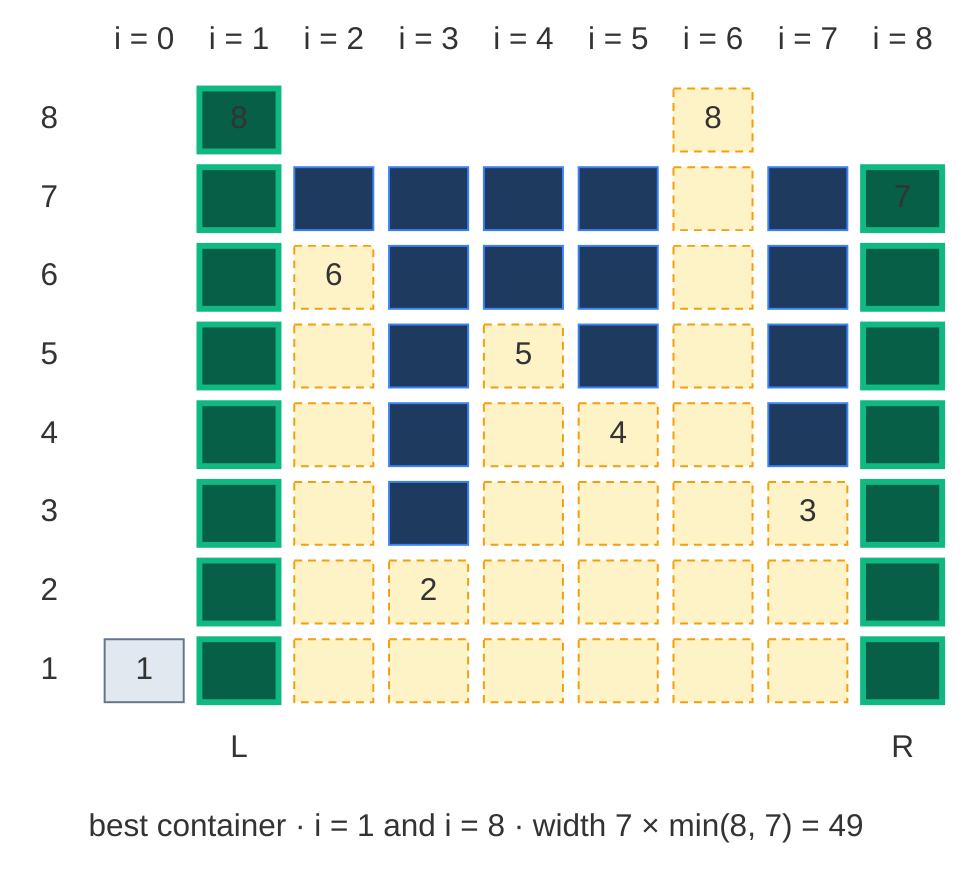

LeetCode's second example: `height = [1,1]` gives `1` (width `1` × height `1`).

We use the first example (`[1,8,6,2,5,4,8,3,7]`) in every section below.

### Constraints

- `n == height.length`
- `2 <= n <= 10^5`
- `0 <= height[i] <= 10^4`
- There are always at least two lines, so at least one container exists.
- The biggest possible area is about `10^5 * 10^4 = 10^9`. It fits in a 32-bit `int` (limit about `2.1 * 10^9`). Python has no overflow anyway.

### What the constraints tell us (simple theory)

A **constraint** is the biggest input the judge will ever give you. It quietly tells you how fast your code must be.

**Rule of thumb:** a computer does about **100 million (10^8) simple steps per second**. Count how many steps your idea needs for the biggest input, and compare.

| Biggest input `n` | Steps you can afford | Ideas that fit |
|:---:|:---:|:---|
| up to ~20 | about `2^n` | Try every subset |
| up to ~500 | about `n^3` | Three nested loops |
| up to ~5,000 | about `n^2` | Two nested loops (every pair) |
| up to ~1,000,000 | about `n` or `n log n` | One loop, two pointers, sorting |

**For this problem:** `n` can be `100,000`.

- Brute force checks every pair. That is `n * (n - 1) / 2` pairs. For `n = 100,000` it is **4,999,950,000 pairs**, about 5 billion. At 10^8 steps per second that is about **50 seconds**. Too slow (Time Limit Exceeded).
- Two pointers check one pair per loop step, and there are only `n - 1` steps. For `n = 100,000` it is **99,999 steps**. That runs in about a millisecond.

So the limit `n <= 10^5` is the judge telling you: "every pair is too many, find a one-pass idea."

**How the work grows as `n` grows**

Red bars = pairs checked by brute force. Green line = loop steps made by two pointers (it stays flat near zero).

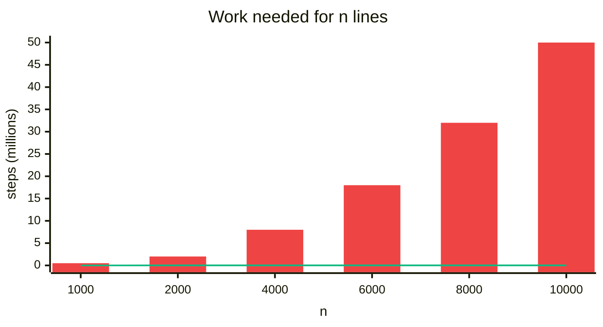

| `n` | Brute force pairs | Two-pointer steps |
|:---:|:---:|:---:|
| 1,000 | 499,500 | 999 |
| 2,000 | 1,999,000 | 1,999 |
| 4,000 | 7,998,000 | 3,999 |
| 6,000 | 17,997,000 | 5,999 |
| 8,000 | 31,996,000 | 7,999 |
| 10,000 | 49,995,000 | 9,999 |
| 100,000 | 4,999,950,000 | 99,999 |

The rows up to `10,000` come from running both loops with a step counter on random arrays. The `100,000` row uses the formula `n * (n - 1) / 2`, which matches every counted row (5 billion loop steps are too many to count in Python). The two-pointer count is always exactly `n - 1`, whatever the heights are, because every step moves one pointer by one and the pointers start `n - 1` apart.

## 2. Core Theory

### What the problem really asks

For every pair of indices `i < j`, the water is:

```text
area(i, j) = (j - i) * min(height[i], height[j])
```

We want the biggest `area(i, j)`. So the water depends on just two things:

1. The **width** between the two lines.
2. The **smaller** of the two heights.

**The shorter line decides the water level.** Say `height[left] = 8` and `height[right] = 3`. The left line is tall, but the water can only go up to `3`:

```text
container height = min(8, 3) = 3
```

The lines in between do not matter at all. They do not block water and they do not hold water. Only the two chosen lines count.

Two forces pull against each other:

- Moving the lines closer **always** makes the width smaller.
- So the only way a closer pair can win is with a **taller minimum height**.

That tug of war is the whole problem.

### Why two pointers work here (the "safe to discard" proof)

**Start wide.** Put `left = 0` and `right = n - 1`. This is the widest container possible. Measure it.

**Then one pointer must move inward. Which one?** The answer: **always move the pointer on the shorter line.** Here is why that never loses the best answer.

Say `height[left] <= height[right]` (left is the shorter line, or they tie). We just measured `area(left, right)`. Now look at **every other partner** that `left` could still have. Those are the indices `j` with `left < j < right`.

- **Width gets smaller:** `j - left` is less than `right - left`, because `j` is closer.
- **Height cannot get bigger:** `min(height[left], height[j])` is at most `height[left]`. It does not matter how tall `height[j]` is, the short line `left` caps the water. And `height[left]` is exactly `min(height[left], height[right])`, the height we already used.

Put the two together:

```text
area(left, j) = (j - left)     * min(height[left], height[j])
              < (right - left) * min(height[left], height[right])
              = area(left, right)
```

Both parts are no bigger, and the width is **strictly** smaller. So every pair that still uses `left` is worse than what we already measured. The short line has **nothing left to offer**. We can throw it away forever. That is the move `left += 1`.

(If `height[right]` is the shorter one, the same proof works from the other side, and we do `right -= 1`.)

**See it on our example.** First step: `left = 0` (height `1`), `right = 8` (height `7`). We measured `8 × 1 = 8`. Here are all the other partners of the short line `i = 0`:

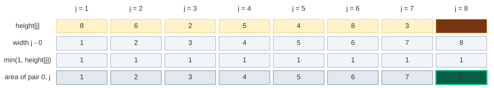

Every area in the bottom row is `1, 2, 3, ..., 7`, all below the `8` we already have. The short line `i = 0` can never do better, so dropping it is safe.

**What if we moved the taller line instead (the wrong move)?** Moving `right` from `8` to `7` throws away every pair that uses `i = 8`. Look at what those pairs were worth:

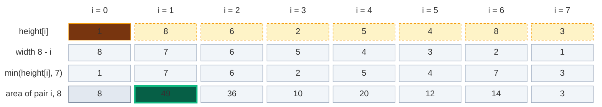

The pair `(1, 8)` is worth `49`, the real answer. Moving the tall line would have thrown it away. Moving the taller line can only shrink the width while the short line still caps the height, so the area can only go down.

### Why the scan never misses anything

Keep one promise true the whole time: **the best pair is still inside the window `[left, right]`, or we have already measured it.**

- At the start the window is the whole array, so the promise is true.
- Each step measures `area(left, right)`, then throws away one line that was just proven useless. The promise stays true.
- When `left` meets `right`, the window is empty. Every pair has been either **measured** or **proven worse** than something measured.

The picture below shows all `36` pairs of our example. Row `i`, column `j` is the pair `(i, j)`. `step k` means that pair was measured in step `k`. `x k` means it was crossed out (proven worse) in step `k`. Each step measures one pair and crosses out a whole row piece or column piece of the grid at once. That is why `8` steps are enough to cover `36` pairs.

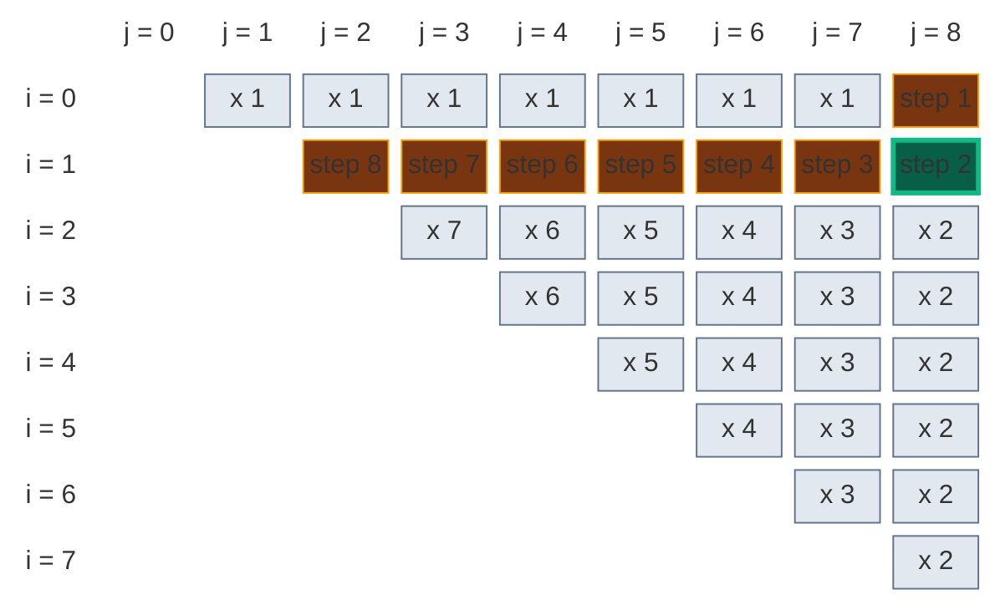

- `8` pairs measured, `28` pairs crossed out, `36` pairs in total. Nothing is missed.
- Step `1` moved `left`, so it crossed out the rest of **row** `0`.
- Steps `2` to `8` moved `right`, so each crossed out the rest of a **column**.

**Why this is fast.** Each step moves one pointer by one place. The pointers start `n - 1` apart, so there are exactly `n - 1` steps: `O(n)` time and `O(1)` space.

**On ties.** When `height[left] == height[right]`, the proof works for **both** lines, so we could drop either one (or even both). Moving just one (the usual `else: right -= 1`) is still correct; the other is handled in a later step.

**Why not sort?** Two Sum II needs a sorted array. Here sorting would destroy the positions, and the positions **are** the width. The scan works because of the "shorter line is useless" proof, not because of order.

### The pointer-move rule

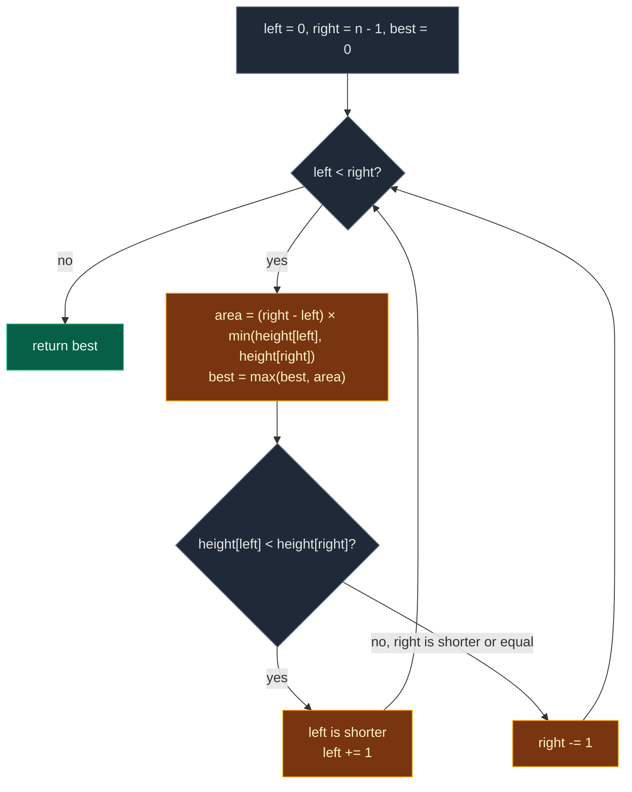

### How to recognise this pattern

| Signal | What it suggests |
|:---|:---|
| Maximise something over a pair `(i, j)` where the width `j - i` matters | Start at the widest pair and shrink |
| The value uses `min(a, b)` (or `max`) of the two ends | The limiting end is the one you can prove useless |
| Sorting would destroy information (positions, order) | Two pointers by the "useless line" proof, not by order |
| You must justify throwing an index away | Write the two-part argument: width strictly down, height capped |
| Contrast: Trapping Rain Water | Same `min` of two walls, but it adds up water at every index instead of picking one best pair |

## 3. Edge Cases

| Case | Input | Expected | Why it matters |
|:---|:---|:---:|:---|
| Smallest input | `[1,1]` | `1` | `n == 2` is the smallest legal input. The loop body runs exactly once. |
| All heights equal | `[5,5,5,5]` | `15` | The widest pair wins: `3 * 5`. Checks that ties do not freeze the pointers. |
| Only zeros | `[0,0]` | `0` | A zero-height container holds nothing. `best` must start at `0`, not `-inf` or `None`. |
| Zeros at both ends | `[0,2,0]` | `0` | Every pair has a `min` of `0`, so the answer really is `0`, not `2`. |
| Strictly increasing | `[1,2,3,4,5]` | `6` | `(0,4)` gives only `4 * 1 = 4`, but `(1,4)` and `(2,4)` give `6`. The widest pair is not always the best. |
| Strictly decreasing | `[5,4,3,2,1]` | `6` | Mirror of the line above. The rule works the same from both sides. |
| Tall ends, short middle | `[9,1,1,1,9]` | `36` | The widest pair `4 * 9` is best. The scan must not be tempted inward. |
| Short ends, tall middle | `[1,9,9,1]` | `9` | The best pair `(1,2)` is the narrowest one in the middle. The scan must reach it. |
| Best pair close together | `[1,2,4,3]` | `4` | `(1,3)` gives `2 * 2 = 4`. Tests the last few steps of the loop. |
| One huge spike | `[1,1,100]` | `2` | A tall line is useless without a tall partner. `min` caps it at `1`, so `2 * 1 = 2`. |
| Main example | `[1,8,6,2,5,4,8,3,7]` | `49` | The best pair `(1,8)` is neither the widest pair nor the tallest pair. |
| Negative heights | not allowed | n/a | The constraints say `0 <= height[i]`. A negative line has no meaning here. Good to say out loud instead of silently assuming. |

## 4. Brute Force

### Idea

Try **every** pair of lines. For each pair:

1. Work out the width.
2. Work out the smaller height.
3. Work out the area.
4. Keep the biggest area seen so far.

On our example, the pairs are `(0,1), (0,2), (0,3), ...`, then `(1,2), (1,3), ...`, and so on. When it reaches `(1,8)`: width `8 - 1 = 7`, smaller height `min(8, 7) = 7`, area `49`. That becomes the maximum, and no other pair beats it. In total it checks `9 * 8 / 2 = 36` pairs.

There is **no real middle step** here (like a hash map or prefix arrays in other problems). We go straight from brute force to two pointers.

### Code

```python
# Import List for type hints
from typing import List


# Brute force: try every pair of lines
class SolutionBrute:

    # LeetCode method name
    def maxArea(self, height: List[int]) -> int:

        # Store the maximum water area found so far
        max_water = 0

        # Store the total number of vertical lines
        n = len(height)

        # Pick the first line using index i
        for i in range(n):

            # Pick the second line using index j after i
            for j in range(i + 1, n):

                # Calculate the width between both selected lines
                width = j - i

                # Calculate the smaller height because water is limited by the shorter line
                min_height = min(height[i], height[j])

                # Calculate the water area for this pair
                current_area = width * min_height

                # Update maximum water area if current area is larger
                max_water = max(max_water, current_area)

        # Return the largest area found after checking all pairs
        return max_water
```

### Complexity

| Measure | Complexity | Why |
|:---|:---:|:---|
| **Time** | `O(n^2)` | We check every pair: `n * (n - 1) / 2` of them. |
| **Space** | `O(1)` | We only store the maximum area and a few numbers. |

## 5. Optimal Approach: Two Pointers

### Idea

- Start with the **widest** container: `left = 0`, `right = len(height) - 1`. This gives the biggest possible width.
- Measure the area and remember the best one.
- Now one pointer must move inward. Should we move the taller line or the shorter line? **Move the shorter line.**
- Why? Say `height[left] = 1` and `height[right] = 7`. The water level is `min(1, 7) = 1`. If we move the taller line `right`, the width shrinks and the height is **still** capped by `1`, so the area cannot improve. If we move the shorter line `left`, we might find a taller line that lifts the water level. Only that move has a chance to win (see the proof in Core Theory).
- The rule:
  - If `height[left] < height[right]`: move `left` forward.
  - Otherwise: move `right` backward.
- Stop when the pointers meet.

### Visual Walkthrough (Story Version)

**The story:** nine wooden walls stand in a row in a sandbox. Their heights are `1, 8, 6, 2, 5, 4, 8, 3, 7`. Two kids, **Lefty** and **Righty**, want to build the biggest pond.

The game rules:

- Lefty stands at one wall, Righty at another wall to the right.
- They stretch a sheet between their two walls and pour water in. The walls in between do not matter; the water just flows around them.
- The water spills over the **shorter** of their two walls. So the pond holds `distance × shorter wall`.
- They write the pond size on a scoreboard if it beats the old record.
- Then the kid at the **shorter** wall takes one step inward, hoping to find a taller wall. (If both walls are equally tall, Righty steps.)
- When the two kids bump into each other, the game ends.

In the pictures: each column is a wall. Orange = the walls the kids stand at. Green = the record pond. Light dashed = walls still in play. Grey = walls a kid already walked away from. Blue = water.

**Step 1: Lefty at wall 0, Righty at wall 8**

- Lefty's wall is `1` tall. Righty's wall is `7` tall.
- Distance `8`. The water spills over Lefty's short wall at height `1`.
- Pond = `8 × 1 = 8`. Scoreboard: `8`.
- Lefty's wall is shorter, so **Lefty steps in**.

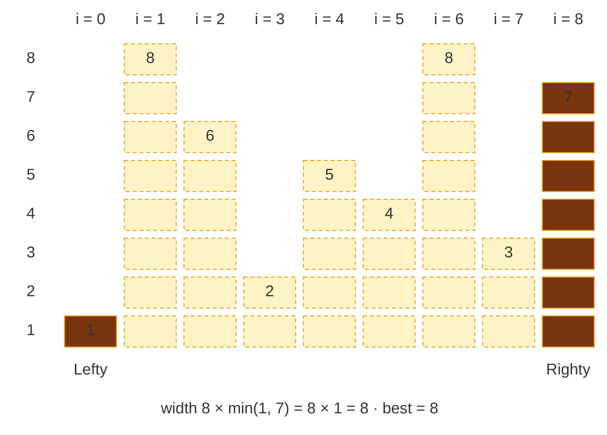

**Step 2: Lefty at wall 1, Righty at wall 8**

- Lefty's wall is `8` tall now. Righty's wall is `7` tall.
- Distance `7`. Water rises to `min(8, 7) = 7`.
- Pond = `7 × 7 = 49`. New record! Scoreboard: `49`.
- Righty's wall is shorter, so **Righty steps in**.

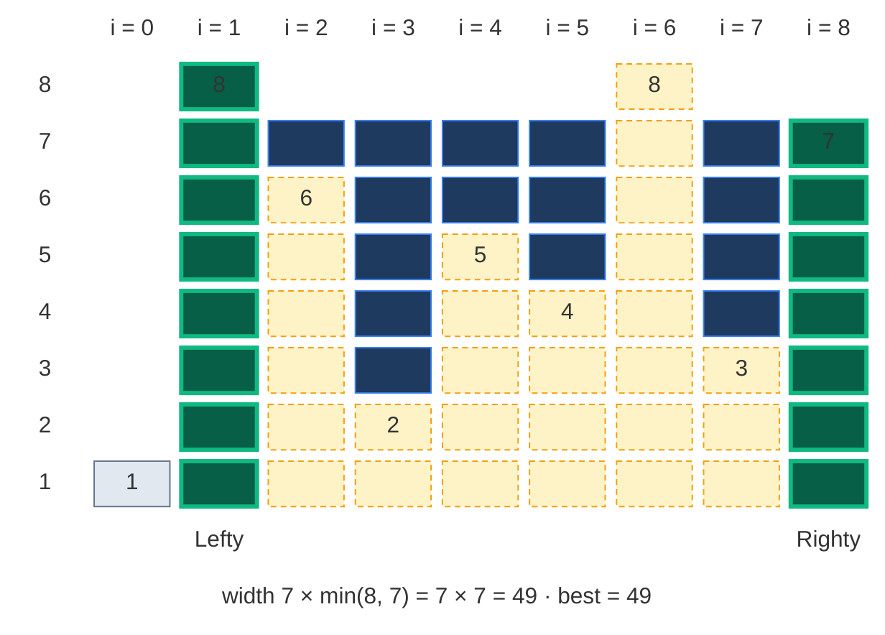

**Step 3: Lefty at wall 1, Righty at wall 7**

- Walls `8` and `3`. Distance `6`. Water rises to `3`.
- Pond = `6 × 3 = 18`. Smaller than `49`. Scoreboard stays `49`.
- Righty's wall is shorter, so **Righty steps in**.

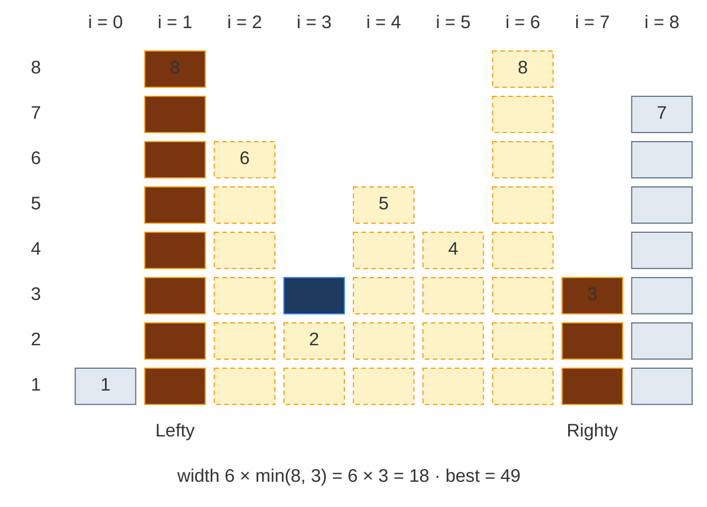

**Step 4: Lefty at wall 1, Righty at wall 6**

- Walls `8` and `8`. Distance `5`. Water rises to `8`.
- Pond = `5 × 8 = 40`. Smaller than `49`. Scoreboard stays `49`.
- A tie. By the rule, **Righty steps in**.

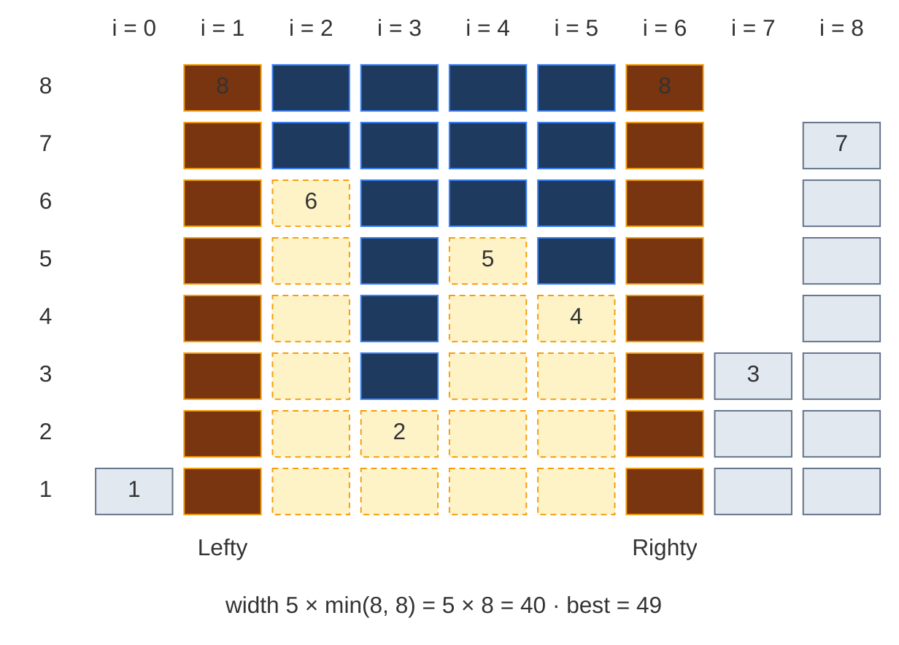

**Step 5: Lefty at wall 1, Righty at wall 5**

- Walls `8` and `4`. Distance `4`. Water rises to `4`.
- Pond = `4 × 4 = 16`. Scoreboard stays `49`.
- Righty's wall is shorter, so **Righty steps in**.

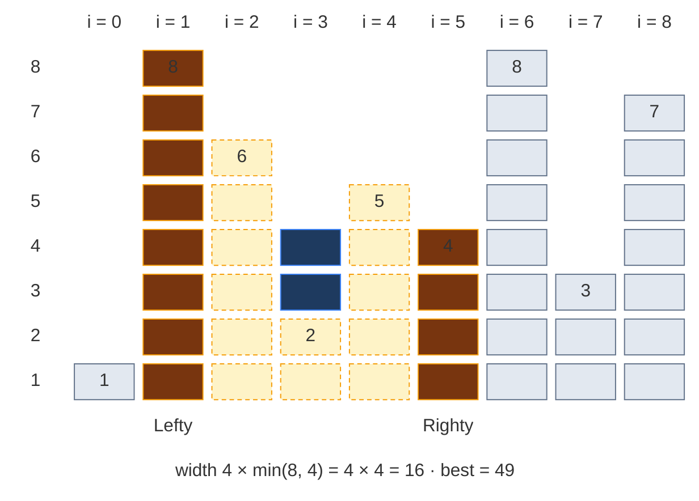

**Step 6: Lefty at wall 1, Righty at wall 4**

- Walls `8` and `5`. Distance `3`. Water rises to `5`.
- Pond = `3 × 5 = 15`. Scoreboard stays `49`.
- Righty's wall is shorter, so **Righty steps in**.

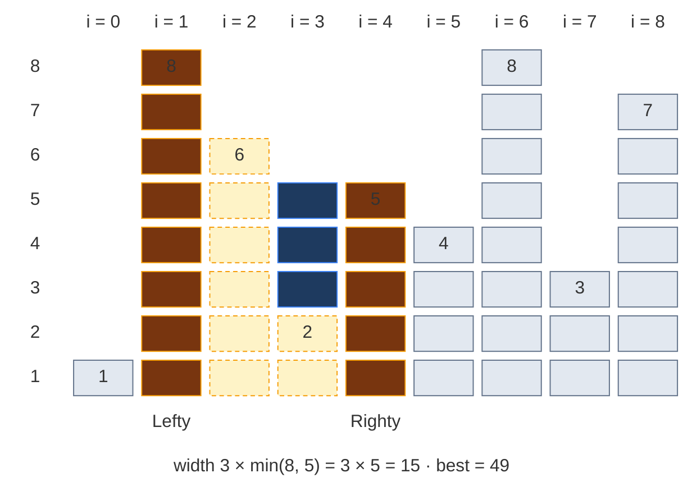

**Step 7: Lefty at wall 1, Righty at wall 3**

- Walls `8` and `2`. Distance `2`. Water rises to `2`.
- Pond = `2 × 2 = 4`. Scoreboard stays `49`.
- Righty's wall is shorter, so **Righty steps in**.

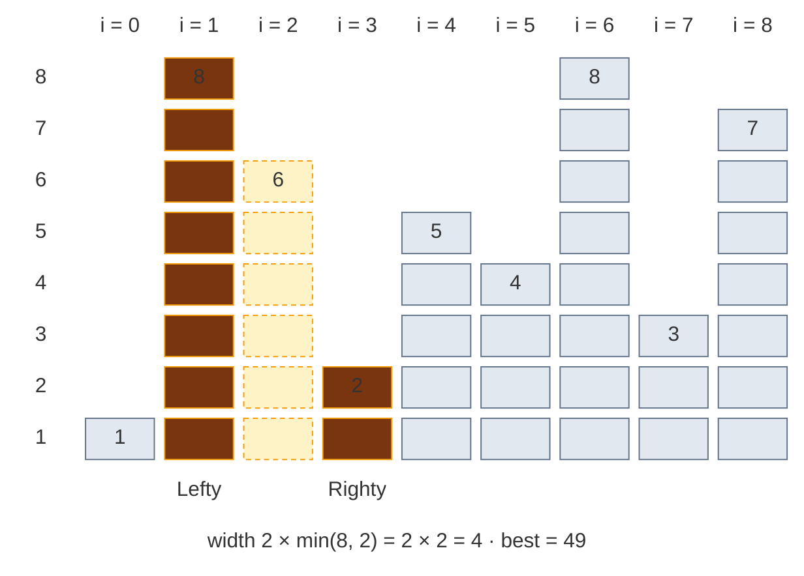

**Step 8: Lefty at wall 1, Righty at wall 2**

- Walls `8` and `6`. Distance `1`. Water rises to `6`.
- Pond = `1 × 6 = 6`. Scoreboard stays `49`.
- Righty's wall is shorter, so **Righty steps in**.

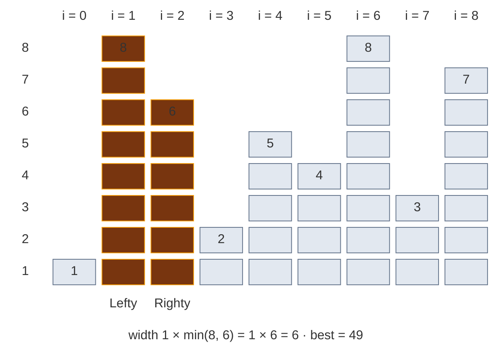

**The end:** Righty steps onto wall 1, where Lefty already stands. They bump into each other. No sheet fits between them, so the game stops. The scoreboard says **49**.

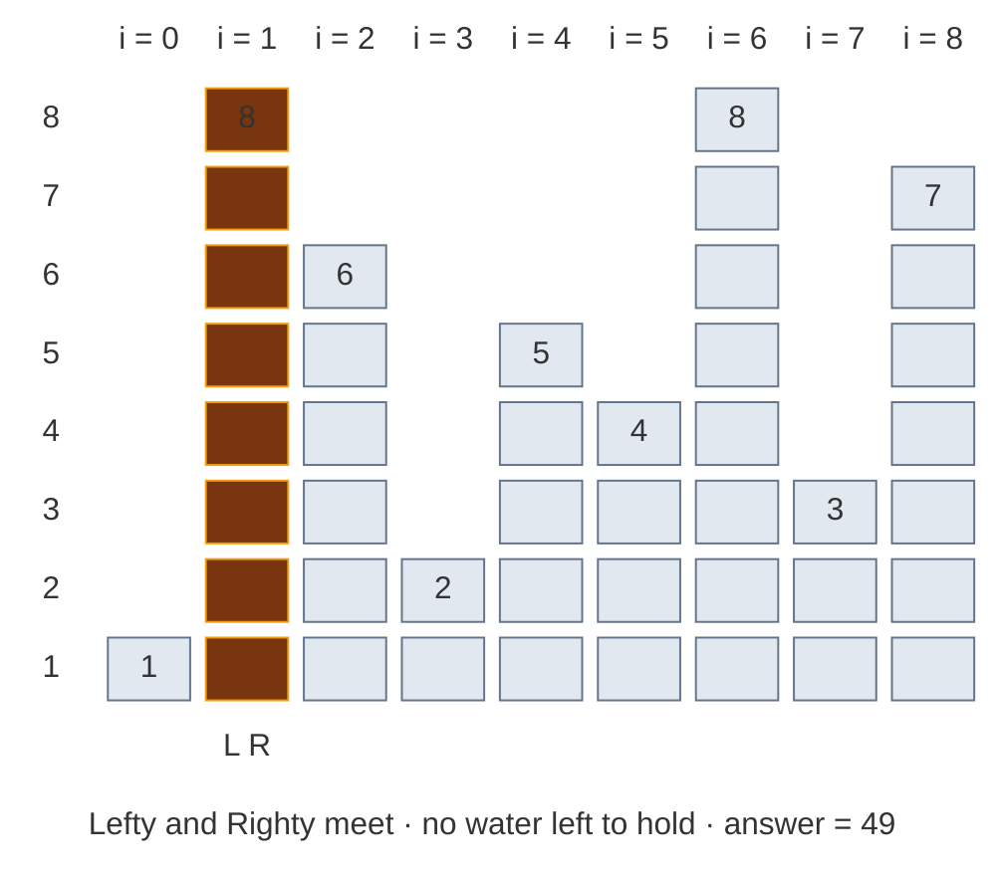

**All steps at a glance**

| Step | Lefty | Righty | Walls | Distance | Water level | Pond | Scoreboard | Who steps |
|:---:|:---:|:---:|:---:|:---:|:---:|:---:|:---:|:---:|
| 1 | 0 | 8 | 1, 7 | 8 | 1 | 8 | 8 | Lefty |
| 2 | 1 | 8 | 8, 7 | 7 | 7 | 49 | 49 | Righty |
| 3 | 1 | 7 | 8, 3 | 6 | 3 | 18 | 49 | Righty |
| 4 | 1 | 6 | 8, 8 | 5 | 8 | 40 | 49 | Righty (tie) |
| 5 | 1 | 5 | 8, 4 | 4 | 4 | 16 | 49 | Righty |
| 6 | 1 | 4 | 8, 5 | 3 | 5 | 15 | 49 | Righty |
| 7 | 1 | 3 | 8, 2 | 2 | 2 | 4 | 49 | Righty |
| 8 | 1 | 2 | 8, 6 | 1 | 6 | 6 | 49 | Righty |
| end | 1 | 1 | – | – | – | – | **49** | they meet |

Notice the pond size goes `8, 49, 18, 40, 16, 15, 4, 6`. It goes down **and up again** (`18` then `40`). So the kids must keep walking to the end; they cannot stop the first time the pond gets smaller.

**What the story teaches**

| In the story | In the code |
|:---|:---|
| A wall in the sandbox | `height[i]` |
| Lefty's wall | `left`, `height[left]` |
| Righty's wall | `right`, `height[right]` |
| Distance between the kids | `width = right - left` |
| Water spills over the shorter wall | `min_height = min(height[left], height[right])` |
| Pond size | `current_area = width * min_height` |
| Scoreboard | `max_water = max(max_water, current_area)` |
| The kid at the shorter wall steps in | `if height[left] < height[right]: left += 1` |
| On a tie, Righty steps | `else: right -= 1` |
| The kids bump into each other | `while left < right` stops |
| Final scoreboard | `return max_water` |

### Step-by-Step Example

`height = [1,8,6,2,5,4,8,3,7]`, `n = 9`. Start: `left = 0`, `right = 8`, `max_water = 0`.

In the pictures: orange = `L` and `R` now, green = the pair that gave the best area, light dashed = still inside the window, grey = ruled out.

**Step 1: `left = 0`, `right = 8`**

- `left < right` → `0 < 8`, so the loop runs.
- `width = 8 - 0 = 8`.
- `min_height = min(height[0], height[8]) = min(1, 7) = 1`.
- `current_area = 8 * 1 = 8`.
- `max_water = max(0, 8) = 8`.
- `height[0] < height[8]` → `1 < 7` is true → `left = 1`.

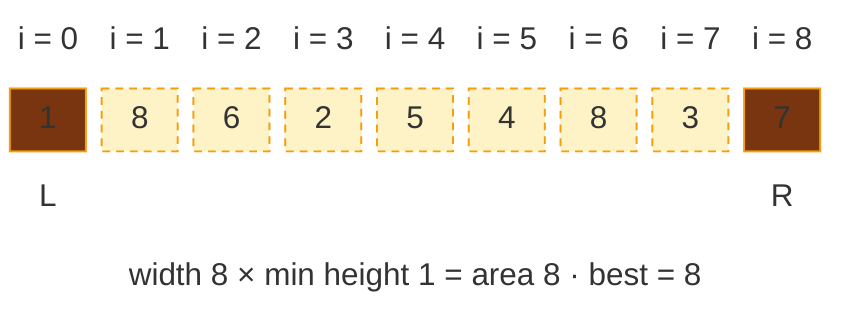

**Step 2: `left = 1`, `right = 8`**

- `1 < 8`, the loop runs.
- `width = 8 - 1 = 7`.
- `min_height = min(8, 7) = 7`.
- `current_area = 7 * 7 = 49`.
- `max_water = max(8, 49) = 49`. New best.
- `height[1] < height[8]` → `8 < 7` is false → `right = 7`.

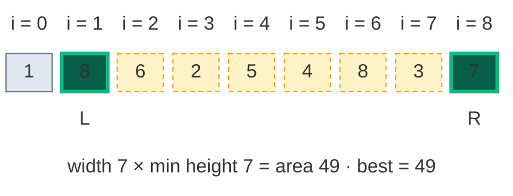

**Step 3: `left = 1`, `right = 7`**

- `1 < 7`, the loop runs.
- `width = 7 - 1 = 6`.
- `min_height = min(8, 3) = 3`.
- `current_area = 6 * 3 = 18`.
- `max_water = max(49, 18) = 49`.
- `8 < 3` is false → `right = 6`.

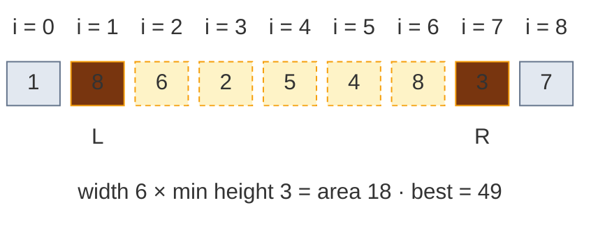

**Step 4: `left = 1`, `right = 6`**

- `1 < 6`, the loop runs.
- `width = 6 - 1 = 5`.
- `min_height = min(8, 8) = 8`.
- `current_area = 5 * 8 = 40`.
- `max_water = max(49, 40) = 49`.
- `8 < 8` is false (a tie) → `right = 5`.

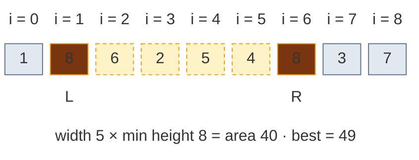

**Step 5: `left = 1`, `right = 5`**

- `1 < 5`, the loop runs.
- `width = 5 - 1 = 4`.
- `min_height = min(8, 4) = 4`.
- `current_area = 4 * 4 = 16`.
- `max_water = max(49, 16) = 49`.
- `8 < 4` is false → `right = 4`.

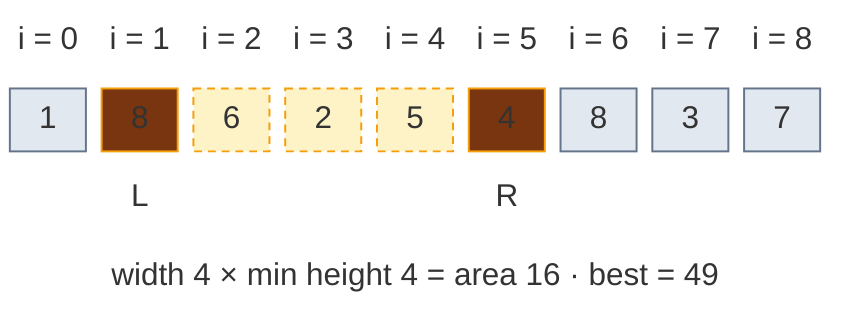

**Step 6: `left = 1`, `right = 4`**

- `1 < 4`, the loop runs.
- `width = 4 - 1 = 3`.
- `min_height = min(8, 5) = 5`.
- `current_area = 3 * 5 = 15`.
- `max_water = max(49, 15) = 49`.
- `8 < 5` is false → `right = 3`.

```mermaid
block-beta
  columns 9
  h0["i = 0"] h1["i = 1"] h2["i = 2"] h3["i = 3"] h4["i = 4"] h5["i = 5"] h6["i = 6"] h7["i = 7"] h8["i = 8"]
  c0["1"] c1["8"] c2["6"] c3["2"] c4["5"] c5["4"] c6["8"] c7["3"] c8["7"]
  space m1["L"] space space m4["R"] space space space space
  info["width 3 × min height 5 = area 15 · best = 49"]:9
  classDef head fill:none,stroke:none,color:#64748b
  class h0,h1,h2,h3,h4,h5,h6,h7,h8 head
  classDef old fill:#e2e8f0,stroke:#64748b,color:#0f172a
  class c0,c5,c6,c7,c8 old
  classDef read fill:#78350f,stroke:#f59e0b,color:#fef3c7
  class c1,c4 read
  classDef wait fill:#fef3c7,stroke:#f59e0b,color:#78350f,stroke-dasharray:4 3
  class c2,c3 wait
  classDef note fill:none,stroke:none,color:#b45309
  class m1,m4,info note
```

**Step 7: `left = 1`, `right = 3`**

- `1 < 3`, the loop runs.
- `width = 3 - 1 = 2`.
- `min_height = min(8, 2) = 2`.
- `current_area = 2 * 2 = 4`.
- `max_water = max(49, 4) = 49`.
- `8 < 2` is false → `right = 2`.

```mermaid
block-beta
  columns 9
  h0["i = 0"] h1["i = 1"] h2["i = 2"] h3["i = 3"] h4["i = 4"] h5["i = 5"] h6["i = 6"] h7["i = 7"] h8["i = 8"]
  c0["1"] c1["8"] c2["6"] c3["2"] c4["5"] c5["4"] c6["8"] c7["3"] c8["7"]
  space m1["L"] space m3["R"] space space space space space
  info["width 2 × min height 2 = area 4 · best = 49"]:9
  classDef head fill:none,stroke:none,color:#64748b
  class h0,h1,h2,h3,h4,h5,h6,h7,h8 head
  classDef old fill:#e2e8f0,stroke:#64748b,color:#0f172a
  class c0,c4,c5,c6,c7,c8 old
  classDef read fill:#78350f,stroke:#f59e0b,color:#fef3c7
  class c1,c3 read
  classDef wait fill:#fef3c7,stroke:#f59e0b,color:#78350f,stroke-dasharray:4 3
  class c2 wait
  classDef note fill:none,stroke:none,color:#b45309
  class m1,m3,info note
```

**Step 8: `left = 1`, `right = 2`**

- `1 < 2`, the loop runs.
- `width = 2 - 1 = 1`.
- `min_height = min(8, 6) = 6`.
- `current_area = 1 * 6 = 6`.
- `max_water = max(49, 6) = 49`.
- `8 < 6` is false → `right = 1`.

```mermaid
block-beta
  columns 9
  h0["i = 0"] h1["i = 1"] h2["i = 2"] h3["i = 3"] h4["i = 4"] h5["i = 5"] h6["i = 6"] h7["i = 7"] h8["i = 8"]
  c0["1"] c1["8"] c2["6"] c3["2"] c4["5"] c5["4"] c6["8"] c7["3"] c8["7"]
  space m1["L"] m2["R"] space space space space space space
  info["width 1 × min height 6 = area 6 · best = 49"]:9
  classDef head fill:none,stroke:none,color:#64748b
  class h0,h1,h2,h3,h4,h5,h6,h7,h8 head
  classDef old fill:#e2e8f0,stroke:#64748b,color:#0f172a
  class c0,c3,c4,c5,c6,c7,c8 old
  classDef read fill:#78350f,stroke:#f59e0b,color:#fef3c7
  class c1,c2 read
  classDef note fill:none,stroke:none,color:#b45309
  class m1,m2,info note
```

**Loop check: `left = 1`, `right = 1`**

- `1 < 1` is false. The loop stops.
- Return `max_water = 49`.

```mermaid
block-beta
  columns 9
  h0["i = 0"] h1["i = 1"] h2["i = 2"] h3["i = 3"] h4["i = 4"] h5["i = 5"] h6["i = 6"] h7["i = 7"] h8["i = 8"]
  c0["1"] c1["8"] c2["6"] c3["2"] c4["5"] c5["4"] c6["8"] c7["3"] c8["7"]
  space m1["L R"] space space space space space space space
  info["left == right · loop stops · return 49"]:9
  classDef head fill:none,stroke:none,color:#64748b
  class h0,h1,h2,h3,h4,h5,h6,h7,h8 head
  classDef old fill:#e2e8f0,stroke:#64748b,color:#0f172a
  class c0,c2,c3,c4,c5,c6,c7,c8 old
  classDef read fill:#78350f,stroke:#f59e0b,color:#fef3c7
  class c1 read
  classDef note fill:none,stroke:none,color:#b45309
  class m1,info note
```

**Dry run table**

| left | right | height[left] | height[right] | width | min height | area | max area | Move |
|:---:|:---:|:---:|:---:|:---:|:---:|:---:|:---:|:---:|
| 0 | 8 | 1 | 7 | 8 | 1 | 8 | 8 | left |
| 1 | 8 | 8 | 7 | 7 | 7 | 49 | 49 | right |
| 1 | 7 | 8 | 3 | 6 | 3 | 18 | 49 | right |
| 1 | 6 | 8 | 8 | 5 | 8 | 40 | 49 | right |
| 1 | 5 | 8 | 4 | 4 | 4 | 16 | 49 | right |
| 1 | 4 | 8 | 5 | 3 | 5 | 15 | 49 | right |
| 1 | 3 | 8 | 2 | 2 | 2 | 4 | 49 | right |
| 1 | 2 | 8 | 6 | 1 | 6 | 6 | 49 | right |

Final answer: `49`. Only `8` pairs were measured, instead of the `36` pairs brute force checks.

### Code

```python
# Import List for type hints
from typing import List


# Optimal: two pointers that shrink from both ends
class Solution:

    # LeetCode method name
    def maxArea(self, height: List[int]) -> int:

        # Initialize the left pointer at the first line
        left = 0

        # Initialize the right pointer at the last line
        right = len(height) - 1

        # Store the maximum water area found so far
        max_water = 0

        # Continue until both pointers meet
        while left < right:

            # Calculate the width between the current two lines
            width = right - left

            # Calculate the limiting height using the shorter line
            min_height = min(height[left], height[right])

            # Calculate current container area
            current_area = width * min_height

            # Update maximum area if current area is greater
            max_water = max(max_water, current_area)

            # If left line is shorter, move left pointer forward
            if height[left] < height[right]:

                # Move left inward to possibly find a taller line
                left += 1

            # Otherwise, right line is shorter or equal
            else:

                # Move right inward to possibly find a taller line
                right -= 1

        # Return the maximum water area found
        return max_water


# Follow-up: also return the two indices of the best container
class SolutionWithPair:

    # Returns (area, (i, j)) for the first best pair found
    def maxAreaPair(self, height: List[int]) -> tuple:

        # Start at both ends
        left, right = 0, len(height) - 1

        # Best area so far and the pair that gave it
        best, best_pair = 0, (0, len(height) - 1)

        # Same loop as before
        while left < right:

            # Area of the current container
            area = (right - left) * min(height[left], height[right])

            # Strictly bigger: remember the area and the pair
            if area > best:

                # Save both together
                best, best_pair = area, (left, right)

            # Move the pointer on the shorter line
            if height[left] < height[right]:

                # Left is shorter
                left += 1

            # Right is shorter or equal
            else:

                # Move right inward
                right -= 1

        # Return the area and the indices
        return best, best_pair


# ---------- Tests ----------

# Same loop, but it records every step so we can check the trace
def trace(height):

    # Start at both ends
    left, right, best = 0, len(height) - 1, 0

    # One tuple per loop step
    steps = []

    # Same loop as the solution
    while left < right:

        # Width and limiting height
        width, low = right - left, min(height[left], height[right])

        # Update the best area
        best = max(best, width * low)

        # Which pointer moves
        move = "left" if height[left] < height[right] else "right"

        # Save this row of the dry run table
        steps.append((left, right, width, low, width * low, best, move))

        # Move the pointer on the shorter line
        if move == "left":

            # Left is shorter
            left += 1

        # Right is shorter or equal
        else:

            # Move right inward
            right -= 1

    # Return all rows and the final meeting point
    return steps, (left, right)


# The example from this note
h = [1, 8, 6, 2, 5, 4, 8, 3, 7]

# Run the trace
steps, meet = trace(h)

# Step 1: (0, 8), width 8, min 1, area 8, best 8, move left
assert steps[0] == (0, 8, 8, 1, 8, 8, "left")

# Step 2: (1, 8), width 7, min 7, area 49, best 49, move right
assert steps[1] == (1, 8, 7, 7, 49, 49, "right")

# Step 3: (1, 7), width 6, min 3, area 18, best stays 49
assert steps[2] == (1, 7, 6, 3, 18, 49, "right")

# Step 4: (1, 6), width 5, min 8, area 40, a tie so right moves
assert steps[3] == (1, 6, 5, 8, 40, 49, "right")

# Step 5: (1, 5), width 4, min 4, area 16
assert steps[4] == (1, 5, 4, 4, 16, 49, "right")

# Step 6: (1, 4), width 3, min 5, area 15
assert steps[5] == (1, 4, 3, 5, 15, 49, "right")

# Step 7: (1, 3), width 2, min 2, area 4
assert steps[6] == (1, 3, 2, 2, 4, 49, "right")

# Step 8: (1, 2), width 1, min 6, area 6
assert steps[7] == (1, 2, 1, 6, 6, 49, "right")

# Exactly n - 1 = 8 steps, and the pointers meet at index 1
assert len(steps) == 8 and meet == (1, 1)

# Proof picture: every partner of the short line 0 is worse than 8
assert all(j * min(h[0], h[j]) < 8 for j in range(1, 8))

# Wrong move picture: the pairs that use index 8 include the answer 49
assert max((8 - i) * min(h[i], h[8]) for i in range(8)) == 49

# LeetCode examples
assert Solution().maxArea(h) == 49

# LeetCode example 2
assert Solution().maxArea([1, 1]) == 1

# Best pair indices for the example
assert SolutionWithPair().maxAreaPair(h) == (49, (1, 8))

# Edge cases from the table: (input, expected)
cases = [
    ([1, 1], 1),
    ([5, 5, 5, 5], 15),
    ([0, 0], 0),
    ([0, 2, 0], 0),
    ([1, 2, 3, 4, 5], 6),
    ([5, 4, 3, 2, 1], 6),
    ([9, 1, 1, 1, 9], 36),
    ([1, 9, 9, 1], 9),
    ([1, 2, 4, 3], 4),
    ([1, 1, 100], 2),
    ([1, 8, 6, 2, 5, 4, 8, 3, 7], 49),
]

# Check each case with both versions
for arr, want in cases:

    # Optimal
    assert Solution().maxArea(arr) == want, arr

    # Brute force
    assert SolutionBrute().maxArea(arr) == want, arr

# Import tools for exhaustive and random checks
import itertools, random

# Every array of length 2 to 6 with heights 0 to 3
for n in range(2, 7):

    # Every combination of heights for that length
    for combo in itertools.product(range(4), repeat=n):

        # Build the list
        bars = list(combo)

        # Two pointers must match brute force
        assert Solution().maxArea(bars) == SolutionBrute().maxArea(bars), bars

# Random bigger arrays
for _ in range(300):

    # Random length and heights
    bars = [random.randint(0, 50) for _ in range(random.randint(2, 40))]

    # Two pointers must match brute force
    assert Solution().maxArea(bars) == SolutionBrute().maxArea(bars), bars

    # The pair version reports a pair that really gives that area
    area, (i, j) = SolutionWithPair().maxAreaPair(bars)

    # Recompute the area from the reported indices
    assert area == SolutionBrute().maxArea(bars) == (j - i) * min(bars[i], bars[j])

    # The loop always runs exactly n - 1 steps
    assert len(trace(bars)[0]) == len(bars) - 1

# All checks passed
print("All tests passed")
```

### Complexity

| Measure | Complexity | Why |
|:---|:---:|:---|
| **Time** | `O(n)` | Each step moves one pointer by one place. They start `n - 1` apart, so there are exactly `n - 1` steps. |
| **Space** | `O(1)` | Only a few variables: `left`, `right`, `max_water`. |

## 6. Common Mistakes

| Mistake | What goes wrong | Fix |
|:---|:---|:---|
| Moving the **taller** line inward | The width shrinks while the short line still caps the height, so the area can only go down. The better partner for the short line is never found. On `[1,8,6,2,5,4,8,3,7]` this returns `8` instead of `49`. | Always move the pointer on the shorter line: `if height[left] < height[right]: left += 1`, `else: right -= 1`. |
| Using `max` instead of `min` for the height | Water is limited by the **shorter** wall. `max` makes every container look too big. | `min_height = min(height[left], height[right])`. |
| Width as `right - left + 1` | That counts elements, not the distance between two lines. Every area is one column too wide. | `width = right - left`. |
| Starting `max_water` at `height[0]` or `None` | Wrong or broken answers on inputs like `[0,0]`. | Start with `max_water = 0`. Areas are never negative, so `0` is a safe start. |
| `while left <= right` | When `left == right` the width is `0`. It adds a useless step, and in variants that read `left - 1` or `right + 1` it can go out of range. | `while left < right`. |
| Stopping early when the area drops | The area is **not** steady as the pointers move. In the example it goes `49`, then `18`, then back up to `40`. Stopping on a drop misses later maxima. | Keep going until the pointers meet. |
| Sorting the array first | Sorting destroys the indices, and the indices are the width. The areas no longer belong to any real pair of lines. | Never sort. Positions carry half the information. |
| On a tie, moving neither pointer | An `if` / `elif` with no final `else` leaves both pointers stuck on equal heights. The loop never ends. | Make the `else` unconditional, so every step moves exactly one pointer. |

## 7. Interview Follow-ups

### Q1. Prove that moving the shorter line never skips the best answer.

**Answer:**
- Say `height[left] <= height[right]`, and the best pair is `(a, b)` inside the window.
- If `a != left`, the best pair is still inside the window after we drop `left`. Nothing is lost.
- If `a == left` and `b == right`, that is the pair we just measured and saved.
- If `a == left` and `b < right`: the width `b - left` is smaller than `right - left`, and `min(height[left], height[b]) <= height[left]`. So `area(left, b) < area(left, right)`. It cannot be the best pair.
- So the best pair is always either already measured or still inside the window. When the pointers meet, it has been measured.

### Q2. What if you must return the two indices, not just the area?

**Answer:**
- Keep the pair next to the best area, and update both in the same `if` (see `SolutionWithPair` in the code).
- Still `O(n)` time and `O(1)` space.
- Use a strict `>` so you report the **first** best pair found.
- Ask the interviewer what to return on ties. On `[5,5,5,5]` the widest pair `(0,3)` wins alone, but on other inputs several pairs can tie: "any best pair", "the widest", or "all of them" are different questions.

### Q3. How is this different from Trapping Rain Water? They look almost the same.

**Answer:**
- Both use the `min` of two walls.
- Container With Most Water picks **one best pair**. The bars in between are ignored; they do not block water.
- Trapping Rain Water adds up water **at every index**. The bars in between take up space and also act as walls.
- So Container keeps a running maximum, and Trapping adds `min(left_max, right_max) - height[i]` at each index. Container needs no `left_max` / `right_max`.

### Q4. What if the container could be slanted, or the lines were not evenly spaced?

**Answer:**
- **Slanted:** the water becomes a trapezoid, `area = width * (height[i] + height[j]) / 2`. Now the taller line counts directly, so the "shorter line is useless" proof breaks. Fall back to checking all pairs in `O(n^2)`, or use geometry tricks on the points `(i, height[i])`.
- **Uneven spacing:** if line `i` stands at position `x[i]` (increasing), use `x[j] - x[i]` as the width. The proof still works word for word, because it only needs "a closer partner has a smaller width".

### Q5. Can you find the `k` largest container areas?

**Answer:**
- Not with the same scan. It crosses out pairs only because they lose to **one** measured area. A crossed-out pair could still be the second best.
- Correct way: go through all pairs and keep a min-heap of size `k`. That is `O(n^2 log k)`.
- For small `k` you can prune: look at lines from tallest to shortest, and stop when the best possible width times the current height is below the smallest area in the heap.

### Q6. The heights arrive as a stream and you cannot store them all. What now?

**Answer:**
- Two pointers need both ends at the same time, so a single forward pass cannot run them.
- What you can keep is the list of possible **left walls**: the "records", lines taller than every line before them. A line that is shorter than an earlier record is never a better left wall, because the record is both taller and farther left.
- For each new bar, binary-search the records for the first one at least as tall as the new bar (best partner of that kind), and check the shorter records one by one.
- Memory is the number of records. That is `O(n)` in the worst case (a strictly increasing stream) but usually much smaller.

## 8. Interview Explanation

> I start with two pointers at both ends, because that gives the widest container. For each pair, I compute the area as the width times the smaller height, because the water level is limited by the shorter line, and I keep the best area. Then I move the pointer at the shorter line inward. Moving the taller line can never help: the width shrinks and the height is still capped by the short line. In fact, every pair that uses the short line is already worse than the one I just measured, so that line can be thrown away. Each step drops one line, so it is O(n) time and O(1) space.

### Key Interview Point

The most important logic is: **always move the shorter line.**

```text
Area = width * min(left_height, right_height)
```

As the width goes down, the only way to get a bigger area is to find a taller minimum height. Moving the shorter line is the only move that can raise that minimum.
