# 02. 42. Trapping Rain Water

| Difficulty | Pattern | Source | Time | Space |
|:---:|:---:|:---:|:---:|:---:|
| **Hard** | Two Pointers: Container-Area Maximization | [42. Trapping Rain Water](https://leetcode.com/problems/trapping-rain-water/) | `O(n)` | `O(1)` |

## 1. Problem Statement

You get an array `height` of `n` non-negative numbers. Each number is the height of a bar. Every bar is `1` unit wide.

It rains. Return how many units of water stay trapped between the bars.

- We are given an array `height`.
- Each value is the height of one vertical bar.
- We must count how much rain water can sit between these bars.

### Example

```text
Input:  height = [0,1,0,2,1,0,1,3,2,1,2,1]
Output: 6
Explanation: 6 units of rain water are trapped between the bars.
```

This is LeetCode example 1. We use this same example in every section below.

**The bars before the rain.** Dark cells are bars. Light cells are air.

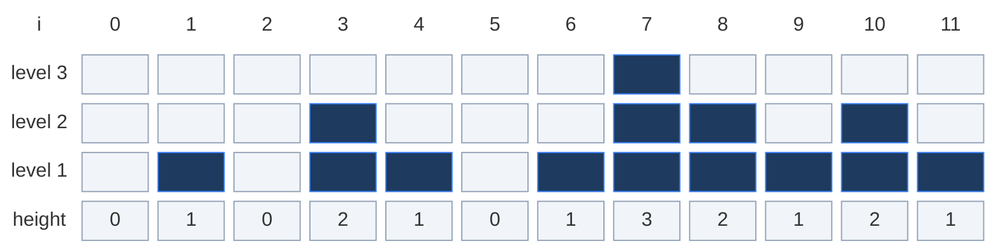

**The bars after the rain.** Blue cells marked `~` are water. Count them: `1 + 1 + 2 + 1 + 1 = 6`.

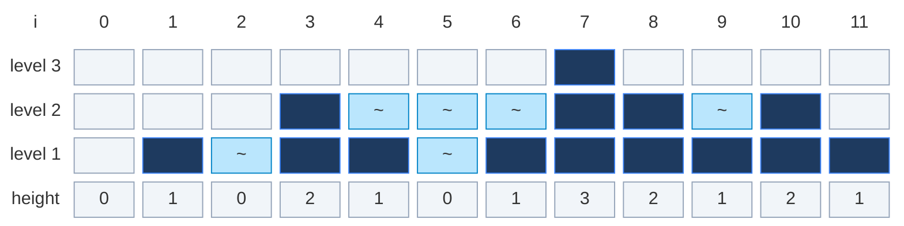

LeetCode example 2 (we use it once, in the follow-ups):

```text
Input:  height = [4,2,0,3,2,5]
Output: 9
```

### Constraints

- `n == height.length`
- `1 <= n <= 2 * 10^4`
- `0 <= height[i] <= 10^5`
- Heights are never negative. The total water is at most `2 * 10^4 * 10^5 = 2 * 10^9`. Python has no overflow. In Java or C++ that is just under the 32-bit `int` limit (`2,147,483,647`), so `int` is fine, but `long` is the safe habit.

### What the constraints tell us (simple theory)

A **constraint** is the biggest input the judge will ever give you. It quietly tells you how fast your code must be.

**Rule of thumb:** a computer does about **100 million (10^8) simple steps per second**. Count how many steps your idea needs for the biggest input, and compare.

| Biggest input `n` | Steps you can afford | Ideas that fit |
|:---:|:---:|:---|
| up to ~20 | about `2^n` | Try every choice |
| up to ~500 | about `n^3` | Three nested loops |
| up to ~5,000 | about `n^2` | Two nested loops |
| up to ~1,000,000 | about `n` or `n log n` | One loop, two pointers, sorting |

**For this problem:** `n` is at most `20,000`.

- The brute force walks left and right from **every** bar. That is `n + 1` steps per bar, so `n * (n + 1)` steps in total. For `n = 20,000` that is about **400 million steps**. In Python that takes many seconds and gets **Time Limit Exceeded**.
- The prefix and suffix arrays need 3 passes: about **60,000 steps**, but `O(n)` extra memory.
- Two pointers need only **19,999 loop steps** and no extra memory.

So `n <= 2 * 10^4` sits right on the edge where `n^2` stops being safe. The judge wants one pass.

**How the work grows as `n` grows**

Red bars = steps made by the brute force. Green line = loop steps made by two pointers (it stays flat near zero).

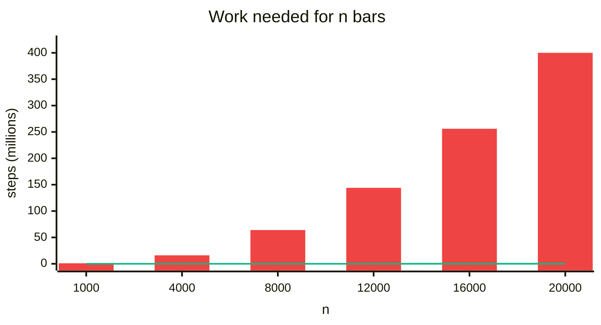

| `n` | Brute force steps | Prefix/suffix steps | Two-pointer steps |
|:---:|:---:|:---:|:---:|
| 1,000 | 1,001,000 | 2,998 | 999 |
| 4,000 | 16,004,000 | 11,998 | 3,999 |
| 8,000 | 64,008,000 | 23,998 | 7,999 |
| 12,000 | 144,012,000 | 35,998 | 11,999 |
| 16,000 | 256,016,000 | 47,998 | 15,999 |
| 20,000 | 400,020,000 | 59,998 | 19,999 |

These numbers come from counting the loop steps of the three codes below on random arrays. The brute force does `n * (n + 1)` steps. Two pointers always do exactly `n - 1` steps, because each step moves one pointer by one and they stop when they meet.

## 2. Core Theory

### What the problem really asks

Do not think about "pools". Think about **one column at a time**.

Water can sit above bar `i` only if there is a taller bar somewhere on its **left** and a taller bar somewhere on its **right**. For every index `i` we need two numbers:

```text
left_max  = tallest bar from index 0 up to i      (i included)
right_max = tallest bar from index i up to n - 1  (i included)
```

Then the water above bar `i` is:

```text
water[i] = min(left_max, right_max) - height[i]
```

**Why the minimum?** Water spills over the **shorter** wall. Example:

```text
left_max  = 3
right_max = 2
height[i] = 1

water = min(3, 2) - 1 = 1
```

The level can only rise to `2`, not `3`. Above `2` it runs out on the right side.

Because `left_max` and `right_max` both include `height[i]` itself, the result is never negative. A bar that is its own tallest wall simply holds `0`.

For our example, index `5` (height `0`): the tallest bar on its left is `2` (index 3), the tallest on its right is `3` (index 7). So `water[5] = min(2, 3) - 0 = 2`. That is the deepest column in the picture above.

So the whole problem is: **for every bar, find the shorter of its two walls, fast.** The four standard ways differ only in how they find those walls.

| Approach | Time | Space | Idea |
|:---|:---:|:---:|:---|
| Brute force | `O(n^2)` | `O(1)` | Rescan left and right for every index |
| Prefix/suffix arrays | `O(n)` | `O(n)` | Precompute both walls for every index, then one pass |
| Monotonic stack | `O(n)` | `O(n)` | Fill water layer by layer, sideways |
| Two pointers | `O(n)` | `O(1)` | Keep two running maxima, process the lower side |

### Why two pointers work (the "safe to settle" proof)

Put `left` at index `0` and `right` at index `n - 1`. Keep two numbers:

- `left_max` = tallest bar seen so far from the left side,
- `right_max` = tallest bar seen so far from the right side.

Each step, we look at `height[left]` and `height[right]`, settle the water at **the shorter one**, and move that pointer inward.

**The key fact.** Every bar we have already passed is **no taller than the taller of the two bars under the pointers.**

Why? A pointer only moves off a bar when that bar is shorter than (or equal to) the bar under the other pointer. The other pointer stays put. So the "taller pointer bar" is always at least as tall as anything we walked past. It is true at the start (nothing passed), and every step keeps it true.

**Now say `height[left] <= height[right]`.** Then:

1. The bar under `right` is the taller one. By the key fact, it is at least as tall as every bar on the left that we passed, and at least as tall as `height[left]`. So `height[right] >= left_max` (after we include `height[left]` in `left_max`).
2. The true right wall of index `left` is the tallest bar anywhere to its right. Index `right` is one of those bars. So the true right wall is `>= height[right] >= left_max`.
3. So for index `left`, the **lower wall is `left_max`**, and `left_max` is fully known (we scanned everything from `0` to `left`).
4. Water at `left` is exactly `left_max - height[left]`. We can settle it and throw the index away. It is **safe to discard**.

We do not need the exact right wall. We only need a **witness**: one real bar on the right that is at least as tall as the left wall. The bar under `right` is that witness. The mirror argument settles the `right` side with `right_max` when `height[right] < height[left]`.

**Why we must move the shorter side.** If we moved the taller side, we would have no witness that the far wall reaches high enough, and we could count water that actually spills out.

This is the **same rule as [Container With Most Water](01.%2011.%20Container%20With%20Most%20Water.md)** in this folder: the shorter bar is the one that limits the water, so the shorter bar is the one we can decide about and move past.

### The pointer-move rule

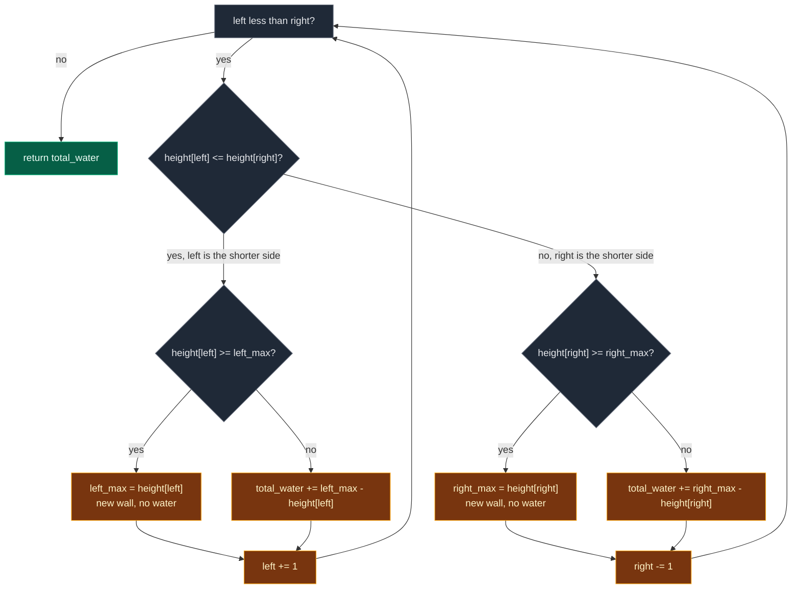

### How to spot this pattern

- The answer at each index depends on a **prefix extreme** (tallest on the left) **and** a **suffix extreme** (tallest on the right).
- The two extremes are combined with a `min` or `max`.
- A comparison of the two ends tells you **which extreme is the binding one** right now.

When all three are true, the prefix and suffix arrays can usually shrink into two variables and two pointers.

## 3. Edge Cases

| Case | Input | Expected | Why it matters |
|:---|:---|:---:|:---|
| Empty array | `[]` | `0` | Not allowed by the constraints, but safe code should not crash. The shorter variant that reads `height[0]` first would raise `IndexError` without a guard. |
| Single bar | `[5]` | `0` | One wall cannot hold water. `left == right` at the start. |
| Two bars | `[5,5]` | `0` | No index lies **between** the walls. |
| All the same height | `[3,3,3,3]` | `0` | A flat floor traps nothing. Every bar equals its own wall. |
| All zeros | `[0,0,0,0]` | `0` | Must not produce negative water. |
| Only going up | `[1,2,3,4,5]` | `0` | Every bar is a new `left_max`, so nothing is ever added. |
| Only going down | `[5,4,3,2,1]` | `0` | Mirror case. It runs through the `else` (right) branch. |
| One valley | `[3,0,3]` | `3` | The smallest real basin: `min(3,3) - 0 = 3`. |
| Unequal walls | `[5,0,3]` | `3` | Water rises to the **lower** wall (`3`), not to `5`. |
| Deep pit | `[5,0,0,0,5]` | `15` | Three columns, each `5` deep. |
| Two basins | `[3,0,3,0,3]` | `6` | The scan must add up separate pools. |
| Flat bottom | `[4,1,1,1,4]` | `9` | Equal floor bars. The `<=` versus `<` choice must not double count. |
| Bar that is floor and wall | `[4,2,0,3,2,5]` | `9` | The `3` holds `1` unit above itself **and** acts as a wall. The formula handles it with no special case. |
| Our example | `[0,1,0,2,1,0,1,3,2,1,2,1]` | `6` | Several basins, both pointers move. |
| Negative heights | n/a | n/a | The constraints say `0 <= height[i]`. A negative bar has no meaning. If negatives were allowed you would clamp each column with `max(0, ...)`. |

## 4. Brute Force

### Idea

For every index `i`:

1. Walk left from `i` to `0` and find the tallest bar (`left_max`).
2. Walk right from `i` to `n - 1` and find the tallest bar (`right_max`).
3. Add `min(left_max, right_max) - height[i]` to the total.

Both walks include `height[i]` itself, so the water is never negative.

**One column in detail: `i = 5`.** Walking left over `0, 1, 0, 2, 1, 0` gives `left_max = 2` (index 3). Walking right over `0, 1, 3, 2, 1, 2, 1` gives `right_max = 3` (index 7). Water `= min(2, 3) - 0 = 2`. The orange columns are the bar at `i` and its two walls. The green cells are the water we just found.

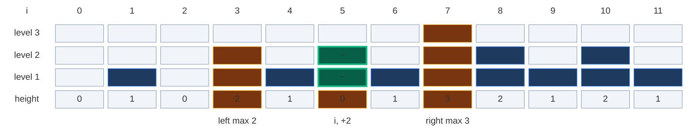

**Every column of the example, one by one:**

| `i` | `height[i]` | `left_max` | `right_max` | water | total |
|:---:|:---:|:---:|:---:|:---|:---:|
| 0 | 0 | `0` | `3` | `min(0, 3) - 0 = 0` | 0 |
| 1 | 1 | `1` | `3` | `min(1, 3) - 1 = 0` | 0 |
| 2 | 0 | `1` | `3` | `min(1, 3) - 0 = 1` | 1 |
| 3 | 2 | `2` | `3` | `min(2, 3) - 2 = 0` | 1 |
| 4 | 1 | `2` | `3` | `min(2, 3) - 1 = 1` | 2 |
| 5 | 0 | `2` | `3` | `min(2, 3) - 0 = 2` | 4 |
| 6 | 1 | `2` | `3` | `min(2, 3) - 1 = 1` | 5 |
| 7 | 3 | `3` | `3` | `min(3, 3) - 3 = 0` | 5 |
| 8 | 2 | `3` | `2` | `min(3, 2) - 2 = 0` | 5 |
| 9 | 1 | `3` | `2` | `min(3, 2) - 1 = 1` | 6 |
| 10 | 2 | `3` | `2` | `min(3, 2) - 2 = 0` | 6 |
| 11 | 1 | `3` | `1` | `min(3, 1) - 1 = 0` | 6 |

Total = `6`. Notice how `left_max` and `right_max` were found again from scratch for every row, even though the rows next to each other share almost the same walk. That waste is what the next approaches remove.

### Code

```python
# Import List for type hints
from typing import List


# Brute force: find both walls from scratch for every index
class SolutionBrute:

    # Return the total trapped water
    def trap(self, height: List[int]) -> int:

        # Number of bars
        n = len(height)

        # Total trapped water so far
        total_water = 0

        # Look at every index
        for i in range(n):

            # Tallest bar on the left side, including index i
            left_max = 0

            # Walk from index 0 up to i
            for left in range(i + 1):

                # Keep the taller bar
                left_max = max(left_max, height[left])

            # Tallest bar on the right side, including index i
            right_max = 0

            # Walk from index i up to n - 1
            for right in range(i, n):

                # Keep the taller bar
                right_max = max(right_max, height[right])

            # Water rises to the lower wall, minus the bar itself
            water_at_current = min(left_max, right_max) - height[i]

            # Add this column's water to the total
            total_water += water_at_current

        # Return the total trapped water
        return total_water
```

### Complexity

| Measure | Complexity | Why |
|:---|:---:|:---|
| **Time** | `O(n^2)` | For each of the `n` indexes we walk `n + 1` cells (left part plus right part). For `n = 20,000` that is about `4 * 10^8` steps. |
| **Space** | `O(1)` | Only a few variables. |

## 5. Better Approach: Prefix and Suffix Max Arrays

This approach has its own full note: [42. Trapping Rain Water (Prefix and Suffix)](../../01.%20Array/16.%20Prefix%20and%20Suffix%20Precomputation/05.%2042.%20Trapping%20Rain%20Water%20%28Prefix%20and%20Suffix%29.md). Here is the short version, because it is the stepping stone to two pointers.

### Idea

Instead of finding `left_max` and `right_max` again and again, **precompute** them once:

```text
prefix_max[i] = tallest bar from index 0 to i
suffix_max[i] = tallest bar from index i to n - 1
```

- `prefix_max[i] = max(prefix_max[i - 1], height[i])`, one pass left to right.
- `suffix_max[i] = max(suffix_max[i + 1], height[i])`, one pass right to left.

Then for every index:

```text
water = min(prefix_max[i], suffix_max[i]) - height[i]
```

**All rows for our example.** Orange = the lower wall. Green = columns that hold water.

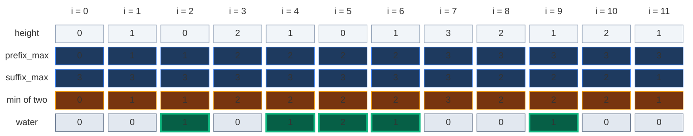

```text
water = 0 + 0 + 1 + 0 + 1 + 2 + 1 + 0 + 0 + 1 + 0 + 0 = 6
```

Look at the two max rows. `prefix_max` only goes **up** as we walk right, and `suffix_max` only goes **up** as we walk left. Left of index 7 (the tallest bar), `prefix_max` is the lower wall. Right of it, `suffix_max` is. Two pointers use exactly this: they never need the whole arrays, only the side that is lower right now.

### Code

```python
# Better: precompute both walls in two arrays
class SolutionBetter:

    # Return the total trapped water
    def trap(self, height: List[int]) -> int:

        # Number of bars
        n = len(height)

        # Fewer than 3 bars can never trap water
        if n < 3:

            # Nothing to trap
            return 0

        # prefix_max[i] = tallest bar from 0 to i
        prefix_max = [0] * n

        # suffix_max[i] = tallest bar from i to n - 1
        suffix_max = [0] * n

        # The first prefix max is the first bar
        prefix_max[0] = height[0]

        # Fill prefix_max from left to right
        for i in range(1, n):

            # Tallest so far from the left
            prefix_max[i] = max(prefix_max[i - 1], height[i])

        # The last suffix max is the last bar
        suffix_max[n - 1] = height[n - 1]

        # Fill suffix_max from right to left
        for i in range(n - 2, -1, -1):

            # Tallest so far from the right
            suffix_max[i] = max(suffix_max[i + 1], height[i])

        # Total trapped water so far
        total_water = 0

        # Look at every index
        for i in range(n):

            # The water level is the lower of the two walls
            water_level = min(prefix_max[i], suffix_max[i])

            # Water above the current bar
            water_at_current = water_level - height[i]

            # Add it to the total
            total_water += water_at_current

        # Return the total trapped water
        return total_water
```

### Complexity

| Measure | Complexity | Why |
|:---|:---:|:---|
| **Time** | `O(n)` | Three passes over the array. |
| **Space** | `O(n)` | The two arrays `prefix_max` and `suffix_max`. |

## 6. Another Better Approach: Monotonic Stack

This problem is also a classic **stack** problem, so know this version too. It fills water **sideways, layer by layer**, instead of column by column.

### Idea

- Keep a stack of indexes whose heights go **down** from bottom to top.
- When the current bar is **taller** than the bar on top of the stack, we found a **right wall**.
- Pop the top. That popped bar is the **bottom** (floor) of a pool.
- The new top of the stack is the **left wall**. If the stack is empty, there is no left wall, so stop.
- Fill one flat layer between the two walls:

```text
distance       = current_index - left_boundary_index - 1
bounded_height = min(height[current_index], height[left_boundary_index]) - height[bottom]
water          = distance * bounded_height
```

**Every pop on our example:**

| current `i` | bottom (popped) | left wall | `distance` | `bounded_height` | water added | total |
|:---:|:---:|:---:|:---:|:---|:---:|:---:|
| 1 | 0 | none | – | stack empty, stop | 0 | 0 |
| 3 | 2 | 1 | `3 - 1 - 1 = 1` | `min(2, 1) - 0 = 1` | 1 | 1 |
| 3 | 1 | none | – | stack empty, stop | 0 | 1 |
| 6 | 5 | 4 | `6 - 4 - 1 = 1` | `min(1, 1) - 0 = 1` | 1 | 2 |
| 7 | 6 | 4 | `7 - 4 - 1 = 2` | `min(3, 1) - 1 = 0` | 0 | 2 |
| 7 | 4 | 3 | `7 - 3 - 1 = 3` | `min(3, 2) - 1 = 1` | 3 | 5 |
| 7 | 3 | none | – | stack empty, stop | 0 | 5 |
| 10 | 9 | 8 | `10 - 8 - 1 = 1` | `min(2, 2) - 1 = 1` | 1 | 6 |

At `i = 7` the pool between index 3 and index 7 is filled as a flat slab of width 3 at level 2 (`3` units over indexes 4, 5, 6), on top of the 1 unit that was already added at index 5. Same total, `6`, but counted in layers.

### Code

```python
# Monotonic stack: fill water in flat layers
class SolutionStack:

    # Return the total trapped water
    def trap(self, height: List[int]) -> int:

        # Total trapped water so far
        total_water = 0

        # Stack of indexes, heights going down from bottom to top
        stack = []

        # Look at every bar by index
        for current_index in range(len(height)):

            # While the current bar is taller than the bar on top of the stack
            while stack and height[current_index] > height[stack[-1]]:

                # The popped bar is the floor of a pool
                bottom_index = stack.pop()

                # If the stack is empty, there is no left wall
                if not stack:

                    # Stop: water would spill out on the left
                    break

                # The new top of the stack is the left wall
                left_boundary_index = stack[-1]

                # Width of the pool between the two walls
                distance = current_index - left_boundary_index - 1

                # Layer height: lower wall minus the floor
                bounded_height = min(height[current_index], height[left_boundary_index]) - height[bottom_index]

                # Add this flat layer of water
                total_water += distance * bounded_height

            # Push the current index on the stack
            stack.append(current_index)

        # Return the total trapped water
        return total_water
```

### Complexity

| Measure | Complexity | Why |
|:---|:---:|:---|
| **Time** | `O(n)` | Each index is pushed once and popped at most once. |
| **Space** | `O(n)` | The stack (a strictly falling array keeps every index on it). |

## 7. Optimal Approach: Two Pointers

### Idea

The prefix/suffix version uses two extra arrays. Can we avoid them? Yes.

- Put `left = 0` and `right = n - 1`.
- Keep `left_max` = tallest bar seen so far from the left side, and `right_max` = tallest bar seen so far from the right side. Both start at `0`.
- While `left < right`, compare `height[left]` and `height[right]`:
  - If `height[left] <= height[right]`, the **left side is the limiting side**. There is a right bar tall enough to hold water on the left, so the water at `left` depends only on `left_max`:
    - if `height[left] >= left_max`: update `left_max` (a new wall, no water here),
    - else: `water += left_max - height[left]`.
    - Then `left += 1`.
  - Else (`height[right] < height[left]`), the **right side is the limiting side**, and the water at `right` depends only on `right_max`:
    - if `height[right] >= right_max`: update `right_max`,
    - else: `water += right_max - height[right]`.
    - Then `right -= 1`.

Each step settles one index for good, so there are exactly `n - 1` steps. The pointers stop on the same index, and that last index is always a tallest bar, which never holds water.

### Visual Walkthrough (Story Version)

**The story:** twelve towers stand in a row. It is about to rain. Two lifeguards, **Lefty** and **Righty**, must say how much water will sit on top of each tower.

- Lefty starts at the left end. Righty starts at the right end.
- Each lifeguard carries a **card** with the height of the tallest tower he has stood on so far. Both cards start at `0`.
- **The rule:** the lifeguard standing on the **shorter** tower (Lefty wins a tie) does the work. He knows the other side has a tower at least as tall as his card, so the water on his tower rises exactly to his card.
- If his tower is as tall as his card or taller, he writes the new height on his card (no water). Otherwise he pours `card - tower` units of water on it.
- Then he takes one step toward the middle.

**How to read the pictures:** dark blue = towers nobody has visited yet, orange = the towers the lifeguards stand on, grey = towers already finished, blue `~` = water poured earlier, green `~` = water poured in this step. The bottom row says who stands where and what happened.

**Start:** Lefty stands on tower 0 (height `0`), Righty on tower 11 (height `1`). Both cards say `0`.

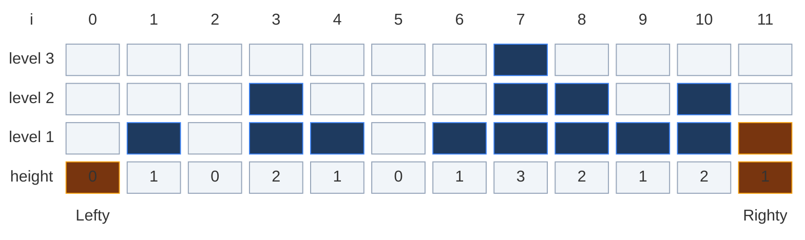

**Step 1.** Lefty's tower `0` is not taller than Righty's `1`, so Lefty works. His tower `0` is as tall as his card `0`, so he writes `0` on his card. No water. He steps to tower 1.

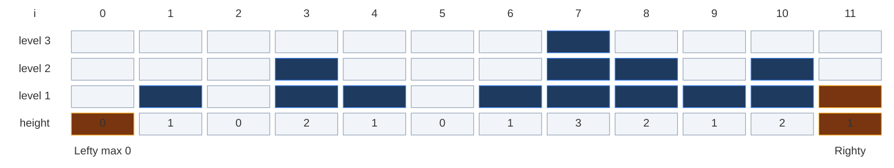

**Step 2.** Lefty's tower `1` vs Righty's `1`: a tie, so Lefty works. `1` is taller than his card `0`, so his card becomes `1`. No water. He steps to tower 2.

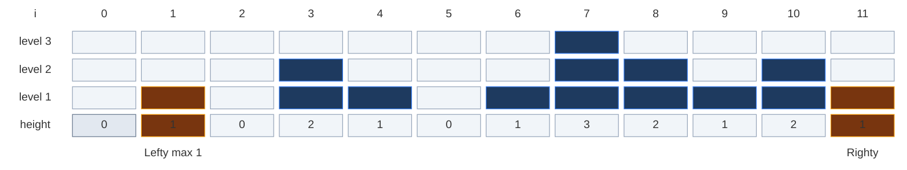

**Step 3.** Lefty's tower `0` vs Righty's `1`: Lefty works. `0` is lower than his card `1`, so he pours `1 - 0 = 1` unit. Total water: `1`. He steps to tower 3.

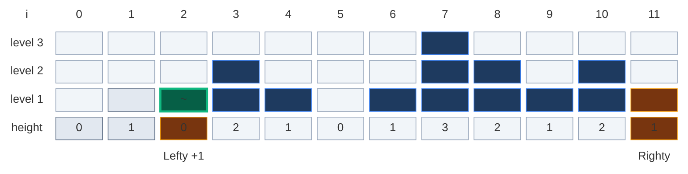

**Step 4.** Lefty's tower `2` vs Righty's `1`: now Righty is on the shorter tower, so Righty works. `1` is taller than his card `0`, so his card becomes `1`. No water. He steps to tower 10.

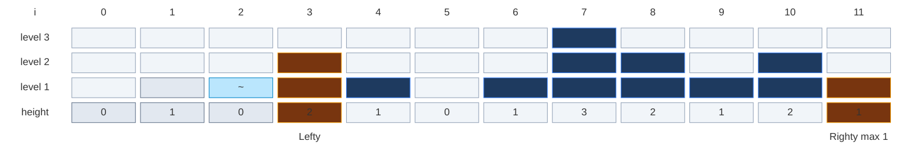

**Step 5.** Lefty's tower `2` vs Righty's `2`: a tie, so Lefty works. `2` is taller than his card `1`, so his card becomes `2`. No water. He steps to tower 4.

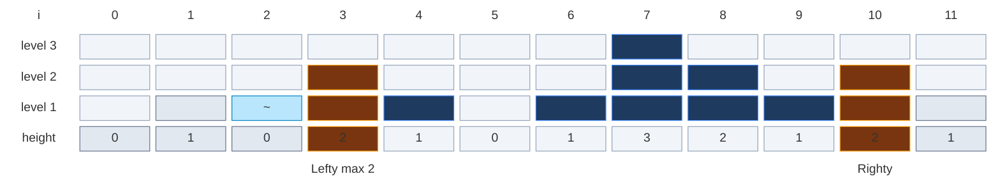

**Step 6.** Lefty's tower `1` vs Righty's `2`: Lefty works. `1` is lower than his card `2`, so he pours `2 - 1 = 1` unit. Total: `2`. He steps to tower 5.

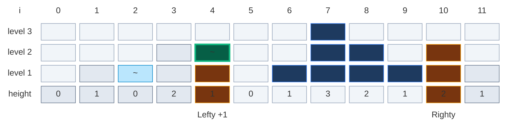

**Step 7.** Lefty's tower `0` vs Righty's `2`: Lefty works. He pours `2 - 0 = 2` units. Total: `4`. He steps to tower 6.

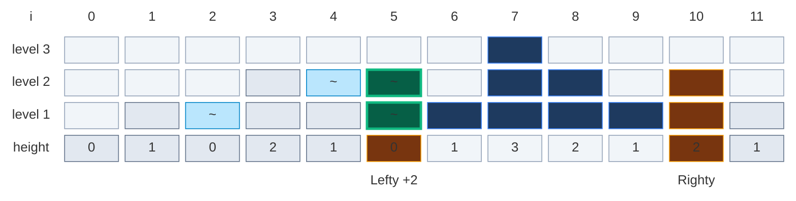

**Step 8.** Lefty's tower `1` vs Righty's `2`: Lefty works. He pours `2 - 1 = 1` unit. Total: `5`. He steps to tower 7, the tallest tower.

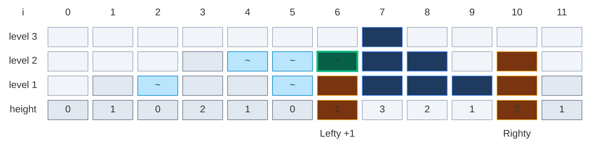

**Step 9.** Lefty's tower `3` vs Righty's `2`: Righty is on the shorter tower, so Righty works. `2` is taller than his card `1`, so his card becomes `2`. No water. He steps to tower 9.

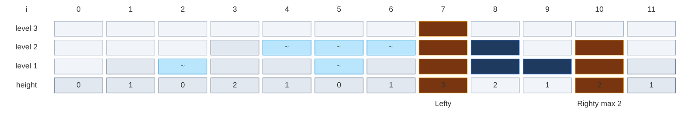

**Step 10.** Lefty's tower `3` vs Righty's `1`: Righty works. `1` is lower than his card `2`, so he pours `2 - 1 = 1` unit. Total: `6`. He steps to tower 8.

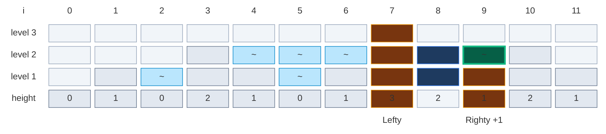

**Step 11.** Lefty's tower `3` vs Righty's `2`: Righty works. `2` is as tall as his card `2`, so the card stays `2`. No water. He steps to tower 7.

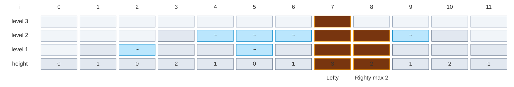

**The end.** Both lifeguards stand on tower 7, the tallest one. Nothing is left between them. Total water: **6**.

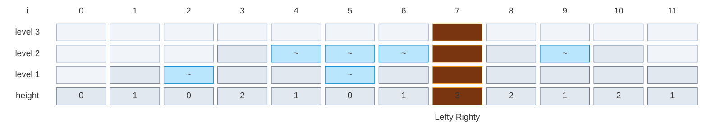

**Summary of the story**

| Step | Lefty on | Righty on | Who works | What he does | Lefty card | Righty card | Total |
|:---:|:---:|:---:|:---:|:---|:---:|:---:|:---:|
| start | 0 (h 0) | 11 (h 1) | – | – | 0 | 0 | 0 |
| 1 | 0 (h 0) | 11 (h 1) | Lefty | card stays 0 | 0 | 0 | 0 |
| 2 | 1 (h 1) | 11 (h 1) | Lefty (tie) | card = 1 | 1 | 0 | 0 |
| 3 | 2 (h 0) | 11 (h 1) | Lefty | pours 1 | 1 | 0 | 1 |
| 4 | 3 (h 2) | 11 (h 1) | Righty | card = 1 | 1 | 1 | 1 |
| 5 | 3 (h 2) | 10 (h 2) | Lefty (tie) | card = 2 | 2 | 1 | 1 |
| 6 | 4 (h 1) | 10 (h 2) | Lefty | pours 1 | 2 | 1 | 2 |
| 7 | 5 (h 0) | 10 (h 2) | Lefty | pours 2 | 2 | 1 | 4 |
| 8 | 6 (h 1) | 10 (h 2) | Lefty | pours 1 | 2 | 1 | 5 |
| 9 | 7 (h 3) | 10 (h 2) | Righty | card = 2 | 2 | 2 | 5 |
| 10 | 7 (h 3) | 9 (h 1) | Righty | pours 1 | 2 | 2 | 6 |
| 11 | 7 (h 3) | 8 (h 2) | Righty | card stays 2 | 2 | 2 | 6 |
| end | 7 | 7 | – | they meet | 2 | 2 | **6** |

**What the story teaches**

| Story | Code |
|:---|:---|
| Lefty and Righty | `left` and `right` pointers |
| Lefty's card, Righty's card | `left_max`, `right_max` |
| The lifeguard on the shorter tower works | `if height[left] <= height[right]` picks the side |
| Lefty wins a tie | `<=` sends ties to the left branch |
| Tower as tall as the card or taller: write it on the card | `if height[left] >= left_max: left_max = height[left]` |
| Tower lower than the card: pour `card - tower` | `total_water += left_max - height[left]` |
| Step toward the middle | `left += 1` or `right -= 1` |
| They meet on the tallest tower | `while left < right` ends; the tallest bar holds no water |
| He trusts the other side without looking | the bar under the other pointer is the **witness** that the far wall is tall enough |

### Step-by-Step Example

`height = [0,1,0,2,1,0,1,3,2,1,2,1]`, `n = 12`.

Start: `left = 0`, `right = 11`, `left_max = 0`, `right_max = 0`, `total_water = 0`.

In each picture: orange = the two pointer columns (`L` and `R`), green `~` = water added in this step, blue `~` = water added before, grey = indexes already settled, dark blue = not visited yet. The label row shows the pointers **at the moment of the decision** and what happened (`max 2` = new `left_max`/`right_max`, `+1` = water added).

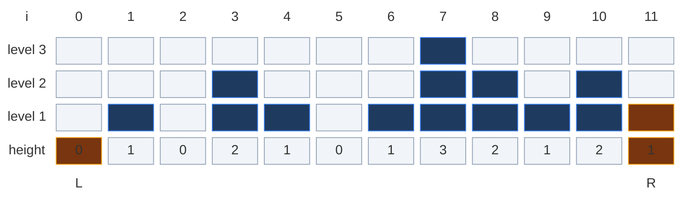

**Step 1.** `height[0] = 0`, `height[11] = 1`. `0 <= 1`, so process left.
`height[0] = 0 >= left_max = 0`, so `left_max = 0` (no water). `left = 1`.
State: `left = 1`, `right = 11`, `left_max = 0`, `right_max = 0`, `total_water = 0`.

```mermaid
block-beta
  columns 13
  hx["i"] h0["0"] h1["1"] h2["2"] h3["3"] h4["4"] h5["5"] h6["6"] h7["7"] h8["8"] h9["9"] h10["10"] h11["11"]
  lv3["level 3"] b3x0[" "] b3x1[" "] b3x2[" "] b3x3[" "] b3x4[" "] b3x5[" "] b3x6[" "] b3x7[" "] b3x8[" "] b3x9[" "] b3x10[" "] b3x11[" "]
  lv2["level 2"] b2x0[" "] b2x1[" "] b2x2[" "] b2x3[" "] b2x4[" "] b2x5[" "] b2x6[" "] b2x7[" "] b2x8[" "] b2x9[" "] b2x10[" "] b2x11[" "]
  lv1["level 1"] b1x0[" "] b1x1[" "] b1x2[" "] b1x3[" "] b1x4[" "] b1x5[" "] b1x6[" "] b1x7[" "] b1x8[" "] b1x9[" "] b1x10[" "] b1x11[" "]
  lh["height"] v0["0"] v1["1"] v2["0"] v3["2"] v4["1"] v5["0"] v6["1"] v7["3"] v8["2"] v9["1"] v10["2"] v11["1"]
  space m0["L max 0"] space space space space space space space space space space m11["R"]
  classDef head fill:none,stroke:none,color:#64748b
  class hx,h0,h1,h2,h3,h4,h5,h6,h7,h8,h9,h10,h11,lv3,lv2,lv1,lh head
  classDef empty fill:#f1f5f9,stroke:#94a3b8,color:#64748b
  class b3x0,b3x1,b3x2,b3x3,b3x4,b3x5,b3x6,b3x8,b3x9,b3x10,b3x11,b2x0,b2x1,b2x2,b2x4,b2x5,b2x6,b2x9,b2x11,b1x0,b1x2,b1x5,v1,v2,v3,v4,v5,v6,v7,v8,v9,v10 empty
  classDef done fill:#1e3a5f,stroke:#3b82f6,color:#dbeafe
  class b3x7,b2x3,b2x7,b2x8,b2x10,b1x1,b1x3,b1x4,b1x6,b1x7,b1x8,b1x9,b1x10 done
  classDef read fill:#78350f,stroke:#f59e0b,color:#fef3c7
  class b1x11,v0,v11 read
  classDef note fill:none,stroke:none,color:#b45309
  class m0,m11 note
```

**Step 2.** `height[1] = 1`, `height[11] = 1`. `1 <= 1`, so process left.
`height[1] = 1 >= left_max = 0`, so `left_max = 1`. `left = 2`.
State: `left = 2`, `right = 11`, `left_max = 1`, `right_max = 0`, `total_water = 0`.

```mermaid
block-beta
  columns 13
  hx["i"] h0["0"] h1["1"] h2["2"] h3["3"] h4["4"] h5["5"] h6["6"] h7["7"] h8["8"] h9["9"] h10["10"] h11["11"]
  lv3["level 3"] b3x0[" "] b3x1[" "] b3x2[" "] b3x3[" "] b3x4[" "] b3x5[" "] b3x6[" "] b3x7[" "] b3x8[" "] b3x9[" "] b3x10[" "] b3x11[" "]
  lv2["level 2"] b2x0[" "] b2x1[" "] b2x2[" "] b2x3[" "] b2x4[" "] b2x5[" "] b2x6[" "] b2x7[" "] b2x8[" "] b2x9[" "] b2x10[" "] b2x11[" "]
  lv1["level 1"] b1x0[" "] b1x1[" "] b1x2[" "] b1x3[" "] b1x4[" "] b1x5[" "] b1x6[" "] b1x7[" "] b1x8[" "] b1x9[" "] b1x10[" "] b1x11[" "]
  lh["height"] v0["0"] v1["1"] v2["0"] v3["2"] v4["1"] v5["0"] v6["1"] v7["3"] v8["2"] v9["1"] v10["2"] v11["1"]
  space space m1["L max 1"] space space space space space space space space space m11["R"]
  classDef head fill:none,stroke:none,color:#64748b
  class hx,h0,h1,h2,h3,h4,h5,h6,h7,h8,h9,h10,h11,lv3,lv2,lv1,lh head
  classDef empty fill:#f1f5f9,stroke:#94a3b8,color:#64748b
  class b3x0,b3x1,b3x2,b3x3,b3x4,b3x5,b3x6,b3x8,b3x9,b3x10,b3x11,b2x0,b2x1,b2x2,b2x4,b2x5,b2x6,b2x9,b2x11,b1x0,b1x2,b1x5,v2,v3,v4,v5,v6,v7,v8,v9,v10 empty
  classDef done fill:#1e3a5f,stroke:#3b82f6,color:#dbeafe
  class b3x7,b2x3,b2x7,b2x8,b2x10,b1x3,b1x4,b1x6,b1x7,b1x8,b1x9,b1x10 done
  classDef read fill:#78350f,stroke:#f59e0b,color:#fef3c7
  class b1x1,b1x11,v1,v11 read
  classDef old fill:#e2e8f0,stroke:#64748b,color:#0f172a
  class v0 old
  classDef note fill:none,stroke:none,color:#b45309
  class m1,m11 note
```

**Step 3.** `height[2] = 0`, `height[11] = 1`. `0 <= 1`, so process left.
`height[2] = 0 < left_max = 1`, so `total_water += 1 - 0 = 1`. `left = 3`.
State: `left = 3`, `right = 11`, `left_max = 1`, `right_max = 0`, `total_water = 1`.

```mermaid
block-beta
  columns 13
  hx["i"] h0["0"] h1["1"] h2["2"] h3["3"] h4["4"] h5["5"] h6["6"] h7["7"] h8["8"] h9["9"] h10["10"] h11["11"]
  lv3["level 3"] b3x0[" "] b3x1[" "] b3x2[" "] b3x3[" "] b3x4[" "] b3x5[" "] b3x6[" "] b3x7[" "] b3x8[" "] b3x9[" "] b3x10[" "] b3x11[" "]
  lv2["level 2"] b2x0[" "] b2x1[" "] b2x2[" "] b2x3[" "] b2x4[" "] b2x5[" "] b2x6[" "] b2x7[" "] b2x8[" "] b2x9[" "] b2x10[" "] b2x11[" "]
  lv1["level 1"] b1x0[" "] b1x1[" "] b1x2["~"] b1x3[" "] b1x4[" "] b1x5[" "] b1x6[" "] b1x7[" "] b1x8[" "] b1x9[" "] b1x10[" "] b1x11[" "]
  lh["height"] v0["0"] v1["1"] v2["0"] v3["2"] v4["1"] v5["0"] v6["1"] v7["3"] v8["2"] v9["1"] v10["2"] v11["1"]
  space space space m2["L +1"] space space space space space space space space m11["R"]
  classDef head fill:none,stroke:none,color:#64748b
  class hx,h0,h1,h2,h3,h4,h5,h6,h7,h8,h9,h10,h11,lv3,lv2,lv1,lh head
  classDef empty fill:#f1f5f9,stroke:#94a3b8,color:#64748b
  class b3x0,b3x1,b3x2,b3x3,b3x4,b3x5,b3x6,b3x8,b3x9,b3x10,b3x11,b2x0,b2x1,b2x2,b2x4,b2x5,b2x6,b2x9,b2x11,b1x0,b1x5,v3,v4,v5,v6,v7,v8,v9,v10 empty
  classDef done fill:#1e3a5f,stroke:#3b82f6,color:#dbeafe
  class b3x7,b2x3,b2x7,b2x8,b2x10,b1x3,b1x4,b1x6,b1x7,b1x8,b1x9,b1x10 done
  classDef old fill:#e2e8f0,stroke:#64748b,color:#0f172a
  class b1x1,v0,v1 old
  classDef new fill:#065f46,stroke:#10b981,color:#ecfdf5,stroke-width:3px
  class b1x2 new
  classDef read fill:#78350f,stroke:#f59e0b,color:#fef3c7
  class b1x11,v2,v11 read
  classDef note fill:none,stroke:none,color:#b45309
  class m2,m11 note
```

**Step 4.** `height[3] = 2`, `height[11] = 1`. `2 <= 1` is false, so process right.
`height[11] = 1 >= right_max = 0`, so `right_max = 1`. `right = 10`.
State: `left = 3`, `right = 10`, `left_max = 1`, `right_max = 1`, `total_water = 1`.

```mermaid
block-beta
  columns 13
  hx["i"] h0["0"] h1["1"] h2["2"] h3["3"] h4["4"] h5["5"] h6["6"] h7["7"] h8["8"] h9["9"] h10["10"] h11["11"]
  lv3["level 3"] b3x0[" "] b3x1[" "] b3x2[" "] b3x3[" "] b3x4[" "] b3x5[" "] b3x6[" "] b3x7[" "] b3x8[" "] b3x9[" "] b3x10[" "] b3x11[" "]
  lv2["level 2"] b2x0[" "] b2x1[" "] b2x2[" "] b2x3[" "] b2x4[" "] b2x5[" "] b2x6[" "] b2x7[" "] b2x8[" "] b2x9[" "] b2x10[" "] b2x11[" "]
  lv1["level 1"] b1x0[" "] b1x1[" "] b1x2["~"] b1x3[" "] b1x4[" "] b1x5[" "] b1x6[" "] b1x7[" "] b1x8[" "] b1x9[" "] b1x10[" "] b1x11[" "]
  lh["height"] v0["0"] v1["1"] v2["0"] v3["2"] v4["1"] v5["0"] v6["1"] v7["3"] v8["2"] v9["1"] v10["2"] v11["1"]
  space space space space m3["L"] space space space space space space space m11["R max 1"]
  classDef head fill:none,stroke:none,color:#64748b
  class hx,h0,h1,h2,h3,h4,h5,h6,h7,h8,h9,h10,h11,lv3,lv2,lv1,lh head
  classDef empty fill:#f1f5f9,stroke:#94a3b8,color:#64748b
  class b3x0,b3x1,b3x2,b3x3,b3x4,b3x5,b3x6,b3x8,b3x9,b3x10,b3x11,b2x0,b2x1,b2x2,b2x4,b2x5,b2x6,b2x9,b2x11,b1x0,b1x5,v4,v5,v6,v7,v8,v9,v10 empty
  classDef done fill:#1e3a5f,stroke:#3b82f6,color:#dbeafe
  class b3x7,b2x7,b2x8,b2x10,b1x4,b1x6,b1x7,b1x8,b1x9,b1x10 done
  classDef read fill:#78350f,stroke:#f59e0b,color:#fef3c7
  class b2x3,b1x3,b1x11,v3,v11 read
  classDef old fill:#e2e8f0,stroke:#64748b,color:#0f172a
  class b1x1,v0,v1,v2 old
  classDef water fill:#bae6fd,stroke:#0284c7,color:#075985
  class b1x2 water
  classDef note fill:none,stroke:none,color:#b45309
  class m3,m11 note
```

**Step 5.** `height[3] = 2`, `height[10] = 2`. `2 <= 2`, so process left.
`height[3] = 2 >= left_max = 1`, so `left_max = 2`. `left = 4`.
State: `left = 4`, `right = 10`, `left_max = 2`, `right_max = 1`, `total_water = 1`.

```mermaid
block-beta
  columns 13
  hx["i"] h0["0"] h1["1"] h2["2"] h3["3"] h4["4"] h5["5"] h6["6"] h7["7"] h8["8"] h9["9"] h10["10"] h11["11"]
  lv3["level 3"] b3x0[" "] b3x1[" "] b3x2[" "] b3x3[" "] b3x4[" "] b3x5[" "] b3x6[" "] b3x7[" "] b3x8[" "] b3x9[" "] b3x10[" "] b3x11[" "]
  lv2["level 2"] b2x0[" "] b2x1[" "] b2x2[" "] b2x3[" "] b2x4[" "] b2x5[" "] b2x6[" "] b2x7[" "] b2x8[" "] b2x9[" "] b2x10[" "] b2x11[" "]
  lv1["level 1"] b1x0[" "] b1x1[" "] b1x2["~"] b1x3[" "] b1x4[" "] b1x5[" "] b1x6[" "] b1x7[" "] b1x8[" "] b1x9[" "] b1x10[" "] b1x11[" "]
  lh["height"] v0["0"] v1["1"] v2["0"] v3["2"] v4["1"] v5["0"] v6["1"] v7["3"] v8["2"] v9["1"] v10["2"] v11["1"]
  space space space space m3["L max 2"] space space space space space space m10["R"] space
  classDef head fill:none,stroke:none,color:#64748b
  class hx,h0,h1,h2,h3,h4,h5,h6,h7,h8,h9,h10,h11,lv3,lv2,lv1,lh head
  classDef empty fill:#f1f5f9,stroke:#94a3b8,color:#64748b
  class b3x0,b3x1,b3x2,b3x3,b3x4,b3x5,b3x6,b3x8,b3x9,b3x10,b3x11,b2x0,b2x1,b2x2,b2x4,b2x5,b2x6,b2x9,b2x11,b1x0,b1x5,v4,v5,v6,v7,v8,v9 empty
  classDef done fill:#1e3a5f,stroke:#3b82f6,color:#dbeafe
  class b3x7,b2x7,b2x8,b1x4,b1x6,b1x7,b1x8,b1x9 done
  classDef read fill:#78350f,stroke:#f59e0b,color:#fef3c7
  class b2x3,b2x10,b1x3,b1x10,v3,v10 read
  classDef old fill:#e2e8f0,stroke:#64748b,color:#0f172a
  class b1x1,b1x11,v0,v1,v2,v11 old
  classDef water fill:#bae6fd,stroke:#0284c7,color:#075985
  class b1x2 water
  classDef note fill:none,stroke:none,color:#b45309
  class m3,m10 note
```

**Step 6.** `height[4] = 1`, `height[10] = 2`. `1 <= 2`, so process left.
`height[4] = 1 < left_max = 2`, so `total_water += 2 - 1 = 1`. `left = 5`.
State: `left = 5`, `right = 10`, `left_max = 2`, `right_max = 1`, `total_water = 2`.

```mermaid
block-beta
  columns 13
  hx["i"] h0["0"] h1["1"] h2["2"] h3["3"] h4["4"] h5["5"] h6["6"] h7["7"] h8["8"] h9["9"] h10["10"] h11["11"]
  lv3["level 3"] b3x0[" "] b3x1[" "] b3x2[" "] b3x3[" "] b3x4[" "] b3x5[" "] b3x6[" "] b3x7[" "] b3x8[" "] b3x9[" "] b3x10[" "] b3x11[" "]
  lv2["level 2"] b2x0[" "] b2x1[" "] b2x2[" "] b2x3[" "] b2x4["~"] b2x5[" "] b2x6[" "] b2x7[" "] b2x8[" "] b2x9[" "] b2x10[" "] b2x11[" "]
  lv1["level 1"] b1x0[" "] b1x1[" "] b1x2["~"] b1x3[" "] b1x4[" "] b1x5[" "] b1x6[" "] b1x7[" "] b1x8[" "] b1x9[" "] b1x10[" "] b1x11[" "]
  lh["height"] v0["0"] v1["1"] v2["0"] v3["2"] v4["1"] v5["0"] v6["1"] v7["3"] v8["2"] v9["1"] v10["2"] v11["1"]
  space space space space space m4["L +1"] space space space space space m10["R"] space
  classDef head fill:none,stroke:none,color:#64748b
  class hx,h0,h1,h2,h3,h4,h5,h6,h7,h8,h9,h10,h11,lv3,lv2,lv1,lh head
  classDef empty fill:#f1f5f9,stroke:#94a3b8,color:#64748b
  class b3x0,b3x1,b3x2,b3x3,b3x4,b3x5,b3x6,b3x8,b3x9,b3x10,b3x11,b2x0,b2x1,b2x2,b2x5,b2x6,b2x9,b2x11,b1x0,b1x5,v5,v6,v7,v8,v9 empty
  classDef done fill:#1e3a5f,stroke:#3b82f6,color:#dbeafe
  class b3x7,b2x7,b2x8,b1x6,b1x7,b1x8,b1x9 done
  classDef old fill:#e2e8f0,stroke:#64748b,color:#0f172a
  class b2x3,b1x1,b1x3,b1x11,v0,v1,v2,v3,v11 old
  classDef new fill:#065f46,stroke:#10b981,color:#ecfdf5,stroke-width:3px
  class b2x4 new
  classDef read fill:#78350f,stroke:#f59e0b,color:#fef3c7
  class b2x10,b1x4,b1x10,v4,v10 read
  classDef water fill:#bae6fd,stroke:#0284c7,color:#075985
  class b1x2 water
  classDef note fill:none,stroke:none,color:#b45309
  class m4,m10 note
```

**Step 7.** `height[5] = 0`, `height[10] = 2`. `0 <= 2`, so process left.
`height[5] = 0 < left_max = 2`, so `total_water += 2 - 0 = 2`. `left = 6`.
State: `left = 6`, `right = 10`, `left_max = 2`, `right_max = 1`, `total_water = 4`.

```mermaid
block-beta
  columns 13
  hx["i"] h0["0"] h1["1"] h2["2"] h3["3"] h4["4"] h5["5"] h6["6"] h7["7"] h8["8"] h9["9"] h10["10"] h11["11"]
  lv3["level 3"] b3x0[" "] b3x1[" "] b3x2[" "] b3x3[" "] b3x4[" "] b3x5[" "] b3x6[" "] b3x7[" "] b3x8[" "] b3x9[" "] b3x10[" "] b3x11[" "]
  lv2["level 2"] b2x0[" "] b2x1[" "] b2x2[" "] b2x3[" "] b2x4["~"] b2x5["~"] b2x6[" "] b2x7[" "] b2x8[" "] b2x9[" "] b2x10[" "] b2x11[" "]
  lv1["level 1"] b1x0[" "] b1x1[" "] b1x2["~"] b1x3[" "] b1x4[" "] b1x5["~"] b1x6[" "] b1x7[" "] b1x8[" "] b1x9[" "] b1x10[" "] b1x11[" "]
  lh["height"] v0["0"] v1["1"] v2["0"] v3["2"] v4["1"] v5["0"] v6["1"] v7["3"] v8["2"] v9["1"] v10["2"] v11["1"]
  space space space space space space m5["L +2"] space space space space m10["R"] space
  classDef head fill:none,stroke:none,color:#64748b
  class hx,h0,h1,h2,h3,h4,h5,h6,h7,h8,h9,h10,h11,lv3,lv2,lv1,lh head
  classDef empty fill:#f1f5f9,stroke:#94a3b8,color:#64748b
  class b3x0,b3x1,b3x2,b3x3,b3x4,b3x5,b3x6,b3x8,b3x9,b3x10,b3x11,b2x0,b2x1,b2x2,b2x6,b2x9,b2x11,b1x0,v6,v7,v8,v9 empty
  classDef done fill:#1e3a5f,stroke:#3b82f6,color:#dbeafe
  class b3x7,b2x7,b2x8,b1x6,b1x7,b1x8,b1x9 done
  classDef old fill:#e2e8f0,stroke:#64748b,color:#0f172a
  class b2x3,b1x1,b1x3,b1x4,b1x11,v0,v1,v2,v3,v4,v11 old
  classDef water fill:#bae6fd,stroke:#0284c7,color:#075985
  class b2x4,b1x2 water
  classDef new fill:#065f46,stroke:#10b981,color:#ecfdf5,stroke-width:3px
  class b2x5,b1x5 new
  classDef read fill:#78350f,stroke:#f59e0b,color:#fef3c7
  class b2x10,b1x10,v5,v10 read
  classDef note fill:none,stroke:none,color:#b45309
  class m5,m10 note
```

**Step 8.** `height[6] = 1`, `height[10] = 2`. `1 <= 2`, so process left.
`height[6] = 1 < left_max = 2`, so `total_water += 2 - 1 = 1`. `left = 7`.
State: `left = 7`, `right = 10`, `left_max = 2`, `right_max = 1`, `total_water = 5`.

```mermaid
block-beta
  columns 13
  hx["i"] h0["0"] h1["1"] h2["2"] h3["3"] h4["4"] h5["5"] h6["6"] h7["7"] h8["8"] h9["9"] h10["10"] h11["11"]
  lv3["level 3"] b3x0[" "] b3x1[" "] b3x2[" "] b3x3[" "] b3x4[" "] b3x5[" "] b3x6[" "] b3x7[" "] b3x8[" "] b3x9[" "] b3x10[" "] b3x11[" "]
  lv2["level 2"] b2x0[" "] b2x1[" "] b2x2[" "] b2x3[" "] b2x4["~"] b2x5["~"] b2x6["~"] b2x7[" "] b2x8[" "] b2x9[" "] b2x10[" "] b2x11[" "]
  lv1["level 1"] b1x0[" "] b1x1[" "] b1x2["~"] b1x3[" "] b1x4[" "] b1x5["~"] b1x6[" "] b1x7[" "] b1x8[" "] b1x9[" "] b1x10[" "] b1x11[" "]
  lh["height"] v0["0"] v1["1"] v2["0"] v3["2"] v4["1"] v5["0"] v6["1"] v7["3"] v8["2"] v9["1"] v10["2"] v11["1"]
  space space space space space space space m6["L +1"] space space space m10["R"] space
  classDef head fill:none,stroke:none,color:#64748b
  class hx,h0,h1,h2,h3,h4,h5,h6,h7,h8,h9,h10,h11,lv3,lv2,lv1,lh head
  classDef empty fill:#f1f5f9,stroke:#94a3b8,color:#64748b
  class b3x0,b3x1,b3x2,b3x3,b3x4,b3x5,b3x6,b3x8,b3x9,b3x10,b3x11,b2x0,b2x1,b2x2,b2x9,b2x11,b1x0,v7,v8,v9 empty
  classDef done fill:#1e3a5f,stroke:#3b82f6,color:#dbeafe
  class b3x7,b2x7,b2x8,b1x7,b1x8,b1x9 done
  classDef old fill:#e2e8f0,stroke:#64748b,color:#0f172a
  class b2x3,b1x1,b1x3,b1x4,b1x11,v0,v1,v2,v3,v4,v5,v11 old
  classDef water fill:#bae6fd,stroke:#0284c7,color:#075985
  class b2x4,b2x5,b1x2,b1x5 water
  classDef new fill:#065f46,stroke:#10b981,color:#ecfdf5,stroke-width:3px
  class b2x6 new
  classDef read fill:#78350f,stroke:#f59e0b,color:#fef3c7
  class b2x10,b1x6,b1x10,v6,v10 read
  classDef note fill:none,stroke:none,color:#b45309
  class m6,m10 note
```

**Step 9.** `height[7] = 3`, `height[10] = 2`. `3 <= 2` is false, so process right.
`height[10] = 2 >= right_max = 1`, so `right_max = 2`. `right = 9`.
State: `left = 7`, `right = 9`, `left_max = 2`, `right_max = 2`, `total_water = 5`.

```mermaid
block-beta
  columns 13
  hx["i"] h0["0"] h1["1"] h2["2"] h3["3"] h4["4"] h5["5"] h6["6"] h7["7"] h8["8"] h9["9"] h10["10"] h11["11"]
  lv3["level 3"] b3x0[" "] b3x1[" "] b3x2[" "] b3x3[" "] b3x4[" "] b3x5[" "] b3x6[" "] b3x7[" "] b3x8[" "] b3x9[" "] b3x10[" "] b3x11[" "]
  lv2["level 2"] b2x0[" "] b2x1[" "] b2x2[" "] b2x3[" "] b2x4["~"] b2x5["~"] b2x6["~"] b2x7[" "] b2x8[" "] b2x9[" "] b2x10[" "] b2x11[" "]
  lv1["level 1"] b1x0[" "] b1x1[" "] b1x2["~"] b1x3[" "] b1x4[" "] b1x5["~"] b1x6[" "] b1x7[" "] b1x8[" "] b1x9[" "] b1x10[" "] b1x11[" "]
  lh["height"] v0["0"] v1["1"] v2["0"] v3["2"] v4["1"] v5["0"] v6["1"] v7["3"] v8["2"] v9["1"] v10["2"] v11["1"]
  space space space space space space space space m7["L"] space space m10["R max 2"] space
  classDef head fill:none,stroke:none,color:#64748b
  class hx,h0,h1,h2,h3,h4,h5,h6,h7,h8,h9,h10,h11,lv3,lv2,lv1,lh head
  classDef empty fill:#f1f5f9,stroke:#94a3b8,color:#64748b
  class b3x0,b3x1,b3x2,b3x3,b3x4,b3x5,b3x6,b3x8,b3x9,b3x10,b3x11,b2x0,b2x1,b2x2,b2x9,b2x11,b1x0,v8,v9 empty
  classDef read fill:#78350f,stroke:#f59e0b,color:#fef3c7
  class b3x7,b2x7,b2x10,b1x7,b1x10,v7,v10 read
  classDef old fill:#e2e8f0,stroke:#64748b,color:#0f172a
  class b2x3,b1x1,b1x3,b1x4,b1x6,b1x11,v0,v1,v2,v3,v4,v5,v6,v11 old
  classDef water fill:#bae6fd,stroke:#0284c7,color:#075985
  class b2x4,b2x5,b2x6,b1x2,b1x5 water
  classDef done fill:#1e3a5f,stroke:#3b82f6,color:#dbeafe
  class b2x8,b1x8,b1x9 done
  classDef note fill:none,stroke:none,color:#b45309
  class m7,m10 note
```

**Step 10.** `height[7] = 3`, `height[9] = 1`. `3 <= 1` is false, so process right.
`height[9] = 1 < right_max = 2`, so `total_water += 2 - 1 = 1`. `right = 8`.
State: `left = 7`, `right = 8`, `left_max = 2`, `right_max = 2`, `total_water = 6`.

```mermaid
block-beta
  columns 13
  hx["i"] h0["0"] h1["1"] h2["2"] h3["3"] h4["4"] h5["5"] h6["6"] h7["7"] h8["8"] h9["9"] h10["10"] h11["11"]
  lv3["level 3"] b3x0[" "] b3x1[" "] b3x2[" "] b3x3[" "] b3x4[" "] b3x5[" "] b3x6[" "] b3x7[" "] b3x8[" "] b3x9[" "] b3x10[" "] b3x11[" "]
  lv2["level 2"] b2x0[" "] b2x1[" "] b2x2[" "] b2x3[" "] b2x4["~"] b2x5["~"] b2x6["~"] b2x7[" "] b2x8[" "] b2x9["~"] b2x10[" "] b2x11[" "]
  lv1["level 1"] b1x0[" "] b1x1[" "] b1x2["~"] b1x3[" "] b1x4[" "] b1x5["~"] b1x6[" "] b1x7[" "] b1x8[" "] b1x9[" "] b1x10[" "] b1x11[" "]
  lh["height"] v0["0"] v1["1"] v2["0"] v3["2"] v4["1"] v5["0"] v6["1"] v7["3"] v8["2"] v9["1"] v10["2"] v11["1"]
  space space space space space space space space m7["L"] space m9["R +1"] space space
  classDef head fill:none,stroke:none,color:#64748b
  class hx,h0,h1,h2,h3,h4,h5,h6,h7,h8,h9,h10,h11,lv3,lv2,lv1,lh head
  classDef empty fill:#f1f5f9,stroke:#94a3b8,color:#64748b
  class b3x0,b3x1,b3x2,b3x3,b3x4,b3x5,b3x6,b3x8,b3x9,b3x10,b3x11,b2x0,b2x1,b2x2,b2x11,b1x0,v8 empty
  classDef read fill:#78350f,stroke:#f59e0b,color:#fef3c7
  class b3x7,b2x7,b1x7,b1x9,v7,v9 read
  classDef old fill:#e2e8f0,stroke:#64748b,color:#0f172a
  class b2x3,b2x10,b1x1,b1x3,b1x4,b1x6,b1x10,b1x11,v0,v1,v2,v3,v4,v5,v6,v10,v11 old
  classDef water fill:#bae6fd,stroke:#0284c7,color:#075985
  class b2x4,b2x5,b2x6,b1x2,b1x5 water
  classDef done fill:#1e3a5f,stroke:#3b82f6,color:#dbeafe
  class b2x8,b1x8 done
  classDef new fill:#065f46,stroke:#10b981,color:#ecfdf5,stroke-width:3px
  class b2x9 new
  classDef note fill:none,stroke:none,color:#b45309
  class m7,m9 note
```

**Step 11.** `height[7] = 3`, `height[8] = 2`. `3 <= 2` is false, so process right.
`height[8] = 2 >= right_max = 2`, so `right_max = 2` (no water). `right = 7`.
State: `left = 7`, `right = 7`, `left_max = 2`, `right_max = 2`, `total_water = 6`.

```mermaid
block-beta
  columns 13
  hx["i"] h0["0"] h1["1"] h2["2"] h3["3"] h4["4"] h5["5"] h6["6"] h7["7"] h8["8"] h9["9"] h10["10"] h11["11"]
  lv3["level 3"] b3x0[" "] b3x1[" "] b3x2[" "] b3x3[" "] b3x4[" "] b3x5[" "] b3x6[" "] b3x7[" "] b3x8[" "] b3x9[" "] b3x10[" "] b3x11[" "]
  lv2["level 2"] b2x0[" "] b2x1[" "] b2x2[" "] b2x3[" "] b2x4["~"] b2x5["~"] b2x6["~"] b2x7[" "] b2x8[" "] b2x9["~"] b2x10[" "] b2x11[" "]
  lv1["level 1"] b1x0[" "] b1x1[" "] b1x2["~"] b1x3[" "] b1x4[" "] b1x5["~"] b1x6[" "] b1x7[" "] b1x8[" "] b1x9[" "] b1x10[" "] b1x11[" "]
  lh["height"] v0["0"] v1["1"] v2["0"] v3["2"] v4["1"] v5["0"] v6["1"] v7["3"] v8["2"] v9["1"] v10["2"] v11["1"]
  space space space space space space space space m7["L"] m8["R max 2"] space space space
  classDef head fill:none,stroke:none,color:#64748b
  class hx,h0,h1,h2,h3,h4,h5,h6,h7,h8,h9,h10,h11,lv3,lv2,lv1,lh head
  classDef empty fill:#f1f5f9,stroke:#94a3b8,color:#64748b
  class b3x0,b3x1,b3x2,b3x3,b3x4,b3x5,b3x6,b3x8,b3x9,b3x10,b3x11,b2x0,b2x1,b2x2,b2x11,b1x0 empty
  classDef read fill:#78350f,stroke:#f59e0b,color:#fef3c7
  class b3x7,b2x7,b2x8,b1x7,b1x8,v7,v8 read
  classDef old fill:#e2e8f0,stroke:#64748b,color:#0f172a
  class b2x3,b2x10,b1x1,b1x3,b1x4,b1x6,b1x9,b1x10,b1x11,v0,v1,v2,v3,v4,v5,v6,v9,v10,v11 old
  classDef water fill:#bae6fd,stroke:#0284c7,color:#075985
  class b2x4,b2x5,b2x6,b2x9,b1x2,b1x5 water
  classDef note fill:none,stroke:none,color:#b45309
  class m7,m8 note
```

**Loop ends** because `left == right == 7`. Index 7 is the tallest bar and holds no water. Return `total_water = 6`.

```mermaid
block-beta
  columns 13
  hx["i"] h0["0"] h1["1"] h2["2"] h3["3"] h4["4"] h5["5"] h6["6"] h7["7"] h8["8"] h9["9"] h10["10"] h11["11"]
  lv3["level 3"] b3x0[" "] b3x1[" "] b3x2[" "] b3x3[" "] b3x4[" "] b3x5[" "] b3x6[" "] b3x7[" "] b3x8[" "] b3x9[" "] b3x10[" "] b3x11[" "]
  lv2["level 2"] b2x0[" "] b2x1[" "] b2x2[" "] b2x3[" "] b2x4["~"] b2x5["~"] b2x6["~"] b2x7[" "] b2x8[" "] b2x9["~"] b2x10[" "] b2x11[" "]
  lv1["level 1"] b1x0[" "] b1x1[" "] b1x2["~"] b1x3[" "] b1x4[" "] b1x5["~"] b1x6[" "] b1x7[" "] b1x8[" "] b1x9[" "] b1x10[" "] b1x11[" "]
  lh["height"] v0["0"] v1["1"] v2["0"] v3["2"] v4["1"] v5["0"] v6["1"] v7["3"] v8["2"] v9["1"] v10["2"] v11["1"]
  space space space space space space space space m7["L R"] space space space space
  classDef head fill:none,stroke:none,color:#64748b
  class hx,h0,h1,h2,h3,h4,h5,h6,h7,h8,h9,h10,h11,lv3,lv2,lv1,lh head
  classDef empty fill:#f1f5f9,stroke:#94a3b8,color:#64748b
  class b3x0,b3x1,b3x2,b3x3,b3x4,b3x5,b3x6,b3x8,b3x9,b3x10,b3x11,b2x0,b2x1,b2x2,b2x11,b1x0 empty
  classDef read fill:#78350f,stroke:#f59e0b,color:#fef3c7
  class b3x7,b2x7,b1x7,v7 read
  classDef old fill:#e2e8f0,stroke:#64748b,color:#0f172a
  class b2x3,b2x8,b2x10,b1x1,b1x3,b1x4,b1x6,b1x8,b1x9,b1x10,b1x11,v0,v1,v2,v3,v4,v5,v6,v8,v9,v10,v11 old
  classDef water fill:#bae6fd,stroke:#0284c7,color:#075985
  class b2x4,b2x5,b2x6,b2x9,b1x2,b1x5 water
  classDef note fill:none,stroke:none,color:#b45309
  class m7 note
```

| Step | `left` | `right` | `height[left]` | `height[right]` | Side | Action | `left_max` | `right_max` | `total_water` |
|:---:|:---:|:---:|:---:|:---:|:---:|:---|:---:|:---:|:---:|
| 1 | 0 | 11 | 0 | 1 | left | `left_max = 0` | 0 | 0 | 0 |
| 2 | 1 | 11 | 1 | 1 | left | `left_max = 1` | 1 | 0 | 0 |
| 3 | 2 | 11 | 0 | 1 | left | `+= 1 - 0` | 1 | 0 | 1 |
| 4 | 3 | 11 | 2 | 1 | right | `right_max = 1` | 1 | 1 | 1 |
| 5 | 3 | 10 | 2 | 2 | left | `left_max = 2` | 2 | 1 | 1 |
| 6 | 4 | 10 | 1 | 2 | left | `+= 2 - 1` | 2 | 1 | 2 |
| 7 | 5 | 10 | 0 | 2 | left | `+= 2 - 0` | 2 | 1 | 4 |
| 8 | 6 | 10 | 1 | 2 | left | `+= 2 - 1` | 2 | 1 | 5 |
| 9 | 7 | 10 | 3 | 2 | right | `right_max = 2` | 2 | 2 | 5 |
| 10 | 7 | 9 | 3 | 1 | right | `+= 2 - 1` | 2 | 2 | 6 |
| 11 | 7 | 8 | 3 | 2 | right | `right_max = 2` | 2 | 2 | 6 |

11 steps for 12 bars, exactly `n - 1`. Look at step 7: `right_max` is only `1` there, yet we pour `2` units at index 5. That is fine, because we use `left_max`, not `min(left_max, right_max)`. The bar under `right` (height `2`) is the witness that the real right wall is at least `2`.

### Code

```python
# Optimal: two pointers with two running maxima
class Solution:

    # Return the total trapped water
    def trap(self, height: List[int]) -> int:

        # Number of bars
        n = len(height)

        # Fewer than 3 bars can never trap water
        if n < 3:

            # Nothing to trap
            return 0

        # Left pointer starts at the beginning
        left = 0

        # Right pointer starts at the end
        right = n - 1

        # Tallest bar seen so far from the left side
        left_max = 0

        # Tallest bar seen so far from the right side
        right_max = 0

        # Total trapped water so far
        total_water = 0

        # Continue until the two pointers meet
        while left < right:

            # The left bar is shorter or equal: the left side is the limiting side
            if height[left] <= height[right]:

                # This bar is at least as tall as every bar before it on the left
                if height[left] >= left_max:

                    # It becomes the new left wall, no water here
                    left_max = height[left]

                # This bar is lower than the left wall
                else:

                    # Water rises to left_max above this bar
                    total_water += left_max - height[left]

                # Move the left pointer one step right
                left += 1

            # The right bar is shorter: the right side is the limiting side
            else:

                # This bar is at least as tall as every bar before it on the right
                if height[right] >= right_max:

                    # It becomes the new right wall, no water here
                    right_max = height[right]

                # This bar is lower than the right wall
                else:

                    # Water rises to right_max above this bar
                    total_water += right_max - height[right]

                # Move the right pointer one step left
                right -= 1

        # Return the total trapped water
        return total_water


# Alternate shorter version: seed the maxima with the end bars
class SolutionShort:

    # Return the total trapped water
    def trap(self, height: List[int]) -> int:

        # Guard the empty array before reading height[0]
        if not height:

            # Nothing to trap
            return 0

        # Total trapped water so far
        result = 0

        # Left pointer at the start
        left = 0

        # Right pointer at the end
        right = len(height) - 1

        # The left wall starts as the first bar
        left_max = height[left]

        # The right wall starts as the last bar
        right_max = height[right]

        # Loop until the pointers meet
        while left < right:

            # The left wall is lower, so move the left pointer
            if left_max < right_max:

                # Step the left pointer right
                left += 1

                # Update the left wall with the new bar
                left_max = max(left_max, height[left])

                # Water above the new bar (0 if it is the new wall)
                result += left_max - height[left]

            # The right wall is lower or equal, so move the right pointer
            else:

                # Step the right pointer left
                right -= 1

                # Update the right wall with the new bar
                right_max = max(right_max, height[right])

                # Water above the new bar (0 if it is the new wall)
                result += right_max - height[right]

        # Return the total trapped water
        return result


# ---------- Tests ----------

# A tracing copy of Solution.trap that records the state after every step
def trap_trace(height):

    # Pointers, walls and total, same start as Solution
    left, right, left_max, right_max, total_water = 0, len(height) - 1, 0, 0, 0

    # One tuple per step: (left, right, left_max, right_max, total_water)
    states = []

    # Same loop as Solution.trap
    while left < right:

        # Left side is the limiting side
        if height[left] <= height[right]:

            # New left wall or water
            if height[left] >= left_max:

                # New left wall
                left_max = height[left]

            # Lower than the wall
            else:

                # Add the water
                total_water += left_max - height[left]

            # Move left
            left += 1

        # Right side is the limiting side
        else:

            # New right wall or water
            if height[right] >= right_max:

                # New right wall
                right_max = height[right]

            # Lower than the wall
            else:

                # Add the water
                total_water += right_max - height[right]

            # Move right
            right -= 1

        # Record the state after this step
        states.append((left, right, left_max, right_max, total_water))

    # Return every recorded state
    return states


# Our example
example = [0, 1, 0, 2, 1, 0, 1, 3, 2, 1, 2, 1]

# The state after each of the 11 steps, exactly as in the Step-by-Step table
assert trap_trace(example) == [
    (1, 11, 0, 0, 0),
    (2, 11, 1, 0, 0),
    (3, 11, 1, 0, 1),
    (3, 10, 1, 1, 1),
    (4, 10, 2, 1, 1),
    (5, 10, 2, 1, 2),
    (6, 10, 2, 1, 4),
    (7, 10, 2, 1, 5),
    (7, 9, 2, 2, 5),
    (7, 8, 2, 2, 6),
    (7, 7, 2, 2, 6),
]

# Exactly n - 1 steps
assert len(trap_trace(example)) == len(example) - 1

# Per-column water from the brute force table and the prefix/suffix rows
prefix_max = [max(example[:i + 1]) for i in range(len(example))]

# Suffix maxima for the same example
suffix_max = [max(example[i:]) for i in range(len(example))]

# Matches the prefix_max row in the picture
assert prefix_max == [0, 1, 1, 2, 2, 2, 2, 3, 3, 3, 3, 3]

# Matches the suffix_max row in the picture
assert suffix_max == [3, 3, 3, 3, 3, 3, 3, 3, 2, 2, 2, 1]

# Matches the water row in the picture
assert [min(a, b) - h for a, b, h in zip(prefix_max, suffix_max, example)] == [0, 0, 1, 0, 1, 2, 1, 0, 0, 1, 0, 0]

# Every solution, in one list
solutions = [Solution(), SolutionShort(), SolutionBetter(), SolutionStack(), SolutionBrute()]

# Our example and LeetCode example 1
for s in solutions:

    # 6 units of water
    assert s.trap(example) == 6

# LeetCode example 2 (the working example from the notes)
for s in solutions:

    # 9 units of water
    assert s.trap([4, 2, 0, 3, 2, 5]) == 9

# Edge cases from the table
edge_cases = [
    ([], 0), ([5], 0), ([5, 5], 0), ([3, 3, 3, 3], 0), ([0, 0, 0, 0], 0),
    ([1, 2, 3, 4, 5], 0), ([5, 4, 3, 2, 1], 0), ([3, 0, 3], 3), ([5, 0, 3], 3),
    ([3, 0, 5], 3), ([5, 0, 0, 0, 5], 15), ([3, 0, 3, 0, 3], 6), ([4, 1, 1, 1, 4], 9),
]

# Check every edge case with every solution
for bars, expected in edge_cases:

    # Each solution on this case
    for s in solutions:

        # Same expected answer
        assert s.trap(bars) == expected, (type(s).__name__, bars)

# Exhaustive small check: every array of length 0..6 with heights 0..3
import itertools

# Try each length
for n in range(0, 7):

    # Try each combination of heights
    for combo in itertools.product(range(4), repeat=n):

        # Build the array
        bars = list(combo)

        # The brute force is the reference answer
        expected = SolutionBrute().trap(bars)

        # Every faster solution must agree
        for s in solutions[:4]:

            # Compare with the brute force
            assert s.trap(bars) == expected, (type(s).__name__, bars)

# Random bigger checks with large heights
import random

# Fixed seed so the test is repeatable
random.seed(42)

# A few hundred random arrays
for _ in range(300):

    # Random length up to 60, heights up to 10^5
    bars = [random.randint(0, 10 ** 5) for _ in range(random.randint(1, 60))]

    # Brute force answer
    expected = SolutionBrute().trap(bars)

    # Every faster solution must agree
    for s in solutions[:4]:

        # Compare with the brute force
        assert s.trap(bars) == expected

# All checks passed
print("All tests passed")
```

### Complexity

| Measure | Complexity | Why |
|:---|:---:|:---|
| **Time** | `O(n)` | Each index is visited once. Exactly `n - 1` loop steps. |
| **Space** | `O(1)` | Only a few variables, no arrays. |

**All four approaches side by side:**

| Approach | Time | Space | Notes |
|:---|:---:|:---:|:---|
| Brute force | `O(n^2)` | `O(1)` | Finds left/right max every time |
| Prefix/suffix arrays | `O(n)` | `O(n)` | Easy and very clear |
| Monotonic stack | `O(n)` | `O(n)` | Fills water in layers |
| Two pointers | `O(n)` | `O(1)` | Most space optimal |

## 8. Common Mistakes

| Mistake | What goes wrong | Fix |
|:---|:---|:---|
| Processing the **taller** side instead of the shorter one | You lose the witness that the far wall is tall enough, so the running max you use may not be the lower wall. Our example gives `14` instead of `6`, and `[4,2,0,3,2,5]` gives `7` instead of `9`. | Branch on `if height[left] <= height[right]` and process the **left** (shorter or equal) side. |
| Adding the water unconditionally, then updating `left_max` | When `height[left] > left_max` you add a **negative** amount that silently cancels real water. | Use the if/else: update `left_max` when `height[left] >= left_max`, otherwise add the difference. The two branches never both run. |
| Using `min(left_max, right_max)` inside the two-pointer loop | Looks like the brute-force formula, but `right_max` is only the max of the **scanned** part, not the true right wall. In step 7 of our example it would give `min(2, 1) - 0 = 1` instead of `2`, so water is under-counted. | Do not take a `min`. The branch condition already proves which single max is the lower wall. Use `left_max` alone on the left branch. |
| Seeding `left_max = height[0]` with no empty-array guard | The shorter version reads `height[left]` before checking the length, so `[]` raises `IndexError`. | `if not height: return 0` (or `if n < 3: return 0`) before touching the array. |
| Writing `while left <= right` | In the shorter version (move first, then add), the pointers cross and bars get counted twice: our example gives `8` instead of `6`, `[4,2,0,3,2,5]` gives `12` instead of `9`. In the main version it adds nothing but wastes a step. | `while left < right`. The meeting index is a tallest bar and never holds water. |
| Putting `left += 1` only inside the `else` | When the bar is a new `left_max`, the pointer never moves, so the loop never ends on a rising array like `[1,2,3]`. | Put `left += 1` after the inner if/else, so it runs on both paths. |
| Thinking a bar cannot be both floor and wall | On `[4,2,0,3,2,5]` the `3` holds `1` unit **and** is a local wall. Skipping "peaks" under-counts. | The per-index formula handles it. Never special-case peaks. |
| In the stack version, popping without checking for an empty stack | After popping the bottom, there may be no left wall, and `stack[-1]` raises `IndexError`. | `if not stack: break` right after the pop. |

## 9. Interview Follow-ups

### Q1. On `[4,2,0,3,2,5]` the right pointer never moves. Why?

**Answer:**

- The last bar `5` is the tallest bar of all. Every left bar is `<= 5`, so `height[left] <= height[right]` is true at every step.
- So the left side does all the work, using only `left_max`:

| Step | `left` | `height[left]` vs `height[right]` | Action | `left_max` | water |
|:---:|:---:|:---:|:---|:---:|:---:|
| 1 | 0 | `4 <= 5` | `4 >= 0`, `left_max = 4` | 4 | 0 |
| 2 | 1 | `2 <= 5` | `2 < 4`, `+= 4 - 2 = 2` | 4 | 2 |
| 3 | 2 | `0 <= 5` | `0 < 4`, `+= 4 - 0 = 4` | 4 | 6 |
| 4 | 3 | `3 <= 5` | `3 < 4`, `+= 4 - 3 = 1` | 4 | 7 |
| 5 | 4 | `2 <= 5` | `2 < 4`, `+= 4 - 2 = 2` | 4 | 9 |

- After step 5, `left = 5 == right`, the loop ends, answer `9`. This matches `Solution().trap([4, 2, 0, 3, 2, 5]) == 9` in the tests.
- That is why our main example is `[0,1,0,2,1,0,1,3,2,1,2,1]`: it makes **both** pointers work.

### Q2. Which solution should you give in an interview?

**Answer:**

- The best final answer for LeetCode 42 is **two pointers: `O(n)` time, `O(1)` space**.
- Because this is also a stack topic, mention the **monotonic stack: `O(n)` time, `O(n)` space**.
- A good order to talk through: start with brute force, then prefix/suffix arrays, then the monotonic stack, and finally two pointers as the most space-saving.

### Q3. Compare the two-pointer and monotonic-stack solutions. When would you pick each?

**Answer:**

- Both give the same total, but they count it differently. Two pointers fill water **column by column** (vertically). The stack fills it **layer by layer** (sideways).
- Two pointers: `O(1)` space, the best answer for this exact problem.
- Stack: `O(n)` space, but the same idea solves Largest Rectangle in Histogram, Next Greater Element and Sum of Subarray Minimums. It also works on a left-to-right stream.
- In an interview: code two pointers, then mention the stack to show you know the pattern family.

### Q4. Could you solve it in one pass if the bars arrived as a stream?

**Answer:**

- Not with two pointers. They need both ends of the array at the same time.
- The monotonic stack fits: it reads strictly left to right and settles water as soon as a taller right wall arrives.
- Memory is the stack depth: `O(n)` in the worst case (a falling stream), usually small.
- Water above bars still on the stack at the end is never counted. That is correct: those bars have no right wall yet.

### Q5. What changes in the 2D version, Trapping Rain Water II (LeetCode 407)?

**Answer:**

- Almost everything. In 1D, two walls decide each column. In 2D, water can escape in four directions, so the level of a cell is set by the **lowest point on its best escape path** to the border.
- The standard solution is a **min-heap flood fill**: push every border cell into a min-heap. Pop the lowest cell. For each unvisited neighbour, add `max(0, level - neighbour_height)` water and push it with height `max(level, neighbour_height)`.
- Time `O(m * n * log(m * n))`, space `O(m * n)`.
- Idea in one line: water always spills over the **lowest rim** first, and the heap always gives you the lowest rim. It is Dijkstra with `max` instead of `sum` as the path cost.

### Q6. What if you must return **where** the water sits, not just the total?

**Answer:**

- Return a per-index array `water[i] = min(prefix_max[i], suffix_max[i]) - height[i]`.
- Two pointers can also fill this array, because each index is settled exactly once. But the output already costs `O(n)` space, so the clearer prefix/suffix version is fine.
- If you need the **pools** as separate regions, use the stack: each pop already gives one flat slab with known left and right walls.

### Q7. What if bars have different widths, or you may remove one bar to get the most water?

**Answer:**

- Different widths are easy: multiply each column's water by its width. The level calculation never used the width, so the proof does not change.
- Removing one bar is harder. Removing a floor bar adds water above it. Removing a **wall** can drain a whole basin.
- Approach: build `prefix_max` and `suffix_max`, compute the normal total, then for each index work out the change. Floor bars take `O(1)` each. Only bars that are prefix or suffix records need a recompute. That is `O(n)` for most inputs and `O(n^2)` in the worst case.

### Q8. How would you split this across many machines for a huge array?

**Answer:**

- Cut the array into chunks. Each chunk can compute its own max and its own water, **if** it knows the tallest wall to its left and to its right.
- Run a parallel prefix scan with `max` (which is associative) to give each chunk the true `prefix_max` at its start and `suffix_max` at its end.
- Then each chunk counts its water on its own. Two parallel passes, span `O(n / p + log p)` for `p` machines.

### Q9. How is this related to Container With Most Water?

**Answer:**

- [Container With Most Water](01.%2011.%20Container%20With%20Most%20Water.md) (the problem before this one in this folder) picks **two** lines and asks for the biggest rectangle. Here **every** column holds its own water.
- Both use the same move: **the shorter side limits the water, so settle it and move it inward**.
- In Container With Most Water, moving the shorter line is safe because it can never make a bigger area with any other line. Here, moving the shorter side is safe because its water is already fully decided by its own running max.

### Q10. Why does the shorter version compare `left_max < right_max` instead of the bars?

**Answer:**

- `SolutionShort` seeds `left_max = height[0]` and `right_max = height[n - 1]`, moves the pointer **first**, and then adds `max - bar`, which is `0` when the bar is a new wall.
- Comparing the two maxima works for the same reason: if `left_max < right_max`, the right side already has a wall taller than the left wall, so the left wall is the lower one for the next left index.
- It needs the `if not height` guard, because it reads `height[0]` before the loop. The tests check it against the brute force on every small array.

## 10. Interview Explanation

> Water above any index is the smaller of the tallest bar on its left and the tallest bar on its right, minus its own height. The brute force recomputes both maxima for every index, which is O(n^2). Prefix and suffix max arrays make it O(n) time but O(n) space. To save the space, I use two pointers from both ends with running left_max and right_max. Each step I process the side with the shorter bar: the taller bar on the other side is a witness that the far wall is at least as high, so the water at the shorter side is exactly its own running max minus its height. I either update the max or add the water, then move that pointer inward. Each index is settled once, so it is O(n) time and O(1) space.

For a stack-specific explanation:

> I can also solve it with a monotonic decreasing stack. When the current bar is taller than the stack top, the popped bar becomes the bottom, the current bar becomes the right wall, and the new stack top becomes the left wall. Then I add the trapped water as width times bounded height. That is O(n) time and O(n) space.
