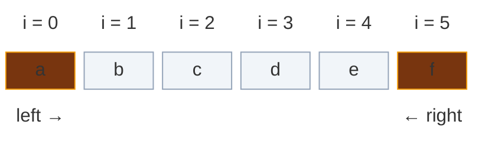
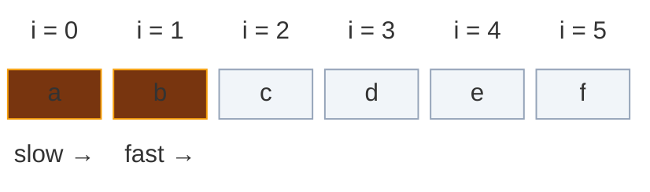
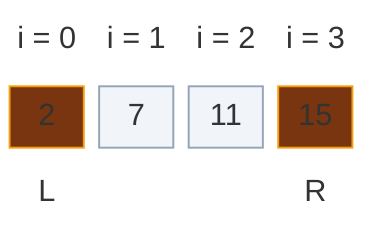
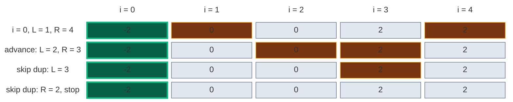

# 02. Two Pointers

Two pointers is the technique that turns `O(n^2)` into `O(n)` by refusing to re-examine what has already been ruled out. Instead of testing every pair, you keep two indices and move them under a rule that guarantees no valid answer is ever skipped.

The pattern is easy to write and easy to get subtly wrong. The hard part is not the code — it is proving that the pointer you move can be discarded safely. This page covers the theory, all four forms with runnable code, the correctness arguments, and how to recognize the pattern.

## Contents

1. [The Core Idea](#1-the-core-idea)
2. [Why It Is Correct](#2-why-it-is-correct)
3. [When You Can Use It](#3-when-you-can-use-it)
4. [Form A: Converging Pointers](#4-form-a-converging-pointers)
5. [Form B: Slow and Fast](#5-form-b-slow-and-fast)
6. [Form C: Fixed Element Plus Scan](#6-form-c-fixed-element-plus-scan)
7. [Form D: Two Arrays](#7-form-d-two-arrays)
8. [Handling Duplicates](#8-handling-duplicates)
9. [Two Pointers vs Sliding Window](#9-two-pointers-vs-sliding-window)
10. [Choosing Which Pointer to Move](#10-choosing-which-pointer-to-move)
11. [Common Traps](#11-common-traps)
12. [Pattern Recognition Cheat Sheet](#12-pattern-recognition-cheat-sheet)
13. [Problems](#13-problems)

## 1. The Core Idea

A brute-force pair search looks at every combination:

```python
# Try every first index
for i in range(n):

    # Try every second index after it
    for j in range(i + 1, n):

        # Check this pair: O(n^2) pairs in total
        check(nums[i], nums[j])
```

Two pointers replaces that with a single walk. Each step moves one pointer, so the total work is bounded by how far the pointers can travel — `O(n)` steps, not `O(n^2)`.

**Converging:** the two pointers start at both ends and meet in the middle.



**Slow / fast:** both pointers start on the left; the fast one leads and the slow one follows.



The saving comes from a promise: **when you move a pointer, every pair involving the position you left behind has already been eliminated.** If you cannot make that promise, the technique does not apply.

## 2. Why It Is Correct

This is the part worth understanding properly, because it is what interviewers probe.

Take a sorted array and a target sum. Pointers at both ends:

`nums = [2, 7, 11, 15]`, `target = 9`:



`2 + 15 = 17`, which is bigger than `9`.

The sum is too big, so we move `R` left. **Why is dropping index 3 safe?**

`nums[3] = 15` is the largest value. Pairing it with anything still available (`nums[0]`, `nums[1]`, `nums[2]`) gives a sum **at least** `2 + 15 = 17`, because `nums[0]` is the smallest remaining value. Every one of those pairs is ≥ 17 > 9. So no pair using index 3 can work, and discarding it loses nothing.

Generalized:

| Condition | Move | Because |
|:---|:---|:---|
| `sum < target` | `left += 1` | `nums[left]` with the largest remaining partner is still too small; no pair using `left` works |
| `sum > target` | `right -= 1` | `nums[right]` with the smallest remaining partner is still too big; no pair using `right` works |

Each step permanently eliminates one index. With `n` indices, the loop runs at most `n` times.

**The general shape of the argument:** to justify moving a pointer, show that the position being abandoned cannot participate in any remaining answer. If you can prove that, the algorithm is correct. If you cannot, you have a bug.

### A harder case: Container With Most Water

Area is `width * min(height[left], height[right])`. Say `height[left] < height[right]`; we move `left`. Why is that safe?

Any pair still involving `left` must use a partner strictly inside the current window. Such a pair has:

- **smaller width** — the partner is nearer than `right`
- **height still capped by `height[left]`** — since `height[left]` is the shorter wall, `min(...)` cannot exceed it

Both factors are ≤ the current values, so no such pair beats the area we already recorded. Discarding `left` is safe. Moving the *taller* wall instead would be wrong: a taller partner could still raise the minimum.

## 3. When You Can Use It

Two pointers needs a **monotonic property** — moving a pointer must change the result in a predictable direction.

| You have | Two pointers works? | Why |
|:---|:---:|:---|
| Sorted array, pair sum | Yes | Moving `left` only increases the sum |
| Unsorted array, pair sum | No | A move tells you nothing; use a hashmap |
| Unsorted, but you may sort | Yes | Sort first, if you do not need original indices |
| Palindrome check | Yes | Symmetric comparison from both ends |
| In-place filter/partition | Yes | Slow/fast, no ordering needed |
| Two sorted lists to merge | Yes | Smallest unprocessed element is at one of the two heads |
| Need original indices | Careful | Sorting destroys them — use a hashmap instead |

**The diagnostic question:** if I move this pointer, do I know for certain the target quantity goes up (or down)? Yes means the pattern applies.

## 4. Form A: Converging Pointers

Start at both ends, move inward, stop when they meet.

```python
# Two Sum on a sorted array
def two_sum_sorted(nums, target):

    # One pointer at each end
    left, right = 0, len(nums) - 1

    # Walk inward until the pointers meet
    while left < right:

        # Sum of the two ends
        total = nums[left] + nums[right]

        # Found the pair
        if total == target:

            # Return both indexes
            return [left, right]

        # Sum too small: we need a bigger left value
        elif total < target:

            # Move left one step to the right
            left += 1

        # Sum too big: we need a smaller right value
        else:

            # Move right one step to the left
            right -= 1

    # No pair adds up to target
    return []
```

### Palindrome: comparison instead of arithmetic

Same skeleton, different test — and skipping logic inside the loop.

```python
# Palindrome check that ignores non-letters/digits and case
def is_palindrome(s):

    # One pointer at each end
    left, right = 0, len(s) - 1

    # Walk inward until the pointers meet
    while left < right:

        # Skip junk on the left
        while left < right and not s[left].isalnum():

            # Step left forward
            left += 1

        # Skip junk on the right
        while left < right and not s[right].isalnum():

            # Step right backward
            right -= 1

        # Compare the two characters, ignoring case
        if s[left].lower() != s[right].lower():

            # A mismatch means not a palindrome
            return False

        # Move left inward
        left += 1

        # Move right inward
        right -= 1

    # Every pair matched
    return True
```

The `left < right` guard inside the inner loops is essential — without it, a string of pure punctuation runs the pointers past each other.

### Maximizing instead of matching

Here you evaluate at every step rather than searching for one answer.

```python
# Container With Most Water
def max_area(height):

    # One pointer at each end (the widest container)
    left, right = 0, len(height) - 1

    # Best area seen so far
    best = 0

    # Walk inward until the pointers meet
    while left < right:

        # Area = width x shorter wall
        best = max(best, (right - left) * min(height[left], height[right]))

        # Left wall is the shorter one
        if height[left] < height[right]:

            # Always discard the shorter wall
            left += 1

        # Right wall is shorter (or equal)
        else:

            # Discard the right wall
            right -= 1

    # Largest area found
    return best
```

### Carrying state: Trapping Rain Water

The pointers carry running maxima, which is what removes the need for prefix/suffix arrays.

```python
# Trapping Rain Water with two pointers
def trap(height):

    # No bars, no water
    if not height:

        # Nothing to trap
        return 0

    # One pointer at each end
    left, right = 0, len(height) - 1

    # Tallest bar seen from each side so far
    left_max = right_max = 0

    # Total water trapped
    water = 0

    # Walk inward until the pointers meet
    while left < right:

        # Left is the limiting side, so left_max alone decides the level
        if height[left] <= height[right]:

            # A new tallest bar on the left holds no water
            if height[left] >= left_max:

                # Update the left max
                left_max = height[left]

            # A lower bar holds water up to left_max
            else:

                # Add the water above this bar
                water += left_max - height[left]

            # Move left inward
            left += 1

        # Right is the limiting side
        else:

            # A new tallest bar on the right holds no water
            if height[right] >= right_max:

                # Update the right max
                right_max = height[right]

            # A lower bar holds water up to right_max
            else:

                # Add the water above this bar
                water += right_max - height[right]

            # Move right inward
            right -= 1

    # Total water
    return water
```

**Why `height[left] <= height[right]` licenses using `left_max`:** water at `left` is bounded by `min(left_max, right_max)`. We know some wall at or before `right` is at least `height[left]`, so `right_max >= height[left]`. If `left_max` is the smaller of the two bounds, it alone sets the level — and if it is not, then `height[left] >= left_max` and no water sits there anyway.

## 5. Form B: Slow and Fast

Both pointers move the same direction. `fast` reads everything; `slow` marks where the next kept element belongs. This is the in-place filter, and one skeleton covers a whole family of problems.

```python
# Move all zeroes to the end, keeping the order of the rest
def move_zeroes(nums):

    # slow = where the next kept value goes
    slow = 0

    # fast reads every element
    for fast in range(len(nums)):

        # Keep only non-zero values (the predicate)
        if nums[fast] != 0:

            # Swap the kept value into the slow slot
            nums[slow], nums[fast] = nums[fast], nums[slow]

            # The next kept value goes one slot later
            slow += 1

    # Invariant: nums[0 .. slow-1] are the kept values, in order
    return nums
```

Change only the `if` to solve a different problem:

```python
# Remove every copy of val in place
def remove_element(nums, val):

    # slow = where the next kept value goes
    slow = 0

    # fast reads every element
    for fast in range(len(nums)):

        # Keep values that are not val
        if nums[fast] != val:

            # Copy the kept value forward
            nums[slow] = nums[fast]

            # Move the write spot
            slow += 1

    # New logical length
    return slow


# Remove duplicates from a sorted array in place
def remove_duplicates_sorted(nums):

    # Empty array has length 0
    if not nums:

        # Nothing to keep
        return 0

    # The first value is always kept
    slow = 1

    # fast reads from the second element on
    for fast in range(1, len(nums)):

        # Compare with the last kept value
        if nums[fast] != nums[slow - 1]:

            # A new value: copy it forward
            nums[slow] = nums[fast]

            # Move the write spot
            slow += 1

    # Number of unique values
    return slow
```

### Cycle detection (Floyd's algorithm)

A different use of the same two-speed idea: `fast` moves twice per step. If a cycle exists they must eventually collide, because the gap between them changes by exactly one each step.

```python
# Floyd's cycle detection on a linked list
def has_cycle(head):

    # Both pointers start at the head
    slow = fast = head

    # Stop when fast falls off the end (no cycle)
    while fast and fast.next:

        # Slow moves one step
        slow = slow.next

        # Fast moves two steps
        fast = fast.next.next

        # They meet only inside a cycle
        if slow is fast:

            # Cycle found
            return True

    # Fast reached the end
    return False
```

## 6. Form C: Fixed Element Plus Scan

For triplets and beyond: sort, fix one element, then two-pointer the remainder. This turns `O(n^3)` into `O(n^2)`.

```python
# 3Sum: sort, fix one number, two pointers on the rest
def three_sum(nums):

    # Sort so pointer moves are safe and duplicates sit together
    nums.sort()

    # All unique triplets
    result = []

    # Number of elements
    n = len(nums)

    # Fix one anchor at a time
    for i in range(n - 2):

        # Sorted: a positive anchor can never reach 0
        if nums[i] > 0:

            # Stop the whole search
            break

        # Same anchor as last time gives the same triplets
        if i > 0 and nums[i] == nums[i - 1]:

            # Skip the duplicate anchor
            continue

        # Pointers on the part after the anchor
        left, right = i + 1, n - 1

        # Walk inward until the pointers meet
        while left < right:

            # Sum of the anchor and both pointers
            total = nums[i] + nums[left] + nums[right]

            # Found a triplet
            if total == 0:

                # Save the values
                result.append([nums[i], nums[left], nums[right]])

                # Move left inward
                left += 1

                # Move right inward
                right -= 1

                # Skip duplicate second values
                while left < right and nums[left] == nums[left - 1]:

                    # Step past the duplicate
                    left += 1

                # Skip duplicate third values
                while left < right and nums[right] == nums[right + 1]:

                    # Step past the duplicate
                    right -= 1

            # Sum too small: grow it
            elif total < 0:

                # Move left right
                left += 1

            # Sum too big: shrink it
            else:

                # Move right left
                right -= 1

    # Every unique triplet
    return result
```

The nesting generalizes: kSum is `k - 2` nested loops wrapping a two-pointer core, costing `O(n^(k-1))`.

| Problem | Structure | Time |
|:---|:---|:---:|
| 2Sum (sorted) | Two pointers | `O(n)` |
| 3Sum | Fix 1 + two pointers | `O(n^2)` |
| 4Sum | Fix 2 + two pointers | `O(n^3)` |

## 7. Form D: Two Arrays

One pointer per array, advancing whichever head is smaller.

```python
# Merge two sorted lists into a new one
def merge_sorted(a, b):

    # One pointer per list
    i = j = 0

    # Merged output
    out = []

    # While both lists still have values
    while i < len(a) and j < len(b):

        # a's value is smaller or equal
        if a[i] <= b[j]:

            # Take it from a
            out.append(a[i])

            # Move a's pointer
            i += 1

        # b's value is smaller
        else:

            # Take it from b
            out.append(b[j])

            # Move b's pointer
            j += 1

    # Copy what is left of a (at most one list has leftovers)
    out.extend(a[i:])

    # Copy what is left of b
    out.extend(b[j:])

    # The merged list
    return out
```

### Merging in place, from the back

When the destination has padding at the end, write backwards so you never clobber unread data.

```python
# Merge nums2 into nums1 in place, filling from the back
def merge_in_place(nums1, m, nums2, n):

    # Last real value of nums1, last value of nums2, last slot
    p1, p2, write = m - 1, n - 1, m + n - 1

    # Only nums2 must be fully copied
    while p2 >= 0:

        # nums1 still has values and its value is bigger
        if p1 >= 0 and nums1[p1] > nums2[p2]:

            # Put nums1's value in the write slot
            nums1[write] = nums1[p1]

            # Move nums1's pointer back
            p1 -= 1

        # nums2's value is bigger (or nums1 is used up)
        else:

            # Put nums2's value in the write slot
            nums1[write] = nums2[p2]

            # Move nums2's pointer back
            p2 -= 1

        # Next write slot is one to the left
        write -= 1

    # nums1 now holds everything, sorted
    return nums1
```

**Why backwards is safe:** `write` is always ≥ `p1`, so every slot overwritten has already been read or was empty padding. Looping while `p2 >= 0` is enough — if `nums2` drains first, whatever remains in `nums1` is already in place.

## 8. Handling Duplicates

Duplicate handling is where most two-pointer solutions break. Sorting puts equal values next to each other, which makes skipping them a simple adjacency check.

Two distinct skips are needed, and forgetting either produces duplicate answers:

```python
# Rule 1: skip duplicate anchors (before scanning)
if i > 0 and nums[i] == nums[i - 1]:

    # Same anchor gives the same triplets
    continue

# Rule 2: skip duplicate left partners (AFTER recording a hit)
while left < right and nums[left] == nums[left - 1]:

    # Step past the duplicate
    left += 1

# Rule 2 again for the right partner
while left < right and nums[right] == nums[right + 1]:

    # Step past the duplicate
    right -= 1
```

The order matters: record the answer, advance both pointers once, *then* skip duplicates. Skipping first would step over a legitimate answer.

`nums = [-2, 0, 0, 2, 2]`, target `0`. Green = the fixed number `i`, orange = `L` and `R`, grey = ruled out.



- Row 1: `-2 + 0 + 2 = 0`, so record `[-2, 0, 2]`.
- Row 2: move both pointers inward.
- Row 3: `nums[2] == nums[1]` (both 0), so skip: `L = 3`.
- Row 4: `nums[3] == nums[4]` (both 2), so skip: `R = 2`. Now `L >= R`, so stop.

Result: one triplet, not four.

## 9. Two Pointers vs Sliding Window

Sliding window is two pointers where both move forward and the span between them *is* the answer. The distinction is worth being precise about:

| | Two pointers (converging) | Sliding window |
|:---|:---|:---|
| Direction | Toward each other | Both forward |
| What matters | The pair of values | The contents of the span |
| Typical question | "find a pair with..." | "longest/shortest span with..." |
| Needs sorted input | Usually yes | No |
| Breaks on negatives | No | Often yes |

```python
# Longest window with sum <= k (all values must be positive)
def longest_window_sum_at_most_k(nums, k):

    # Window start, window sum, best length
    left = total = best = 0

    # Grow the window one element at a time
    for right in range(len(nums)):

        # Add the new element
        total += nums[right]

        # Too big: shrink from the left
        while total > k:

            # Remove the leftmost element
            total -= nums[left]

            # Move the window start
            left += 1

        # Record the best window length
        best = max(best, right - left + 1)

    # Longest valid window
    return best
```

**Why positives are required:** shrinking the window must reduce the sum. With a negative value, removing it *increases* the sum, so the `while` may exit at the wrong place. For arrays with negatives, use prefix sums plus a hashmap instead.

## 10. Choosing Which Pointer to Move

The rule differs per problem, and picking wrong is the classic bug. Each rule below is backed by the correctness argument from section 2.

| Problem | Rule | Justification |
|:---|:---|:---|
| Two Sum II | Sum too small → `left++`; too big → `right--` | Sorted, so each move changes the sum in exactly one direction |
| 3Sum | Same, per fixed anchor | The inner scan is just Two Sum II |
| Valid Palindrome | Skip non-alphanumerics, else move both | Comparison is symmetric |
| Container With Most Water | Always move the **shorter** wall | Width only shrinks; only a taller minimum can improve area |
| Trapping Rain Water | Process the side with the **smaller** height | That side's running max is the true bound |
| Move Zeroes | `fast` always; `slow` only on a keeper | `slow` marks the write position |
| Merge Sorted Array | Move whichever head is larger (writing backwards) | Largest unplaced element goes into the highest free slot |

## 11. Common Traps

| Trap | Broken | Correct |
|:---|:---|:---|
| Wrong loop bound | `while left <= right` on a pair search | `while left < right` — an element cannot pair with itself |
| Missing inner guard | `while not s[left].isalnum(): left += 1` | Add `left < right` or it runs off the end |
| Skipping dups too early | Skip before recording the answer | Record, advance once, then skip |
| Only skipping the anchor | Duplicate triplets in the output | Skip `left` and `right` too |
| Forgetting to sort | Two pointers on unsorted input | Sort first, or use a hashmap |
| Sorting when indices matter | Returns positions from the sorted array | Use a hashmap, or sort `(value, index)` pairs |
| Moving the taller wall | Container With Most Water returns too small | Always move the shorter one |
| `isalpha()` for palindromes | Drops digits, so `"0P"` misbehaves | Use `isalnum()` |
| Forward in-place merge | Overwrites unread values | Fill from the back |
| Sliding window with negatives | Shrink step is not monotonic | Prefix sums + hashmap |

## 12. Pattern Recognition Cheat Sheet

| Signal in the problem | Form | Cost |
|:---|:---|:---:|
| Sorted array, "find a pair summing to X" | Converging | `O(n)` / `O(1)` |
| "Is it a palindrome" | Converging | `O(n)` / `O(1)` |
| "Maximize area/distance between two positions" | Converging | `O(n)` / `O(1)` |
| "Remove/move elements in-place" | Slow / fast | `O(n)` / `O(1)` |
| "Remove duplicates from sorted array" | Slow / fast | `O(n)` / `O(1)` |
| "Find a cycle" | Slow / fast (Floyd) | `O(n)` / `O(1)` |
| "Triplets/quadruplets summing to X" | Sort + fix + scan | `O(n^(k-1))` |
| "Merge two sorted sequences" | Two arrays | `O(m+n)` |
| "Longest/shortest span satisfying X" | Sliding window | `O(n)` |
| Water/height/container between bars | Converging with state | `O(n)` / `O(1)` |

## 13. Problems

| # | Pattern | Problem | Difficulty | Key Idea |
|:---:|:---|:---|:---:|:---|
| 1 | Opposite-End Pairs on Sorted | [167. Two Sum II - Input Array Is Sorted](01.%20Opposite-End%20Pairs%20on%20Sorted/01.%20167.%20Two%20Sum%20II%20-%20Input%20Array%20Is%20Sorted.md) | Medium | Sorted order tells you which end to drop |
| 2 | Opposite-End Pairs on Sorted | [15. 3Sum](01.%20Opposite-End%20Pairs%20on%20Sorted/02.%2015.%203Sum.md) | Medium | Sort, fix one number, two pointers on the rest, skip duplicates |
| 3 | Palindrome Verify-Construct | [125. Valid Palindrome](02.%20Palindrome%20Verify-Construct/01.%20125.%20Valid%20Palindrome.md) | Easy | Skip non-alphanumerics, compare from both ends inward |
| 4 | Container-Area Maximization | [11. Container With Most Water](11.%20Container-Area%20Maximization/01.%2011.%20Container%20With%20Most%20Water.md) | Medium | Always move the shorter line |
| 5 | Container-Area Maximization | [42. Trapping Rain Water](11.%20Container-Area%20Maximization/02.%2042.%20Trapping%20Rain%20Water.md) | Hard | Process the smaller side; its max bounds the water |

### How the Optimization Pays Off

| Problem | Brute Force | Optimal | What two pointers buys |
|:---|:---:|:---:|:---|
| Valid Palindrome | `O(n)` time, `O(n)` space | `O(n)` / `O(1)` | No cleaned-string copy |
| Two Sum II | `O(n^2)` | `O(n)` / `O(1)` | No hashmap |
| 3Sum | `O(n^3)` | `O(n^2)` | No set for dedup |
| Container With Most Water | `O(n^2)` | `O(n)` | Skips provably worse pairs |
| Trapping Rain Water | `O(n^2)` | `O(n)` / `O(1)` | No prefix/suffix arrays |

## Where This Leads

| Skill built here | Used later in |
|:---|:---|
| Correctness by elimination | Binary search, greedy proofs |
| Slow/fast pointers | Linked list cycles, middle node, quickselect |
| Sort-then-scan | 4Sum, merge intervals, closest-pair problems |
| Converging with state | Trapping Rain Water 2D, histogram problems |
| Window growth/shrink | The entire sliding window topic |
