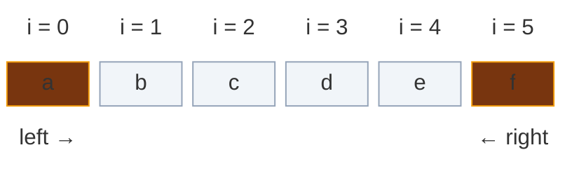
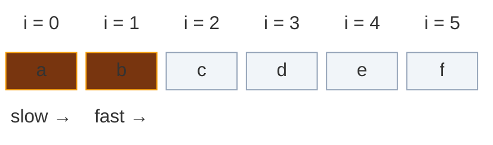
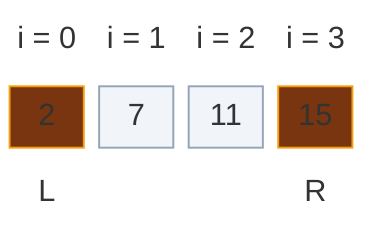
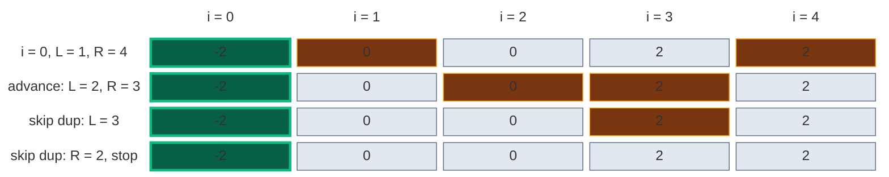

# 02. Two Pointers

Two pointers is the technique that turns `O(n^2)` into `O(n)` by refusing to re-examine what has already been ruled out. Instead of testing every pair, you keep two indices and move them under a rule that guarantees no valid answer is ever skipped.

The pattern is easy to write and easy to get subtly wrong. The hard part is not the code — it is proving that the pointer you move can be discarded safely. This page covers the theory, all four forms with runnable code, the correctness arguments, and how to recognize the pattern.

## Contents

1. [The Core Idea](#1-the-core-idea)
2. [Why It Is Correct](#2-why-it-is-correct)
3. [When You Can Use It](#3-when-you-can-use-it)
4. [Form A: Converging Pointers](#4-form-a-converging-pointers)
5. [Form B: Slow and Fast](#5-form-b-slow-and-fast)
6. [Form C: Fixed Element Plus Scan](#6-form-c-fixed-element-plus-scan)
7. [Form D: Two Arrays](#7-form-d-two-arrays)
8. [Handling Duplicates](#8-handling-duplicates)
9. [Two Pointers vs Sliding Window](#9-two-pointers-vs-sliding-window)
10. [Choosing Which Pointer to Move](#10-choosing-which-pointer-to-move)
11. [Common Traps](#11-common-traps)
12. [Pattern Recognition Cheat Sheet](#12-pattern-recognition-cheat-sheet)
13. [Problems by Pattern](#13-problems-by-pattern)

## 1. The Core Idea

A brute-force pair search looks at every combination:

```python
for i in range(n):
    for j in range(i + 1, n):
        check(nums[i], nums[j])        # O(n^2) pairs
```

Two pointers replaces that with a single walk. Each step moves one pointer, so the total work is bounded by how far the pointers can travel — `O(n)` steps, not `O(n^2)`.

**Converging:** the two pointers start at both ends and meet in the middle.



**Slow / fast:** both pointers start on the left; the fast one leads and the slow one follows.



The saving comes from a promise: **when you move a pointer, every pair involving the position you left behind has already been eliminated.** If you cannot make that promise, the technique does not apply.

## 2. Why It Is Correct

This is the part worth understanding properly, because it is what interviewers probe.

Take a sorted array and a target sum. Pointers at both ends:

`nums = [2, 7, 11, 15]`, `target = 9`:



`2 + 15 = 17`, which is bigger than `9`.

The sum is too big, so we move `R` left. **Why is dropping index 3 safe?**

`nums[3] = 15` is the largest value. Pairing it with anything still available (`nums[0]`, `nums[1]`, `nums[2]`) gives a sum **at least** `2 + 15 = 17`, because `nums[0]` is the smallest remaining value. Every one of those pairs is ≥ 17 > 9. So no pair using index 3 can work, and discarding it loses nothing.

Generalized:

| Condition | Move | Because |
|:---|:---|:---|
| `sum < target` | `left += 1` | `nums[left]` with the largest remaining partner is still too small; no pair using `left` works |
| `sum > target` | `right -= 1` | `nums[right]` with the smallest remaining partner is still too big; no pair using `right` works |

Each step permanently eliminates one index. With `n` indices, the loop runs at most `n` times.

**The general shape of the argument:** to justify moving a pointer, show that the position being abandoned cannot participate in any remaining answer. If you can prove that, the algorithm is correct. If you cannot, you have a bug.

### A harder case: Container With Most Water

Area is `width * min(height[left], height[right])`. Say `height[left] < height[right]`; we move `left`. Why is that safe?

Any pair still involving `left` must use a partner strictly inside the current window. Such a pair has:

- **smaller width** — the partner is nearer than `right`
- **height still capped by `height[left]`** — since `height[left]` is the shorter wall, `min(...)` cannot exceed it

Both factors are ≤ the current values, so no such pair beats the area we already recorded. Discarding `left` is safe. Moving the *taller* wall instead would be wrong: a taller partner could still raise the minimum.

## 3. When You Can Use It

Two pointers needs a **monotonic property** — moving a pointer must change the result in a predictable direction.

| You have | Two pointers works? | Why |
|:---|:---:|:---|
| Sorted array, pair sum | Yes | Moving `left` only increases the sum |
| Unsorted array, pair sum | No | A move tells you nothing; use a hashmap |
| Unsorted, but you may sort | Yes | Sort first, if you do not need original indices |
| Palindrome check | Yes | Symmetric comparison from both ends |
| In-place filter/partition | Yes | Slow/fast, no ordering needed |
| Two sorted lists to merge | Yes | Smallest unprocessed element is at one of the two heads |
| Need original indices | Careful | Sorting destroys them — use a hashmap instead |

**The diagnostic question:** if I move this pointer, do I know for certain the target quantity goes up (or down)? Yes means the pattern applies.

## 4. Form A: Converging Pointers

Start at both ends, move inward, stop when they meet.

```python
def two_sum_sorted(nums, target):
    left, right = 0, len(nums) - 1
    while left < right:
        total = nums[left] + nums[right]
        if total == target:
            return [left, right]
        elif total < target:
            left += 1            # need a bigger sum
        else:
            right -= 1           # need a smaller sum
    return []
```

### Palindrome: comparison instead of arithmetic

Same skeleton, different test — and skipping logic inside the loop.

```python
def is_palindrome(s):
    left, right = 0, len(s) - 1
    while left < right:
        while left < right and not s[left].isalnum():
            left += 1                       # skip junk from the left
        while left < right and not s[right].isalnum():
            right -= 1                      # skip junk from the right
        if s[left].lower() != s[right].lower():
            return False
        left += 1
        right -= 1
    return True
```

The `left < right` guard inside the inner loops is essential — without it, a string of pure punctuation runs the pointers past each other.

### Maximizing instead of matching

Here you evaluate at every step rather than searching for one answer.

```python
def max_area(height):
    left, right = 0, len(height) - 1
    best = 0
    while left < right:
        best = max(best, (right - left) * min(height[left], height[right]))
        if height[left] < height[right]:
            left += 1               # always discard the shorter wall
        else:
            right -= 1
    return best
```

### Carrying state: Trapping Rain Water

The pointers carry running maxima, which is what removes the need for prefix/suffix arrays.

```python
def trap(height):
    if not height:
        return 0
    left, right = 0, len(height) - 1
    left_max = right_max = 0
    water = 0
    while left < right:
        if height[left] <= height[right]:
            # left is the limiting side, so left_max alone decides the level
            if height[left] >= left_max:
                left_max = height[left]
            else:
                water += left_max - height[left]
            left += 1
        else:
            if height[right] >= right_max:
                right_max = height[right]
            else:
                water += right_max - height[right]
            right -= 1
    return water
```

**Why `height[left] <= height[right]` licenses using `left_max`:** water at `left` is bounded by `min(left_max, right_max)`. We know some wall at or before `right` is at least `height[left]`, so `right_max >= height[left]`. If `left_max` is the smaller of the two bounds, it alone sets the level — and if it is not, then `height[left] >= left_max` and no water sits there anyway.

## 5. Form B: Slow and Fast

Both pointers move the same direction. `fast` reads everything; `slow` marks where the next kept element belongs. This is the in-place filter, and one skeleton covers a whole family of problems.

```python
def move_zeroes(nums):
    slow = 0
    for fast in range(len(nums)):
        if nums[fast] != 0:                       # the predicate
            nums[slow], nums[fast] = nums[fast], nums[slow]
            slow += 1
        # invariant: nums[0..slow-1] are the kept values, in original order
    return nums
```

Change only the `if` to solve a different problem:

```python
def remove_element(nums, val):
    slow = 0
    for fast in range(len(nums)):
        if nums[fast] != val:
            nums[slow] = nums[fast]
            slow += 1
    return slow                       # new logical length


def remove_duplicates_sorted(nums):
    if not nums:
        return 0
    slow = 1
    for fast in range(1, len(nums)):
        if nums[fast] != nums[slow - 1]:     # compare to last kept value
            nums[slow] = nums[fast]
            slow += 1
    return slow
```

### Cycle detection (Floyd's algorithm)

A different use of the same two-speed idea: `fast` moves twice per step. If a cycle exists they must eventually collide, because the gap between them changes by exactly one each step.

```python
def has_cycle(head):
    slow = fast = head
    while fast and fast.next:
        slow = slow.next            # one step
        fast = fast.next.next       # two steps
        if slow is fast:
            return True
    return False
```

## 6. Form C: Fixed Element Plus Scan

For triplets and beyond: sort, fix one element, then two-pointer the remainder. This turns `O(n^3)` into `O(n^2)`.

```python
def three_sum(nums):
    nums.sort()
    result = []
    n = len(nums)
    for i in range(n - 2):
        if nums[i] > 0:                              # sorted: no triplet can reach 0
            break
        if i > 0 and nums[i] == nums[i - 1]:         # skip duplicate anchors
            continue
        left, right = i + 1, n - 1
        while left < right:
            total = nums[i] + nums[left] + nums[right]
            if total == 0:
                result.append([nums[i], nums[left], nums[right]])
                left += 1
                right -= 1
                while left < right and nums[left] == nums[left - 1]:
                    left += 1                        # skip duplicate seconds
                while left < right and nums[right] == nums[right + 1]:
                    right -= 1                       # skip duplicate thirds
            elif total < 0:
                left += 1
            else:
                right -= 1
    return result
```

The nesting generalizes: kSum is `k - 2` nested loops wrapping a two-pointer core, costing `O(n^(k-1))`.

| Problem | Structure | Time |
|:---|:---|:---:|
| 2Sum (sorted) | Two pointers | `O(n)` |
| 3Sum | Fix 1 + two pointers | `O(n^2)` |
| 4Sum | Fix 2 + two pointers | `O(n^3)` |

## 7. Form D: Two Arrays

One pointer per array, advancing whichever head is smaller.

```python
def merge_sorted(a, b):
    i = j = 0
    out = []
    while i < len(a) and j < len(b):
        if a[i] <= b[j]:
            out.append(a[i]); i += 1
        else:
            out.append(b[j]); j += 1
    out.extend(a[i:])         # at most one of these is non-empty
    out.extend(b[j:])
    return out
```

### Merging in place, from the back

When the destination has padding at the end, write backwards so you never clobber unread data.

```python
def merge_in_place(nums1, m, nums2, n):
    p1, p2, write = m - 1, n - 1, m + n - 1
    while p2 >= 0:                              # only nums2 must be drained
        if p1 >= 0 and nums1[p1] > nums2[p2]:
            nums1[write] = nums1[p1]; p1 -= 1
        else:
            nums1[write] = nums2[p2]; p2 -= 1
        write -= 1
    return nums1
```

**Why backwards is safe:** `write` is always ≥ `p1`, so every slot overwritten has already been read or was empty padding. Looping while `p2 >= 0` is enough — if `nums2` drains first, whatever remains in `nums1` is already in place.

## 8. Handling Duplicates

Duplicate handling is where most two-pointer solutions break. Sorting puts equal values next to each other, which makes skipping them a simple adjacency check.

Two distinct skips are needed, and forgetting either produces duplicate answers:

```python
# 1. Skip duplicate anchors (before scanning)
if i > 0 and nums[i] == nums[i - 1]:
    continue

# 2. Skip duplicate partners (AFTER recording a hit)
while left < right and nums[left] == nums[left - 1]:
    left += 1
while left < right and nums[right] == nums[right + 1]:
    right -= 1
```

The order matters: record the answer, advance both pointers once, *then* skip duplicates. Skipping first would step over a legitimate answer.

`nums = [-2, 0, 0, 2, 2]`, target `0`. Green = the fixed number `i`, orange = `L` and `R`, grey = ruled out.



- Row 1: `-2 + 0 + 2 = 0`, so record `[-2, 0, 2]`.
- Row 2: move both pointers inward.
- Row 3: `nums[2] == nums[1]` (both 0), so skip: `L = 3`.
- Row 4: `nums[3] == nums[4]` (both 2), so skip: `R = 2`. Now `L >= R`, so stop.

Result: one triplet, not four.

## 9. Two Pointers vs Sliding Window

Sliding window is two pointers where both move forward and the span between them *is* the answer. The distinction is worth being precise about:

| | Two pointers (converging) | Sliding window |
|:---|:---|:---|
| Direction | Toward each other | Both forward |
| What matters | The pair of values | The contents of the span |
| Typical question | "find a pair with..." | "longest/shortest span with..." |
| Needs sorted input | Usually yes | No |
| Breaks on negatives | No | Often yes |

```python
def longest_window_sum_at_most_k(nums, k):
    """All values must be positive for this to be valid."""
    left = total = best = 0
    for right in range(len(nums)):
        total += nums[right]              # grow
        while total > k:
            total -= nums[left]           # shrink from the left
            left += 1
        best = max(best, right - left + 1)
    return best
```

**Why positives are required:** shrinking the window must reduce the sum. With a negative value, removing it *increases* the sum, so the `while` may exit at the wrong place. For arrays with negatives, use prefix sums plus a hashmap instead.

## 10. Choosing Which Pointer to Move

The rule differs per problem, and picking wrong is the classic bug. Each rule below is backed by the correctness argument from section 2.

| Problem | Rule | Justification |
|:---|:---|:---|
| Two Sum II | Sum too small → `left++`; too big → `right--` | Sorted, so each move changes the sum in exactly one direction |
| 3Sum | Same, per fixed anchor | The inner scan is just Two Sum II |
| Valid Palindrome | Skip non-alphanumerics, else move both | Comparison is symmetric |
| Container With Most Water | Always move the **shorter** wall | Width only shrinks; only a taller minimum can improve area |
| Trapping Rain Water | Process the side with the **smaller** height | That side's running max is the true bound |
| Move Zeroes | `fast` always; `slow` only on a keeper | `slow` marks the write position |
| Merge Sorted Array | Move whichever head is larger (writing backwards) | Largest unplaced element goes into the highest free slot |

## 11. Common Traps

| Trap | Broken | Correct |
|:---|:---|:---|
| Wrong loop bound | `while left <= right` on a pair search | `while left < right` — an element cannot pair with itself |
| Missing inner guard | `while not s[left].isalnum(): left += 1` | Add `left < right` or it runs off the end |
| Skipping dups too early | Skip before recording the answer | Record, advance once, then skip |
| Only skipping the anchor | Duplicate triplets in the output | Skip `left` and `right` too |
| Forgetting to sort | Two pointers on unsorted input | Sort first, or use a hashmap |
| Sorting when indices matter | Returns positions from the sorted array | Use a hashmap, or sort `(value, index)` pairs |
| Moving the taller wall | Container With Most Water returns too small | Always move the shorter one |
| `isalpha()` for palindromes | Drops digits, so `"0P"` misbehaves | Use `isalnum()` |
| Forward in-place merge | Overwrites unread values | Fill from the back |
| Sliding window with negatives | Shrink step is not monotonic | Prefix sums + hashmap |

## 12. Pattern Recognition Cheat Sheet

| Signal in the problem | Form | Cost |
|:---|:---|:---:|
| Sorted array, "find a pair summing to X" | Converging | `O(n)` / `O(1)` |
| "Is it a palindrome" | Converging | `O(n)` / `O(1)` |
| "Maximize area/distance between two positions" | Converging | `O(n)` / `O(1)` |
| "Remove/move elements in-place" | Slow / fast | `O(n)` / `O(1)` |
| "Remove duplicates from sorted array" | Slow / fast | `O(n)` / `O(1)` |
| "Find a cycle" | Slow / fast (Floyd) | `O(n)` / `O(1)` |
| "Triplets/quadruplets summing to X" | Sort + fix + scan | `O(n^(k-1))` |
| "Merge two sorted sequences" | Two arrays | `O(m+n)` |
| "Longest/shortest span satisfying X" | Sliding window | `O(n)` |
| Water/height/container between bars | Converging with state | `O(n)` / `O(1)` |

## 13. Problems by Pattern

The full Two Pointers sheet: **263 problems in 17 patterns**. **Written** = full note in this folder (click the problem). **Planned** = on the list, note to follow (the link goes to LeetCode).

| # | Pattern | Problems | Written |
|:---:|:---|:---:|:---:|
| 1 | [Opposite-End Pairs on Sorted](#1-opposite-end-pairs-on-sorted) | 44 | 2 |
| 2 | [Palindrome Verify-Construct](#2-palindrome-verify-construct) | 20 | 1 |
| 3 | [Merge Two Sorted Sequences](#3-merge-two-sorted-sequences) | 12 | 0 |
| 4 | [Fast-Slow Write Pointer](#4-fast-slow-write-pointer) | 14 | 0 |
| 5 | [Dutch Flag 3-Way Partition](#5-dutch-flag-3-way-partition) | 2 | 0 |
| 6 | [Fast-Slow on Linked Lists](#6-fast-slow-on-linked-lists) | 22 | 0 |
| 7 | [Two-Pointer Sliding Window](#7-two-pointer-sliding-window) | 3 | 0 |
| 8 | [Greedy Subsequence Matching](#8-greedy-subsequence-matching) | 16 | 0 |
| 9 | [In-Place Reversal](#9-in-place-reversal) | 17 | 0 |
| 10 | [Two-String Comparison Walk](#10-two-string-comparison-walk) | 16 | 0 |
| 11 | [Container-Area Maximization](#11-container-area-maximization) | 5 | 2 |
| 12 | [Two Pointers plus Binary Search](#12-two-pointers-plus-binary-search) | 15 | 0 |
| 13 | [Greedy Matching-Scheduling](#13-greedy-matching-scheduling) | 11 | 0 |
| 14 | [Expand-Around-Center](#14-expand-around-center) | 7 | 0 |
| 15 | [Interval-Two-List Pointer Walk](#15-interval-two-list-pointer-walk) | 6 | 0 |
| 16 | [Prefix-Suffix Two-Pointer Scan](#16-prefix-suffix-two-pointer-scan) | 17 | 0 |
| 17 | [Misc Non-Classic Application](#17-misc-non-classic-application) | 36 | 0 |

### 1. Opposite-End Pairs on Sorted

| # | Problem | Core Logic | Status |
|:---:|:---|:---|:---:|
| 1 | [15. 3Sum](01.%20Opposite-End%20Pairs%20on%20Sorted/02.%2015.%203Sum.md) | Sort the array, fix one value, then use opposite-end pointers on the remainder to find all pairs summing to its negation, skipping duplicates to avoid repeat triplets. | Written |
| 2 | [16. 3Sum Closest](https://leetcode.com/problems/3sum-closest/) | Sort the array, fix one value, then move opposite-end pointers inward based on whether the current triplet sum is above or below target, tracking the closest sum seen. | Planned |
| 3 | [18. 4Sum](https://leetcode.com/problems/4sum/) | Sort the array, fix two outer values with nested loops, then use opposite-end pointers on the remaining range to find pairs completing the target sum, skipping duplicates. | Planned |
| 4 | [167. Two Sum II - Input Array Is Sorted](01.%20Opposite-End%20Pairs%20on%20Sorted/01.%20167.%20Two%20Sum%20II%20-%20Input%20Array%20Is%20Sorted.md) | Opposite-end pointers on the sorted array move inward: if the pair sum is too small the left pointer advances, if too large the right pointer retreats, until the target sum is found. | Written |
| 5 | [259. 3Sum Smaller](https://leetcode.com/problems/3sum-smaller/) | Sort the array, fix one value, then use opposite-end pointers on the remainder: whenever the triplet sum is below target, every pair between the pointers counts, and the left pointer advances. | Planned |
| 6 | [360. Sort Transformed Array](https://leetcode.com/problems/sort-transformed-array/) | Depending on the quadratic's sign, the transformed values are largest at the ends or in the middle; opposite-end pointers compare both ends' transformed values and fill the result array from the correct side. | Planned |
| 7 | [532. K-diff Pairs in an Array](https://leetcode.com/problems/k-diff-pairs-in-an-array/) | After sorting (or using a frequency map), two pointers scan for pairs whose difference equals k, advancing the pointer with the smaller gap and skipping duplicate values. | Planned |
| 8 | [611. Valid Triangle Number](https://leetcode.com/problems/valid-triangle-number/) | After sorting, fixing the largest side and using opposite-end pointers on the remaining two lets every valid pair satisfying the triangle inequality be counted in bulk as the pointers move. | Planned |
| 9 | [633. Sum of Square Numbers](https://leetcode.com/problems/sum-of-square-numbers/) | Opposite-end pointers start at 0 and the square root of c, adjusting inward based on whether the sum of squares is above or below c, until a match is found or the pointers cross. | Planned |
| 10 | [825. Friends Of Appropriate Ages](https://leetcode.com/problems/friends-of-appropriate-ages/) | After sorting ages, a two-pointer window per distinct age (or overall) finds the range of ages a person can friend, counting all valid pairs via the window's size. | Planned |
| 11 | [881. Boats to Save People](https://leetcode.com/problems/boats-to-save-people/) | After sorting weights, opposite-end pointers pair the heaviest remaining person with the lightest if they fit together in one boat, otherwise the heaviest goes alone, counting boats used. | Planned |
| 12 | [923. 3Sum With Multiplicity](https://leetcode.com/problems/3sum-with-multiplicity/) | After sorting, fixing one value and using opposite-end pointers on the remainder counts matching pairs in bulk (using combinatorics for repeated equal values) to tally all valid triplets modulo the given value. | Planned |
| 13 | [942. DI String Match](https://leetcode.com/problems/di-string-match/) | Two pointers start at the lowest and highest available values; each 'I' consumes the current low value and each 'D' consumes the current high value, building a valid permutation greedily. | Planned |
| 14 | [977. Squares of a Sorted Array](https://leetcode.com/problems/squares-of-a-sorted-array/) | Opposite-end pointers compare the absolute values at both ends of the original sorted array, placing the larger square into the back of the result array and moving inward. | Planned |
| 15 | [1099. Two Sum Less Than K](https://leetcode.com/problems/two-sum-less-than-k/) | After sorting, opposite-end pointers look for pairs summing to just under k: a sum under k is recorded and the left pointer advances to try a larger sum, otherwise the right pointer retreats. | Planned |
| 16 | [1237. Find Positive Integer Solution for a Given Equation](https://leetcode.com/problems/find-positive-integer-solution-for-a-given-equation/) | Since the function is monotonic in each variable, opposite-end pointers start at one extreme of each range and move inward based on whether the current function value is too high or too low. | Planned |
| 17 | [1346. Check If N and Its Double Exist](https://leetcode.com/problems/check-if-n-and-its-double-exist/) | After sorting, a two-pointer or hashmap check looks for any pair where one value is exactly double the other, skipping the trivial same-index case for zero. | Planned |
| 18 | [1385. Find the Distance Value Between Two Arrays](https://leetcode.com/problems/find-the-distance-value-between-two-arrays/) | After sorting the second array, each element of the first array uses a two-pointer or binary search check against the sorted second array to see if any value is within the distance d. | Planned |
| 19 | [1471. The k Strongest Values in an Array](https://leetcode.com/problems/the-k-strongest-values-in-an-array/) | After sorting and finding the median, opposite-end pointers compare each end's distance from the median, repeatedly taking the stronger (or left-tiebreak) value until k values are chosen. | Planned |
| 20 | [1498. Number of Subsequences That Satisfy the Given Sum Condition](https://leetcode.com/problems/number-of-subsequences-that-satisfy-the-given-sum-condition/) | After sorting, opposite-end pointers find for each left minimum value the farthest right maximum value keeping the sum within target, adding 2^(count between them) subsequences via precomputed powers of two. | Planned |
| 21 | [1577. Number of Ways Where Square of Number Is Equal to Product of Two Numbers](https://leetcode.com/problems/number-of-ways-where-square-of-number-is-equal-to-product-of-two-numbers/) | For every value in one array, its square is looked up as a target product in the other (sorted) array using a two-pointer or hashmap pair-count technique. | Planned |
| 22 | [1679. Max Number of K-Sum Pairs](https://leetcode.com/problems/max-number-of-k-sum-pairs/) | After sorting, opposite-end pointers check if the two end values sum to k: if so both are consumed as a pair, otherwise the pointer on the wrong side of the target moves inward. | Planned |
| 23 | [1782. Count Pairs Of Nodes](https://leetcode.com/problems/count-pairs-of-nodes/) | Degrees and shared edges are precomputed, then for each query a two-pointer/binary-search count over sorted degree-pair sums (adjusted for directly connected pairs) answers how many pairs exceed the threshold. | Planned |
| 24 | [1855. Maximum Distance Between a Pair of Values](https://leetcode.com/problems/maximum-distance-between-a-pair-of-values/) | Two pointers walk the two non-increasing arrays; whenever the current pair is valid (nums1[i] <= nums2[j]), the distance is recorded and the second pointer advances to look for an even larger gap. | Planned |
| 25 | [1877. Minimize Maximum Pair Sum in Array](https://leetcode.com/problems/minimize-maximum-pair-sum-in-array/) | After sorting, opposite-end pointers pair the smallest remaining value with the largest remaining value, since balancing extremes together minimizes the maximum pair sum. | Planned |
| 26 | [1885. Count Pairs in Two Arrays](https://leetcode.com/problems/count-pairs-in-two-arrays/) | The difference array (nums1[i]-nums2[i]) is sorted, then opposite-end pointers count all pairs whose combined difference is positive, the classic sorted two-pointer pair-counting technique. | Planned |
| 27 | [1989. Maximum Number of People That Can Be Caught in Tag](https://leetcode.com/problems/maximum-number-of-people-that-can-be-caught-in-tag/) | After sorting both friends' and escaping people's positions, a greedy two-pointer walk matches each catcher to the nearest uncaught escaper within range, advancing both pointers on a successful catch. | Planned |
| 28 | [2122. Recover the Original Array](https://leetcode.com/problems/recover-the-original-array/) | After sorting, trying every candidate difference k derived from the two smallest values, opposite-end-style greedy two-pointer matching pairs each lower value with a higher value exactly k apart to validate the split. | Planned |
| 29 | [2367. Number of Arithmetic Triplets](https://leetcode.com/problems/number-of-arithmetic-triplets/) | After sorting (already guaranteed here), two pointers (or a hashmap) check for each middle value whether both value-diff and value+diff exist earlier and later respectively, counting valid triplets. | Planned |
| 30 | [2441. Largest Positive Integer That Exists With Its Negative](https://leetcode.com/problems/largest-positive-integer-that-exists-with-its-negative/) | A hash set (or two-pointer scan after sorting by absolute value) checks for each positive value whether its negation is also present, tracking the largest such match. | Planned |
| 31 | [2465. Number of Distinct Averages](https://leetcode.com/problems/number-of-distinct-averages/) | After sorting, opposite-end pointers repeatedly pair and average the current smallest and largest remaining values, collecting the distinct averages produced into a set. | Planned |
| 32 | [2491. Divide Players Into Teams of Equal Skill](https://leetcode.com/problems/divide-players-into-teams-of-equal-skill/) | After sorting, opposite-end pointers pair the smallest remaining skill with the largest remaining skill, verifying every pair sums to the same total (twice the average) while accumulating the chemistry product. | Planned |
| 33 | [2562. Find the Array Concatenation Value](https://leetcode.com/problems/find-the-array-concatenation-value/) | Opposite-end pointers repeatedly concatenate the leftmost and rightmost remaining numbers (or just the leftmost if one remains) into the running total, moving inward until all elements are consumed. | Planned |
| 34 | [2576. Find the Maximum Number of Marked Indices](https://leetcode.com/problems/find-the-maximum-number-of-marked-indices/) | After sorting, binary search the largest usable prefix length m, checking via a two-pointer pairing of the first m elements against the last m elements whether every pair satisfies the doubling condition. | Planned |
| 35 | [2592. Maximize Greatness of an Array](https://leetcode.com/problems/maximize-greatness-of-an-array/) | After sorting, a greedy two-pointer walk tries to match each element in the shifted array with the smallest available larger value from the original sorted array, skipping any that can't be beaten. | Planned |
| 36 | [2824. Count Pairs Whose Sum is Less than Target](https://leetcode.com/problems/count-pairs-whose-sum-is-less-than-target/) | After sorting, opposite-end pointers count all pairs below the target in bulk: whenever the current pair sum is under target, every pair between the pointers qualifies, and the left pointer advances. | Planned |
| 37 | [2856. Minimum Array Length After Pair Removals](https://leetcode.com/problems/minimum-array-length-after-pair-removals/) | After sorting, if any value's frequency exceeds half the array it dominates the answer (2*frequency - n); otherwise opposite-end pairing removes everything down to 0 or 1 remaining element. | Planned |
| 38 | [3132. Find the Integer Added to Array II](https://leetcode.com/problems/find-the-integer-added-to-array-ii/) | After sorting both arrays, trying each of the few smallest candidate offsets, a two-pointer matching check verifies that at most two elements of the larger array need to be skipped to align the rest. | Planned |
| 39 | [3194. Minimum Average of Smallest and Largest Elements](https://leetcode.com/problems/minimum-average-of-smallest-and-largest-elements/) | After sorting, opposite-end pointers repeatedly average the current smallest and largest remaining pair, tracking the minimum average produced across all such pairs. | Planned |
| 40 | [3584. Maximum Product of First and Last Elements of a Subsequence](https://leetcode.com/problems/maximum-product-of-first-and-last-elements-of-a-subsequence/) | After separating candidates meeting the gap constraint, opposite-end-style tracking of the best positive and best negative products (prefix max/min scans) finds the maximum achievable product. | Planned |
| 41 | [3633. Earliest Finish Time for Land and Water Rides I](https://leetcode.com/problems/earliest-finish-time-for-land-and-water-rides-i/) | After sorting both ride-type lists by start time, a two-pointer (or nested scan for small inputs) combination finds the pairing of a land ride and a water ride minimizing the later finish time. | Planned |
| 42 | [3635. Earliest Finish Time for Land and Water Rides II](https://leetcode.com/problems/earliest-finish-time-for-land-and-water-rides-ii/) | The same sorted two-pointer ride-pairing technique as part I is optimized (prefix minimum of finish times) to scale to much larger ride lists. | Planned |
| 43 | [3649. Number of Perfect Pairs](https://leetcode.com/problems/number-of-perfect-pairs/) | After sorting absolute values, opposite-end/sliding two-pointer counting finds for each value how many earlier values keep the ratio condition within bounds, summing valid pair counts. | Planned |
| 44 | [3752. Lexicographically Smallest Negated Permutation that Sums to Target](https://leetcode.com/problems/lexicographically-smallest-negated-permutation-that-sums-to-target/) | A greedy two-pointer-style choice assigns each position the smallest viable signed value from the remaining candidates while keeping the running sum reachable of the target, adjusting from the ends. | Planned |

### 2. Palindrome Verify-Construct

| # | Problem | Core Logic | Status |
|:---:|:---|:---|:---:|
| 1 | [125. Valid Palindrome](02.%20Palindrome%20Verify-Construct/01.%20125.%20Valid%20Palindrome.md) | Opposite-end pointers skip non-alphanumeric characters and compare the lowercased characters, closing inward until they cross or a mismatch is found. | Written |
| 2 | [234. Palindrome Linked List](https://leetcode.com/problems/palindrome-linked-list/) | Fast-slow pointers find the middle, the second half is reversed in place, and then the first half and reversed second half are compared node by node. | Planned |
| 3 | [680. Valid Palindrome II](https://leetcode.com/problems/valid-palindrome-ii/) | Opposite-end pointers close inward while characters match; on the first mismatch, the check branches into two sub-checks (skip the left or skip the right character) to allow one deletion. | Planned |
| 4 | [1147. Longest Chunked Palindrome Decomposition](https://leetcode.com/problems/longest-chunked-palindrome-decomposition/) | Opposite-end pointers grow matching prefix/suffix chunks from both ends; whenever the growing prefix equals the growing suffix, both are cut off as a matched pair and the pointers reset for the remaining middle. | Planned |
| 5 | [1332. Remove Palindromic Subsequences](https://leetcode.com/problems/remove-palindromic-subsequences/) | Since the string only contains two characters, opposite-end pointers check if it's already a palindrome (answer 1); otherwise it always takes exactly 2 removals (all a's, then all b's). | Planned |
| 6 | [1616. Split Two Strings to Make Palindrome](https://leetcode.com/problems/split-two-strings-to-make-palindrome/) | Opposite-end pointers close inward while the two strings' characters at mirrored positions match; at the first mismatch, both possible splits (checking if either remaining middle segment is itself a palindrome) are tried. | Planned |
| 7 | [1750. Minimum Length of String After Deleting Similar Ends](https://leetcode.com/problems/minimum-length-of-string-after-deleting-similar-ends/) | Opposite-end pointers repeatedly trim matching runs of the same character from both ends simultaneously, stopping once the ends differ or the pointers meet/cross. | Planned |
| 8 | [1842. Next Palindrome Using Same Digits](https://leetcode.com/problems/next-palindrome-using-same-digits/) | The first half of the digit string is treated like Next Permutation to find the next larger arrangement, then mirrored to reconstruct the full palindrome, with edge handling for all-9s half. | Planned |
| 9 | [2108. Find First Palindromic String in the Array](https://leetcode.com/problems/find-first-palindromic-string-in-the-array/) | Each word is checked in order with opposite-end pointers comparing characters inward until a mismatch or the pointers meet; the first word that fully matches is returned. | Planned |
| 10 | [2193. Minimum Number of Moves to Make Palindrome](https://leetcode.com/problems/minimum-number-of-moves-to-make-palindrome/) | Opposite-end pointers repeatedly find the matching partner for the leftmost character near the right end, swapping it into place with adjacent swaps (or shifting it directly, counting the moves) and shrinking the window. | Planned |
| 11 | [2330. Valid Palindrome IV](https://leetcode.com/problems/valid-palindrome-iv/) | Opposite-end pointers compare mirrored characters; each mismatch consumes one of the two allowed changes, and the string is valid if the number of mismatches never exceeds two. | Planned |
| 12 | [2396. Strictly Palindromic Number](https://leetcode.com/problems/strictly-palindromic-number/) | Opposite-end pointers check, for every base from 2 to n-2, whether the number's digit representation in that base reads the same forwards and backwards. | Planned |
| 13 | [2422. Merge Operations to Turn Array Into a Palindrome](https://leetcode.com/problems/merge-operations-to-turn-array-into-a-palindrome/) | Opposite-end pointers compare the two end values; whenever they differ, the smaller side's two elements are merged (summed) and that pointer advances, counting merge operations until the pointers meet. | Planned |
| 14 | [2697. Lexicographically Smallest Palindrome](https://leetcode.com/problems/lexicographically-smallest-palindrome/) | Opposite-end pointers compare mirrored characters and replace whichever one is lexicographically larger with the smaller of the pair, moving inward to build the smallest valid palindrome. | Planned |
| 15 | [3239. Minimum Number of Flips to Make Binary Grid Palindromic I](https://leetcode.com/problems/minimum-number-of-flips-to-make-binary-grid-palindromic-i/) | For each row and each column, opposite-end pointers compare mirrored cells, counting mismatches to determine the cheaper of a row-wise or column-wise flip strategy. | Planned |
| 16 | [3240. Minimum Number of Flips to Make Binary Grid Palindromic II](https://leetcode.com/problems/minimum-number-of-flips-to-make-binary-grid-palindromic-ii/) | Opposite-end pointers compare cells mirrored across both the row and column midlines simultaneously (groups of four), choosing the cheapest flip combination per group to satisfy both symmetries. | Planned |
| 17 | [3734. Lexicographically Smallest Palindromic Permutation Greater Than Target](https://leetcode.com/problems/lexicographically-smallest-palindromic-permutation-greater-than-target/) | Opposite-end pointers build the palindrome's first half greedily, backtracking (via a next-permutation-like adjustment) whenever the mirrored candidate can't exceed the target's corresponding half. | Planned |
| 18 | [3766. Minimum Operations to Make Binary Palindrome](https://leetcode.com/problems/minimum-operations-to-make-binary-palindrome/) | Opposite-end pointers compare mirrored bits; the handful of mismatches found determine the minimum flip/move operations needed to make the binary string a palindrome. | Planned |
| 19 | [3884. First Matching Character From Both Ends](https://leetcode.com/problems/first-matching-character-from-both-ends/) | Opposite-end pointers scan inward from both ends simultaneously, returning the first position where a character matching the target is found from either side. | Planned |
| 20 | [4030. Check ASCII Palindromic](https://leetcode.com/problems/check-ascii-palindromic/) | Opposite-end pointers compare the ASCII codes (or characters) at mirrored positions, closing inward until they cross or a mismatch is found. | Planned |

### 3. Merge Two Sorted Sequences

| # | Problem | Core Logic | Status |
|:---:|:---|:---|:---:|
| 1 | [88. Merge Sorted Array](https://leetcode.com/problems/merge-sorted-array/) | Filling from the back avoids overwriting unread values: pointers start at the end of both arrays' valid data and the larger current value is placed at the current end slot, working backward. | Planned |
| 2 | [349. Intersection of Two Arrays](https://leetcode.com/problems/intersection-of-two-arrays/) | After sorting both arrays, two pointers walk them in tandem, advancing the smaller value's pointer and recording a match (once) whenever both pointers see equal values. | Planned |
| 3 | [350. Intersection of Two Arrays II](https://leetcode.com/problems/intersection-of-two-arrays-ii/) | After sorting both arrays, two pointers walk them in tandem, advancing whichever value is smaller and recording every matching pair (respecting duplicate counts) when values are equal. | Planned |
| 4 | [1570. Dot Product of Two Sparse Vectors](https://leetcode.com/problems/dot-product-of-two-sparse-vectors/) | Two pointers walk each vector's list of (index, value) pairs in tandem, advancing whichever index is smaller and multiplying-and-accumulating whenever both pointers share the same index. | Planned |
| 5 | [1754. Largest Merge Of Two Strings](https://leetcode.com/problems/largest-merge-of-two-strings/) | Two pointers compare the remaining suffixes of both strings at each step, appending from whichever string currently has the lexicographically larger suffix to build the largest possible merge. | Planned |
| 6 | [1768. Merge Strings Alternately](https://leetcode.com/problems/merge-strings-alternately/) | Two pointers walk both strings in lockstep, appending one character from each in turn, then appending whatever remains of the longer string once the shorter one is exhausted. | Planned |
| 7 | [1868. Product of Two Run-Length Encoded Arrays](https://leetcode.com/problems/product-of-two-run-length-encoded-arrays/) | Two pointers walk each run-length-encoded array's segments in tandem, multiplying the overlapping value pair and advancing whichever segment ends first, merging adjacent equal-product runs in the output. | Planned |
| 8 | [2540. Minimum Common Value](https://leetcode.com/problems/minimum-common-value/) | Two pointers walk both sorted arrays in tandem, advancing whichever current value is smaller, returning the first point where both pointers see an equal value. | Planned |
| 9 | [2570. Merge Two 2D Arrays by Summing Values](https://leetcode.com/problems/merge-two-2d-arrays-by-summing-values/) | Two pointers walk both sorted-by-id arrays in tandem, summing values for matching ids and copying through any id that appears in only one array, building the merged result in sorted order. | Planned |
| 10 | [3667. Sort Array By Absolute Value](https://leetcode.com/problems/sort-array-by-absolute-value/) | Splitting the sorted array into its negative prefix (read backward) and non-negative suffix, a two-pointer merge of these two already-sorted-by-absolute-value sequences produces the final order. | Planned |
| 11 | [3801. Minimum Cost to Merge Sorted Lists](https://leetcode.com/problems/minimum-cost-to-merge-sorted-lists/) | A k-way merge (via two-pointer pairwise merging or a min-heap) combines all sorted lists while tracking the accumulated merge cost, minimized by choosing merge order carefully. | Planned |
| 12 | [4001. Aggregate Two Time Series](https://leetcode.com/problems/aggregate-two-time-series/) | Two pointers walk both time-sorted series in tandem, merging matching timestamps and carrying forward the last known value from either series for gaps, producing a combined aggregated timeline. | Planned |

### 4. Fast-Slow Write Pointer

| # | Problem | Core Logic | Status |
|:---:|:---|:---|:---:|
| 1 | [26. Remove Duplicates from Sorted Array](https://leetcode.com/problems/remove-duplicates-from-sorted-array/) | A slow write-pointer only advances (and copies the current value) when the fast read-pointer finds a value different from the last kept one, compacting duplicates in place. | Planned |
| 2 | [27. Remove Element](https://leetcode.com/problems/remove-element/) | A slow write-pointer copies forward only the values not equal to the target as a fast read-pointer scans the whole array, compacting the valid elements to the front. | Planned |
| 3 | [80. Remove Duplicates from Sorted Array II](https://leetcode.com/problems/remove-duplicates-from-sorted-array-ii/) | A slow write-pointer keeps a value only if it differs from the element two positions back in the written output, allowing each value to appear at most twice. | Planned |
| 4 | [283. Move Zeroes](https://leetcode.com/problems/move-zeroes/) | A slow write-pointer tracks the next position for a non-zero value as a fast read-pointer scans forward, swapping non-zero values into place and leaving zeros trailing behind. | Planned |
| 5 | [443. String Compression](https://leetcode.com/problems/string-compression/) | A slow write-pointer records each run's character and digit-count characters as a fast read-pointer scans past consecutive equal characters, compressing runs in place. | Planned |
| 6 | [905. Sort Array By Parity](https://leetcode.com/problems/sort-array-by-parity/) | A slow write-pointer and a fast read-pointer swap even values to the front as the fast pointer scans forward, partitioning evens before odds in one pass. | Planned |
| 7 | [922. Sort Array By Parity II](https://leetcode.com/problems/sort-array-by-parity-ii/) | Two pointers, one stepping through even indices and one through odd indices, swap any out-of-place values (even value at an odd index, or vice versa) into their correct parity slot. | Planned |
| 8 | [1089. Duplicate Zeros](https://leetcode.com/problems/duplicate-zeros/) | A first pass (with a bounds-aware pointer) determines how many elements fit after duplicating zeros, then a second backward pass writes each value (and duplicated zero) into its final position. | Planned |
| 9 | [1861. Rotating the Box](https://leetcode.com/problems/rotating-the-box/) | A slow write-pointer (processing each row right-to-left) tracks where the next falling stone should land, shifting stones past empty space while obstacles reset the landing position. | Planned |
| 10 | [2149. Rearrange Array Elements by Sign](https://leetcode.com/problems/rearrange-array-elements-by-sign/) | Two separate write-pointers (one for even output positions tracking positives, one for odd output positions tracking negatives) are filled in a single pass preserving each group's relative order. | Planned |
| 11 | [2460. Apply Operations to an Array](https://leetcode.com/problems/apply-operations-to-an-array/) | A left-to-right pass first applies the doubling-and-zeroing merge rule to adjacent equal pairs, then a slow write-pointer compacts all non-zero values to the front, leaving zeros trailing. | Planned |
| 12 | [2938. Separate Black and White Balls](https://leetcode.com/problems/separate-black-and-white-balls/) | A running count of misplaced white balls seen so far accumulates the total adjacent swaps needed as a single pass encounters each black ball, equivalent to a two-pointer partition cost count. | Planned |
| 13 | [3936. Minimum Swaps to Move Zeros to End](https://leetcode.com/problems/minimum-swaps-to-move-zeros-to-end/) | A slow write-pointer tracks the next position for a non-zero value as a fast read-pointer scans forward, counting the swaps needed to compact non-zero values to the front. | Planned |
| 14 | [3940. Limit Occurrences in Sorted Array](https://leetcode.com/problems/limit-occurrences-in-sorted-array/) | A slow write-pointer keeps a value only if it hasn't already appeared the maximum allowed number of consecutive times in the written output, generalizing the remove-duplicates write-pointer pattern. | Planned |

### 5. Dutch Flag 3-Way Partition

| # | Problem | Core Logic | Status |
|:---:|:---|:---|:---:|
| 1 | [75. Sort Colors](https://leetcode.com/problems/sort-colors/) | Three pointers (low, mid, high) partition the array into 0s, 1s, and 2s in one pass, swapping mid's element to the correct zone and advancing pointers accordingly (Dutch national flag). | Planned |
| 2 | [2161. Partition Array According to Given Pivot](https://leetcode.com/problems/partition-array-according-to-given-pivot/) | Three separate output buffers (less than, equal to, greater than the pivot) are filled in one pass preserving relative order, then concatenated, mirroring a stable Dutch-flag partition. | Planned |

### 6. Fast-Slow on Linked Lists

| # | Problem | Core Logic | Status |
|:---:|:---|:---|:---:|
| 1 | [19. Remove Nth Node From End of List](https://leetcode.com/problems/remove-nth-node-from-end-of-list/) | Advance a lead pointer n steps ahead, then move both lead and a trail pointer together until the lead falls off the end, leaving the trail just before the node to remove. | Planned |
| 2 | [61. Rotate List](https://leetcode.com/problems/rotate-list/) | Find the length and connect tail to head to form a ring, then walk (length - k mod length) steps from the new head and break the ring there. | Planned |
| 3 | [82. Remove Duplicates from Sorted List II](https://leetcode.com/problems/remove-duplicates-from-sorted-list-ii/) | A dummy head plus a trailing pointer skips over any run of nodes sharing a duplicated value entirely, relinking only past the whole run. | Planned |
| 4 | [86. Partition List](https://leetcode.com/problems/partition-list/) | Two separate dummy-headed chains collect nodes less than x and nodes >= x in original relative order, then the first chain's tail is linked to the second chain's head. | Planned |
| 5 | [141. Linked List Cycle](https://leetcode.com/problems/linked-list-cycle/) | A slow pointer moves one step and a fast pointer moves two steps per iteration; if they ever meet, a cycle exists, otherwise the fast pointer reaches null. | Planned |
| 6 | [142. Linked List Cycle II](https://leetcode.com/problems/linked-list-cycle-ii/) | After slow and fast pointers meet inside a cycle, resetting one pointer to the head and advancing both one step at a time makes them meet again exactly at the cycle's start. | Planned |
| 7 | [143. Reorder List](https://leetcode.com/problems/reorder-list/) | Find the middle with fast-slow pointers, reverse the second half in place, then interleave-merge the first half and reversed second half node by node. | Planned |
| 8 | [148. Sort List](https://leetcode.com/problems/sort-list/) | Fast-slow pointers split the list into two halves, each half is sorted recursively (merge sort), and the two sorted halves are merged back together node by node. | Planned |
| 9 | [160. Intersection of Two Linked Lists](https://leetcode.com/problems/intersection-of-two-linked-lists/) | Two pointers each walk their own list and then switch to the other list's head upon reaching the end; the combined walked distance equalizes so they meet at the intersection or both reach null. | Planned |
| 10 | [202. Happy Number](https://leetcode.com/problems/happy-number/) | A slow pointer and a fast pointer both repeatedly apply the digit-square-sum transformation (slow once, fast twice) per step; if they meet on a value other than 1, the sequence cycles forever. | Planned |
| 11 | [287. Find the Duplicate Number](https://leetcode.com/problems/find-the-duplicate-number/) | Treating each value as a pointer to the next index (as in a linked list), Floyd's cycle detection finds the meeting point and then the cycle's entrance, which is the duplicate value. | Planned |
| 12 | [457. Circular Array Loop](https://leetcode.com/problems/circular-array-loop/) | A slow pointer and a fast pointer both follow the array's jump directions (one step and two steps respectively) from each start index, detecting a same-direction cycle of length > 1. | Planned |
| 13 | [876. Middle of the Linked List](https://leetcode.com/problems/middle-of-the-linked-list/) | A slow pointer advances one step and a fast pointer advances two steps per iteration; when the fast pointer reaches the end, the slow pointer sits at the middle. | Planned |
| 14 | [1265. Print Immutable Linked List in Reverse](https://leetcode.com/problems/print-immutable-linked-list-in-reverse/) | Recursion naturally unwinds the call stack from tail to head, so printing each node's value after the recursive call on its successor produces reverse order using only the given forward-only API. | Planned |
| 15 | [1634. Add Two Polynomials Represented as Linked Lists](https://leetcode.com/problems/add-two-polynomials-represented-as-linked-lists/) | A merge-like walk compares the current exponents of both polynomial lists, combining matching-exponent terms' coefficients (dropping zero results) and copying over non-matching terms in exponent order. | Planned |
| 16 | [1650. Lowest Common Ancestor of a Binary Tree III](https://leetcode.com/problems/lowest-common-ancestor-of-a-binary-tree-iii/) | Two pointers start at each node and climb to their parent, switching to the other node's start once reaching the root, so both pointers travel equal total distance and meet at the LCA. | Planned |
| 17 | [1721. Swapping Nodes in a Linked List](https://leetcode.com/problems/swapping-nodes-in-a-linked-list/) | One pointer finds the k-th node from the head while a second (lagging) pointer, started once the first has advanced k steps, finds the k-th node from the end; their values are then swapped. | Planned |
| 18 | [2046. Sort Linked List Already Sorted Using Absolute Values](https://leetcode.com/problems/sort-linked-list-already-sorted-using-absolute-values/) | Walking the list, any node smaller than its predecessor (indicating it was originally negative and out of place) is unlinked and reinserted at the head, achieving sorted order in one pass. | Planned |
| 19 | [2095. Delete the Middle Node of a Linked List](https://leetcode.com/problems/delete-the-middle-node-of-a-linked-list/) | A slow pointer and a fast pointer (started one step ahead of slow) advance so that when fast reaches the end, slow's next node is the middle, which is then unlinked. | Planned |
| 20 | [2105. Watering Plants II](https://leetcode.com/problems/watering-plants-ii/) | Two pointers start at opposite ends of the row, each person watering plants and refilling their can when empty, meeting in the middle with a tie-break rule for the shared last plant. | Planned |
| 21 | [2130. Maximum Twin Sum of a Linked List](https://leetcode.com/problems/maximum-twin-sum-of-a-linked-list/) | Fast-slow pointers find the middle, the second half is reversed in place, and then corresponding nodes from the front and reversed back are summed to track the maximum twin pair sum. | Planned |
| 22 | [2674. Split a Circular Linked List](https://leetcode.com/problems/split-a-circular-linked-list/) | Fast-slow pointers find the midpoint of the circular list, then the ring is cut into two halves by redirecting each half's tail to point back to its own head. | Planned |

### 7. Two-Pointer Sliding Window

| # | Problem | Core Logic | Status |
|:---:|:---|:---|:---:|
| 1 | [567. Permutation in String](https://leetcode.com/problems/permutation-in-string/) | A fixed-size sliding window of character counts over the second string is compared to the first string's character-count signature, sliding one position at a time and updating counts incrementally. | Planned |
| 2 | [795. Number of Subarrays with Bounded Maximum](https://leetcode.com/problems/number-of-subarrays-with-bounded-maximum/) | A sliding window technique counts subarrays with max <= right bound minus subarrays with max <= left bound minus 1, each computed via a two-pointer scan that resets at any out-of-range element. | Planned |
| 3 | [3555. Smallest Subarray to Sort in Every Sliding Window](https://leetcode.com/problems/smallest-subarray-to-sort-in-every-sliding-window/) | A fixed-size sliding window tracks the running max-before/min-after structure (via monotonic deques) needed to determine, for each window, the minimal subarray that still needs sorting. | Planned |

### 8. Greedy Subsequence Matching

| # | Problem | Core Logic | Status |
|:---:|:---|:---|:---:|
| 1 | [392. Is Subsequence](https://leetcode.com/problems/is-subsequence/) | A pointer into the subsequence string only advances when the current character of the main string matches it, so the subsequence is valid if that pointer reaches the end. | Planned |
| 2 | [522. Longest Uncommon Subsequence II](https://leetcode.com/problems/longest-uncommon-subsequence-ii/) | Each string is checked against every other string with a two-pointer is-subsequence test; a string qualifies if it is not a subsequence of any other string in the list. | Planned |
| 3 | [524. Longest Word in Dictionary through Deleting](https://leetcode.com/problems/longest-word-in-dictionary-through-deleting/) | Each dictionary word is tested against the source string with a two-pointer is-subsequence walk, tracking the longest (then lexicographically smallest) word that qualifies. | Planned |
| 4 | [1023. Camelcase Matching](https://leetcode.com/problems/camelcase-matching/) | A pointer into the pattern only advances when the query's current character matches it; any unmatched character in the query must be lowercase, otherwise the match fails. | Planned |
| 5 | [1055. Shortest Way to Form String](https://leetcode.com/problems/shortest-way-to-form-string/) | A pointer into the target string resets to the start of the source string whenever it reaches the source's end, advancing through the target one matched character at a time, counting source passes used. | Planned |
| 6 | [1764. Form Array by Concatenating Subarrays of Another Array](https://leetcode.com/problems/form-array-by-concatenating-subarrays-of-another-array/) | A pointer into the list of target subarrays only advances once a full subarray match is confirmed at the current position in the source array, scanned via a nested two-pointer comparison. | Planned |
| 7 | [1898. Maximum Number of Removable Characters](https://leetcode.com/problems/maximum-number-of-removable-characters/) | Binary search the number of removals to apply; for each guess, a two-pointer is-subsequence check (skipping the removed positions) verifies whether the pattern can still be matched. | Planned |
| 8 | [2486. Append Characters to String to Make Subsequence](https://leetcode.com/problems/append-characters-to-string-to-make-subsequence/) | A pointer walks through s checking off characters of t in order as they're matched; whatever suffix of t remains unmatched once s is exhausted must be appended. | Planned |
| 9 | [2565. Subsequence With the Minimum Score](https://leetcode.com/problems/subsequence-with-the-minimum-score/) | Two pointers find the longest matching prefix of t within s and the longest matching suffix of t within s; the minimum removal is the overlap-adjusted gap between where the prefix match ends and the suffix match begins. | Planned |
| 10 | [2825. Make String a Subsequence Using Cyclic Increments](https://leetcode.com/problems/make-string-a-subsequence-using-cyclic-increments/) | A pointer into the target string only advances when the source string's current character (optionally cyclically incremented by one) matches it, succeeding if the pointer reaches the end of the target. | Planned |
| 11 | [3006. Find Beautiful Indices in the Given Array I](https://leetcode.com/problems/find-beautiful-indices-in-the-given-array-i/) | Occurrence positions of both pattern strings are found (brute force or string matching), then two pointers walk the two sorted occurrence lists to find pairs within the allowed distance k. | Planned |
| 12 | [3008. Find Beautiful Indices in the Given Array II](https://leetcode.com/problems/find-beautiful-indices-in-the-given-array-ii/) | The same two-pointer walk over two sorted occurrence-position lists as part I is combined with efficient (Z-function/KMP) pattern matching to scale to much larger strings. | Planned |
| 13 | [3302. Find the Lexicographically Smallest Valid Sequence](https://leetcode.com/problems/find-the-lexicographically-smallest-valid-sequence/) | A precomputed suffix array tracks, for every position, the minimum edits still needed to match the remaining pattern as a subsequence from there, letting a forward two-pointer greedy pick the smallest valid choice at each step. | Planned |
| 14 | [3316. Find Maximum Removals From Source String](https://leetcode.com/problems/find-maximum-removals-from-source-string/) | DP (or a two-pointer greedy with memoization) tracks, from each position pair in source and pattern, the maximum number of removable (non-pattern-required) characters while still keeping the pattern as a subsequence. | Planned |
| 15 | [3983. Subsequence After One Replacement](https://leetcode.com/problems/subsequence-after-one-replacement/) | A two-pointer is-subsequence walk is run once normally and then retried allowing exactly one character substitution at the first mismatch point, checking if the rest can still be matched. | Planned |
| 16 | [3998. Transform Binary String Using Subsequence Sort](https://leetcode.com/problems/transform-binary-string-using-subsequence-sort/) | A two-pointer check verifies that every '0' appears in the same relative order in both the original and target strings (since 1s can be freely reordered around sorted subsequences of 0s). | Planned |

### 9. In-Place Reversal

| # | Problem | Core Logic | Status |
|:---:|:---|:---|:---:|
| 1 | [151. Reverse Words in a String](https://leetcode.com/problems/reverse-words-in-a-string/) | Opposite-end pointers trim and reverse the overall character sequence, then each word is reversed back in place (or words are split, reversed in order, and rejoined) to restore correct word order. | Planned |
| 2 | [186. Reverse Words in a String II](https://leetcode.com/problems/reverse-words-in-a-string-ii/) | The entire character array is reversed in place with opposite-end pointers, then each individual word's substring is reversed again in place to restore correct word order. | Planned |
| 3 | [189. Rotate Array](https://leetcode.com/problems/rotate-array/) | Reversing the whole array, then reversing the first k elements and the remaining n-k elements separately, produces the rotated array using only in-place reversals. | Planned |
| 4 | [344. Reverse String](https://leetcode.com/problems/reverse-string/) | Opposite-end pointers swap the characters at each end and move inward until they meet in the middle, reversing the array in place. | Planned |
| 5 | [345. Reverse Vowels of a String](https://leetcode.com/problems/reverse-vowels-of-a-string/) | Opposite-end pointers skip over consonants and swap only vowel characters found from each side, moving inward until they meet. | Planned |
| 6 | [541. Reverse String II](https://leetcode.com/problems/reverse-string-ii/) | Walking the string in blocks of 2k characters, opposite-end pointers reverse just the first k characters of each block in place, leaving the rest of the block untouched. | Planned |
| 7 | [557. Reverse Words in a String III](https://leetcode.com/problems/reverse-words-in-a-string-iii/) | Opposite-end pointers reverse the characters within each space-delimited word in place, leaving word order and spacing unchanged. | Planned |
| 8 | [832. Flipping an Image](https://leetcode.com/problems/flipping-an-image/) | Opposite-end pointers reverse each row in place while simultaneously flipping (XOR with 1) the two swapped values, combining the reverse and invert into one pass. | Planned |
| 9 | [917. Reverse Only Letters](https://leetcode.com/problems/reverse-only-letters/) | Opposite-end pointers skip over non-letter characters and swap only letter characters found from each side, moving inward until they meet. | Planned |
| 10 | [2000. Reverse Prefix of Word](https://leetcode.com/problems/reverse-prefix-of-word/) | Opposite-end pointers reverse only the substring from the start of the word up to (and including) the first occurrence of the given character, leaving the rest of the word untouched. | Planned |
| 11 | [3643. Flip Square Submatrix Vertically](https://leetcode.com/problems/flip-square-submatrix-vertically/) | Opposite-end row pointers within the specified square region swap each pair of rows in place, reversing the submatrix vertically without touching cells outside it. | Planned |
| 12 | [3722. Lexicographically Smallest String After Reverse](https://leetcode.com/problems/lexicographically-smallest-string-after-reverse/) | Candidate reversal ranges are compared by opposite-end pointer scans of the resulting string, selecting the single reversal that yields the lexicographically smallest overall result. | Planned |
| 13 | [3775. Reverse Words With Same Vowel Count](https://leetcode.com/problems/reverse-words-with-same-vowel-count/) | Opposite-end pointers reverse the characters of each word in place only among groups of words sharing the same vowel count, leaving word order and other words unchanged. | Planned |
| 14 | [3794. Reverse String Prefix](https://leetcode.com/problems/reverse-string-prefix/) | Opposite-end pointers reverse only the specified prefix length of the string in place, leaving the remaining suffix untouched. | Planned |
| 15 | [3823. Reverse Letters Then Special Characters in a String](https://leetcode.com/problems/reverse-letters-then-special-characters-in-a-string/) | Opposite-end pointers skip over special characters and swap only letter characters found from each side, then a second pass (or combined logic) handles the special characters' own reversal requirement. | Planned |
| 16 | [3865. Reverse K Subarrays](https://leetcode.com/problems/reverse-k-subarrays/) | Walking the array in blocks of k, opposite-end pointers reverse each full block in place, leaving any shorter trailing block untouched or reversed per the problem's edge rule. | Planned |
| 17 | [3991. Sort Array Using Prefix Reversals](https://leetcode.com/problems/sort-array-using-prefix-reversals/) | Repeatedly find the position of the next value needed in sorted order, reverse the prefix up to and including it to bring it to the front, then reverse the growing sorted prefix to place it correctly (pancake-sort style). | Planned |

### 10. Two-String Comparison Walk

| # | Problem | Core Logic | Status |
|:---:|:---|:---|:---:|
| 1 | [161. One Edit Distance](https://leetcode.com/problems/one-edit-distance/) | Two pointers walk both strings simultaneously; on the first mismatch, the remaining suffixes are checked for an insert, delete, or replace edit, allowing at most one difference. | Planned |
| 2 | [165. Compare Version Numbers](https://leetcode.com/problems/compare-version-numbers/) | Two pointers walk each version string, extracting and comparing one dot-separated numeric revision at a time (treating missing trailing parts as zero) until a difference or the end is found. | Planned |
| 3 | [246. Strobogrammatic Number](https://leetcode.com/problems/strobogrammatic-number/) | Opposite-end pointers check that each pair of mirrored characters forms a valid strobogrammatic pair (0-0, 1-1, 6-9, 8-8, 9-6), including the middle character for odd lengths. | Planned |
| 4 | [408. Valid Word Abbreviation](https://leetcode.com/problems/valid-word-abbreviation/) | Two pointers walk the word and the abbreviation simultaneously, consuming letters one at a time or skipping ahead by a parsed numeric run, failing on any mismatch or invalid leading zero. | Planned |
| 5 | [777. Swap Adjacent in LR String](https://leetcode.com/problems/swap-adjacent-in-lr-string/) | Two pointers walk both strings skipping 'X' characters, checking that the sequence of L/R characters matches and that every L only moved leftward and every R only moved rightward. | Planned |
| 6 | [809. Expressive Words](https://leetcode.com/problems/expressive-words/) | Two pointers walk the source word and each query word simultaneously, comparing run lengths of repeated characters and requiring the source's run to be at least as long (and >= 3 if stretched). | Planned |
| 7 | [844. Backspace String Compare](https://leetcode.com/problems/backspace-string-compare/) | Two pointers walk each string from the end backward, skipping characters cancelled out by backspaces, and compare the next surviving character from each string at every step. | Planned |
| 8 | [925. Long Pressed Name](https://leetcode.com/problems/long-pressed-name/) | Two pointers walk the typed name and the name being compared simultaneously, allowing the typed pointer to consume extra repeated characters but requiring every name character to appear in order. | Planned |
| 9 | [1163. Last Substring in Lexicographical Order](https://leetcode.com/problems/last-substring-in-lexicographical-order/) | Two candidate starting pointers are compared character by character; whichever candidate falls behind lexicographically is advanced past the mismatch, eventually isolating the true lexicographically largest suffix. | Planned |
| 10 | [1455. Check If a Word Occurs As a Prefix of Any Word in a Sentence](https://leetcode.com/problems/check-if-a-word-occurs-as-a-prefix-of-any-word-in-a-sentence/) | A pointer walks each space-separated word of the sentence, comparing it character by character against the search word's prefix until a match or the sentence ends. | Planned |
| 11 | [1826. Faulty Sensor](https://leetcode.com/problems/faulty-sensor/) | Two pointers walk both readings arrays in lockstep; on the first mismatch, one pointer skips ahead by one (simulating a dropped reading) and the comparison continues to see which sensor's skip restores agreement. | Planned |
| 12 | [1961. Check If String Is a Prefix of Array](https://leetcode.com/problems/check-if-string-is-a-prefix-of-array/) | A pointer walks through the concatenation of the word list, consuming characters in order and comparing them against the target string until it either fully matches or mismatches. | Planned |
| 13 | [2337. Move Pieces to Obtain a String](https://leetcode.com/problems/move-pieces-to-obtain-a-string/) | Two pointers walk the non-'_' characters of both strings in lockstep, checking that each corresponding piece matches and that its position only moved in the direction its letter permits (L left, R right). | Planned |
| 14 | [3403. Find the Lexicographically Largest String From the Box I](https://leetcode.com/problems/find-the-lexicographically-largest-string-from-the-box-i/) | Two pointers compare the two candidate remaining substrings (from the front or back of the available range) character by character, always picking whichever gives the lexicographically larger next character. | Planned |
| 15 | [3406. Find the Lexicographically Largest String From the Box II](https://leetcode.com/problems/find-the-lexicographically-largest-string-from-the-box-ii/) | The same front-vs-back candidate comparison technique as part I is optimized (suffix array / binary lifting style comparison) to scale to much larger strings. | Planned |
| 16 | [3460. Longest Common Prefix After at Most One Removal](https://leetcode.com/problems/longest-common-prefix-after-at-most-one-removal/) | Precomputed prefix-match length arrays from both ends let each candidate single-character removal position be checked in O(1) for the resulting longest common prefix with the other string. | Planned |

### 11. Container-Area Maximization

| # | Problem | Core Logic | Status |
|:---:|:---|:---|:---:|
| 1 | [11. Container With Most Water](11.%20Container-Area%20Maximization/01.%2011.%20Container%20With%20Most%20Water.md) | Start pointers at both ends; always move the pointer at the shorter line inward since moving the taller one can only shrink the area, tracking the best area seen. | Written |
| 2 | [42. Trapping Rain Water](11.%20Container-Area%20Maximization/02.%2042.%20Trapping%20Rain%20Water.md) | Opposite-end pointers track the running max height seen from each side; the shorter side's current water level is bounded by its own max, so that pointer advances and accumulates trapped water. | Written |
| 3 | [845. Longest Mountain in Array](https://leetcode.com/problems/longest-mountain-in-array/) | A scan expands outward from each peak (where the slope changes from rising to falling) using left and right pointers to measure the mountain's total length, tracking the longest found. | Planned |
| 4 | [962. Maximum Width Ramp](https://leetcode.com/problems/maximum-width-ramp/) | A monotonic decreasing stack of candidate left indices is scanned from the right with a second pointer, popping (and measuring the ramp width) whenever a later, equal-or-larger value is found. | Planned |
| 5 | [1793. Maximum Score of a Good Subarray](https://leetcode.com/problems/maximum-score-of-a-good-subarray/) | Opposite-end pointers start at the index of the minimum value and expand outward, always extending toward whichever neighbor has the larger value, tracking the best min-value-times-length score. | Planned |

### 12. Two Pointers plus Binary Search

| # | Problem | Core Logic | Status |
|:---:|:---|:---|:---:|
| 1 | [475. Heaters](https://leetcode.com/problems/heaters/) | After sorting both houses and heaters, a two-pointer (or binary search) walk finds each house's nearest heater, tracking the maximum of these minimum distances as the required radius. | Planned |
| 2 | [658. Find K Closest Elements](https://leetcode.com/problems/find-k-closest-elements/) | Binary search (equivalently a shrinking two-pointer window) narrows a window of size k by comparing the distances of its two boundary candidates to x, discarding the farther one each step. | Planned |
| 3 | [719. Find K-th Smallest Pair Distance](https://leetcode.com/problems/find-k-th-smallest-pair-distance/) | Binary search the answer distance; a two-pointer sliding window over the sorted array counts, for each guess, how many pairs have a distance within it, checking against k. | Planned |
| 4 | [786. K-th Smallest Prime Fraction](https://leetcode.com/problems/k-th-smallest-prime-fraction/) | Binary search the answer value; for each guess, a two-pointer sweep over the sorted array counts how many fractions are below it, narrowing toward the k-th smallest fraction. | Planned |
| 5 | [1697. Checking Existence of Edge Length Limited Paths](https://leetcode.com/problems/checking-existence-of-edge-length-limited-paths/) | Edges and queries are both sorted by weight/limit; a pointer walks through edges (union-find merging components) up to each query's limit in increasing order, answering connectivity offline. | Planned |
| 6 | [1755. Closest Subsequence Sum](https://leetcode.com/problems/closest-subsequence-sum/) | Meet-in-the-middle splits the array into two halves, generates all subset sums of each half, sorts one half's sums, then for every sum in the other half a two-pointer/binary search finds the closest complement. | Planned |
| 7 | [2300. Successful Pairs of Spells and Potions](https://leetcode.com/problems/successful-pairs-of-spells-and-potions/) | After sorting potions, each spell's minimum sufficient potion strength is found via binary search (a shrinking two-pointer boundary), counting all potions from that point to the end. | Planned |
| 8 | [2503. Maximum Number of Points From Grid Queries](https://leetcode.com/problems/maximum-number-of-points-from-grid-queries/) | Queries and grid cells are both processed in sorted order with a pointer/priority-queue BFS expansion, so each query only needs to expand newly-reachable cells beyond the previous smaller queries. | Planned |
| 9 | [2563. Count the Number of Fair Pairs](https://leetcode.com/problems/count-the-number-of-fair-pairs/) | After sorting, for each element two binary searches (equivalently shrinking two-pointer boundaries) find the range of partner indices keeping the pair sum within [lower, upper], summing the valid counts. | Planned |
| 10 | [2604. Minimum Time to Eat All Grains](https://leetcode.com/problems/minimum-time-to-eat-all-grains/) | Binary search the answer time; a greedy two-pointer feasibility check walks both sorted hens and grains, assigning each hen to cover as many consecutive grains as reachable within the time budget. | Planned |
| 11 | [2838. Maximum Coins Heroes Can Collect](https://leetcode.com/problems/maximum-coins-heroes-can-collect/) | Sort each monster group's values and build a prefix-sum array; each hero's power is binary-searched (a shrinking two-pointer boundary) into the sorted list to read off the cumulative coins collectible. | Planned |
| 12 | [3534. Path Existence Queries in a Graph II](https://leetcode.com/problems/path-existence-queries-in-a-graph-ii/) | Nodes are sorted by value and connected via a sliding two-pointer window (within the allowed distance) using union-find or binary lifting, then each query's path existence is answered via ancestor jumps. | Planned |
| 13 | [3685. Subsequence Sum After Capping Elements](https://leetcode.com/problems/subsequence-sum-after-capping-elements/) | After sorting and capping values, a sliding two-pointer window over prefix sums checks for each candidate cap whether some subset size reaches the target sum within the allowed range. | Planned |
| 14 | [3814. Maximum Capacity Within Budget](https://leetcode.com/problems/maximum-capacity-within-budget/) | Binary search the answer capacity; a greedy two-pointer/counting feasibility check sums the cost of achieving that capacity across all sources, comparing against the budget. | Planned |
| 15 | [4026. Maximum Gap Between Stations](https://leetcode.com/problems/maximum-gap-between-stations/) | Binary search the answer gap; a greedy feasibility check walks the sorted stations inserting the minimum number of new stations needed to keep every consecutive gap within the guessed maximum. | Planned |

### 13. Greedy Matching-Scheduling

| # | Problem | Core Logic | Status |
|:---:|:---|:---|:---:|
| 1 | [455. Assign Cookies](https://leetcode.com/problems/assign-cookies/) | After sorting both children's greed factors and cookie sizes, a greedy two-pointer walk assigns the smallest sufficient cookie to each child, advancing both pointers on a successful match. | Planned |
| 2 | [826. Most Profit Assigning Work](https://leetcode.com/problems/most-profit-assigning-work/) | After sorting both jobs by difficulty and workers by ability, a pointer advances through the jobs tracking the best profit achievable so far, assigning it to each worker greedily in ability order. | Planned |
| 3 | [870. Advantage Shuffle](https://leetcode.com/problems/advantage-shuffle/) | After sorting both arrays, a greedy two-pointer assignment gives each of the opponent's values (from largest to smallest) the smallest available value that beats it, dumping unbeatable values on the opponent's largest. | Planned |
| 4 | [948. Bag of Tokens](https://leetcode.com/problems/bag-of-tokens/) | After sorting, opposite-end pointers greedily play the cheapest token face-up for points when possible, or sacrifice the most expensive token face-down for power when stuck, maximizing final score. | Planned |
| 5 | [2071. Maximum Number of Tasks You Can Assign](https://leetcode.com/problems/maximum-number-of-tasks-you-can-assign/) | Binary search the number of assignable tasks; for each guess, a greedy two-pointer/multiset check matches the easiest tasks to the weakest sufficient workers, using pills only when strictly necessary. | Planned |
| 6 | [2234. Maximum Total Beauty of the Gardens](https://leetcode.com/problems/maximum-total-beauty-of-the-gardens/) | Sort the gardens, then prefix sums of the sorted values plus binary search determine, for a given complete-threshold, how many flowers are needed and how many remain for partial gardens. | Planned |
| 7 | [2332. The Latest Time to Catch a Bus](https://leetcode.com/problems/the-latest-time-to-catch-a-bus/) | After sorting both buses and passengers, a greedy two-pointer simulation boards passengers onto each bus in order up to its capacity, then searches backward for the latest valid arrival gap. | Planned |
| 8 | [2410. Maximum Matching of Players With Trainers](https://leetcode.com/problems/maximum-matching-of-players-with-trainers/) | After sorting both players and trainers, a greedy two-pointer walk advances the trainer pointer until it can train the current player, matching as many pairs as possible. | Planned |
| 9 | [2462. Total Cost to Hire K Workers](https://leetcode.com/problems/total-cost-to-hire-k-workers/) | Two pointers maintain a window of the first and last candidate workers, using two small heaps to always pick the cheaper available worker from either end for each of the k hires. | Planned |
| 10 | [3186. Maximum Total Damage With Spell Casting](https://leetcode.com/problems/maximum-total-damage-with-spell-casting/) | After sorting and grouping by value, a sliding two-pointer window excludes any values within 2 of the current one, combined with DP (accelerated by prefix sums) to pick the best non-conflicting subset. | Planned |
| 11 | [3645. Maximum Total from Optimal Activation Order](https://leetcode.com/problems/maximum-total-from-optimal-activation-order/) | After sorting candidates by a key ratio, a greedy two-pointer/priority-queue walk activates items in the order that maximizes total value under the accumulating multiplier constraint. | Planned |

### 14. Expand-Around-Center

| # | Problem | Core Logic | Status |
|:---:|:---|:---|:---:|
| 1 | [5. Longest Palindromic Substring](https://leetcode.com/problems/longest-palindromic-substring/) | Expand outward from every possible center (each index and each gap between indices) while both sides match, tracking the longest palindrome found. | Planned |
| 2 | [647. Palindromic Substrings](https://leetcode.com/problems/palindromic-substrings/) | Expand outward from every possible center (each index and each gap between indices) while both sides match, counting every valid palindrome found. | Planned |
| 3 | [1960. Maximum Product of the Length of Two Palindromic Substrings](https://leetcode.com/problems/maximum-product-of-the-length-of-two-palindromic-substrings/) | Manacher's algorithm (or expand-around-center at every position) finds the longest palindrome extending from each index, then the best non-overlapping left/right pair of palindrome lengths is combined. | Planned |
| 4 | [2472. Maximum Number of Non-overlapping Palindrome Substrings](https://leetcode.com/problems/maximum-number-of-non-overlapping-palindrome-substrings/) | A greedy left-to-right scan combined with expand-around-center (or a precomputed shortest-palindrome-starting-here table) picks the earliest-ending valid palindrome of sufficient length at each position. | Planned |
| 5 | [3503. Longest Palindrome After Substring Concatenation I](https://leetcode.com/problems/longest-palindrome-after-substring-concatenation-i/) | Expand-around-center (or DP) finds, for every split point between the two strings, the best combination of a matching prefix-suffix pair across the boundary plus the longest palindrome within the remainder. | Planned |
| 6 | [3504. Longest Palindrome After Substring Concatenation II](https://leetcode.com/problems/longest-palindrome-after-substring-concatenation-ii/) | The same cross-boundary matching-pair plus best-interior-palindrome technique as part I is optimized (Manacher's algorithm, hashing) to scale to much longer strings. | Planned |
| 7 | [3844. Longest Almost-Palindromic Substring](https://leetcode.com/problems/longest-almost-palindromic-substring/) | Expand outward from every center while allowing up to one mismatch to be 'spent', tracking the longest substring that remains within the allowed mismatch budget. | Planned |

### 15. Interval-Two-List Pointer Walk

| # | Problem | Core Logic | Status |
|:---:|:---|:---|:---:|
| 1 | [244. Shortest Word Distance II](https://leetcode.com/problems/shortest-word-distance-ii/) | Each word's sorted list of occurrence indices is walked with two pointers in tandem, always advancing whichever list's current index is smaller to find the closest cross-list pair. | Planned |
| 2 | [253. Meeting Rooms II](https://leetcode.com/problems/meeting-rooms-ii/) | Sort start times and end times separately, then walk both sorted lists with pointers: whenever the next meeting starts before the earliest ongoing one ends, a new room is needed. | Planned |
| 3 | [986. Interval List Intersections](https://leetcode.com/problems/interval-list-intersections/) | Two pointers walk both sorted interval lists in tandem, recording the overlap of the current pair (if any) and advancing whichever interval ends first. | Planned |
| 4 | [1229. Meeting Scheduler](https://leetcode.com/problems/meeting-scheduler/) | After sorting both people's slot lists, two pointers walk them in tandem, checking the overlap of the current pair against the required duration and advancing whichever slot ends first. | Planned |
| 5 | [1537. Get the Maximum Score](https://leetcode.com/problems/get-the-maximum-score/) | Two pointers walk both sorted arrays simultaneously, accumulating separate running sums between intersection points and, at each shared value, adding the larger accumulated path before merging and continuing. | Planned |
| 6 | [2406. Divide Intervals Into Minimum Number of Groups](https://leetcode.com/problems/divide-intervals-into-minimum-number-of-groups/) | Sorted start times and end times are swept with a running overlap counter (a two-pointer sweep): its peak value is the minimum number of groups needed. | Planned |

### 16. Prefix-Suffix Two-Pointer Scan

| # | Problem | Core Logic | Status |
|:---:|:---|:---|:---:|
| 1 | [581. Shortest Unsorted Continuous Subarray](https://leetcode.com/problems/shortest-unsorted-continuous-subarray/) | A left-to-right pass tracks the running maximum to find the last element out of non-decreasing order, and a right-to-left pass tracks the running minimum to find the first element out of order. | Planned |
| 2 | [696. Count Binary Substrings](https://leetcode.com/problems/count-binary-substrings/) | A single pass tracks the run length of the current character group and the previous group's run length, adding min(previous, current) valid substrings whenever a group ends. | Planned |
| 3 | [763. Partition Labels](https://leetcode.com/problems/partition-labels/) | A single pass records each character's last occurrence index; a running window end extends to the last occurrence of every character seen so far, closing a partition whenever the current index reaches it. | Planned |
| 4 | [821. Shortest Distance to a Character](https://leetcode.com/problems/shortest-distance-to-a-character/) | A left-to-right pass tracks the distance since the last target character, and a right-to-left pass tracks the distance to the next one, taking the minimum of both passes per index. | Planned |
| 5 | [838. Push Dominoes](https://leetcode.com/problems/push-dominoes/) | A left-to-right scan between consecutive force sources ('L'/'R' characters) resolves each in-between segment of dominoes based on the forces pushing from both ends of that segment. | Planned |
| 6 | [1574. Shortest Subarray to be Removed to Make Array Sorted](https://leetcode.com/problems/shortest-subarray-to-be-removed-to-make-array-sorted/) | A left pointer finds the longest non-decreasing prefix and a right pointer finds the longest non-decreasing suffix; then a two-pointer merge checks every prefix-length/suffix-start combination that keeps the boundary sorted. | Planned |
| 7 | [1813. Sentence Similarity III](https://leetcode.com/problems/sentence-similarity-iii/) | A left pointer and a right pointer trim matching words from the start and end of the shorter sentence against the longer one, succeeding if the trimming consumes the entire shorter sentence. | Planned |
| 8 | [1963. Minimum Number of Swaps to Make the String Balanced](https://leetcode.com/problems/minimum-number-of-swaps-to-make-the-string-balanced/) | A single left-to-right pass tracks a running balance (brackets open minus closed); the minimum swaps needed equals (max negative imbalance + 1) / 2, found via that running scan. | Planned |
| 9 | [2109. Adding Spaces to a String](https://leetcode.com/problems/adding-spaces-to-a-string/) | Two pointers walk the original string and the sorted list of space positions in tandem, copying characters from the source and inserting a space whenever the current index matches the next required position. | Planned |
| 10 | [2110. Number of Smooth Descent Periods of a Stock](https://leetcode.com/problems/number-of-smooth-descent-periods-of-a-stock/) | A single pass tracks the running length of the current strictly-decreasing-by-one streak, adding that streak's full count of valid subarrays (1 through its length) at each step. | Planned |
| 11 | [2200. Find All K-Distant Indices in an Array](https://leetcode.com/problems/find-all-k-distant-indices-in-an-array/) | A left-to-right scan records every index containing the key value, then every index within k of any recorded key index is marked as k-distant using a running nearest-key-distance check. | Planned |
| 12 | [2511. Maximum Enemy Forts That Can Be Captured](https://leetcode.com/problems/maximum-enemy-forts-that-can-be-captured/) | A single pass tracks the index of the last seen fort (1 or -1); whenever an opposite-sign fort is found, the run of empty cells between them is a valid capture length to compare against the maximum. | Planned |
| 13 | [2903. Find Indices With Index and Value Difference I](https://leetcode.com/problems/find-indices-with-index-and-value-difference-i/) | A running prefix minimum and maximum index (kept far enough back to satisfy the index gap) let each current index check in O(1) whether a valid earlier partner satisfies the value-difference condition. | Planned |
| 14 | [2905. Find Indices With Index and Value Difference II](https://leetcode.com/problems/find-indices-with-index-and-value-difference-ii/) | The same running prefix min/max index technique as part I is applied, scaling to larger arrays since the check remains O(1) per index. | Planned |
| 15 | [2970. Count the Number of Incremovable Subarrays I](https://leetcode.com/problems/count-the-number-of-incremovable-subarrays-i/) | A left pointer finds the longest strictly increasing prefix and a right pointer finds the longest strictly increasing suffix; every prefix/suffix combination that keeps the boundary strictly increasing is counted. | Planned |
| 16 | [2972. Count the Number of Incremovable Subarrays II](https://leetcode.com/problems/count-the-number-of-incremovable-subarrays-ii/) | The same prefix/suffix strictly-increasing-boundary technique as part I is combined with binary search per prefix length to scale to much larger arrays. | Planned |
| 17 | [3400. Maximum Number of Matching Indices After Right Shifts](https://leetcode.com/problems/maximum-number-of-matching-indices-after-right-shifts/) | For each candidate shift amount, a circular comparison scan counts matching positions between the shifted array and the target, tracking the shift that maximizes matches. | Planned |

### 17. Misc Non-Classic Application

| # | Problem | Core Logic | Status |
|:---:|:---|:---|:---:|
| 1 | [28. Find the Index of the First Occurrence in a String](https://leetcode.com/problems/find-the-index-of-the-first-occurrence-in-a-string/) | A sliding comparison window (brute force or KMP failure-function matching) checks the needle against every aligned position in the haystack until a full match is found. | Planned |
| 2 | [31. Next Permutation](https://leetcode.com/problems/next-permutation/) | Scan from the right to find the first decreasing element, swap it with the smallest larger element to its right, then reverse the suffix to get the next lexicographic permutation. | Planned |
| 3 | [170. Two Sum III - Data structure design](https://leetcode.com/problems/two-sum-iii-data-structure-design/) | A hashmap of value counts supports O(1) amortized add; find checks, for each stored value, whether the complement needed to reach the target is also present. | Planned |
| 4 | [251. Flatten 2D Vector](https://leetcode.com/problems/flatten-2d-vector/) | A row pointer and a column pointer track the current read position, advancing the row pointer past any exhausted (empty) rows before returning or checking for the next element. | Planned |
| 5 | [272. Closest Binary Search Tree Value II](https://leetcode.com/problems/closest-binary-search-tree-value-ii/) | An in-order traversal (or two stacks acting as predecessor/successor pointers) expands outward from the target value, always picking the next closer candidate from either direction. | Planned |
| 6 | [277. Find the Celebrity](https://leetcode.com/problems/find-the-celebrity/) | Two-pointer candidate elimination: whenever knows(a,b) is true, a can't be the celebrity so move on; ends with one candidate, then verify it against everyone. | Planned |
| 7 | [295. Find Median from Data Stream](https://leetcode.com/problems/find-median-from-data-stream/) | Two heaps (a max-heap for the lower half and a min-heap for the upper half) are kept balanced in size so the median is always available from their tops in O(log n) per insertion. | Planned |
| 8 | [321. Create Maximum Number](https://leetcode.com/problems/create-maximum-number/) | The best single-array subsequence of each required length is built with a monotonic stack, and the two arrays' best subsequences are then merged greedily to maximize the combined digit sequence. | Planned |
| 9 | [466. Count The Repetitions](https://leetcode.com/problems/count-the-repetitions/) | After detecting a repeating cycle in how many times s2 is matched per block of s1 (via a hashmap of state to progress), the total count is extrapolated mathematically instead of simulating every block. | Planned |
| 10 | [481. Magical String](https://leetcode.com/problems/magical-string/) | The self-describing sequence is generated by a write pointer appending new digits based on a read pointer walking earlier-generated run-length values, counting 1s as they're produced. | Planned |
| 11 | [556. Next Greater Element III](https://leetcode.com/problems/next-greater-element-iii/) | The digits are treated like Next Permutation: scan from the right for the first decreasing digit, swap with the smallest larger digit to its right, then reverse the suffix to get the next larger arrangement. | Planned |
| 12 | [653. Two Sum IV - Input is a BST](https://leetcode.com/problems/two-sum-iv-input-is-a-bst/) | A hash set collects values seen during a tree traversal, checking at each node whether the complement needed to reach the target has already been recorded. | Planned |
| 13 | [723. Candy Crush](https://leetcode.com/problems/candy-crush/) | Repeated passes mark three-or-more matching runs (scanning rows and columns), then a gravity pass (fast-slow pointer per column) drops surviving candies down and refills empty space, until no matches remain. | Planned |
| 14 | [969. Pancake Sorting](https://leetcode.com/problems/pancake-sorting/) | Repeatedly find the index of the largest unsorted element, flip it to the front with one pancake flip, then flip it again to its correct sorted position at the end of the unsorted region. | Planned |
| 15 | [1048. Longest String Chain](https://leetcode.com/problems/longest-string-chain/) | After sorting words by length, DP finds for each word the longest chain ending there by checking every single-character-removed predecessor, which requires no two-pointer walk, just string removal checks. | Planned |
| 16 | [1214. Two Sum BSTs](https://leetcode.com/problems/two-sum-bsts/) | An in-order traversal of one tree collects all its values into a set (or sorted list), then the other tree is traversed checking each value's complement against that set. | Planned |
| 17 | [1508. Range Sum of Sorted Subarray Sums](https://leetcode.com/problems/range-sum-of-sorted-subarray-sums/) | All n(n+1)/2 subarray sums are generated via a prefix-sum array, sorted, and then the requested index range is summed directly. | Planned |
| 18 | [1712. Ways to Split Array Into Three Subarrays](https://leetcode.com/problems/ways-to-split-array-into-three-subarrays/) | Prefix sums let every split-point pair's three-part sums be compared in O(1); two binary searches per left-cut count the valid right-cut range satisfying the non-decreasing sum condition. | Planned |
| 19 | [1850. Minimum Adjacent Swaps to Reach the Kth Smallest Number](https://leetcode.com/problems/minimum-adjacent-swaps-to-reach-the-kth-smallest-number/) | The digits are advanced k times using the Next Permutation technique, then the minimum adjacent transposition count to reach that target arrangement is computed via a greedy positional matching scan. | Planned |
| 20 | [2014. Longest Subsequence Repeated k Times](https://leetcode.com/problems/longest-subsequence-repeated-k-times/) | Candidate subsequences are generated and checked (via a greedy two-pointer is-subsequence test repeated k times) from longest to shortest and lexicographically largest to find the best valid one. | Planned |
| 21 | [2035. Partition Array Into Two Arrays to Minimize Sum Difference](https://leetcode.com/problems/partition-array-into-two-arrays-to-minimize-sum-difference/) | Meet-in-the-middle generates all subset sums of each half of the array, sorts one half's sums, then for every subset size and sum in the other half a binary search finds the closest complementary sum. | Planned |
| 22 | [2868. The Wording Game](https://leetcode.com/problems/the-wording-game/) | Two pointers advance through each player's word list, with each player choosing greedily (based on length comparisons against the opponent's last played word) whether to play now or pass. | Planned |
| 23 | [2911. Minimum Changes to Make K Semi-palindromes](https://leetcode.com/problems/minimum-changes-to-make-k-semi-palindromes/) | For every possible substring length and divisor, a precomputed cost table (built via opposite-end pointer comparisons within each residue class) feeds a DP over how to split the string into k semi-palindromic parts. | Planned |
| 24 | [3069. Distribute Elements Into Two Arrays I](https://leetcode.com/problems/distribute-elements-into-two-arrays-i/) | Each new element is appended to whichever of the two growing arrays currently has the larger last element (or array1 on a tie), simulated directly without a sorted structure since n is small. | Planned |
| 25 | [3218. Minimum Cost for Cutting Cake I](https://leetcode.com/problems/minimum-cost-for-cutting-cake-i/) | DP over which horizontal and vertical cuts have been used (with cost weighted by remaining piece count) finds the minimum total cutting cost, without a direct two-pointer walk. | Planned |
| 26 | [3284. Sum of Consecutive Subarrays](https://leetcode.com/problems/sum-of-consecutive-subarrays/) | DP tracks, for each position, the length of the longest valid consecutive-difference run ending there (for both +1 and -1 step patterns), summing contributions without a direct pointer-pair scan. | Planned |
| 27 | [3356. Zero Array Transformation II](https://leetcode.com/problems/zero-array-transformation-ii/) | Binary search the minimum number of leading queries to apply; a difference-array prefix-sum pass checks feasibility (every value zeroed out) for each candidate count. | Planned |
| 28 | [3362. Zero Array Transformation III](https://leetcode.com/problems/zero-array-transformation-iii/) | A difference array tracks active range-decrements; a greedy priority-queue removes the latest-ending, least-useful query first whenever an index still needs coverage, to maximize removable queries. | Planned |
| 29 | [3455. Shortest Matching Substring](https://leetcode.com/problems/shortest-matching-substring/) | Occurrence positions of each wildcard-separated pattern piece are found via string matching, then a two-pointer/greedy walk checks the tightest ordered combination of pieces satisfying the gap constraints. | Planned |
| 30 | [3730. Maximum Calories Burnt from Jumps](https://leetcode.com/problems/maximum-calories-burnt-from-jumps/) | DP over reachable jump states (accelerated by tracking running best values rather than a direct two-pointer pair scan) finds the maximum total calories achievable. | Planned |
| 31 | [3750. Minimum Number of Flips to Reverse Binary String](https://leetcode.com/problems/minimum-number-of-flips-to-reverse-binary-string/) | DP (or greedy run-length analysis) determines the minimum flips needed to transform the string into its own reverse, grouping by matching run patterns rather than a direct pointer-pair scan. | Planned |
| 32 | [3867. Sum of GCD of Formed Pairs](https://leetcode.com/problems/sum-of-gcd-of-formed-pairs/) | For each possible GCD value, a frequency-of-multiples count (sieve-style) determines how many pairs share at least that GCD, combined via Mobius-like subtraction to get the exact-GCD pair sum. | Planned |
| 33 | [3896. Minimum Operations to Transform Array into Alternating Prime](https://leetcode.com/problems/minimum-operations-to-transform-array-into-alternating-prime/) | DP or greedy casework over the small set of valid alternating prime patterns (checking feasibility position by position) determines the minimum number of changes needed, rather than a direct pointer-pair scan. | Planned |
| 34 | [3992. Rearrange String to Avoid Character Pair](https://leetcode.com/problems/rearrange-string-to-avoid-character-pair/) | A greedy frequency-based construction (always placing the currently most frequent remaining character that won't create the forbidden adjacent pair) builds the rearranged string, failing if no valid placement exists. | Planned |
| 35 | [3999. Minimum Number of String Groups Through Transformations](https://leetcode.com/problems/minimum-number-of-string-groups-through-transformations/) | Strings are grouped by connectivity under the allowed one-character transformation (checked pairwise via Hamming-distance-style comparison), then the minimum groups needed is the count of connected components. | Planned |
| 36 | [4014. Minimum Total Price After Applying Discounts](https://leetcode.com/problems/minimum-total-price-after-applying-discounts/) | A tree DP (post-order traversal tracking whether a node's discount is available based on its parent's chosen ancestor) finds the minimum total price, rather than a direct pointer-pair scan. | Planned |

### How the Optimization Pays Off

| Problem | Brute Force | Optimal | What two pointers buys |
|:---|:---:|:---:|:---|
| Valid Palindrome | `O(n)` time, `O(n)` space | `O(n)` / `O(1)` | No cleaned-string copy |
| Two Sum II | `O(n^2)` | `O(n)` / `O(1)` | No hashmap |
| 3Sum | `O(n^3)` | `O(n^2)` | No set for dedup |
| Container With Most Water | `O(n^2)` | `O(n)` | Skips provably worse pairs |
| Trapping Rain Water | `O(n^2)` | `O(n)` / `O(1)` | No prefix/suffix arrays |

## Where This Leads

| Skill built here | Used later in |
|:---|:---|
| Correctness by elimination | Binary search, greedy proofs |
| Slow/fast pointers | Linked list cycles, middle node, quickselect |
| Sort-then-scan | 4Sum, merge intervals, closest-pair problems |
| Converging with state | Trapping Rain Water 2D, histogram problems |
| Window growth/shrink | The entire sliding window topic |
