# 01. Introduction to Sliding Window

| Topic | Pattern | Brute force | Sliding window | Space |
|:---:|:---:|:---:|:---:|:---:|
| **Concept** | Fixed and variable windows | `O(n·k)` or `O(n^2)` | `O(n)` | `O(1)` |

## 1. What a Sliding Window Is

**Sliding window** is a two-pointer trick for **contiguous** parts of an array or string. Contiguous means "next to each other, with no gaps".

Here is the question the lecture opens with:

```text
nums = [2, 1, 5, 1, 3, 2]
Find the maximum sum of any 3 consecutive elements.
```

The key word is **consecutive**. Only unbroken runs of 3 count. There are 4 of them:

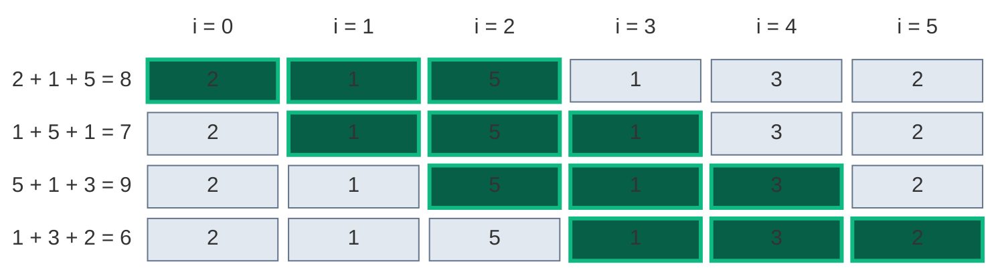

The sums are `8`, `7`, `9`, `6`, so the answer is `9`.

Picture a frame of 3 cells moving left to right over the array. That frame is the **window**.

**The idea in one line:** do not recompute every new window from scratch. Keep information about the current window, and update it as the window moves.

### Two boundaries: `L` and `R`

A window is always described by two indexes:

- `L` (left) = the first index inside the window.
- `R` (right) = the last index inside the window.

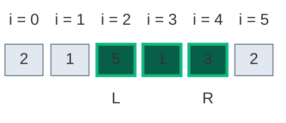

The most used formula in this whole topic is the window length:

```text
window length = R - L + 1
```

The `+ 1` is there because **both** ends are inside the window. With `L = 2` and `R = 4` the window holds indexes `2, 3, 4`, which is 3 elements. `4 - 2 = 2` is wrong; `4 - 2 + 1 = 3` is right. Forgetting the `+ 1` is the most common sliding-window bug.

## 2. Why It Beats the Nested Loop

### Brute force: recompute every window

For a fixed size `k`, the starting positions are `0, 1, ..., n - k`. That is `n - k + 1` windows. With `n = 6` and `k = 3` the starts are `0, 1, 2, 3`, which is exactly `6 - 3 + 1 = 4`.

Each window costs `k` additions, so the total is `(n - k + 1) × k`, written `O(n·k)`. When `k` is close to `n / 2`, that is `O(n^2)`.

### What really changes between two windows

Look at two windows side by side. Orange = the element that leaves, green = the element that enters, blue = reused.

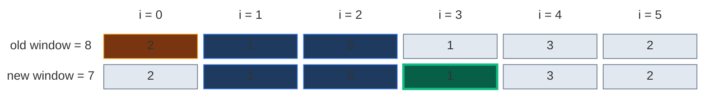

Only **two** things change: one element leaves on the left and one enters on the right. The middle was already added up. So:

```text
new_sum = old_sum - outgoing + incoming
7       = 8       - 2        + 1
```

That one line is the whole speed-up.

| Stage | Brute force | Sliding window |
|:---|:---|:---|
| First window | `O(k)` | `O(k)` |
| Every later window | `O(k)`, recompute | `O(1)`, remove one and add one |
| Total | `O(n·k)` | `O(k) + (n - k)·O(1)` = `O(n)` |

**Reuse previous work instead of recalculating everything.**

### How much work, as the array grows (simple theory)

A computer does about **100 million (10^8) simple steps per second**. Let us count the steps for the "longest subarray with sum `<= K`" question (Section 4) in the worst case, where every subarray is valid. Every number below was counted by running code.

Red bars = brute force steps (double loop). Green line = sliding window steps (`R` moves `n` times, `L` moves at most `n` times).

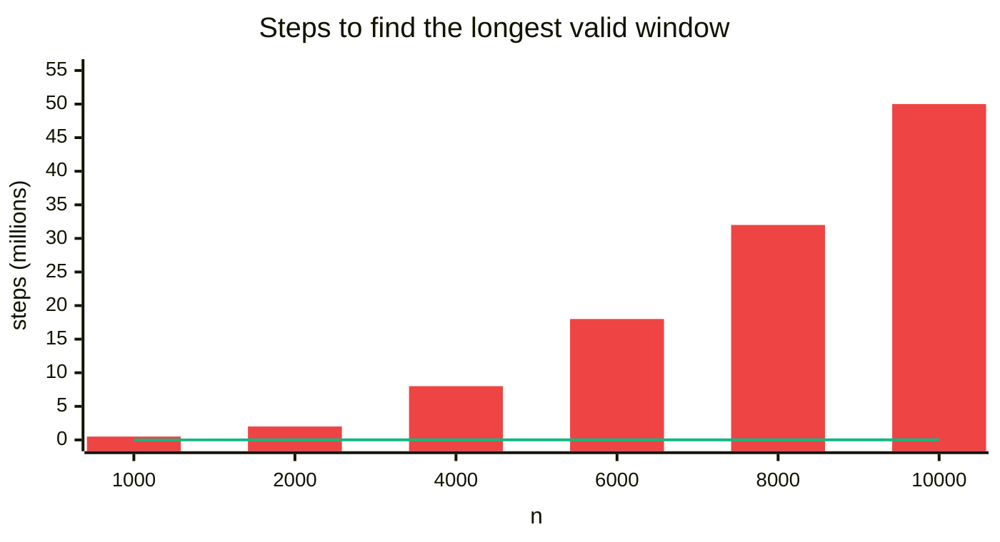

| `n` | Brute force steps | Sliding window steps |
|:---:|:---:|:---:|
| 1,000 | 500,500 | 1,000 |
| 2,000 | 2,001,000 | 2,000 |
| 4,000 | 8,002,000 | 4,000 |
| 6,000 | 18,003,000 | 6,000 |
| 8,000 | 32,004,000 | 8,000 |
| 10,000 | 50,005,000 | 10,000 |

Brute force grows like `n^2 / 2`. At `n = 10^5` it would need about 5 billion steps (around a minute). The sliding window needs at most `2n` = 200,000 steps.

## 3. Fixed-Size Windows

The window size is given by the problem and never changes: always `k`. Typical wording:

- maximum or minimum sum of a subarray of size `k`
- average of every `k` elements
- first negative number in every window of size `k`
- maximum in every window of size `k`

### Visual Walkthrough (Story Version)

**The story:** Mia walks along a row of 6 candy jars with a tray that holds exactly 3 jars. She wants the tray with the most candies.

**The rules:**

- The tray always holds the 3 jars right next to each other.
- To move one step right, she puts down the leftmost jar and picks up the next jar on the right.
- She never recounts the jars in the middle. She just subtracts what she put down and adds what she picked up.

**How to read the pictures:** green = jars on the tray, orange = the jar just put down, grey = jars not on the tray.

**Step 1: fill the tray with jars 0, 1, 2.** She counts `2 + 1 + 5 = 8`. Best so far: `8`.

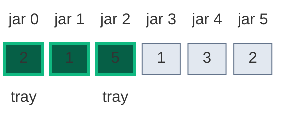

**Step 2: put down jar 0 (2 candies), pick up jar 3 (1 candy).** `8 - 2 + 1 = 7`. Best stays `8`.

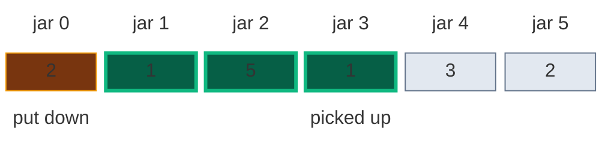

**Step 3: put down jar 1 (1), pick up jar 4 (3).** `7 - 1 + 3 = 9`. New best: `9`.

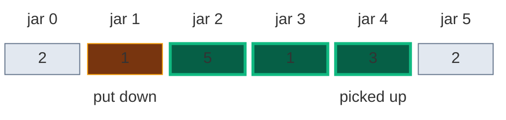

**Step 4: put down jar 2 (5), pick up jar 5 (2).** `9 - 5 + 2 = 6`. Best stays `9`.

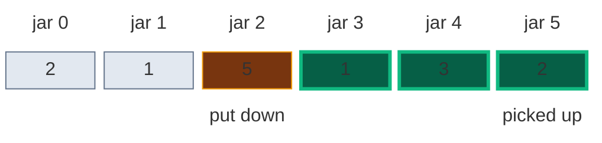

The tray reached the last jar. **Answer: 9.**

| Step | Tray (jars) | Put down | Picked up | Tray total | Best |
|:---:|:---:|:---:|:---:|:---:|:---:|
| 1 | 0, 1, 2 | – | – | 8 | 8 |
| 2 | 1, 2, 3 | 2 | 1 | 7 | 8 |
| 3 | 2, 3, 4 | 1 | 3 | 9 | 9 |
| 4 | 3, 4, 5 | 5 | 2 | 6 | 9 |

**What the story teaches**

| In the story | In the code |
|:---|:---|
| Tray of 3 jars | Window of size `k` |
| Leftmost jar on the tray | `nums[L]` |
| Rightmost jar on the tray | `nums[R]` |
| Put down, pick up | `window_sum -= nums[L]`, `window_sum += nums[R]` |
| Never recount the middle | Each slide is `O(1)` |
| Best tray | `max_sum` |

### Step-by-Step Example (the lecture's board example)

`arr = [-1, 2, 3, 3, 4, 5, -1]`, `k = 4`. The first window is `l = 0` to `r = k - 1 = 3`, which holds `[-1, 2, 3, 3]` with `sum = 7`. Then every slide drops `arr[l]` and adds `arr[r]`.

Green = inside the window, orange = the element that just left, grey = outside.

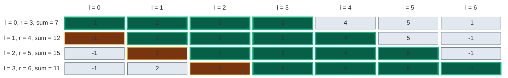

- `l = 0, r = 3`: first window, `sum = 7` (this costs `O(k)`).
- `l = 1, r = 4`: `7 - (-1) + 4 = 12`.
- `l = 2, r = 5`: `12 - 2 + 5 = 15`.
- `l = 3, r = 6`: `15 - 3 + (-1) = 11`.

**Maximum = 15.** The same mechanism as a picture:

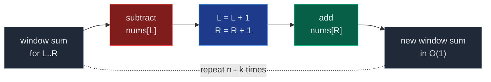

**The rule to say in an interview:** at every step, `window_sum` holds the sum of exactly the current `k` elements. One subtraction and one addition keep that true, so each step is `O(1)`.

There are two common ways to write it (both are in the [Code](#8-code) section):

- **Style 1: build the first window, then slide.** Add up `nums[0 .. k-1]` once, then for every new `right` subtract `nums[right - k]` and add `nums[right]`.
- **Style 2: the reusable fixed-window template.** Add `nums[right]`; if the window got bigger than `k`, remove `nums[left]` and move `left`; when the size is exactly `k`, record the answer. In short: **add right → too big? remove left → size is k? record.**

## 4. Variable-Size Windows

Now the question changes:

```text
Find the longest subarray whose sum <= K.
arr = [2, 5, 1, 7, 10], K = 14
```

No size is given. The answer might hold 2, 3 or 4 elements, so the window must **grow and shrink**.

**Brute force:** for every start `i`, add elements one by one; record the length while the sum is `<= K`; stop when it goes over. That is two nested loops: `O(n^2)` time, `O(1)` space.

**Sliding window:** keep two pointers and only two moves:

- **expand:** move `R` right and add `arr[R]`
- **shrink:** while the sum is too big, remove `arr[L]` and move `L` right

### Step-by-Step Example

Green = the current valid window, red = the current window when it is too big (invalid), grey = outside.

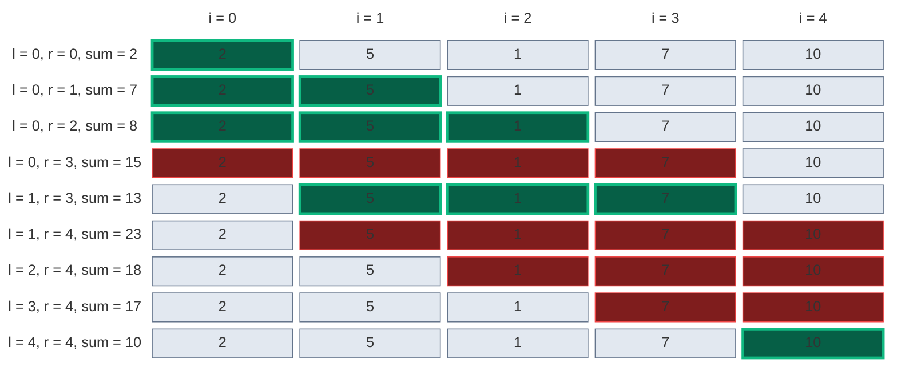

| `l` | `r` | Window | Sum | Valid? | Action | `maxLen` |
|:---:|:---:|:---|:---:|:---:|:---|:---:|
| 0 | 0 | `[2]` | 2 | yes | record | 1 |
| 0 | 1 | `[2, 5]` | 7 | yes | record | 2 |
| 0 | 2 | `[2, 5, 1]` | 8 | yes | record | 3 |
| 0 | 3 | `[2, 5, 1, 7]` | 15 | **no** | shrink: drop 2 | 3 |
| 1 | 3 | `[5, 1, 7]` | 13 | yes | record (3) | 3 |
| 1 | 4 | `[5, 1, 7, 10]` | 23 | **no** | shrink: drop 5 | 3 |
| 2 | 4 | `[1, 7, 10]` | 18 | **no** | shrink: drop 1 | 3 |
| 3 | 4 | `[7, 10]` | 17 | **no** | shrink: drop 7 | 3 |
| 4 | 4 | `[10]` | 10 | yes | record (1) | 3 |

**Answer: 3.**

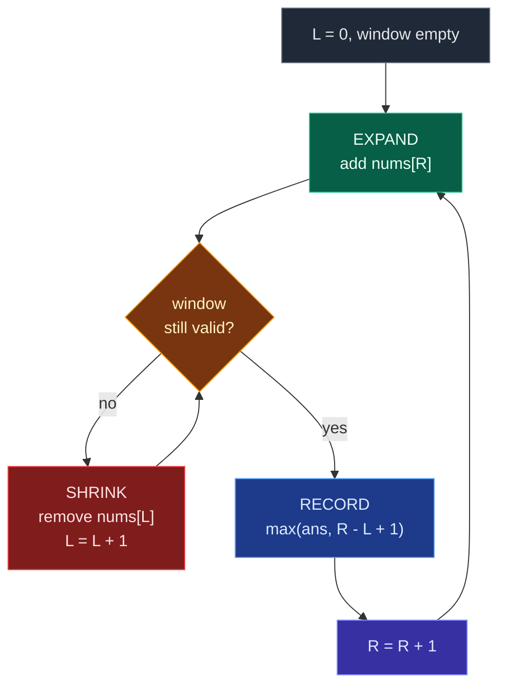

**Why is it still `O(n)` with a loop inside a loop?** Count pointer moves, not loops. `R` moves at most `n` times in total. `L` also moves at most `n` times in total, because it never goes back. So the total is `n + n = 2n` moves, which is `O(n)`. The lecture writes it as `TC → O(N + N)`, `SC → O(1)`. This "amortized" argument is a strong interview point.

## 5. The Expand / Shrink Skeleton

Memorise this one shape instead of fifty solutions:

1. Expand: add `nums[right]` to the window state.
2. Shrink: **while** the window is invalid, remove `nums[left]` and move `left`.
3. Record: the window is valid now, so update the answer with `right - left + 1`.

**Use `while`, not `if`.** One removal may not be enough:

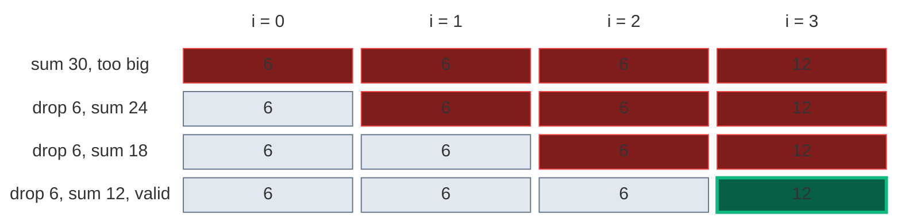

`30 → 24 → 18 → 12`: it took three removals to get back under `K = 14`. An `if` would leave a broken window, and every later answer would be wrong.

**One exception worth knowing:** if you only need the *length* of the longest window (not the window itself), an `if` that shrinks at most one step per expansion also works. The window then never shrinks; it only refuses to grow, so `maxLen` stays correct. The `while` form is the one that is always safe.

### The three shapes that cover most interview problems

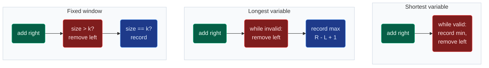

Note the flip in the last shape:

- **Longest:** invalid → shrink; valid → record.
- **Shortest:** valid → record **and keep shrinking**.

Mixing these two up causes many interview failures.

### The four families

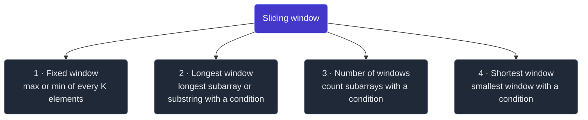

Family 3 uses a trick rather than a new template. To count subarrays with sum **exactly** `K`, solve the easier "at most" question twice:

```text
answer = count(sum <= K) - count(sum <= K - 1)
```

## 6. When Sliding Window Works

The word "subarray" alone is not enough. Sliding window needs **monotonic** behaviour: moving a pointer must change the window state in a **predictable direction**.

For a sum with **non-negative** values this holds perfectly:

- expand `R` → the sum stays the same or goes up
- shrink `L` → the sum stays the same or goes down

So once the window is too big, the only fix is to move `L` forward. Once it is valid, the only way to grow it is to move `R`. Two forward-only pointers are enough.

**Why negative numbers break it.** Take `nums = [5, -10, 20]`:

- expanding can make the sum go **down** (add `-10`)
- shrinking can make the sum go **up** (remove `-10`)

Now a window that looks invalid might become valid just by expanding, and `L` can no longer be moved safely. Interviewers love this trap. For negative numbers use instead:

- **prefix sums + a hash map** (subarray sum equals K)
- a **monotonic deque** (shortest subarray with sum at least K)
- **binary search** on the answer

**It is not only about sums.** In "longest substring without repeating characters", expanding can add a duplicate and shrinking removes it. The problem can always be fixed by moving `L` forward, never backward. That is the real rule: **if the condition can be repaired by moving `L` forward, sliding window applies.**

The window state can be many things:

| Window state | How it is kept | Typical problem |
|:---|:---|:---|
| Sum | `window_sum += nums[right]` | Max sum of size `k` |
| Frequency map | `freq[s[right]] += 1` | Anagrams, permutation in string |
| Count of zeros | `if nums[right] == 0: zeros += 1` | Max Consecutive Ones III |
| Distinct count | `freq[x] += 1`; if it became 1, `distinct += 1` | K distinct characters |
| Max or min | a monotonic `deque` | Sliding window maximum |

So sliding window is not an algorithm about sums. It is a framework: **keep information about a contiguous range up to date, cheaply.**

## 7. Recognising the Pattern

**Trigger words:** subarray, substring, contiguous, consecutive, window, longest, shortest, maximum, minimum, at most, at least, exactly.

| Problem wording | Window type | What to keep | When to record |
|:---|:---|:---|:---|
| max/min sum of size `k` | Fixed, size `k` | running sum | every time size is `k` |
| average of every `k` elements | Fixed, size `k` | running sum | every time size is `k` |
| maximum in every window of size `k` | Fixed, size `k` | monotonic deque | every time size is `k` |
| longest subarray with sum `<= K` | Longest | running sum | after shrinking to valid |
| longest substring without repeats | Longest | frequency map or last-seen index | after shrinking to valid |
| longest subarray with at most `K` zeros | Longest | zero count | after shrinking to valid |
| shortest subarray with sum `>= K` | Shortest | running sum | while still valid, then shrink |
| minimum window substring | Shortest | need/have counts | while still valid, then shrink |
| count subarrays with sum exactly `K` | Two "at most" runs | running sum | `f(K) - f(K - 1)` |
| count subarrays with at most `K` distinct | Counting | distinct count | add `right - left + 1` |
| pick `k` cards from both ends | Fixed, size `n - k` (the middle) | running sum | `total - smallest middle` |

**Checklist for a new problem:**

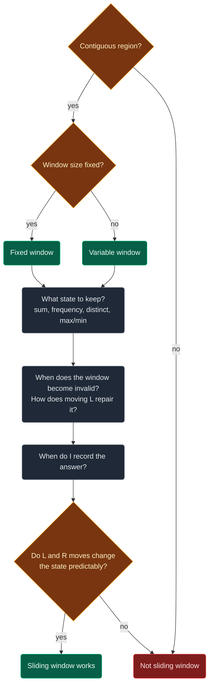

## 8. Code

All four solutions from this note, then the tests.

```python
# Import List for type hints
from typing import List


# Brute force: max sum of any k consecutive elements
def max_sum_brute(nums: List[int], k: int) -> float:

    # Number of elements
    n = len(nums)

    # No window seen yet
    max_sum = float("-inf")

    # Try every starting point
    for i in range(n - k + 1):

        # Sum of this window, computed from scratch
        current_sum = 0

        # Visit exactly k elements
        for j in range(i, i + k):

            # Add this element
            current_sum += nums[j]

        # Keep the best window sum
        max_sum = max(max_sum, current_sum)

    # Best sum over all windows
    return max_sum


# Style 1: build the first window, then slide
def max_sum_fixed(nums: List[int], k: int):

    # Number of elements
    n = len(nums)

    # A window bigger than the array does not exist
    if k > n:

        # Signal "no answer"
        return None

    # Sum of the first window
    window_sum = sum(nums[:k])

    # The first window is the best so far
    max_sum = window_sum

    # Every new right end, from index k onward
    for right in range(k, n):

        # Index of the element that leaves
        left = right - k

        # Remove the outgoing element
        window_sum -= nums[left]

        # Add the incoming element
        window_sum += nums[right]

        # Keep the best window sum
        max_sum = max(max_sum, window_sum)

    # Best window sum
    return max_sum


# Style 2: the reusable fixed-window template
def max_sum_template(nums: List[int], k: int):

    # Left edge of the window
    left = 0

    # Sum of the current window
    window_sum = 0

    # Best answer, none yet
    answer = None

    # Grow the window one element at a time
    for right in range(len(nums)):

        # 1. Add the new element
        window_sum += nums[right]

        # 2. Window got bigger than k
        if right - left + 1 > k:

            # Remove the leftmost element
            window_sum -= nums[left]

            # Move the left edge
            left += 1

        # 3. Window has exactly k elements
        if right - left + 1 == k:

            # Record the best sum
            answer = window_sum if answer is None else max(answer, window_sum)

    # Best window sum
    return answer


# Variable window: longest subarray with sum <= K (non-negative values)
def longest_at_most_k(nums: List[int], K: int, trace: list = None) -> int:

    # Left edge of the window
    left = 0

    # Sum of the current window
    current = 0

    # Longest valid length so far
    answer = 0

    # Expand the right edge
    for right in range(len(nums)):

        # Include nums[right]
        current += nums[right]

        # Shrink until the window is valid again
        while current > K:

            # Remove the leftmost element
            current -= nums[left]

            # Move the left edge
            left += 1

        # The window is valid: record its length
        answer = max(answer, right - left + 1)

        # Save (left, right, sum) for the tests
        if trace is not None:

            # One entry per right position
            trace.append((left, right, current))

    # Longest valid window
    return answer


# Import random for the agreement tests
import random

# Story example: windows of size 3
assert max_sum_fixed([2, 1, 5, 1, 3, 2], 3) == 9

# Board example: windows of size 4
assert max_sum_fixed([-1, 2, 3, 3, 4, 5, -1], 4) == 15

# Same answer from the template
assert max_sum_template([-1, 2, 3, 3, 4, 5, -1], 4) == 15

# Same answer from brute force
assert max_sum_brute([-1, 2, 3, 3, 4, 5, -1], 4) == 15

# k bigger than the array
assert max_sum_fixed([1, 2], 3) is None

# All negative values: answer must not be 0
assert max_sum_fixed([-5, -2, -7], 2) == -7

# Variable window example, traced
trace = []

# Run with the trace on
assert longest_at_most_k([2, 5, 1, 7, 10], 14, trace) == 3

# State after each right position (after shrinking)
assert trace == [(0, 0, 2), (0, 1, 7), (0, 2, 8), (1, 3, 13), (4, 4, 10)]

# Nothing fits
assert longest_at_most_k([20, 30], 10) == 0

# Everything fits
assert longest_at_most_k([1, 1, 1], 10) == 3

# Brute force for the variable window, used as a checker
def longest_brute(nums, K):

    # Longest valid length
    best = 0

    # Every start
    for i in range(len(nums)):

        # Running sum from i
        s = 0

        # Every end
        for j in range(i, len(nums)):

            # Add the next element
            s += nums[j]

            # Valid window: record its length
            if s <= K:

                # Keep the longest
                best = max(best, j - i + 1)

    # Longest valid length
    return best

# Random checks: all versions agree
for _ in range(500):

    # Random length and window size
    n = random.randint(1, 12)

    # Random values, negatives allowed for the fixed window
    arr = [random.randint(-10, 10) for _ in range(n)]

    # Random k from 1 to n
    k = random.randint(1, n)

    # Fixed-window versions agree with brute force
    assert max_sum_fixed(arr, k) == max_sum_template(arr, k) == max_sum_brute(arr, k)

    # Non-negative values for the variable window
    pos = [abs(x) for x in arr]

    # Random limit
    K = random.randint(0, 30)

    # Variable window agrees with brute force
    assert longest_at_most_k(pos, K) == longest_brute(pos, K)

# All checks passed
print("All tests passed")
```

## 9. Common Mistakes

| Mistake | What goes wrong | Fix |
|:---|:---|:---|
| Window size written as `R - L` | Both ends are inside, so the count is one short | Use `R - L + 1` |
| `if` instead of `while` to shrink | One removal may not fix the window, so it stays broken | `while invalid: remove left; left += 1` |
| Recording before shrinking (longest problems) | You record an invalid window | Shrink first, then record |
| Using the longest shape for a shortest problem | Shortest must record **while valid** and keep shrinking | Swap the `while` condition and move the record inside it |
| Not undoing state when `left` moves | The sum or frequency map no longer matches `[L..R]` | Every `left += 1` must undo `nums[left]` |
| Sum window on an array with negative numbers | Expanding and shrinking are no longer predictable | Prefix sums + hash map, or a monotonic deque |
| Moving `left` backward to "retry" | Breaks the `O(n)` bound and usually the answer | Both pointers only move forward |
| Not checking `k > n` | `sum(nums[:k])` quietly returns a short window | Check and return early |
| `max_sum = 0` when values can be negative | Every real window is below 0, so 0 is returned | Start at `float("-inf")` or at the first window |
| Thinking "pick from both ends" is not a window problem | The cards you do **not** pick form a contiguous middle | Use the opposite fixed window of size `n - k` |

## 10. Interview Follow-ups

### Q1. What is the difference between sliding window and two pointers?

**Answer:**
- Sliding window is a kind of two pointers.
- In sliding window both pointers move in the **same direction** and the region between them is the answer candidate.
- Classic two pointers often move **toward each other** (like Two Sum II on a sorted array).

### Q2. Why is the variable window `O(n)` and not `O(n^2)`?

**Answer:**
- `R` moves forward at most `n` times.
- `L` moves forward at most `n` times, and never goes back.
- Total moves are at most `2n`, so the whole scan is `O(n)` even with a `while` inside a `for`.

### Q3. When does sliding window fail?

**Answer:**
- When moving a pointer does not change the state in a predictable direction.
- The classic case: sums with negative numbers.
- Use prefix sums + hash map, a monotonic deque, or binary search on the answer instead.

### Q4. How do you count subarrays with an exact condition, like sum exactly `K`?

**Answer:**
- A window that is "exactly right" is hard to keep.
- Count "at most `K`" and "at most `K - 1`", then subtract: `f(K) - f(K - 1)`.

### Q5. How do you find the maximum in every window of size `k`?

**Answer:**
- A running sum does not work for maximum, because you cannot "subtract" a maximum.
- Keep a monotonic deque of indexes whose values decrease from front to back.
- The front is the window maximum; pop it when it leaves the window. Total `O(n)`.

## 11. Interview Explanation

> Sliding window is a two-pointer technique for contiguous subarrays or substrings. Instead of recomputing every overlapping range from scratch, I keep the state of the current window and update it as the edges move. For a fixed size, I remove the element that leaves and add the element that enters, so each step is O(1). For a variable size, I expand the right edge and shrink the left edge with a while loop whenever the window breaks the condition. Both pointers only move forward, so many O(n^2) problems become O(n). It only works when moving a pointer changes the state predictably, which is why sums with negative numbers need a different tool.
