# 01. 1423. Maximum Points You Can Obtain from Cards

| Difficulty | Pattern | Source | Time | Space |
|:---:|:---:|:---:|:---:|:---:|
| **Medium** | Fixed Window / Complement | [1423. Maximum Points You Can Obtain from Cards](https://leetcode.com/problems/maximum-points-you-can-obtain-from-cards/) | `O(n)` | `O(1)` |

## 1. Problem Statement

Cards are laid out **in a row**. Each card has some points, given in the array `cardPoints`.

In one step you take **one card from the start or from the end** of the row. You must take exactly `k` cards.

Your score is the sum of the points of the cards you took. Return the **maximum score** possible.

### Example

```text
Input:  cardPoints = [1, 2, 3, 4, 5, 6, 1], k = 3
Output: 12   (take the 3 cards on the right: 5 + 6 + 1)
```

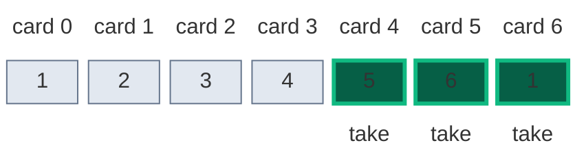

We use this same example in every section below.

Other LeetCode examples:

```text
[2, 2, 2], k = 2                -> 4    (any two cards give 4)
[9, 7, 7, 9, 7, 7, 9], k = 7    -> 55   (you must take every card)
```

### Constraints

- `1 <= cardPoints.length <= 10^5`
- `1 <= cardPoints[i] <= 10^4` (every card is worth at least 1 point)
- `1 <= k <= cardPoints.length`

### What the constraints tell us (simple theory)

A **constraint** is the biggest input the judge will ever give you. It tells you how fast your code must be.

**Rule of thumb:** a computer does about **100 million (10^8) simple steps per second**.

| Biggest input `n` | Steps you can afford | Ideas that fit |
|:---:|:---:|:---|
| up to ~20 | about `2^n` | Try every choice |
| up to ~5,000 | about `n^2` | Two nested loops |
| up to ~1,000,000 | about `n` | One loop, sliding window |

**For this problem:** `n` can be `10^5` and `k` can be as big as `n`.

- Brute force tries all `k + 1` ways to split the cards (some from the left, the rest from the right) and re-adds up to `k` cards each time: about `k^2` steps. With `k = 10^5` that is `10^10` steps, far too slow.
- The sliding window needs about `2n` steps: `2 × 10^5`, instantly.

**How the work grows** (with `k = n / 2`; every number counted by running code). Red bars = brute force steps, green line = sliding window steps.

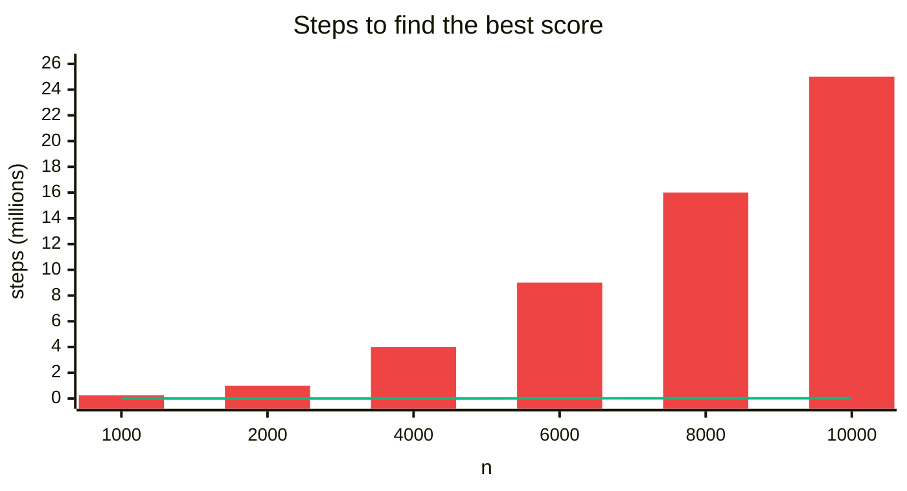

| `n` | `k` | Brute force steps | Sliding window steps |
|:---:|:---:|:---:|:---:|
| 1,000 | 500 | 250,500 | 2,000 |
| 2,000 | 1,000 | 1,001,000 | 4,000 |
| 4,000 | 2,000 | 4,002,000 | 8,000 |
| 6,000 | 3,000 | 9,003,000 | 12,000 |
| 8,000 | 4,000 | 16,004,000 | 16,000 |
| 10,000 | 5,000 | 25,005,000 | 20,000 |

## 2. Core Theory

### Where is the window?

At first this does not look like a subarray problem. The cards you take come from **both ends**, so they are a piece from the left plus a piece from the right: two separate pieces, not one block. The window is **hidden**.

### The key trick: look at the cards you leave behind

Stop asking "which `k` cards do I take?" Ask "which cards do I **leave**?"

- You take `k` cards out of `n`, so exactly `n - k` cards stay.
- You can only take cards from the two ends, so the cards that stay are always **one unbroken block in the middle**. You can never pull a card out of the middle.

Green = cards you take, grey = the block you leave (always contiguous, always `n - k` long).

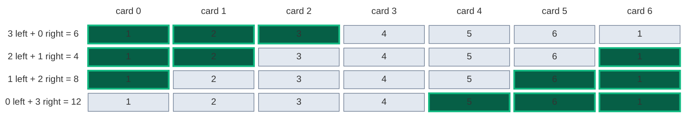

The total of all cards never changes, so:

```text
picked + left_behind = total
picked = total - left_behind
```

To make `picked` as **big** as possible, make `left_behind` as **small** as possible. And `left_behind` is always a block of fixed size `n - k`. So the problem becomes the most basic fixed-size window question:

```text
answer = total - (smallest sum of any window of size n - k)
```

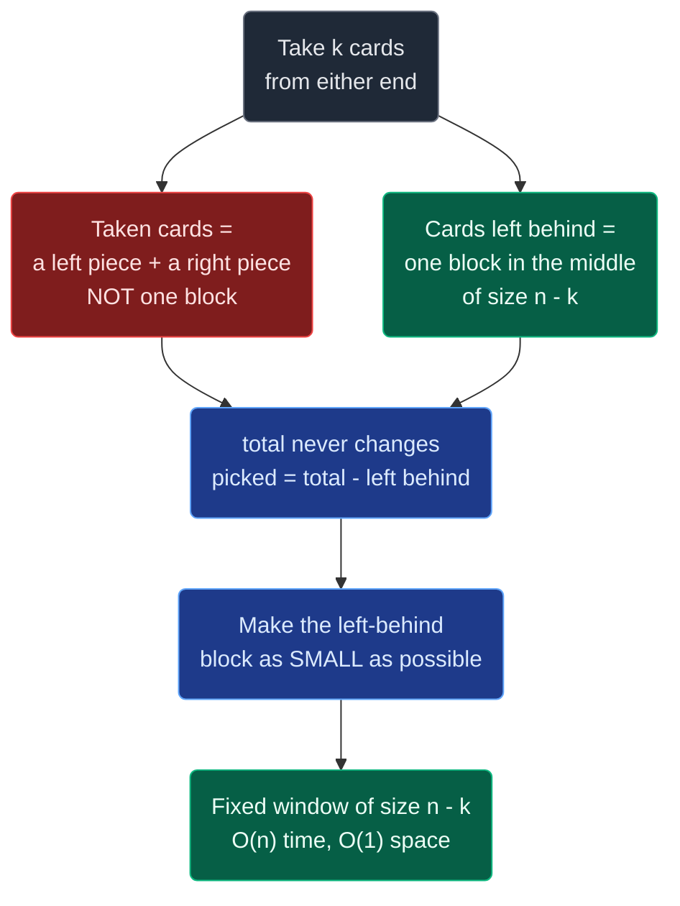

### Only `k + 1` real choices

If you take `x` cards from the left, you must take `k - x` from the right, and `x` can be `0, 1, ..., k`. So there are only `k + 1` different results, not `2^k`. The **order** of moves does not matter: "left, right, left" and "right, left, left" both mean "2 from the left, 1 from the right". This is a nice point to say in an interview.

### Why greedy fails

The obvious idea, "always grab the bigger end card", is wrong:

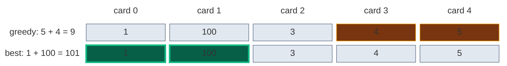

- **Greedy:** the right end `5` is bigger than `1`, take it. Then `4` is bigger than `1`, take it. Score `9`.
- **Best:** take the cheap `1` first. That uncovers `100`. Take it. Score `101`.

A cheap card can hide an expensive one behind it. That is why we need the complement trick, not a one-line greedy.

### Taking every card (`k == n`)

The left-behind block has size `n - k`. When `k == n` that size is `0`, and a window of size `0` makes no sense. Handle it first: if you must take every card, return `sum(cardPoints)` right away. LeetCode's third example tests exactly this.

## 3. Edge Cases

| Case | Input | Expected | Why it matters |
|:---|:---|:---:|:---|
| Single card | `[5], k = 1` | `5` | `n == 1` and `k == n` together; window size is `0` |
| Take everything | `[9,7,7,9,7,7,9], k = 7` | `55` | `k == n` needs the early return |
| One card only | `[5,2,9], k = 1` | `9` | Must check both ends, not just the left |
| Best card on the left | `[9,2,5], k = 1` | `9` | Catches code that only looks at the right end |
| All equal | `[2,2,2,2], k = 2` | `4` | Every window ties |
| Greedy trap | `[1,100,3,4,5], k = 2` | `101` | Greedy gives `9` |
| Big cards on both ends | `[100,1,1,1,100], k = 2` | `200` | Best split is 1 left + 1 right |
| Smallest block at the start | `[1,1,9,9,9], k = 3` | `27` | Answer is all right-side cards |
| Smallest block at the end | `[9,9,9,1,1], k = 3` | `27` | Answer is all left-side cards |
| Biggest input | `10^5` cards | linear | `O(k^2)` brute force times out |

All card points are at least `1`. But this trick still works with negative numbers: `picked = total - left_behind` is plain arithmetic, and the window size is fixed, so we never have to "shrink" anything. (Only a `max_points = 0` start value would break; see Common Mistakes.)

## 4. Brute Force: Try Every Left/Right Split

### Idea

Take `i` cards from the left and `k - i` from the right, for every `i` from `0` to `k`. Add up each split from scratch and keep the best.


| Split | Cards taken | Score |
|:---|:---|:---:|
| 3 left + 0 right | 1, 2, 3 | 6 |
| 2 left + 1 right | 1, 2, 1 | 4 |
| 1 left + 2 right | 1, 6, 1 | 8 |
| 0 left + 3 right | 5, 6, 1 | **12** |

### Code

```python
# Import List for type hints
from typing import List


# Brute force: try every split and add it up from scratch
class SolutionBrute:

    # Main method
    def maxScore(self, cardPoints: List[int], k: int) -> int:

        # Number of cards
        n = len(cardPoints)

        # Best score so far
        max_points = 0

        # Take i cards from the left and k - i from the right
        for i in range(k + 1):

            # Score of this split
            current_points = 0

            # Add the first i cards
            for left_index in range(i):

                # Add one left card
                current_points += cardPoints[left_index]

            # Add the last k - i cards
            for right_index in range(k - i):

                # Add one right card
                current_points += cardPoints[n - 1 - right_index]

            # Keep the best split
            max_points = max(max_points, current_points)

        # Best score
        return max_points
```

### Complexity

| Measure | Complexity | Why |
|:---|:---:|:---|
| **Time** | `O(k^2)` | `k + 1` splits, each re-adds up to `k` cards |
| **Space** | `O(1)` | A few counters |

With `k = n = 10^5` this is `10^10` steps: too slow.

## 5. Better Approach: Prefix and Suffix Sums

### Idea

Stop re-adding the same cards. Work out the sums once:

- `prefix[i]` = sum of the first `i` cards
- `suffix[i]` = sum of the last `i` cards

Then every split is one lookup: `score = prefix[i] + suffix[k - i]`.

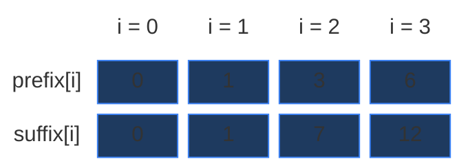

| `i` (left) | `prefix[i]` | `suffix[k - i]` | Score |
|:---:|:---:|:---:|:---:|
| 0 | 0 | 12 | **12** |
| 1 | 1 | 7 | 8 |
| 2 | 3 | 1 | 4 |
| 3 | 6 | 0 | 6 |

### Code

```python
# Better: prefix and suffix sums
class SolutionBetter:

    # Main method
    def maxScore(self, cardPoints: List[int], k: int) -> int:

        # Number of cards
        n = len(cardPoints)

        # prefix[i] = sum of the first i cards
        prefix = [0] * (k + 1)

        # suffix[i] = sum of the last i cards
        suffix = [0] * (k + 1)

        # Build the prefix sums
        for i in range(1, k + 1):

            # Previous prefix plus the next left card
            prefix[i] = prefix[i - 1] + cardPoints[i - 1]

        # Build the suffix sums
        for i in range(1, k + 1):

            # Previous suffix plus the next right card
            suffix[i] = suffix[i - 1] + cardPoints[n - i]

        # Best score so far
        max_points = 0

        # Try every split
        for left_count in range(k + 1):

            # Cards taken from the right
            right_count = k - left_count

            # Score of this split in O(1)
            current_points = prefix[left_count] + suffix[right_count]

            # Keep the best split
            max_points = max(max_points, current_points)

        # Best score
        return max_points
```

### Complexity

| Measure | Complexity | Why |
|:---|:---:|:---|
| **Time** | `O(k)` | Three passes over `k + 1` entries |
| **Space** | `O(k)` | Two arrays of size `k + 1` |

Faster, but the two arrays are not needed. Two `O(1)`-space ideas follow.

## 6. Optimal 1: Take the First `k` Cards, Then Swap One at a Time

### Idea

Start by taking all `k` cards from the left. Then give back the last left card and take one more card from the right end. Each swap is one subtraction and one addition. After `k` swaps you have seen all `k + 1` splits.

### Step-by-Step Example (the lecture's board example)

`arr = [6, 2, 3, 4, 7, 2, 1, 7, 1]`, `k = 4`. Green = cards taken from the left, blue = cards taken from the right, orange = the card just given back, grey = not taken.

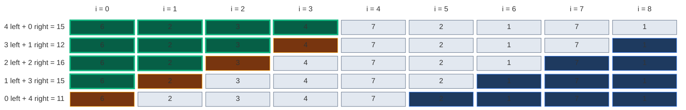

| Left sum | Right sum | Total | Swap |
|:---:|:---:|:---:|:---|
| 15 | 0 | 15 | start: take `[6, 2, 3, 4]` |
| 11 | 1 | 12 | give back `4`, take `1` |
| 8 | 8 | **16** | give back `3`, take `7` |
| 6 | 9 | 15 | give back `2`, take `1` |
| 0 | 11 | 11 | give back `6`, take `2` |

The best is **16**: two cards from the left (`6, 2`) and two from the right (`7, 1`).

This version never needs the `k == n` check: with `k == n` every swap keeps the total equal to the sum of all cards. The code is `SolutionShift` in the final [Code](#code-2) block.

**Time** `O(k)`, **space** `O(1)`.

## 7. Optimal 2: Complement Sliding Window

### Idea

1. If `k == n`, return the total right away.
2. `window_size = n - k`, `total = sum(cardPoints)`.
3. Add up the first window `cardPoints[0 .. window_size - 1]`; it is the smallest so far.
4. Slide: add `cardPoints[right]`, remove `cardPoints[right - window_size]`, keep the smallest window sum.
5. Answer = `total - smallest window`.

### Visual Walkthrough (Story Version)

**The story:** Tom must take 3 of the 7 toy cars lined up on a shelf, but only from the two ends. Instead, his sister Anu thinks: "4 cars will stay on the shelf, side by side. Let me find the 4 neighbouring cars with the **fewest** points. Tom gets everything else."

**The rules:**

- Anu's "stay" box always covers exactly 4 cars next to each other.
- To slide the box one step right, one car leaves on the left and one joins on the right.
- She keeps the smallest box total she has seen.

**How to read the pictures:** grey = inside the "stay" box, green = cars Tom takes, orange = the car that just left the box.

**Step 1: box on cars 0 to 3.** Box total `1 + 2 + 3 + 4 = 10`. Smallest so far `10`.

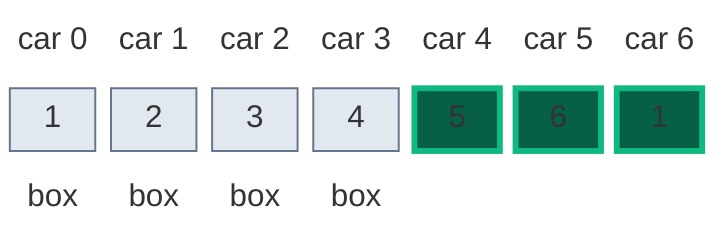

**Step 2: slide right.** Car 0 (`1`) leaves, car 4 (`5`) joins. `10 - 1 + 5 = 14`. Smallest stays `10`.

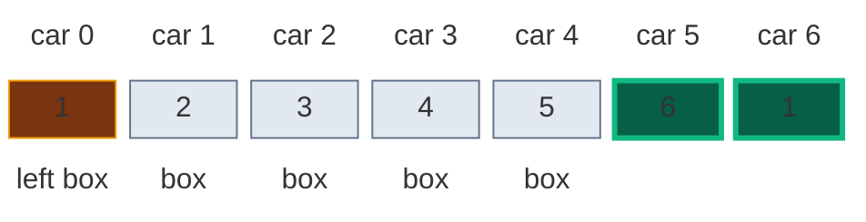

**Step 3: slide right.** Car 1 (`2`) leaves, car 5 (`6`) joins. `14 - 2 + 6 = 18`. Smallest stays `10`.

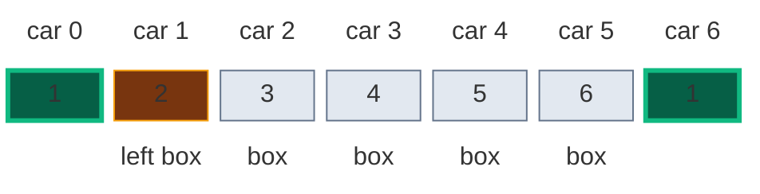

**Step 4: slide right.** Car 2 (`3`) leaves, car 6 (`1`) joins. `18 - 3 + 1 = 16`. Smallest stays `10`.

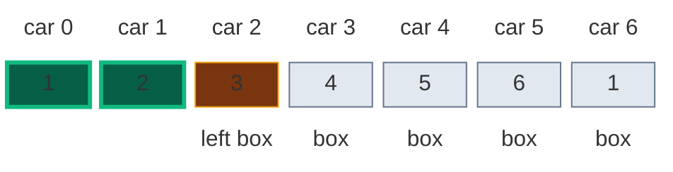

The box reached the end. All cars total `22`. **Tom gets `22 - 10 = 12`** (the cars outside the smallest box: `5, 6, 1`).

| Step | Box covers | Leaves | Joins | Box total | Smallest | Tom would get |
|:---:|:---:|:---:|:---:|:---:|:---:|:---:|
| 1 | cars 0–3 | – | – | 10 | 10 | 12 |
| 2 | cars 1–4 | 1 | 5 | 14 | 10 | 8 |
| 3 | cars 2–5 | 2 | 6 | 18 | 10 | 4 |
| 4 | cars 3–6 | 3 | 1 | 16 | 10 | 6 |

**What the story teaches**

| In the story | In the code |
|:---|:---|
| Cars on the shelf | `cardPoints` |
| The "stay" box of 4 cars | Window of size `n - k` |
| Box total | `window_sum` |
| Smallest box seen | `min_window_sum` |
| All cars together | `total_sum` |
| Tom's cars | `total_sum - min_window_sum` |

### Step-by-Step Example

`cardPoints = [1, 2, 3, 4, 5, 6, 1]`, `k = 3`, `n = 7`, `window_size = 4`, `total_sum = 22`. Grey = the window (cards left behind), orange = the card that just left, green = cards taken.

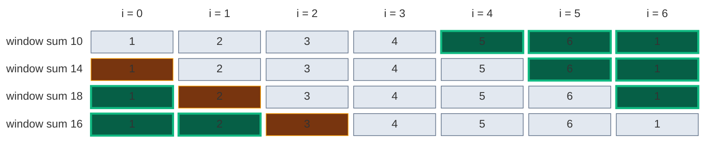

| `right` | Removed | Added | `window_sum` | `min_window_sum` |
|:---:|:---:|:---:|:---:|:---:|
| start | – | – | 10 | 10 |
| 4 | `cardPoints[0] = 1` | `cardPoints[4] = 5` | 14 | 10 |
| 5 | `cardPoints[1] = 2` | `cardPoints[5] = 6` | 18 | 10 |
| 6 | `cardPoints[2] = 3` | `cardPoints[6] = 1` | 16 | 10 |

Answer: `22 - 10 = 12`.

### Code

```python
# Optimal 1 (lecture style): take k from the left, then swap one at a time
class SolutionShift:

    # Main method
    def maxScore(self, cardPoints: List[int], k: int) -> int:

        # Number of cards
        size = len(cardPoints)

        # Last card currently taken from the left
        left = k - 1

        # Next card to take from the right end
        right = size - 1

        # Start by taking the first k cards
        current_pick = sum(cardPoints[:k])

        # This is the best so far
        max_pick = current_pick

        # Do k swaps
        for _ in range(k):

            # Give back cardPoints[left], take cardPoints[right]
            current_pick += cardPoints[right] - cardPoints[left]

            # Keep the best total
            max_pick = max(max_pick, current_pick)

            # Next card to give back
            left -= 1

            # Next card to take
            right -= 1

        # Best score
        return max_pick


# Optimal 2: complement sliding window (minimise the cards left behind)
class Solution:

    # Main method (trace is optional and only used by the tests)
    def maxScore(self, cardPoints: List[int], k: int, trace: list = None) -> int:

        # Number of cards
        n = len(cardPoints)

        # Taking every card: the window would be empty
        if k == n:

            # The answer is simply all the points
            return sum(cardPoints)

        # Cards left behind always form a block of this size
        window_size = n - k

        # Total of all cards
        total_sum = sum(cardPoints)

        # Sum of the first left-behind block
        window_sum = sum(cardPoints[:window_size])

        # Smallest block so far
        min_window_sum = window_sum

        # Save the starting state for the tests
        if trace is not None:

            # (window_sum, min_window_sum)
            trace.append((window_sum, min_window_sum))

        # Slide the block one step at a time
        for right in range(window_size, n):

            # The new card joins the block
            window_sum += cardPoints[right]

            # The oldest card leaves the block
            window_sum -= cardPoints[right - window_size]

            # Keep the smallest block
            min_window_sum = min(min_window_sum, window_sum)

            # Save this step for the tests
            if trace is not None:

                # (window_sum, min_window_sum)
                trace.append((window_sum, min_window_sum))

        # Picked = total - smallest left-behind block
        return total_sum - min_window_sum


# Import random for the agreement tests
import random

# Our example, traced step by step
trace = []

# Run the optimal solution with the trace on
assert Solution().maxScore([1, 2, 3, 4, 5, 6, 1], 3, trace) == 12

# Window sums after each step
assert trace == [(10, 10), (14, 10), (18, 10), (16, 10)]

# LeetCode example 2
assert Solution().maxScore([2, 2, 2], 2) == 4

# LeetCode example 3: take every card
assert Solution().maxScore([9, 7, 7, 9, 7, 7, 9], 7) == 55

# The lecture's board example
assert Solution().maxScore([6, 2, 3, 4, 7, 2, 1, 7, 1], 4) == 16

# Same board example with the swap version
assert SolutionShift().maxScore([6, 2, 3, 4, 7, 2, 1, 7, 1], 4) == 16

# Single card
assert Solution().maxScore([5], 1) == 5

# One card, best on the right
assert Solution().maxScore([5, 2, 9], 1) == 9

# One card, best on the left
assert Solution().maxScore([9, 2, 5], 1) == 9

# Greedy trap: greedy would give 9
assert Solution().maxScore([1, 100, 3, 4, 5], 2) == 101

# Big cards on both ends
assert Solution().maxScore([100, 1, 1, 1, 100], 2) == 200

# Smallest block at the start
assert Solution().maxScore([1, 1, 9, 9, 9], 3) == 27

# Smallest block at the end
assert Solution().maxScore([9, 9, 9, 1, 1], 3) == 27

# All four versions agree on random inputs
for _ in range(500):

    # Random number of cards
    n = random.randint(1, 12)

    # Random card points
    cards = [random.randint(1, 20) for _ in range(n)]

    # Random k from 1 to n
    k = random.randint(1, n)

    # Brute force answer
    expected = SolutionBrute().maxScore(cards, k)

    # Every other version must match
    assert SolutionBetter().maxScore(cards, k) == SolutionShift().maxScore(cards, k) == Solution().maxScore(cards, k) == expected

# Biggest input runs fast
assert Solution().maxScore([10 ** 4] * 10 ** 5, 5 * 10 ** 4) == 5 * 10 ** 8

# All checks passed
print("All tests passed")
```

**About `trace`:** it is only for the tests. LeetCode calls `maxScore(cardPoints, k)` and the code works the same.

### Complexity

| Approach | Time | Space |
|:---|:---:|:---:|
| Brute force | `O(k^2)` | `O(1)` |
| Prefix + suffix | `O(k)` | `O(k)` |
| Optimal 1 (swap) | `O(k)` | `O(1)` |
| **Optimal 2 (complement window)** | **`O(n)`** | **`O(1)`** |

Optimal 2 is `O(n)` because `sum(cardPoints)` and the slide each touch every card once.

## 8. Common Mistakes

| Mistake | What goes wrong | Fix |
|:---|:---|:---|
| Greedy: always take the bigger end | A cheap card can hide an expensive one: `[1,100,3,4,5], k = 2` gives `9` instead of `101` | Try all `k + 1` splits, or use the complement window |
| No `k == n` check in the window version | The window size is `0` and the loop makes no sense | `if k == n: return sum(cardPoints)` |
| Sliding a window of size `k` | You minimise the wrong block | The window is the cards left **behind**: size `n - k` |
| Returning `min_window_sum` | That is what you left behind, not what you took | Return `total_sum - min_window_sum` |
| Maximising the middle window | `picked = total - middle`, so a bigger middle means a **smaller** score | Minimise the window |
| Recomputing each window with `sum(...)` | Loses the `O(1)` update; back to slow | Add the new card, subtract the old card |
| Wrong outgoing index, like `right - window_size + 1` | Removes the wrong card and the sum drifts | The outgoing index is exactly `right - window_size` |
| `max_points = 0` when points could be negative | `0` leaks out as the answer | Start from the first real split |

## 9. Interview Follow-ups

### Q1. Why are the cards left behind always one contiguous block?

**Answer:**
- Every move removes a card from one of the two **current** ends.
- So the removed cards are always a prefix plus a suffix of the original row.
- If you took `x` from the left and `k - x` from the right, the cards left are indexes `x` to `n - (k - x) - 1`: one unbroken range of length `n - k`.
- No move can remove a middle card, so a gap can never form.

### Q2. Which `O(1)`-space solution would you show?

**Answer:**
- In a sliding-window interview: the complement window. It shows the key idea, "maximise what I take = minimise what I leave".
- Then add: the swap version is `O(k)`, which is faster when `k` is much smaller than `n`, because it never touches the middle of the array.

### Q3. Does it still work if points can be zero or negative?

**Answer:**
- Yes. `picked = total - left_behind` is plain arithmetic, true for any sign.
- The window size is fixed, so we only slide; we never shrink. The usual "negative numbers break sliding window" problem does not apply.
- Only fix any `max_points = 0` start value.

### Q4. What if you may take **at most** `k` cards?

**Answer:**
- With all points `>= 1`, taking more cards is never worse, so the answer does not change.
- With negative points, also track the best score for every count `j` from `0` to `k` while enumerating splits.

### Q5. Why `k + 1` results and not `2^k`?

**Answer:**
- There are `2^k` move **sequences** (left or right at each step).
- But "L, R, L" and "R, L, L" both mean "2 from the left, 1 from the right".
- The result depends only on how many came from the left: `0` to `k`, so `k + 1` results.

### Q6. What if `k` were bigger than `n`?

**Answer:**
- The constraints forbid it, but defensively clamp `k = min(k, n)` or reject the input.
- Unchecked, `window_size = n - k` goes negative and the slicing silently returns nonsense.

## 10. Interview Explanation

> I need to take exactly k cards from either end. Instead of trying every combination, I notice that the cards I do not take always form one continuous block of size n - k in the middle. The total of all cards is fixed, so maximising what I take is the same as minimising that middle block. I compute the total, then slide a fixed window of size n - k across the array, adding the new card and removing the old one each step, and keep the smallest window sum. The answer is the total minus that smallest window. If k equals n I just return the total. That is O(n) time and O(1) extra space.
