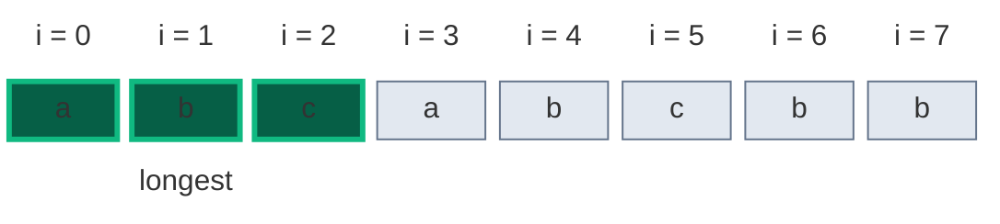
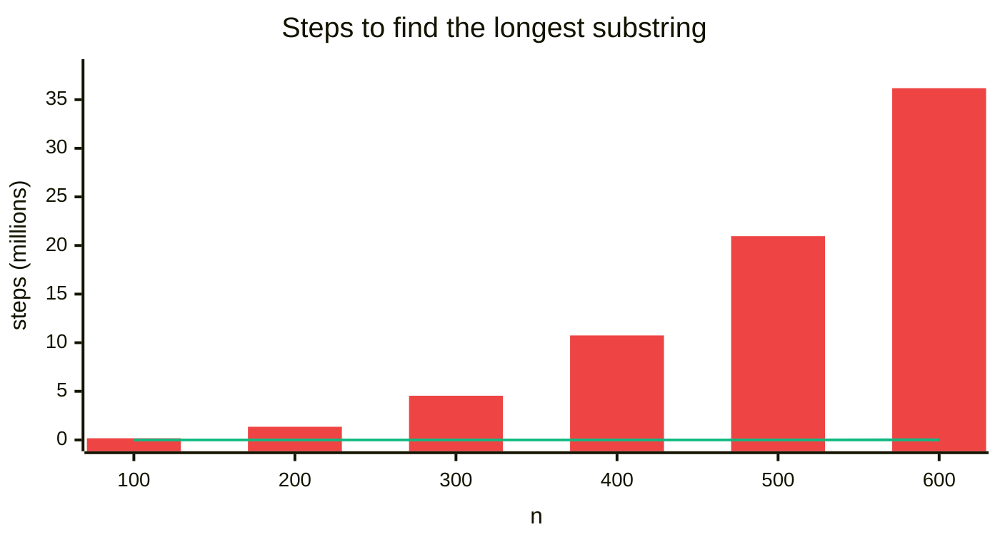
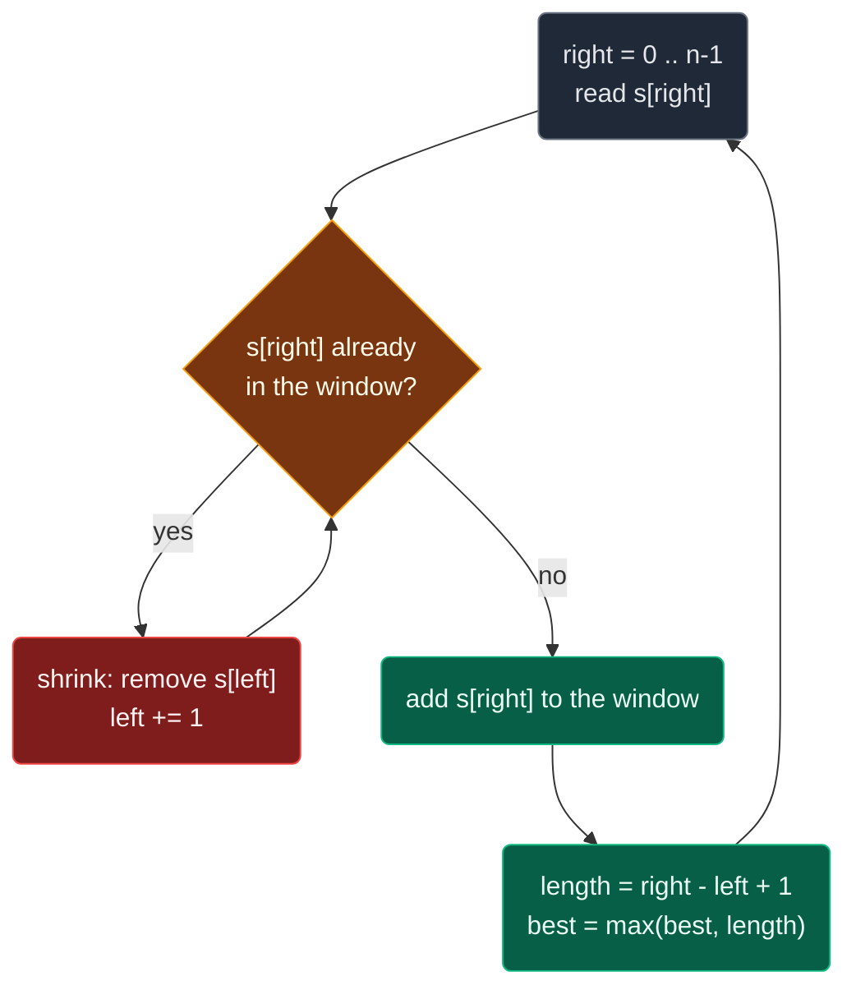
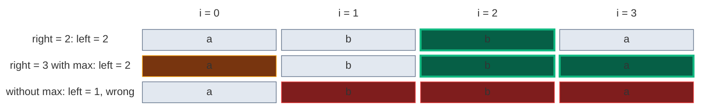
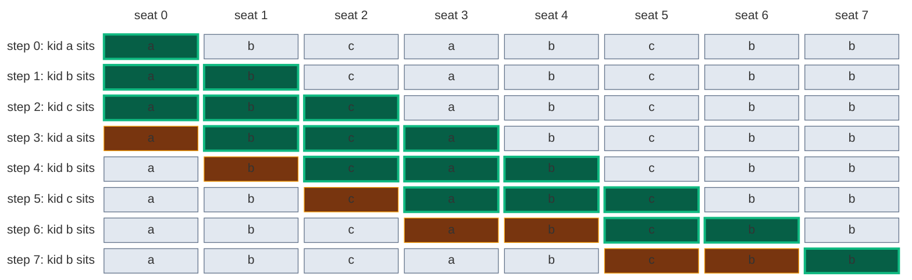

# 02. 3. Longest Substring Without Repeating Characters

| Difficulty | Pattern | Source | Time | Space |
|:---:|:---:|:---:|:---:|:---:|
| **Medium** | Variable Window + Set/Map | [3. Longest Substring Without Repeating Characters](https://leetcode.com/problems/longest-substring-without-repeating-characters/) | `O(n)` | `O(min(n, charset))` |

## 1. Problem Statement

Given a string `s`, return the length of the **longest substring** that has **no repeated characters**.

A **substring** is **contiguous** (no gaps). In `"pwwkew"`, `"pwke"` is a subsequence (it skips a letter), not a substring, so it does not count.

### Example

```text
Input:  s = "abcabcbb"
Output: 3   ("abc", "bca" and "cab" are all valid answers)
```



We use this same example in every section below.

Other LeetCode examples:

```text
"bbbbb"   -> 1   ("b")
"pwwkew"  -> 3   ("wke")
```

### Constraints

- `0 <= s.length <= 5 * 10^4`
- `s` has English letters, digits, symbols and spaces

### What the constraints tell us (simple theory)

A **constraint** is the biggest input the judge will ever give you. A computer does about **100 million (10^8) simple steps per second**.

| Biggest input `n` | Steps you can afford | Ideas that fit |
|:---:|:---:|:---|
| up to ~500 | about `n^3` | Three nested loops |
| up to ~5,000 | about `n^2` | Two nested loops |
| up to ~1,000,000 | about `n` | One loop, sliding window |

**For this problem:** `n` can be `5 × 10^4`.

- Checking every substring and testing it for repeats costs about `n^3 / 6` steps: about `2 × 10^13`. Hopeless.
- The sliding window moves `right` `n` times and `left` at most `n` times: at most `10^5` steps.

**How the work grows** (random strings of letters; counted by running code). Red bars = brute force steps, green line = sliding window steps.



| `n` | Brute force steps | Sliding window steps |
|:---:|:---:|:---:|
| 100 | 171,700 | 191 |
| 200 | 1,353,400 | 394 |
| 300 | 4,545,100 | 599 |
| 400 | 10,746,800 | 790 |
| 500 | 20,958,500 | 994 |
| 600 | 36,180,200 | 1,199 |

Even at `n = 600` brute force needs 36 million steps. The window never needs more than `2n`.

## 2. Core Theory

### What the problem really asks

Three words decide the approach:

- **Longest** → maximise a length.
- **Substring** → contiguous.
- **Without repeating** → a condition the window must keep.

"Longest + contiguous + condition" is the signature of a **variable-size sliding window**: grow while the condition holds, shrink the moment it breaks.

**The promise (invariant):** whenever we record the answer, the window `s[left .. right]` has **no repeated character**.



### Why the inner `while` does not make it `O(n^2)`

The code has a `while` inside a `for`, but `right` moves forward at most `n` times and `left` moves forward at most `n` times. **Each character enters the window once and leaves it at most once**, so the total is at most `2n` steps.

### Faster shrinking: remember the last index

The set version moves `left` one step at a time. If we store **where each character was last seen**, we can jump `left` straight past the old copy:

```text
left = last_seen[s[right]] + 1
```

### Why the `max` guard is required (`"abba"`)

That jump has a trap. Green = the window after the step, orange = an old index that is already outside the window.



- `right = 2` (`'b'`): last seen at 1, so `left = 1 + 1 = 2`. Window `"b"`.
- `right = 3` (`'a'`): last seen at **0**. A plain `left = 0 + 1 = 1` would move `left` **backward** to 1 and let the second `'b'` back in: `"bba"` is not valid.
- With the guard, `left = max(2, 0 + 1) = 2`. Window `"ba"`. Correct.

**Rule:** `left` never moves backward. Always write `left = max(left, last_seen[ch] + 1)`. The map keeps old characters forever; `max` is what tells "inside the window" from "long gone".

### Set or hash map?

| | Set version | Hash map jump |
|:---|:---|:---|
| Stores | characters inside the window | last index of every character seen |
| On a duplicate | remove from the left one by one | jump `left` directly |
| Needs `while` | yes | no |
| Time | `O(n)` | `O(n)` |
| Space | `O(min(n, charset))` | `O(min(n, charset))` |
| Best for | learning; works for every "longest valid window" problem | cleaner final code |

**Space** is `O(min(n, charset))`: at most one entry per distinct character. Lowercase only: `26`. ASCII: `128` or `256`. Any Unicode: up to `n`.

The lecture writes the hash map version with a fixed array `hash[256]` filled with `-1` ("never seen"), and moves `l` only when `hash[s[r]] >= l`. That check does the same job as `max(left, ...)`: it ignores old indexes outside the window.

## 3. Edge Cases

| Case | Input | Expected | Why it matters |
|:---|:---|:---:|:---|
| Empty string | `""` | `0` | The loop never runs; start the answer at `0`, not `1` |
| One character | `"a"` | `1` | Smallest real window |
| All the same | `"bbbbb"` | `1` | Shrinks on every step |
| All different | `"abcdef"` | `6` | Never shrinks |
| Old-index trap | `"abba"` | `2` | Without `max`, `left` moves backward |
| Best window at the end | `"aab"` | `2` | Answer is `"ab"` |
| Space character | `" "` | `1` | Spaces, digits and symbols are normal characters |
| Repeat far apart | `"abcdefa"` | `6` | The jump must skip `left` all the way |

## 4. Brute Force: Check Every Substring

### Idea

Try every start `i` and every end `j`. If `s[i .. j]` has no repeats (its set has the same size as the substring), update the answer.

For `"abcabcbb"` starting at index 0: `"a"`, `"ab"`, `"abc"` are fine; `"abca"` has two `a`s, so it fails. Then start again from index 1, re-checking everything to its right.

### Code

```python
# Brute force: check every substring
class SolutionBrute:

    # Main method
    def lengthOfLongestSubstring(self, s: str) -> int:

        # Length of the string
        n = len(s)

        # Longest valid length so far
        max_length = 0

        # Every start index
        for start in range(n):

            # Every end index
            for end in range(start, n):

                # Cut out the substring
                current_substring = s[start:end + 1]

                # No repeats if the set is as long as the substring
                if len(current_substring) == len(set(current_substring)):

                    # Keep the longest
                    max_length = max(max_length, end - start + 1)

        # Longest valid length
        return max_length
```

### Complexity

| Measure | Complexity | Why |
|:---|:---:|:---|
| **Time** | `O(n^3)` | `O(n^2)` substrings, each checked in `O(n)` |
| **Space** | `O(n)` | The substring and its set |

## 5. Better Approach: Grow One Start With a Set

### Idea

For each start, add characters one by one into a set. The moment a character is already in the set, this start cannot go further: stop and try the next start.

- start at `a`: `a`, `ab`, `abc`, then `a` repeats → best 3
- start at `b`: `b`, `bc`, `bca`, then `b` repeats → best 3
- and so on

### Code

```python
# Better: for each start, grow with a set until a repeat
class SolutionBetter:

    # Main method
    def lengthOfLongestSubstring(self, s: str) -> int:

        # Length of the string
        n = len(s)

        # Longest valid length so far
        max_length = 0

        # Every start index
        for start in range(n):

            # Characters in this attempt
            seen = set()

            # Grow to the right
            for end in range(start, n):

                # A repeat ends this start
                if s[end] in seen:

                    # Try the next start
                    break

                # Remember this character
                seen.add(s[end])

                # Keep the longest
                max_length = max(max_length, end - start + 1)

        # Longest valid length
        return max_length
```

### Complexity

| Measure | Complexity | Why |
|:---|:---:|:---|
| **Time** | `O(n^2)` | Two nested loops; the set check is `O(1)` |
| **Space** | `O(min(n, charset))` | The set holds distinct characters only |

Each new start throws away everything the previous start learned. The sliding window keeps it.

## 6. Optimal Approach: Sliding Window (Set, Then Hash Map Jump)

### Idea

After `"abc"` is valid, moving to `"abca"` does not need a fresh start. Just **repair** the window: drop characters from the left until the repeat is gone.

- `left` = start of the current valid window
- `right` = the character being added
- `seen` = the characters inside the window

**Use `while`, not `if`:** at `right = 6` below, one removal is not enough.

### Visual Walkthrough (Story Version)

**The story:** Kids walk onto a bench one by one from the right. The rule of the bench: **no two kids with the same name**. If a new kid's name is already on the bench, kids leave from the **left end** until the old kid with that name is gone. The teacher writes down the longest bench ever seen.

**How to read the pictures:** green = kids on the bench, orange = kids who just left, grey = not on the bench (yet, or any more).



| Step | New kid | Kids who left | Bench | Length | Longest |
|:---:|:---:|:---|:---|:---:|:---:|
| 0 | a | – | a | 1 | 1 |
| 1 | b | – | a b | 2 | 2 |
| 2 | c | – | a b c | 3 | 3 |
| 3 | a | a | b c a | 3 | 3 |
| 4 | b | b | c a b | 3 | 3 |
| 5 | c | c | a b c | 3 | 3 |
| 6 | b | a, b | c b | 2 | 3 |
| 7 | b | c, b | b | 1 | 3 |

**What the story teaches**

| In the story | In the code |
|:---|:---|
| The bench | Window `s[left .. right]` |
| Names on the bench | `seen` set |
| A new kid sits on the right | `right` moves forward |
| Kids leave from the left until the name is free | `while s[right] in seen: remove s[left]; left += 1` |
| Longest bench | `max_length` |

### Step-by-Step Example

`s = "abcabcbb"`. Green = window after the step, orange = removed this step, grey = outside.


| `right` | char | Removed | `left` | Window | Length | Best |
|:---:|:---:|:---|:---:|:---:|:---:|:---:|
| 0 | a | – | 0 | a | 1 | 1 |
| 1 | b | – | 0 | ab | 2 | 2 |
| 2 | c | – | 0 | abc | 3 | 3 |
| 3 | a | `s[0]` | 1 | bca | 3 | 3 |
| 4 | b | `s[1]` | 2 | cab | 3 | 3 |
| 5 | c | `s[2]` | 3 | abc | 3 | 3 |
| 6 | b | `s[3]`, `s[4]` | 5 | cb | 2 | 3 |
| 7 | b | `s[5]`, `s[6]` | 7 | b | 1 | 3 |

**Same example with the hash map jump** (`left = max(left, last_seen[ch] + 1)`):

| `right` | char | Last seen | New `left` | Window | Best |
|:---:|:---:|:---:|:---:|:---:|:---:|
| 0 | a | – | 0 | a | 1 |
| 1 | b | – | 0 | ab | 2 |
| 2 | c | – | 0 | abc | 3 |
| 3 | a | 0 | `max(0, 1) = 1` | bca | 3 |
| 4 | b | 1 | `max(1, 2) = 2` | cab | 3 |
| 5 | c | 2 | `max(2, 3) = 3` | abc | 3 |
| 6 | b | 4 | `max(3, 5) = 5` | cb | 3 |
| 7 | b | 6 | `max(5, 7) = 7` | b | 3 |

### Code

```python
# Optimal 1: sliding window with a set
class SolutionSet:

    # Main method (trace is optional and only used by the tests)
    def lengthOfLongestSubstring(self, s: str, trace: list = None) -> int:

        # Characters inside the window
        seen = set()

        # Left edge of the window
        left = 0

        # Longest valid length so far
        max_length = 0

        # Add one character at a time
        for right in range(len(s)):

            # Repeat inside the window: shrink until it is gone
            while s[right] in seen:

                # Drop the leftmost character
                seen.remove(s[left])

                # Move the left edge
                left += 1

            # Add the new character
            seen.add(s[right])

            # Keep the longest window
            max_length = max(max_length, right - left + 1)

            # Save (left, right) for the tests
            if trace is not None:

                # One entry per character
                trace.append((left, right))

        # Longest valid length
        return max_length


# Optimal 2: sliding window with a last-index map
class Solution:

    # Main method
    def lengthOfLongestSubstring(self, s: str) -> int:

        # Last index where each character was seen
        last_seen = {}

        # Left edge of the window
        left = 0

        # Longest valid length so far
        max_length = 0

        # Add one character at a time
        for right in range(len(s)):

            # The character being added
            current_char = s[right]

            # Seen before: jump left past it (never backward)
            if current_char in last_seen:

                # max keeps left from moving back on an old index
                left = max(left, last_seen[current_char] + 1)

            # Remember the newest index of this character
            last_seen[current_char] = right

            # Keep the longest window
            max_length = max(max_length, right - left + 1)

        # Longest valid length
        return max_length


# Import random for the agreement tests
import random

# Our example, traced step by step
trace = []

# Run the set version with the trace on
assert SolutionSet().lengthOfLongestSubstring("abcabcbb", trace) == 3

# (left, right) after each step
assert trace == [(0, 0), (0, 1), (0, 2), (1, 3), (2, 4), (3, 5), (5, 6), (7, 7)]

# LeetCode examples
assert Solution().lengthOfLongestSubstring("abcabcbb") == 3

# All the same
assert Solution().lengthOfLongestSubstring("bbbbb") == 1

# Answer must be a substring, not a subsequence
assert Solution().lengthOfLongestSubstring("pwwkew") == 3

# Empty string
assert Solution().lengthOfLongestSubstring("") == 0

# One character
assert Solution().lengthOfLongestSubstring("a") == 1

# All different
assert Solution().lengthOfLongestSubstring("abcdef") == 6

# Old-index trap: needs the max guard
assert Solution().lengthOfLongestSubstring("abba") == 2

# Best window at the end
assert Solution().lengthOfLongestSubstring("aab") == 2

# A space is a normal character
assert Solution().lengthOfLongestSubstring(" ") == 1

# Repeat far apart
assert Solution().lengthOfLongestSubstring("abcdefa") == 6

# The jump without max would give 3 on "abba"
def jump_without_max(s):

    # Last index of each character
    last_seen = {}

    # Left edge
    left = 0

    # Best length
    best = 0

    # Every character
    for right, ch in enumerate(s):

        # Wrong: no max guard
        if ch in last_seen:

            # Can move left backward
            left = last_seen[ch] + 1

        # Remember the index
        last_seen[ch] = right

        # Keep the longest
        best = max(best, right - left + 1)

    # Wrong answer on "abba"
    return best

# Shows the bug
assert jump_without_max("abba") == 3

# All versions agree on random strings
for _ in range(500):

    # Random string from a small alphabet so repeats happen
    s = "".join(random.choice("abcd ") for _ in range(random.randint(0, 15)))

    # Brute force answer
    expected = SolutionBrute().lengthOfLongestSubstring(s)

    # Every version must match
    assert SolutionBetter().lengthOfLongestSubstring(s) == SolutionSet().lengthOfLongestSubstring(s) == Solution().lengthOfLongestSubstring(s) == expected

# Biggest input runs fast
assert Solution().lengthOfLongestSubstring("".join(chr(32 + i % 95) for i in range(5 * 10 ** 4))) == 95

# All checks passed
print("All tests passed")
```

**About `trace`:** it is only for the tests. LeetCode calls `lengthOfLongestSubstring(s)` and the code works the same.

### Complexity

| Approach | Time | Space |
|:---|:---:|:---:|
| Brute force | `O(n^3)` | `O(n)` |
| Grow each start with a set | `O(n^2)` | `O(min(n, charset))` |
| **Sliding window + set** | **`O(n)`** (at most `2n` pointer moves) | `O(min(n, charset))` |
| **Sliding window + last-index map** | **`O(n)`** (one pass) | `O(min(n, charset))` |

## 7. Common Mistakes

| Mistake | What goes wrong | Fix |
|:---|:---|:---|
| `left = last_seen[ch] + 1` without `max` | An old index moves `left` backward; `"abba"` gives `3` instead of `2` | `left = max(left, last_seen[ch] + 1)` |
| `if` instead of `while` in the set version | One removal may not clear the repeat | `while s[right] in seen:` |
| Recording the length before fixing the window | Records a window that still has a repeat | Add, fix, **then** record |
| Treating it as a subsequence | `"pwke"` would give `4` for `"pwwkew"` | Only contiguous windows count |
| Not updating `last_seen[ch] = right` | The old index stays, so the jump fires again and again | Write the new index every step |
| Length as `right - left` | Off by one | `right - left + 1` |
| Starting the answer at `1` | Empty string returns `1` | Start at `0` |

## 8. Interview Follow-ups

### Q1. How do you return the substring itself?

**Answer:**
- Also store `best_start = left` whenever a new maximum is found.
- At the end return `s[best_start : best_start + max_length]`.
- Same time and space.

### Q2. What if the characters can be any Unicode?

**Answer:**
- The dictionary version works for any alphabet.
- A fixed `int[256]` array no longer works.
- Space becomes `O(min(n, charset))`, which is up to `O(n)` for arbitrary Unicode.

### Q3. How do you solve "longest substring with at most `k` distinct characters"?

**Answer:**
- Same skeleton, different state: a `Counter` of characters in the window.
- While `len(counter) > k`, decrease `counter[s[left]]`, delete it at zero, and move `left`.
- That is [340](../03.%20At%20Most/01.%20340.%20Longest%20Substring%20With%20At%20Most%20K%20Distinct%20Characters.md).

### Q4. Why is the `while` inside the `for` still `O(n)`?

**Answer:**
- `left` never goes back. Over the whole run it moves at most `n` times in total.
- Each character enters once and leaves at most once: at most `2n` steps.

### Q5. Can it be done in one pass with `O(1)` space?

**Answer:**
- Only if the alphabet is fixed: an `int[128]` array of last indexes is constant space (the lecture's `hash[256]`).
- For an unlimited alphabet, no: you must be able to tell up to `n` different characters apart.

## 9. Interview Explanation

> This is a longest contiguous window with a condition, so I use a variable sliding window. I keep left and right edges and a set of the characters inside the window. For each new character on the right, if it is already in the set, I remove characters from the left in a while loop until the repeat is gone, then add the new one and record right minus left plus one. A faster version stores the last index of each character and jumps left to max(left, last index + 1); the max matters, because on "abba" an old index would otherwise pull left backward. Each character enters and leaves the window at most once, so it is O(n) time and O(min(n, charset)) space.
