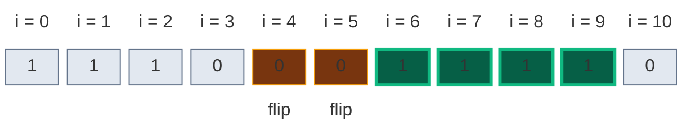
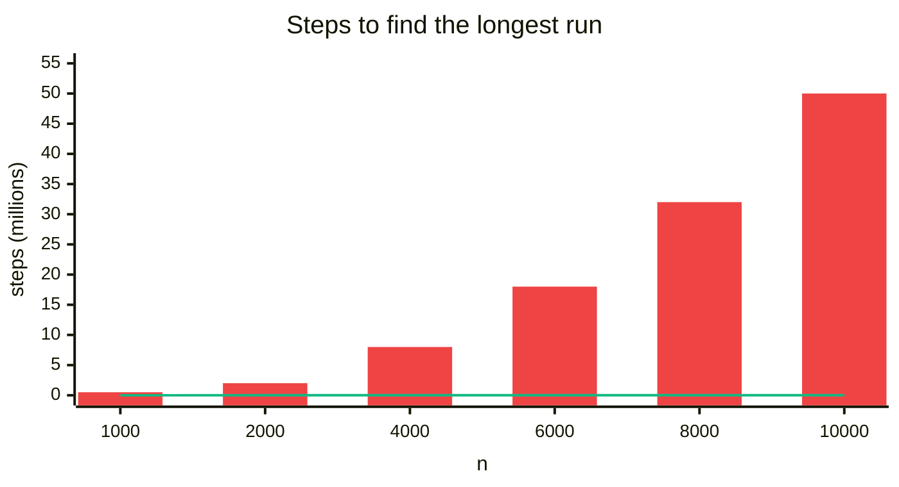
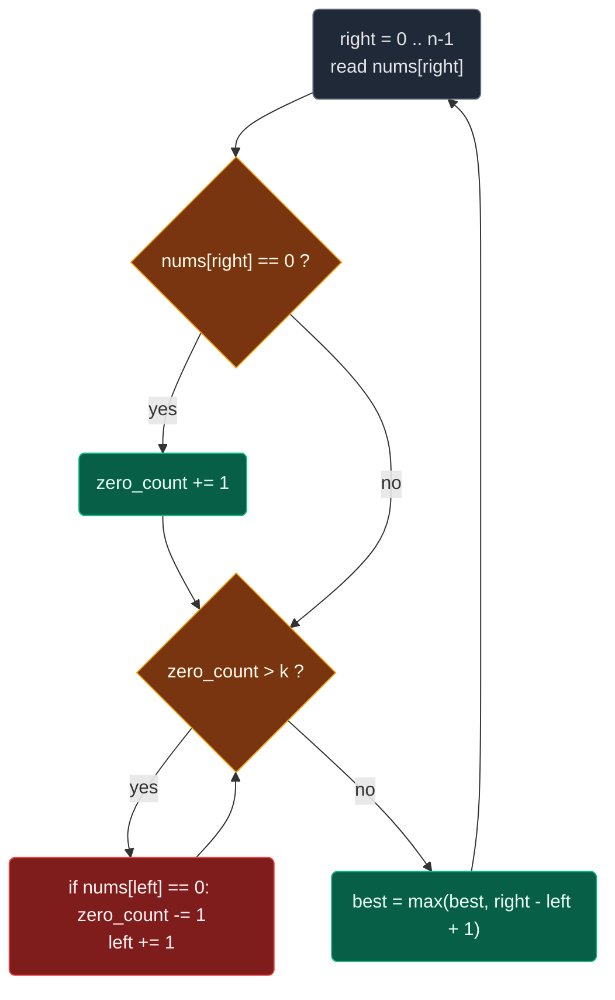
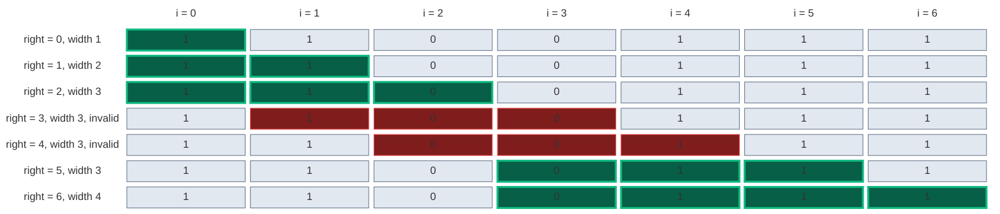
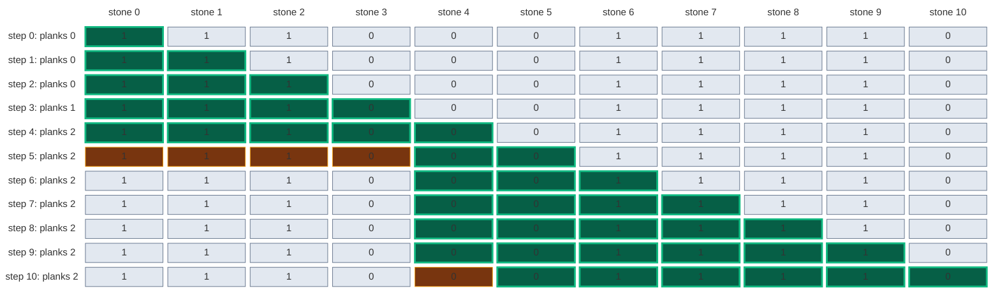

# 03. 1004. Max Consecutive Ones III

| Difficulty | Pattern | Source | Time | Space |
|:---:|:---:|:---:|:---:|:---:|
| **Medium** | Variable Window + Budget Counter | [1004. Max Consecutive Ones III](https://leetcode.com/problems/max-consecutive-ones-iii/) | `O(n)` | `O(1)` |

## 1. Problem Statement

You get a binary array `nums` (only `0`s and `1`s) and a number `k`. You may flip **at most `k`** zeros into ones. Return the **longest run of consecutive `1`s** you can make.

### Example

```text
Input:  nums = [1, 1, 1, 0, 0, 0, 1, 1, 1, 1, 0], k = 2
Output: 6
```

Flip the two zeros at index 4 and 5 (orange). The green run of 6 becomes all ones.



We use this same example in every section below.

Another LeetCode example:

```text
nums = [0,0,1,1,0,0,1,1,1,0,1,1,0,0,0,1,1,1,1], k = 3  -> 10
```

### Constraints

- `1 <= nums.length <= 10^5`
- `nums[i]` is `0` or `1`
- `0 <= k <= nums.length`

### What the constraints tell us (simple theory)

A **constraint** is the biggest input the judge will ever give you. A computer does about **100 million (10^8) simple steps per second**.

| Biggest input `n` | Steps you can afford | Ideas that fit |
|:---:|:---:|:---|
| up to ~5,000 | about `n^2` | Two nested loops |
| up to ~1,000,000 | about `n` | One loop, sliding window |

**For this problem:** `n` can be `10^5`.

- Checking every subarray is about `n^2 / 2` = `5 × 10^9` steps in the worst case (when `k` is large, nothing ever stops early). Too slow.
- The sliding window moves `right` `n` times and `left` at most `n` times: at most `2 × 10^5` steps.

**How the work grows** (worst case: `k` large; counted by running code). Red bars = brute force steps, green line = sliding window steps.



| `n` | Brute force steps | Sliding window steps |
|:---:|:---:|:---:|
| 1,000 | 500,500 | 1,000 |
| 2,000 | 2,001,000 | 2,000 |
| 4,000 | 8,002,000 | 4,000 |
| 6,000 | 18,003,000 | 6,000 |
| 8,000 | 32,004,000 | 8,000 |
| 10,000 | 50,005,000 | 10,000 |

## 2. Core Theory

### Say the problem in a different way

Do not think about flipping. Restate it first:

```text
"Flip at most k zeros and get the longest run of ones"
   is the same as
"Find the longest subarray that has at most k zeros"
```

**Why they are the same:** take any window with `z` zeros. If `z <= k`, you can flip all of them, and the whole window becomes ones. If `z > k`, you cannot. So the longest run you can make is exactly the longest window with at most `k` zeros.

Now the keywords are clear: **longest + contiguous + at most k** → a **variable-size sliding window**.

### What do we need to remember?

In "Longest Substring Without Repeating Characters" we needed a set of characters. Here the only question is **how many zeros are inside the window?** So one number is enough: `zero_count`. No set, no map. That is why the space is `O(1)`.

### The budget idea

- Every zero costs 1 flip.
- Your budget is `k`.
- The window is valid when its total cost is at most `k`.

This "budget" idea solves many problems: at most `k` distinct values, at most `k` replacements, at most `k` bad elements.

### The loop



**Order matters:** expand, then fix the window, then record. Recording before the fix would count a window you are not allowed to use.

**Only count down for zeros.** When `left` moves past a `1`, `zero_count` does not change. Only a leaving `0` gives back one flip.

### `while` or `if`? Two different promises

Your notes have a second write-up on this. Both versions are `O(n)`; they promise different things.

**`while` version: "the current window is always valid".** After the loop, `zero_count <= k` for sure. Track the best length in `max_length`.

**`if` version: "the window never gets smaller".** Shrink **at most one** step per new element, and return `n - left` at the end, with no `max_length`.

Why it works: let `W` be the window width. Each step `right` moves, so the width tries to become `W + 1`:

| Case | When | What happens | New width |
|:---|:---|:---|:---:|
| A: still valid | `zero_count <= k` | `left` stays | `W + 1` (grows) |
| B: now invalid | `zero_count > k` | `left` moves once | `W` (same) |

So the width never shrinks, and it only grows on a valid step. It always equals the best valid length found so far. The window may be **invalid** for a while, but it is never allowed to **grow** while invalid. At the end, `right = n - 1`, so the width is `n - left`.



`nums = [1, 1, 0, 0, 1, 1, 1]`, `k = 1`: from `right = 3` to `right = 4` the window (red) is invalid but keeps width 3. Once it is valid again it can grow to 4. Answer `7 - 3 = 4`.

| | `while` version | `if` version |
|:---|:---|:---|
| Promise | window always valid | width never shrinks |
| Needs `max_length` | yes | no, returns `n - left` |
| Shrinks per step | 0 or more | at most 1 |
| Time / space | `O(n)` / `O(1)` | `O(n)` / `O(1)` |
| Easy to explain | yes | needs the width argument |
| Works for other problems | yes, the general template | **no**: fails for shortest-window and exact-count problems |

## 3. Edge Cases

| Case | Input | Expected | Why it matters |
|:---|:---|:---:|:---|
| `k = 0` | `[1,1,0,1,1,1]`, `k = 0` | `3` | Just the longest existing run of ones |
| `k = 0`, all zeros | `[0,0,0]`, `k = 0` | `0` | Window shrinks to empty each step |
| One element | `[0]`, `k = 1` | `1` | Smallest input |
| All ones | `[1,1,1,1]`, `k = 2` | `4` | Never shrinks |
| All zeros, small `k` | `[0,0,0,0,0]`, `k = 2` | `2` | Only `k` zeros fit |
| `k` ≥ number of zeros | `[1,0,1,0,1]`, `k = 3` | `5` | Whole array |
| `k = n` | `[0,0,0]`, `k = 3` | `3` | Upper limit of `k` |
| Best run at the end | `[0,0,1,1,1]`, `k = 0` | `3` | Found only at the last steps |

## 4. Brute Force: Check Every Subarray

### Idea

For every start, extend to the right and keep a running `zero_count`. While it is at most `k`, the window can become all ones, so record its length. Once it goes over `k`, extending further only makes it worse, so `break`.

### Code

```python
# Import List for type hints
from typing import List


# Brute force: every start, extend until too many zeros
class SolutionBrute:

    # Main method
    def longestOnes(self, nums: List[int], k: int) -> int:

        # Number of elements
        n = len(nums)

        # Longest valid length so far
        max_length = 0

        # Every start index
        for start in range(n):

            # Zeros in the current window
            zero_count = 0

            # Extend to the right
            for end in range(start, n):

                # A zero costs one flip
                if nums[end] == 0:

                    # Count it
                    zero_count += 1

                # Still within budget
                if zero_count <= k:

                    # Keep the longest
                    max_length = max(max_length, end - start + 1)

                # Over budget: this start can go no further
                else:

                    # Try the next start
                    break

        # Longest valid length
        return max_length
```

### Complexity

| Measure | Complexity | Why |
|:---|:---:|:---|
| **Time** | `O(n^2)` | Every start scans forward again |
| **Space** | `O(1)` | A few counters |

## 5. Optimal Approach: Variable Sliding Window

### Idea

Brute force throws away its work: when the zeros go over `k`, it starts again from the next index. Instead, **don't restart, move `left`**. Remove elements from the left until the window is valid again, then keep going.

1. `left = 0`, `zero_count = 0`, `max_length = 0`.
2. For each `right`: if `nums[right] == 0`, add 1 to `zero_count`.
3. While `zero_count > k`: if `nums[left] == 0`, subtract 1; move `left`.
4. Record `right - left + 1`.

### Visual Walkthrough (Story Version)

**The story:** Ravi walks along a path of stones. White stones (`1`) are fine. Black stones (`0`) are holes, and he has only **2 planks** to cover holes. He wants the longest stretch he can walk without stepping in a hole.

**The rules:**

- His stretch grows one stone at a time on the right.
- Each hole inside the stretch uses one plank.
- If he needs a 3rd plank, he gives up stones from the **left** of the stretch until a hole leaves it and a plank comes back.

**How to read the pictures:** green = stones in his stretch, orange = stones he just gave up, grey = outside. The label row shows holes as `hole`.



| Step (`right`) | New stone | Planks used | Given up | Stretch | Length | Longest |
|:---:|:---:|:---:|:---|:---:|:---:|:---:|
| 0 | 1 | 0 | – | 0–0 | 1 | 1 |
| 1 | 1 | 0 | – | 0–1 | 2 | 2 |
| 2 | 1 | 0 | – | 0–2 | 3 | 3 |
| 3 | 0 | 1 | – | 0–3 | 4 | 4 |
| 4 | 0 | 2 | – | 0–4 | 5 | 5 |
| 5 | 0 | 3 → 2 | stones 0, 1, 2, 3 | 4–5 | 2 | 5 |
| 6 | 1 | 2 | – | 4–6 | 3 | 5 |
| 7 | 1 | 2 | – | 4–7 | 4 | 5 |
| 8 | 1 | 2 | – | 4–8 | 5 | 5 |
| 9 | 1 | 2 | – | 4–9 | 6 | **6** |
| 10 | 0 | 3 → 2 | stone 4 | 5–10 | 6 | 6 |

At step 5 he gave up **four** stones, but only the last one (index 3) was a hole. The three white stones gave back nothing. That is why the shrink must be a `while`, and why `zero_count` only drops for zeros.

**What the story teaches**

| In the story | In the code |
|:---|:---|
| Stone path | `nums` |
| Hole | `0` |
| Planks | `k` |
| Planks used | `zero_count` |
| Giving up stones from the left | `left += 1` |
| A hole leaving gives a plank back | `if nums[left] == 0: zero_count -= 1` |
| Longest stretch | `max_length` |

### Step-by-Step Example

Green = window after the step, orange = removed this step, grey = outside.

```mermaid
block-beta
  columns 12
  hx[" "] h0["i = 0"] h1["i = 1"] h2["i = 2"] h3["i = 3"] h4["i = 4"] h5["i = 5"] h6["i = 6"] h7["i = 7"] h8["i = 8"] h9["i = 9"] h10["i = 10"]
  l0["right = 0, left = 0, zeros = 0, best = 1"] r0c0["1"] r0c1["1"] r0c2["1"] r0c3["0"] r0c4["0"] r0c5["0"] r0c6["1"] r0c7["1"] r0c8["1"] r0c9["1"] r0c10["0"]
  l1["right = 1, left = 0, zeros = 0, best = 2"] r1c0["1"] r1c1["1"] r1c2["1"] r1c3["0"] r1c4["0"] r1c5["0"] r1c6["1"] r1c7["1"] r1c8["1"] r1c9["1"] r1c10["0"]
  l2["right = 2, left = 0, zeros = 0, best = 3"] r2c0["1"] r2c1["1"] r2c2["1"] r2c3["0"] r2c4["0"] r2c5["0"] r2c6["1"] r2c7["1"] r2c8["1"] r2c9["1"] r2c10["0"]
  l3["right = 3, left = 0, zeros = 1, best = 4"] r3c0["1"] r3c1["1"] r3c2["1"] r3c3["0"] r3c4["0"] r3c5["0"] r3c6["1"] r3c7["1"] r3c8["1"] r3c9["1"] r3c10["0"]
  l4["right = 4, left = 0, zeros = 2, best = 5"] r4c0["1"] r4c1["1"] r4c2["1"] r4c3["0"] r4c4["0"] r4c5["0"] r4c6["1"] r4c7["1"] r4c8["1"] r4c9["1"] r4c10["0"]
  l5["right = 5, left = 4, zeros = 2, best = 5"] r5c0["1"] r5c1["1"] r5c2["1"] r5c3["0"] r5c4["0"] r5c5["0"] r5c6["1"] r5c7["1"] r5c8["1"] r5c9["1"] r5c10["0"]
  l6["right = 6, left = 4, zeros = 2, best = 5"] r6c0["1"] r6c1["1"] r6c2["1"] r6c3["0"] r6c4["0"] r6c5["0"] r6c6["1"] r6c7["1"] r6c8["1"] r6c9["1"] r6c10["0"]
  l7["right = 7, left = 4, zeros = 2, best = 5"] r7c0["1"] r7c1["1"] r7c2["1"] r7c3["0"] r7c4["0"] r7c5["0"] r7c6["1"] r7c7["1"] r7c8["1"] r7c9["1"] r7c10["0"]
  l8["right = 8, left = 4, zeros = 2, best = 5"] r8c0["1"] r8c1["1"] r8c2["1"] r8c3["0"] r8c4["0"] r8c5["0"] r8c6["1"] r8c7["1"] r8c8["1"] r8c9["1"] r8c10["0"]
  l9["right = 9, left = 4, zeros = 2, best = 6"] r9c0["1"] r9c1["1"] r9c2["1"] r9c3["0"] r9c4["0"] r9c5["0"] r9c6["1"] r9c7["1"] r9c8["1"] r9c9["1"] r9c10["0"]
  l10["right = 10, left = 5, zeros = 2, best = 6"] r10c0["1"] r10c1["1"] r10c2["1"] r10c3["0"] r10c4["0"] r10c5["0"] r10c6["1"] r10c7["1"] r10c8["1"] r10c9["1"] r10c10["0"]
  classDef head fill:none,stroke:none,color:#64748b
  class hx,h0,h1,h2,h3,h4,h5,h6,h7,h8,h9,h10,l0,l1,l2,l3,l4,l5,l6,l7,l8,l9,l10 head
  classDef new fill:#065f46,stroke:#10b981,color:#ecfdf5,stroke-width:3px
  class r0c0,r1c0,r1c1,r2c0,r2c1,r2c2,r3c0,r3c1,r3c2,r3c3,r4c0,r4c1,r4c2,r4c3,r4c4,r5c4,r5c5,r6c4,r6c5,r6c6,r7c4,r7c5,r7c6,r7c7,r8c4,r8c5,r8c6,r8c7,r8c8,r9c4,r9c5,r9c6,r9c7,r9c8,r9c9,r10c5,r10c6,r10c7,r10c8,r10c9,r10c10 new
  classDef old fill:#e2e8f0,stroke:#64748b,color:#0f172a
  class r0c1,r0c2,r0c3,r0c4,r0c5,r0c6,r0c7,r0c8,r0c9,r0c10,r1c2,r1c3,r1c4,r1c5,r1c6,r1c7,r1c8,r1c9,r1c10,r2c3,r2c4,r2c5,r2c6,r2c7,r2c8,r2c9,r2c10,r3c4,r3c5,r3c6,r3c7,r3c8,r3c9,r3c10,r4c5,r4c6,r4c7,r4c8,r4c9,r4c10,r5c6,r5c7,r5c8,r5c9,r5c10,r6c0,r6c1,r6c2,r6c3,r6c7,r6c8,r6c9,r6c10,r7c0,r7c1,r7c2,r7c3,r7c8,r7c9,r7c10,r8c0,r8c1,r8c2,r8c3,r8c9,r8c10,r9c0,r9c1,r9c2,r9c3,r9c10,r10c0,r10c1,r10c2,r10c3 old
  classDef read fill:#78350f,stroke:#f59e0b,color:#fef3c7
  class r5c0,r5c1,r5c2,r5c3,r10c4 read
```



### Code

```python
# Optimal: variable sliding window (while version)
class Solution:

    # Main method (trace is optional and only used by the tests)
    def longestOnes(self, nums: List[int], k: int, trace: list = None) -> int:

        # Left edge of the window
        left = 0

        # Zeros inside the window
        zero_count = 0

        # Longest valid length so far
        max_length = 0

        # Add one element at a time
        for right in range(len(nums)):

            # A new zero uses one flip
            if nums[right] == 0:

                # Count it
                zero_count += 1

            # Over budget: shrink from the left
            while zero_count > k:

                # Only a leaving zero gives a flip back
                if nums[left] == 0:

                    # One flip returned
                    zero_count -= 1

                # Move the left edge
                left += 1

            # The window is valid: record its length
            max_length = max(max_length, right - left + 1)

            # Save (right, left, zero_count, max_length) for the tests
            if trace is not None:

                # One entry per step
                trace.append((right, left, zero_count, max_length))

        # Longest valid length
        return max_length


# Alternative: the "if" version (width never shrinks)
class SolutionIf:

    # Main method
    def longestOnes(self, nums: List[int], k: int) -> int:

        # Left edge of the window
        left = 0

        # Zeros inside the window
        zero_count = 0

        # Add one element at a time
        for right in range(len(nums)):

            # A new zero uses one flip
            if nums[right] == 0:

                # Count it
                zero_count += 1

            # Over budget: shrink by at most one
            if zero_count > k:

                # Only a leaving zero gives a flip back
                if nums[left] == 0:

                    # One flip returned
                    zero_count -= 1

                # Move the left edge once
                left += 1

        # Width at the end = best valid length
        return len(nums) - left


# Import random for the agreement tests
import random

# Our example, traced step by step
trace = []

# Run with the trace on
assert Solution().longestOnes([1, 1, 1, 0, 0, 0, 1, 1, 1, 1, 0], 2, trace) == 6

# (right, left, zero_count, max_length) after each step
assert trace == [(0, 0, 0, 1), (1, 0, 0, 2), (2, 0, 0, 3), (3, 0, 1, 4), (4, 0, 2, 5), (5, 4, 2, 5), (6, 4, 2, 5), (7, 4, 2, 5), (8, 4, 2, 5), (9, 4, 2, 6), (10, 5, 2, 6)]

# LeetCode example 2
assert Solution().longestOnes([0, 0, 1, 1, 0, 0, 1, 1, 1, 0, 1, 1, 0, 0, 0, 1, 1, 1, 1], 3) == 10

# The if-trick example
assert SolutionIf().longestOnes([1, 1, 0, 0, 1, 1, 1], 1) == 4

# k = 0: longest existing run
assert Solution().longestOnes([1, 1, 0, 1, 1, 1], 0) == 3

# k = 0, all zeros
assert Solution().longestOnes([0, 0, 0], 0) == 0

# One element
assert Solution().longestOnes([0], 1) == 1

# All ones
assert Solution().longestOnes([1, 1, 1, 1], 2) == 4

# All zeros, small k
assert Solution().longestOnes([0, 0, 0, 0, 0], 2) == 2

# k covers every zero
assert Solution().longestOnes([1, 0, 1, 0, 1], 3) == 5

# Best run at the end
assert Solution().longestOnes([0, 0, 1, 1, 1], 0) == 3

# All versions agree on random inputs
for _ in range(500):

    # Random binary array
    arr = [random.randint(0, 1) for _ in range(random.randint(1, 15))]

    # Random budget
    k = random.randint(0, len(arr))

    # Brute force answer
    expected = SolutionBrute().longestOnes(arr, k)

    # Both window versions must match
    assert Solution().longestOnes(arr, k) == SolutionIf().longestOnes(arr, k) == expected

# Biggest input runs fast
assert Solution().longestOnes([1, 0] * 50000, 10) == 21

# All checks passed
print("All tests passed")
```

**About `trace`:** it is only for the tests. LeetCode calls `longestOnes(nums, k)` and the code works the same.

### Complexity

| Approach | Time | Space |
|:---|:---:|:---:|
| Brute force | `O(n^2)` | `O(1)` |
| **Sliding window (`while`)** | **`O(n)`** (at most `2n` pointer moves) | **`O(1)`** |
| Sliding window (`if`) | `O(n)` (exactly one `right` move and at most one `left` move per step) | `O(1)` |

## 6. Common Mistakes

| Mistake | What goes wrong | Fix |
|:---|:---|:---|
| Thinking about flips instead of zeros in a window | You start simulating flips; slow and confusing | Restate: longest window with at most `k` zeros |
| Lowering `zero_count` for every element that leaves | A leaving `1` wrongly gives back a flip | Only `if nums[left] == 0` |
| Recording before shrinking (`while` version) | You count an invalid window | Expand, fix, then record |
| Using the `if` trick on another problem | It only works for "longest length" with a budget | Use the `while` template by default |
| Returning `max_length` in the `if` version | There is no valid `max_length` there | Return `len(nums) - left` |
| Length as `right - left` | Off by one | `right - left + 1` |

## 7. Interview Follow-ups

### Q1. How do you return the actual subarray?

**Answer:**
- In the `while` version, store `best_left = left` whenever `max_length` improves.
- The answer is `nums[best_left : best_left + max_length]`.

### Q2. What if `k` is huge?

**Answer:**
- Nothing changes. If `k` is at least the number of zeros, the window never shrinks and the answer is `n`.

### Q3. Why does the `if` trick not work for "shortest window" problems?

**Answer:**
- The trick depends on "a wider window is a better answer", so the width may never shrink.
- In shortest-window problems we must shrink as far as possible, so the width has to go down.

### Q4. How is this related to 424 Longest Repeating Character Replacement?

**Answer:**
- Same budget idea: cost of a window = `window length - count of the most common letter`.
- The window is valid when that cost is at most `k`.
- See [424](../05.%20Repeating%20Characters/02.%20424.%20Longest%20Repeating%20Character%20Replacement.md).

### Q5. Can you flip ones to zeros too?

**Answer:**
- If you want the longest run of either digit, run the same window twice: once counting zeros, once counting ones, and take the bigger answer.

## 8. Interview Explanation

> I restate the problem: flipping at most k zeros to get the longest run of ones is the same as finding the longest subarray with at most k zeros, because every zero inside such a window can be flipped. So I use a variable sliding window and keep only a count of zeros. I add one element on the right; if it is a zero I increase the count. While the count is more than k, I move left forward and decrease the count only when the leaving element is a zero. Then I record right minus left plus one. Each pointer moves at most n times, so it is O(n) time and O(1) space. There is also an if-version that returns n minus left, because the window width never shrinks, but the while version is the general template.
