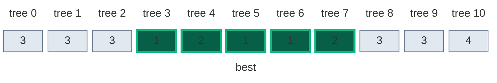
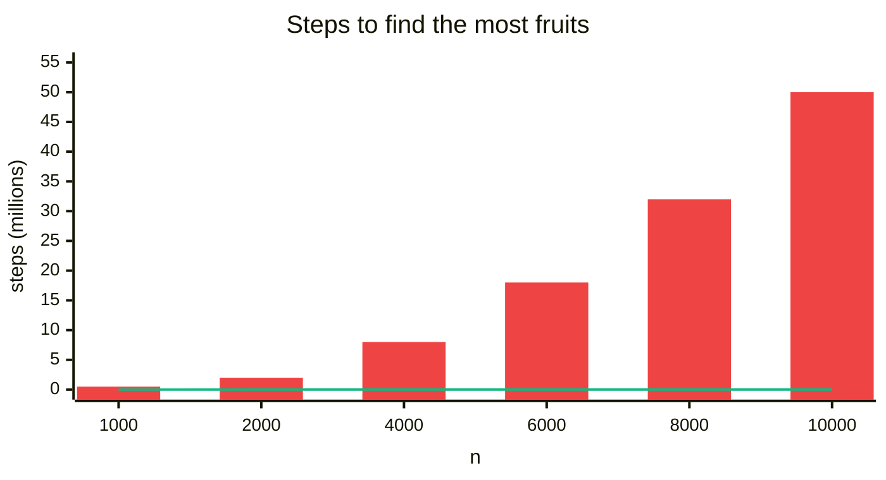
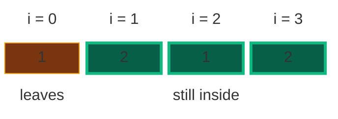
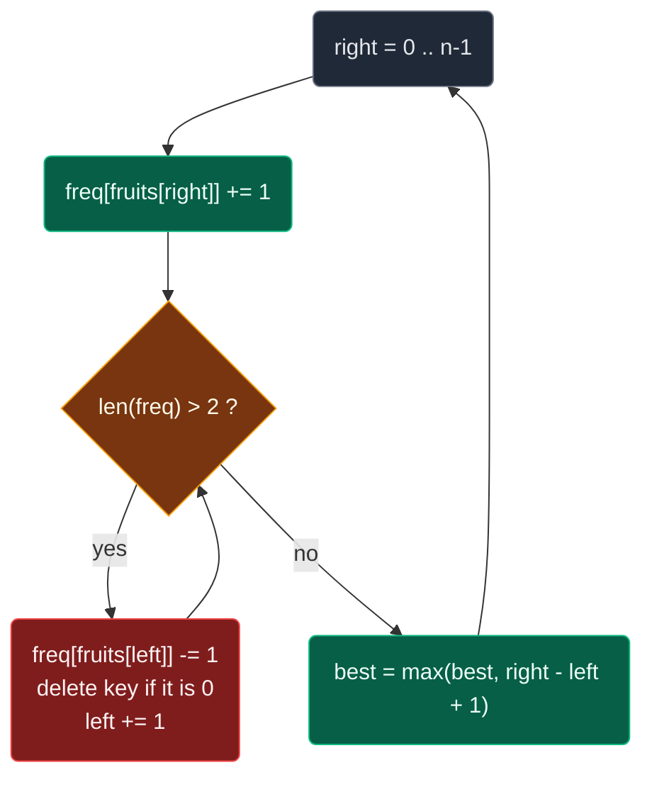

# 04. 904. Fruit Into Baskets

| Difficulty | Pattern | Source | Time | Space |
|:---:|:---:|:---:|:---:|:---:|
| **Medium** | Variable Window + Count Map | [904. Fruit Into Baskets](https://leetcode.com/problems/fruit-into-baskets/) | `O(n)` | `O(1)` |

## 1. Problem Statement

A farm has one row of fruit trees, from left to right. `fruits[i]` is the **type** of fruit tree `i` gives.

The owner's rules:

- You have **two baskets**. Each basket holds only **one type** of fruit, but any amount of it.
- Start at any tree. Pick **one fruit from every tree** while moving **right**.
- Stop as soon as a tree's fruit does not fit in either basket.

Return the **maximum number of fruits** you can pick.

### Example (from the lecture)

```text
Input:  fruits = [3, 3, 3, 1, 2, 1, 1, 2, 3, 3, 4]
Output: 5   (trees 3 to 7: [1, 2, 1, 1, 2], only types 1 and 2)
```



We use this same example in every section below.

LeetCode examples:

```text
[1, 2, 1]        -> 3
[0, 1, 2, 2]     -> 3   ([1, 2, 2])
[1, 2, 3, 2, 2]  -> 4   ([2, 3, 2, 2])
```

### Constraints

- `1 <= fruits.length <= 10^5`
- `0 <= fruits[i] < fruits.length`

### What the constraints tell us (simple theory)

A **constraint** is the biggest input the judge will ever give you. A computer does about **100 million (10^8) simple steps per second**.

| Biggest input `n` | Steps you can afford | Ideas that fit |
|:---:|:---:|:---|
| up to ~5,000 | about `n^2` | Two nested loops |
| up to ~1,000,000 | about `n` | One loop, sliding window |

**For this problem:** `n` can be `10^5`.

- Trying every start and scanning right is about `n^2 / 2` = `5 × 10^9` steps in the worst case (only two fruit types, so nothing stops early).
- The sliding window: `right` moves `n` times and `left` at most `n` times, so at most `2 × 10^5` steps.

**How the work grows** (worst case: only two fruit types; counted by running code). Red bars = brute force steps, green line = sliding window steps.



| `n` | Brute force steps | Sliding window steps |
|:---:|:---:|:---:|
| 1,000 | 500,500 | 1,000 |
| 2,000 | 2,001,000 | 2,000 |
| 4,000 | 8,002,000 | 4,000 |
| 6,000 | 18,003,000 | 6,000 |
| 8,000 | 32,004,000 | 8,000 |
| 10,000 | 50,005,000 | 10,000 |

## 2. Core Theory

### The hard part is the translation

The baskets and the farm are just a story. Turn each rule into plain array words:

| Story rule | What it really means |
|:---|:---|
| one row of trees, only move right | the answer is a **contiguous subarray** |
| two baskets, one type each | the subarray has **at most 2 different values** |
| any amount per basket | how many of each does not matter, only how many **types** |
| maximum number of fruits | maximise the **length** |

So the whole problem is one sentence:

```text
Find the longest subarray with at most 2 different values.
```

Say this sentence first in an interview. It shows you decoded the story, and that is what the interviewer is checking.

**Why a variable window:** longest + contiguous + at most → variable sliding window. And if a window has at most 2 types, every smaller window inside it does too, so shrinking from the left always helps.

### Why a count map, not a set

When `left` moves off a fruit, we must know if **another** fruit of that type is still inside.



`left` moves off a `1` (orange), but another `1` (index 2) is still inside. A set cannot tell; a **count map** can: decrease the count, and remove the type only when its count reaches `0`.

```text
state: fruit type -> how many of it are inside the window
valid when: len(freq) <= 2
```

### The steps, and the bug everybody writes

1. **Expand:** `freq[fruits[right]] += 1`.
2. **Shrink:** while `len(freq) > 2`: decrease `freq[fruits[left]]`; **if it reaches 0, delete the key**; move `left`.
3. **Record:** `best = max(best, right - left + 1)`.

**The classic bug:** forgetting to delete a key whose count is `0`. Then `len(freq)` still counts a type that is no longer in the window, the map looks full forever, `left` keeps running, and the answer is too small.



**Why `while`, not `if`:** one new fruit adds at most one new type, but the fruit leaving on the left may have copies behind it. In our example at `right = 4`, three trees (`3, 3, 3`) had to leave before type `3` was gone.

**Why still `O(n)`:** `right` moves at most `n` times, `left` moves at most `n` times, never back. At most `2n` steps.

**It is the `k = 2` case of a general template.** Replace `2` with `k` and you get "longest subarray with at most `k` distinct values" ([340](../03.%20At%20Most/01.%20340.%20Longest%20Substring%20With%20At%20Most%20K%20Distinct%20Characters.md)).

## 3. Edge Cases

| Case | Input | Expected | Why it matters |
|:---|:---|:---:|:---|
| One tree | `[5]` | `1` | Smallest input |
| One type only | `[2,2,2,2]` | `4` | Never shrinks |
| Two types only | `[1,2,1,2]` | `4` | Whole array |
| All different | `[0,1,2,3]` | `2` | Every window of 3 is invalid |
| Best at the start | `[1,1,2,3,4]` | `3` | Found early |
| Best at the end | `[4,3,1,1,2]` | `3` | Found at the last step |
| Type leaves but comes back | `[1,2,1,3,1]` | `3` | Count map, not a set |

## 4. Brute Force: Try Every Starting Tree

### Idea

From each start, move right and collect fruit types in a set. When the set has 3 types, stop. Keep the longest run.

### Code

```python
# Import List for type hints
from typing import List


# Brute force: every start, extend until a third type appears
class SolutionBrute:

    # Main method
    def totalFruit(self, fruits: List[int]) -> int:

        # Number of trees
        n = len(fruits)

        # Most fruits so far
        max_fruits = 0

        # Every start tree
        for start in range(n):

            # Types collected from this start
            types = set()

            # Walk right
            for end in range(start, n):

                # Put this fruit's type in a basket
                types.add(fruits[end])

                # A third type: this start is done
                if len(types) > 2:

                    # Try the next start
                    break

                # Keep the longest run
                max_fruits = max(max_fruits, end - start + 1)

        # Most fruits
        return max_fruits
```

### Complexity

| Measure | Complexity | Why |
|:---|:---:|:---|
| **Time** | `O(n^2)` | Each start may scan far to the right |
| **Space** | `O(1)` | The set never holds more than 3 types |

## 5. Optimal Approach: Sliding Window + Count Map

### Idea

Keep a window `fruits[left .. right]` with at most 2 types, and a map `freq` of how many of each type are inside. Add the new tree on the right; while there are 3 types, remove trees from the left (deleting a type when its count hits 0); then record the length.

### Visual Walkthrough (Story Version)

**The story:** Asha walks along the row with two baskets. Each new fruit goes into the basket for its type. If a **third** type shows up, she empties fruits from the **start** of her picking run, oldest first, until one whole type is gone and a basket is free.

**How to read the pictures:** green = fruits in her baskets, orange = fruits she just threw out, grey = not picked. The label row shows what is in the baskets.


| Step (`right`) | New fruit | Thrown out | Baskets (`freq`) | Run | Best |
|:---:|:---:|:---|:---|:---:|:---:|
| 0 | 3 | – | {3: 1} | 1 | 1 |
| 1 | 3 | – | {3: 2} | 2 | 2 |
| 2 | 3 | – | {3: 3} | 3 | 3 |
| 3 | 1 | – | {1: 1, 3: 3} | 4 | 4 |
| 4 | 2 | 3, 3, 3 | {1: 1, 2: 1} | 2 | 4 |
| 5 | 1 | – | {1: 2, 2: 1} | 3 | 4 |
| 6 | 1 | – | {1: 3, 2: 1} | 4 | 4 |
| 7 | 2 | – | {1: 3, 2: 2} | 5 | **5** |
| 8 | 3 | 1, 2, 1, 1 | {2: 1, 3: 1} | 2 | 5 |
| 9 | 3 | – | {2: 1, 3: 2} | 3 | 5 |
| 10 | 4 | 2 | {3: 2, 4: 1} | 3 | 5 |

At step 8 she threw out **four** fruits before type `1` was fully gone. That is why the shrink is a `while`.

**What the story teaches**

| In the story | In the code |
|:---|:---|
| Two baskets | at most 2 keys in `freq` |
| Fruit count per basket | `freq[type]` |
| Throwing out the oldest fruit | `freq[fruits[left]] -= 1`, `left += 1` |
| A basket becomes empty and free | `del freq[type]` when the count is 0 |
| Longest run | `max_fruits` |

### Step-by-Step Example

Green = window after the step, orange = removed this step, grey = outside.

```mermaid
block-beta
  columns 12
  hx[" "] h0["i = 0"] h1["i = 1"] h2["i = 2"] h3["i = 3"] h4["i = 4"] h5["i = 5"] h6["i = 6"] h7["i = 7"] h8["i = 8"] h9["i = 9"] h10["i = 10"]
  l0["right = 0, left = 0, best = 1"] r0c0["3"] r0c1["3"] r0c2["3"] r0c3["1"] r0c4["2"] r0c5["1"] r0c6["1"] r0c7["2"] r0c8["3"] r0c9["3"] r0c10["4"]
  l1["right = 1, left = 0, best = 2"] r1c0["3"] r1c1["3"] r1c2["3"] r1c3["1"] r1c4["2"] r1c5["1"] r1c6["1"] r1c7["2"] r1c8["3"] r1c9["3"] r1c10["4"]
  l2["right = 2, left = 0, best = 3"] r2c0["3"] r2c1["3"] r2c2["3"] r2c3["1"] r2c4["2"] r2c5["1"] r2c6["1"] r2c7["2"] r2c8["3"] r2c9["3"] r2c10["4"]
  l3["right = 3, left = 0, best = 4"] r3c0["3"] r3c1["3"] r3c2["3"] r3c3["1"] r3c4["2"] r3c5["1"] r3c6["1"] r3c7["2"] r3c8["3"] r3c9["3"] r3c10["4"]
  l4["right = 4, left = 3, best = 4"] r4c0["3"] r4c1["3"] r4c2["3"] r4c3["1"] r4c4["2"] r4c5["1"] r4c6["1"] r4c7["2"] r4c8["3"] r4c9["3"] r4c10["4"]
  l5["right = 5, left = 3, best = 4"] r5c0["3"] r5c1["3"] r5c2["3"] r5c3["1"] r5c4["2"] r5c5["1"] r5c6["1"] r5c7["2"] r5c8["3"] r5c9["3"] r5c10["4"]
  l6["right = 6, left = 3, best = 4"] r6c0["3"] r6c1["3"] r6c2["3"] r6c3["1"] r6c4["2"] r6c5["1"] r6c6["1"] r6c7["2"] r6c8["3"] r6c9["3"] r6c10["4"]
  l7["right = 7, left = 3, best = 5"] r7c0["3"] r7c1["3"] r7c2["3"] r7c3["1"] r7c4["2"] r7c5["1"] r7c6["1"] r7c7["2"] r7c8["3"] r7c9["3"] r7c10["4"]
  l8["right = 8, left = 7, best = 5"] r8c0["3"] r8c1["3"] r8c2["3"] r8c3["1"] r8c4["2"] r8c5["1"] r8c6["1"] r8c7["2"] r8c8["3"] r8c9["3"] r8c10["4"]
  l9["right = 9, left = 7, best = 5"] r9c0["3"] r9c1["3"] r9c2["3"] r9c3["1"] r9c4["2"] r9c5["1"] r9c6["1"] r9c7["2"] r9c8["3"] r9c9["3"] r9c10["4"]
  l10["right = 10, left = 8, best = 5"] r10c0["3"] r10c1["3"] r10c2["3"] r10c3["1"] r10c4["2"] r10c5["1"] r10c6["1"] r10c7["2"] r10c8["3"] r10c9["3"] r10c10["4"]
  classDef head fill:none,stroke:none,color:#64748b
  class hx,h0,h1,h2,h3,h4,h5,h6,h7,h8,h9,h10,l0,l1,l2,l3,l4,l5,l6,l7,l8,l9,l10 head
  classDef new fill:#065f46,stroke:#10b981,color:#ecfdf5,stroke-width:3px
  class r0c0,r1c0,r1c1,r2c0,r2c1,r2c2,r3c0,r3c1,r3c2,r3c3,r4c3,r4c4,r5c3,r5c4,r5c5,r6c3,r6c4,r6c5,r6c6,r7c3,r7c4,r7c5,r7c6,r7c7,r8c7,r8c8,r9c7,r9c8,r9c9,r10c8,r10c9,r10c10 new
  classDef old fill:#e2e8f0,stroke:#64748b,color:#0f172a
  class r0c1,r0c2,r0c3,r0c4,r0c5,r0c6,r0c7,r0c8,r0c9,r0c10,r1c2,r1c3,r1c4,r1c5,r1c6,r1c7,r1c8,r1c9,r1c10,r2c3,r2c4,r2c5,r2c6,r2c7,r2c8,r2c9,r2c10,r3c4,r3c5,r3c6,r3c7,r3c8,r3c9,r3c10,r4c5,r4c6,r4c7,r4c8,r4c9,r4c10,r5c0,r5c1,r5c2,r5c6,r5c7,r5c8,r5c9,r5c10,r6c0,r6c1,r6c2,r6c7,r6c8,r6c9,r6c10,r7c0,r7c1,r7c2,r7c8,r7c9,r7c10,r8c0,r8c1,r8c2,r8c9,r8c10,r9c0,r9c1,r9c2,r9c3,r9c4,r9c5,r9c6,r9c10,r10c0,r10c1,r10c2,r10c3,r10c4,r10c5,r10c6 old
  classDef read fill:#78350f,stroke:#f59e0b,color:#fef3c7
  class r4c0,r4c1,r4c2,r8c3,r8c4,r8c5,r8c6,r10c7 read
```



### Code

```python
# Optimal: sliding window with a count map
class Solution:

    # Main method (trace is optional and only used by the tests)
    def totalFruit(self, fruits: List[int], trace: list = None) -> int:

        # Fruit type -> how many are inside the window
        freq = {}

        # Left edge of the window
        left = 0

        # Most fruits so far
        max_fruits = 0

        # Add one tree at a time
        for right in range(len(fruits)):

            # Put the new fruit in its basket
            freq[fruits[right]] = freq.get(fruits[right], 0) + 1

            # Three types: shrink from the left
            while len(freq) > 2:

                # The fruit leaving the window
                left_fruit = fruits[left]

                # One fewer of that type
                freq[left_fruit] -= 1

                # Its basket is empty now
                if freq[left_fruit] == 0:

                    # Free the basket (the key bug if you forget this)
                    del freq[left_fruit]

                # Move the left edge
                left += 1

            # The window is valid: record its length
            max_fruits = max(max_fruits, right - left + 1)

            # Save (right, left, baskets, best) for the tests
            if trace is not None:

                # One entry per step
                trace.append((right, left, dict(sorted(freq.items())), max_fruits))

        # Most fruits
        return max_fruits


# Lazy version: shrink at most once, width never shrinks
class SolutionLazy:

    # Main method
    def totalFruit(self, fruits: List[int]) -> int:

        # Fruit type -> how many are inside the window
        freq = {}

        # Left edge of the window
        left = 0

        # Add one tree at a time
        for right in range(len(fruits)):

            # Put the new fruit in its basket
            freq[fruits[right]] = freq.get(fruits[right], 0) + 1

            # Three types: shrink by exactly one
            if len(freq) > 2:

                # The fruit leaving the window
                left_fruit = fruits[left]

                # One fewer of that type
                freq[left_fruit] -= 1

                # Basket empty: free it
                if freq[left_fruit] == 0:

                    # Remove the type
                    del freq[left_fruit]

                # Move the left edge once
                left += 1

        # The width at the end is the best length
        return len(fruits) - left


# Import random for the agreement tests
import random

# Our example, traced step by step
trace = []

# Run with the trace on
assert Solution().totalFruit([3, 3, 3, 1, 2, 1, 1, 2, 3, 3, 4], trace) == 5

# (right, left, baskets, best) after each step
assert trace == [(0, 0, {3: 1}, 1), (1, 0, {3: 2}, 2), (2, 0, {3: 3}, 3), (3, 0, {1: 1, 3: 3}, 4), (4, 3, {1: 1, 2: 1}, 4), (5, 3, {1: 2, 2: 1}, 4), (6, 3, {1: 3, 2: 1}, 4), (7, 3, {1: 3, 2: 2}, 5), (8, 7, {2: 1, 3: 1}, 5), (9, 7, {2: 1, 3: 2}, 5), (10, 8, {3: 2, 4: 1}, 5)]

# LeetCode examples
assert Solution().totalFruit([1, 2, 1]) == 3

# Start later for a better run
assert Solution().totalFruit([0, 1, 2, 2]) == 3

# Best run in the middle
assert Solution().totalFruit([1, 2, 3, 2, 2]) == 4

# One tree
assert Solution().totalFruit([5]) == 1

# One type only
assert Solution().totalFruit([2, 2, 2, 2]) == 4

# All different
assert Solution().totalFruit([0, 1, 2, 3]) == 2

# A type leaves and comes back
assert Solution().totalFruit([1, 2, 1, 3, 1]) == 3

# All versions agree on random inputs
for _ in range(500):

    # Random row of trees with few types
    row = [random.randint(0, 3) for _ in range(random.randint(1, 15))]

    # Brute force answer
    expected = SolutionBrute().totalFruit(row)

    # Both window versions must match
    assert Solution().totalFruit(row) == SolutionLazy().totalFruit(row) == expected

# Biggest input runs fast
assert Solution().totalFruit([1, 2] * 50000) == 100000

# All checks passed
print("All tests passed")
```

**About `trace`:** it is only for the tests. LeetCode calls `totalFruit(fruits)` and the code works the same.

**The lazy version** (`SolutionLazy`) uses the same "width never shrinks" idea as the `if` version in [1004](03.%201004.%20Max%20Consecutive%20Ones%20III.md): the window may be invalid for a while, but it never grows while invalid, so the final width `n - left` is the answer. It only works for "longest" problems; the `while` version is the general template.

### Complexity

| Approach | Time | Space |
|:---|:---:|:---:|
| Brute force | `O(n^2)` | `O(1)` |
| **Sliding window + count map** | **`O(n)`** (at most `2n` pointer moves) | **`O(1)`** (at most 3 keys) |
| Lazy version | `O(n)` | `O(1)` |

## 6. Common Mistakes

| Mistake | What goes wrong | Fix |
|:---|:---|:---|
| Not deleting a key at count 0 | `len(freq)` counts types that left; answer too small | `if freq[x] == 0: del freq[x]` |
| Using a set instead of a count map | Cannot tell if another fruit of the type is still inside | Store counts, delete only at 0 |
| `if` shrink but still recording `max(...)` | Mixes the two ideas and measures invalid windows | `while` + `max`, or `if` + `return n - left` |
| Shrinking at `len(freq) >= 2` | Two types are allowed | Shrink only at `> 2` |
| Recording before the shrink | Counts an invalid window | Record after the loop |
| Reading `fruits[left]` after `left += 1` | Lowers the wrong count | Save `left_fruit` first |

## 7. Interview Follow-ups

### Q1. What if you had `k` baskets?

**Answer:**
- Replace `2` with `k`: `while len(freq) > k`.
- That is LeetCode 340, the general "at most `k` distinct" template.

### Q2. How do you return the actual trees?

**Answer:**
- When `max_fruits` improves, store `best_left = left`.
- Return `fruits[best_left : best_left + max_fruits]`.

### Q3. How do you count all subarrays with at most 2 types?

**Answer:**
- Same window. After shrinking, every subarray that ends at `right` and starts between `left` and `right` is valid.
- Add `right - left + 1` to a counter each step.

### Q4. What if the fruit types are strings?

**Answer:**
- Nothing changes: a dictionary works with any hashable key.

### Q5. Can you solve it without a map?

**Answer:**
- Yes: keep the last two types, the length of the current run of the last type, and the current window length.
- When a third type comes, the new window is "last run + new fruit".
- Still `O(n)` and `O(1)`, but harder to explain and does not generalise to `k`.

## 8. Interview Explanation

> The story translates to: find the longest subarray with at most two different values. That is a variable sliding window. I keep a count map of fruit types inside the window. For each new tree I add its type. While the map has more than two types, I remove fruits from the left, lowering their count and deleting the type when its count reaches zero, which is the step people forget. Then I record the window length. Each pointer moves at most n times, so it is O(n) time and O(1) space, since the map never holds more than three types. Replacing 2 with k gives the general at-most-k-distinct template.
