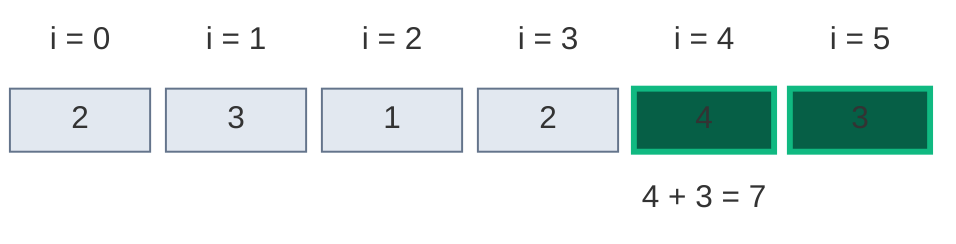
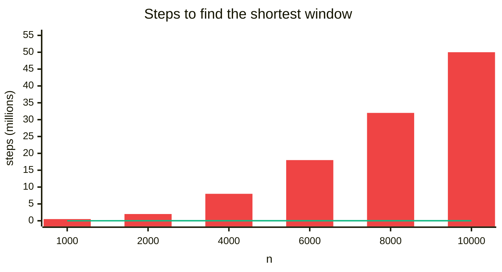
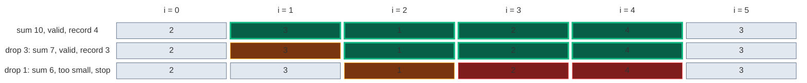
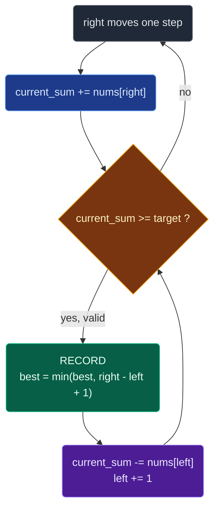
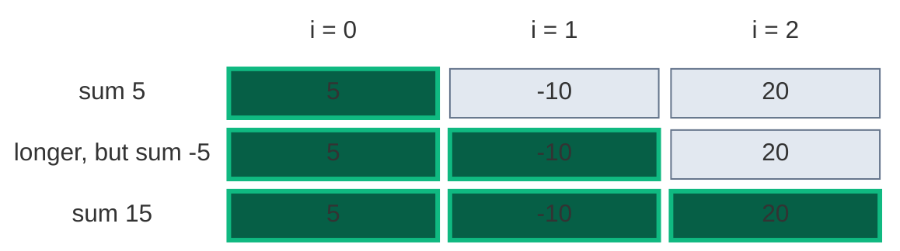
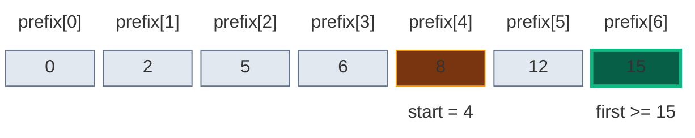
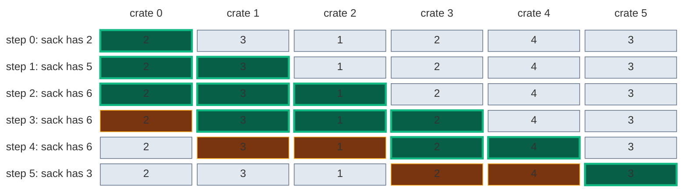
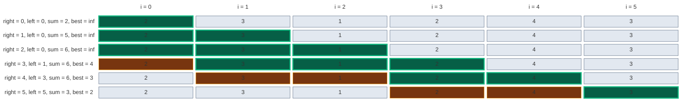

# 05. 209. Minimum Size Subarray Sum

| Difficulty | Pattern | Source | Time | Space |
|:---:|:---:|:---:|:---:|:---:|
| **Medium** | Shortest Variable Window | [209. Minimum Size Subarray Sum](https://leetcode.com/problems/minimum-size-subarray-sum/) | `O(n)` | `O(1)` |

## 1. Problem Statement

You get an array of **positive** integers `nums` and a number `target`. Return the **smallest length** of a subarray whose sum is **at least** `target`. If there is no such subarray, return `0`.

### Example

```text
Input:  target = 7, nums = [2, 3, 1, 2, 4, 3]
Output: 2   ([4, 3] has sum 7 and length 2)
```



We use this same example in every section below.

Other LeetCode examples:

```text
target = 4,  nums = [1, 4, 4]                  -> 1
target = 11, nums = [1, 1, 1, 1, 1, 1, 1, 1]   -> 0   (no subarray reaches 11)
```

### Constraints

- `1 <= target <= 10^9`
- `1 <= nums.length <= 10^5`
- `1 <= nums[i] <= 10^4` (**every value is positive**; this matters a lot, see Core Theory)

### What the constraints tell us (simple theory)

A **constraint** is the biggest input the judge will ever give you. A computer does about **100 million (10^8) simple steps per second**.

| Biggest input `n` | Steps you can afford | Ideas that fit |
|:---:|:---:|:---|
| up to ~5,000 | about `n^2` | Two nested loops |
| up to ~100,000 | about `n log n` | Sorting, binary search |
| up to ~1,000,000 | about `n` | One loop, sliding window |

**For this problem:** `n` can be `10^5`.

- Trying every subarray is about `n^2 / 2` = `5 × 10^9` steps when `target` is too big to ever reach (nothing stops early).
- Prefix sums + binary search: about `n log n` ≈ `1.7 × 10^6` steps.
- The sliding window: at most `2n` = `2 × 10^5` steps.

**How the work grows** (worst case: `target` never reached; counted by running code). Red bars = brute force steps, green line = sliding window steps.



| `n` | Brute force steps | Sliding window steps |
|:---:|:---:|:---:|
| 1,000 | 500,500 | 1,000 |
| 2,000 | 2,001,000 | 2,000 |
| 4,000 | 8,002,000 | 4,000 |
| 6,000 | 18,003,000 | 6,000 |
| 8,000 | 32,004,000 | 8,000 |
| 10,000 | 50,005,000 | 10,000 |

## 2. Core Theory

### A shortest window, not a longest one

All the earlier problems in this topic were **longest** windows. This one is the **mirror image**: a **shortest** window.

| | Longest window | Shortest window (this problem) |
|:---|:---|:---|
| Goal | longest valid window | shortest valid window |
| Shrink **while** the window is | **invalid** | **valid** |
| Record the answer | **after** the shrink loop | **inside** the shrink loop |
| Start value | `answer = 0` | `answer = infinity` |
| Combine with | `max(...)` | `min(...)` |

In a longest window you shrink only until it is valid again, then measure once. Here, as soon as the window is valid you measure it, then **keep shrinking** to see if a shorter one is still valid.

### Why `while`, not `if`

In 1004 a one-step `if` shrink was allowed, because shorter windows could never beat the best length. Here **shorter is better**, so you must keep shrinking:



- `[3, 1, 2, 4]` has sum `10 >= 7`, length 4 → record 4.
- Remove `3`: `[1, 2, 4]` has sum `7 >= 7`, length 3 → record 3. **An `if` never reaches this.**
- Remove `1`: `[2, 4]` has sum `6 < 7` → stop.

### Record first, then remove

Inside the loop the order is **record → remove → move `left`**. When you enter the loop body the window **is** valid, so measure it first. If you removed first, you would measure a window that may already be invalid.



### Start at infinity, and turn it back into 0

With `min`, a start value of `0` would win every comparison, so start at `float("inf")`. If no window is ever valid, the answer is still infinity; return `0` in that case. LeetCode's third example checks exactly this.

### Why every value must be positive

With positive values:

- expanding `right` → the sum can only go **up**
- shrinking `left` → the sum can only go **down**

So once a window is too small, moving `left` forward can never fix it, and once it is valid, there is no reason to look at bigger windows starting at the same `left`. That is what makes two forward-only pointers correct.

One negative number breaks it:



`[5, -10]` is **longer** than `[5]` but has a **smaller** sum. Growing the window can make the sum go down, so "expand until valid, then shrink while valid" stops making sense. With negatives you need prefix sums + a monotonic deque (LeetCode 862).

Positivity also makes the prefix sums **strictly increasing**, which is what lets the better approach use binary search.

## 3. Edge Cases

| Case | Input | Expected | Why it matters |
|:---|:---|:---:|:---|
| No valid subarray | `target = 11`, `[1,1,1,1,1,1,1,1]` | `0` | Must turn infinity into `0` |
| One element is enough | `target = 4`, `[1,4,4]` | `1` | Shortest possible answer |
| Whole array needed | `target = 15`, `[1,2,3,4,5]` | `5` | Window never shrinks below `n` |
| One element, too small | `target = 5`, `[3]` | `0` | Smallest input, no answer |
| One element, enough | `target = 3`, `[3]` | `1` | Smallest input, answer 1 |
| Valid only at the end | `target = 7`, `[1,1,1,1,7]` | `1` | Found at the last step |
| Biggest target | `target = 10^9`, `10^5` values of `10^4` | `100000` | Only the whole array reaches it |

## 4. Brute Force: Try Every Subarray

### Idea

For each start, add elements one by one. As soon as the sum reaches `target`, record the length and `break`: making this window longer cannot give a shorter answer.

### Code

```python
# Import List for type hints
from typing import List


# Brute force: every start, extend until the sum is big enough
class SolutionBrute:

    # Main method
    def minSubArrayLen(self, target: int, nums: List[int]) -> int:

        # Number of elements
        n = len(nums)

        # Shortest length so far (infinity = none yet)
        min_length = float("inf")

        # Every start index
        for start in range(n):

            # Sum from start to end
            current_sum = 0

            # Extend to the right
            for end in range(start, n):

                # Add the next element
                current_sum += nums[end]

                # Reached the target
                if current_sum >= target:

                    # Keep the shortest
                    min_length = min(min_length, end - start + 1)

                    # Longer windows from this start cannot be shorter
                    break

        # No valid window means 0
        return 0 if min_length == float("inf") else min_length
```

### Complexity

| Measure | Complexity | Why |
|:---|:---:|:---|
| **Time** | `O(n^2)` | Every start may scan to the end |
| **Space** | `O(1)` | A few counters |

## 5. Better Approach: Prefix Sums + Binary Search

### Idea

Build `prefix[i]` = sum of the first `i` elements. The sum of `nums[start .. end]` is `prefix[end + 1] - prefix[start]`. For each `start`, we need the smallest `end + 1` with `prefix[end + 1] >= prefix[start] + target`. Because all values are positive, `prefix` is **strictly increasing**, so binary search finds it in `O(log n)`.



For `start = 4`: we need `prefix[j] >= prefix[4] + 7 = 8 + 7 = 15`. Binary search finds `j = 6` (`prefix[6] = 15`), so the length is `6 - 4 = 2`.

### Code

```python
# Import bisect for binary search
import bisect


# Better: prefix sums and binary search
class SolutionBetter:

    # Main method
    def minSubArrayLen(self, target: int, nums: List[int]) -> int:

        # Number of elements
        n = len(nums)

        # prefix[i] = sum of the first i elements
        prefix = [0] * (n + 1)

        # Build the prefix sums
        for i in range(n):

            # Previous prefix plus this element
            prefix[i + 1] = prefix[i] + nums[i]

        # Shortest length so far
        min_length = float("inf")

        # Every start index
        for start in range(n):

            # Prefix value we need to reach
            need = prefix[start] + target

            # First index j with prefix[j] >= need
            j = bisect.bisect_left(prefix, need)

            # Found inside the array
            if j <= n:

                # Window is nums[start .. j - 1]
                min_length = min(min_length, j - start)

        # No valid window means 0
        return 0 if min_length == float("inf") else min_length
```

### Complexity

| Measure | Complexity | Why |
|:---|:---:|:---|
| **Time** | `O(n log n)` | One binary search per start |
| **Space** | `O(n)` | The prefix array |

LeetCode's follow-up asks for exactly this `O(n log n)` version. The sliding window is still faster.

## 6. Optimal Approach: Shortest Sliding Window

### Idea

1. `left = 0`, `current_sum = 0`, `min_length = infinity`.
2. For each `right`: add `nums[right]`.
3. **While** `current_sum >= target`: record `right - left + 1`, remove `nums[left]`, move `left`.
4. Return `0` if `min_length` is still infinity, else `min_length`.

### Visual Walkthrough (Story Version)

**The story:** Leo fills a sack with apples from a row of crates, walking right. He needs **at least 7 apples**, but wants to carry **as few crates** as possible. Each time the sack has enough, he writes down how many crates he has, then hands back the **oldest** crate and checks again.

**How to read the pictures:** green = crates in the sack, orange = crates handed back this step, grey = not in the sack. The label shows the apples in the sack.



| Step (`right`) | New crate | Sack checks (valid windows recorded) | Handed back | Sack after | Fewest crates |
|:---:|:---:|:---|:---|:---:|:---:|
| 0 | 2 | – | – | `[2]` = 2 | ∞ |
| 1 | 3 | – | – | `[2,3]` = 5 | ∞ |
| 2 | 1 | – | – | `[2,3,1]` = 6 | ∞ |
| 3 | 2 | `[2,3,1,2]` = 8 → 4 crates | 2 | `[3,1,2]` = 6 | 4 |
| 4 | 4 | `[3,1,2,4]` = 10 → 4; `[1,2,4]` = 7 → 3 | 3, 1 | `[2,4]` = 6 | 3 |
| 5 | 3 | `[2,4,3]` = 9 → 3; `[4,3]` = 7 → **2** | 2, 4 | `[3]` = 3 | **2** |

At step 4 and step 5 he recorded **two** windows each. That is the `while` doing its job.

**What the story teaches**

| In the story | In the code |
|:---|:---|
| Crates in a row | `nums` |
| Apples in the sack | `current_sum` |
| "At least 7 apples" | `current_sum >= target` |
| Write down the crate count | `min_length = min(min_length, right - left + 1)` |
| Hand back the oldest crate | `current_sum -= nums[left]`, `left += 1` |
| Fewest crates | `min_length` |

### Step-by-Step Example

Green = window after the step, orange = removed this step, grey = outside.



### Code

```python
# Optimal: shortest sliding window
class Solution:

    # Main method (trace is optional and only used by the tests)
    def minSubArrayLen(self, target: int, nums: List[int], trace: list = None) -> int:

        # Left edge of the window
        left = 0

        # Sum of the window
        current_sum = 0

        # Shortest valid length (infinity = none yet)
        min_length = float("inf")

        # Add one element at a time
        for right in range(len(nums)):

            # Grow the window
            current_sum += nums[right]

            # Valid: record it, then try a shorter one
            while current_sum >= target:

                # Record first, while the window is still valid
                min_length = min(min_length, right - left + 1)

                # Remove the leftmost element
                current_sum -= nums[left]

                # Move the left edge
                left += 1

            # Save (right, left, current_sum, min_length) for the tests
            if trace is not None:

                # One entry per step
                trace.append((right, left, current_sum, min_length))

        # No valid window means 0
        if min_length == float("inf"):

            # Nothing reached the target
            return 0

        # Shortest valid length
        return min_length


# Import random for the agreement tests
import random

# Infinity, used in the trace check
INF = float("inf")

# Our example, traced step by step
trace = []

# Run with the trace on
assert Solution().minSubArrayLen(7, [2, 3, 1, 2, 4, 3], trace) == 2

# (right, left, sum after shrinking, best) after each step
assert trace == [(0, 0, 2, INF), (1, 0, 5, INF), (2, 0, 6, INF), (3, 1, 6, 4), (4, 3, 6, 3), (5, 5, 3, 2)]

# LeetCode example 2
assert Solution().minSubArrayLen(4, [1, 4, 4]) == 1

# LeetCode example 3: nothing reaches the target
assert Solution().minSubArrayLen(11, [1, 1, 1, 1, 1, 1, 1, 1]) == 0

# Whole array needed
assert Solution().minSubArrayLen(15, [1, 2, 3, 4, 5]) == 5

# One element, too small
assert Solution().minSubArrayLen(5, [3]) == 0

# One element, enough
assert Solution().minSubArrayLen(3, [3]) == 1

# Valid only at the end
assert Solution().minSubArrayLen(7, [1, 1, 1, 1, 7]) == 1

# All versions agree on random inputs
for _ in range(500):

    # Random positive array
    arr = [random.randint(1, 10) for _ in range(random.randint(1, 15))]

    # Random target
    t = random.randint(1, 60)

    # Brute force answer
    expected = SolutionBrute().minSubArrayLen(t, arr)

    # Both faster versions must match
    assert SolutionBetter().minSubArrayLen(t, arr) == Solution().minSubArrayLen(t, arr) == expected

# Biggest input runs fast
assert Solution().minSubArrayLen(10 ** 9, [10 ** 4] * 10 ** 5) == 10 ** 5

# All checks passed
print("All tests passed")
```

**About `trace`:** it is only for the tests. LeetCode calls `minSubArrayLen(target, nums)` and the code works the same.

### Complexity

| Approach | Time | Space |
|:---|:---:|:---:|
| Brute force | `O(n^2)` | `O(1)` |
| Prefix sums + binary search | `O(n log n)` | `O(n)` |
| **Shortest sliding window** | **`O(n)`** (at most `2n` pointer moves) | **`O(1)`** |

## 7. Common Mistakes

| Mistake | What goes wrong | Fix |
|:---|:---|:---|
| `if` instead of `while` | Misses shorter windows (the `[1,2,4]` above) | `while current_sum >= target` |
| Recording after removing | Measures a window that may be invalid | Record first, then remove |
| Recording outside the loop (longest-window shape) | Records invalid windows or misses valid ones | For shortest windows, record **inside** the loop |
| Starting `min_length` at `0` | `min` always returns `0` | Start at `float("inf")` |
| Returning infinity when nothing is valid | LeetCode expects `0` | Convert infinity to `0` |
| Using this window with negative numbers | The sum is no longer predictable; wrong answers | Prefix sums + monotonic deque (LeetCode 862) |
| Length as `right - left` | Off by one | `right - left + 1` |

## 8. Interview Follow-ups

### Q1. Can you do it in `O(n log n)`? (LeetCode asks this)

**Answer:**
- Yes: prefix sums are strictly increasing because all values are positive.
- For each start, binary search the first prefix that is at least `prefix[start] + target`.
- See `SolutionBetter` above.

### Q2. What if the array can have negative numbers?

**Answer:**
- The sliding window breaks, because growing the window can make the sum smaller.
- Use prefix sums with a monotonic deque of indexes: LeetCode 862, Shortest Subarray with Sum at Least K, still `O(n)`.

### Q3. How do you return the subarray itself?

**Answer:**
- When `min_length` improves, also store `best_left = left` (inside the loop, before `left` moves).
- Return `nums[best_left : best_left + min_length]`.

### Q4. What if the condition were "sum exactly equal to target"?

**Answer:**
- With positive values, the same window works: shrink while `sum > target`, then check `sum == target`.
- With negative values, use prefix sums and a hash map (LeetCode 560).

### Q5. How is this different from the longest-window template?

**Answer:**
- Longest: shrink while **invalid**, record **after** the loop.
- Shortest: shrink while **valid**, record **inside** the loop.
- Mixing them up is one of the most common sliding-window bugs.

## 9. Interview Explanation

> All values are positive, so the window sum only grows when I expand and only shrinks when I move left. I use a shortest sliding window: add nums[right] to a running sum, and while the sum is at least target, record the window length, then remove nums[left] and move left. Recording happens inside the loop, before the removal, because that is the moment the window is valid; and it must be a while loop, since after removing one element a shorter window can still be valid. I start the answer at infinity and return 0 if it never changes. Each pointer moves at most n times, so it is O(n) time and O(1) space. With negative numbers this breaks, and I would switch to prefix sums with a monotonic deque.
