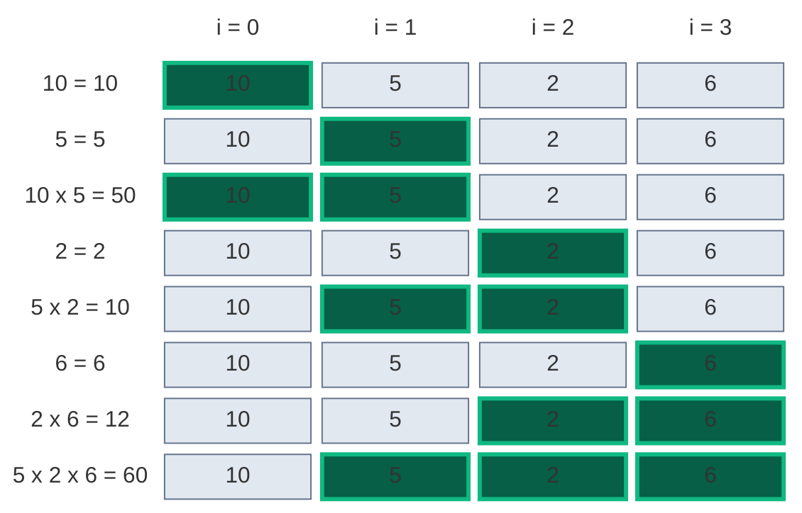
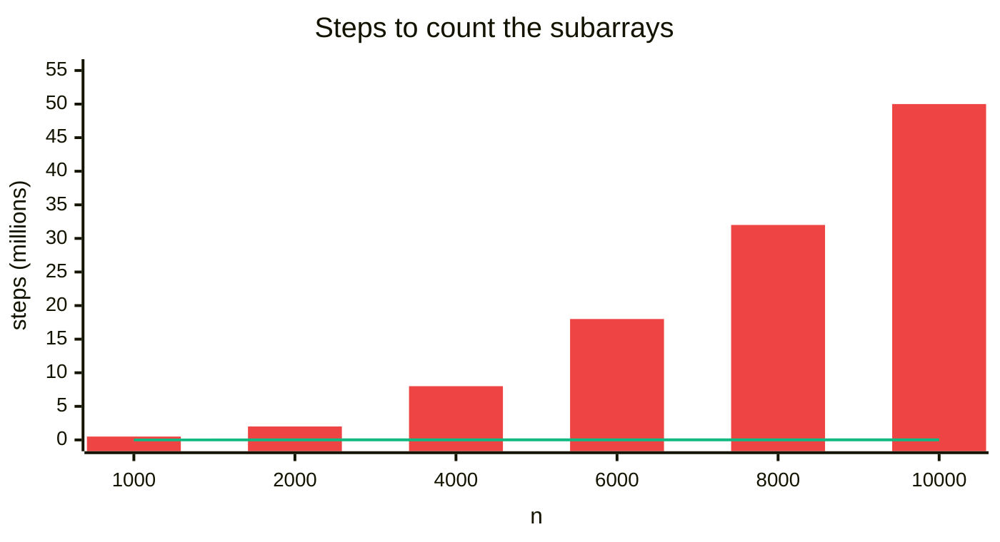
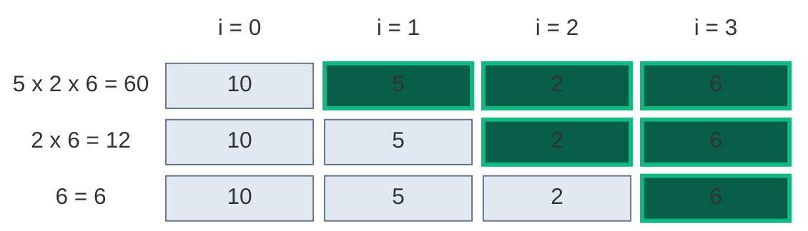
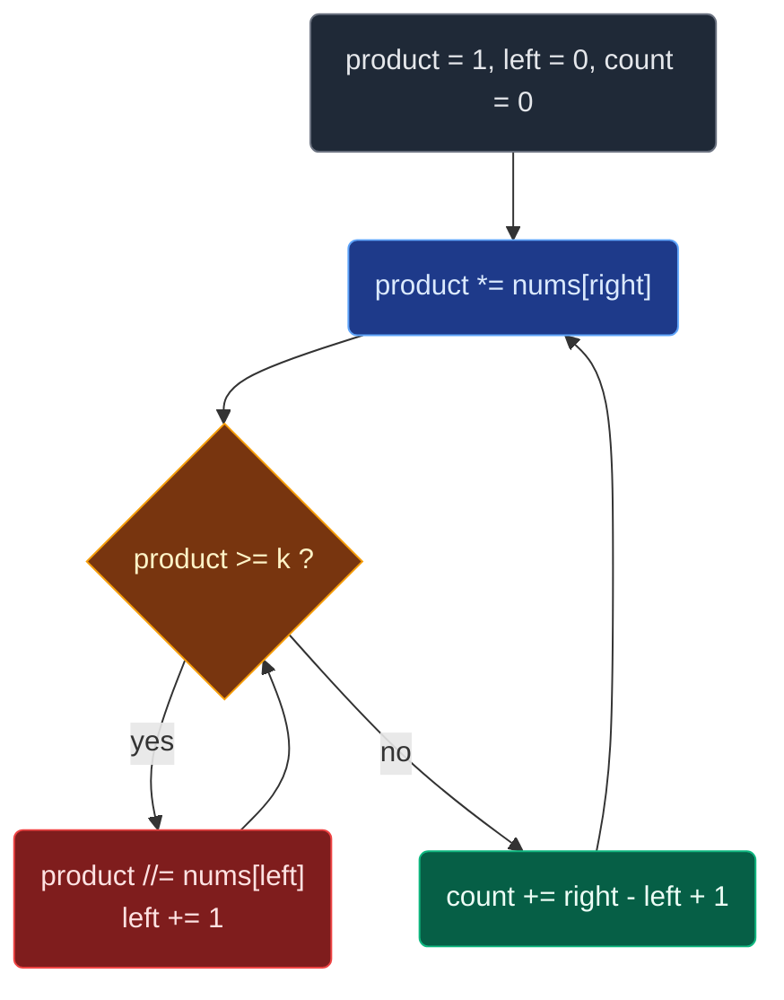
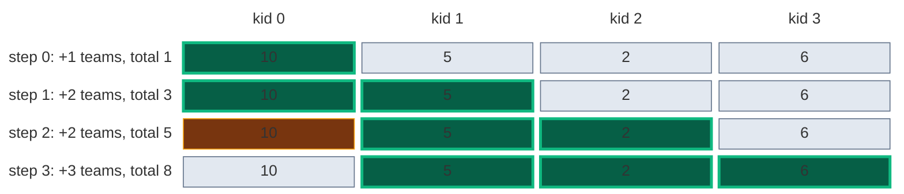
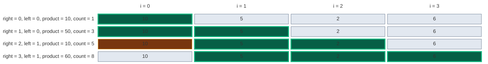

# 06. 713. Subarray Product Less Than K

| Difficulty | Pattern | Source | Time | Space |
|:---:|:---:|:---:|:---:|:---:|
| **Medium** | Counting Window | [713. Subarray Product Less Than K](https://leetcode.com/problems/subarray-product-less-than-k/) | `O(n)` | `O(1)` |

## 1. Problem Statement

You get an array of positive integers `nums` and a number `k`. Return **how many** contiguous subarrays have a product **strictly less than** `k`.

### Example

```text
Input:  nums = [10, 5, 2, 6], k = 100
Output: 8
The 8 subarrays: [10], [5], [2], [6], [10, 5], [5, 2], [2, 6], [5, 2, 6]
([10, 5, 2] is not counted: its product is 100, which is not less than 100.)
```



We use this same example in every section below.

Another LeetCode example:

```text
nums = [1, 2, 3], k = 0  -> 0   (no product of positive numbers is below 0)
```

### Constraints

- `1 <= nums.length <= 3 * 10^4`
- `1 <= nums[i] <= 1000`
- `0 <= k <= 10^6`

### What the constraints tell us (simple theory)

A **constraint** is the biggest input the judge will ever give you. A computer does about **100 million (10^8) simple steps per second**.

| Biggest input `n` | Steps you can afford | Ideas that fit |
|:---:|:---:|:---|
| up to ~5,000 | about `n^2` | Two nested loops |
| up to ~1,000,000 | about `n` | One loop, sliding window |

**For this problem:** `n` can be `3 × 10^4`.

- Trying every subarray is about `n^2 / 2` = `4.5 × 10^8` steps in the worst case (all ones, so the product never reaches `k` and nothing stops early). Several seconds in Python.
- The sliding window: at most `2n` = `6 × 10^4` steps.

**How the work grows** (worst case: all ones; counted by running code). Red bars = brute force steps, green line = sliding window steps.



| `n` | Brute force steps | Sliding window steps |
|:---:|:---:|:---:|
| 1,000 | 500,500 | 1,000 |
| 2,000 | 2,001,000 | 2,000 |
| 4,000 | 8,002,000 | 4,000 |
| 6,000 | 18,003,000 | 6,000 |
| 8,000 | 32,004,000 | 8,000 |
| 10,000 | 50,005,000 | 10,000 |

## 2. Core Theory

### A counting window

The earlier problems asked for the **longest** or **shortest** window. This one asks **how many**. The window moves the same way; only the answer update changes.

All values are positive, so the product behaves predictably:

- expanding `right` → `product *= nums[right]` → the product never goes down
- shrinking `left` → `product //= nums[left]` → the product never goes up

So `left` never needs to go back, and both pointers move forward only.

### The counting trick

After shrinking, the window `[left .. right]` is valid (product `< k`). Now ask a smaller question: **how many valid subarrays end exactly at `right`?**

They are the window and all its suffixes:



- `[5, 2, 6]` = 60 ✓
- drop `5` → `[2, 6]` = 12 ✓
- drop `2` → `[6]` = 6 ✓

Dropping positive numbers from the left can only make the product smaller, so if the widest one is valid, **all of them are**. Their starts are `left, left + 1, ..., right`, which is `right - left + 1` subarrays. So each step adds:

```text
count += right - left + 1
```

**No double counting:** every subarray has exactly one end index. At step `right` we only count subarrays that **end** at `right`, so every valid subarray is counted exactly once over the whole scan.



### Why `k <= 1` returns 0 right away

Every value is at least `1`, so every product is at least `1`. If `k <= 1`, no product can be `< k`.

There is also a code reason: with `k <= 1` the `while product >= k` loop would keep dividing until `left` passes `right` and runs off the array. The early return avoids that.

### Why dividing is safe

`product //= nums[left]` uses integer division. It is exact because `nums[left]` was multiplied into `product` earlier, so `product` is always a multiple of it. No rounding errors.

### Why `while`, not `if`

One new large number can push the product far above `k`. Several small numbers may need to leave before it drops below `k` again, so the shrink must be a `while`.

### Where it fits

| Problem type | Shrink while | Record |
|:---|:---|:---|
| Longest (1004, 904) | invalid | `max(best, right - left + 1)` after the loop |
| Shortest (209) | valid | `min(best, right - left + 1)` inside the loop |
| **Counting (this one)** | invalid | `count += right - left + 1` after the loop |

## 3. Edge Cases

| Case | Input | Expected | Why it matters |
|:---|:---|:---:|:---|
| `k = 0` | `[1,2,3]`, `k = 0` | `0` | Early return |
| `k = 1` | `[1,1,1]`, `k = 1` | `0` | `1` is not less than `1` |
| All ones, `k = 2` | `[1,1,1]`, `k = 2` | `6` | Every subarray counts: `3 + 2 + 1` |
| One element below `k` | `[5]`, `k = 10` | `1` | Smallest real case |
| One element not below `k` | `[10]`, `k = 10` | `0` | Strictly less than |
| A big value | `[1,1,100,1,1]`, `k = 50` | `6` | `100` alone is too big; it splits the array |

## 4. Brute Force: Try Every Subarray

### Idea

For each start, multiply elements one by one. While the product is below `k`, count the subarray. Once it reaches `k`, stop: all values are positive, so it can only grow.

### Code

```python
# Import List for type hints
from typing import List


# Brute force: every start, multiply until the product is too big
class SolutionBrute:

    # Main method
    def numSubarrayProductLessThanK(self, nums: List[int], k: int) -> int:

        # Number of elements
        n = len(nums)

        # Number of valid subarrays
        count = 0

        # Every start index
        for start in range(n):

            # Product from start to end
            product = 1

            # Extend to the right
            for end in range(start, n):

                # Multiply in the next element
                product *= nums[end]

                # Too big: longer subarrays from this start are too big too
                if product >= k:

                    # Try the next start
                    break

                # This subarray is valid
                count += 1

        # Total valid subarrays
        return count
```

### Complexity

| Measure | Complexity | Why |
|:---|:---:|:---|
| **Time** | `O(n^2)` | Every start may scan to the end |
| **Space** | `O(1)` | A few counters |

## 5. Optimal Approach: Counting Sliding Window

### Idea

1. If `k <= 1`, return `0`.
2. `product = 1`, `left = 0`, `count = 0`.
3. For each `right`: multiply in `nums[right]`; while `product >= k`, divide out `nums[left]` and move `left`.
4. Add `right - left + 1` to `count`.

### Visual Walkthrough (Story Version)

**The story:** A row of 4 kids each hold a number card: `10, 5, 2, 6`. A **team** is a group of kids standing next to each other. A team is allowed if its cards **multiplied** together are below 100. The teacher counts all allowed teams. At each step a new kid joins on the right, and the teacher counts every allowed team that **ends** with that new kid.

**How to read the pictures:** green = the longest allowed team ending at the new kid, orange = kids who had to step out, grey = not in the team. The label shows how many teams were counted this step.



| Step (`right`) | New kid | Stepped out | Team | Product | Teams ending here | Total |
|:---:|:---:|:---|:---:|:---:|:---:|:---:|
| 0 | 10 | – | [10] | 10 | 1 | 1 |
| 1 | 5 | – | [10, 5] | 50 | 2 | 3 |
| 2 | 2 | 10 | [5, 2] | 10 | 2 | 5 |
| 3 | 6 | – | [5, 2, 6] | 60 | 3 | **8** |

At step 2 the product would be `10 × 5 × 2 = 100`, which is not below 100, so the kid with `10` steps out.

**What the story teaches**

| In the story | In the code |
|:---|:---|
| Kids with cards | `nums` |
| Team product | `product` |
| Kid steps out on the left | `product //= nums[left]`, `left += 1` |
| Teams ending at the new kid | `right - left + 1` |
| Teacher's total | `count` |

### Step-by-Step Example

Green = window after the step, orange = removed this step, grey = outside.



### Code

```python
# Optimal: counting sliding window
class Solution:

    # Main method (trace is optional and only used by the tests)
    def numSubarrayProductLessThanK(self, nums: List[int], k: int, trace: list = None) -> int:

        # No product of positive numbers is below 1
        if k <= 1:

            # Nothing to count (and avoids running left off the array)
            return 0

        # Product of the window
        product = 1

        # Left edge of the window
        left = 0

        # Number of valid subarrays
        count = 0

        # Add one element at a time
        for right in range(len(nums)):

            # Multiply in the new element
            product *= nums[right]

            # Too big: shrink from the left
            while product >= k:

                # Divide out the leftmost element (always exact)
                product //= nums[left]

                # Move the left edge
                left += 1

            # Every subarray ending at right and starting in the window is valid
            count += right - left + 1

            # Save (right, left, product, added, count) for the tests
            if trace is not None:

                # One entry per step
                trace.append((right, left, product, right - left + 1, count))

        # Total valid subarrays
        return count


# Import random for the agreement tests
import random

# Our example, traced step by step
trace = []

# Run with the trace on
assert Solution().numSubarrayProductLessThanK([10, 5, 2, 6], 100, trace) == 8

# (right, left, product, added, total) after each step
assert trace == [(0, 0, 10, 1, 1), (1, 0, 50, 2, 3), (2, 1, 10, 2, 5), (3, 1, 60, 3, 8)]

# LeetCode example 2
assert Solution().numSubarrayProductLessThanK([1, 2, 3], 0) == 0

# k = 1: nothing is below 1
assert Solution().numSubarrayProductLessThanK([1, 1, 1], 1) == 0

# All ones, k = 2: every subarray counts
assert Solution().numSubarrayProductLessThanK([1, 1, 1], 2) == 6

# One element below k
assert Solution().numSubarrayProductLessThanK([5], 10) == 1

# One element equal to k
assert Solution().numSubarrayProductLessThanK([10], 10) == 0

# A big value splits the array
assert Solution().numSubarrayProductLessThanK([1, 1, 100, 1, 1], 50) == 6

# Both versions agree on random inputs
for _ in range(500):

    # Random positive array
    arr = [random.randint(1, 10) for _ in range(random.randint(1, 12))]

    # Random k, including 0 and 1
    k = random.randint(0, 200)

    # Brute force and window must match
    assert Solution().numSubarrayProductLessThanK(arr, k) == SolutionBrute().numSubarrayProductLessThanK(arr, k)

# Biggest input runs fast: all ones with k = 2 counts every subarray
assert Solution().numSubarrayProductLessThanK([1] * 30000, 2) == 30000 * 30001 // 2

# All checks passed
print("All tests passed")
```

**About `trace`:** it is only for the tests. LeetCode calls `numSubarrayProductLessThanK(nums, k)` and the code works the same.

### Complexity

| Approach | Time | Space |
|:---|:---:|:---:|
| Brute force | `O(n^2)` | `O(1)` |
| **Counting sliding window** | **`O(n)`** (at most `2n` pointer moves) | **`O(1)`** |

## 6. Common Mistakes

| Mistake | What goes wrong | Fix |
|:---|:---|:---|
| No `k <= 1` check | `left` runs past `right` and off the array | Return `0` first |
| Adding `1` per step instead of `right - left + 1` | Counts only the full window, not its suffixes | `count += right - left + 1` |
| `<= k` instead of `< k` | Counts products equal to `k` | The condition is strictly less |
| `if` instead of `while` | The product can stay too big | `while product >= k` |
| Using `/` (float division) | Floating-point errors on big products | Use `//`; it is exact here |
| Using the window with zeros or negatives | The product is no longer predictable | See the follow-ups |

## 7. Interview Follow-ups

### Q1. What if `nums` could contain zeros?

**Answer:**
- Any subarray containing a zero has product `0`, which is below any positive `k`.
- Dividing by zero is impossible, so the window breaks. Split the array at zeros, or count "subarrays containing a zero" separately and use the window only on the zero-free pieces.

### Q2. What if negative numbers were allowed?

**Answer:**
- A negative factor flips the sign, so the product is no longer predictable as the window grows or shrinks.
- The sliding window does not apply; you would need a different method (for example tracking counts by sign with prefix information).

### Q3. Why only count subarrays ending at `right`?

**Answer:**
- Every subarray has exactly one end index, so counting by end index counts each one exactly once.
- It also turns the count into one formula, `right - left + 1`, per step.

### Q4. Can you use the "lazy `if`" trick from 1004?

**Answer:**
- No. That trick keeps the window width from shrinking, which is fine for "longest".
- For counting you need the **exact** valid window at every step, so you must shrink fully with `while`.

### Q5. How big can the answer get?

**Answer:**
- At most `n(n + 1) / 2` (every subarray valid). For `n = 3 × 10^4` that is about `4.5 × 10^8`, which fits in a 64-bit integer (and in Python's int).

## 8. Interview Explanation

> All values are positive, so the product only grows when I expand and only shrinks when I move left. I keep a product window: multiply in nums[right], and while the product is at least k, divide out nums[left] and move left. After that, the window is valid, and every subarray that ends at right and starts anywhere inside the window is also valid, because removing positive factors only lowers the product. That is right minus left plus one subarrays, so I add that to the count. If k is at most 1 I return 0 first. Each pointer moves at most n times, so it is O(n) time and O(1) space.
