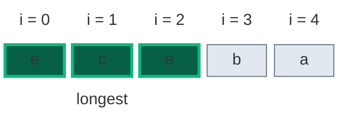
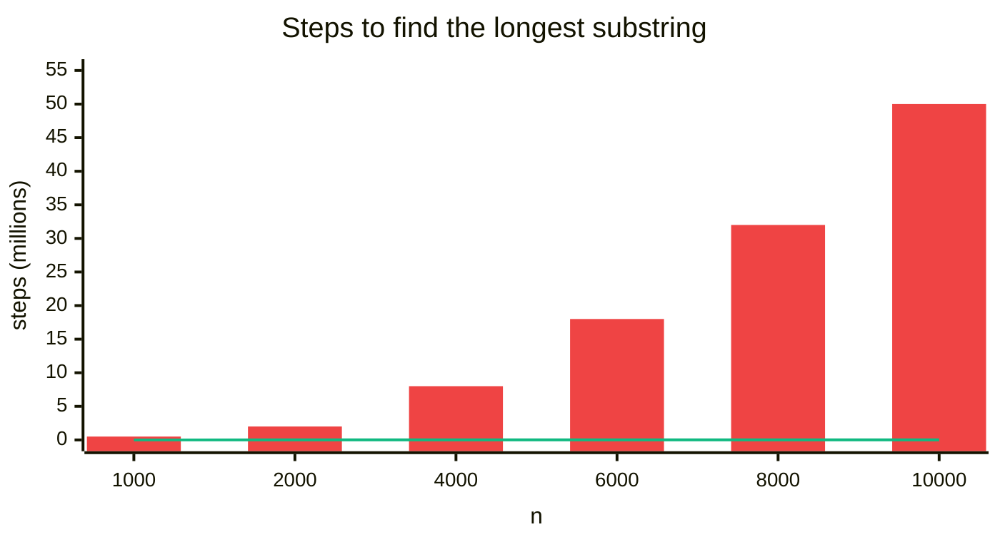
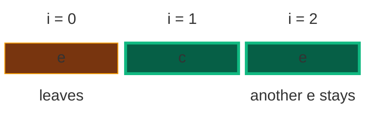
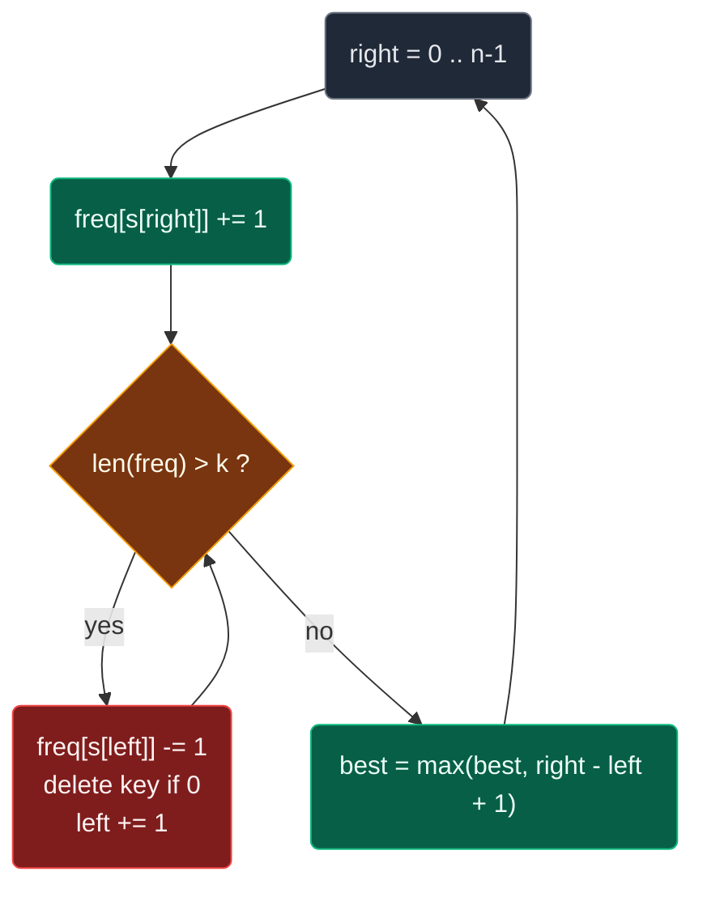
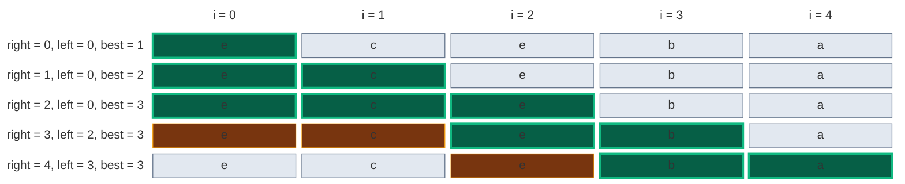

# 01. 340. Longest Substring With At Most K Distinct Characters

| Difficulty | Pattern | Source | Time | Space |
|:---:|:---:|:---:|:---:|:---:|
| **Medium** | At-Most-K Count Map | [340. Longest Substring With At Most K Distinct Characters](https://leetcode.com/problems/longest-substring-with-at-most-k-distinct-characters/) | `O(n)` | `O(k)` |

## 1. Problem Statement

Given a string `s` and a number `k`, return the length of the **longest substring** that has **at most `k` different characters**.

### Example

```text
Input:  s = "eceba", k = 2
Output: 3   ("ece" has only 'e' and 'c')
```



We use this same example in every section below.

Another LeetCode example:

```text
s = "aa", k = 1  -> 2   ("aa")
```

### Constraints

- `1 <= s.length <= 5 * 10^4`
- `0 <= k <= 50`

### What the constraints tell us (simple theory)

A **constraint** is the biggest input the judge will ever give you. A computer does about **100 million (10^8) simple steps per second**.

| Biggest input `n` | Steps you can afford | Ideas that fit |
|:---:|:---:|:---|
| up to ~5,000 | about `n^2` | Two nested loops |
| up to ~1,000,000 | about `n` | One loop, sliding window |

**For this problem:** `n` can be `5 × 10^4`.

- Trying every start and scanning right is about `n^2 / 2` = `1.25 × 10^9` steps in the worst case (when `k` covers every character, nothing stops early).
- The sliding window: at most `2n` = `10^5` steps.

**How the work grows** (worst case: nothing stops early; counted by running code). Red bars = brute force steps, green line = sliding window steps.



| `n` | Brute force steps | Sliding window steps |
|:---:|:---:|:---:|
| 1,000 | 500,500 | 1,000 |
| 2,000 | 2,001,000 | 2,000 |
| 4,000 | 8,002,000 | 4,000 |
| 6,000 | 18,003,000 | 6,000 |
| 8,000 | 32,004,000 | 8,000 |
| 10,000 | 50,005,000 | 10,000 |

## 2. Core Theory

### The parent problem of this folder

This is the **template** for the whole "At Most" section. The others are this problem in disguise:

| Problem | What it really asks | Relation to 340 |
|:---|:---|:---|
| **340** At Most K Distinct | longest substring, `distinct <= k` | the template |
| [159](02.%20159.%20Longest%20Substring%20with%20At%20Most%20Two%20Distinct%20Characters.md) At Most Two Distinct | longest substring, `distinct <= 2` | `k = 2` |
| [904](../02.%20Basic/04.%20904.%20Fruit%20Into%20Baskets.md) Fruit Into Baskets | longest subarray, `distinct <= 2` | `k = 2`, numbers instead of letters |

Learn this one template and all three are solved.

**How to spot it:** longest + substring (contiguous) + at most → variable sliding window + count map. "At most" also means: if a window is valid, every smaller window inside it is valid, so shrinking from the left always helps.

### What to remember about the window

The window is valid when `number of different characters <= k`. A **count map** answers "how many different characters?" instantly:

```text
freq: character -> how many times it is inside the window
len(freq) = number of different characters
```

### Why a count map, not a set

When `left` moves off a character, another copy may still be inside:



In `"ece"`, `left` leaves an `e` (orange), but another `e` is still inside. A count map just lowers `e` from 2 to 1 and keeps it. Only when a count reaches `0` is the character really gone.

### The template

1. **Expand:** `freq[s[right]] += 1`
2. **Shrink:** while `len(freq) > k`: lower `freq[s[left]]`; **if it is 0, delete the key**; move `left`.
3. **Record:** `best = max(best, right - left + 1)`

**Deleting the zero-count key is required.** `len(freq)` is the number of different characters only if the map holds exactly the characters inside the window. A key stuck at `0` is a character that already left; it makes `len(freq)` too big, the window keeps shrinking for no reason, and the answer comes out too small.



**Why `O(n)`:** `right` moves `n` times and `left` moves at most `n` times, never back.

**Space `O(k)`:** the map holds at most `k + 1` characters at any time.

## 3. Edge Cases

| Case | Input | Expected | Why it matters |
|:---|:---|:---:|:---|
| `k = 0` | `"abc"`, `k = 0` | `0` | Every character is too many; window is always empty |
| One character | `"a"`, `k = 1` | `1` | Smallest real case |
| `k` bigger than the distinct count | `"abc"`, `k = 5` | `3` | Never shrinks |
| All the same | `"aaaa"`, `k = 1` | `4` | Never shrinks |
| A character leaves and returns | `"abaccc"`, `k = 2` | `4` | `"accc"`: needs counts, not a set |
| `k = 1` | `"aabbbcc"`, `k = 1` | `3` | Longest run of one letter |

## 4. Brute Force: Try Every Start

### Idea

From each start, move right and collect characters in a set. When the set has more than `k` characters, stop. Keep the longest valid length.

### Code

```python
# Brute force: every start, extend until too many different characters
class SolutionBrute:

    # Main method
    def lengthOfLongestSubstringKDistinct(self, s: str, k: int) -> int:

        # Length of the string
        n = len(s)

        # Longest valid length so far
        best = 0

        # Every start index
        for start in range(n):

            # Different characters seen from this start
            seen = set()

            # Extend to the right
            for end in range(start, n):

                # Add this character
                seen.add(s[end])

                # Too many different characters: stop this start
                if len(seen) > k:

                    # Try the next start
                    break

                # Keep the longest
                best = max(best, end - start + 1)

        # Longest valid length
        return best
```

### Complexity

| Measure | Complexity | Why |
|:---|:---:|:---|
| **Time** | `O(n^2)` | Every start may scan far to the right |
| **Space** | `O(k)` | The set has at most `k + 1` characters |

## 5. Optimal Approach: Sliding Window + Count Map

### Idea

Keep a window with at most `k` different characters and a count map of what is inside. Add the new character; while there are more than `k` different characters, remove from the left (deleting a key at 0); then record the length.

### Visual Walkthrough (Story Version)

**The story:** Kids walk into a photo booth from the right, one at a time. Each kid wears a colour shirt (`e`, `c`, `b`, `a`). The booth allows **at most 2 shirt colours** in the photo. If a third colour comes in, kids leave from the **left** until one colour is completely gone.

**How to read the pictures:** green = kids in the booth, orange = kids who just left, grey = outside. The label row shows the colour counts.


| Step (`right`) | New shirt | Left the booth | Colour counts | Booth | Best |
|:---:|:---:|:---|:---|:---:|:---:|
| 0 | e | – | {e: 1} | e | 1 |
| 1 | c | – | {c: 1, e: 1} | ec | 2 |
| 2 | e | – | {c: 1, e: 2} | ece | **3** |
| 3 | b | e, c | {b: 1, e: 1} | eb | 3 |
| 4 | a | e | {a: 1, b: 1} | ba | 3 |

At step 3 the first `e` left, but `e` was still in the booth (count went 2 → 1). Only when `c` left did a colour disappear.

**What the story teaches**

| In the story | In the code |
|:---|:---|
| Shirt colours | characters |
| At most 2 colours | `len(freq) <= k` |
| Colour counts | `freq` |
| A colour fully leaves | `del freq[ch]` when the count is 0 |
| Longest photo | `best` |

### Step-by-Step Example

Green = window after the step, orange = removed this step, grey = outside.



### Code

```python
# Optimal: sliding window with a count map
class Solution:

    # Main method (trace is optional and only used by the tests)
    def lengthOfLongestSubstringKDistinct(self, s: str, k: int, trace: list = None) -> int:

        # Character -> how many times it is inside the window
        freq = {}

        # Left edge of the window
        left = 0

        # Longest valid length so far
        best = 0

        # Add one character at a time
        for right in range(len(s)):

            # Count the new character
            freq[s[right]] = freq.get(s[right], 0) + 1

            # Too many different characters: shrink from the left
            while len(freq) > k:

                # The character leaving the window
                out = s[left]

                # One fewer copy inside
                freq[out] -= 1

                # No copies left: the character is gone
                if freq[out] == 0:

                    # Required, or len(freq) stays too big
                    del freq[out]

                # Move the left edge
                left += 1

            # The window is valid: record its length
            best = max(best, right - left + 1)

            # Save (right, left, counts, best) for the tests
            if trace is not None:

                # One entry per step
                trace.append((right, left, dict(sorted(freq.items())), best))

        # Longest valid length
        return best


# Lazy version: shrink at most once, width never shrinks
class SolutionLazy:

    # Main method
    def lengthOfLongestSubstringKDistinct(self, s: str, k: int) -> int:

        # Character -> count inside the window
        freq = {}

        # Left edge of the window
        left = 0

        # Add one character at a time
        for right in range(len(s)):

            # Count the new character
            freq[s[right]] = freq.get(s[right], 0) + 1

            # Too many: shrink by exactly one
            if len(freq) > k:

                # The character leaving the window
                out = s[left]

                # One fewer copy inside
                freq[out] -= 1

                # No copies left
                if freq[out] == 0:

                    # Remove the key
                    del freq[out]

                # Move the left edge once
                left += 1

        # Final width is the best length
        return len(s) - left


# Import random for the agreement tests
import random

# Our example, traced step by step
trace = []

# Run with the trace on
assert Solution().lengthOfLongestSubstringKDistinct("eceba", 2, trace) == 3

# (right, left, counts, best) after each step
assert trace == [(0, 0, {"e": 1}, 1), (1, 0, {"c": 1, "e": 1}, 2), (2, 0, {"c": 1, "e": 2}, 3), (3, 2, {"b": 1, "e": 1}, 3), (4, 3, {"a": 1, "b": 1}, 3)]

# LeetCode example 2
assert Solution().lengthOfLongestSubstringKDistinct("aa", 1) == 2

# k = 0: nothing fits
assert Solution().lengthOfLongestSubstringKDistinct("abc", 0) == 0

# One character
assert Solution().lengthOfLongestSubstringKDistinct("a", 1) == 1

# k bigger than the distinct count
assert Solution().lengthOfLongestSubstringKDistinct("abc", 5) == 3

# All the same
assert Solution().lengthOfLongestSubstringKDistinct("aaaa", 1) == 4

# A character leaves and returns
assert Solution().lengthOfLongestSubstringKDistinct("abaccc", 2) == 4

# k = 1: longest run of one letter
assert Solution().lengthOfLongestSubstringKDistinct("aabbbcc", 1) == 3

# All versions agree on random strings
for _ in range(500):

    # Random string with few letters
    s = "".join(random.choice("abcd") for _ in range(random.randint(1, 15)))

    # Random k
    k = random.randint(0, 5)

    # Brute force answer
    expected = SolutionBrute().lengthOfLongestSubstringKDistinct(s, k)

    # Both window versions must match
    assert Solution().lengthOfLongestSubstringKDistinct(s, k) == SolutionLazy().lengthOfLongestSubstringKDistinct(s, k) == expected

# Biggest input runs fast
assert Solution().lengthOfLongestSubstringKDistinct("ab" * 25000, 2) == 50000

# All checks passed
print("All tests passed")
```

**About `trace`:** it is only for the tests. LeetCode calls `lengthOfLongestSubstringKDistinct(s, k)` and the code works the same.

**The lazy version** shrinks at most once per step and returns `len(s) - left`. The window may be invalid for a while, but it never grows while invalid, so its final width is the best length (same idea as in [1004](../02.%20Basic/03.%201004.%20Max%20Consecutive%20Ones%20III.md)). It only works for "longest" questions; for counting or exact-`k` problems use the `while` version.

### Complexity

| Approach | Time | Space |
|:---|:---:|:---:|
| Brute force | `O(n^2)` | `O(k)` |
| **Sliding window + count map** | **`O(n)`** (at most `2n` pointer moves) | **`O(k)`** |
| Lazy version | `O(n)` | `O(k)` |

## 6. Common Mistakes

| Mistake | What goes wrong | Fix |
|:---|:---|:---|
| Not deleting a key at 0 | `len(freq)` counts characters that left; answer too small | `if freq[ch] == 0: del freq[ch]` |
| Using a set | Cannot tell if another copy is still inside | Count map |
| Shrinking at `len(freq) >= k` | `k` different characters are allowed | Shrink only at `> k` |
| Recording before the shrink | Records an invalid window | Record after the loop |
| Lazy `if` while still using `max(...)` | Measures invalid windows | `while` + `max`, or `if` + `return n - left` |

## 7. Interview Follow-ups

### Q1. How does this relate to 159 and 904?

**Answer:**
- 159 is this problem with `k = 2`.
- 904 is the same with `k = 2` on an array of numbers, wrapped in a story.

### Q2. How do you count substrings with at most `k` distinct characters?

**Answer:**
- Same window. After shrinking, every substring ending at `right` that starts inside the window is valid.
- Add `right - left + 1` each step.

### Q3. What about **exactly** `k` distinct characters?

**Answer:**
- For counting: `exactly(k) = atMost(k) - atMost(k - 1)`.
- That is the trick used in [992](../04.%20At%20Most%20Trick/03.%20992.%20Subarrays%20with%20K%20Different%20Integers.md).

### Q4. What if the string uses any Unicode characters?

**Answer:**
- Nothing changes: a dictionary works with any character.
- Space stays `O(k)`, since the map never holds more than `k + 1` keys.

### Q5. How do you return the substring itself?

**Answer:**
- When `best` improves, store `best_left = left`.
- Return `s[best_left : best_left + best]`.

## 8. Interview Explanation

> This is a longest contiguous window with an at-most condition, so I use a variable sliding window and a count map of characters inside it; the map's size is the number of different characters. For each new character on the right I increase its count. While the map has more than k keys, I lower the count of s[left], delete it when it reaches zero, and move left. Then I record right minus left plus one. Each pointer moves at most n times, so it is O(n) time, and the map never holds more than k plus one keys, so O(k) space. With k equal to 2 this is LeetCode 159 and Fruit Into Baskets.
